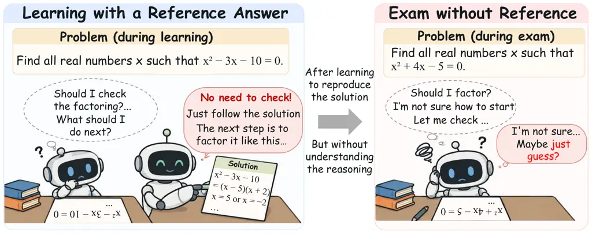
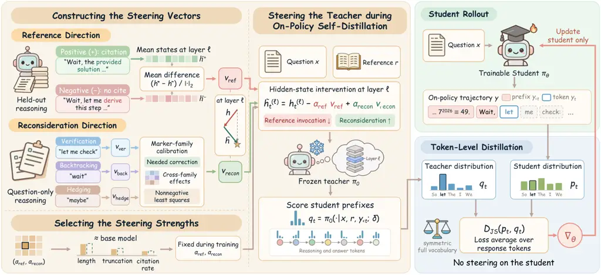

# Steering the Teacher: Improving On-Policy Self-Distillation for Thinking Models

Tiejin Chen   Xiaoou Liu   Hanyang Chen   Hua Wei Affiliation: Arizona
State University  {tchen169, xiaoouli, hchen478, hua.wei}@asu.edu  
^(\*) Equal Contribution

###### Abstract

On-policy self-distillation (OPSD) trains a student on its own reasoning
trajectories using token-level supervision from a reference-conditioned
teacher initialized from the same model. However, access to the
reference can induce teacher behaviors that undermine independent
reasoning in thinking models, leading to reference hallucinations, where
the student cites an unavailable reference to justify reasoning steps,
and reconsideration suppression, where the teacher discourages
verification and revision at uncertain steps. We introduce
Steered-Teacher OPSD (ST-OPSD) to jointly address these failure modes
through activation steering. ST-OPSD extracts two directions from
model-generated reasoning trajectories and applies them to the teacher’s
hidden states during distillation target computation, suppressing
reference-invoking behavior and encouraging reconsideration with
marker-family calibration. The student learns from the resulting teacher
distributions without being steered. Experiments on AIME and HMMT show
that ST-OPSD improves accuracy over vanilla OPSD and other interventions
while restoring reconsideration and reference-hallucination rates to
base-model levels.

## 1 Introduction

As illustrated in Figure 1, a student tutors a classmate through a
difficult math problem with access to the reference answer. When the
classmate pauses to check a step or hesitates about what to do next, the
tutor dismisses these efforts as unnecessary and tells them to follow
the provided solution, pointing to the reference answer to prescribe the
next step without explaining why it works. The classmate may learn to
reproduce the solution without understanding the reasoning behind it or
how to apply it to new problems. During an exam without the reference
answer, they may lack an independent reasoning strategy, skip necessary
checks, and ultimately resort to guessing.



Figure 1: An analogy of reference-conditioned supervision in OPSD: a
tutor prescribes solution steps and discourages verification,
potentially leaving the student unable to reason independently on new
problems without a reference answer.

Language models face a similar challenge in on-policy self-distillation
(OPSD). A student generates reasoning from the question alone, while a
teacher initialized from the same model additionally receives a
reference solution and provides token-level supervision along the
student’s trajectory \[1\]. This trains the student on contexts
encountered during its own generation \[2, 3\], but
reference-conditioned supervision may also transfer behaviors that
undermine independent reasoning.

Specifically, there are two teacher behaviors that contribute to
performance degradation in thinking models under OPSD. First, the
teacher invokes privileged information through phrases such as “The
example solution uses…”. The student learns to imitate these citations
despite lacking access to the reference, producing reference
hallucinations: reasoning steps justified by an unseen solution rather
than independent derivation. These hallucinations manifest
reference-induced shortcuts \[4, 5\]. Second, knowing the answer leads
the teacher to assign low probabilities to reconsideration markers at
uncertain branching points \[6, 7\]. The resulting reconsideration
suppression encourages the student to continue confidently \[6, 8\],
shortening reasoning without corresponding accuracy gains and degrading
performance under longer reasoning budgets \[6\].

We introduce Steered-Teacher OPSD (ST-OPSD), which addresses reference
hallucinations and reconsideration suppression through activation
steering, a technique that changes a model’s behavior by adding
directions to its hidden states \[9, 10\]. We extract two directions
from the model’s own reasoning trajectories: a _reference direction_
that distinguishes reference-invoking steps from independent reasoning,
and a _reconsideration direction_ that distinguishes sentence boundaries
followed by reconsideration markers from other boundaries. While the
teacher scores the students’ on-policy trajectories, ST-OPSD subtracts
the reference direction and adds the reconsideration direction to the
teacher’s hidden states. The resulting next-token distributions serve as
distillation targets. The student itself is never steered and learns
through parameter updates. Experiments on AIME and HMMT show that
ST-OPSD improves accuracy over both vanilla OPSD and other baselines,
while restoring the student model’s reconsideration frequency and
reference-hallucination rate to base-model levels.

Overall, our contributions are:

- •
  We introduce ST-OPSD, a teacher-steering framework that uses two
  trajectory-derived directions to mitigate the reference hallucinations
  and reconsideration suppression in OPSD.
- •
  We demonstrate that ST-OPSD improves accuracy on AIME and HMMT while
  restoring the student’s reconsideration and reference-hallucination
  rates to base-model levels.
- •
  We show that combining both steering directions achieves the strongest
  results. We further show that ST-OPSD achieves higher accuracy than
  random steering, teacher prompting, and direct student steering at
  inference time.

## 2 Related Work

#### On-policy Self-Distillation.

On-policy distillation provides token-level teacher supervision on
student-generated prefixes, aligning the training states with the
student’s evolving policy \[2, 3\]. On-policy self-distillation (OPSD)
retains this supervision mechanism while using a privileged version of
the model itself as the teacher. OPSD uses a privileged version of the
model as the teacher, with prior work exploring different sources of
privileged guidance, such as guidance or hints and teacher-student
training designs \[1, 11, 12, 13, 14, 15\]. The different designs expand
how privileged guidance is obtained and maintained, while leaving its
suitability as supervision for an unprivileged student an important
concern. Though OPSD achieves better performance for instruction models,
for thinking models, a reference-conditioned teacher can introduce two
related risks. First, it can suppress hesitation, self-correction, and
exploration, altering the student’s deliberative behavior \[8, 6\].
Second, it can favor answer-dependent shortcuts that are unavailable to
the student at inference \[5, 4\]. Students trained under such
supervision can inherit shorter reasoning traces and perform worse
\[6\]. Meanwhile, reduced hesitation and reconsideration could also be
associated with poorer out-of-distribution generalization \[8\]. Recent
work has explored alternative ways of constructing supervision signals
from privileged teachers. OGLS-SD \[16\] contrasts teacher logits
conditioned on successful and failed rollouts to reduce shared
privileged-conditioning biases and improve outcome-discriminative
guidance. Purified OPSD \[4\] targets answer-dependent shortcuts by
subtracting reference-only log probabilities from those of the
question-and-reference-conditioned teacher to form a new training
target. RLSD \[17\] tries to address reference leakage at the objective
level by using log-probability differences to reweight verifier-derived
advantages. In contrast to these approaches, which modify supervision at
the objective level, we intervene directly in the privileged teacher’s
hidden states to discourage reference-invoking behavior and preserve
reconsideration during on-policy distillation. Our steering-vector
approach also provides more direct and fine-grained control over these
behaviors through separately adjustable steering strengths.

#### Steering Vectors.

Steering vectors control language-model behavior by intervening in
hidden representations \[9, 18, 10, 19\]. Empirical studies identify
approximately linear directions associated with certain semantic and
behavioral attributes \[9, 19\]. A common construction takes the
difference between mean activations from examples that differ in the
target behavior \[10, 19\]. Beyond behavioral directions, function
vectors capture task-related representations \[20\], while task
arithmetic explores the composition of task-specific updates in
parameter space \[21\]. Subsequent studies examine steering reliability
\[22\], refine vectors with sparse autoencoders \[23\], and develop
conceptor-based activation transformations \[24\]. Feedback controllers
further adapt interventions during generation \[25\]. Besides,
applications extend to test-time optimization, visual understanding, and
reasoning \[26, 27, 28\]. In this paper, instead of using the steering
vector in inference, we jointly apply steering vectors to a privileged
teacher during target computation to investigate how to reduce reference
dependence and preserve hesitation during training state, shaping
on-policy supervision for thinking models.

## 3 Method



Figure 2: Overview of the ST-OPSD framework. We construct steering
vectors and apply them to the teacher to reduce reference invocation and
encourage reconsideration during on-policy self-distillation. The
student learns from the steered teacher while generating reasoning from
the question alone.

With the answer in the prompt, the teacher might choose to cite the
reference directly and discourage reconsideration. Following the
teacher, the student will also learn to cite a reference and skip
reconsideration, which makes it harder to solve new problems
independently when no reference answer is available. The key idea is to
restore the teacher’s support for independent reasoning and
reconsideration. However, prompt instructions alone provide limited
control over these behaviors. ST-OPSD therefore uses steering vectors to
control these behaviors by directly modifying the teacher’s hidden
states \[10\]. We will introduce how to construct the steering vector
and how the steering vector will be used in OPSD next.

### 3.1 Constructing the Steering Vectors

To promote these two behaviors in the teacher, we construct two steering
directions. One supports independent reasoning by discouraging reference
citation, while the other encourages reconsideration. Steering vector is
motivated by the observation that behavioral tendencies can be encoded
as approximately linear directions in a model’s hidden-state space
\[10\]. Shifting hidden states along these directions can therefore
promote or suppress the corresponding behaviors. A common way to
estimate such a direction is to take the difference between the mean
hidden states of examples that exhibit the target behavior and those
that do not.

To construct the steering vector, we use the base model $`\pi_{0}`$ to
generate reasoning trajectories on problems held out from OPSD training.
These trajectories provide positive and negative examples of the
behaviors we aim to control. Positive examples contain the target
behavior and negative examples does not contain. How to obtain and
select these examples will be described later.

For each positive or negative example $`i`$, we extract the hidden state
$`h_{i,t_{i}}^{(\ell)}`$ at the output of layer $`\ell`$, where
$`t_{i}`$ is the token position selected for that example. Let
$`\mathcal{I}^{+}`$ and $`\mathcal{I}^{-}`$ denote the index sets of
positive and negative examples, respectively. We then average the
selected token states within each group to obtain a representative
activation for each group, reducing the influence of variation across
individual examples:

```math
\displaystyle\bar{h}^{+} \displaystyle=\frac{1}{|\mathcal{I}^{+}|}\sum_{i\in\mathcal{I}^{+}}h_{i,t_{i}}^{(\ell)},\quad\bar{h}^{-} \displaystyle=\frac{1}{|\mathcal{I}^{-}|}\sum_{i\in\mathcal{I}^{-}}h_{i,t_{i}}^{(\ell)}. \tag{1}
```

Since the two groups differ in whether the target behavior is present
\[9, 18\], we use their mean difference to estimate the corresponding
behavioral direction and normalize it to obtain a unit steering vector:

```math
d=\bar{h}^{+}-\bar{h}^{-},\quad u=\frac{d}{\lVert d\rVert_{2}}. \tag{2}
```

Normalization allows us to specify the steering direction and
intervention strength separately.

#### Reference direction.

To suppress the teacher’s reference-citing behavior, we construct this
direction from its own reasoning trajectories. Broadly suppressing
reference-related activations could also weaken the teacher’s use of
privileged information. We therefore focus on reference citations after
reconsideration. Within these segments, we identify explicit reference
citations through pattern matching against expressions such as “example
solution,” “provided solution,” and “in the example.” Segments
containing a matched expression serve as positive examples, while
segments without a match serve as negative examples. After getting the
positive and negative examples, we can obtain $`v_{ref}`$ using eq. 2.

#### Reconsideration direction.

To restore the teacher’s support for reconsideration, we use reasoning
trajectories generated by the base model $`\pi_{0}`$ without the
reference, which still contains the ability to reconsider. Following
Kaur et al. \[6\], we identify reconsideration through three marker
families, including verification (e.g., “let me check”), backtracking
(e.g., “wait”), and hedging (e.g., “maybe”). For each reconsideration
family $`f`$, sentences beginning with one of its markers serve as
positive examples. All families share a negative pool of sentences
beginning with none of the markers in our inventory. Generic planning
expressions such as “let me think” also signal deliberation, so we
exclude sentences beginning with these expressions from the negative
pool. Using eq. 2, we construct a unit direction $`v_{f}`$ for each
family separately, so that their relative contributions are not
determined by their sample counts. We then combine these directions with
nonnegative weights calibrated to bring the teacher’s marker
probabilities closer to those of the base model without the reference.
To determine the combination weights, we first measure the probability
correction needed for the teacher to match the question-only base model
on each marker family, using the same held-out reasoning prefixes. We
then perturb the teacher along each family direction separately and
measure the resulting probability changes across all three families. We
fit nonnegative weights by least squares so that the weighted sum of
these measured effects approximates the required correction. Finally, we
normalize the weighted sum of the family directions to obtain
$`v_{\mathrm{recon}}`$.

### 3.2 Steering the Teacher during On-Policy Self-Distillation

We next use the two constructed steering directions to modify the
teacher’s supervision during OPSD. At each iteration, the student
generates reasoning trajectories without access to the reference. The
teacher then scores these trajectories with access to the reference
solution, while its hidden states are steered to discourage reference
citation and encourage reconsideration. The resulting token
distributions serve as distillation targets for updating the student.

When the teacher scores a student-generated trajectory, we modify its
hidden state at the output of layer $`\ell`$ as:

```math
\widetilde{h}_{t}^{(\ell)}=h_{t}^{(\ell)}-\alpha_{\mathrm{ref}}v_{\mathrm{ref}}+\alpha_{\mathrm{recon}}v_{\mathrm{recon}}, \tag{3}
```

where $`\alpha_{\mathrm{ref}},\alpha_{\mathrm{recon}}\geq 0`$ control
the intervention strengths. Both directions point toward the behaviors
represented by their positive examples. We therefore subtract
$`v_{\mathrm{ref}}`$ to suppress reference citation and add
$`v_{\mathrm{recon}}`$ to promote reconsideration. The intervention
applies throughout the response, including positions that predict
reasoning and final-answer tokens.

#### Selecting the steering strengths.

To set the intervention strengths in eq. 3, we evaluate candidate pairs
on a small held-out set, separate from the data used for steering-vector
construction and OPSD training. For each pair, we generate teacher
responses with both directions active and compare them with responses
from the base model on the same problems under the same token budget.
Excessive reconsideration steering can produce overly long responses. We
therefore select strengths that keep the teacher’s average response
length and truncation rate close to those of the base model. The
selected strengths should also reduce reference citation after
reconsideration to approximately the base model’s rate as well. We
measure this citation rate as the fraction of marker occurrences
followed by a matched reference expression. The selected strengths
remain fixed throughout OPSD training.

#### Learning from the steered teacher.

With the steering strengths fixed, we train the student using
token-level supervision from the steered teacher. At training step
$`k`$, we sample a batch of problems $`\{(x_{i},r_{i})\}_{i=1}^{B}`$,
where $`x_{i}`$ is the question and $`r_{i}`$ is its reference solution.
The current student generates a response
$`y_{i}\sim\pi_{\theta_{k}}(\cdot\mid x_{i})`$ for each question. Let
$`\delta=-\alpha_{\mathrm{ref}}v_{\mathrm{ref}}+\alpha_{\mathrm{recon}}v_{\mathrm{recon}}`$
denote the combined hidden-state perturbation. Along each sampled
trajectory, the student and the steered teacher compute next-token
distributions conditioned on the same response prefix,

```math
\displaystyle p_{i,t} \displaystyle=\pi_{\theta}(\cdot\mid x_{i},y_{i,<t}), \tag{4}
```

```math
\displaystyle q_{i,t} \displaystyle=\pi_{0}(\cdot\mid x_{i},r_{i},y_{i,<t};\delta),
```

where $`\delta`$ specifies the intervention applied to the frozen
teacher’s hidden states according to eq. 3. The resulting distribution
$`q_{i,t}`$ serves as the distillation target for the student at each
step.

We then train the student using the original OPSD, which matches these
teacher distributions by minimizing the symmetric Jensen–Shannon
divergence over the full vocabulary. With
$`\mu_{i,t}=\tfrac{1}{2}(p_{i,t}+q_{i,t})`$, the divergence will be:

```math
D_{\mathrm{JS}}(p_{i,t},q_{i,t})=\frac{1}{2}\mathrm{KL}(p_{i,t}\,\|\,\mu_{i,t})+\frac{1}{2}\mathrm{KL}(q_{i,t}\,\|\,\mu_{i,t}). \tag{5}
```

For responses of lengths $`T_{i}=|y_{i}|`$, the training objective
averages this divergence over all generated reasoning and final-answer
tokens,

```math
\mathcal{L}_{k}(\theta)=\frac{\displaystyle\sum_{i=1}^{B}\sum_{t=1}^{T_{i}}D_{\mathrm{JS}}(p_{i,t},q_{i,t})}{\displaystyle\sum_{i=1}^{B}T_{i}}. \tag{6}
```

During each update, we hold the sampled trajectories and teacher
distributions fixed and optimize only the student’s parameters. The
updated student then generates the next batch of on-policy trajectories.
The student learns through these parameter updates and uses no steering
during training or inference.

## 4 Experiments

We conduct comprehensive experiments to evaluate the effectiveness of
ST-OPSD, examine how teacher steering shapes student reasoning, and
compare it with alternative interventions. Specifically, our experiments
are organized around the following research questions:

RQ1: Does ST-OPSD improve student reasoning performance and behavior
across models and training settings?

RQ2: How do individual steering components and alternative interventions
affect the performance of ST-OPSD?

RQ3: How does ST-OPSD compare with other methods in computational
efficiency?

|          |               |                  |                      |                    |                  |                      |                    |                  |                      |                       |                  |                      |                    |
| -------- | ------------- | ---------------- | -------------------- | ------------------ | ---------------- | -------------------- | ------------------ | ---------------- | -------------------- | --------------------- | ---------------- | -------------------- | ------------------ |
| Model    | Method        | AIME24           |                      |                    | AIME25           |                      |                    | HMMT25           |                      |                       | Avg.             |                      |                    |
|          |               | Acc $`\uparrow`$ | Hes./1k $`\uparrow`$ | Ref $`\downarrow`$ | Acc $`\uparrow`$ | Hes./1k $`\uparrow`$ | Ref $`\downarrow`$ | Acc $`\uparrow`$ | Hes./1k $`\uparrow`$ | Ref $`\downarrow`$    | Acc $`\uparrow`$ | Hes./1k $`\uparrow`$ | Ref $`\downarrow`$ |
| Qwen3-4B | Base          | 70.8             | 12.9                 | 10.8               | 65.8             | 13.1                 | 15.8               | 41.7             | 15.1                 | 14.2                  | 59.4             | 13.7                 | 13.6               |
|          | Vanilla OPSD  | 69.2             | 13.4                 | 59.2               | 56.7             | 12.9                 | 68.3               | 31.7             | 15.4                 | 72.5                  | 52.5             | 13.9                 | 66.7               |
|          | Purified OPSD | 70.8             | 14.1                 | 10.0               | 64.2             | 13.1                 | 17.5               | 43.3             | 18.7                 | 8.3                   | 59.4             | 15.3                 | 11.9               |
|          | Random SV     | 69.2             | 13.2                 | 56.7               | 49.2             | 13.3                 | 78.3               | 31.7             | 16.6                 | 79.2                  | 50.0             | 14.4                 | 71.4               |
|          | ST-OPSD       | 74.2             | 13.8                 | 12.5               | 64.2             | 14.4                 | 14.2               | 45.0             | 16.8                 | 12.5                  | 61.1             | 15.0                 | 13.1               |
| Qwen3-8B | Base          | 79.2             | 13.8                 | 15.0               | 70.0             | 14.1                 | 20.0               | 46.7             | 14.7                 | 25.0                  | 65.3             | 14.2                 | 20.0               |
|          | Vanilla OPSD  | 75.0             | 13.5                 | 55.0               | 58.3             | 13.2                 | 62.5               | 43.3             | 14.2                 | 74.2                  | 58.9             | 13.6                 | 63.9               |
|          | Purified OPSD | 75.8             | 14.1                 | 13.3               | 67.5             | 14.6                 | 22.5               | 49.2             | 14.7                 | 25.0                  | 64.2             | 14.5                 | 20.3               |
|          | Random SV     | 76.7             | 13.7                 | 50.0               | 58.3             | 14.4                 | 76.7               | 45.0             | 15.4                 | 70.8                  | 60.0             | 14.5                 | 65.8               |
|          | ST-OPSD       | 83.3             | 15.6                 | 15.0               | 65.8             | 15.9                 | 23.3               | 49.2             | 18.9                 | 19.2                  | 66.1             | 16.8                 | 19.2               |
| OLMo-7B  | Base          | 77.5             | 12.6                 | 19.2               | 67.5             | 12.2                 | 20.0               | 46.7             | 12.9                 | 22.5                  | 63.9             | 12.6                 | 20.6               |
|          | Vanilla OPSD  | 73.3             | 12.1                 | 30.8               | 64.2             | 12.1                 | 33.3               | 44.2             | 12.9                 | 32.5                  | 60.6             | 12.4                 | 32.2               |
|          | Purified OPSD | 75.0             | 12.3                 | 21.7               | 68.3             | 12.4                 | 26.7               | 44.2             | 12.7                 | 27.5                  | 62.5             | 12.5                 | 25.3               |
|          | Random SV     | 70.8             | 13.6                 | 23.3               | 65.0             | 13.1                 | 31.7               | 36.7             | 12.2                 | 31.7                  | 57.5             | 13.0                 | 28.9               |
|          | ST-OPSD       | 75.8             | 13.8                 | 16.7               | 68.3             | 13.6                 | 8.3                | 45.8             | 14.2                 | 15.0                  | 63.3             | 13.9                 | 13.3               |

Table 1: Results on three mathematical reasoning benchmarks. Acc.
denotes avg@4 accuracy (%), Hes./1k denotes the number of hesitation
markers per 1,000 generated tokens, and Ref. (%) denotes the percentage
of responses containing reference citations. Across all evaluated
models, ST-OPSD improves average accuracy over Vanilla OPSD while
bringing hesitation frequency and reference-citation rates closer to
base-model levels.

### 4.1 Experimental Setting

#### Models

To test our method comprehensively, we evaluate ST-OPSD on four
different thinking models, including Qwen3-4B \[29\], Qwen3-8B \[29\],
and OLMo-7B-Thinking \[30\]. We evaluate models using the original OPSD
method \[1\], where the student is updated through distillation, while
the teacher remains frozen.

#### Datasets

Following previous work \[6\], we train all models on the filtered
mathematical subset of OpenThoughts \[31\]. We evaluate on AIME 24, AIME
25 \[32\], and HMMT 25 \[33\]. We reserve 64 OpenThoughts questions for
constructing all steering vectors and exclude them from training. To
assess the effect of the training dataset, we also train on Omni-Math
\[34\] and evaluate on the same benchmarks.

#### Configuration

We use the same LoRA \[35\] settings with a rank of 64, learning rate
$`2\times 10^{-5}`$ as the previous paper \[4\]. We also use an update
step of 200 and a batch size of 32. The training rollout uses vLLM
\[36\] with a temperature of $`1.0`$, top-$`p=1.0`$, and a maximum
generation length of 8,192 tokens. For evaluation, we sample four
responses per problem at temperature $`0.6`$ and top-$`p=0.95`$,
allowing up to 81,920 tokens per response, and we grade final answers
using math_verify \[37\] and report avg@4, the mean correctness over the
four responses per problem and across problems, for accuracy. We will
also report the frequency of hesitation words and mentions of answers in
the prompt to demonstrate the change of our methods for the trained
model. We compare ST-OPSD with Vanilla OPSD and Purified OPSD \[4\] and
use one Nvidia H100 for all experiments.

#### Steering details.

|          |                           |                             |                                             |
| -------- | ------------------------- | --------------------------- | ------------------------------------------- |
| Model    | $`\alpha_{\mathrm{ref}}`$ | $`\alpha_{\mathrm{recon}}`$ | $`\lVert v\rVert_{2}/\lVert out\rVert_{2}`$ |
| Qwen3-4B | 2.29                      | 9.50                        | 12.7                                        |
| Qwen3-8B | 4.25                      | 12.8                        | 8.9                                         |
| OLMo-7B  | 0.80                      | 3.50                        | 18.7                                        |

Table 2: Steering coefficients and vector norms for each model.

For the steering vector, we apply all directions at layer 22 for each
model we used. For each direction, we use a hold-out set of 64 questions
and sample 2 generations for one question and obtain positive and
negative samples. For the chosen $`\alpha_{\mathrm{ref}}`$ and
$`\alpha_{\mathrm{recon}}`$, we provide the detailed parameters in
table 2. The ratio $`\lVert v\rVert_{2}/\lVert out\rVert_{2}`$ indicates
the magnitude of the steering vector relative to the output activation.
For our selected steering vector, this ratio typically remains around
10%.

### 4.2 Effectiveness of ST-OPSD (RQ1)

We evaluate whether correcting reference citation and reconsideration
suppression in the teacher improves student learning. We compare ST-OPSD
with the base model, Vanilla OPSD, Purified OPSD, and Random SV using
Qwen3-4B, Qwen3-8B, and OLMo-7B on AIME24, AIME25, and HMMT25 using
OpenThoughts as the training set. We report avg@4 accuracy,
hesitation-marker frequency (Hes./1k), and reference-citation rate
(Ref.) to examine both task performance and the behaviors learned during
distillation. We present our results in table 1 and we have the
following observation:

• ST-OPSD achieves higher average accuracy than Purified OPSD on all
three models, alongside clear improvements over Vanilla OPSD. It also
exceeds the base model on both Qwen models. On OLMo-7B, ST-OPSD nearly
matches the base model, recovering most of the accuracy lost under
Vanilla OPSD. We hypothesize that the reference provides limited
additional reasoning benefits to the OLMo teacher, restricting further
gains beyond the base model. These results demonstrate that ST-OPSD
improves the effectiveness of OPSD.

• Vanilla OPSD makes the student cite the reference much more often. On
HMMT25, over 70% of responses from both Qwen models cite the reference,
far above the base-model rates. ST-OPSD brings the average citation rate
back to levels close to or below the base model on all three models.
These results demonstrate that ST-OPSD effectively suppresses
reference-citing behavior in the student.

• ST-OPSD produces higher hesitation behavior than the base model on all
three models, consistent with encouraging reconsideration during
distillation. However, marker frequency alone does not determine
accuracy. On Qwen3-4B, Purified OPSD has a higher hesitation frequency
and a lower reference-citation rate than ST-OPSD, yet achieves lower
accuracy. These results indicate that the behavioral metrics are useful
diagnostics but do not fully capture the quality of the reasoning
learned by the student.

• Random SV that has the same norm as our final SV fails to reproduce
the accuracy gains of ST-OPSD and can perform even worse than Vanilla
OPSD. Thus, modifying the teacher’s hidden states alone is insufficient
to improve distillation. The advantage of ST-OPSD supports constructing
steering directions that specifically target reference citation and
reconsideration.

### 4.3 Ablation Studies (RQ2)

In this section, we examine how the supervision design and training data
affect ST-OPSD. All experiments use Qwen3-4B and are evaluated on
AIME24, AIME25, and HMMT25.

(a) Method variants

(b) Omni-Math training

(c) Combining with data selection

Figure 3: Ablation studies with Qwen3-4B. (a) Method variants under the
default training setting. Base + SV applies inference-time steering,
Prompted OPSD uses teacher instructions, and Recon. only and Ref. only
apply each steering direction separately. (b) Vanilla OPSD and ST-OPSD
trained on Omni-Math. (c) Combining ST-OPSD with the selected subset
improves upon the previous best ST-OPSD result, obtained with the
default training data. Selected denotes examples where the teacher
contributes new reasoning ideas. Panels (a) and (c) report mean accuracy
across AIME24, AIME25, and HMMT25. All scores are percentages.

#### Effects of steering variants.

ST-OPSD addresses reference citation and reconsideration suppression
through two teacher-side steering directions. We examine the benefit of
addressing both behaviors and compare our design with direct
inference-time steering and teacher prompting. In detail, we evaluate
the base model, the base model with inference-time steering, Vanilla
OPSD, OPSD with teacher instructions, ST-OPSD with only the
reconsideration direction, and the full method. The teacher’s
instructions encourage reconsideration and understanding of the
reference while discouraging direct reference citation, and prompt OPSD
to test whether instructions can provide similar benefits by asking to
encourage reconsideration and understanding of the reference directly.
Finally, inference-time steering tests whether the gains can be obtained
by applying steering directly to the base model during generation.
Figure 3 reports the results under the default training setting. We have
the following observations:

• Reconsideration-only or reference-only steering improves upon Vanilla
OPSD but remains below the base model and full ST-OPSD. Adding another
direction further improves performance and brings ST-OPSD above the base
model. Restoring reconsideration, therefore, partially recovers the
performance lost during distillation, while correcting the reference
citation provides an additional benefit. These results support
addressing both teacher behaviors together.

• Prompted OPSD performs worse than Vanilla OPSD. Explicitly requesting
the desired behaviors, therefore, does not yield better distillation.
This comparison supports the use of hidden-state interventions to obtain
more effective teacher supervision.

• Direct inference-time steering leaves the base model’s mean accuracy
nearly unchanged. ST-OPSD achieves a larger improvement, which is
retained in a student who uses no steering at inference.

#### Effects of training data.

We further examine whether ST-OPSD retains its advantage when the
training data change. We compare Vanilla OPSD and ST-OPSD when training
on Omni-Math and on a selected training subset in which the teacher
contributes new reasoning ideas. The latter setting tests whether
steering remains beneficial when training examples are selected for this
property. fig. 3(b) and (c) report the results, and we have the
following observations.

• ST-OPSD retains its advantage over Vanilla OPSD when training on
Omni-Math, with improvements across all three evaluation benchmarks.
This suggests that the benefit of correcting teacher supervision extends
beyond our default training setting and dataset.

• On the selected subset, ST-OPSD still outperforms Vanilla OPSD across
all three benchmarks. Vanilla OPSD remains below the base model in mean
accuracy, despite using examples selected for the teacher’s new
reasoning ideas. This suggests that the teacher’s contribution of new
reasoning alone does not guarantee improved student performance.

• On the selected subset, ST-OPSD achieves the highest mean accuracy
among all evaluated Qwen3-4B settings, reaching 64.2%. It outperforms
ST-OPSD trained on either the default data or Omni-Math. This suggests
that selecting examples with new teacher reasoning and correcting the
teacher’s supervision can complement each other to further improve
distillation.

### 4.4 Efficiency of ST-OPSD (RQ3)

ST-OPSD introduces hidden-state interventions during the training stage.
To evaluate the additional cost provided by ST-OPSD, we evaluate the
computational time of ST-OPSD by comparing its generation and training
time and token throughput with Vanilla OPSD and Purified OPSD. In
detail, we compare the computation speed and cost for them using OLMo-7B
and the OpenThought dataset over the 200 training steps. All runs are
compared with one Nvidia H100, and table 3 presents the comparison.
Overall, we have the following observation:

|               |               |        |                      |        |
| ------------- | ------------- | ------ | -------------------- | ------ |
|               | Time (s/step) |        | Throughput (token/s) |        |
| Method        | Gen.          | Train. | Gen.                 | Train. |
| Vanilla OPSD  | 181.2         | 71.0   | 850                  | 2,176  |
| ST-OPSD       | 214.2         | 86.7   | 845                  | 2,092  |
| Purified OPSD | 222.0         | 117.0  | 844                  | 1,602  |

Table 3: Efficiency comparison on OLMo. Gen. and Train. denote
generation and training, respectively. Lower time and higher throughput
indicate better efficiency. The results show that ST-OPSD roughly
maintains the speed.

• ST-OPSD achieves nearly identical generation throughput to Purified
OPSD and approximately 31% higher training throughput on the same
machine. These results demonstrate that ST-OPSD offers a more
computationally efficient alternative to Purified OPSD since Purified
OPSD requires two more forward pass during training.

• Although we provide the same output budget, with teacher steering, the
student in ST-OPSD tends to generate longer reasoning trajectories,
while Vanilla OPSD tends to produce shorter responses during training.
The resulting increase in tokens per step largely explains ST-OPSD’s
longer generation and training times.

• Generating the trajectories for steering-vector construction takes
approximately 15 minutes. Since the resulting vectors are reused
throughout training, this generation cost is amortized across all
training steps and adds only a small overhead relative to the
distillation run.

## 5 Conclusion

We introduce ST-OPSD, a teacher-steering framework that mitigates
reference hallucinations and reconsideration suppression in on-policy
self-distillation. ST-OPSD uses two trajectory-derived steering
directions to adjust the teacher’s distillation targets, while the
student learns through parameter updates without direct steering.
Experiments on AIME and HMMT demonstrate improved accuracy over vanilla
OPSD and other baselines, along with reconsideration and
reference-hallucination rates restored to base-model levels. These
findings suggest that shaping teacher supervision can improve
distillation while preserving behaviors that support independent
reasoning.

## References

- \[1\] S. Zhao, Z. Xie, M. Liu, J. Huang, G. Pang, F. Chen, and A.
  Grover (2026) Self-distilled reasoner: on-policy self-distillation for
  large language models. Cited by: §1, §2, §4.1.
- \[2\] R. Agarwal, N. Vieillard, Y. Zhou, P. Stanczyk, S. Ramos
  Garea, M. Geist, and O. Bachem (2024) On-policy distillation of
  language models: learning from self-generated mistakes. In
  International Conference on Learning Representations, Vol. 2024,
  pp. 21246–21263. Cited by: §1, §2.
- \[3\] Y. Gu, L. Dong, F. Wei, and M. Huang (2024) Minillm: knowledge
  distillation of large language models. In International Conference on
  Learning Representations, Vol. 2024, pp. 32694–32717. Cited by: §1,
  §2.
- \[4\] Z. Shen, J. Tong, S. Yan, C. Shen, H. Chen, W. Ye, X. Hu, R.
  Miao, H. Wang, J. Zhao, et al. (2026) Purified opsd: on-policy
  self-distillation without losing how to think. Cited by: §1, §2, §4.1.
- \[5\] S. Harne, C. Karkar, Y. Pandya, A. Awadallah, and A.
  Nambi (2026) Privileged, but biased: how pi-conditioned teachers break
  self-distillation. Cited by: §1, §2.
- \[6\] S. Kaur, N. Ri, Y. He, L. Fowl, and S. Arora (2026) Rethinking
  on-policy self-distillation for thinking models. Cited by: §1, §2,
  §3.1, §4.1.
- \[7\] K. Peng, C. Li, Y. Ouyang, Y. Yuan, and L. Ding (2026)
  Diagnosing and mitigating thinking collapse in on-policy
  self-distillation. arXiv preprint arXiv:2607.10805. Cited by: §1.
- \[8\] J. Kim, X. Luo, M. Kim, S. Lee, D. Kim, J. Jeon, D. Li, and Y.
  Yang (2026) Why does self-distillation (sometimes) degrade the
  reasoning capability of LLMs?. In Third Conference on Language
  Modeling, External Links:
  [Link](https://openreview.net/forum?id=Az7guis46K) Cited by: §1, §2.
- \[9\] A. M. Turner, L. Thiergart, G. Leech, D. Udell, J. J.
  Vazquez, U. Mini, and M. MacDiarmid (2023) Steering language models
  with activation engineering. arXiv preprint arXiv:2308.10248. Cited
  by: §1, §2, §3.1.
- \[10\] N. Rimsky, N. Gabrieli, J. Schulz, M. Tong, E. Hubinger, and A.
  Turner (2024) Steering llama 2 via contrastive activation addition. In
  Proceedings of the 62nd Annual Meeting of the Association for
  Computational Linguistics (Volume 1: Long Papers), L. Ku, A. Martins,
  and V. Srikumar (Eds.), Bangkok, Thailand, pp. 15504–15522. External
  Links: [Link](https://aclanthology.org/2024.acl-long.828/),
  [Document](https://dx.doi.org/10.18653/v1/2024.acl-long.828) Cited by:
  §1, §2, §3.1, §3.
- \[11\] I. Shenfeld, M. Damani, J. Hübotter, and P. Agrawal (2026)
  Self-distillation enables continual learning. In Forty-third
  International Conference on Machine Learning, External Links:
  [Link](https://openreview.net/forum?id=qA6FgH0nnZ) Cited by: §2.
- \[12\] J. Hübotter, F. Lübeck, L. D. Behric, A. Baumann, M.
  Bagatella, D. Marta, I. Hakimi, I. Shenfeld, T. K. Buening, C.
  Guestrin, and A. Krause (2026) Reinforcement learning via
  self-distillation. In Forty-third International Conference on Machine
  Learning, External Links:
  [Link](https://openreview.net/forum?id=QkfkxyRizZ) Cited by: §2.
- \[13\] E. Penaloza, D. Vattikonda, N. Gontier, A. Lacoste, L. Charlin,
  and M. Caccia (2026) Privileged information distillation for language
  models. In Forty-third International Conference on Machine Learning,
  External Links: [Link](https://openreview.net/forum?id=ebZcMQImhG)
  Cited by: §2.
- \[14\] Y. Chen, G. Guo, Z. Xu, and K. Liu (2026) Dualopsd: adaptive
  privileged teachers for on-policy self-distillation. Cited by: §2.
- \[15\] G. Zhang, J. Lyu, R. Sun, X. Yu, H. Zhao, Q. Ren, and S.
  Yan (2026) Latent on-policy self-distillation. Cited by: §2.
- \[16\] Y. Yang, X. Wang, and W. Zhang (2026) OGLS-sd: on-policy
  self-distillation with outcome-guided logit steering for llm
  reasoning. Cited by: §2.
- \[17\] C. Yang, C. Qin, Q. Si, M. Chen, N. Gu, D. Yao, Z. Lin, W.
  Wang, J. Wang, and N. Duan (2026) Self-distilled rlvr. Cited by: §2.
- \[18\] K. Li, O. Patel, F. Viégas, H. Pfister, and M.
  Wattenberg (2023) Inference-time intervention: eliciting truthful
  answers from a language model. Advances in Neural Information
  Processing Systems 36, pp. 41451–41530. Cited by: §2, §3.1.
- \[19\] A. Zou, L. Phan, S. Chen, J. Campbell, P. Guo, R. Ren, A.
  Pan, X. Yin, M. Mazeika, A. Dombrowski, et al. (2023) Representation
  engineering: a top-down approach to ai transparency. arXiv preprint
  arXiv:2310.01405. Cited by: §2.
- \[20\] E. Todd, M. Li, A. Sen Sharma, A. Mueller, B. Wallace, and D.
  Bau (2024) Function vectors in large language models. In International
  conference on learning representations, Vol. 2024, pp. 17282–17333.
  Cited by: §2.
- \[21\] G. Ilharco, M. T. Ribeiro, M. Wortsman, L. Schmidt, H.
  Hajishirzi, and A. Farhadi (2023) Editing models with task arithmetic.
  In The Eleventh International Conference on Learning Representations,
  External Links: [Link](https://openreview.net/forum?id=6t0Kwf8-jrj)
  Cited by: §2.
- \[22\] J. Braun, C. Eickhoff, D. Krueger, S. A. Bahrainian, and D.
  Krasheninnikov (2025) Understanding (un) reliability of steering
  vectors in language models. arXiv preprint arXiv:2505.22637. Cited by:
  §2.
- \[23\] A. Wang, X. Wu, D. Shu, Y. Ma, and N. Liu (2025) Enhancing llm
  steering through sparse autoencoder-based vector refinement. arXiv
  preprint arXiv:2509.23799. Cited by: §2.
- \[24\] J. Postmus and S. Abreu (2024) Steering large language models
  using conceptors: improving addition-based activation engineering.
  arXiv preprint arXiv:2410.16314. Cited by: §2.
- \[25\] D. V. Nguyen, H. M. Vu, N. Y. Pham, L. Zhang, and T. M.
  Nguyen (2025) Activation steering with a feedback controller. arXiv
  preprint arXiv:2510.04309. Cited by: §2.
- \[26\] X. Kang, D. Shi, and L. Chen (2026) Model whisper: steering
  vectors unlock large language models’ potential in test-time. In
  Proceedings of the AAAI Conference on Artificial Intelligence, Vol.
  40, pp. 31392–31400. Cited by: §2.
- \[27\] W. H. Gan, D. Fu, J. Asilis, O. Liu, D. Yogatama, V. Sharan, R.
  Jia, and W. Neiswanger (2025) Textual steering vectors can improve
  visual understanding in multimodal large language models. arXiv
  preprint arXiv:2505.14071. Cited by: §2.
- \[28\] C. Venhoff, I. Arcuschin, P. Torr, A. Conmy, and N.
  Nanda (2025) Understanding reasoning in thinking language models via
  steering vectors. arXiv preprint arXiv:2506.18167. Cited by: §2.
- \[29\] A. Yang, A. Li, B. Yang, B. Zhang, B. Hui, B. Zheng, B. Yu, C.
  Gao, C. Huang, C. Lv, et al. (2025) Qwen3 technical report. arXiv
  preprint arXiv:2505.09388. Cited by: §4.1.
- \[30\] D. Groeneveld, I. Beltagy, E. Walsh, A. Bhagia, R. Kinney, O.
  Tafjord, A. Jha, H. Ivison, I. Magnusson, Y. Wang, et al. (2024) OLMo:
  accelerating the science of language models. In Proceedings of the
  62nd annual meeting of the association for computational linguistics
  (volume 1: long papers), pp. 15789–15809. Cited by: §4.1.
- \[31\] E. Guha, R. Marten, S. Keh, N. Raoof, G. Smyrnis, H. Bansal, M.
  Nezhurina, J. Mercat, T. Vu, Z. Sprague, et al. (2026) Openthoughts:
  data recipes for reasoning models. In International Conference on
  Learning Representations, Vol. 2026, pp. 108059–108130. Cited by:
  §4.1.
- \[32\] Mathematical Association of America American invitational
  mathematics examination (aime). Note:
  [https://maa.org/maa-invitational-competitions/](https://maa.org/maa-invitational-competitions/)Accessed:
  2026-05-03 Cited by: §4.1.
- \[33\] M. Balunovic, J. Dekoninck, I. Petrov, N. Jovanović, and M.
  Vechev (2026) Matharena: evaluating llms on uncontaminated math
  competitions. Advances in Neural Information Processing Systems 38.
  Cited by: §4.1.
- \[34\] B. Gao, F. Song, Z. Yang, Z. Cai, Y. Miao, Q. Dong, L. Li, C.
  Ma, L. Chen, Z. Tang, et al. (2025) Omni-math: a universal olympiad
  level mathematic benchmark for large language models. In International
  Conference on Learning Representations, Vol. 2025, pp. 100540–100569.
  Cited by: §4.1.
- \[35\] E. J. Hu, yelong shen, P. Wallis, Z. Allen-Zhu, Y. Li, S.
  Wang, L. Wang, and W. Chen (2022) LoRA: low-rank adaptation of large
  language models. In International Conference on Learning
  Representations, External Links:
  [Link](https://openreview.net/forum?id=nZeVKeeFYf9) Cited by: §4.1.
- \[36\] W. Kwon, Z. Li, S. Zhuang, Y. Sheng, L. Zheng, C. H. Yu, J.
  Gonzalez, H. Zhang, and I. Stoica (2023) Efficient memory management
  for large language model serving with pagedattention. In Proceedings
  of the 29th symposium on operating systems principles, pp. 611–626.
  Cited by: §4.1.
- \[37\] H. Kydlíček (2025) Math-Verify: math verification library.
  External Links: [Link](https://github.com/huggingface/Math-Verify)
  Cited by: §4.1.

## Appendix A Hesitation and Reference Citation Markers

Figure 4 lists the hesitation marker inventory, grouped into
verification, backtracking, and hedging families.


Figure 4: Hesitation markers grouped into the three reconsideration
families used in ST-OPSD.

Figure 5 lists the reference-citation marker inventory. In the Answer
Statements group, is/was/says denotes three alternative forms.


Figure 5: Inventory of reference-citation markers grouped by expression
type.

## Appendix B Prompts

We provide the student and teacher prompt templates used in our
experiments, including the modified teacher prompt used in the Prompted
OPSD ablation. In these templates, {question} denotes the problem, and
{reference solution} denotes the reference solution available to the
teacher.

#### Student prompt.

The student receives only the question, without access to the reference
solution. We use this prompt for both on-policy generation during
training and evaluation.

{promptbox}

Student prompt question

#### Standard teacher prompt.

The teacher receives the question together with a reference solution
presented as an example response. The prompt asks the teacher to produce
its own response, including its reasoning. Vanilla OPSD and ST-OPSD use
the same teacher prompt. ST-OPSD additionally applies steering to the
teacher’s hidden states when scoring student-generated trajectories.

{promptbox}

Standard teacher prompt question This is an example for a response to
the question: reference solution Now answer with a response of your own,
including the thinking process.

#### Teacher prompt for Prompted OPSD.

To examine whether prompt instructions can encourage the desired teacher
behaviors, we append two requirements to the standard teacher prompt.
The first encourages the teacher to check its reasoning and reconsider
possible mistakes. The second asks it to reconsider without consulting
the reference and to avoid mentioning the reference in its response.
This template is used for the Prompted OPSD variant in our ablation
studies.

{promptbox}

Teacher prompt for Prompted OPSD question This is an example for a
response to the question: reference solution Now answer with a response
of your own, including the thinking process.

While reasoning, carefully double-check every step. If anything might be
wrong, stop, say so, and verify or recompute it before moving on. When
you pause to check or reconsider, do not look back at the example
response or compare against its answer; verify by recomputing it
yourself. Do not mention the example in your response.
