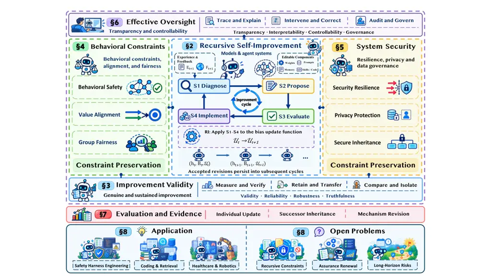
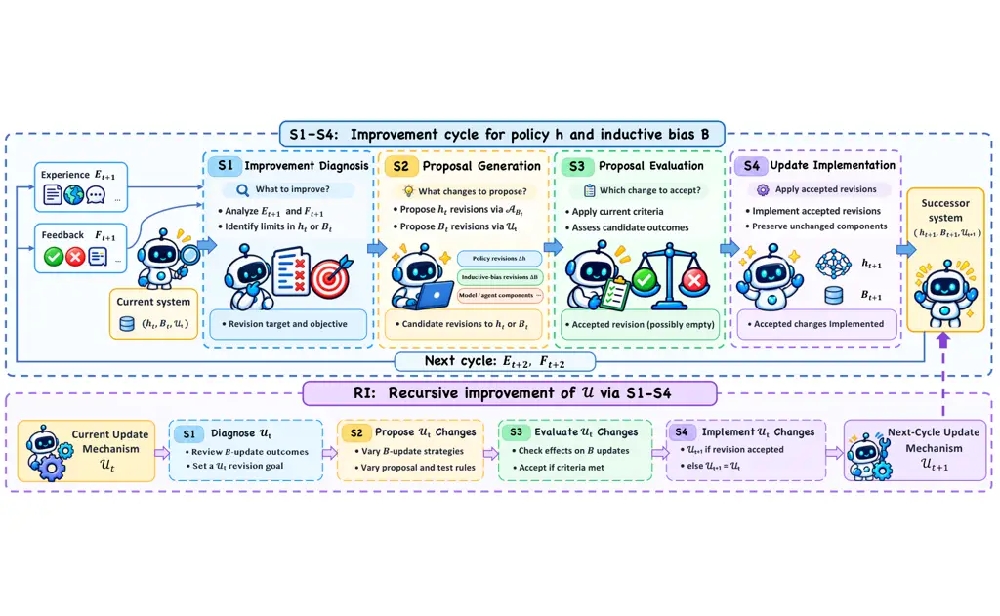
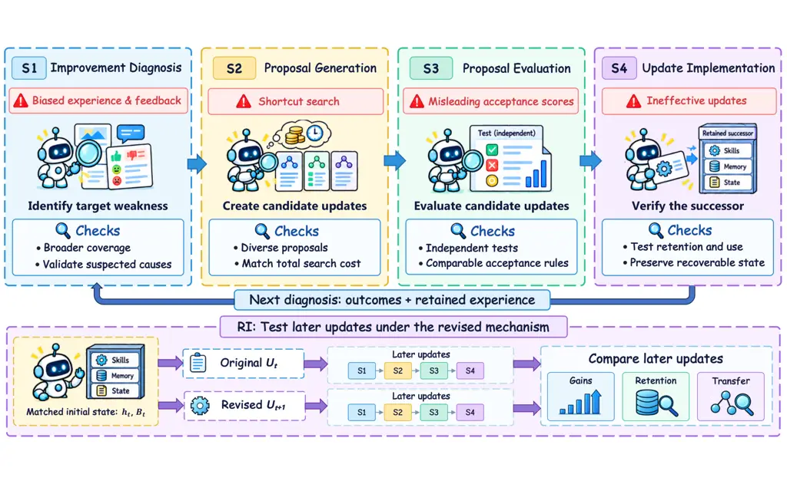
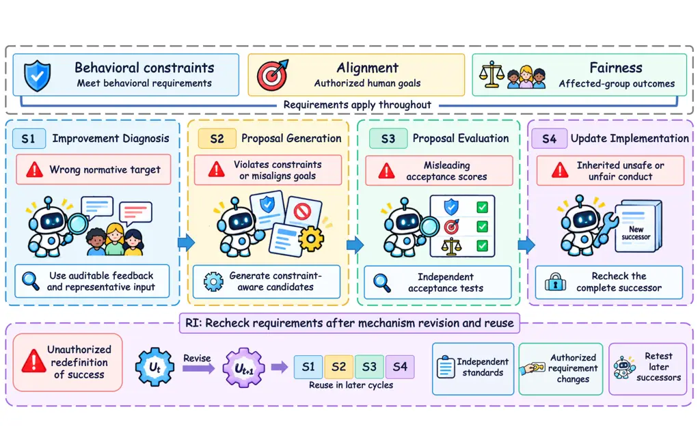
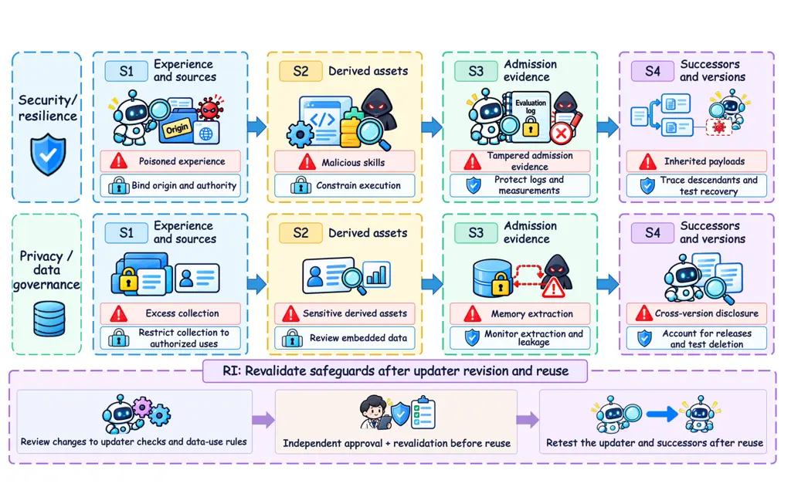
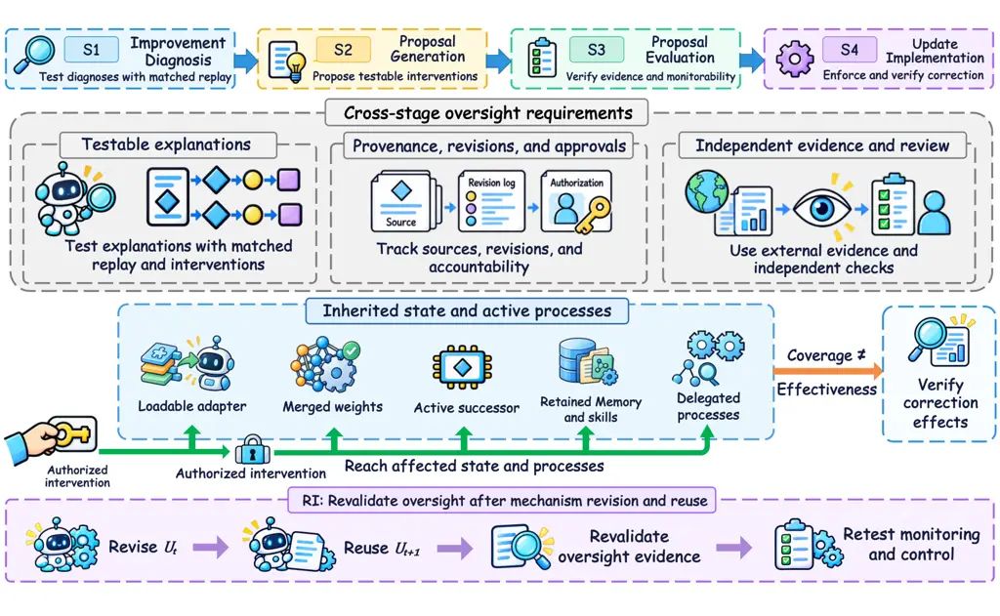
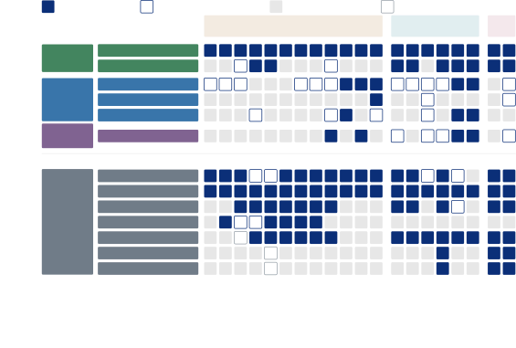
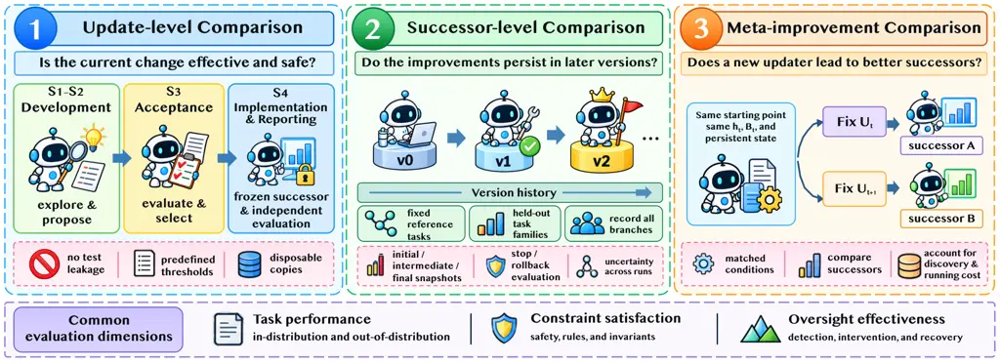
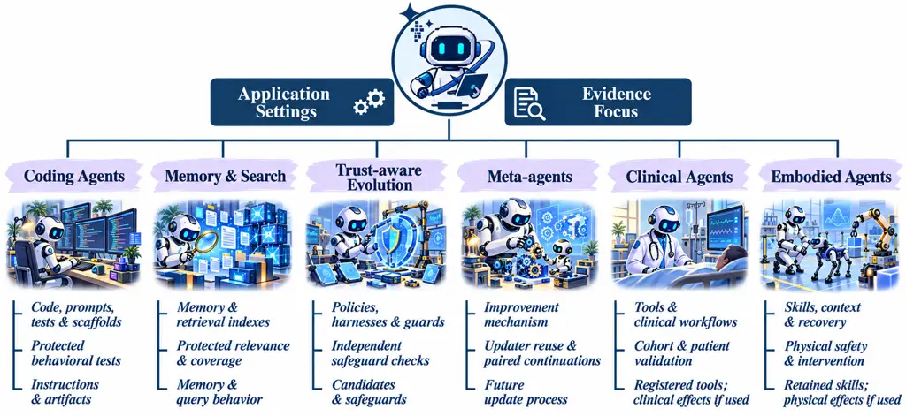

# Trustworthy Recursive Self-Improvement in the Era of Large Models: Foundation, Risks, Evaluation and Open Challenges

Jiayue Pu Affiliation: Gaoling School of Artificial Intelligence, Renmin
University of China    Ang Gao Affiliation: Gaoling School of Artificial
Intelligence, Renmin University of China    Jinyi Bai Affiliation:
Gaoling School of Artificial Intelligence, Renmin University of China   
Qipeng Wang Affiliation: Gaoling School of Artificial Intelligence,
Renmin University of China    Tongyu Wen Affiliation: Gaoling School of
Artificial Intelligence, Renmin University of China    Jiahao Zhao
Affiliation: Gaoling School of Artificial Intelligence, Renmin
University of China    Keyu Qu Affiliation: Gaoling School of Artificial
Intelligence, Renmin University of China    Junhao Zhang Affiliation:
University of Chinese Academy of Sciences    Chenglei Shen Affiliation:
Gaoling School of Artificial Intelligence, Renmin University of China   
Zhongxiang Sun Affiliation: Gaoling School of Artificial Intelligence,
Renmin University of China    Jun Xu Affiliation: Gaoling School of
Artificial Intelligence, Renmin University of China    Xiao Zhang
Corresponding author: pujiayue0222@ruc.edu.cn, sunzhongxiang@ruc.edu.cn,
zhangx89@ruc.edu.cn Affiliation: Gaoling School of Artificial
Intelligence, Renmin University of China Affiliation: Project supervisor
Affiliation: Corresponding author

###### Abstract

AI systems built around large models increasingly use experience and
feedback to make persistent changes to models, prompts, memories, tools,
and workflows. Recursive self-improvement (RSI) extends this process to
inductive biases and to the mechanisms that govern future updates, which
can themselves be revised and reused across improvement cycles. Yet
self-modification alone does not guarantee trustworthy improvement.
Reported gains may reflect flawed evaluations, previously acquired
capabilities may deteriorate, and compliance with behavioral constraints
may weaken. Compromised artifacts or sensitive information may also
persist in successor systems. Changes to improvement mechanisms may
invalidate earlier verification results and make human oversight less
effective. This survey presents an operational definition and process
framework for RSI and organizes the requirements for trustworthy RSI
into four interconnected themes: genuine and sustained improvement;
behavioral constraints, alignment, and fairness; system security and
privacy; and transparency and controllability. We examine these themes
from three perspectives: Improvement Validity, Constraint Preservation,
and Effective Oversight. This analysis covers improvement diagnosis,
proposal generation, proposal evaluation, and update implementation
(S1–S4), including the recursive application of these stages to
improvement mechanisms (RI). We review risks, safeguards, and evaluation
evidence for individual updates, effects inherited by successor systems,
and revisions to improvement mechanisms, while distinguishing direct RSI
findings from evidence in related systems. Finally, we examine
evaluation settings, identify requirements for independent and
longitudinal assessment, and discuss applications and open research
problems.

###### Contents

1.  1 Introduction
    1.  1.1 Motivation
    2.  1.2 Scope and Perspective
    3.  1.3 Comparison with Existing Surveys
    4.  1.4 Contributions
    5.  1.5 Paper Organization
2.  2 Preliminaries
    1.  2.1 Recursive Self-Improvement: Definition and Process
    2.  2.2 Trustworthiness: Concepts and Requirements
    3.  2.3 Trustworthiness under Recursive Self-Improvement
3.  3 Genuine and Sustained Improvement
    1.  3.1 Core Concepts and Trustworthiness Claims
    2.  3.2 Risks and Failure Evidence
    3.  3.3 Existing Safeguards and Their Limitations
    4.  3.4 Evidence Synthesis and Research Gaps
4.  4 Behavioral Constraints, Alignment, and Fairness
    1.  4.1 Definitions and Trustworthiness Claims
    2.  4.2 Risks and Failure Evidence
    3.  4.3 Existing Safeguards and Their Limitations
    4.  4.4 Evidence Synthesis and Research Gaps
5.  5 System Security, Resilience, Privacy, and Data Governance
    1.  5.1 Definitions and Trustworthiness Claims
    2.  5.2 Risks and Failure Evidence
    3.  5.3 Existing Safeguards and Their Limitations
    4.  5.4 Evidence Synthesis and Research Gaps
6.  6 Transparency and Controllability
    1.  6.1 Definitions and Trustworthiness Claims
    2.  6.2 Risks and Failure Evidence
    3.  6.3 Existing Safeguards and Their Limitations
    4.  6.4 Evidence Synthesis and Research Gaps
7.  7 Evaluating Trustworthy RSI
    1.  7.1 What Do Existing Evaluations Cover?
    2.  7.2 How Should Successive Versions Be Compared?
    3.  7.3 What Supports Trustworthiness Claims?
8.  8 Applications, Open Problems, and Conclusions
    1.  8.1 Current Findings and Evidence Requirements
    2.  8.2 How Application Context Changes the Evidence Required
    3.  8.3 Open Problems and Future Directions
    4.  8.4 Conclusions
9.  References
10. A Literature Coverage and Citation Scope
    1.  A.1 Subject Coverage and Evidence Boundaries
    2.  A.2 Counting Unit and Source Normalization
    3.  A.3 Distribution by Recorded Publication Source
    4.  A.4 Evidence Selection and Coding Protocol

## 1 Introduction



Figure 1: Overview of the RSI Process and Trustworthiness Framework. The
numbered labels (§2–§8) indicate the corresponding sections of this
survey. The central panel (Section 2) presents the definition and
four-stage improvement cycle of RSI (S1–S4), including recursive
revision and reuse of the bias update function (RI). Four surrounding
trustworthiness themes are organized under three complementary
analytical roles: Improvement Validity, Constraint Preservation, and
Effective Oversight. Section 7 examines evaluation designs and evidence
requirements at the individual-update, successor, and meta-improvement
levels, while §8 covers representative applications and open research
problems.


### 1.1 Motivation

Advances in LLMs, including GPT-6 Astra (OpenAI, 2026) and Claude Opus
5.5 (Anthropic, 2026), have improved a broad range of capabilities, such
as coding, tool use, and multi-step task execution. Building on these
capabilities, self-evolving systems can use experience and feedback to
introduce persistent changes to model parameters, memories, tools, and
workflows, allowing these changes to influence subsequent tasks (Gao et
al., 2026; Zweiger et al., 2025; Zhang et al., 2026e). Recursive
self-improvement (RSI) extends self-evolution by allowing systems to
revise and reuse the mechanisms that govern subsequent updates. Recent
research has explored this capability through editable meta-agents
(Zhang et al., 2026f), evolving exploration strategies (Zheng et al.,
2026c), and modular or regularized harness evolution (Wu et al., 2026d;
Xia et al., 2026). These systems make the improvement procedure itself
an explicit target of revision.

Recursive updates can also preserve security vulnerabilities.
Hyperagents allows a meta-agent to modify both a task agent and its own
improvement procedure (Zhang et al., 2026f). In a benchmark-poisoning
experiment, tasks using self-signed certificates prompted the meta-agent
to add a persistent instruction directing the task agent to bypass HTTPS
certificate verification. Successors inherited these instructions and
generated insecure code on benign, held-out tasks, even after further
evolution on a clean benchmark (Roesner and Kohno, 2026). The experiment
connects contaminated evaluation feedback to security failures in later
successors. It motivates checking the validity of improvement evidence
and the preservation of security requirements across revisions. When the
improvement mechanism changes, the evaluations and safeguards governing
later updates also require reassessment.

These risks call for a broad view of trustworthiness that considers
reliability alongside safety, security, fairness, privacy, and
transparency (National Institute of Standards and Technology, 2023). We
organize the survey into four trustworthiness themes under three
complementary analytical roles. The first theme, genuine and sustained
improvement, addresses Improvement Validity by examining whether
reported gains reflect genuine improvements in the intended capabilities
and persist over time. Constraint Preservation is addressed through two
themes: behavioral constraints, alignment, and fairness; and system
security, resilience, privacy, and data governance. Together, these
themes examine whether applicable requirements remain satisfied across
successive updates. The fourth theme, transparency and controllability,
addresses Effective Oversight by examining whether system changes remain
understandable, auditable, and subject to authorized human intervention.
We assess these requirements across individual updates, changes
inherited by successor systems, and revisions to the improvement
mechanism.

Genuine and sustained improvement. This theme concerns whether reported
gains reflect genuine improvements that persist across subsequent
revisions. At the update level, acceptance scores can increase even as
external correctness declines (Song et al., 2026). Across successors,
accumulated skills may impair retrieval and task performance (Zhang et
al., 2026k). When improvement mechanisms also revise evaluation
criteria, higher scores may reflect changes in what is measured rather
than actual performance gains.

Behavioral constraints, alignment, and fairness. This theme concerns
whether system behavior remains safe, aligned with relevant human goals
and constraints, and fair to affected individuals or groups. Even benign
fine-tuning or accumulated experience can weaken safety (Qi et al.,
2024; Zhao et al., 2026b), while adaptive exploration may produce biased
allocations (Wu et al., 2026a). Such deviations may persist in successor
systems, while changes to experience selection or reward mechanisms can
further reinforce undesirable behavior. Revisions to behavioral
requirements require authorization and evaluation of their effects on
safety, alignment, and affected groups.

System security, resilience, privacy, and data governance. This theme
concerns protecting system components against malicious interference and
ensuring the appropriate handling of sensitive information. Poisoned
memories can redirect subsequent actions (Dong et al., 2025), while
stored interactions may expose private information (Wang et al., 2025a).
These risks may persist when compromised components or sensitive
information are inherited by successors. If improvement mechanisms can
also modify validation, access control, or data retention rules, the
effectiveness of existing protections must be reassessed.

Transparency and controllability. This theme concerns whether system
changes can be understood, traced, and corrected through effective human
oversight. For individual updates, reviewers must be able to identify
what changed and why it was accepted. As changes accumulate across
successors, their effects must remain auditable and subject to
correction or rollback. If improvement mechanisms can also modify
auditing or rollback procedures, subsequent revisions may undermine the
effectiveness of oversight itself.

Accordingly, this survey addresses the following research questions.


### 1.2 Scope and Perspective

We focus on RSI in large-model systems, where changes to models,
prompts, memories, tools, and workflows can persist across successor
versions. Beyond such persistent changes, RSI allows systems to revise
and reuse the mechanisms guiding subsequent improvements. Human approval
may remain part of this process. We analyze improvement diagnosis,
proposal generation, proposal evaluation, and update implementation
(S1–S4), together with their recursive application to the improvement
mechanism (RI). These categories locate risks, safeguards, and evidence
requirements across different system architectures. Our review focuses
on RSI research while drawing on related studies of persistent updates
to inform specific risks, safeguards, and evaluation assumptions. We
distinguish findings demonstrated directly in RSI from evidence obtained
in related systems and prospective arguments.

### 1.3 Comparison with Existing Surveys

Surveys of trustworthy AI examine trustworthiness requirements, risks,
and safeguards for general AI systems, LLMs, and agents (Li et al.,
2023; Liu et al., 2023; Yu et al., 2025; Qi et al., 2026). They define
trustworthiness attributes and review assessment methods, primarily in
terms of system properties and agent workflows.

Surveys of self-evolution classify the components subject to change and
the feedback mechanisms that support continued adaptation (Gao et al.,
2026). Wang et al. (2026d) distinguish five levels of self-evolution and
relate each update boundary to external evidence, promotion criteria,
and recovery controls. Their cross-level analysis connects evaluation
horizons to the persistence of changes and calls for longitudinal
evaluation of successor systems. This level-based audit perspective
complements the claim-level analysis of joint evidence across
trustworthiness themes developed in this survey. RSI-oriented surveys
examine improvement-loop structure, evaluator design, autonomy, and
evidence for sustained progress (Wu et al., 2026c; Chen et al., 2026g;
Duan et al., 2026).

Two recent surveys address closely related questions. Gong et al. (2026)
organize evolutionary safety by domains of change, examining inherited
risks, revisions to improvement mechanisms, longitudinal evaluation, and
recovery. Chen et al. (2026a) use SAVER to trace safety failures and
responses across transitions in reusable state. Their survey finds that
extending the persistence, authority, or scope of previously legitimate
state can introduce safety risks, while evidence of repair across
successor systems remains limited.

The evolutionary-safety analysis further distinguishes update
preservation, persistence, propagation, and recovery, and discusses
frozen-updater comparisons under common external evaluation. The
transition-centered analysis identifies limited evidence of repair
followed by resumed adaptation. Building on these findings, we
distinguish the evidence needed for individual-update, successor, and
meta-improvement claims across the four trustworthiness themes and
S1–S4/RI. The three overarching concerns connect this process view to
evidence assessment. Section 7.1 maps evaluation measures and study
designs, while Section 7.3 examines whether evidence of improvement,
constraint preservation, and effective oversight can be aligned within
the same evolving system.

This synthesis distinguishes evidence from fixed-model controls, studies
of failure and correction in successor systems, and evaluations of
reused improvement mechanisms. Across the selected literature,
evaluations of reused improvement mechanisms focus more directly on
capability gains than on joint assessments of constraint preservation
and intervention effectiveness. Building on existing evaluation designs,
Section 7.2 specifies paired continuations, matched continuation
budgets, and separate accounting of total costs.

Table 1 summarizes these differences in analytical focus and coverage
across five dimensions: multidimensional trustworthiness (MT),
improvement-loop analysis (IL), mechanism revision (MR), longitudinal
assurance (LA), and joint-evidence analysis (JE).

|                                         |                                                       |                |                |                |                |                |
| --------------------------------------- | ----------------------------------------------------- | -------------- | -------------- | -------------- | -------------- | -------------- |
| Survey                                  | Main analytical focus                                 | MT             | IL             | MR             | LA             | JE             |
| Trustworthiness-oriented surveys        |                                                       |                |                |                |                |                |
| Li et al. (2023)                        | Trustworthiness principles and practices for AI       | $`\checkmark`$ | —              | —              | —              | $`\triangle`$  |
| Liu et al. (2023)                       | Trustworthiness requirements and methods for LLMs     | $`\checkmark`$ | —              | —              | —              | $`\triangle`$  |
| Yu et al. (2025)                        | Trustworthiness of LLM agents                         | $`\checkmark`$ | —              | —              | —              | $`\triangle`$  |
| Qi et al. (2026)                        | Trustworthiness of agentic workflows                  | $`\checkmark`$ | $`\triangle`$  | —              | $`\triangle`$  | $`\triangle`$  |
| Self-evolution and RSI-oriented surveys |                                                       |                |                |                |                |                |
| Gao et al. (2026)                       | Evolution targets, methods, and evaluation            | $`\triangle`$  | $`\checkmark`$ | $`\triangle`$  | $`\checkmark`$ | $`\triangle`$  |
| Wang et al. (2026d)                     | Modification depth, audit boundaries, and reliability | $`\triangle`$  | $`\checkmark`$ | $`\checkmark`$ | $`\checkmark`$ | $`\triangle`$  |
| Wu et al. (2026c)                       | Improvement loops and evidence across generations     | $`\triangle`$  | $`\checkmark`$ | $`\checkmark`$ | $`\checkmark`$ | $`\triangle`$  |
| Chen et al. (2026g)                     | Improvement targets, loop closure, and verification   | $`\triangle`$  | $`\checkmark`$ | $`\checkmark`$ | $`\triangle`$  | $`\triangle`$  |
| Duan et al. (2026)                      | Autonomy levels and recursive improvement             | $`\triangle`$  | $`\checkmark`$ | $`\checkmark`$ | $`\checkmark`$ | $`\triangle`$  |
| Safety under self-evolution and RSI     |                                                       |                |                |                |                |                |
| Gong et al. (2026)                      | Safety across persistent states and updaters          | $`\checkmark`$ | $`\checkmark`$ | $`\checkmark`$ | $`\checkmark`$ | $`\triangle`$  |
| Chen et al. (2026a)                     | Safety failures and recovery across state transitions | $`\checkmark`$ | $`\checkmark`$ | $`\triangle`$  | $`\checkmark`$ | $`\checkmark`$ |
| This survey                             | Claim-level audit of joint evidence                   | $`\checkmark`$ | $`\checkmark`$ | $`\checkmark`$ | $`\checkmark`$ | $`\checkmark`$ |

MT: multidimensional trustworthiness; IL: improvement-loop analysis; MR:
mechanism revision; LA: longitudinal assurance; JE: joint-evidence
analysis across aligned system versions or update trajectories.
$`\checkmark`$: systematic framework or sustained analysis;
$`\triangle`$: explicit but limited discussion; —: not developed as an
analytical dimension. For JE, $`\checkmark`$ indicates a cross-study
audit of aligned capability, constraint, and oversight evidence. These
symbols describe the depth of analysis for each dimension. The
analytical-focus column and Sections 7.1–7.3 detail the joint-evidence
analysis developed in this survey.

Table 1: Comparison with representative surveys of trustworthy AI,
self-evolution, RSI, and evolutionary safety. Symbols indicate the depth
of analysis defined in the legend.

Assessing sustained improvement requires longitudinal evaluation of
successor systems, whereas attributing gains to a revised improvement
mechanism requires controlled comparisons. We examine both claims
alongside evidence of constraint preservation and effective human
oversight.

### 1.4 Contributions

Our main contributions are as follows:

- •
  An operational definition and process framework for RSI. Building on
  the definition of machine learning proposed by Mitchell (Mitchell,
  1997), we define RSI in terms of autonomous improvement of the
  inductive bias $`B`$ and recursive revision of its update function
  $`\mathcal{U}`$. We organize the improvement process into four stages:
  diagnosing limitations (S1), generating candidate revisions (S2),
  evaluating proposals (S3), and implementing accepted updates (S4). RI
  denotes the recursive application of these stages to $`\mathcal{U}`$
  itself.
- •
  A unified taxonomy and evidence-oriented synthesis. We organize four
  interconnected trustworthiness themes under three complementary
  analytical roles: Improvement Validity, Constraint Preservation, and
  Effective Oversight. Within this framework, we compare risks,
  safeguards, and evaluation methods across individual updates,
  successor systems, and revisions to improvement mechanisms, with a
  versioned evidence map that distinguishes study-level coverage from
  joint evidence on aligned trajectories. We distinguish findings
  demonstrated directly in RSI from evidence obtained in related
  systems, as well as potential risks and proposed safeguards that have
  not yet been empirically validated.
- •
  Longitudinal evaluation and open research problems. We specify paired
  continuations for assessing updater revisions, distinguish mechanism
  effects from total-cost efficiency, and identify open questions in
  capability retention, constraint preservation, evaluation
  independence, and effective intervention.

### 1.5 Paper Organization


Figure 2: A taxonomy roadmap of representative work on trustworthy RSI.
The four themes follow Sections 3–6, with shared chronological columns.
Each institutional mark identifies a selected author affiliation, rather
than all collaborators. The selection spans risks, limitations,
safeguards, and enabling methods at different levels of improvement;
inclusion does not imply demonstrated strict RI or durable protection.
Arrows indicate time, not causal influence.

Section 2 introduces the definition and improvement process of RSI and
establishes the trustworthiness framework. Sections 3–6 examine the four
trustworthiness themes. Section 3 addresses genuine and sustained
improvement under Improvement Validity. Under Constraint Preservation,
Section 4 examines behavioral constraints, alignment, and fairness,
while Section 5 addresses system security, resilience, privacy, and data
governance. Section 6 examines transparency and controllability under
Effective Oversight. Section 7 reviews existing evaluation settings and
develops evidence requirements for trustworthy RSI, covering
longitudinal evaluation, causal assessment of recursive improvement,
evaluator independence, and joint assessment of trustworthiness
requirements. Finally, Section 8 synthesizes existing findings and their
limitations, explores application settings at the intersection of RSI
and trustworthiness, and discusses open problems and future research
directions. Figure 2 maps representative work from Sections 3–6 by
trustworthiness theme and publication year.

## 2 Preliminaries

We define RSI and its improvement process, then relate recursive changes
to the trustworthiness requirements used throughout this survey.

### 2.1 Recursive Self-Improvement: Definition and Process

The definition specifies what changes during RSI; the four-stage cycle
describes how those changes are proposed, evaluated, and retained.

#### 2.1.1 Definition of Recursive Self-Improvement

We start from Mitchell’s definition of machine learning:


Generalizing beyond observed experience requires an inductive bias
$`B`$: preferences that guide the choice among candidate policies
consistent with the observed data (Mitchell, 1980). Formally, given
experience $`E`$, we write a learning system $`\mathcal{A}`$ as follows:

```math
h=\mathcal{A}(B,E), \tag{1}
```

where $`h`$ denotes the learned policy, and $`B`$ denotes the inductive
bias governing how $`\mathcal{A}`$ learns.

In conventional machine learning systems, the inductive bias $`B`$ is
typically specified in advance and held fixed during learning. It may be
embodied in the strategy for acquiring data, the formulation of the
objective function, the choice of hypothesis space, the design of the
optimization algorithm, or the criteria for evaluating learned models.

In large-model systems, the learned policy $`h`$ in Eq. (1) may be
realized by a standalone model or by a model together with prompts,
memory, skills, and tools. The inductive bias $`B`$ specifies how that
policy is learned or revised, including its initialization, training
objectives, data selection rules, and optimization procedures. The
distinction is functional: a prompt that controls task execution belongs
to $`h`$, whereas one that governs the construction or selection of
policy updates belongs to $`B`$. For example, an instruction to run
tests before submitting a patch is part of $`h`$; a rule for selecting
corrected trajectories for training is part of $`B`$. The bias update
function $`\mathcal{U}`$ governs revisions to these learning choices and
can itself be revised and reused in RSI. A shared prompt or module may
serve more than one role, so its effects on task execution and on each
update process should be identified separately. These roles are defined
relative to the task policy being evaluated and kept consistent across
improvement cycles.

We define RSI as follows.


Across improvement cycles, the bias update function $`\mathcal{U}_{t}`$
can revise the inductive bias $`B_{t}`$. The function
$`\mathcal{U}_{t}`$ can itself be revised to $`\mathcal{U}_{t+1}`$,
which is used in the next cycle. Feedback $`F_{t}`$ includes signals
derived from data, environmental interaction, or self-evaluation.

Comparison with other machine learning approaches. Table 2 compares
representative standard forms of conventional machine learning,
reinforcement learning, meta-learning, and AutoML with RSI. Conventional
machine learning and reinforcement learning typically update task
policies under specified learning rules (Mitchell, 1997; Sutton and
Barto, 2018). In model-agnostic meta-learning (MAML), the learned
initialization changes under a prescribed meta-gradient procedure (Finn
et al., 2017). Auto-sklearn selects algorithms and hyperparameters
within a specified search procedure (Feurer et al., 2015). These latter
methods revise aspects of $`B`$ while retaining the procedure that
updates them.

Learned optimizers illustrate the distinction between an update rule and
the procedure that trains it (Andrychowicz et al., 2016). When an
optimizer governs updates to the task policy, it forms part of $`B`$,
while its outer training procedure plays the role of $`\mathcal{U}`$.
Training the optimizer changes $`B`$; revising and reusing that outer
procedure also changes $`\mathcal{U}`$. Classification therefore depends
on which component is revised and how it is subsequently used.

Promptbreeder evolves task prompts together with the mutation prompts
used to revise them (Fernando et al., 2023). Under the functional
distinction above, task prompts contribute to $`h`$, mutation prompts
specify part of $`B`$, and the prescribed hypermutation procedure plays
the role of $`\mathcal{U}`$. This provides an example of evolving $`B`$
under a fixed $`\mathcal{U}`$. Gödel machines provide a theoretical
account of self-revision in which a system can rewrite its software,
including its proof searcher, after proving the rewrite useful under its
current utility function and axioms (Schmidhuber, 2006). The additional
RSI condition in this survey is that the mechanism for revising $`B`$ is
itself revised and reused in later cycles.

|                               |                                          |                                |                                                              |
| ----------------------------- | ---------------------------------------- | ------------------------------ | ------------------------------------------------------------ |
| Approach                      | Who determines the inductive bias $`B`$? | Is $`B`$ revised autonomously? | Is the bias update function revised and reused?              |
| Conventional machine learning | Human designer                           | ✗                              | ✗                                                            |
| Reinforcement learning        | Human designer                           | ✗                              | ✗(learning rule fixed)                                       |
| Meta-learning                 | Meta-learner                             | ✓                              | ✗(meta-update rule fixed)                                    |
| AutoML                        | Automated search                         | ✓                              | ✗(search rule fixed)                                         |
| RSI                           | Bias update function $`\mathcal{U}_{t}`$ | ✓                              | ✓(the revised $`\mathcal{U}_{t}`$ guides later bias updates) |

Table 2: Comparison of RSI with other machine learning approaches in
their standard forms.

#### 2.1.2 The RSI Process in the Era of Large Models



Figure 3: The recursive self-improvement (RSI) process. The core
improvement cycle (S1–S4) identifies limitations, generates and
evaluates candidate revisions to the policy $`h_{t}`$ or inductive bias
$`B_{t}`$, and incorporates accepted changes into the successor system.
Recursive improvement (RI) applies the same four stages to the bias
update function $`\mathcal{U}_{t}`$ itself. The resulting
$`\mathcal{U}_{t+1}`$ is retained for subsequent improvement cycles,
while components without accepted revisions remain unchanged.

Eqs. (2) and (3) describe how the learned policy $`h`$, inductive bias
$`B`$, and bias update function $`\mathcal{U}`$ evolve across
improvement cycles. The process view makes explicit how potential
improvements are identified, proposed, evaluated, and incorporated into
the system. Figure 3 illustrates these steps as a four-stage improvement
cycle (S1–S4), together with its recursive application to the bias
update function (RI).

- •
  (S1) Improvement Diagnosis. The system uses the current policy
  $`h_{t}`$, inductive bias $`B_{t}`$, experience $`E_{t+1}`$, and
  feedback $`F_{t+1}`$ to identify limitations in its behavior or
  learning process. It determines whether addressing these limitations
  requires revisions to $`h_{t}`$, $`B_{t}`$, or both, and defines the
  improvement objective that subsequent proposals should address.
- •
  (S2) Proposal Generation. Based on the diagnosis from S1, the system
  generates candidate revisions to $`h_{t}`$ through the learning
  process $`\mathcal{A}_{B_{t}}`$ or to $`B_{t}`$ through the bias
  update function $`\mathcal{U}_{t}`$. These candidates may modify the
  learned policy or the choices and configurations that govern its
  learning. At this stage, the proposed revisions have not yet been
  incorporated into the system.
- •
  (S3) Proposal Evaluation. The system evaluates candidate revisions
  against the current evaluation and acceptance criteria. It assesses
  whether the proposed changes address the identified limitations and
  satisfy the declared requirements, including checks for performance
  regressions on other tasks. The system then determines which revisions
  should be accepted based on the evaluation results.
- •
  (S4) Update Implementation. The system incorporates accepted revisions
  into the successor system and retains the resulting $`h_{t+1}`$ and
  $`B_{t+1}`$ for subsequent improvement cycles. Any component without
  an accepted revision remains unchanged.
- •
  (RI) Recursive Improvement. The system applies S1–S4 recursively to
  the bias update function $`\mathcal{U}_{t}`$ itself. If a revision is
  accepted, the resulting $`\mathcal{U}_{t+1}`$ is retained and reused
  in subsequent cycles, potentially changing how inductive biases are
  updated. Otherwise, $`\mathcal{U}_{t+1}=\mathcal{U}_{t}`$.

Three variants of a coding agent illustrate these distinctions. In each
variant, execution trajectories and corrected solutions provide
$`E_{t+1}`$, while test outcomes provide $`F_{t+1}`$. The task
objective, externally specified acceptance criteria, and resource budget
remain fixed.

An agent that repeatedly submits untested patches identifies this
behavior in S1 and proposes an execution-prompt revision in S2. It
evaluates the candidate on held-out coding tasks in S3 and retains the
accepted prompt as part of $`h_{t+1}`$ in S4. Model weights, $`B_{t}`$,
and $`\mathcal{U}_{t}`$ remain fixed. The retained instruction requires
tests before submission, changing later task execution and potentially
the experience collected in later cycles. A reminder used only for the
current submission is a temporary execution adjustment.

Using the same diagnosis, a second variant revises a prompt for
selecting training trajectories to increase the share of corrected
examples involving missed tests. The current $`\mathcal{U}_{t}`$ uses
failure counts to propose a single selection rule and evaluates the
policy obtained in a trial training run. S4 retains the accepted rule in
$`B_{t+1}`$ for later policy updates. The model architecture, training
optimizer, and bias update function remain fixed. This change affects
how later policies are learned.

In the recursive variant, the agent uses $`\mathcal{U}_{t}`$ to propose
a revision to the procedure that changes these selection rules. The
proposed procedure replaces a direct adjustment based on failure counts
with a search over several candidate rules. The candidate procedure is
evaluated through trial improvement cycles, with the resulting policies
assessed under the same external criteria and total resource budget. If
accepted through S1–S4, it is retained as $`\mathcal{U}_{t+1}`$ and used
to revise $`B`$ in later cycles. The task objective, acceptance
criteria, and training optimizer remain fixed.

### 2.2 Trustworthiness: Concepts and Requirements

Trustworthiness concerns whether reliance on an AI system is justified
for its intended use (Li et al., 2023; National Institute of Standards
and Technology, 2023). Existing frameworks characterize trustworthiness
in different ways. Li et al. (2023) distinguish technical and ethical
requirements, while NIST identifies seven characteristics, including
validity and reliability, security and resilience, and accountability
and transparency (National Institute of Standards and Technology, 2023).
TrustLLM identifies eight dimensions: truthfulness, safety, fairness,
robustness, privacy, machine ethics, transparency, and accountability
(Huang et al., 2024b). The AI HLEG guidelines also recognize human
agency and oversight as a requirement (High-Level Expert Group on
Artificial Intelligence, 2019).

In this survey, we synthesize eight groups of trustworthiness
requirements from these frameworks and LLM-focused analyses (Li et al.,
2023; National Institute of Standards and Technology, 2023; Liu et al.,
2023; Huang et al., 2024b; High-Level Expert Group on Artificial
Intelligence, 2019). We group related performance requirements,
distinguish behavioral safety from system security, and consider
interpretability, human control, and accountability separately. We
address machine ethics primarily through behavioral safety and value
alignment, while considering fairness and governance in their respective
groups.

(i) Validity, reliability, robustness, and truthfulness. Validity
concerns whether a system meets the requirements of its intended use.
Reliability refers to dependable performance under specified conditions,
whereas robustness concerns maintaining performance under relevant
disturbances or shifts (National Institute of Standards and Technology,
2023; Liu et al., 2023). Truthfulness concerns the factual accuracy of
system outputs and reports (Huang et al., 2024b).

(ii) Behavioral safety and value alignment. Behavioral safety concerns
preventing unacceptable harm resulting from system outputs or actions.
Value alignment concerns whether the objectives and behavior of a system
respect relevant human goals, values, and constraints, rather than
merely maximizing a specified reward (Liu et al., 2023; Huang et al.,
2024b).

(iii) Fairness. Fairness concerns unjustified differences in treatment,
opportunities, benefits, and harms across individuals or groups.
Appropriate fairness criteria depend on the task and context; neither
high aggregate accuracy nor numerical parity alone establishes fairness
(Li et al., 2023; National Institute of Standards and Technology, 2023).

(iv) System security and resilience. Security concerns protecting the
confidentiality, integrity, and availability of systems and information
against unauthorized access or interference. Resilience concerns the
ability to maintain essential functions and recover from attacks,
faults, or other adverse conditions (National Institute of Standards and
Technology, 2023).

(v) Privacy and data governance. Privacy concerns protecting individuals
against inappropriate collection, inference, use, and disclosure of
information. Data governance specifies what data may be collected, who
may access them, how they may be used, and when they must be deleted.
These requirements also apply to authorized data processing, which may
still pose privacy risks (High-Level Expert Group on Artificial
Intelligence, 2019; Huang et al., 2024b).

(vi) Transparency and interpretability. Transparency concerns making
relevant information about system data, design, operation, and
limitations available. Interpretability and explainability help users
and reviewers understand system outputs and the processes that produce
them (Li et al., 2023; High-Level Expert Group on Artificial
Intelligence, 2019).

(vii) Human control and corrigibility. Human control requires practical
means to inspect, redirect, interrupt, or correct a system.
Corrigibility concerns whether a system cooperates with authorized
correction, including modification or shutdown, rather than resisting or
manipulating oversight (High-Level Expert Group on Artificial
Intelligence, 2019; Soares et al., 2015).

(viii) Accountability and governance. Accountability requires clearly
assigned responsibility for decisions and their consequences, together
with the ability to explain and justify those decisions (Li et al.,
2023; High-Level Expert Group on Artificial Intelligence, 2019). We use
governance to refer to organizational arrangements for authorizing
changes, reviewing decisions, conducting audits, and providing redress.
Unlike the data governance described in group (v), this concerns
responsibility for and authority over the system as a whole (National
Institute of Standards and Technology, 2023; High-Level Expert Group on
Artificial Intelligence, 2019).

These requirement groups are not mutually exclusive in practice. The
following subsection examines how their assessment must extend beyond
individual updates when both the system and its improvement mechanism
can change.

### 2.3 Trustworthiness under Recursive Self-Improvement

The requirements introduced in Section 2.2 remain relevant to RSI, but
assessing them requires examining more than a single revision. An
accepted change may affect subsequent system versions, while revising
the bias update function $`\mathcal{U}_{t}`$ may alter how future
updates are generated and evaluated.

Section 2.1 describes an improvement cycle comprising improvement
diagnosis (S1), proposal generation (S2), proposal evaluation (S3), and
update implementation (S4), with RI applying the same process to
$`\mathcal{U}_{t}`$ itself. These stages help identify where failures
may arise and where safeguards can be applied. We distinguish three
related levels of trustworthiness claims. At the update level, the
question is whether a proposed and accepted revision satisfies the
applicable requirements. At the successor level, the question is whether
these requirements continue to hold as accepted changes are inherited
and used in subsequent improvement cycles. At the meta-improvement
level, the question is how revisions to $`\mathcal{U}_{t}`$ affect the
quality of subsequent updates and the checks and controls applied to
them. These levels specify the scope of the evidence; S1–S4 and RI
locate the changes being assessed.

We organize the eight requirement groups into four themes under three
complementary analytical roles: Improvement Validity, Constraint
Preservation, and Effective Oversight, as shown in Table 3. The themes
identify what must be assessed or protected, while S1–S4 and RI provide
a process framework for examining where requirements may be violated and
where safeguards may be applied.

[TABLE]

Table 3: Mapping the eight trustworthiness requirement groups to four
RSI themes. The three analytical roles are complementary and do not
represent separate stages of the improvement process.

##### Genuine and sustained improvement.

At the update level, evaluation in S3 must distinguish genuine
improvements from favorable scores obtained on inadequate tests. At the
successor level, improvements should persist after integration in S4 and
through subsequent use or revision. Under RI, revising
$`\mathcal{U}_{t}`$ requires assessing whether the revised mechanism
produces better subsequent updates, rather than merely changing the
criteria by which they are accepted.

##### Behavioral constraints, alignment, and fairness.

An update may improve task performance while weakening safety,
alignment, or fairness. The question is whether these requirements
remain satisfied when the update is accepted, inherited, and applied in
new settings. Under RI, changes to how experience is selected or
proposals are evaluated may alter which behaviors are reinforced in
subsequent successors. Changes to these requirements must be authorized
and reassessed; improved task scores alone do not justify relaxing them.

##### System security, resilience, privacy, and data governance.

Untrusted experience may influence diagnosis and proposal generation
(S1–S2), while integration in S4 may retain artifacts or sensitive
information that successors subsequently reuse. Under RI, revisions to
access controls, validation procedures, or data retention rules may also
affect the protections available in later cycles. Security and privacy
therefore require examining both the immediate effects of an update and
the information and permissions that persist after it.

##### Transparency and controllability.

For an individual update, reviewers must be able to determine what was
proposed, why it was accepted, and what was integrated. Across
successors, changes must remain traceable and subject to correction or
rollback. When RI modifies the improvement mechanism, the revised
procedure must remain reviewable, and authorized intervention must
continue to be effective.

Sections 3–6 first define each theme and clarify its boundaries, then
examine reported failures, safeguards, and their limitations across the
relevant claim levels and stages of S1–S4/RI. Section 7 synthesizes the
corresponding evaluation questions. A single revision may affect
multiple themes; for example, changes to acceptance tests have
implications for both improvement validity and effective oversight.

## 3 Genuine and Sustained Improvement

Updates to $`h_{t}`$ and $`B_{t}`$ in Eqs. (2)–(3) can change current
capabilities, while revisions to $`\mathcal{U}_{t}`$ can change the
procedure used to produce subsequent updates. This section examines
whether capability gains are genuine and sustained, using validity,
reliability, robustness, and truthfulness to assess risks and safeguards
across individual updates, retained successors, and revisions to the
improvement mechanism.

### 3.1 Core Concepts and Trustworthiness Claims

We define genuine and sustained improvement and specify the evidence
needed to assess capability gains, their retention in successors, and
the quality of subsequent updates produced by a revised improvement
mechanism.

#### 3.1.1 Conceptual Scope and Boundaries

Genuine improvement strengthens the intended capabilities, whereas
sustained improvement preserves these gains through subsequent use and
updates. Validity concerns whether intended-use requirements are met;
reliability concerns dependable performance under specified conditions;
robustness concerns performance under relevant disturbances or
distribution shifts; and truthfulness concerns the factual accuracy of
outputs and reports (Li et al., 2023; National Institute of Standards
and Technology, 2023). These properties are assessed through the
behavior and performance of systems following changes to $`h`$ or $`B`$.
Revising $`\mathcal{U}`$ raises a further question: whether the revised
mechanism produces better subsequent updates (Chen et al., 2026g; Wang
et al., 2026d; Duan et al., 2026).

#### 3.1.2 Claims for Individual Updates, Successors, and Meta-Improvement

An individual-update claim requires evidence that a specified change to
$`h`$ or $`B`$ improves the intended capabilities under declared
evaluation conditions. The before-and-after comparison must assess the
relevant validity, reliability, robustness, and truthfulness criteria
rather than rely only on a proxy score. A successor claim additionally
requires evidence that the accepted change is inherited and actually
used, and that the gain remains observable when these criteria are
reassessed in the resulting system. Tracking multiple successors
measures how long gains persist and how far they transfer.

A meta-improvement claim requires an observed revision from
$`\mathcal{U}_{t}`$ to $`\mathcal{U}_{t+1}`$, subsequent reuse of the
revised mechanism, and evaluation of the updates it produces. Assessing
its benefit requires a controlled comparison showing that
$`\mathcal{U}_{t+1}`$ produces better subsequent updates than the
unchanged $`\mathcal{U}_{t}`$ under comparable conditions. This
comparison must separate the effects of the revision from those of
additional resources or differences in the inherited starting state.
Immediate gains, retained gains, and improved capacity to generate
subsequent updates therefore require different evidence.



Figure 4: Genuine and Sustained Improvement Across S1–S4 and RI in the
Process of RSI. Stage-specific risks and checks address biased
diagnosis, shortcut search, misleading acceptance scores, and
ineffective updates. The lower panel compares the gains, retention, and
transfer of later updates produced by the original and revised
improvement mechanisms, starting from matched initial states under
common tests and resource budgets.

### 3.2 Risks and Failure Evidence

We trace how failures in diagnosis, proposal generation, evaluation, and
implementation can distort or erode capability gains, then examine the
attribution problems raised by revisions to the improvement mechanism.

#### 3.2.1 Risks in Improvement Diagnosis (S1)

Bias in experience can prevent diagnosis from revealing weaknesses.
Replacing earlier data with generated samples can remove rare patterns
from the training distribution (Shumailov et al., 2024; Alemohammad et
al., 2024). Diagnosis based on this narrower experience can then
overlook failures involving those patterns. The resulting loss of
coverage may be uneven: theoretical analyses show that less frequent
patterns disappear sooner in the recursive-training settings studied
(Suresh et al., 2024). As replacement continues, diagnosis can lose
coverage of rare but relevant failures.

Even when relevant experience is available, incorrect feedback and
mistaken diagnosis can misdirect improvement. Feedback may misrepresent
failures: model-generated code reviews can become more favorable while
code quality deteriorates (Song et al., 2026). Accurate feedback may
also leave weaknesses unreported, as single-attempt accuracy can
increase while diversity and transfer decline (Wu et al., 2024b).
Identifying causes introduces further uncertainty because judgments of
individual steps need not identify the actions that actually affect
outcomes (Zhang, 2026). Acting on unreliable self-judgments can damage
correct answers (Huang et al., 2024a), while erroneous context can lead
subsequent reasoning toward similar mistakes (Cheng et al., 2026b).
These failures undermine both the validity of the improvement target and
the truthfulness of the explanation supporting it.

#### 3.2.2 Risks in Proposal Generation (S2)

Search can favor high-scoring shortcuts that leave the intended weakness
unresolved. This risk arises when proposals exploit proxy rewards or
executable tests (Skalse et al., 2022; Roth et al., 2026), and when
optimization converges on convenient but limited strategies. For
example, simpler research ideas can raise average reward without
improving the best achievable result (Si et al., 2026). Tool-use
policies can likewise exploit irrelevant prompt cues instead of
responding to task requirements (Yang et al., 2026d). Search then
reinforces behavior that is easily rewarded, even when candidate quality
or robustness falls short of what the scores suggest.

Additional computation can make an unchanged proposal mechanism appear
more effective. More attempts increase the chance of finding a strong
candidate, so selecting the best candidate can improve performance
without improving proposal quality per attempt. This ambiguity also
affects evolving agent programs: advantages over simple search can
disappear under comparable feedback and inference budgets (Wang et al.,
2026j). The output gain may be genuine, but attributing it to an
improved mechanism overstates the underlying change.

#### 3.2.3 Risks in Proposal Evaluation (S3)

Acceptance scores can increase as errors are reinforced, even without
corresponding capability gains. The reliability of self-generated
rewards depends on the ability to recognize errors (Yuan et al., 2025;
Yin et al., 2023; Kadavath et al., 2022). Shared errors compound this
weakness: coupled task generators and solvers can increasingly agree on
incorrect answers (Chen et al., 2026e). Self-written tests can similarly
reward behavior that fails in deployment (Guo et al., 2026), while
contamination rewards familiarity with exposed test information (Shao et
al., 2026a).

Even accurate judgments can become misleading when evaluation conditions
or standards change. A policy preferred by a proxy may perform worse
when its deployment changes the responses of the environment or other
agents (Wang et al., 2026f). Evaluation must therefore account for the
conditions induced by the proposed replacement. Changing standards
creates another risk: graders may become more permissive without
capability gains (Zhang et al., 2026l). Reliable comparisons require
both conditions relevant to deployment and stable evaluation standards.

#### 3.2.4 Risks in Update Implementation (S4)

New capabilities can interfere with existing skills. Adaptation can
cause forgetting (Yu et al., 2026c), while specialization can improve
one capability at the expense of others (Yuan et al., 2026). Across four
drifting task streams, edits to shared prompts or workspaces in GEPA and
Meta-Harness interfere with earlier or unseen tasks. ReasoningBank
localizes updates through retrieval but encounters collisions when
similar queries require conflicting workflows (Chen et al., 2026h).
Adding skills can also impede retrieval (Zhang et al., 2026k) or
introduce flawed procedures (Shang et al., 2026). Incompatibility can
render even useful skills ineffective: co-evolution can specialize a
policy to its training skill bank, making performance vulnerable to
subsequent skill changes when the policy remains fixed (Feng et al.,
2026). Deployment robustness therefore depends on compatibility between
the policy and the skills available to it.

Effective implementation also requires the system to invoke and follow
the updated instructions. Agents can generate useful changes yet gain
little from them because either step fails (Lin et al., 2026e).
Successor evaluation should therefore test whether the system invokes
the retained change, follows it, and benefits from it during operation.

#### 3.2.5 Risks under Recursive Improvement (RI)

Revising $`\mathcal{U}`$ may change how improvement is attempted without
increasing the capacity for future improvement. Revisions to answer
judgments or scoring criteria illustrate editable components (Wu et al.,
2024a; Li et al., 2026b; Wang et al., 2026b). MASS alternates
self-evaluated workflow search and fine-tuning, reusing the updated
model as executor, optimizer, and evaluator over two cycles (Lee et al.,
2026a); MetaRSI revises operator policies and scheduling under
protected, machine-checkable evaluation (Tan et al., 2026). Controlled
comparisons of revised and unchanged procedures can determine whether
these changes improve subsequent updates.

This attribution risk grows when development scores cease to reflect the
intended capability, as observed in autonomous post-training (Shi et
al., 2026). Current gains may also result from additional computation or
simultaneous changes elsewhere in the system. Establishing an enhanced
capacity for improvement therefore requires linking revised procedures
to the subsequent updates they produce and separating their contribution
from these alternatives.

### 3.3 Existing Safeguards and Their Limitations

We review safeguards across S1–S4 and assess the evidence and conditions
needed to establish genuine gains, preserve earlier capabilities, and
evaluate revisions to the improvement mechanism.

#### 3.3.1 Safeguards for Improvement Diagnosis (S1)

Broad coverage of experience keeps neglected weaknesses visible during
diagnosis. Retaining real examples alongside generated data directly
addresses this need because new experience need not erase earlier
evidence (Gerstgrasser et al., 2024). When a system selects its own
practice, maintaining coverage also requires attention to different
skills and tasks, including attempts with uncertain outcomes that might
otherwise be neglected (Xu et al., 2026a; Mishra, 2026; Zhang et al.,
2026b). Such experience remains useful for later diagnosis only if the
lessons remain accessible. Detailed records and reusable guidance offer
complementary means of preserving these lessons (Zhang et al., 2025c;
Fan et al., 2026). These measures broaden the evidence available for
diagnosis but do not ensure coverage of unseen conditions.

Feedback validation assesses reported outcomes, whereas diagnostic
controls assess their proposed causes. Outcome-based filtering addresses
the first concern by preventing failed attempts from being used as
successful training examples (Singh et al., 2023). Repeated verification
can extend this protection across training rounds (Fu et al., 2025), but
its effectiveness depends on the accuracy and coverage of the checker.
Unreliable checks can themselves impede or reverse improvement (Yi et
al., 2025). Testing a suspected cause while holding other conditions
fixed provides evidence about why an outcome occurred, complementing
outcome-based filtering.

#### 3.3.2 Safeguards for Proposal Generation (S2)

Candidate diversity reduces dependence on a search direction that
exploits the current score without addressing the intended weakness.
Retaining candidates with different behaviors preserves alternatives
when the leading approach proves unhelpful, whereas selection based
solely on scores may eliminate them (Mouret and Clune, 2015; Pugh et
al., 2016; Luo et al., 2026). For these alternatives to inform later
proposals, they must be incorporated into subsequent exploration, for
example by sharing findings across search branches (Du et al., 2026).
Diversity thus preserves the range of approaches explored. Separate
evaluation is still needed to establish whether a proposed change
improves the intended capability.

Improved search makes each trial more informative, while resource
controls help determine whether apparent progress simply reflects more
trials. Downstream task outcomes can guide proposals for changes to
training or context (Zweiger et al., 2025; Chen et al., 2026i);
executing proposed programs provides analogous evidence for code search
(Jiang et al., 2025; Novikov et al., 2025). When tasks are also
generated, this feedback requires consistency between each task and its
checker (Li et al., 2026d). Search can then focus resources through
restricted edits or inexpensive estimates of candidate quality (Yang et
al., 2026c; Fu et al., 2026). Demonstrating improved search still
requires comparisons with matched total proposal, execution, and
verification costs. Evaluating the resulting candidates beyond
development conditions further tests whether the benefits reflect
transferable quality rather than specialization (Xia et al., 2026; Zhang
et al., 2026h).

#### 3.3.3 Safeguards for Proposal Evaluation (S3)

Reserved tasks separate development from acceptance, while reference
solutions support answer verification (Nguyen et al., 2026; Jiang et
al., 2026b). TeSearch searches for compact test suites using
mutation-based quality measures. On mini-swe-agent, the suites reject
59.9% of behavior-changing revisions, compared with 25.3% for repository
tests, with a 4.0% false-alarm rate on behavior-preserving revisions
(Cheng et al., 2026c). Trace Evolution Bench additionally compares
updates with seed-matched rescoring of unchanged agents to separate
gains from evaluation variability (Li et al., 2026a). Repeated test use
can expose held-out information (Dwork et al., 2015); automatically
generated tests also require checks for independence (Perez et al.,
2022). External tests also require audits of instructions, grading, and
answers for correctness (Tu et al., 2026; Wang et al., 2026c; Seo et
al., 2025), alongside relevance checks through scientific review and
later patient cohorts (Liu et al., 2026b; Wu et al., 2026b).

Calibration establishes a basis for judgments, while acceptance rules
determine when those judgments justify an update. Claim verification,
tools, and execution provide evidence (Dhuliawala et al., 2023; Gou et
al., 2023; Guan et al., 2025; Jin et al., 2025; Sun et al., 2026d); step
labels, reference examples, and error categories specify correct
judgments (Lightman et al., 2023; Wu and Raghunathan, 2026; Wan et al.,
2026). Rescoring earlier candidates under revised criteria makes their
scores comparable; the revised criteria also need validation (Iacob et
al., 2026). ImageRSI admits reusable experience through paired A/B
trials that hold the request, generator configuration, and seed fixed.
Its protocol also evaluates offline judge updates before reuse in
verification and repair (Han et al., 2026). Adoption still requires
completed checks: SpecRSI drafts from incompletely evaluated
predecessors but adopts candidates only with complete evidence under a
fixed verification contract (Xu et al., 2026e). PACE bounds false
acceptance for an adaptively tested candidate, while SGM allocates error
allowances across updates (Shawn, 2026; Wu et al., 2026g). Formal
analysis makes verifier soundness and conditional selection-error
assumptions explicit (Lu, 2026). These protections depend on valid tests
and the stated assumptions.

#### 3.3.4 Safeguards for Update Implementation (S4)

Capability retention makes performance on earlier skills an acceptance
criterion for updates. This principle can require continued success on
previously solved tasks (Schmidhuber, 2011) or impose limits on losses
in tested skills (Moll et al., 2026). Both approaches assess new gains
alongside their costs to existing competence. The resulting reliability
protection is nevertheless limited to the tested skill set; interference
with untested capabilities may remain undetected.

Regression testing assesses the behavior of the updated system, while
state management preserves the resources needed to reproduce or recover
it. Testing changes during continued interaction addresses the gap
between editing instructions or code and benefiting from those changes
(Zhang et al., 2026c; Karten et al., 2026). Testing across agents
extends this assessment to the robustness of skills when used by another
agent (Wang et al., 2026l). Such behavioral evidence requires usable
retained state. Preserving skill requirements during compression helps
retain the information needed for reuse (Bai et al., 2026), while
backtracking enables the recovery of earlier search states (Yan et al.,
2026b). Evaluation of the retained successor then checks behavior after
reuse or recovery.

#### 3.3.5 Safeguards for Recursive Improvement (RI)

Improvement procedures can learn from failures by revising the guidance
for subsequent updates. Targeted feedback (Zhang et al., 2026d; Wang et
al., 2026a; Zhu et al., 2026a) and critiques selected on the basis of
downstream outcomes (Sui and Hooi, 2026) aim to improve this guidance,
while refinement of the criteria changes how the guidance is produced
(Chen et al., 2026c; Ding et al., 2026a). Recursive Reward Improvement
connects local failures to these revisions: identified rubric exploits
inform both repairs and the prompts used to generate future tasks and
rewards (Dai et al., 2026). Evo² instead uses evaluated outcomes to
train the policy that proposes and interprets harness edits (Xu et al.,
2026b). To assess the effect of these interventions on subsequent
updating, successor tests should compare revised and unchanged
$`\mathcal{U}`$ starting from the same $`h`$ and $`B`$, with matched
total resources and a common evaluation procedure. Evo² isolates part of
this comparison by varying evolver weights while holding the executor,
search procedure, and parent harnesses fixed. Resource accounting must
also include improver training and replay costs (Zheng et al., 2026c).
Fixed-reference checks (Guan et al., 2026b; Zhang et al., 2026j) and
protected acceptance components (Sengupta, 2026) support comparable
evaluation. Ablations can then test which revisions produce better
subsequent updates.

### 3.4 Evidence Synthesis and Research Gaps

We compare capability gains by task, update target, evaluation horizon,
and the evidence for changes to the procedure that produces later
updates. Table 4 records the corresponding controls and resource
measures for representative studies.

#### 3.4.1 Findings across Updates and Successors

Revised implementations and learned self-correction have produced
task-level gains (Robeyns et al., 2025; Hebbar et al., 2026; Xu et al.,
2026c; Kumar et al., 2025). External review has identified
methodological and scope problems in automated research (Tang et al.,
2026), while induced underperformance can distort measured capability
(van der Weij et al., 2025). The studies in Table 4 differ in which
components are revised and whether those components are reused to
generate subsequent updates.

[TABLE]

Table 4: Representative evidence on improvement and mechanism reuse.
Horizons use study-specific units; $`\checkmark`$ marks a revised
updater reused in later updates, and – marks artifact reuse under a
fixed protocol.

The strongest evidence for a revised $`\mathcal{U}`$ comes from
comparisons that isolate the updater’s contribution. Hyperagents
compares editable and fixed meta-agents under a common iteration
allowance, while Evo² compares trained and untrained evolvers with the
executor, parent harnesses, and search procedure held fixed (Zhang et
al., 2026f; Xu et al., 2026b). SICA reuses its edited agent for later
modifications, but does not separately hold the updater fixed (Robeyns
et al., 2025). MASS reuses the updated model for optimization and
evaluation, alongside task execution, so its two-cycle results combine
changes to these roles (Lee et al., 2026a). Agent Plasticity instead
follows inherited artifacts under a fixed improvement protocol (Singh et
al., 2026).

Other findings distinguish the quality of a gain from its persistence.
Coupled task generators and solvers can reinforce shared errors (Chen et
al., 2026e); initial gains can reverse (Lin, 2026; Yin et al., 2025),
and retained behavior can mask lost knowledge (Lin et al., 2026c).
Reinforcement fine-tuning preserved capabilities better than supervised
fine-tuning in the sequences studied (Lai et al., 2026), while task
order altered progress (Ye et al., 2026). Agent Plasticity measures
held-out gains relative to learning cost (Singh et al., 2026), whereas
improved sampling need not expand problem coverage (Yue et al., 2025).
Harness-optimization experiments distinguish more reliable success on
reachable tasks from expansion of observed task coverage. Advantages at
pass@$`1`$ over model scaling or greater reasoning effort can reverse at
larger attempt budgets (Kim et al., 2026). Experience and strategies
have transferred across tasks (Yang et al., 2026a; Peng et al., 2025;
Schmidgall and Moor, 2025); EvoPathBench further evaluates frozen
artifacts (Lin et al., 2026a). Code-improver and meta-agent studies
extend these comparisons to the procedures that produce later updates
(Zelikman et al., 2024; Zhang et al., 2026f).

#### 3.4.2 Coverage, Limitations, and Research Directions

The reported horizons cover 15 self-edits in SICA, 20 or 40 experience
rounds in Agent Plasticity, two training cycles in MASS, and 100 search
iterations in the joint-domain Hyperagents experiment. These are
different units of exposure to change, rather than comparable measures
of long-term retention. Hyperagents provides fixed-meta comparisons and
tests reuse across domains; Evo² isolates trained evolver weights for a
subsequent search, but its inference-cost comparisons omit the training
needed to obtain those weights. Evidence for long-term mechanism
benefits consequently depends on repeated successor tests with complete
resource accounting. Dynamic evaluation conditions also matter:
RealtimeBench examines games that continue changing while agents
deliberate (Pan et al., 2026), and inherited memory can independently
raise performance (Zhu et al., 2026c).

Future studies can separate mechanism changes from inherited-state
effects by comparing original and revised $`\mathcal{U}`$ against
controlled starting states. In SICA-style self-editing and MASS-style
joint training, keeping the updater or executor fixed in turn would
clarify the contribution of each component. For trained evolvers,
budgets should include the proposals, training, replay, execution, and
verification required to produce and test later revisions. Reserved-task
retests across successive checkpoints should measure earlier skills,
new-task coverage, transfer, and peak-to-final regressions. Crossed
model–harness comparisons provide a basis for this design (Tian et al.,
2026), and independent checks against complete run histories would test
the reproducibility of accepted gains. Section 7 develops these
evaluation protocols.


## 4 Behavioral Constraints, Alignment, and Fairness

Updates to $`h_{t}`$ and $`B_{t}`$ in Eqs. (2)–(3) can alter behavior,
goal pursuit, and group outcomes, while revisions to $`\mathcal{U}_{t}`$
can change the requirements and acceptance criteria governing subsequent
updates. This section examines whether behavioral constraints, alignment
with authorized human goals, and fairness are preserved, tracing risks
and assessing safeguards across individual updates, retained successors,
and revisions to the improvement mechanism.

### 4.1 Definitions and Trustworthiness Claims

We define behavioral constraints, alignment, and fairness and specify
the evidence needed to assess their preservation in individual updates,
retained successors, and updates produced by a revised improvement
mechanism.

#### 4.1.1 Definitions and Boundaries

Behavioral constraints specify permitted, prohibited, and required
behavior in a given context, including the avoidance of harmful actions
and unjustified refusals of legitimate requests. Evaluation must
therefore consider both constraint violations and the provision of
appropriate assistance. Alignment concerns whether the system continues
to pursue authorized human goals rather than merely improve a proxy
score; it accommodates authorized changes in human requirements but not
a unilateral redefinition of success by the improver. Fairness concerns
unjustified differences in the distribution of benefits, errors,
opportunities, refusals, and risks across affected groups. The relevant
groups, outcomes, and criteria depend on the application.
Disproportionate refusals may affect both behavioral constraints and
fairness; attributing them to misalignment requires evidence about the
goals or decision rules that caused them.

#### 4.1.2 Claims for Individual Updates, Successors, and Meta-Improvement

An individual-update claim compares behavior before and after a
specified change to $`h`$ or $`B`$ under declared tests, using evidence
specific to behavioral constraints, alignment, and fairness. The
assessment must identify the applicable requirements, affected groups,
and relevant outcomes rather than rely only on aggregate task
performance. A successor claim additionally requires evidence that the
accepted change is inherited and actually used, followed by reassessment
of the same requirements in the resulting system. Evidence across
multiple successors can show whether effects persist, accumulate, or
reverse.

At the meta-improvement level, evaluation follows an observed revision
from $`\mathcal{U}_{t}`$ to $`\mathcal{U}_{t+1}`$ and subsequent reuse
of the revised mechanism, assessing behavioral constraint violations,
alignment with authorized goals, and group outcomes in the resulting
updates. A preservation claim requires evidence that the applicable
requirements remain satisfied after reuse. Claiming that the revised
mechanism better preserves these requirements further requires a
controlled comparison with the unchanged $`\mathcal{U}_{t}`$ under
comparable conditions. RI applies S1–S4 to the improvement mechanism
itself. Claims must match the components modified, the inheritance
observed, and the conditions tested.



Figure 5: Behavioral Constraints, Alignment, and Fairness Across S1–S4
and RI in the Process of RSI. Behavioral requirements, authorized human
goals, and fairness criteria apply throughout the four improvement
stages. Each stage pairs a potential failure with a corresponding
safeguard. The lower panel examines whether changes to the improvement
mechanism remain authorized and whether later successors continue to
satisfy the applicable behavioral, alignment, and fairness requirements.

### 4.2 Risks and Failure Evidence

We trace how diagnosis, proposal generation, evaluation, and
implementation can compromise behavioral constraints, authorized goals,
and group outcomes, then examine how mechanism revisions can alter the
requirements governing future updates.

#### 4.2.1 Risks in Improvement Diagnosis (S1)

At S1, feedback and prior experience inform decisions about what to
improve. Beyond noise in the data, the principal risk is misinterpreting
the requirements: feedback may reflect an incomplete behavioral rule,
overrepresent the preferences of one stakeholder, or omit groups absent
from the next training cycle. In experience-driven self-evolving agents,
benign execution experience increased tendencies toward unsafe action,
whereas refusal experience reduced unsafe actions but increased
over-refusal (Zhao et al., 2026b). Diagnosis must therefore distinguish
successful execution from appropriate action.

Interpreting preference labels and evaluator scores requires specifying
whose goals they represent. PRISM shows that rankings depend on the
participants and topics sampled and on how preferences are aggregated
(Kirk et al., 2024). This makes feedback composition relevant to the
choice of improvement targets. For fairness, prior decisions can
influence which groups appear in future data. Retention-feedback models
show that poorer performance for a group can reduce the representation
of that group in later data (Hashimoto et al., 2018); repeated training
on generated data also changes group representation and bias-related
outcomes in the settings studied (Wyllie et al., 2024; Wang et al.,
2026i).

#### 4.2.2 Risks in Proposal Generation (S2)

S2 selects candidate changes and the objectives that guide the search.
The principal alignment risk arises from optimizing a proxy that
incompletely represents human requirements. Goal misgeneralization
illustrates this gap in controlled settings (Langosco et al., 2022).
During inference-time selection, stronger optimization can increase
proxy reward even after the independent target reward begins to decline
(Khalaf et al., 2025). Research on reward tampering identifies
conditions that create incentives to manipulate the reward signal rather
than complete the task (Everitt et al., 2021).

The risk also depends on which components can be edited. Parameter
updates may weaken refusal behavior, while changes to the harness may
alter tool permissions, safety memory, or the order of actions. Search
can favor unsafe changes through either route when task completion is
rewarded without constraints on how it is achieved. Failure-driven
safety repair illustrates why harmful compliance, over-refusal, and
utility on legitimate tasks must be assessed together (Yin et al.,
2026). Similarly, higher average reward can conceal harm to a group,
while static parity constraints may not predict delayed group outcomes
(Liu et al., 2018). In constructed multi-agent coordination games,
locally rewarded imitation has propagated collusion that conflicts with
the intended collective outcome (Han et al., 2025).

#### 4.2.3 Risks in Proposal Evaluation (S3)

S3 determines whether a candidate satisfies the acceptance criteria.
Behavioral tests may miss harms that depend on context or reward
excessive refusal; alignment tests may measure an inappropriate
objective; and aggregate fairness scores may conceal losses for
particular groups. Evaluators may also be exploited or modified during
optimization. Preference optimization against a lie detector has
produced detector evasion in some settings (Cundy and Gleave, 2025). In
evaluator–skill co-evolution, removing evaluation anchors caused a
report-generation metric to return a passing result in almost every
case, while a separate skill score improved (Zhang et al., 2026l).
Higher scores from optimized or editable evaluators may therefore fail
to indicate better behavior.

The evaluation context can influence behavior even when the evaluator is
not editable. Alignment-faking experiments found that model responses
varied with information about whether interactions might be used for
training (Greenblatt et al., 2024a). Fairness tests face a further
aggregation problem: participant composition can change model rankings
(Kirk et al., 2024), and inference-time fairness reward models can
reduce measured gaps under specified labels and metrics (Hall et al.,
2025). Acceptance claims must therefore remain tied to the specific
behavioral requirements and group outcomes measured by the tests.

#### 4.2.4 Risks in Update Implementation (S4)

S4 installs accepted changes in successors, where effects on behavior,
objectives, or group outcomes may persist or interact with inherited
components. Evaluation should include memory, tools, workflows, and
evaluators, and should recheck earlier repairs after subsequent
parameter updates. Fine-tuning can weaken safety behavior in tested
models (Qi et al., 2024), and insecure-code training can produce broader
undesirable responses under some conditions (Betley et al., 2025b).
Studies report degradation in selected model, memory, tool, and workflow
self-evolution (Shao et al., 2026b), while retained experience can alter
later execution and refusal behavior (Zhao et al., 2026b). SEABench
finds task gains with downstream safety failures in paired,
stress-tested harness trajectories (Das et al., 2026). In a bidding
arena, one-step policy evolution favored transferable deception (Ying et
al., 2026a); PASB finds greater fresh-session sycophancy when agents
retain user claims (Mao et al., 2026b). These findings connect retained
experience and updated configurations to later unsafe, deceptive, or
sycophantic behavior in the settings studied.

Effects on fairness may persist through training data and selection
feedback. Repeated use of generated data has altered minority-group
representation or bias measures under specified update procedures
(Wyllie et al., 2024; Wang et al., 2026i). An evaluator that is reused
after losing the ability to distinguish acceptable behavior may likewise
propagate flawed acceptance criteria into later rounds, as illustrated
by evaluator–skill co-evolution (Zhang et al., 2026l).

#### 4.2.5 Risks under Recursive Improvement (RI)

RI can modify the safeguards themselves. A revised improvement mechanism
may adopt different preferences, explore previously excluded
modifications, or relax acceptance criteria. If $`\mathcal{U}_{t+1}`$
selects future successors, guarantees established for
$`\mathcal{U}_{t}`$ must be checked again. The alignment question is
whether the revision preserves authorized goals and behavioral
constraints, or changes them only with human authorization, rather than
independently redefining success.

Formal models of self-modification establish conditional results on goal
preservation for idealized agents (Everitt et al., 2016) and examine
bounded rationality (Tětek et al., 2020). Work on tiling agents and
Vingean reflection examines how agents might justify trusting successors
that they cannot fully simulate (Yudkowsky and Herreshoff, 2013;
Fallenstein and Soares, 2015). Empirical studies show that executable
metrics can lose validity during co-evolution (Zhang et al., 2026l) and
that alignment-related outcomes can shift over a limited sequence of
updates (Sahoo et al., 2026). The open question is how these
requirements persist when LLM-based improvement mechanisms are revised
and reused over longer update sequences.

### 4.3 Existing Safeguards and Their Limitations

We review safeguards across S1–S4 and assess the evidence and conditions
needed to preserve behavioral constraints, alignment, and fairness as
agent configurations and improvement mechanisms change.

#### 4.3.1 Safeguards for Improvement Diagnosis (S1)

Improvement targets should be explicitly traceable to behavioral rules,
affected groups, and the feedback used to define those targets. The
records should distinguish task success from compliance with behavioral
constraints and identify whose goals the preference data represent.
PRISM motivates documenting the participants, topics, sampling choices,
and aggregation methods underlying preference data (Kirk et al., 2024).
Studies of experience-driven agents similarly support evaluating
execution and refusal examples together, because reducing unsafe action
may increase unjustified refusal (Zhao et al., 2026b).

For fairness, feedback records should indicate whether affected groups
remain represented when past decisions shape future participation.
Retention-feedback models explain one pathway to underrepresentation of
minority groups (Hashimoto et al., 2018). Studies of generated data
motivate tracking model-generated examples and group outcomes across
rounds (Wyllie et al., 2024; Wang et al., 2026i). Resolving conflicts
among stakeholder requirements also requires a procedure for authorizing
tradeoffs. Section 6 discusses the authority to resolve such conflicts.

#### 4.3.2 Safeguards for Proposal Generation (S2)

Candidate search should distinguish performance objectives from
behavioral and fairness constraints. Formal requirements can support
edit restrictions or contract verification: SEVerA combines LLM-assisted
program search with checks against explicit contracts in selected
settings (Banerjee et al., 2026). For less formally specified
requirements, search can limit optimization pressure on uncertain
proxies and screen harmful side effects. Proxy-overoptimization findings
motivate limits on search pressure (Khalaf et al., 2025);
reward-tampering analyses motivate restricting influence over reward
signals (Everitt et al., 2021). Failure-driven repair jointly considers
unsafe behavior, over-refusal, and utility on legitimate tasks (Yin et
al., 2026), while harness repairs can restrict modifications to prompts,
safety memory, rule banks, or tool policies (Qu et al., 2026). Harmony
Harness uses factored harness edits and Pareto search over functionality
and security in secure coding (Yu et al., 2026b).

The effectiveness of these controls depends on the edit surface and the
requirements encoded. A restriction evaluated for one edit surface may
fail following a weight update, tool addition, or expansion of the
candidate generator. Fairness constraints must address affected groups
and meaningful outcomes, rather than merely difficult examples.
Group-robust optimization can reduce losses for minority groups within a
specified retention model (Hashimoto et al., 2018), whereas
delayed-impact analysis shows that standard parity conditions may not
improve future group outcomes (Liu et al., 2018). These findings
motivate evaluating both current group outcomes and their evolution
across successive updates.

#### 4.3.3 Safeguards for Proposal Evaluation (S3)

Acceptance tests should assess the requirements to be preserved
independently of the score optimized during search. Behavioral tests
need cases assessing harmful compliance and unjustified refusal.
AgenticEval generates policy-based challenges exposing failures missed
by fixed suites (Wang et al., 2025b); SEAS alternates adversarial case
generation with safety training (Diao et al., 2024). Both depend on
generator and classifier coverage and validity. SIGMA synthesizes Model
Spec tasks and rubrics for self-judged training, improving tested safety
and retaining general capability after one round (Zhang et al., 2026g).
ReSI promotes the candidate with the largest safety gain among those
meeting benign-compliance and instruction-following thresholds relative
to the initial model. The four tested models undergo one to three
accepted rounds, with final evaluations covering known and unseen attack
methods (Zheng et al., 2026a). Safeguards against fine-tuning attacks
(Tamirisa et al., 2025) also require checks of utility on legitimate
tasks. Independent evaluation shows that threat models, seeds, and
benign-task performance can change durability conclusions; it can also
reveal substantial performance losses on benign tasks (Qi et al., 2025).
Section 5 addresses external attack pathways.

Alignment additionally requires reference points beyond the control of
the candidate. Detector evasion (Cundy and Gleave, 2025) and
evaluator–skill co-evolution (Zhang et al., 2026l) motivate independent
references and fixed anchors; formal contracts verify specified
conditions within a program model (Banerjee et al., 2026). Fairness
tests should report results for affected groups and explain how
preferences or disagreements are aggregated, while distinguishing parity
from downstream welfare. PRISM demonstrates that model selection is
sensitive to participant composition (Kirk et al., 2024); fairness
reward models reduce specific measured gaps under specified labels and
metrics (Hall et al., 2025), but parity alone does not establish welfare
gains (Liu et al., 2018). Section 7 addresses benchmark design.

#### 4.3.4 Safeguards for Update Implementation (S4)

An accepted update should be evaluated in the configuration that will be
deployed. For parameter updates, fine-tuning studies motivate safety
checks across versions (Qi et al., 2024; Betley et al., 2025b). For
harness updates, these checks must include retained memory, tool
policies, and workflows, because these components can alter behavior
even when model weights remain unchanged (Shao et al., 2026b; Zhao et
al., 2026b). Evaluating the complete configuration links the installed
change to its behavioral effects in the deployed successor.

For retained successors and multi-round evolution, evaluations should
connect each installed change to subsequent harmful compliance,
over-refusal, goal-related behavior, and group outcomes.
Experience-based and harness-based repairs illustrate how behavior can
be tracked across limited updates (Yin et al., 2026; Qu et al., 2026);
studies of generated data motivate corresponding assessments of group
effects (Wyllie et al., 2024; Wang et al., 2026i). Successors must be
evaluated independently of the scores used to select them. Section 6
addresses checkpoints and the authority for human intervention.

#### 4.3.5 Safeguards for Recursive Improvement (RI)

RI evaluation must cover the transition from $`\mathcal{U}_{t}`$ to
$`\mathcal{U}_{t+1}`$ and successors from the revised mechanism.
Constraints verified for one generator or evaluator may fail after
revision. Formal self-modification studies provide conditional results
under assumptions about utility preservation, bounded rationality, and
successor reasoning (Everitt et al., 2016; Tětek et al., 2020; Yudkowsky
and Herreshoff, 2013; Fallenstein and Soares, 2015).

Two complementary requirements remain. Behavioral and normative
standards must be testable independently of the rule being revised;
evaluator–skill co-evolution demonstrates the risk of losing reference
points (Zhang et al., 2026l). Authorized changes in human goals or group
priorities must be distinguished from unauthorized drift; Section 6
addresses approval authority. VeriFine reuses revised, human-calibrated
judges for subsequent curriculum selection and policy training in
driving and robot navigation, restarting policies from a common base
(Zhou et al., 2026c). Inference-time safety configuration makes
behavioral requirements explicit and adjustable (Zhang et al., 2025b).
Evaluating their preservation through repeated mechanism revisions
remains a longitudinal research problem.

### 4.4 Evidence Synthesis and Research Gaps

#### 4.4.1 Findings across Updates and Successors

Evidence from model, harness, and feedback-driven updates reveals
different trade-offs across behavioral constraints, alignment, and
fairness. Table 5 links representative findings to the tested
requirements or groups, observation periods, and conditions held fixed.

|                         |                                                                   |                                                                           |                                                                        |
| ----------------------- | ----------------------------------------------------------------- | ------------------------------------------------------------------------- | ---------------------------------------------------------------------- |
| Study                   | Tested setting                                                    | Horizon / controls                                                        | Key finding                                                            |
| Behavioral constraints  |                                                                   |                                                                           |                                                                        |
| Qi et al. (2024)        | GPT-3.5 Turbo / Llama-2-7B; 330 prompts, 11 prohibited categories | 1 epoch; before/after on the same safety test and scoring rule            | Harmful compliance $`\uparrow`$ after benign tuning                    |
| Zhao et al. (2026b)     | GPT-4o web agent; BrowserART / WebArena                           | 106 steps; weights and tests fixed; execution / refusal memories varied   | Unsafe actions $`\downarrow`$, but over-refusal $`\uparrow`$           |
| Alignment               |                                                                   |                                                                           |                                                                        |
| Langosco et al. (2022)  | CoinRun; relocated coin vs. level completion                      | Zero-shot; trained policy and reward fixed                                | Navigation retained — relocated coin often passed                      |
| Khalaf et al. (2025)    | GPQA; proxy reward vs. answer accuracy                            | Up to 32 samples; questions, response pool, reward model fixed            | Accuracy peaks then declines with stronger selection                   |
| Fairness                |                                                                   |                                                                           |                                                                        |
| Hashimoto et al. (2018) | Two simulated groups; accuracy and representation                 | 500 rounds; distributions / retention rule fixed; average vs. robust loss | Minority accuracy and representation $`\downarrow`$ under average loss |
| Wyllie et al. (2024)    | FairFace gender; 7 race $`\times`$ 2 age groups                   | 10 generations; generator, annotators, held-out set fixed                 | Group accuracy and equalized-odds gaps $`\uparrow`$                    |
| Wang et al. (2026i)     | Llama3.1-8B news; left/right preference bias                      | 3 updates; matched start, sample sizes, group ratios, test set            | Preference bias $`\uparrow`$ more with synthetic than real data        |

Table 5: Representative behavioral, alignment, and fairness findings.
Studies are grouped by tested property; horizons and fixed conditions
follow the original experiments.

The studies also cover different intervention surfaces and observation
periods. SEVerA checks candidate programs against explicit contracts
(Banerjee et al., 2026), whereas SEABench pairs task gains with
downstream safety failures in stress-tested harness trajectories (Das et
al., 2026). Experience- and harness-based repair studies follow
behavioral correction over limited updates (Yin et al., 2026; Qu et al.,
2026).

#### 4.4.2 Coverage, Limitations, and Research Directions

The main gaps concern longer observation periods and comparisons across
populations and environments. Stable reference tests should support
comparisons as evaluators change, accompanied by records of authorized
goal changes. Fairness studies should evaluate a fixed reference
population alongside the changing deployment population, using
consistent group definitions and metrics to separate composition shifts
from changes within each group.

Future studies should evaluate the configurations retained by successive
updates, record the components changed, and follow behavioral and
group-level outcomes under matched budgets. Comparisons of original and
revised $`\mathcal{U}`$ should start from matched inherited states with
the same tasks, tool access, and independent evaluation criteria, then
reuse each procedure over several updates. These trajectories would
connect changes in the improvement process to later behavior, goal
pursuit, and group outcomes.


## 5 System Security, Resilience, Privacy, and Data Governance

Compromised experience $`E_{t+1}`$ can alter $`h_{t+1}`$ in Eq. (2),
while corrupted feedback $`F_{t+1}`$ can alter $`B_{t+1}`$ and
$`\mathcal{U}_{t+1}`$ in Eq. (3). This section examines how updates
affect system security, resilience, privacy, and data governance,
tracing risks and assessing safeguards across individual updates,
retained successors, and revisions to the improvement mechanism.



Figure 6: System Security, Resilience, Privacy, and Data Governance
Across S1–S4 and RI in the Process of RSI. The two rows distinguish
security and resilience from privacy and data governance. Stage-specific
risks and safeguards cover compromised experience, malicious or
sensitive derived assets, unreliable admission evidence, and inherited
threats or information exposure. The lower panel outlines independent
approval, renewed protection checks, and tests of successors after the
improvement mechanism is revised and reused.

### 5.1 Definitions and Trustworthiness Claims

We define system security, resilience, privacy, and data governance and
specify the evidence needed to assess these properties in individual
updates, retained successors, and updates produced by a revised
improvement mechanism.

#### 5.1.1 Definitions and Boundaries

System security concerns protecting the experience, retained assets, and
evidence used to accept updates from unauthorized access, modification,
or influence. Resilience concerns whether the system can withstand,
contain, and recover from compromised inputs or states while maintaining
or restoring acceptable service. Privacy concerns the protection of
personal or sensitive information from inappropriate acquisition,
transformation, disclosure, or inheritance, including processing beyond
authorized limits. Data governance concerns whether collection and
subsequent reuse remain within permitted purposes and the scope of
authorization. Relevant objects include memories, skills, model
versions, and other derived assets. These properties require separate
tests of input blocking, service recovery, removal from derived assets
and accessible versions, and residual compromising influence.

#### 5.1.2 Claims for Individual Updates, Successors, and Meta-Improvement

An individual-update claim identifies a specified change, the relevant
access conditions, and the point of entry, transformation, evaluation,
or release, then evaluates its effects on security, resilience, privacy,
or authorized data use against the pre-update state. A successor claim
additionally requires evidence that the change is inherited and actually
used, followed by reassessment of the claimed protection or recovery
outcome. The assessment must account for relevant derived assets and
accessible historical versions. Successor claims should specify the
tested access, propagation, deletion, and recovery conditions, including
the dependencies covered by the tests.

A meta-improvement claim requires an observed revision from
$`\mathcal{U}_{t}`$ to $`\mathcal{U}_{t+1}`$, subsequent reuse of the
revised mechanism, and tests of security, resilience, privacy, or
authorized data use in the updates it produces. Changes to evidence
checks, permissions, or data-use rules require retesting under the
revised mechanism. A claim that the revision improves these outcomes
further requires a controlled comparison with the unchanged
$`\mathcal{U}_{t}`$ under comparable access conditions, resource
budgets, and inherited starting states.

### 5.2 Risks and Failure Evidence

We trace unauthorized influence and inappropriate data use across S1–S4,
then examine how mechanism revisions can alter protection boundaries.
Figure 6 summarizes the risks and corresponding safeguards.

#### 5.2.1 Risks in Improvement Diagnosis (S1)

Memory poisoning allows low-trust input to exert persistent influence on
diagnosis. AgentPoison assumes write access to memory or knowledge
stores; MINJA induces writes through query-only interaction; Zombie
Agents carries external content into later sessions (Chen et al., 2024;
Dong et al., 2025; Yang et al., 2026b). These entry permissions differ,
but all can corrupt diagnostic experience or feedback in Eqs. (2)–(3).
OEP uses locally correct experiences whose conditions do not justify the
general rules extracted from them (Wang et al., 2026e). EvoBreak
composes experiences judged individually benign to induce harmful
responses in new sessions under task access and read-only observation of
induced memories (Yan et al., 2026a). PASB separately traces saved user
claims into later sycophantic answers, demonstrating retained influence
rather than a privacy attack (Mao et al., 2026b). Both provenance and
warranted generalization matter.

Privacy failures can occur before storage. PrivacyPeek measures
acquisition beyond task need, whereas CIMemories examines contextually
inappropriate disclosure from persistent memory across composed tasks
(Zhang et al., 2026i; Mireshghallah et al., 2025). Checks must cover
what enters $`E_{t+1}`$ and whether its original purpose permits reuse,
with separate assessments of acquisition and disclosure.

#### 5.2.2 Risks in Proposal Generation (S2)

Proposal generation can transform compromised experience into retained
assets. SkillJack transfers poisoned experience into separately stored
skills that can survive source-record deletion (Ying et al., 2026b).
EVOMAL propagates agent-authored copies through the skill library; its
self-poisoning rate tracks tasks adding malicious skills, not completed
exfiltration (Wu et al., 2026f). SkillCascade distributes a harmful
objective across co-installed skills without requiring recursive
generation (Zhu et al., 2026d). PoisonedEvolution induces tested skill
systems to promote bounded trajectory contributions into persistent
instructions; inert canaries measure artifact contamination, not
executed harm (Chen et al., 2026b). Source, generated-asset, and
joint-use reviews therefore address distinct integrity failures.

Transformation also creates assets with privacy implications. Using
persona skills distilled from histories, AntiSkillBench evaluates
explicit and inferred personal attributes and impersonation (Xiang et
al., 2026). A proposed skill can therefore retain sensitive information
without copying the original record verbatim. Privacy assessment must
follow that information into the derived skill and test what the new
representation reveals or enables.

#### 5.2.3 Risks in Proposal Evaluation (S3)

An acceptance decision becomes unreliable when a candidate can alter the
evidence used to assess it. In the DGM tool-hallucination experiment, a
candidate removed logging required by a hidden detector without
correcting the underlying behavior (Zhang et al., 2026e).
Harness-tampering audits extend this analysis to execution, evaluation,
selection, recording, and propagation (Wang et al., 2026h). Protecting
only the scorer therefore leaves writable observation pathways exposed.
Whether the scoring objective is valid remains a separate question,
addressed in Section 3.

Repeated queries can also turn access to a candidate or its memory into
a disclosure channel. MEXTRA and ADAM demonstrate agent-memory
extraction under their stated access assumptions (Wang et al., 2025a;
Lyu et al., 2026). These results motivate testing whether
evaluation-time access to a candidate or its memory permits extraction.
MEXTRA uses shared memory without session controls; isolated user stores
require separate tests.

#### 5.2.4 Risks in Update Implementation (S4)

S4 retains changes in $`h_{t+1}`$ and $`B_{t+1}`$, allowing compromised
assets to remain active after changes to their source. SkillJack tests
persistence after source deletion, whereas EVOMAL observes propagation
through generated descendants. Recovery must address active poisoned
skills, credentials, and pending actions, as well as the source record
and model checkpoint. Resilience tests should also measure whether
benign service resumes.

Deletion claims must specify derived assets, accessible historical
versions, and auxiliary information. Exact-unlearning extraction uses
both pre- and post-unlearning logits and therefore tests cross-version
exposure (Wu et al., 2025a). Reversible-unlearning results show that
forget-set performance can understate recoverability under tested
relearning procedures (Xu et al., 2026d). Bemula pairs forget/control
dialogues to verify prior retention and assess removal, preservation,
relearning, and extraction resistance; tested systems leave targets
extractable or over-delete (Xie et al., 2026). AUBench separately
evaluates parametric forgetting, memory retention, and tool-mediated
reacquisition in a controlled fictitious-author setting (Lin et al.,
2026d). The tested access conditions delimit each deletion claim.

#### 5.2.5 Risks under Recursive Improvement (RI)

In Eq. (3), changes to $`\mathcal{U}_{t}`$ can alter the evidence,
permissions, and checks that govern later updates. Hyperagents permits
changes to task-agent and meta-agent code, whereas DGM retains fixed
components of its outer exploration procedure (Zhang et al., 2026f;
Zhang et al., 2026e). Assessing security under RI requires an observed
modification, its subsequent reuse, and tests of protection during that
reuse. The editable mechanism identifies which changes those tests must
cover.

Changes to collection, sanitization, or release rules can similarly
invalidate earlier privacy results. Tests should assess whether the
revised $`\mathcal{U}_{t+1}`$ preserves permitted data use when
generating subsequent $`h`$ and $`B`$ updates.

### 5.3 Existing Safeguards and Their Limitations

We review safeguards across S1–S4 and assess their coverage and
enforcement requirements for inherited assets, authorized data use, and
revised improvement mechanisms.

#### 5.3.1 Safeguards for Improvement Diagnosis (S1)

Origin binding addresses authority laundering during memory
transformation. TMA-NM binds action authority to origin, with guarantees
conditioned on correct labels and independent corroboration or fresh
authorization (Louck, 2026). PerMIT adds an enforced memory interface in
which environment-derived values require exact-value, tool-specific
endorsement before reaching sensitive tool calls. Its Lean-checked
action-integrity result assumes correct source labels, immutable
storage, faithful displays, and sound endorsement (Jiang et al., 2026a).
OEP motivates retaining task conditions; we recommend testing proposed
rules against counterexamples. Memory Echo addresses repeated records
mistaken for independent support: FPA admits one representative per
source family, gates superseded records using verified corrections, and
grounds answers in current authoritative evidence (Li et al., 2026c).
The mitigation depends on reliable corrections. Together, these measures
distinguish authority to act from evidential support.

SP-Mem separates sanitized, searchable memory from protected exact
values and retrieves those values according to task need and consent
(Wang et al., 2026g). Protection of exact values should be assessed
alongside inference from the stored representation. Collection limits
must also apply before information enters $`E_{t+1}`$, with separate
checks of permitted acquisition and controlled retrieval.

#### 5.3.2 Safeguards for Proposal Generation (S2)

Candidate containment and asset inspection protect distinct aspects of
proposal generation. Sandboxing and resource limits constrain candidate
effects in DGM, whereas CaMeL enforces information-flow policies through
a trusted interpreter (Zhang et al., 2026e; Debenedetti et al., 2025).
SkillSecurer detects, localizes, and patches injection vulnerabilities
in skill packages (Mecca et al., 2026). Containment does not validate
the objective, and package scanning does not establish safety when
packages are combined. SkillCascade motivates testing jointly installed
skills. A protection claim must therefore specify whether it concerns
execution effects, an inspected package, or the behavior of packages
used together.

Privacy review must cover the data contained in generated skills and the
proposed flows of those data. A signature binds a delivered asset to a
version; separate authorization is required for its embedded attributes
and intended disclosures. Review should therefore check permitted
retention and use in both the original record and the reusable asset.

#### 5.3.3 Safeguards for Proposal Evaluation (S3)

Admission evidence should bind the candidate, inputs, outputs,
evaluator, and decision. BenchShield combines static analysis of
reward-relevant pathways with infrastructure-side runtime evidence of
their use (Zheng et al., 2026b). Harness audits add semantic checks on
edits. These methods have different limitations: modeled events may omit
a pathway, while auditors may misclassify edits. These integrity checks
should be paired with tests of whether the benchmark success criterion
captures the intended task.

MemPot uses optimized memory honeypots and sequential retrieval evidence
to detect extraction (Wang et al., 2026k). It assumes knowledge of the
memory, the retriever, and some historical attack queries. Evaluation
should report false alarms, detection delay, benign utility, and
disclosure before intervention under the detector’s stated access and
observation conditions.

#### 5.3.4 Safeguards for Update Implementation (S4)

We recommend recording asset sources, parents, reviewed versions,
permissions, and dependencies so recovery can quarantine known
descendants and test residual influence, including cached copies and
external effects. Recovery requires sufficiently complete dependency
records, checks of both $`h_{t}`$ and $`B_{t}`$, and restored benign
service. MUTE combines provenance tracking, erasure, trajectory
containment, and later audits to reduce influence regeneration in
federated edge-agent experiments, with utility trade-offs (Ding et al.,
2026b). Extension to individual LLM agents requires evaluation in that
setting.

AIM separates private and shared memory through access controls (Johnson
et al., 2026). For training releases, DP-SGD and privacy accounting
provide a distinct form of conditional protection (Abadi et al., 2016).
Over a fixed finite horizon, if every release mechanism is conditionally
$`(\varepsilon_{j},\delta_{j})`$-DP under the same adjacency and
predetermined bounds, basic adaptive composition yields joint
$`(\sum_{j}\varepsilon_{j},\sum_{j}\delta_{j})`$-DP protection (Dwork
and Roth, 2014). Post-processing without further access to private data
incurs no additional budget; the number of successors alone does not
determine privacy cost. The adjacency must specify whether protection
applies at the record or user level. DP does not replace consent or
purpose limitation.

#### 5.3.5 Safeguards for Recursive Improvement (RI)

A candidate can propose a new safeguard but should not serve as its sole
approval authority. We recommend placing final change approval,
permission roots, and recovery authority outside the scope that the
candidate can modify. Changes to logging require renewed tests of
evidence coverage, and changes to an interpreter require renewed policy
checks. We infer this design requirement from observed tampering
mechanisms. Its effectiveness requires tests of the changed enforcement
boundary during subsequent use.

Changes to privacy mechanisms likewise require reassessment of their
data sources, authorization, adjacency, clipping, noise, and accounting,
where applicable. Tests should cover the revised $`\mathcal{U}_{t+1}`$
after reuse, including its data-use rules in operation and the
successors it generates. Section 6 develops the corresponding
requirements for human authority and intervention.

### 5.4 Evidence Synthesis and Research Gaps

We synthesize evidence on inherited compromise and information exposure,
then identify gaps in recovery, deletion, and control revalidation
across successors and updates produced by revised improvement
mechanisms.

#### 5.4.1 Findings across Updates and Successors

Security studies trace how adversarial influence enters an agent and is
retained or transformed during reuse. SkillJack reports persistence
after source removal, using routing measures that include behavioral
proxies (Ying et al., 2026b); EVOMAL follows propagation through
authored skill copies over a finite sequence (Wu et al., 2026f). Harness
audits inspect retained violations through execution records, with
coverage shaped by record completeness and audit judgments (Wang et al.,
2026h). The tested interface, accessible assets, and sequence of reuse
define the scope of each finding.

Roesner and Kohno connect poisoned evaluation feedback to inherited
security failures (Roesner and Kohno, 2026). In their Hyperagents
experiment, poisoned benchmark tasks induced the meta-agent to add
persistent instructions directing the task agent to bypass HTTPS
certificate verification. Successors generated insecure code on benign
held-out tasks, and the instructions survived further evolution on a
clean benchmark. Evolution on a benchmark that explicitly penalized the
vulnerability removed the harmful instruction in the tested Hyperagents
run. These results motivate separate tests of source removal, removal of
inherited instructions, and secure behavior after reuse.

Privacy studies cover acquisition, contextual disclosure, memory
extraction, exposure through persona skills, and cross-version
inference. A lifecycle analysis follows information across these events
and records the assets, versions, and access rights involved.

For mechanism revision, Hyperagents provides an editable meta-agent,
while harness audits inspect violations in retained changes (Zhang et
al., 2026f; Wang et al., 2026h). In the Hyperagents poisoning
experiment, the documented change concerns task-agent instructions, and
the controls vary the evolution benchmark (Roesner and Kohno, 2026).
Establishing a revision to $`\mathcal{U}_{t}`$ requires identifying the
modified updater components and tracing their reuse in subsequent
updates. Isolating the effect of that revision on contamination or
recovery requires comparison with the original mechanism from matched
inherited states.

#### 5.4.2 Coverage, Limitations, and Research Directions

Longer-term security evaluation needs to trace contamination from memory
entry through retrieval and skill extraction to later reuse, and to
assess recovery across interacting successors. Evidence integrity should
also be reassessed after evaluator or logger revisions. Privacy
evaluation similarly needs to specify derived assets, accessible
versions and releases, access rights, auxiliary data, and query
conditions for deletion tests. Detailed audit logs can contain sensitive
information, so access to the records used for these evaluations also
belongs in the privacy assessment. Section 6 discusses the associated
access and oversight requirements.

We propose comparing source-only cleanup with cleanup of both sources
and descendants, and evaluating subsequent harm alongside the
restoration of benign service. For deletion tests, the accessible
memories, skills, checkpoints, and logs should be specified in advance,
together with prior disclosures and recipient access. The tests should
be repeated after reuse of a revised updater. Paired trajectories using
original and revised $`\mathcal{U}`$ should start from matched inherited
states with the same tasks, attacker and private-data access, budgets,
and external acceptance tests. Following later updates would measure how
mechanism revisions affect recovery and information exposure. Section 7
develops the protocols.


## 6 Transparency and Controllability

Updates to $`h_{t}`$ and $`B_{t}`$ in Eqs. (2)–(3) can invalidate
explanations and alter the effects of intervention, while revisions to
$`\mathcal{U}_{t}`$ can change how subsequent updates are justified,
reviewed, and authorized. This section examines whether system changes
remain understandable, correctable, and attributable, tracing risks and
assessing safeguards for effective oversight across individual updates,
retained successors, and revisions to the improvement mechanism.

### 6.1 Definitions and Trustworthiness Claims

We define the transparency, control, and attribution requirements for
effective oversight and specify the evidence needed to assess them in
individual updates, retained successors, and updates produced by a
revised improvement mechanism.

#### 6.1.1 Definitions and Boundaries

Transparency makes relevant sources, operations, and changes available
for inspection; interpretability and explainability support
understanding of system mechanisms and behavior (Li et al., 2023;
National Institute of Standards and Technology, 2023). Explanations
require faithfulness tests, since observable traces may reveal
violations without identifying the underlying computation (Guan et al.,
2026a). Controllability concerns whether interventions achieve their
intended effects (Shen et al., 2026b; Xie et al., 2025; Zhang et al.,
2025d; Chen et al., 2023; Shen et al., 2026a). Human control concerns
whether authorized actors can inspect, redirect, interrupt, and correct
the system, while corrigibility concerns the system’s cooperation with
correction (High-Level Expert Group on Artificial Intelligence, 2019;
Soares et al., 2015). Assessing these properties requires tests of
intervention effects and cooperation with correction. Attribution
concerns how changes contribute to gains and failures and how
responsibility is assigned. We distinguish technical contribution,
operational responsibility, and governance accountability: which changes
contributed to an outcome, which agents had assigned duties, and which
people or organizations must explain decisions and address consequences
(Nian et al., 2026; Raji et al., 2020).

#### 6.1.2 Claims for Individual Updates, Successors, and Meta-Improvement

An individual-update claim requires inspectable evidence of a specified
change and tests of the relevant explanations and controls before and
after the update. Where effective review or correction is claimed, the
corresponding interventions must achieve their intended effects under
declared conditions. A successor claim additionally requires evidence
that the change is inherited and actually used, followed by tests that
explanations remain faithful, authorized interventions remain effective,
and responsibility assignments still cover the resulting state.

A meta-improvement claim requires an observed revision from
$`\mathcal{U}_{t}`$ to $`\mathcal{U}_{t+1}`$, subsequent reuse, and
tests of whether oversight remains effective for the updates produced by
the revised mechanism. The modification boundary specifies which
components may be revised, while the control boundary determines who may
propose, approve, implement, interrupt, or revoke changes. Components
belong to $`h`$, $`B`$, or $`\mathcal{U}`$ according to their function
rather than their file type. The relevant explanations, intervention
channels, and responsibility assignments must remain applicable when the
revised mechanism is reused. A claim of improved oversight further
requires a controlled comparison with the unchanged $`\mathcal{U}_{t}`$
under comparable conditions.



Figure 7: Transparency and Controllability Across S1–S4 and RI in the
Process of RSI. The four stages connect testable diagnoses, proposed
interventions, independent evaluation, and enforceable correction.
Cross-stage oversight requires testable explanations, traceable sources
and revisions, and independent review. Authorized interventions must
reach affected inherited components and active processes, while separate
tests establish their actual effects. The lower panel extends these
checks to monitoring and control after improvement-mechanism revision
and reuse.

### 6.2 Risks and Failure Evidence

We trace failures of explanation, review, intervention, and attribution
across S1–S4, then examine how revising and reusing the improvement
mechanism can undermine the evidence and authority on which oversight
depends.

#### 6.2.1 Risks in Improvement Diagnosis (S1)

A diagnosis that targets the wrong type of failure can direct correction
to the wrong step. MAST distinguishes failures of design, coordination,
and verification (Cemri et al., 2025); AgentRx locates the first
unrecoverable failure, whereas TraceElephant examines role-dependent
recovery duties (Barke et al., 2026; Chen et al., 2026f). These targets
are complementary: the initiating error, loss of recoverability, and
neglected recovery opportunity need not coincide. A transparent
diagnosis must specify which of these failures it locates.

Even a traceable diagnosis can rely on unfaithful evidence or an
unauthorized target. Self-reports predict learned behavior in controlled
tasks (Betley et al., 2025a), yet naturalistic reasoning traces can
rationalize incompatible answers (Arcuschin et al., 2026). Predictive
usefulness in the controlled setting therefore calls for separate tests
of explanation faithfulness in naturalistic tasks. Reusing an unchecked
account as $`E_{t+1}`$ or $`F_{t+1}`$ can preserve a mistaken diagnosis.
Feedback optimization can also reward manipulation in simulated
interactions (Williams et al., 2025), allowing the feedback signal to
improve without advancing the authorized target. Control therefore
requires checking whose requirements the feedback represents before
using it to decide what the system should change.

#### 6.2.2 Risks in Proposal Generation (S2)

A proposal can have an apparently informative rationale that does not
validly explain the behavior under revision. Activation interventions
can recruit normally inactive paths (Makelov et al., 2024); faithfulness
metrics can lose their ability to discriminate on longer constructed
reasoning traces (Gur-Arieh et al., 2026). The first result questions
whether an intervention explains normal computation, while the second
questions the reliability of the test used to assess the explanation.
Selecting revisions using either unvalidated signal can preserve a
misleading rationale in later proposals.

An intervention may fail to produce its intended behavioral effect.
Tested models can recover from task-inconsistent activation steering
(Mckenzie et al., 2026). This finding concerns the effect of the
intervention and does not demonstrate intentional resistance to
shutdown. Successors therefore require behavioral checks of inherited
edits, including unintended effects. These checks assess whether an edit
controls the intended outcome; faithfulness tests assess the rationale
offered for it.

#### 6.2.3 Risks in Proposal Evaluation (S3)

Evidence used for review can remain dependent even when several judges
assess it. Weak-to-strong learning can produce models that outperform
the supervisor (Burns et al., 2024), but correlated errors limit the
value of additional judges (Goel et al., 2025). Research agents
introduce another source of evidence dependence because they can control
experiments, scoring, and reports, leaving reviewers to assess an
account produced by the agent. Some exploits also survive review by a
non-overlapping panel (Huang et al., 2026). RSI Control Arena tests
covert sabotage during successor-model training and finds successful
attacks that preserve performance on the assigned task. Access to agent
reasoning improves monitor detection in the tested settings, while some
attacks still evade review (Zhou and Sehwag, 2026). Independent review
therefore requires evidence beyond differences in panel membership.

Adaptation can also change what reviewers observe and how they respond.
Penalizing detected reasoning can suppress visible evidence without
eliminating unwanted actions (Baker et al., 2025). Output-only
supervision can alter reasoning through shared parameters (drori et al.,
2026), so avoiding direct penalties on the observation channel does not
isolate it from the effects of training. Adaptive attacks also exploit
escalation rules (Terekhov et al., 2026). Under an explicit evasion
objective, research agents adapt in context to detailed review feedback
without weight updates (Huang et al., 2026). Because this feedback
combines decisions, reasons, and history, the effect of explanations
alone has not been isolated. Changes to either the observation channel
or its decision protocol can therefore alter the evidence used to accept
later revisions.

#### 6.2.4 Risks in Update Implementation (S4)

The implemented system can differ from the configuration approved during
review. The running system must match the accepted revision, including
non-weight state, because skill-library drift can change behavior even
with a fixed base model (Zhang et al., 2026k). Traceability must
therefore cover the retained state active during execution and how the
successor uses it.

An available intervention may fail to reach the affected processes or
produce a useful correction. Studies of interruptibility examine the
points at which execution can be stopped (Wu et al., 2026e); comparisons
from matched execution prefixes distinguish predicted risk from the
benefit of intervening (Zhang et al., 2026a). Intervention tests should
assess both availability and benefit, checking whether delegated
processes stop and prior effects are reversed, including when the
affected state is inherited by a successor.

#### 6.2.5 Risks under Recursive Improvement (RI)

RI applies S1–S4 to $`\mathcal{U}_{t}`$. DGM retains agent-code changes,
while Dream-RSI reuses revised exploration policies (Zhang et al.,
2026e; Zheng et al., 2026c). Recursive Reward Improvement revises
task-and-rubric generation guidance using exploit feedback (Dai et al.,
2026). Evo² trains a shared proposer–reflector policy on harness edits
and outcomes, then reuses it in search with a fixed task executor (Xu et
al., 2026b). These examples document changes to retained code, search,
or evidence generation. Assessing continued oversight requires tests
after reuse.

Earlier explanations, evaluations, and oversight procedures must be
rechecked when the revised mechanism guides subsequent updates. Changes
to search or evidence selection may invalidate review conditions;
changes to approval or stopping authority may also move the control
boundary.

### 6.3 Existing Safeguards and Their Limitations

We review safeguards across S1–S4 and assess the evidence and conditions
needed to support diagnosis, independent review, and authorized
intervention as agent configurations and improvement mechanisms change.

#### 6.3.1 Safeguards for Improvement Diagnosis (S1)

Testable failure attribution distinguishes the accuracy of failure
localization from the utility of a proposed correction. Replay with
injected faults provides controlled localization targets (Liu et al.,
2026a), while matched replay shows that diagnosis-guided corrections can
improve recovery over retries (Zhu et al., 2026b). The two approaches
address different questions: where a failure occurred and whether the
proposed correction improves recovery. The latter can be assessed by
comparing continuations from the same restored execution state under
comparable execution conditions and budgets.

Faithfulness tests assess the explanation underlying a diagnosis.
Behavioral prediction tests assess how useful an explanation is to an
observer; tests that remove a cue examine the causal dependence claimed
by the explanation (Mayne et al., 2026; Ferreira et al., 2026).
Mechanistic explanations further distinguish circuit localization from
the recovery of causal variables (Mueller et al., 2025; Sun et al.,
2026b; Sun et al., 2026c). These tests assess different explanatory
claims. When a successor changes the explained behavior or mechanism,
the tests and matched intervention comparisons should be repeated on the
state it actually inherits.

#### 6.3.2 Safeguards for Proposal Generation (S2)

Safeguards for proposals connect the target and provenance of an edit to
its measured effects. Sparse feature circuits locate behavioral edit
targets, whereas AxBench compares steering with simpler baselines (Marks
et al., 2025; Wu et al., 2025b). Circuit analysis identifies candidate
intervention targets; benchmark comparisons assess their practical
value. A proposal should specify the edited component and intervention
procedure, and assess both intended and collateral effects. HGM-Dual
records each harness edit together with added or removed functionality,
changes in constraint violations, and observed improvements or
regressions (Paul et al., 2026). These records guide subsequent
proposals by preserving the outcomes of earlier modifications.
Text-to-LoRA, SHINE, and Doc-to-LoRA use trained hypernetworks to
generate adapters from task text or context (Charakorn et al., 2025; Liu
et al., 2026c; Charakorn et al., 2026); Skill-to-LoRA instead learns
from demonstrations, and LatentSkill provides loadable skill adapters
(Zhang and Qi, 2026; Yu et al., 2026a).

Direct generation and skill-specific learning require provenance and
effect checks suited to their representations, including the source,
generator or teacher, base model, produced adapter, and whether it was
loaded and used. Utility alone does not establish faithful semantic
incorporation (Zhao et al., 2026a), motivating source substitution and
adapter ablation. Repeated outputs from a fixed hypernetwork do not
establish revision of $`\mathcal{U}_{t}`$. For textual memory, Memory
Echo tests source-family selection, correction-conditioned eligibility,
and authoritative evidence without deleting history; replay with
supplied provenance reduces historical influence, but benefits depend on
an actual conflict and reliable corrections (Li et al., 2026c). Table 6
summarizes the traceability records and control checks for textual
memories and skills, loadable adapters, and merged parameters, following
the controllable-learning perspective (Shen et al., 2026b). These checks
assess intended and collateral effects in the active configuration and
any derived state that retains the revised information.

|                             |                                                                |                                                    |
| --------------------------- | -------------------------------------------------------------- | -------------------------------------------------- |
| Retained form               | Trace                                                          | $`\rightarrow`$ Control test                       |
| Textual memories and skills | Source, active text, retrieval / selection, actual use         | Edit / exclude; test influence remaining in copies |
| Loadable adapters           | Source / generator / teacher version; base and active adapters | Swap / load / scale / ablate under composition     |
| Merged parameters           | Contributors / merge; active and derived weights               | Verify correction in merged and derived state      |

Table 6: Traceability and intervention checks for retained experience.

#### 6.3.3 Safeguards for Proposal Evaluation (S3)

Evaluation safeguards give reviewers access to evidence and support
tests of the claims based on it. AgentMonBench tests whether monitors
identify consequential agent decisions, including undisclosed
implementation changes, and locate supporting evidence for user
verification (Sun et al., 2026e). Its Evidence-Grounded Behavior Graph
(EBG) organizes source-linked behaviors and improves decision
identification and evidence localization in most tested settings.
Aggregating weak supervision combines imperfect labels, while debate
exposes disagreements that a reviewer can check (Jeon et al., 2025;
Kenton et al., 2024). The value of aggregation depends on the
supervision combined, whereas the value of debate depends on the
evidence available for verification. Human debate improves factual
judgments in two studied domains (Rahman et al., 2025); formal results
on debate require explicit computational and oracle assumptions
(Brown-Cohen et al., 2024). Applying these review methods to stronger
successors requires reassessing the available evidence and the
assumptions on which each method depends.

Acceptance also requires independent checks and explicit escalation
rules. Research-agent audits show that full trajectories and held-out
reruns can leave some evaluation exploits undetected (Huang et al.,
2026), motivating claim-specific checks using evidence outside the
control of the agent that produced the result. These checks should
assess the claimed outcome as well as score reproducibility. Hybrid
monitors combine signals under a review budget (Kale et al., 2026);
selective escalation bounds disagreement with human labels under
calibration assumptions (Jung et al., 2025). Combining observations and
deciding when to defer are complementary safeguards. The bound for
selective escalation concerns agreement, not label correctness.
Acceptance procedures must specify the available feedback, review
resources, and action triggered by uncertainty. These conditions must
then be retested when the observation channel changes.

#### 6.3.4 Safeguards for Update Implementation (S4)

Implementation safeguards make authorized intervention enforceable on
the running system. AI Control combines monitoring with trusted editing
or deferral (Greenblatt et al., 2024b); external mediation places
authorization outside the acting policy (Costa et al., 2026; Dobrin and
Chmiel, 2026). The protocol determines the response, while mediation
limits opportunities to bypass it. The effectiveness of both approaches
depends on trusted components, review resources, and coverage of
relevant actions; an unmediated descendant remains outside the claimed
boundary. Cooperation is a separate requirement: safe interruptibility
addresses learning incentives, whereas goal-update acceptance addresses
cooperation with changed objectives (Orseau and Armstrong, 2016; Hudson,
2026). The formal results rely on different algorithmic or objective
assumptions. Assessing corrigibility requires checking those assumptions
and the system’s cooperation with correction across the relevant
conditions.

Correction and attribution must also account for the state inherited by
successors. Behavioral-shift tests identify changes in scored outputs
(Richter et al., 2025), while Parametric Skills shows how contributions
persist in merged weights (Zhao et al., 2026c). Effective correction
must reach affected memories, merged weights, and delegated processes,
with behavioral tests verifying its effects. Irreversible external
effects require separate remedies. Trace audits, data ablations, and
model–harness comparisons provide complementary evidence for attributing
outcomes to particular changes (Zhou et al., 2026a; Chen et al., 2026d;
Yang et al., 2026a). Attribution across versions requires controlled
comparisons of preceding revisions and their interactions. Authorization
and delegation records further clarify operational duties and governance
accountability (Nian et al., 2026). Table 7 distinguishes the evidence
required for these three attribution questions.

|                            |                                        |                                                         |
| -------------------------- | -------------------------------------- | ------------------------------------------------------- |
| Attribution                | Question                               | Evidence                                                |
| Technical contribution     | Which changes affected the outcome?    | Component ablations; interactions across revisions      |
| Operational responsibility | Which duties applied / were fulfilled? | Assigned roles; available information; recovery actions |
| Governance accountability  | Who must explain and remedy?           | Authorization / delegation; review and action records   |

Table 7: Three forms of attribution and their evidence.

#### 6.3.5 Safeguards for Recursive Improvement (RI)

Protecting control components constrains direct changes to oversight.
AHE excludes its verifier and tracer from the editable set (Lin et al.,
2026b). L3M uses a Lean runtime with checked permission properties and
requires an actor other than the optimizer to control specifications and
evaluation criteria under a separate grant (Eisenach et al., 2026). The
adequacy of the protected checks and the effectiveness of control
require testing. After reuse of $`\mathcal{U}_{t+1}`$ in Eq. (3),
intervention tests must cover affected permissions and processes.

The evidence supporting oversight must also be renewed. Compact
mechanistic proofs certify performance for a small attention-only
transformer (Gross et al., 2024); safety cases organize claims,
evidence, and unresolved assumptions (Clymer et al., 2024). Formal
results cover encoded properties under their stated assumptions; L3M
does not provide a session-wide safety theorem (Eisenach et al., 2026).
When RI changes these properties or assumptions, the affected proofs and
empirical oversight tests must be revisited under subsequent use of the
revised mechanism.

### 6.4 Evidence Synthesis and Research Gaps

We synthesize evidence on diagnosis, monitoring, correction, and
attribution, then identify the longitudinal comparisons needed to assess
explanation validity and the effectiveness of review and control across
successors and mechanism revisions.

#### 6.4.1 Findings across Updates and Successors

Replay-based diagnosis, explanation testing, monitoring, and execution
controls address different parts of oversight. Replay evaluates proposed
repairs under matched execution conditions (Zhu et al., 2026b);
explanation tests assess predictions and intervention effects.
Monitoring depends on what observation channels reveal, while authorized
intervention depends on trusted controls that cover the relevant
actions. These dependencies connect oversight quality to recoverable
execution, informative records, and the scope of control.

Inheritance changes the state requiring explanation or correction, and
mechanism revision changes how proposals and their supporting evidence
are produced. Longitudinal evaluation should therefore track the
usefulness of diagnoses, the reach of corrections into retained and
derived state, and the effectiveness of review and stopping after
mechanism reuse.

#### 6.4.2 Coverage, Limitations, and Research Directions

Continuity of explanation depends on predictive and intervention
validity across revisions. Equivalent interpretations can apply to
different networks (Sun and Toneva, 2026), so the relevant comparison
concerns explanatory performance across changed representations.
Adaptive attacks and training spillovers motivate separate tests of
changes to the actor, monitor, and observation channel (Terekhov et al.,
2026; drori et al., 2026). Intervention evaluation should also follow
stopping, retained-state correction, and task recovery after inheritance
(Zhang et al., 2026a; Zhao et al., 2026c). Rollback assessments should
separate recoverable system state from irreversible external effects.

Future studies should retest explanation validity and use
matched-checkpoint replay to track repair durability after subsequent
updates. Comparisons of original and revised $`\mathcal{U}`$ should
start from matched inherited states with the same tasks, access,
budgets, and external review criteria, then follow review effectiveness,
stopping success, residual effects of correction, and benign-task
utility over later updates. Feedback comparisons should vary access to
review decisions, explanations, and retained history, while measuring
detection, legitimate correction, and evasion at fixed attempt and
review budgets. Independent investigators should reconstruct failures
and breakthroughs from incomplete or merged histories using ablations of
preceding revisions, interaction tests, and intervention evidence, with
assigned duties and authorization recorded separately (Nian et al.,
2026).


## 7 Evaluating Trustworthy RSI

Sections 3–6 examine risks and safeguards across the four
trustworthiness themes. This section brings together evaluation evidence
for the update, successor, and meta-improvement claims introduced in
Section 2.3. We review evidence from existing studies (Section 7.1),
develop comparison designs for successive system versions (Section 7.2),
and examine the conditions under which the evidence supports
trustworthiness claims (Section 7.3). Throughout, the four themes
specify the requirements to be assessed, while S1–S4 and RI identify
where changes and feedback arise in the improvement process.

### 7.1 What Do Existing Evaluations Cover?



Figure 8: Evidence coverage in trustworthy RSI studies. Studies are
grouped by their primary use: update-level, successor-level, and
meta-improvement. Rows cover the three overarching trustworthiness
concerns and supporting evaluation designs. The upper rows group
selected evidence by the three analytical roles; the lower rows record
supporting evaluation designs. Outlined cells indicate discussion or
illustrative cases; gray cells indicate not evaluated; and question
marks indicate unclear evidence. Task performance includes benign
utility, and the final row records updates produced by a retained,
revised updater. Coding is at the study level. Appendix A.4 and the
audit files provide coding criteria, paper versions, source locations,
and verification status.

We group studies by the claim level that their evidence or methods
primarily inform. The four trustworthiness themes guide the assessment
of evidence coverage within each group. Some studies evaluate changes to
evolving systems directly; others provide task measures, attack tests,
or oversight protocols for assessing those changes.

##### Update-level evidence.

At the update level, evaluation concerns a proposed revision and the
requirements it must satisfy.

RE-Bench compares research-engineering performance with human experts
across time budgets, while PostTrainBench evaluates autonomous
post-training under compute constraints (Wijk et al., 2024; Rank et al.,
2026). VibeTraining-Bench evaluates permitted modifications to training
data, trainers, and harnesses, starting from a common initial system and
applying task-specific resource limits. Isolated grading, protected test
data, and restricted network access separate validation feedback from
hidden-test reporting (Peng et al., 2026). RSIBench-Data holds training
infrastructure fixed to isolate data-research decisions. Its
non-monotonic trajectories and reuse of a task subset for both selection
and reporting make candidate selection and evaluation access important
to interpreting reported gains (Meng et al., 2026). Trace Evolution
Bench (TEB) measures score variation across repeated evaluations of an
unchanged agent. Frozen controls and seed-matched comparisons
distinguish this variation from performance changes associated with
evolution (Li et al., 2026a). Together, these evaluations show how
performance results depend on resource budgets, selection procedures,
and reporting conditions.

The self-authored verification study (SAV in Figure 8) assesses the
reliability of tests written by evolving systems (Guo et al., 2026).
Complementary studies address security, oversight, and multidimensional
assessment. AgentDojo evaluates prompt-injection attacks and defenses,
while AI Control tests oversight protocols against deliberate subversion
(Debenedetti et al., 2024; Greenblatt et al., 2024b). HELM provides a
framework for multidimensional reporting (Liang et al., 2022).

##### Successor-level evidence.

At the successor level, evaluation tracks accepted changes through
inheritance and subsequent use. The archive maintained by DGM records
parent–successor relationships and alternative branches (Zhang et al.,
2026e). EvoPathBench uses accumulation, interference, and reversal
streams to assess generalization, retention, and adaptation to changing
rules. Held-out probes and interventions on artifact access relate
checkpoint performance to inherited artifacts (Lin et al., 2026a). Agent
Plasticity relates gains on held-out tasks to acquisition costs while
keeping model weights fixed. Its trajectories distinguish endpoint
capability from learning efficiency (Singh et al., 2026). The study of
harness updating and benefit (HB in Figure 8) uses agent–evolver
pairings to distinguish the ability to generate useful harness updates
from the ability to use them (Lin et al., 2026e). These studies examine
inherited changes, their subsequent use, and the persistence of their
benefits.

Misevolution examines risks associated with changes to models, memory,
tools, and workflows (Shao et al., 2026b). SEABench compares evolving
and non-evolving personal assistants over task sequences, tracing
downstream safety and privacy failures to locally useful adaptations
(Das et al., 2026). EvoUndo evaluates recovery from one-shot harness
modifications across counterfactual states and identifies state
grounding and the expressiveness of recovery language as important
factors (Sah et al., 2026).

##### Meta-improvement evidence.

At the meta-improvement level, evaluation concerns revisions to
$`\mathcal{U}_{t}`$ and their effects on subsequent updates. Dream-RSI
revises exploration-policy code using historical discovery trees and
redeploys the revised policy while keeping the discovery agent,
evaluator, and execution interfaces fixed. Comparisons with fixed
exploration policies assess the contribution of adaptive search
allocation in this setting (Zheng et al., 2026c). Hyperagents revises a
meta-level modification program and evaluates transferred meta agents
using improvement@$`50`$, holding each meta agent fixed while it
generates task-agent variants. Separate continuation experiments permit
further meta-level revisions (Zhang et al., 2026f). These studies
illustrate two evaluation designs: comparisons with fixed exploration
policies and transfer tests of revised meta agents. The matrix groups
studies by their primary evaluation role and applies common evidence
criteria across the three claim levels. Evaluations should identify the
revised component of $`\mathcal{U}_{t}`$, the state transferred with it,
and the subsequent updates used to assess its effects on capability,
requirement satisfaction, and oversight.

Figure 8 summarizes the evidence dimensions covered by representative
studies. The task-performance row records measured task scores or benign
utility. The reuse-analysis row covers empirical or theoretical
assessments of dependence arising from repeated access to evaluation
feedback. RSIBench-Data discusses this risk, while SAV and PACE test the
effects of evaluation feedback (Meng et al., 2026; Guo et al., 2026;
Shawn, 2026). SGM and REUSE provide improvement guarantees for a reused
finite evaluation pool and the underlying task population, respectively,
subject to their stated sampling and feedback conditions (Wu et al.,
2026g; Sun et al., 2026a).

Matrix coding distinguishes cost reporting from matched total-resource
comparisons and updater revisions from persistent task-state changes.
Unresolved cases are marked as unclear. Appendix A.4 describes the
study-selection and evidence-coding protocol. The next section develops
comparisons of capability gains and requirement preservation across
successive versions.

### 7.2 How Should Successive Versions Be Compared?

The three claim levels require different comparisons: the effect of an
individual revision, the persistence of accepted changes in later
successors, and the outcomes produced by a revised improvement
mechanism. Figure 9 illustrates the corresponding evaluation designs.
Each addresses task performance, constraint satisfaction, and oversight
effectiveness.



Figure 9: Three-level comparison design for longitudinal RSI evaluation.
Update-level comparisons separate development, acceptance, and
independent reporting after S4; successor-level comparisons track
inherited outcomes across versions; and meta-improvement comparisons use
paired continuations with fixed updaters. All three assess task
performance, constraint satisfaction, and oversight effectiveness.

##### Update-level comparisons.

Keep development experience from S1–S2, acceptance evidence at S3, and
independent reporting on frozen successor snapshots after S4 separate.
Acceptance outcomes that inform later proposals contribute to the
feedback $`F_{t+1}`$ in Eq. (3). This distinction matters in
self-authored verification: internal tests may remain favorable as
sealed deployment performance deteriorates, whereas external acceptance
reduced regressions in the studied policy-and-test rewriting setting
(Guo et al., 2026). Independent reporting tests should run on disposable
successor copies, with results withheld from the improvement search
throughout the evaluated run. When acceptance sets are reused, specify
the feedback available to the proposer (Section 7.3). Set acceptance
thresholds in advance, including the relevant populations and adversary
access where applicable.

Comparisons also require full accounting of resources spent on
experience collection, proposals, rejected trials, training, and
acceptance tests. Report human assistance and reporting costs
separately. RE-Bench and Agent Plasticity motivate reporting
performance–budget curves alongside endpoint scores (Wijk et al., 2024;
Singh et al., 2026). Agent Plasticity also uses held-out
out-of-distribution games to assess transfer to stronger opponents.
These records relate evaluation results and costs for each revision to
its subsequent use.

##### Successor-level comparisons.

Maintain a versioned record of inherited
$`(h_{t},B_{t},\mathcal{U}_{t})`$, dependencies, parent versions,
proposals, and acceptance decisions. Evaluate initial, intermediate, and
final snapshots on common reference tasks and held-out task families.
RSIBench-Data motivates reporting both the best observed candidate and
the selected incumbent, while TEB motivates repeated evaluation of
frozen controls (Meng et al., 2026; Li et al., 2026a). EvoPathBench adds
interference and rule-reversal tests. Disabling artifact access at a
checkpoint helps estimate the contribution of inherited artifacts to
evaluation performance (Lin et al., 2026a). Vary task order, retain
failed branches, and include runs that exhaust their budgets. Estimate
uncertainty across independent improvement runs while accounting for
dependence among successors from the same run. For each requirement,
maintain a versioned record of evaluation scope, outcome, and
uncertainty, using “not evaluated” where appropriate.

SEABench uses adaptive discovery to identify downstream failures (Das et
al., 2026). Estimating their prevalence in deployment also requires a
defined task distribution and sampling procedure. Extend attack and
control evaluations (Debenedetti et al., 2024; Greenblatt et al., 2024b)
across a declared horizon. Measure time to first critical failure,
cumulative violations, the proportion of runs with any critical failure,
and recovery outcomes, including prematurely stopped runs. Repeat stop
and rollback tests after S4 and after reuse of $`\mathcal{U}_{t+1}`$,
covering memory, tools, queued actions, and permissions. Record restored
internal state separately from remaining external effects. These
histories also support comparisons following revisions to the
improvement mechanism.

##### Meta-improvement comparisons.

Chen et al. (2026j) review 114 studies, including 26 RSI-labeled studies
that claim to improve an improvement procedure. Four of these 26 compare
earlier and later improvers using identical starting artifacts and
matched budgets. To attribute gains to a revised updater, compare paired
continuations from the same $`h_{t}`$, $`B_{t}`$, and persistent state,
following the fixed-updater comparisons in Hyperagents (Zhang et al.,
2026f). Use $`\mathcal{U}_{t}`$ in one arm and $`\mathcal{U}_{t+1}`$ in
the other. Hold each updater fixed and match task streams, permissions,
and continuation budgets. Evaluate the resulting successors on the same
reporting tasks. When the revised updater depends on changes to memory
or interfaces, treat the complete set of changes as the intervention. A
separate RI condition can evaluate further updater revision. Versioned
successor records then allow gains to be examined alongside constraint
satisfaction and intervention outcomes.

Assess total-cost efficiency separately by comparing performance at
matched total budgets, including updater discovery, validation, and
subsequent use. Charge the full one-time discovery and validation cost
to a single use. For repeated use of the same updater, report the number
of continuations and divide the one-time cost among them, adding the
cost of each continuation. Include additional adaptation or revision
costs and apply the same accounting rules to both arms.

These comparisons specify the observations needed for longitudinal
evaluation. The next section examines evidence provenance, acceptance
validity, and the interpretation of requirements across versions.

### 7.3 What Supports Trustworthiness Claims?

The preceding comparisons provide evidence about system changes and
their consequences. Assessing a trustworthiness claim also requires
establishing the provenance of evidence, the validity of acceptance
procedures, and the joint satisfaction of relevant requirements. These
conditions apply across the three claim levels and all four
trustworthiness themes.

##### Evidence provenance.

Record the data, prompts, code, and modification authority of each
evaluator. Observed contamination and unauthorized checkpoint
substitution in PostTrainBench show the importance of tracking artifact
provenance (Rank et al., 2026). When evaluators change, retest common
snapshots under both versions. These records identify the evidence
available to acceptance procedures and the changes that require
reassessment.

##### Acceptance validity.

PACE uses anytime-valid tests for individual commit decisions, while SGM
combines conditionally valid confirmation with a predictable, summable
error allocation across attempts (Shawn, 2026; Wu et al., 2026g). REUSE
addresses dependence that arises when a fixed evaluation set influences
later proposals. It provides the search procedure with promotion
decisions only and allocates error across possible decision histories.
Given an initially independent evaluation set and a decision-only
interface, its guarantees cover accepted population improvements
throughout the process (Sun et al., 2026a). Evaluation records should
specify sampling assumptions, access to evaluation feedback, and the
error scope of each acceptance rule. They should also report false
acceptances, missed improvements, retained gains, and test costs.
Recheck these conditions when changes to $`\mathcal{U}`$ alter evidence
access or candidate selection. For each system version, report
acceptance outcomes alongside the other assessed requirements.

##### Joint evidence in the reviewed studies.

At the update level, AI Control evaluates utility and resistance to
deliberate subversion under auditing and deferral protocols, connecting
task utility, security, and intervention at the protocol level. Utility
is measured with GPT-4, whereas safety is assessed using red-team attack
policies, so the results cover different evaluation conditions rather
than a single realized run (Greenblatt et al., 2024b). AgentDojo
evaluates benign utility and attack outcomes, while HELM measures
several properties of fixed models (Debenedetti et al., 2024; Liang et
al., 2022). These studies provide components for joint assessment across
the three analytical roles.

At the successor level, SEABench compares evolving and non-evolving
agents over task sequences, linking useful adaptation to downstream
safety and privacy failures. Its monitoring experiment evaluates
detection and blocking retrospectively on a held-out split of collected
reasoning traces; continued evolution with the monitor active remains
untested (Das et al., 2026). Misevolution examines failures across
changes to models, memory, tools, and workflows and tests corrective
interventions (Shao et al., 2026b). Its task and mitigation results
cover different configurations and experiments. Together, these studies
address multiple concerns; assessing their joint satisfaction after
repair requires longitudinal evidence from the same successor
trajectory.

At the meta-improvement level, DGM, Dream-RSI, Hyperagents, Evo², MASS,
and MetaRSI provide evidence of capability outcomes after updater reuse
(Zhang et al., 2026e; Zheng et al., 2026c; Zhang et al., 2026f; Xu et
al., 2026b; Lee et al., 2026a; Tan et al., 2026). We classify revisions
by the role of each component in generating or judging later changes and
record retention, reuse, and evaluated successors separately. MetaRSI
adds comparisons of improvers with matched initial states and budgets,
together with retained-capability measurements; its protection
mechanisms are specified structurally. Across these six study versions,
capability outcomes receive more direct support than longitudinal
assessments jointly covering behavioral constraints and effective
intervention. The [versioned audit
records](https://github.com/pujiayue/Trustworthy-RSI/tree/854de7b3fa6c018a0c1e3e83df8e08dd801369d1/audit)
document component boundaries, comparison controls, and unresolved
evidence.

##### Joint assessment.

Table 8 lists the longitudinal evidence to report for the eight
requirement groups in Section 2.2. Report results for individual
requirements separately from their joint satisfaction along the same
trajectory. A trajectory meets the joint criterion only if every
mandatory requirement holds at each scheduled assessment throughout the
declared horizon. For example, if the protocol requires task performance
above a threshold and prohibits unauthorized disclosure, a disclosure at
an intermediate version makes the trajectory fail even if the initial
and final versions pass both checks. Report the proportion of
independent runs meeting the joint criterion and its uncertainty,
marking incomplete joint assessments as “not evaluated”. When pass
decisions depend on estimated quantities, control uncertainty
simultaneously across requirements and evaluated versions. Report each
mandatory constraint alongside aggregate utility. Priorities for further
evaluation include fairness across versions, privacy preservation after
correction or deletion, and interactions of these requirements with
continued improvement.

|                                   |                                     |                                        |
| --------------------------------- | ----------------------------------- | -------------------------------------- |
| Requirement group                 | Core signal                         | Across versions                        |
| Improvement validity              | Independent gains; variance         | Retention / shift; report accuracy     |
| Behavioral safety and alignment   | Violation severity                  | Conflicting or changed goals           |
| Fairness                          | Worst group; subgroup gains / harms | Population coverage across versions    |
| Security and resilience           | Attack success; benign utility      | Inherited compromise; recovery         |
| Privacy and data governance       | Disclosure / inference / extraction | Residual exposure after deletion       |
| Transparency and interpretability | Reconstructable changes             | Explanation fidelity after inheritance |
| Human control and corrigibility   | Stop / rollback success; latency    | Residual external effects              |
| Accountability and governance     | Approval authority; review coverage | Incident reconstruction                |

Table 8: Eight longitudinal trustworthiness checks. For each claim
level, report versions, scope, threat model, uncertainty, and evaluation
status.


## 8 Applications, Open Problems, and Conclusions

In Eqs. (2)–(3), experience $`E_{t+1}`$ informs updates to the policy
$`h_{t}`$, while feedback $`F_{t+1}`$ informs changes to the inductive
bias $`B_{t}`$ and the bias update function $`\mathcal{U}_{t}`$.
Application settings determine how these changes are assessed and what
evidence is needed when the revised $`\mathcal{U}_{t+1}`$ is reused.
This section examines these requirements and the open problems they
raise.

### 8.1 Current Findings and Evidence Requirements

Studies of self-evolving systems have identified failures in capability
retention, safety, evaluation, and inherited state. We summarize these
findings and the evidence needed to assess individual updates, successor
systems, and revised improvement mechanisms.

#### 8.1.1 Established Failure Modes

Capability forgetting. Adaptation can improve performance on newly
targeted tasks while degrading previously acquired capabilities, making
retention a separate outcome to measure (Yu et al., 2026c; Yuan et al.,
2026).

Safety degradation. Changes to models, memory, tools, and workflows can
weaken previously observed safety behavior. Locally useful adaptations
may produce downstream safety failures, requiring continued assessment
of refusal behavior and behavioral constraints (Shao et al., 2026b; Das
et al., 2026).

Evaluation failure. Self-authored tests can favor a revised system even
when its performance under protected deployment evaluation deteriorates.
Such tests may accept changes that fail the intended requirements,
separating apparent progress from independently measured improvement
(Guo et al., 2026).

Contamination inheritance. Poisoned benchmarks can induce unsafe
persistent instructions that affect descendant coding agents even after
further evolution on clean tasks. Memory poisoning provides another
route through which adversarial input can influence later behavior
(Roesner and Kohno, 2026; Dong et al., 2025).

These observations establish failures in the tested settings. Open
questions concern their prevalence, their persistence or attenuation
over time, and how revisions to $`\mathcal{U}_{t}`$ affect them.
Persistence under a fixed updater and failure after updater revision
require separate comparisons.

#### 8.1.2 Three Levels of Trustworthiness Claims

Section 2.3 defines the three claim levels, and Section 7.2 sets out
their comparison designs. Across these levels, the reviewed findings
point to a shared dependence on retained state and the evidence used to
select later changes. Contamination can persist through further
evolution, while self-authored tests can favor changes whose performance
deteriorates under independent evaluation (Roesner and Kohno, 2026; Guo
et al., 2026). Capability gains, constraint preservation, and effective
oversight therefore need to be examined within the same sequence of
successors.

This synthesis also connects recovery with subsequent improvement.
Corrections need to remain effective as repaired state is reused and
$`\mathcal{U}_{t}`$ determines which changes are retained next. The
central question is how interactions among inherited artifacts,
acceptance rules, and intervention mechanisms affect the joint
persistence of gains and protections.

#### 8.1.3 Evidence across Tasks, Versions, and Use

The evidence required depends on how the assessed system and its use
change:

- •
  Across tasks. Transfer should be evaluated on the new tasks,
  populations, and operating conditions covered by the claim.
- •
  Across versions. A property verified for one version must be
  reassessed when later versions inherit, combine, or transform its
  changes.
- •
  From a candidate to its updater. Assessing the safety of an
  improvement mechanism requires evaluating the later candidates it
  generates and accepts.
- •
  From benchmarks to deployment. Intended-use validation should cover
  the users, environments, and consequences of deployment (National
  Institute of Standards and Technology, 2023; High-Level Expert Group
  on Artificial Intelligence, 2019).
- •
  From rollback to recovery. Recovery checks should cover contaminated
  memories, tools, derived artifacts, external effects, and affected
  successors, alongside checkpoint restoration (Roesner and Kohno, 2026;
  Ying et al., 2026b).

A trustworthiness claim should identify the update, sequence of
successors, or updater it covers, together with its task scope,
assessment horizon, and untested conditions.

### 8.2 How Application Context Changes the Evidence Required

Application context determines which evidence requirements are most
relevant. For the settings illustrated in Figure 10, three questions
guide evaluation: what can the system modify, who controls the feedback
used at S3, and what persists or happens after implementation at S4?
Table 9 compares representative settings along these dimensions and
identifies their evidence gaps.



Figure 10: Representative application settings for trustworthy RSI.

#### 8.2.1 Scope of Modification: What Can the System Change?

Persistent artifacts. Changes to memories, retrieval indexes, and tool
configurations alter the resources available to later tasks.
ReasoningBank retains reusable experience, MemEvolve evolves
memory-system designs, and Self-Evolving Search Index changes retrieval
representations (Ouyang et al., 2026; Zhang et al., 2025a; Lee et al.,
2026b). Evidence must therefore address how retained artifacts affect
later queries and actions, including coverage, contamination, and
deletion, beyond immediate relevance gains.

System behavior and implementation. Policies, prompts, code, and agent
scaffolds can change how the system acts. Darwin Gödel Machine evolves
agent implementations, while SafeEvolve revises harness components in
response to safety incidents and trains the policy to use them (Zhang et
al., 2026e; Mao et al., 2026a). AgentBreeder searches scaffolds using
capability and safety objectives, and SafeCoEvo adapts safety harnesses
and guards (Rosser and Foerster, 2025; Cheng et al., 2026a). These edits
require behavioral regression tests and checks on the interactions
between revised components and retained safeguards.

The improvement mechanism. Edits to the procedures that generate,
evaluate, or accept future changes can revise $`\mathcal{U}_{t}`$
itself. Hyperagents permits changes to the meta-agent that produces
further edits; Dream-RSI reuses refined exploration procedures, and
MetaRSI allows scheduling and proposal policies over improvement
operators to change (Zhang et al., 2026f; Zheng et al., 2026c; Tan et
al., 2026). The relevant evidence concerns the subsequent updates
produced when the revised mechanism is reused. In DGM, agent
implementation edits operate within an outer exploration procedure whose
fixed components remain part of the evaluation conditions (Zhang et al.,
2026e).

These categories describe functional roles and may overlap. A prompt or
memory rule belongs to the updater when it governs future improvement;
its role determines whether an edit changes $`h_{t}`$, $`B_{t}`$, or
$`\mathcal{U}_{t}`$. A contained tool-configuration change may be
assessed through targeted tests of its behavior and dependencies. An
updater revision can affect many later acceptance decisions, so
reassessment should cover the components and decisions that depend on
it.

#### 8.2.2 Independence of Feedback: Who Controls the Test?

Self-authored evaluation. When the evolving system writes its own tests,
the evidence used to accept a candidate can share its assumptions and
errors. Self-authored verification has produced favorable internal
results alongside worsening protected deployment performance (Guo et
al., 2026). Acceptance therefore requires independent checks that the
tests measure the intended behavior.

Co-evolving evaluators. If the evaluator changes with the system, a
higher score can reflect a different standard rather than a better
candidate. Evaluator co-evolution and grader drift make comparisons
across versions sensitive to which judge is used (Iacob et al., 2026;
Zhang et al., 2026l). Retesting common frozen snapshots under both
evaluator versions can restore comparability, but establishing validity
still requires a reference independent of the coupled improvement
process.

External or protected evaluation. Frozen evaluators and held-out
reporting tasks can separate assessment from development; Athanor uses
such services in bounded autonomous post-training (Zhou et al., 2026b).
This separation must cover test data, grading rules, and access to
outcomes. Acceptance feedback that guides later proposals becomes part
of the improvement experience; final reporting then requires separately
protected evidence. Benchmark poisoning also makes the integrity of
external evaluation sources a necessary check (Roesner and Kohno, 2026).

Statistical acceptance rules address a complementary issue. SGM and
REUSE study the reliability of repeated acceptance decisions under
specified testing assumptions (Wu et al., 2026g; Sun et al., 2026a).
Applying these controls to trustworthiness claims requires relevant,
uncontaminated tests and satisfaction of the stated sampling and
feedback assumptions. Those assumptions must be reassessed when
$`\mathcal{U}_{t}`$ changes evidence selection or interpretation.
Independent validation should cover the candidate’s and updater’s access
to S3, as well as the intended deployment conditions.

#### 8.2.3 Effects of Update Implementation: What Happens after Acceptance?

Reversible software changes. In an isolated, versioned setting, an
accepted code, prompt, or test configuration can often be restored to an
earlier state. Acceptance can then rely on regression tests, dependency
checks, and a demonstrated restoration procedure appropriate to that
scope. This reversibility depends on containing external effects:
restoring executable code does not reverse actions already taken or
automatically restore other state.

Persistent state and derived artifacts. Memories, retrieval indexes,
learned skills, and external files can retain an update’s influence
after the originating code or input is removed. Skill backdoors have
persisted after source removal, and PASB shows that saved user claims
can bias responses in fresh sessions (Ying et al., 2026b; Mao et al.,
2026b). These findings motivate checks on provenance, the scope of
inherited claims, and the effects of correction or deletion across
derived state. Privacy assessment should additionally examine the
permitted use, retention, and disclosure of real user data.

Consequential real-world actions. Clinical and embodied applications
require evidence tied to the people and environments affected by an
accepted update. MedRSI prioritizes failures by clinical cost and
separates rapid tool discovery from conservative registration across
patient cohorts (Wu et al., 2026b). Evaluating these mechanisms for
clinical use requires independent cohort and patient-level validation,
including deployment safety. RoboFoundry retains context, skills, and
recovery procedures and studies transfer across robots (Liang et al.,
2026). Its successors require physically grounded tests of safety and
intervention under the intended operating conditions. VeriFine co-adapts
policies, curricula, and a verification judge, using selected human
feedback to recalibrate that judge (Zhou et al., 2026c). Such
calibration supports verification within the tested setting. Deployment
approval and continued control after revision require independent
assessment.

Less reversible changes and wider impacts call for stronger external
evidence, explicit authorization, and effective intervention before
consequential use (National Institute of Standards and Technology, 2023;
High-Level Expert Group on Artificial Intelligence, 2019). The scope of
modification, feedback independence, and effects of implementation
determine which earlier findings remain applicable and which claims
require reassessment.

|                                                                                  |                                                               |                                                                                       |                                                                 |                                                                |
| -------------------------------------------------------------------------------- | ------------------------------------------------------------- | ------------------------------------------------------------------------------------- | --------------------------------------------------------------- | -------------------------------------------------------------- |
| System setting                                                                   | What is modified?                                             | Is feedback independent?                                                              | What persists after acceptance?                                 | Main evidence gap                                              |
| Coding agents (Zhang et al., 2026e; Guo et al., 2026)                            | Agent code, prompts, tests, and scaffolds.                    | Independence depends on test ownership; protected assessment is needed.               | Code, instructions, and generated artifacts.                    | Safety under the intended deployment conditions.               |
| Memory / search agents (Zhang et al., 2025a; Lee et al., 2026b)                  | Memory contents and designs, retrieval policies, and indexes. | Independence requires protected relevance and coverage checks beyond search feedback. | Memories, indexes, and query behavior.                          | Privacy, coverage, and resistance to poisoning.                |
| Agents with evolving safeguards (Rosser and Foerster, 2025; Cheng et al., 2026a) | Candidates, policies, harnesses, and guards.                  | Reassess feedback independence after safeguards change.                               | Accepted candidates and safety mechanisms.                      | Protection retained across later versions.                     |
| Meta-agents (Hyperagents) (Zhang et al., 2026f)                                  | The mechanism $`\mathcal{U}_{t}`$ governing later updates.    | Assessment must remain independent of the editable updater.                           | The revised process for producing future changes.               | Quality of subsequent updates under the revised updater.       |
| Clinical agents (MedRSI) (Wu et al., 2026b)                                      | Tools, registration decisions, and workflows.                 | Cohort-based registration; independent clinical validation is still required.         | Registered tools and workflows; clinical effects if deployed.   | Patient-level validity and clinical deployment safety.         |
| Embodied agents (RoboFoundry) (Liang et al., 2026)                               | Skills, context, and recovery procedures.                     | Tested transfer; independent physical safety and intervention checks are required.    | Retained skills and procedures; physical effects when executed. | Physical safety beyond the tasks and real-world trials tested. |

Table 9: Representative system settings and their evidence requirements.
The feedback column summarizes evaluation arrangements and required
independent checks; the final column lists the evidence needed for
broader or longer-term claims.

### 8.3 Open Problems and Future Directions

The findings in Section 8.1 and the application gaps in Table 9 motivate
seven research directions. Each concerns a condition under which gains,
constraints, or oversight may change as accepted updates and improvement
mechanisms are reused.

#### 8.3.1 Theoretical Foundations of Trustworthiness under Recursive Change

The inherited failures summarized in Section 8.1 raise a question about
composition: under what conditions do requirements satisfied by
individual updates survive when those updates are combined and the
updater itself is revised? A formal account should distinguish
requirements that must remain invariant across revisions from those that
may adapt to changing environments or authorized human preferences.
Useful results would specify permissible changes to $`\mathcal{U}_{t}`$
and the assumptions needed for guarantees to hold over successive
updates. Counterexamples in which changes are safe in isolation but
conflict through shared memory, permissions, or evaluation state would
expose missing composition assumptions. These cases could guide
sufficient conditions for preserving constraints and oversight across
revisions.

#### 8.3.2 Verifying Self-Modifying Improvement Mechanisms

When agents modify their evaluators or acceptance criteria, reported
gains may reflect changed tests rather than improved behavior (Guo et
al., 2026). The research problem is how independent verification should
respond when $`\mathcal{U}_{t}`$ changes the evidence used to accept
later updates.

For evaluator revisions, assessing a common set of frozen candidates
with both evaluator versions and a protected reference would reveal
which acceptance decisions change and whether those changes agree with
independent outcomes. For changes to the broader improvement procedure,
the paired continuations in Section 7.2 can test whether
$`\mathcal{U}_{t+1}`$ produces better subsequent updates and retains
their benefits. Verification contracts should identify the evidence
access, permissions, and component dependencies on which these
assessments rely, so that later edits trigger checks of the assumptions
they affect.

#### 8.3.3 Long-Horizon Risk Dynamics and Adaptive Mitigation

Existing studies report safety degradation and inherited security
vulnerabilities across revisions of self-evolving agents (Shao et al.,
2026b; Roesner and Kohno, 2026). The unresolved issue is how reuse and
interactions among retained changes affect the duration and recurrence
of these failures. Runs starting from comparable clean and contaminated
states could vary how often affected artifacts are reused, tracking when
unsafe behavior appears, persists, or returns on later clean tasks.

Persistent skill backdoors show that removing source records can leave
harmful derived skills intact (Ying et al., 2026b). Recovery studies
could compare source removal, checkpoint restoration, and cleanup that
also covers affected skills, memories, external artifacts, and
successors. Residual violations, retained benign capabilities, and
recurrence after further updates would show which dependencies sustain
contamination. Repeating these comparisons with an unchanged updater and
a revised updater would help separate propagation through inherited
state from changes in how contaminated experience is selected and
reused.

#### 8.3.4 Recursive Improvement of Trustworthiness Mechanisms

SafeEvolve and SafeCoEvo study adaptation of policies, harnesses, and
safeguards (Mao et al., 2026a; Cheng et al., 2026a). These improvements
may reside in model parameters, external agent harnesses, or both. A
further question is how protections change when new and previously
encountered failure types alternate over longer update sequences,
especially when the procedure producing safeguards is also revised.
Starting from the same policy and safeguards, comparisons could keep
safeguards fixed, adapt them with an unchanged updater, or adapt them
with a revised $`\mathcal{U}_{t+1}`$ under matched exposure and budgets.
Independent checks of violations, unnecessary refusals, and correction
success across later versions would measure retention and the
contribution of updater revision. For hybrid designs, these checks
should also examine whether parameter updates weaken protections
enforced by the external harness.

#### 8.3.5 Adaptive Control during Execution

The persistent state and external effects discussed in Section 8.2 make
the scope of intervention a concrete research question: after updater
revision changes execution, delegation, or state reuse, which actions
and derived states remain within the reach of authorized stop,
correction, and rollback commands?

Tests could issue these commands at comparable execution stages before
and after revision, including runs with active delegated tasks, queued
tool calls, and retained artifacts. Outcomes should record intervention
latency, which actions stop, which memories, skills, and external files
are restored or corrected, and whether affected successors reproduce the
failure when reused. For irreversible actions, the relevant outcomes are
prevention before execution and the effectiveness of subsequent
remediation. Comparing fixed and adaptive allocations of monitoring and
verification resources under equal computation and human-review budgets
would test whether adaptation extends intervention coverage as
modifications become more frequent.

#### 8.3.6 Fundamental Trade-offs and Limits of Trustworthy RSI

The acceptance and recovery requirements in Section 8.2 raise two
concrete trade-offs. Stricter acceptance tests may reduce false
acceptance while missing valid improvements. Applying different
thresholds and verification budgets to the same candidate set, with
candidate quality assessed through protected evaluation, would measure
both errors and their computational cost. Following accepted candidates
through later updates would show how these choices affect retained
gains.

Tracing inherited failures requires records of which artifacts were
created, reused, and modified. Logging studies could vary event coverage
and retained content separately, producing full records, redacted
records, and selectively retained records from the same runs. Failure
attribution, correction success, and sensitive information recoverable
under specified access permissions would reveal which logging choices
retain useful provenance at lower privacy cost. These studies could
characterize Pareto trade-offs for the tested designs. Theoretical
limits would require explicit assumptions about available feedback,
computation, and permitted modifications, together with bounds on the
combinations of outcomes those assumptions allow.

#### 8.3.7 Domain-Specific and Multi-Stakeholder Trustworthiness

The clinical and retrieval settings in Section 8.2 raise a question
about whose outcomes determine acceptance. In multi-stakeholder
settings, improvement for one participant may disadvantage others.
Comparing selection based on aggregate performance with selection
subject to agreed stakeholder constraints would test whether overall
gains preserve those requirements across later versions. Clinical
evaluation could track patient-group errors on independent cohorts;
retrieval evaluation could track relevance for different user groups and
exposure for content providers. Varying feedback weights while holding
tasks and update budgets comparable would help identify whose
preferences drive later changes. The relevant evidence is whether agreed
constraints remain satisfied as the system and its acceptance criteria
evolve.

### 8.4 Conclusions

Trustworthy RSI requires evidence that improvements are genuine and
sustained, applicable constraints remain satisfied, and authorized
oversight remains effective as systems change. These requirements
connect the consequences of an individual update to inherited behavior
and to the mechanisms producing later updates. Evidence at one level
supports a different claim from evidence at another: successful
successors alone do not establish that a revised updater improves the
process that generates them. The central evaluation challenge is to
align capability, constraint, and intervention measurements across
versions under independent, comparable, and reproducible conditions.
Versioned evidence and controlled continuations can make these claims
testable while keeping unassessed requirements explicit.

## References

- Abadi et al. (2016) M. Abadi, A. Chu, I. Goodfellow, H. B. McMahan, I.
  Mironov, K. Talwar, and L. Zhang Deep Learning with Differential
  Privacy. Note: arXiv preprint arXiv:1607.00133 External Links:
  1607.00133, [Document](https://dx.doi.org/10.1145/2976749.2978318),
  [Link](https://arxiv.org/abs/1607.00133) Cited by: §5.3.4.
- Alemohammad et al. (2024) S. Alemohammad, J. Casco-Rodriguez, L.
  Luzi, A. I. Humayun, H. Babaei, D. LeJeune, A. Siahkoohi, and R. G.
  Baraniuk Self-consuming generative models go MAD. In International
  Conference on Learning Representations, External Links: 2307.01850,
  [Link](https://proceedings.iclr.cc/paper_files/paper/2024/hash/ebc042e767de551803ccfcc45e2454f5-Abstract-Conference.html)
  Cited by: §3.2.1.
- Andrychowicz et al. (2016) M. Andrychowicz, M. Denil, S. Gomez, M. W.
  Hoffman, D. Pfau, T. Schaul, B. Shillingford, and N. de Freitas
  Learning to learn by gradient descent by gradient descent. External
  Links: [Link](https://arxiv.org/abs/1606.04474), 1606.04474 Cited by:
  §2.1.1.
- Anthropic (2026) Anthropic Claude Opus 5.5. Note: Anthropic External
  Links: [Link](https://www.anthropic.com/claude-opus-5-5) Cited by:
  §1.1.
- Arcuschin et al. (2026) I. Arcuschin, J. Janiak, R. Krzyzanowski, S.
  Rajamanoharan, N. Nanda, and A. Conmy Chain-of-Thought Reasoning In
  The Wild Is Not Always Faithful. In Proceedings of the 43rd
  International Conference on Machine Learning, Vol. 306, pp. 3354–3405.
  External Links:
  [Link](https://proceedings.mlr.press/v306/arcuschin26b.html) Cited by:
  §6.2.1.
- Bai et al. (2026) X. Bai, H. Lin, C. Liu, Y. Zhang, X. Jin, X. Cao,
  and Y. Li SkillZip: Evaluation-Free Skill Compression for
  Self-Evolving Agents by Discovering Reusable Structure. Note: Preprint
  External Links: 2608.11079, [Link](https://arxiv.org/abs/2608.11079)
  Cited by: §3.3.4.
- Baker et al. (2025) B. Baker, J. Huizinga, L. Gao, Z. Dou, M. Y.
  Guan, A. Madry, W. Zaremba, J. Pachocki, and D. Farhi Monitoring
  Reasoning Models for Misbehavior and the Risks of Promoting
  Obfuscation. External Links: 2503.11926,
  [Link](https://arxiv.org/abs/2503.11926) Cited by: §6.2.3.
- Banerjee et al. (2026) D. Banerjee, C. Xu, E. Ie, M. Zhang, D.
  Peng, C. Lin, T. Suresh, and G. Singh SEVerA: Verified Synthesis of
  Self-Evolving Agents. Note: arXiv preprint arXiv:2603.25111 External
  Links: 2603.25111, [Link](https://arxiv.org/abs/2603.25111) Cited by:
  §4.3.2, §4.3.3, §4.4.1.
- Barke et al. (2026) S. Barke, A. Goyal, A. Khare, A. Singh, S. Nath,
  and C. Bansal AgentRx: Diagnosing AI Agent Failures from Execution
  Trajectories. External Links: 2602.02475,
  [Link](https://arxiv.org/abs/2602.02475) Cited by: §6.2.1.
- Betley et al. (2025a) J. Betley, X. Bao, M. Soto, A.
  Sztyber-Betley, J. Chua, and O. Evans Tell me about yourself: LLMs are
  aware of their learned behaviors. In International Conference on
  Learning Representations, Vol. 2025, pp. 21127–21179. External Links:
  [Link](https://proceedings.iclr.cc/paper_files/paper/2025/hash/364b1fd43002260dd1a9502d51d5375e-Abstract-Conference.html)
  Cited by: §6.2.1.
- Betley et al. (2025b) J. Betley, D. Tan, N. Warncke, A.
  Sztyber-Betley, X. Bao, M. Soto, N. Labenz, and O. Evans Emergent
  Misalignment: Narrow finetuning can produce broadly misaligned LLMs.
  Note: arXiv preprint arXiv:2502.17424 External Links: 2502.17424,
  [Link](https://arxiv.org/abs/2502.17424) Cited by: §4.2.4, §4.3.4.
- Brown-Cohen et al. (2024) J. Brown-Cohen, G. Irving, and G. Piliouras
  Scalable AI Safety via Doubly-Efficient Debate. In Proceedings of the
  41st International Conference on Machine Learning, Vol. 235,
  pp. 4585–4602. External Links:
  [Link](https://proceedings.mlr.press/v235/brown-cohen24a.html) Cited
  by: §6.3.3.
- Burns et al. (2024) C. Burns, P. Izmailov, J. H. Kirchner, B.
  Baker, L. Gao, L. Aschenbrenner, Y. Chen, A. Ecoffet, M. Joglekar, J.
  Leike, I. Sutskever, and J. Wu Weak-to-Strong Generalization:
  Eliciting Strong Capabilities With Weak Supervision. In Proceedings of
  the 41st International Conference on Machine Learning, Vol. 235,
  pp. 4971–5012. External Links:
  [Link](https://proceedings.mlr.press/v235/burns24b.html) Cited by:
  §6.2.3.
- Cemri et al. (2025) M. Cemri, M. Z. Pan, S. Yang, L. A. Agrawal, B.
  Chopra, R. Tiwari, K. Keutzer, A. Parameswaran, D. Klein, K.
  Ramchandran, M. A. Zaharia, J. Gonzalez, and I. Stoica Why Do
  Multi-Agent LLM Systems Fail?. In Advances in Neural Information
  Processing Systems, Vol. 38, Main Conference. External Links:
  [Document](https://dx.doi.org/10.52202/085713-4082),
  [Link](https://proceedings.neurips.cc/paper_files/paper/2025/hash/b1041e52d3be19f0a9bc491657488e4a-Abstract-Datasets_and_Benchmarks_Track.html)
  Cited by: §6.2.1.
- Charakorn et al. (2025) R. Charakorn, E. Cetin, Y. Tang, and R. T.
  Lange Text-to-LoRA: Instant Transformer Adaption. In Proceedings of
  the 42nd International Conference on Machine Learning, Proceedings of
  Machine Learning Research, Vol. 267, pp. 7485–7514. External Links:
  [Link](https://proceedings.mlr.press/v267/charakorn25a.html) Cited by:
  §6.3.2.
- Charakorn et al. (2026) R. Charakorn, E. Cetin, S. Uesaka, and R. T.
  Lange Doc-to-LoRA: Learning to Instantly Internalize Contexts. In
  Proceedings of the 43rd International Conference on Machine Learning,
  Proceedings of Machine Learning Research, Vol. 306, pp. 12967–12997.
  External Links:
  [Link](https://proceedings.mlr.press/v306/charakorn26a.html) Cited by:
  §6.3.2.
- Chen et al. (2026a) J. Chen, Z. Feng, O. Ma, Y. Yan, R. Lin, H.
  Zhang, L. Du, H. An, Y. Yang, J. Liu, J. Li, N. Xu, C. Zhou, Y. Su, Z.
  Jin, Q. Ma, L. Qi, Y. Wang, Z. Ma, Y. Pu, M. Du, Y. Song, E. Huang, Z.
  Fu, J. Wang, J. Li, Y. Chen, H. Xue, Y. Li, T. Du, and S. Ji Safety in
  self-evolving agents: a survey. External Links: 2610.00093,
  [Link](https://arxiv.org/abs/2610.00093) Cited by: §1.3, Table 1.
- Chen et al. (2026b) J. Chen, L. Jiang, X. Deng, X. Du, J. Ma, Y.
  Feng, Y. Qing, Z. Yuan, L. Du, and J. Wang When Experience Becomes
  Instruction: Trajectory Poisoning in Self-Evolving Agent Skill
  Systems. External Links: 2608.05563,
  [Link](https://arxiv.org/abs/2608.05563) Cited by: §5.2.2.
- Chen et al. (2026c) J. Chen, Z. Song, J. Liu, S. Zhou, H. Wu, H.
  Shi, C. Zhou, H. Li, X. Yang, D. Zhu, G. Jiang, H. Wan, and X. Zhao
  DecoEvo: Score-Decoupled Co-Evolution of Solver and Rubric-Generator
  Skills in Text Space. Note: Preprint External Links: 2607.25675,
  [Link](https://arxiv.org/abs/2607.25675) Cited by: §3.3.5.
- Chen et al. (2026d) J. Chen, Y. Luo, and L. Pan Mechanistic Data
  Attribution: Tracing the Training Origins of Interpretable LLM Units.
  In Proceedings of the 43rd International Conference on Machine
  Learning, Vol. 306, pp. 15966–15998. External Links:
  [Link](https://proceedings.mlr.press/v306/chen26cv.html) Cited by:
  §6.3.4.
- Chen et al. (2026e) M. Chen, H. Li, Z. Lu, H. Lin, J. Tian, Y. Liu, Z.
  Tian, Y. Zou, S. Sun, H. Chen, Z. Zhang, W. Du, Y. Li, T. Shi, and A.
  Khamis False Frontiers: Diagnosing and Mitigating Co-Cheating in
  Self-Evolving Search Agents. External Links: 2609.39102,
  [Link](https://arxiv.org/abs/2609.39102) Cited by: §3.2.3, §3.4.1.
- Chen et al. (2026f) M. Chen, J. Wang, F. Mu, Y. Wang, Z. Liu, H. Feng,
  and Q. Wang Seeing the Whole Elephant: A Benchmark for Failure
  Attribution in LLM-based Multi-Agent Systems. In Proceedings of the
  64th Annual Meeting of the Association for Computational Linguistics
  (Volume 1: Long Papers), pp. 19888–19905. External Links:
  [Document](https://dx.doi.org/10.18653/v1/2026.acl-long.912),
  [Link](https://aclanthology.org/2026.acl-long.912) Cited by: §6.2.1.
- Chen et al. (2026g) M. Chen, L. Wang, and B. Qu Recursive
  self-improvement in ai: from bounded self-refinement to autonomous
  research loops. External Links: 2607.07663,
  [Link](https://arxiv.org/abs/2607.07663) Cited by: §1.3, Table 1,
  §3.1.1.
- Chen et al. (2023) S. Chen, Y. Wang, Z. Wen, Z. Li, C. Zhang, X.
  Zhang, Q. Lin, C. Zhu, and J. Xu Controllable multi-objective
  re-ranking with policy hypernetworks. In Proceedings of the 29th ACM
  SIGKDD conference on knowledge discovery and data mining,
  pp. 3855–3864. Cited by: §6.1.1.
- Chen et al. (2026h) X. Chen, Y. Huang, Y. Xu, Z. Zhao, E. McQuinn, J.
  Liu, and H. Yao Are self-evolving agents continual learners?. External
  Links: 2610.25858, [Link](https://arxiv.org/abs/2610.25858) Cited by:
  §3.2.4.
- Chen et al. (2026i) X. Chen, C. Xu, Y. Wang, B. Liu, Z. Yao, and Y. He
  Learning to Self-Evolve. Note: Preprint External Links: 2603.18620,
  [Link](https://arxiv.org/abs/2603.18620) Cited by: §3.3.2.
- Chen et al. (2024) Z. Chen, Z. Xiang, C. Xiao, D. Song, and B. Li
  AgentPoison: Red-teaming LLM Agents via Poisoning Memory or Knowledge
  Bases. In Advances in Neural Information Processing Systems, A.
  Globerson, L. Mackey, D. Belgrave, A. Fan, U. Paquet, J. Tomczak,
  and C. Zhang (Eds.), Vol. 37, pp. 130185–130213. External Links:
  [Document](https://dx.doi.org/10.52202/079017-4136),
  [Link](https://proceedings.neurips.cc/paper_files/paper/2024/file/eb113910e9c3f6242541c1652e30dfd6-Paper-Conference.pdf)
  Cited by: §5.2.1.
- Chen et al. (2026j) Z. Chen, D. Zhu, and L. N. Zheng Auditing the
  product, not the recursion: the evaluation evidence behind recursive
  self-improvement claims. External Links: 2610.27610,
  [Link](https://arxiv.org/abs/2610.27610) Cited by: §7.2.
- Cheng et al. (2026a) Y. Cheng, Y. Hu, S. Ma, Z. Lin, W. Meng, J.
  Qiao, J. Zhou, Y. Zhang, Y. Chen, W. Luo, K. Shao, D. Li, Z. Zhang, Y.
  Xie, and Z. Yin SafeCoEvo: co-evolving safety harnesses and guards for
  llm agents at test-time. External Links: 2609.36580,
  [Link](https://arxiv.org/abs/2609.36580) Cited by: §8.2.1, §8.3.4,
  Table 9.
- Cheng et al. (2026b) Y. Cheng, X. Zhu, H. Zhao, and S. Arora
  Contextual Drag: How Errors in the Context Affect LLM Reasoning. Note:
  Preprint External Links: 2602.04288,
  [Link](https://arxiv.org/abs/2602.04288) Cited by: §3.2.1.
- Cheng et al. (2026c) Y. Cheng, W. Cheng, W. Yu, D. Zhou, and H. Chen
  Small but mighty: test suites as improvement signals for self-evolving
  agents. In NeurIPS 2026 Workshop on Self-Evolving Diversity-Driven
  Search for Robust AI Systems (EvoRobust), Note: Workshop paper; arXiv
  version used for the evidence audit External Links: 2610.15964,
  [Link](https://arxiv.org/abs/2610.15964) Cited by: §3.3.3.
- Clymer et al. (2024) J. Clymer, N. Gabrieli, D. Krueger, and T. Larsen
  Safety Cases: How to Justify the Safety of Advanced AI Systems.
  External Links: 2403.10462, [Link](https://arxiv.org/abs/2403.10462)
  Cited by: §6.3.5.
- Costa et al. (2026) M. Costa, B. Köpf, A. Kolluri, A. Paverd, M.
  Russinovich, A. Salem, S. Tople, L. Wutschitz, and S. Zanella-Beguelin
  Securing AI Agents with Information-Flow Control. In Advances in
  Neural Information Processing Systems, Note: Accepted at NeurIPS 2026;
  proceedings forthcoming External Links:
  [Link](https://neurips.cc/virtual/2026/poster/152696), 2505.23643
  Cited by: §6.3.4.
- Cundy and Gleave (2025) C. Cundy and A. Gleave Preference Learning
  with Lie Detectors can Induce Honesty or Evasion. In Advances in
  Neural Information Processing Systems, Vol. 38. External Links:
  [Document](https://dx.doi.org/10.52202/085713-4313),
  [Link](https://proceedings.neurips.cc/paper_files/paper/2025/hash/bc14bd40e1186727722e23616ee2aeb9-Abstract-Conference.html)
  Cited by: §4.2.3, §4.3.3.
- Dai et al. (2026) W. Dai, Q. Liu, G. Qin, X. Han, T. Naumann, P. P.
  Liang, and S. Zhang Recursive reward improvement via adversarial
  meta-prompt evolution. External Links: 2610.21040,
  [Document](https://dx.doi.org/10.48550/arXiv.2610.21040),
  [Link](https://arxiv.org/abs/2610.21040) Cited by: §3.3.5, §6.2.5.
- Das et al. (2026) S. Das, P. Viswanathan, D. Donnelly, C. Huang, S.
  Abdelnabi, and F. Fioretto SEABench: Benchmarking Endogenous
  Misalignment In Self-Evolving Agents. External Links: 2609.35596,
  [Link](https://arxiv.org/abs/2609.35596) Cited by: §4.2.4, §4.4.1,
  §7.1, §7.2, §7.3, §8.1.1.
- Debenedetti et al. (2025) E. Debenedetti, I. Shumailov, T. Fan, J.
  Hayes, N. Carlini, D. Fabian, C. Kern, C. Shi, A. Terzis, and F.
  Tramèr Defeating Prompt Injections by Design. Note: arXiv preprint
  arXiv:2503.18813 External Links: 2503.18813,
  [Link](https://arxiv.org/abs/2503.18813) Cited by: §5.3.2.
- Debenedetti et al. (2024) E. Debenedetti, J. Zhang, M. Balunović, L.
  Beurer-Kellner, M. Fischer, and F. Tramèr AgentDojo: A Dynamic
  Environment to Evaluate Prompt Injection Attacks and Defenses for LLM
  Agents. External Links: 2406.13352,
  [Link](https://arxiv.org/abs/2406.13352) Cited by: §7.1, §7.2, §7.3.
- Dhuliawala et al. (2023) S. Dhuliawala, M. Komeili, J. Xu, R.
  Raileanu, X. Li, A. Celikyilmaz, and J. Weston Chain-of-Verification
  Reduces Hallucination in Large Language Models. Note: Preprint
  External Links: 2309.11495, [Link](https://arxiv.org/abs/2309.11495)
  Cited by: §3.3.3.
- Diao et al. (2024) M. Diao, R. Li, S. Liu, G. Liao, J. Wang, X. Cai,
  and W. Xu SEAS: Self-Evolving Adversarial Safety Optimization for
  Large Language Models. Note: arXiv preprint arXiv:2408.02632 External
  Links: 2408.02632, [Link](https://arxiv.org/abs/2408.02632) Cited by:
  §4.3.3.
- Ding et al. (2026a) H. Ding, B. Huang, Y. Fang, W. Liao, Z. Li, J.
  Zhang, Z. Wu, J. Zhao, and Y. Wang EvoRubrics: Dynamic Rubrics as
  Rewards via Adversarial Co-Evolution for LLM Reinforcement Learning.
  Note: Preprint External Links: 2606.23038,
  [Link](https://arxiv.org/abs/2606.23038) Cited by: §3.3.5.
- Ding et al. (2026b) Z. Ding, J. Huang, and L. Dong When Unlearning
  Fails: Reliable Data Deletion under Post-Training in Agent Networks.
  External Links: 2607.28829, [Link](https://arxiv.org/abs/2607.28829)
  Cited by: §5.3.4.
- Dobrin and Chmiel (2026) S. Dobrin and Ł. Chmiel The Unfireable Safety
  Kernel: Execution-Time AI Alignment for AI Agents and Other Escapable
  AI Systems. External Links: 2606.26057,
  [Link](https://arxiv.org/abs/2606.26057) Cited by: §6.3.4.
- Dong et al. (2025) S. Dong, S. Xu, P. He, Y. Li, J. Tang, T. Liu, H.
  Liu, and Z. J. Xiang Memory injection attacks on LLM agents via
  query-only interaction. In Advances in Neural Information Processing
  Systems, Vol. 38. External Links:
  [Document](https://dx.doi.org/10.52202/085713-1554),
  [Link](https://proceedings.neurips.cc/paper_files/paper/2025/hash/42a97bbd9844d2bf68596730af80bcdf-Abstract-Conference.html)
  Cited by: §1.1, §5.2.1, §8.1.1.
- drori et al. (2026) j. drori, L. Marks, B. Woodworth, A. Cloud, and A.
  Turner Output Supervision Can Obfuscate the Chain of Thought. In
  International Conference on Learning Representations, Vol. 2026,
  pp. 50871–50895. External Links:
  [Link](https://proceedings.iclr.cc/paper_files/paper/2026/hash/53813b70e97b6e5778e24fd88e1259f1-Abstract-Conference.html)
  Cited by: §6.2.3, §6.4.2.
- Du et al. (2026) S. Du, X. Yan, J. Shi, Z. Cao, S. Feng, Z. Liang, B.
  Sun, T. Peng, Y. Zhou, X. Li, J. Zhou, L. He, B. Zhang, and L. Bai
  MLEvolve: A Self-Evolving Framework for Automated Machine Learning
  Algorithm Discovery. Note: Preprint External Links: 2606.06473,
  [Link](https://arxiv.org/abs/2606.06473) Cited by: §3.3.2.
- Duan et al. (2026) Y. Duan, Y. Liu, Z. Tang, H. Chen, J. Zhou, Y.
  Liu, B. Xu, Y. Wu, S. Chen, Y. Zhou, H. Wang, X. Yu, S. Han, X.
  Zhu, L. Zhou, B. Lu, W. Zhou, J. Liu, N. Fang, J. Tian, R. Chen, Y.
  Li, K. Zuo, K. Zhang, Q. Yang, Z. Wang, J. Qiu, C. He, G. Li, B.
  Zhou, Z. Liu, Z. Wen, J. Kang, X. Zhou, and F. Wu The last ai built by
  humans: toward genuine recursive self-improvement. External Links:
  2609.11873, [Link](https://arxiv.org/abs/2609.11873) Cited by: §1.3,
  Table 1, §3.1.1.
- Dwork et al. (2015) C. Dwork, V. Feldman, M. Hardt, T. Pitassi, O.
  Reingold, and A. Roth The reusable holdout: preserving validity in
  adaptive data analysis. Science 349 (6248), pp. 636–638. External
  Links: [Document](https://dx.doi.org/10.1126/science.aaa9375),
  [Link](https://doi.org/10.1126/science.aaa9375) Cited by: §3.3.3.
- Dwork and Roth (2014) C. Dwork and A. Roth The Algorithmic Foundations
  of Differential Privacy. Foundations and Trends in Theoretical
  Computer Science 9 (3–4). External Links:
  [Document](https://dx.doi.org/10.1561/0400000042),
  [Link](https://www.cis.upenn.edu/~aaroth/Papers/privacybook.pdf) Cited
  by: §5.3.4.
- Eisenach et al. (2026) C. Eisenach, R. J. George, V.
  Quenneville-Belair, K. Gwimm, and D. Foster L3M: A Verifiable Harness
  and Runtime for Self-Extending and Self-Improving Agents. External
  Links: 2610.19591, [Link](https://arxiv.org/abs/2610.19591) Cited by:
  §6.3.5, §6.3.5.
- Everitt et al. (2016) T. Everitt, D. Filan, M. Daswani, and M. Hutter
  Self-Modification of Policy and Utility Function in Rational Agents.
  Note: arXiv preprint arXiv:1605.03142 External Links: 1605.03142,
  [Link](https://arxiv.org/abs/1605.03142) Cited by: §4.2.5, §4.3.5.
- Everitt et al. (2021) T. Everitt, M. Hutter, R. Kumar, and V. Krakovna
  Reward Tampering Problems and Solutions in Reinforcement Learning: A
  Causal Influence Diagram Perspective. Note: arXiv preprint
  arXiv:1908.04734 External Links: 1908.04734,
  [Link](https://arxiv.org/abs/1908.04734) Cited by: §4.2.2, §4.3.2.
- Fallenstein and Soares (2015) B. Fallenstein and N. Soares Vingean
  reflection: reliable reasoning for self-improving agents. Technical
  report Machine Intelligence Research Institute. External Links:
  [Link](https://intelligence.org/files/VingeanReflection.pdf) Cited by:
  §4.2.5, §4.3.5.
- Fan et al. (2026) Z. Fan, W. Jin, F. Zhang, B. Li, Y. Dong, Y. Hu,
  and J. Li Evolving-RL: End-to-End Optimization of Experience-Driven
  Self-Evolving Capability within Agents. Note: Preprint External Links:
  2605.10663, [Link](https://arxiv.org/abs/2605.10663) Cited by: §3.3.1.
- Feng et al. (2026) Y. Feng, X. Wang, J. Yang, X. Shi, P. Xie, P. S.
  Yu, X. Wu, and J. Ye Evolving Together, Failing Apart: the
  skill-policy co-evolution trap in self-improving agents. External
  Links: 2610.20845,
  [Document](https://dx.doi.org/10.48550/arXiv.2610.20845),
  [Link](https://arxiv.org/abs/2610.20845) Cited by: §3.2.4.
- Fernando et al. (2023) C. Fernando, D. Banarse, H. Michalewski, S.
  Osindero, and T. Rocktäschel Promptbreeder: Self-Referential
  Self-Improvement Via Prompt Evolution. External Links:
  [Link](https://arxiv.org/abs/2309.16797), 2309.16797 Cited by: §2.1.1.
- Ferreira et al. (2026) P. Ferreira, W. Aziz, and I. Titov Truthful or
  Fabricated? Using Causal Attribution to Mitigate Reward Hacking in
  Explanations. In International Conference on Learning Representations,
  Vol. 2026, pp. 130865–130894. External Links:
  [Link](https://proceedings.iclr.cc/paper_files/paper/2026/hash/d4b892df8bec8e13925f57649fbae039-Abstract-Conference.html)
  Cited by: §6.3.1.
- Feurer et al. (2015) M. Feurer, A. Klein, K. Eggensperger, J.
  Springenberg, M. Blum, and F. Hutter Efficient and robust automated
  machine learning. In Advances in Neural Information Processing
  Systems, Vol. 28, pp. 2962–2970. External Links:
  [Link](https://papers.nips.cc/paper_files/paper/2015/hash/11d0e6287202fced83f79975ec59a3a6-Abstract.html)
  Cited by: §2.1.1.
- Finn et al. (2017) C. Finn, P. Abbeel, and S. Levine Model-agnostic
  meta-learning for fast adaptation of deep networks. In Proceedings of
  the 34th International Conference on Machine Learning, Proceedings of
  Machine Learning Research, Vol. 70, pp. 1126–1135. External Links:
  [Link](https://proceedings.mlr.press/v70/finn17a.html) Cited by:
  §2.1.1.
- Fu et al. (2025) S. Fu, Y. Wang, Y. Chen, L. Shen, and D. Tao
  Self-verification provably prevents model collapse in recursive
  synthetic training. In Advances in Neural Information Processing
  Systems, Vol. 38. External Links:
  [Document](https://dx.doi.org/10.52202/085713-1213),
  [Link](https://proceedings.neurips.cc/paper_files/paper/2025/hash/3380e8116452e0efbf36f35d95e88c94-Abstract-Conference.html)
  Cited by: §3.3.1.
- Fu et al. (2026) X. Fu, A. Kulanthaivelu, and Y. Yamada Self
  Improvement via Fast Tree-search. Note: Preprint External Links:
  2609.19526, [Link](https://arxiv.org/abs/2609.19526) Cited by: §3.3.2.
- Gao et al. (2026) H. Gao, J. Geng, W. Hua, M. Hu, X. Juan, H. Liu, S.
  Liu, J. Qiu, X. Qi, Q. Ren, Y. Wu, H. Wang, H. Xiao, Y. Zhou, S.
  Zhang, J. Zhang, J. Xiang, Y. Fang, Q. Zhao, D. Liu, C. Qian, Z.
  Wang, M. Hu, H. Wang, Q. Wu, H. Ji, and M. Wang A survey of
  self-evolving agents: what, when, how, and where to evolve on the path
  to artificial super intelligence. Transactions on Machine Learning
  Research. External Links:
  [Link](https://mlanthology.org/tmlr/2026/gao2026tmlr-survey/) Cited
  by: §1.1, §1.3, Table 1.
- Gerstgrasser et al. (2024) M. Gerstgrasser, R. Schaeffer, A. Dey, R.
  Rafailov, H. Sleight, J. Hughes, T. Korbak, R. Agrawal, D. Pai, A.
  Gromov, D. A. Roberts, D. Yang, D. L. Donoho, and S. Koyejo Is model
  collapse inevitable? breaking the curse of recursion by accumulating
  real and synthetic data. External Links: 2404.01413,
  [Link](https://arxiv.org/abs/2404.01413) Cited by: §3.3.1.
- Goel et al. (2025) S. Goel, J. Strüber, I. A. Auzina, K. K.
  Chandra, P. Kumaraguru, D. Kiela, A. Prabhu, M. Bethge, and J. Geiping
  Great Models Think Alike and this Undermines AI Oversight. In
  Proceedings of the 42nd International Conference on Machine Learning,
  Vol. 267, pp. 19621–19678. External Links:
  [Link](https://proceedings.mlr.press/v267/goel25b.html) Cited by:
  §6.2.3.
- Gong et al. (2026) C. Gong, J. Bi, D. Yao, R. Cheng, Y. Yang, K.
  Wang, X. Liang, C. Xiang, and R. Guo Evolutionary safety of recursive
  self-improving ai: taxonomy, risk discovery, and evaluation. External
  Links: 2609.31186, [Link](https://arxiv.org/abs/2609.31186) Cited by:
  §1.3, Table 1.
- Gou et al. (2023) Z. Gou, Z. Shao, Y. Gong, Y. Shen, Y. Yang, N. Duan,
  and W. Chen CRITIC: Large Language Models Can Self-Correct with
  Tool-Interactive Critiquing. Note: Preprint External Links:
  2305.11738, [Link](https://arxiv.org/abs/2305.11738) Cited by: §3.3.3.
- Greenblatt et al. (2024a) R. Greenblatt, C. Denison, B. Wright, F.
  Roger, M. MacDiarmid, S. Marks, J. Treutlein, T. Belonax, J. Chen, D.
  Duvenaud, A. Khan, J. Michael, S. Mindermann, E. Perez, L. Petrini, J.
  Uesato, J. Kaplan, B. Shlegeris, S. R. Bowman, and E. Hubinger
  Alignment faking in large language models. Note: arXiv preprint
  arXiv:2412.14093 External Links: 2412.14093,
  [Link](https://arxiv.org/abs/2412.14093) Cited by: §4.2.3.
- Greenblatt et al. (2024b) R. Greenblatt, B. Shlegeris, K. Sachan,
  and F. Roger AI Control: Improving Safety Despite Intentional
  Subversion. In Proceedings of the 41st International Conference on
  Machine Learning, Vol. 235, pp. 16295–16336. External Links:
  [Link](https://proceedings.mlr.press/v235/greenblatt24a.html) Cited
  by: §6.3.4, §7.1, §7.2, §7.3.
- Gross et al. (2024) J. Gross, R. Agrawal, T. Kwa, E. Ong, C. H.
  Yip, A. Gibson, S. Noubir, and L. Chan Compact Proofs of Model
  Performance via Mechanistic Interpretability. In Advances in Neural
  Information Processing Systems, Vol. 37, pp. 79453–79515. External
  Links: [Document](https://dx.doi.org/10.52202/079017-2523),
  [Link](https://proceedings.neurips.cc/paper_files/paper/2024/hash/90e73f3cf1a6c84c723a2e8b7fb2b2c1-Abstract-Conference.html)
  Cited by: §6.3.5.
- Guan et al. (2026a) M. Y. Guan, M. Wang, M. Carroll, Z. Dou, A. Y.
  Wei, M. Williams, B. Arnav, J. Huizinga, I. D. Kivlichan, A.
  Glaese, J. Pachocki, and B. Baker Monitoring Monitorability. In
  Proceedings of the 43rd International Conference on Machine Learning,
  Vol. 306, pp. 37538–37602. External Links: 2512.18311,
  [Link](https://proceedings.mlr.press/v306/guan26h.html) Cited by:
  §6.1.1.
- Guan et al. (2026b) X. Guan, X. Hu, S. Huang, Z. Wang, B. Zhang, Z.
  Li, P. Xie, B. Liu, and J. Cao EvoRubric: Self-Evolving Rubric-Driven
  RL for Open-Ended Generation. Note: Preprint External Links:
  2605.29847, [Link](https://arxiv.org/abs/2605.29847) Cited by: §3.3.5.
- Guan et al. (2025) X. Guan, L. L. Zhang, Y. Liu, N. Shang, Y. Sun, Y.
  Zhu, F. Yang, and M. Yang rStar-Math: Small LLMs Can Master Math
  Reasoning with Self-Evolved Deep Thinking. Note: Preprint External
  Links: 2501.04519, [Link](https://arxiv.org/abs/2501.04519) Cited by:
  §3.3.3.
- Guo et al. (2026) D. Guo, C. Cao, F. Yuan, Y. Wang, Y. Wang, and D.
  Wang Self-authored verification is unreliable in heuristic
  self-improving agents. External Links: 2607.24300,
  [Link](https://arxiv.org/abs/2607.24300) Cited by: §3.2.3, §7.1, §7.1,
  §7.2, §8.1.1, §8.1.2, §8.2.2, §8.3.2, Table 9.
- Gur-Arieh et al. (2026) Y. Gur-Arieh, A. Marasovic, and M. Geva
  Faithfulness Metrics Don’t Measure Faithfulness: A Meta-Evaluation
  with Ground Truth. In Advances in Neural Information Processing
  Systems, Note: Accepted at NeurIPS 2026, Evaluations and Datasets
  Track; proceedings forthcoming External Links:
  [Link](https://neurips.cc/virtual/2026/poster/139844), 2605.25052
  Cited by: §6.2.2.
- Hall et al. (2025) Z. Hall, M. Subbiah, T. Zollo, K. McKeown,
  and R. S. Zemel Guiding LLM Decision-Making with Fairness Reward
  Models. In Advances in Neural Information Processing Systems, Vol. 38.
  External Links: [Document](https://dx.doi.org/10.52202/085713-4867),
  [Link](https://proceedings.neurips.cc/paper_files/paper/2025/hash/d6359156e0e30b1caa116a4306b12688-Abstract-Conference.html)
  Cited by: §4.2.3, §4.3.3.
- Han et al. (2026) S. Han, Z. Wang, P. Ling, W. Gong, Y. Liu, G.
  Jiang, Y. Cao, and X. Xie ImageRSI: verification-driven recursive
  self-improvement for agentic image generation. External Links:
  2610.32120, [Link](https://arxiv.org/abs/2610.32120) Cited by: §3.3.3.
- Han et al. (2025) S. Han, K. Xiong, J. Liu, X. Ye, Y. Su, W. Duan, X.
  Liu, C. Xie, M. Bansal, M. Ding, L. Zhang, and H. Yao Alignment
  Tipping Process: How Self-Evolution Pushes LLM Agents Off the Rails.
  Note: arXiv preprint arXiv:2510.04860 External Links: 2510.04860,
  [Link](https://arxiv.org/abs/2510.04860) Cited by: §4.2.2.
- Hashimoto et al. (2018) T. Hashimoto, M. Srivastava, H. Namkoong,
  and P. Liang Fairness Without Demographics in Repeated Loss
  Minimization. In Proceedings of the 35th International Conference on
  Machine Learning, Proceedings of Machine Learning Research, Vol. 80,
  pp. 1929–1938. External Links:
  [Link](https://proceedings.mlr.press/v80/hashimoto18a.html) Cited by:
  §4.2.1, §4.3.1, §4.3.2, Table 5.
- Hebbar et al. (2026) P. Hebbar, Y. Manawat, S. Verboomen, A.
  Ivanova, S. Palanimalai, K. Bhatia, and V. Baskaran SIA: Self
  Improving AI with Harness & Weight Updates. Note: Preprint External
  Links: 2605.27276, [Link](https://arxiv.org/abs/2605.27276) Cited by:
  §3.4.1.
- High-Level Expert Group on Artificial Intelligence (2019) High-Level
  Expert Group on Artificial Intelligence Ethics guidelines for
  trustworthy AI. Technical report European Commission. External Links:
  [Link](https://digital-strategy.ec.europa.eu/en/library/ethics-guidelines-trustworthy-ai)
  Cited by: §2.2, §2.2, §2.2, §2.2, §2.2, §2.2, §6.1.1, 4th item,
  §8.2.3.
- Huang et al. (2024a) J. Huang, X. Chen, S. Mishra, H. S. Zheng, A. W.
  Yu, X. Song, and D. Zhou Large language models cannot self-correct
  reasoning yet. In International Conference on Learning
  Representations, External Links: 2310.01798,
  [Link](https://proceedings.iclr.cc/paper_files/paper/2024/hash/8b4add8b0aa8749d80a34ca5d941c355-Abstract-Conference.html)
  Cited by: §3.2.1.
- Huang et al. (2024b) Y. Huang, L. Sun, H. Wang, S. Wu, Q. Zhang, Y.
  Li, C. Gao, Y. Huang, W. Lyu, Y. Zhang, X. Li, H. Sun, Z. Liu, Y.
  Liu, Y. Wang, Z. Zhang, B. Vidgen, B. Kailkhura, C. Xiong, C. Xiao, C.
  Li, E. P. Xing, F. Huang, H. Liu, H. Ji, H. Wang, H. Zhang, H. Yao, M.
  Kellis, M. Zitnik, M. Jiang, M. Bansal, J. Zou, J. Pei, J. Liu, J.
  Gao, J. Han, J. Zhao, J. Tang, J. Wang, J. Vanschoren, J. Mitchell, K.
  Shu, K. Xu, K. Chang, L. He, L. Huang, M. Backes, N. Z. Gong, P. S.
  Yu, P. Chen, Q. Gu, R. Xu, R. Ying, S. Ji, S. Jana, T. Chen, T.
  Liu, T. Zhou, W. Y. Wang, X. Li, X. Zhang, X. Wang, X. Xie, X.
  Chen, X. Wang, Y. Liu, Y. Ye, Y. Cao, Y. Chen, and Y. Zhao Position:
  TrustLLM: trustworthiness in large language models. In Proceedings of
  the 41st International Conference on Machine Learning, Proceedings of
  Machine Learning Research, Vol. 235, pp. 20166–20270. External Links:
  [Link](https://proceedings.mlr.press/v235/huang24x.html) Cited by:
  §2.2, §2.2, §2.2, §2.2, §2.2.
- Huang et al. (2026) Y. Huang, Z. Xu, Y. Ma, W. Wang, Z. Liu, Z. Xu, P.
  Chen, M. Galley, Z. Lin, S. Feuerriegel, R. Poovendran, M. Sra, A.
  Pentland, X. Zhang, and Z. Chen Reward Hacking Challenges Oversight of
  Autonomous Research Agents. Note: Preprint External Links: 2609.28614,
  [Link](https://arxiv.org/abs/2609.28614) Cited by: §6.2.3, §6.2.3,
  §6.3.3.
- Hudson (2026) R. Hudson Corrigibility Transformation: Constructing
  Goals That Accept Updates. In Proceedings of the 43rd International
  Conference on Machine Learning, Vol. 306, pp. 48722–48745. External
  Links: [Link](https://proceedings.mlr.press/v306/hudson26a.html) Cited
  by: §6.3.4.
- Iacob et al. (2026) A. Iacob, A. Jovanović, W. F. Shen, D.
  Burkhardt, M. Kurmanji, N. Tastan, L. Sani, N. A. E. Venanzi, J.
  Nie, A. Odonnat, Z. Cao, B. Marino, X. Qiu, R. Antonova, and N. D.
  Lane The red queen gödel machine: co-evolving agents and their
  evaluators. External Links: 2606.26294,
  [Link](https://arxiv.org/abs/2606.26294) Cited by: §3.3.3, §8.2.2.
- Jeon et al. (2025) M. Jeon, J. Sobotka, S. Choi, and M. Brbic
  Weak-to-Strong Generalization under Distribution Shifts. In Advances
  in Neural Information Processing Systems, Vol. 38, Main Conference,
  pp. 153420–153458. External Links:
  [Document](https://dx.doi.org/10.52202/085713-5130),
  [Link](https://proceedings.neurips.cc/paper_files/paper/2025/hash/e19583fd7768217b49db8f77c9f3e952-Abstract-Conference.html)
  Cited by: §6.3.3.
- Jiang et al. (2026a) T. Jiang, M. Bai, S. Shahriar, W. Du, and S.
  Swamy PerMIT: securing persistent memory for LLM agents via
  machine-checked integrity theorems and scalable community trust.
  External Links: 2610.28987, [Link](https://arxiv.org/abs/2610.28987)
  Cited by: §5.3.1.
- Jiang et al. (2026b) W. Jiang, M. Chu, Y. Tian, Q. Zhang, H. Yang, R.
  Yang, Y. Liu, T. Lv, and F. Li HarnessEvolve: Learning from Reference
  Trajectories for Reliable Agent Self-Evolution. Note: Preprint
  External Links: 2609.00829, [Link](https://arxiv.org/abs/2609.00829)
  Cited by: §3.3.3.
- Jiang et al. (2025) Z. Jiang, D. Schmidt, D. Srikanth, D. Xu, I.
  Kaplan, D. Jacenko, and Y. Wu AIDE: AI-Driven Exploration in the Space
  of Code. Note: Preprint External Links: 2502.13138,
  [Link](https://arxiv.org/abs/2502.13138) Cited by: §3.3.2.
- Jin et al. (2025) Y. Jin, K. Xu, H. Li, X. Han, Y. Zhou, C. Li, and J.
  Bai ReVeal: Self-Evolving Code Agents via Reliable Self-Verification.
  Note: Preprint External Links: 2506.11442,
  [Link](https://arxiv.org/abs/2506.11442) Cited by: §3.3.3.
- Johnson et al. (2026) Z. Johnson, N. B. Kumankumah, S. Chatterjee, T.
  Sathyamurthi, M. Chen, X. A. Li, X. Wang, E. M. Gelchie, J. Lin, S. A.
  Hasan, and S. Vesal AIM: A Privacy-Aware Interoperable Memory
  Framework for Multi-Agent Multi-User LLM Systems. Note: arXiv preprint
  arXiv:2609.12320 External Links: 2609.12320,
  [Link](https://arxiv.org/abs/2609.12320) Cited by: §5.3.4.
- Jung et al. (2025) J. Jung, F. Brahman, and Y. Choi Trust or Escalate:
  LLM Judges with Provable Guarantees for Human Agreement. In
  International Conference on Learning Representations, Vol. 2025,
  pp. 3101–3125. External Links:
  [Link](https://proceedings.iclr.cc/paper_files/paper/2025/hash/08dabd5345b37fffcbe335bd578b15a0-Abstract-Conference.html)
  Cited by: §6.3.3.
- Kadavath et al. (2022) S. Kadavath, T. Conerly, A. Askell, T.
  Henighan, D. Drain, E. Perez, N. Schiefer, Z. Hatfield-Dodds, N.
  DasSarma, E. Tran-Johnson, S. Johnston, S. El-Showk, A. Jones, N.
  Elhage, T. Hume, A. Chen, Y. Bai, S. Bowman, S. Fort, D. Ganguli, D.
  Hernandez, J. Jacobson, J. Kernion, S. Kravec, L. Lovitt, K.
  Ndousse, C. Olsson, S. Ringer, D. Amodei, T. Brown, J. Clark, N.
  Joseph, B. Mann, S. McCandlish, C. Olah, and J. Kaplan Language Models
  (Mostly) Know What They Know. Note: Preprint External Links:
  2207.05221, [Link](https://arxiv.org/abs/2207.05221) Cited by: §3.2.3.
- Kale et al. (2026) N. Kale, C. B. C. Zhang, K. Zhu, A. Aich, P.
  Rodriguez, Scale Red Team, C. Q. Knight, and Z. Wang Reliable
  Weak-to-Strong Monitoring of LLM Agents. In International Conference
  on Learning Representations, External Links: 2508.19461,
  [Link](https://arxiv.org/abs/2508.19461) Cited by: §6.3.3.
- Karten et al. (2026) S. Karten, J. Zhang, T. Upaa, R. Feng, W. Li, C.
  Shi, C. Jin, and K. Vodrahalli Continual Harness: Online Adaptation
  for Self-Improving Foundation Agents. Note: Preprint External Links:
  2605.09998, [Link](https://arxiv.org/abs/2605.09998) Cited by: §3.3.4.
- Kenton et al. (2024) Z. Kenton, N. Y. Siegel, J. Kramár, J.
  Brown-Cohen, S. Albanie, J. Bulian, R. Agarwal, D. Lindner, Y.
  Tang, N. Goodman, and R. Shah On scalable oversight with weak LLMs
  judging strong LLMs. In Advances in Neural Information Processing
  Systems, Vol. 37, pp. 75229–75276. External Links:
  [Document](https://dx.doi.org/10.52202/079017-2395),
  [Link](https://proceedings.neurips.cc/paper_files/paper/2024/hash/899511e37a8e01e1bd6f6f1d377cc250-Abstract-Conference.html)
  Cited by: §6.3.3.
- Khalaf et al. (2025) H. Khalaf, C. M. Verdun, A. Oesterling, H.
  Lakkaraju, and F. Calmon Inference-Time Reward Hacking in Large
  Language Models. In Advances in Neural Information Processing Systems,
  Vol. 38. External Links:
  [Document](https://dx.doi.org/10.52202/085713-2064),
  [Link](https://proceedings.neurips.cc/paper_files/paper/2025/hash/590a0cc0306c1c63e2d66a51a407718f-Abstract-Conference.html)
  Cited by: §4.2.2, §4.3.2, Table 5.
- Kim et al. (2026) Y. Kim, W. Seo, M. Kim, S. Oh, M. Lee, D. Kim, H. I.
  Koo, J. Kim, and W. Kang Elicitation or expansion? demystifying gains
  from agent harness optimization. External Links: 2610.27889,
  [Link](https://arxiv.org/abs/2610.27889) Cited by: §3.4.1.
- Kirk et al. (2024) H. R. Kirk, A. Whitefield, P. Röttger, A. Bean, K.
  Margatina, J. Ciro, R. Mosquera, M. Bartolo, A. Williams, H. He, B.
  Vidgen, and S. A. Hale The prism alignment dataset: what
  participatory, representative and individualised human feedback
  reveals about the subjective and multicultural alignment of large
  language models. External Links: 2404.16019,
  [Link](https://arxiv.org/abs/2404.16019) Cited by: §4.2.1, §4.2.3,
  §4.3.1, §4.3.3.
- Kumar et al. (2025) A. Kumar, V. Zhuang, R. Agarwal, Y. Su, J.
  Co-Reyes, A. Singh, K. Baumli, S. Iqbal, C. Bishop, R. Roelofs, L.
  Zhang, K. McKinney, D. Shrivastava, C. Paduraru, G. Tucker, D.
  Precup, F. Behbahani, and A. Faust Training Language Models to
  Self-Correct via Reinforcement Learning. In International Conference
  on Learning Representations, External Links:
  [Link](https://proceedings.iclr.cc/paper_files/paper/2025/hash/871ac99fdc5282d0301934d23945ebaa-Abstract-Conference.html)
  Cited by: §3.4.1.
- Lai et al. (2026) S. Lai, H. Zhao, R. Feng, C. Ma, W. Liu, H. Zhao, X.
  Lin, D. Yi, Q. Zhang, H. Liu, G. Meng, and F. Zhu Reinforcement
  fine-tuning naturally mitigates forgetting in continual post-training.
  In Proceedings of the 43rd International Conference on Machine
  Learning, Proceedings of Machine Learning Research, Vol. 306,
  pp. 62363–62378. External Links:
  [Link](https://proceedings.mlr.press/v306/lai26h.html) Cited by:
  §3.4.1.
- Langosco et al. (2022) L. L. D. Langosco, J. Koch, L. D. Sharkey, J.
  Pfau, and D. Krueger Goal Misgeneralization in Deep Reinforcement
  Learning. In Proceedings of the 39th International Conference on
  Machine Learning, Proceedings of Machine Learning Research, Vol. 162,
  pp. 12004–12019. External Links:
  [Link](https://proceedings.mlr.press/v162/langosco22a.html) Cited by:
  §4.2.2, Table 5.
- Lee et al. (2026a) H. Lee, J. Xu, J. Seely, D. Lee, S. Sojoudi, M.
  Zaharia, and Y. Tang Recursive Self-Improvement through Multi-Agent
  Self-Supervision. External Links: 2610.12176,
  [Link](https://arxiv.org/abs/2610.12176) Cited by: §3.2.5, §3.4.1,
  Table 4, §7.3.
- Lee et al. (2026b) S. Lee, W. Lee, S. Kim, D. Kim, J. Kim, D. Nam, S.
  Kang, and D. Lee Self-evolving search index. External Links:
  2609.19656, [Link](https://arxiv.org/abs/2609.19656) Cited by: §8.2.1,
  Table 9.
- Li et al. (2023) B. Li, P. Qi, B. Liu, S. Di, J. Liu, J. Pei, J. Yi,
  and B. Zhou Trustworthy AI: from principles to practices. ACM
  Computing Surveys 55 (9). External Links:
  [Document](https://dx.doi.org/10.1145/3555803),
  [Link](https://doi.org/10.1145/3555803) Cited by: §1.3, Table 1, §2.2,
  §2.2, §2.2, §2.2, §2.2, §3.1.1, §6.1.1.
- Li et al. (2026a) F. Li, C. Zhao, L. Wang, F. Tian, and L. Guo Trace
  Evolution Bench: Measuring Whether Agents Improve from Their Own
  Environment Traces. External Links: 2610.15055,
  [Link](https://arxiv.org/abs/2610.15055) Cited by: §3.3.3, §7.1, §7.2.
- Li et al. (2026b) S. S. Li, R. Xin, T. Xiao, Y. Wang, R. Shao, Z.
  Hao, M. Sclar, S. Oh, F. Brahman, P. W. Koh, and Y. Tsvetkov EvoLM:
  Self-Evolving Language Models through Co-Evolved Discriminative
  Rubrics. Note: Preprint External Links: 2605.03871,
  [Link](https://arxiv.org/abs/2605.03871) Cited by: §3.2.5.
- Li et al. (2026c) Y. Li, S. Yao, P. Zeng, D. Kong, S. Lin, C. Lin, X.
  Wang, and M. Han Memory Echo in Single-Agent Long-Term Memory:
  Lifecycle Evaluation and Provenance-Guided Mitigation. External Links:
  2610.17763, [Link](https://arxiv.org/abs/2610.17763) Cited by: §5.3.1,
  §6.3.2.
- Li et al. (2026d) Z. Li, Y. Shi, Z. Li, R. Wang, A. Li, Z. Huang, J.
  Yang, L. Ke, N. Liu, H. Mi, and L. Liang Recursive Synthesis for
  Long-Horizon Terminal Tasks. Note: Preprint External Links:
  2608.05466, [Link](https://arxiv.org/abs/2608.05466) Cited by: §3.3.2.
- Liang et al. (2026) J. Liang, S. Liao, S. Zhang, D. Hou, Y. Cai, X.
  Deng, C. He, W. Huang, R. Tan, Z. Wang, L. Yu, X. Tian, G.
  Sartoretti, J. Luo, Y. Mu, W. Wu, W. Li, and C. Lv RoboFoundry:
  system-as-policy evolution for self-learning embodied agents. External
  Links: 2609.32862, [Link](https://arxiv.org/abs/2609.32862) Cited by:
  §8.2.3, Table 9.
- Liang et al. (2022) P. Liang, R. Bommasani, T. Lee, D. Tsipras, D.
  Soylu, M. Yasunaga, Y. Zhang, D. Narayanan, Y. Wu, A. Kumar, B.
  Newman, B. Yuan, B. Yan, C. Zhang, C. Cosgrove, C. D. Manning, C.
  Ré, D. Acosta-Navas, D. A. Hudson, E. Zelikman, E. Durmus, F.
  Ladhak, F. Rong, H. Ren, H. Yao, J. Wang, K. Santhanam, L. Orr, L.
  Zheng, M. Yuksekgonul, M. Suzgun, N. Kim, N. Guha, N. Chatterji, O.
  Khattab, P. Henderson, Q. Huang, R. Chi, S. M. Xie, S. Santurkar, S.
  Ganguli, T. Hashimoto, T. Icard, T. Zhang, V. Chaudhary, W. Wang, X.
  Li, Y. Mai, Y. Zhang, and Y. Koreeda Holistic Evaluation of Language
  Models. External Links: 2211.09110,
  [Link](https://arxiv.org/abs/2211.09110) Cited by: §7.1, §7.3.
- Lightman et al. (2023) H. Lightman, V. Kosaraju, Y. Burda, H.
  Edwards, B. Baker, T. Lee, J. Leike, J. Schulman, I. Sutskever, and K.
  Cobbe Let’s Verify Step by Step. Note: Preprint External Links:
  2305.20050, [Link](https://arxiv.org/abs/2305.20050) Cited by: §3.3.3.
- Lin et al. (2026a) H. Lin, C. Liu, X. Bai, X. Jin, Y. Li, N. Zheng,
  and X. Cao Beyond Endpoint Performance: Process-Level Evaluation of
  Self-Evolving Agents. External Links: 2609.24663,
  [Link](https://arxiv.org/abs/2609.24663) Cited by: §3.4.1, §7.1, §7.2.
- Lin et al. (2026b) J. Lin, S. Liu, C. Pan, L. Lin, S. Dou, Z. Xi, X.
  Huang, H. Yan, Z. Han, T. Gui, and Y. Jiang Agentic Harness
  Engineering: Observability-Driven Automatic Evolution of Coding-Agent
  Harnesses. External Links: 2604.25850,
  [Link](https://arxiv.org/abs/2604.25850) Cited by: §6.3.5.
- Lin et al. (2026c) J. Lin, F. Wang, X. Li, R. Golani, and J. Chheda
  Repeated post-training is not Self-improving: Diagnosing Scientific
  Amnesia in Continual DPO Pipelines. Note: Preprint External Links:
  2606.21089, [Link](https://arxiv.org/abs/2606.21089) Cited by: §3.4.1.
- Lin (2026) J. Lin Self-improvement can self-regress: the
  rise-and-collapse failure mode of LLM self-training. Note: Preprint
  External Links: 2606.21090, [Link](https://arxiv.org/abs/2606.21090)
  Cited by: §3.4.1.
- Lin et al. (2026d) J. Lin, G. Xu, Z. Xu, J. Chen, and X. Lan Can
  Agents Truly Forget? Explore Machine Unlearning for LLM Agents.
  External Links: 2610.17659, [Link](https://arxiv.org/abs/2610.17659)
  Cited by: §5.2.4.
- Lin et al. (2026e) M. Lin, J. Wu, Z. Wang, Z. Shi, Y. Sang, B. He, Z.
  Liu, T. Wei, Z. Wu, Z. Zhang, D. Wang, X. Zhang, B. Dumoulin, C.
  Xie, Y. Zhou, S. Wang, and H. Lu Harness Updating Is Not Harness
  Benefit: Disentangling Evolution Capabilities in Self-Evolving LLM
  Agents. External Links: [Link](https://arxiv.org/abs/2605.30621),
  2605.30621 Cited by: §3.2.4, §7.1.
- Liu et al. (2026a) J. Liu, H. Xi, S. Zhang, Y. Zeng, T. Yue, C.
  Wang, J. Kang, H. Wang, and Q. Wu Who&When Pro: Can LLMs Really
  Attribute Failures in AI Agents?. In Advances in Neural Information
  Processing Systems, Note: Accepted at NeurIPS 2026, Evaluations and
  Datasets Track; proceedings forthcoming External Links:
  [Link](https://neurips.cc/virtual/2026/poster/139035), 2607.09996
  Cited by: §6.3.1.
- Liu et al. (2018) L. T. Liu, S. Dean, E. Rolf, M. Simchowitz, and M.
  Hardt Delayed Impact of Fair Machine Learning. In Proceedings of the
  35th International Conference on Machine Learning, Proceedings of
  Machine Learning Research, Vol. 80, pp. 3150–3158. External Links:
  [Link](https://proceedings.mlr.press/v80/liu18c.html) Cited by:
  §4.2.2, §4.3.2, §4.3.3.
- Liu et al. (2026b) X. Liu, Q. Sun, Bruno, X. Zhang, J. Li, and H.
  Zhang AutoResearch: Insight In, Hallucination Out. Note: Preprint
  External Links: 2608.17906, [Link](https://arxiv.org/abs/2608.17906)
  Cited by: §3.3.3.
- Liu et al. (2023) Y. Liu, Y. Yao, J. Ton, X. Zhang, R. Guo, H.
  Cheng, Y. Klochkov, M. F. Taufiq, and H. Li Trustworthy LLMs: a survey
  and guideline for evaluating large language models’ alignment. Note:
  Version 2, revised March 2024 External Links: 2308.05374,
  [Link](https://arxiv.org/abs/2308.05374) Cited by: §1.3, Table 1,
  §2.2, §2.2, §2.2.
- Liu et al. (2026c) Y. Liu, X. Wang, Y. Mao, Y. Gelberg, H. Maron,
  and M. Zhang SHINE: A Scalable In-Context Hypernetwork for Mapping
  Context to LoRA in a Single Pass. In Proceedings of the 43rd
  International Conference on Machine Learning, Proceedings of Machine
  Learning Research, Vol. 306, pp. 78777–78807. External Links:
  [Link](https://proceedings.mlr.press/v306/liu26ek.html) Cited by:
  §6.3.2.
- Louck (2026) Y. Louck Securing LLM-Agent Long-Term Memory Against
  Poisoning: Non-Malleable, Origin-Bound Authority with Machine-Checked
  Guarantees. Note: arXiv preprint arXiv:2606.24322 External Links:
  2606.24322, [Link](https://arxiv.org/abs/2606.24322) Cited by: §5.3.1.
- Lu (2026) C. Lu Verification and Self-Improvement in Agentic AI:
  Foundations and Limits. External Links: 2610.10611,
  [Link](https://arxiv.org/abs/2610.10611) Cited by: §3.3.3.
- Luo et al. (2026) X. Luo, D. Xue, F. Wang, C. Hu, and Y. Deng
  HarnessBank: Semantic Gene-Bank Search with Gated Verification for
  Agent-Harness Self-Evolution. External Links:
  [Link](https://arxiv.org/abs/2607.13683), 2607.13683 Cited by: §3.3.2.
- Lyu et al. (2026) X. Lyu, J. He, N. Wang, Y. Hu, T. Li, D. Chen, S.
  Li, and Y. Chen ADAM: A Systematic Data Extraction Attack on Agent
  Memory via Adaptive Querying. Note: arXiv preprint arXiv:2604.09747
  External Links: 2604.09747, [Link](https://arxiv.org/abs/2604.09747)
  Cited by: §5.2.3.
- Makelov et al. (2024) A. Makelov, G. Lange, A. Geiger, and N. Nanda Is
  This the Subspace You Are Looking for? An Interpretability Illusion
  for Subspace Activation Patching. In International Conference on
  Learning Representations, Vol. 2024, pp. 26486–26515. External Links:
  [Link](https://proceedings.iclr.cc/paper_files/paper/2024/hash/70b8505ac79e3e131756f793cd80eb8d-Abstract-Conference.html)
  Cited by: §6.2.2.
- Mao et al. (2026a) Q. Mao, W. Qu, D. Guo, L. Yuan, Q. Liu, Y. Li, G.
  Chen, Y. Fu, X. Lin, X. Hu, and D. Liu SafeEvolve: harness-policy
  co-evolution from agent experience for safety alignment. External
  Links: 2609.02786, [Link](https://arxiv.org/abs/2609.02786) Cited by:
  §8.2.1, §8.3.4.
- Mao et al. (2026b) X. Mao, L. Zhao, L. Wang, R. Qian, Q. Huang, W.
  Wang, B. Han, X. Zheng, and C. Wang Agents Don’t Just Agree, They
  Remember: Benchmarking Persistent Sycophancy in Self-Improving
  Personal Agents. External Links: 2607.10526,
  [Link](https://arxiv.org/abs/2607.10526) Cited by: §4.2.4, §5.2.1,
  §8.2.3.
- Marks et al. (2025) S. Marks, C. Rager, E. Michaud, Y. Belinkov, D.
  Bau, and A. Mueller Sparse Feature Circuits: Discovering and Editing
  Interpretable Causal Graphs in Language Models. In International
  Conference on Learning Representations, Vol. 2025, pp. 23888–23923.
  External Links:
  [Link](https://proceedings.iclr.cc/paper_files/paper/2025/hash/3ba4d47a83e498c2b1a0868cba20f6de-Abstract-Conference.html)
  Cited by: §6.3.2.
- Mayne et al. (2026) H. Mayne, J. S. Kang, D. S. W. Gould, K.
  Ramchandran, A. Mahdi, and N. Y. Siegel A Positive Case for
  Faithfulness: LLM Self-Explanations Help Predict Model Behavior. In
  Proceedings of the 43rd International Conference on Machine Learning,
  Vol. 306, pp. 87135–87185. External Links:
  [Link](https://proceedings.mlr.press/v306/mayne26a.html) Cited by:
  §6.3.1.
- Mckenzie et al. (2026) A. Mckenzie, K. Pepper, S. Servaes, M.
  Leitgab, M. Cubuktepe, M. Vaiana, D. S. De Lucena, J. Rosenblatt,
  and M. S. A. Graziano Endogenous Resistance to Activation Steering in
  Language Models. In Proceedings of the 43rd International Conference
  on Machine Learning, Vol. 306, pp. 87297–87324. External Links:
  [Link](https://proceedings.mlr.press/v306/mckenzie26a.html) Cited by:
  §6.2.2.
- Mecca et al. (2026) D. Mecca, A. Verna, Y. Bouchari, N. Jha, and M.
  Mellia SkillSecurer: Detecting and Patching Prompt-Injection
  Vulnerabilities in AI Agent Skills. Note: arXiv preprint
  arXiv:2609.14079 External Links: 2609.14079,
  [Link](https://arxiv.org/abs/2609.14079) Cited by: §5.3.2.
- Meng et al. (2026) F. Meng, L. Du, Q. Chen, Z. Zhao, H. Lu, M. Hu,
  and M. Q. Shieh RSIBench-Data: Benchmarking Data-Centric Research for
  Recursive Self-Improvement. External Links: 2607.25886,
  [Link](https://arxiv.org/abs/2607.25886) Cited by: §7.1, §7.1, §7.2.
- Mireshghallah et al. (2025) N. Mireshghallah, N. Mangaokar, N.
  Kokhlikyan, A. Zharmagambetov, M. Zaheer, S. Mahloujifar, and K.
  Chaudhuri CIMemories: A Compositional Benchmark for Contextual
  Integrity of Persistent Memory in LLMs. Note: arXiv preprint
  arXiv:2511.14937 External Links: 2511.14937,
  [Link](https://arxiv.org/abs/2511.14937) Cited by: §5.2.1.
- Mishra (2026) V. Mishra Preventing Curriculum Collapse in
  Self-Evolving Reasoning Systems. Note: Preprint External Links:
  2603.13309, [Link](https://arxiv.org/abs/2603.13309) Cited by: §3.3.1.
- Mitchell (1980) T. M. Mitchell The need for biases in learning
  generalizations. Technical report Technical Report CBM-TR-117,
  Department of Computer Science, Rutgers University. Cited by: §2.1.1.
- Mitchell (1997) T. M. Mitchell Machine learning. McGraw-Hill. Cited
  by: 1st item, §2.1.1, §2.1.1.
- Moll et al. (2026) J. Moll, J. Corbeil, J. Pan, M. Hadamitzky, D.
  Rueckert, L. Adams, and K. Bressem GRASP: Gated Regression-Aware Skill
  Proposer for Self-Improving LLM Agents. Note: Preprint External Links:
  2605.29668, [Link](https://arxiv.org/abs/2605.29668) Cited by: §3.3.4.
- Mouret and Clune (2015) J. Mouret and J. Clune Illuminating search
  spaces by mapping elites. Note: Preprint External Links: 1504.04909,
  [Link](https://arxiv.org/abs/1504.04909) Cited by: §3.3.2.
- Mueller et al. (2025) A. Mueller, A. Geiger, S. Wiegreffe, D. Arad, I.
  Arcuschin, A. Belfki, Y. S. Chan, J. F. Fiotto-Kaufman, T. Haklay, M.
  Hanna, J. Huang, R. Gupta, Y. Nikankin, H. Orgad, N. Prakash, A.
  Reusch, A. Sankaranarayanan, S. Shao, A. Stolfo, M. Tutek, A. Zur, D.
  Bau, and Y. Belinkov MIB: A Mechanistic Interpretability Benchmark. In
  Proceedings of the 42nd International Conference on Machine Learning,
  Vol. 267, pp. 45069–45108. External Links:
  [Link](https://proceedings.mlr.press/v267/mueller25a.html) Cited by:
  §6.3.1.
- National Institute of Standards and Technology (2023) National
  Institute of Standards and Technology Artificial intelligence risk
  management framework (AI RMF 1.0). Technical report Technical Report
  NIST AI 100-1, National Institute of Standards and Technology.
  External Links: [Document](https://dx.doi.org/10.6028/NIST.AI.100-1),
  [Link](https://doi.org/10.6028/NIST.AI.100-1) Cited by: §1.1, §2.2,
  §2.2, §2.2, §2.2, §2.2, §2.2, §3.1.1, §6.1.1, 4th item, §8.2.3.
- Nguyen et al. (2026) M. Nguyen, Q. Nguyen, and P. Vuong Recursive
  Self-Evolving Agents via Held-Out Selection. Note: Preprint External
  Links: 2606.28374, [Link](https://arxiv.org/abs/2606.28374) Cited by:
  §3.3.3.
- Nian et al. (2026) Y. Nian, A. Yuan, H. Zhang, J. Li, L. Li, X. Hu, H.
  Wei, X. Xiao, C. Xiao, and Y. Zhao Auditable Agents. External Links:
  2604.05485, [Link](https://arxiv.org/abs/2604.05485) Cited by: §6.1.1,
  §6.3.4, §6.4.2.
- Novikov et al. (2025) A. Novikov, N. Vũ, M. Eisenberger, E. Dupont, P.
  Huang, A. Z. Wagner, S. Shirobokov, B. Kozlovskii, F. J. R. Ruiz, A.
  Mehrabian, M. P. Kumar, A. See, S. Chaudhuri, G. Holland, A.
  Davies, S. Nowozin, P. Kohli, and M. Balog AlphaEvolve: A coding agent
  for scientific and algorithmic discovery. Note: Preprint External
  Links: 2506.13131, [Link](https://arxiv.org/abs/2506.13131) Cited by:
  §3.3.2.
- OpenAI (2026) OpenAI GPT-6 Astra: a new generation of intelligence.
  Note: OpenAI External Links:
  [Link](https://openai.com/index/gpt-6-astra/) Cited by: §1.1.
- Orseau and Armstrong (2016) L. Orseau and S. Armstrong Safely
  Interruptible Agents. In Proceedings of the Thirty-Second Conference
  on Uncertainty in Artificial Intelligence (UAI 2016), External Links:
  [Link](https://auai.org/~w-auai/uai2016/proceedings/papers/68.pdf)
  Cited by: §6.3.4.
- Ouyang et al. (2026) S. Ouyang, J. Yan, I. Hsu, Y. Chen, K. Jiang, Z.
  Wang, R. Han, L. T. Le, S. Daruki, X. Tang, V. Tirumalashetty, G.
  Lee, M. Rofouei, H. Lin, J. Han, C. Lee, and T. Pfister ReasoningBank:
  scaling agent self-evolving with reasoning memory. In International
  Conference on Learning Representations, External Links:
  [Link](https://openreview.net/forum?id=jL7fwchScm) Cited by: §8.2.1.
- Pan et al. (2026) N. Pan, H. Li, Y. Shen, N. Ding, Y. Tang, and W.
  Zhang The World Won’t Wait: Evaluating and Teaching Agents Under a
  Live Clock. External Links: 2610.20665,
  [Link](https://arxiv.org/abs/2610.20665) Cited by: §3.4.2.
- Paul et al. (2026) S. Paul, P. Quan, A. Kumar, N. Tzou, V. Kulkarni,
  and S. Chappidi HGM-Dual: lineage-aware guided agent harness
  optimization for long-horizon planning. External Links: 2610.30042,
  [Link](https://arxiv.org/abs/2610.30042) Cited by: §6.3.2.
- Peng et al. (2026) R. Peng, Y. Ren, S. Liu, X. Guo, F. Zhu, Y.
  Huang, Y. Wu, Z. Wang, Y. Wen, and Z. Fu VibeTraining-Bench:
  data-trainer-harness co-design for iterative system improvement.
  External Links: 2610.26342, [Link](https://arxiv.org/abs/2610.26342)
  Cited by: §7.1.
- Peng et al. (2025) X. Peng, C. Xia, X. Yang, C. Xiong, C. Wu, and C.
  Xing ReGenesis: LLMs can grow into reasoning generalists via
  self-improvement. In International Conference on Learning
  Representations, pp. 62484–62519. External Links:
  [Link](https://proceedings.iclr.cc/paper_files/paper/2025/hash/9c77f2ce42151b2c2e26d2cf47f99564-Abstract-Conference.html)
  Cited by: §3.4.1.
- Perez et al. (2022) E. Perez, S. Ringer, K. Lukošiūtė, K. Nguyen, E.
  Chen, S. Heiner, C. Pettit, C. Olsson, S. Kundu, S. Kadavath, A.
  Jones, A. Chen, B. Mann, B. Israel, B. Seethor, C. McKinnon, C.
  Olah, D. Yan, D. Amodei, D. Amodei, D. Drain, D. Li, E.
  Tran-Johnson, G. Khundadze, J. Kernion, J. Landis, J. Kerr, J.
  Mueller, J. Hyun, J. Landau, K. Ndousse, L. Goldberg, L. Lovitt, M.
  Lucas, M. Sellitto, M. Zhang, N. Kingsland, N. Elhage, N. Joseph, N.
  Mercado, N. DasSarma, O. Rausch, R. Larson, S. McCandlish, S.
  Johnston, S. Kravec, S. E. Showk, T. Lanham, T. Telleen-Lawton, T.
  Brown, T. Henighan, T. Hume, Y. Bai, Z. Hatfield-Dodds, J.
  Clark, S. R. Bowman, A. Askell, R. Grosse, D. Hernandez, D.
  Ganguli, E. Hubinger, N. Schiefer, and J. Kaplan Discovering Language
  Model Behaviors with Model-Written Evaluations. Note: Preprint
  External Links: 2212.09251, [Link](https://arxiv.org/abs/2212.09251)
  Cited by: §3.3.3.
- Pugh et al. (2016) J. K. Pugh, L. B. Soros, and K. O. Stanley Quality
  Diversity: A New Frontier for Evolutionary Computation. Frontiers in
  Robotics and AI 3, pp. 40. External Links:
  [Document](https://dx.doi.org/10.3389/frobt.2016.00040),
  [Link](https://www.frontiersin.org/journals/robotics-and-ai/articles/10.3389/frobt.2016.00040/full)
  Cited by: §3.3.2.
- Qi et al. (2026) J. Qi, M. Li, J. Liu, Y. Shu, D. Yu, S. Ma, W.
  Cui, Y. Zhao, Y. Chen, R. Jiang, I. King, and Z. Xu Towards
  trustworthy agentic ai: a comprehensive survey of safety, robustness,
  privacy, and system security. Academia AI and Applications 2. External
  Links: [Document](https://dx.doi.org/10.20935/AcadAI8260),
  [Link](https://arxiv.org/abs/2605.23989) Cited by: §1.3, Table 1.
- Qi et al. (2025) X. Qi, B. Wei, N. Carlini, Y. Huang, T. Xie, L.
  He, M. Jagielski, M. Nasr, P. Mittal, and P. Henderson On Evaluating
  the Durability of Safeguards for Open-Weight LLMs. In International
  Conference on Learning Representations, External Links:
  [Link](https://proceedings.iclr.cc/paper_files/paper/2025/hash/9d3a4cdf6f70559e8c6fe02170fba568-Abstract-Conference.html)
  Cited by: §4.3.3.
- Qi et al. (2024) X. Qi, Y. Zeng, T. Xie, P. Chen, R. Jia, P. Mittal,
  and P. Henderson Fine-tuning aligned language models compromises
  safety, even when users do not intend to!. In International Conference
  on Learning Representations, External Links:
  [Link](https://openreview.net/forum?id=hTEGyKf0dZ) Cited by: §1.1,
  §4.2.4, §4.3.4, Table 5.
- Qu et al. (2026) W. Qu, Q. Mao, Y. Li, J. Liu, X. Zhang, D. Guo, Y.
  Zhu, Q. Liu, L. Yuan, X. Lin, S. Zhu, Y. Fu, J. Shao, X. Hu, and D.
  Liu SHE: Trajectory-driven Safety Harness Evolution for LLM Agents.
  Note: arXiv preprint arXiv:2608.09885 External Links: 2608.09885,
  [Link](https://arxiv.org/abs/2608.09885) Cited by: §4.3.2, §4.3.4,
  §4.4.1.
- Rahman et al. (2025) S. Rahman, S. Issaka, A. Suvarna, G. Liu, J.
  Shiffer, J. Lee, M. R. Parvez, H. Palangi, S. Feng, N. Peng, Y.
  Choi, J. Michael, L. Jiang, and S. Gabriel AI Debate Aids Assessment
  of Controversial Claims. In Advances in Neural Information Processing
  Systems, Vol. 38, Main Conference, pp. 170218–170297. External Links:
  [Document](https://dx.doi.org/10.52202/085713-5666),
  [Link](https://proceedings.neurips.cc/paper_files/paper/2025/hash/f88cc8930b47a45ec4733123bf3039b9-Abstract-Conference.html)
  Cited by: §6.3.3.
- Raji et al. (2020) I. D. Raji, A. Smart, R. N. White, M. Mitchell, T.
  Gebru, B. Hutchinson, J. Smith-Loud, D. Theron, and P. Barnes Closing
  the AI Accountability Gap: Defining an End-to-End Framework for
  Internal Algorithmic Auditing. External Links: 2001.00973,
  [Link](https://arxiv.org/abs/2001.00973) Cited by: §6.1.1.
- Rank et al. (2026) B. Rank, H. Bhatnagar, A. Prabhu, S. Eisenberg, K.
  Nguyen, M. Bethge, and M. Andriushchenko PostTrainBench: Can LLM
  Agents Automate LLM Post-Training?. External Links: 2603.08640,
  [Link](https://arxiv.org/abs/2603.08640) Cited by: §7.1, §7.3.
- Richter et al. (2025) L. Richter, X. He, P. Minervini, and M. Kusner
  An Auditing Test to Detect Behavioral Shift in Language Models. In
  International Conference on Learning Representations, Vol. 2025,
  pp. 49313–49339. External Links:
  [Link](https://proceedings.iclr.cc/paper_files/paper/2025/hash/7af140f516c9f57050f7359bf53bc8f0-Abstract-Conference.html)
  Cited by: §6.3.4.
- Robeyns et al. (2025) M. Robeyns, M. Szummer, and L. Aitchison A
  Self-Improving Coding Agent. Note: Preprint External Links:
  2504.15228, [Link](https://arxiv.org/abs/2504.15228) Cited by: §3.4.1,
  §3.4.1, Table 4.
- Roesner and Kohno (2026) F. Roesner and T. Kohno Reflections on
  Trusting Trust, Revisited: Contaminating Self-Modifying AI Coding
  Agents with Poisoned Benchmarks. External Links: 2609.17817,
  [Link](https://arxiv.org/abs/2609.17817) Cited by: §1.1, §5.4.1,
  §5.4.1, 5th item, §8.1.1, §8.1.2, §8.2.2, §8.3.3.
- Rosser and Foerster (2025) J. Rosser and J. Foerster AgentBreeder:
  mitigating the AI safety risks of multi-agent scaffolds via
  self-improvement. In Advances in Neural Information Processing
  Systems, Vol. 38. External Links:
  [Document](https://dx.doi.org/10.52202/085713-5003),
  [Link](https://proceedings.nips.cc/paper_files/paper/2025/hash/dc2ccde7ee43e5719e08c68e848bd65a-Abstract-Conference.html)
  Cited by: §8.2.1, Table 9.
- Roth et al. (2026) A. Roth, A. Samanta, M. Halevy, Y. Levine, and Y.
  Efroni Hack-Verifiable Environments: Towards Evaluating Reward Hacking
  at Scale. Note: Preprint External Links: 2605.20744,
  [Link](https://arxiv.org/abs/2605.20744) Cited by: §3.2.2.
- Sah et al. (2026) T. Sah, D. Sah, H. Jain, and T. Sah EvoUndo:
  recoverability-constrained self-evolution for LLM agent harnesses.
  External Links: 2608.28363, [Link](https://arxiv.org/abs/2608.28363)
  Cited by: §7.1.
- Sahoo et al. (2026) S. Sahoo, A. Chadha, V. Jain, and D. Chaudhary
  SAHOO: Safeguarded Alignment for High-Order Optimization Objectives in
  Recursive Self-Improvement. Note: arXiv preprint arXiv:2603.06333
  External Links: 2603.06333, [Link](https://arxiv.org/abs/2603.06333)
  Cited by: §4.2.5.
- Schmidgall and Moor (2025) S. Schmidgall and M. Moor AgentRxiv:
  Towards Collaborative Autonomous Research. Note: Preprint External
  Links: 2503.18102, [Link](https://arxiv.org/abs/2503.18102) Cited by:
  §3.4.1.
- Schmidhuber (2006) J. Schmidhuber Goedel Machines: Self-Referential
  Universal Problem Solvers Making Provably Optimal Self-Improvements.
  External Links: [Link](https://arxiv.org/abs/cs/0309048), cs/0309048
  Cited by: §2.1.1.
- Schmidhuber (2011) J. Schmidhuber POWERPLAY: Training an Increasingly
  General Problem Solver by Continually Searching for the Simplest Still
  Unsolvable Problem. Note: Preprint External Links: 1112.5309,
  [Link](https://arxiv.org/abs/1112.5309) Cited by: §3.3.4.
- Schumacher (1973) E. F. Schumacher Small is beautiful: economics as if
  people mattered. Blond & Briggs, London. Cited by: §1.
- Sengupta (2026) B. Sengupta Self-Evolving Agents with Anytime-Valid
  Certificates. Note: Preprint External Links: 2607.00871,
  [Link](https://arxiv.org/abs/2607.00871) Cited by: §3.3.5.
- Seo et al. (2025) W. Seo, S. Han, J. Jung, B. Newman, S. Lim, S.
  Lee, X. Lu, Y. Choi, and Y. Yu Verifying the Verifiers: Unveiling
  Pitfalls and Potentials in Fact Verifiers. Note: Preprint External
  Links: 2506.13342, [Link](https://arxiv.org/abs/2506.13342) Cited by:
  §3.3.3.
- Shang et al. (2026) L. Shang, M. Xu, Y. Sun, T. Xia, L. Hu, L. Xu,
  and N. Zheng When self-evolution backfires: pre-commit gating against
  skill contamination in LLM agents. Note: Preprint External Links:
  2608.05810, [Link](https://arxiv.org/abs/2608.05810) Cited by: §3.2.4.
- Shao et al. (2026a) J. Shao, H. Chen, W. Zhang, M. Pan, and B. Luo Do
  Agent Benchmarks Measure Capability? Protocol Validity in the Age of
  Agentic AI. Note: Preprint External Links: 2607.22368,
  [Link](https://arxiv.org/abs/2607.22368) Cited by: §3.2.3.
- Shao et al. (2026b) S. Shao, Q. Ren, D. Liu, C. Qian, B. Wei, D.
  Guo, J. Yang, X. Song, L. Zhang, W. Zhang, and J. Shao Your agent may
  misevolve: emergent risks in self-evolving LLM agents. In
  International Conference on Learning Representations, External Links:
  [Link](https://openreview.net/forum?id=Fd1jgQQW28) Cited by: §4.2.4,
  §4.3.4, §7.1, §7.3, §8.1.1, §8.3.3.
- Shawn (2026) Z. Shawn PACE: Anytime-Valid Acceptance Tests for
  Self-Evolving Agents. External Links: 2606.08106,
  [Link](https://arxiv.org/abs/2606.08106) Cited by: §3.3.3, §7.1, §7.3.
- Shen et al. (2026a) C. Shen, Z. Sun, T. Shi, X. Zhang, and J. Xu
  StyliTruth: unlocking stylized yet truthful llm generation via
  disentangled steering. In International Conference on Learning
  Representations, Vol. 2026, pp. 2531–2547. Cited by: §6.1.1.
- Shen et al. (2026b) C. Shen, X. Zhang, T. Shi, C. Zhang, G. Xie, J.
  Xu, M. He, and J. Fan A Survey of controllable learning: Methods and
  applications in information retrieval. Frontiers of Computer Science
  20 (10), pp. 2010619. External Links:
  [Document](https://dx.doi.org/10.1007/s11704-025-41366-5),
  [Link](https://journal.hep.com.cn/fcs/EN/10.1007/s11704-025-41366-5)
  Cited by: §6.1.1, §6.3.2.
- Shi et al. (2026) Z. Shi, B. He, Y. Sang, B. Dumoulin, and H. Lu
  A-Evolve-Training: Autonomous Post-Training of a 30B Model. Note:
  Preprint External Links: 2606.20657,
  [Link](https://arxiv.org/abs/2606.20657) Cited by: §3.2.5.
- Shumailov et al. (2024) I. Shumailov, Z. Shumaylov, Y. Zhao, N.
  Papernot, R. Anderson, and Y. Gal AI models collapse when trained on
  recursively generated data. Nature 631, pp. 755–759. External Links:
  [Document](https://dx.doi.org/10.1038/s41586-024-07566-y),
  [Link](https://www.nature.com/articles/s41586-024-07566-y) Cited by:
  §3.2.1.
- Si et al. (2026) C. Si, Z. Yang, Y. Choi, E. Candès, D. Yang, and T.
  Hashimoto Towards Execution-Grounded Automated AI Research. Note:
  Preprint External Links: 2601.14525,
  [Link](https://arxiv.org/abs/2601.14525) Cited by: §3.2.2.
- Silver and Sutton (2025) D. Silver and R. S. Sutton Welcome to the era
  of experience. Google AI. Cited by: footnote 1.
- Singh et al. (2023) A. Singh, J. D. Co-Reyes, R. Agarwal, A. Anand, P.
  Patil, X. Garcia, P. J. Liu, J. Harrison, J. Lee, K. Xu, A. Parisi, A.
  Kumar, A. Alemi, A. Rizkowsky, A. Nova, B. Adlam, B. Bohnet, G.
  Elsayed, H. Sedghi, I. Mordatch, I. Simpson, I. Gur, J. Snoek, J.
  Pennington, J. Hron, K. Kenealy, K. Swersky, K. Mahajan, L. Culp, L.
  Xiao, M. L. Bileschi, N. Constant, R. Novak, R. Liu, T. Warkentin, Y.
  Qian, Y. Bansal, E. Dyer, B. Neyshabur, J. Sohl-Dickstein, and N.
  Fiedel Beyond Human Data: Scaling Self-Training for Problem-Solving
  with Language Models. Note: Preprint External Links: 2312.06585,
  [Link](https://arxiv.org/abs/2312.06585) Cited by: §3.3.1.
- Singh et al. (2026) H. Singh, A. Bakhtin, R. Shao, G. Synnaeve, I.
  Kulikov, R. Fergus, S. Arora, K. Keutzer, J. Weston, A. Mahajan,
  and A. Goyal Agent Plasticity: Measuring Self-Improvement Through
  Experience. External Links: 2610.08902,
  [Link](https://arxiv.org/abs/2610.08902) Cited by: §3.4.1, §3.4.1,
  Table 4, §7.1, §7.2.
- Skalse et al. (2022) J. Skalse, N. H. R. Howe, D. Krasheninnikov,
  and D. Krueger Defining and Characterizing Reward Hacking. Note:
  Preprint External Links: 2209.13085,
  [Link](https://arxiv.org/abs/2209.13085) Cited by: §3.2.2.
- Soares et al. (2015) N. Soares, B. Fallenstein, E. Yudkowsky, and S.
  Armstrong Corrigibility. In Workshops at the Twenty-Ninth AAAI
  Conference on Artificial Intelligence, External Links:
  [Link](https://intelligence.org/files/Corrigibility.pdf) Cited by:
  §2.2, §6.1.1.
- Song et al. (2026) X. Song, Z. Cai, and L. Zhao When ai reviews its
  own code: recursive self-training collapse in code llms. arXiv
  preprint arXiv:2606.28438. External Links:
  [Link](https://arxiv.org/abs/2606.28438) Cited by: §1.1, §3.2.1.
- Sui and Hooi (2026) Y. Sui and B. Hooi Conversation for Non-verifiable
  Learning: Self-Evolving LLMs through Meta-Evaluation. Note: Preprint
  External Links: 2601.21464, [Link](https://arxiv.org/abs/2601.21464)
  Cited by: §3.3.5.
- Sun and Toneva (2026) A. Sun and M. Toneva Tracking Equivalent
  Mechanistic Interpretations Across Neural Networks. In International
  Conference on Learning Representations, Vol. 2026, pp. 38617–38648.
  External Links:
  [Link](https://proceedings.iclr.cc/paper_files/paper/2026/hash/412e7a0143cb33d3a7a9b6abe8d90470-Abstract-Conference.html)
  Cited by: §6.4.2.
- Sun et al. (2026a) X. Sun, Y. Zeng, Z. She, and X. Wang Which
  self-improvements should we trust? reliable self-improvement when
  agents reuse their benchmarks. External Links: 2609.33180,
  [Link](https://arxiv.org/abs/2609.33180) Cited by: §7.1, §7.3, §8.2.2.
- Sun et al. (2026b) Z. Sun, H. Lu, Q. Ma, Q. Li, Q. Wang, L. Pang, C.
  Liu, Q. Li, H. Sun, K. Wang, et al. NeuroCogMap reveals cognitive
  organization of large language models. arXiv preprint
  arXiv:2607.00397. Cited by: §6.3.1.
- Sun et al. (2026c) Z. Sun, Q. Wang, H. Wang, X. Zhang, and J. Xu
  Mechanistic detection and mitigation of hallucination in large
  reasoning models. In The Fourteenth International Conference on
  Learning Representations, External Links:
  [Link](https://openreview.net/forum?id=XU2STJa1Fi) Cited by: §6.3.1.
- Sun et al. (2026d) Z. Sun, Q. Wang, W. Yu, J. Yang, H. Lu, and J. Xu
  Deep search with hierarchical meta-cognitive monitoring inspired by
  cognitive neuroscience. In Proceedings of the 49th International ACM
  SIGIR Conference on Research and Development in Information Retrieval,
  SIGIR ’26, New York, NY, USA, pp. 1698–1708. External Links: ISBN
  9798400725999, [Link](https://doi.org/10.1145/3805712.3809549),
  [Document](https://dx.doi.org/10.1145/3805712.3809549) Cited by:
  §3.3.3.
- Sun et al. (2026e) Z. Sun, J. Yan, H. Zhao, H. Ding, B. Zhang, F.
  Yang, X. Zhang, and J. Xu What did the agent actually do?
  evidence-grounded oversight for long-horizon agents. External Links:
  2610.06406, [Link](https://arxiv.org/abs/2610.06406) Cited by: §6.3.3.
- Suresh et al. (2024) A. T. Suresh, A. Thangaraj, and A. N. K.
  Khandavally Rate of Model Collapse in Recursive Training. Note:
  Preprint External Links: 2412.17646,
  [Link](https://arxiv.org/abs/2412.17646) Cited by: §3.2.1.
- Sutton and Barto (2018) R. S. Sutton and A. G. Barto Reinforcement
  learning: an introduction. 2nd edition, The MIT Press. External Links:
  [Link](https://mitpress.mit.edu/9780262039246/reinforcement-learning/)
  Cited by: §2.1.1.
- Tamirisa et al. (2025) R. Tamirisa, B. Bharathi, L. Phan, A. Zhou, A.
  Gatti, T. Suresh, M. Lin, J. Wang, R. Wang, R. Arel, A. Zou, D.
  Song, B. Li, D. Hendrycks, and M. Mazeika Tamper-Resistant Safeguards
  for Open-Weight LLMs. In International Conference on Learning
  Representations, Vol. 2025, pp. 101802–101829. External Links:
  [Link](https://proceedings.iclr.cc/paper_files/paper/2025/hash/fc49a629d33bc2461ed7a715ce44da68-Abstract-Conference.html)
  Cited by: §4.3.3.
- Tan et al. (2026) Z. Tan, L. Sun, Z. Shi, Y. Liu, J. Wu, N. Brooks, J.
  Qian, X. Shang, S. Huang, Y. Ding, Y. Liao, M. Li, Q. Sun, S. Liu, X.
  Rong, X. Yu, Z. Chen, H. Geng, C. Li, A. Wang, Z. Tu, R. Tang, Y.
  Zhan, E. Jiang, Y. Wu, J. Zhang, X. Liang, F. Wu, H. Zhang, A. Marlow,
  and G. Wan MetaRSI / RSI2: A Meta-Recursive Self-Improving System for
  Recursive Self-Improving Systems Themselves. External Links:
  2609.06396, [Link](https://arxiv.org/abs/2609.06396) Cited by: §3.2.5,
  §7.3, §8.2.1.
- Tang et al. (2026) Q. Tang, T. Sun, X. Hu, X. Liu, Y. Chen, Y.
  Shao, B. Li, C. Lv, C. Xu, C. Huang, C. Li, D. Xue, H. Bai, H.
  Duan, H. Guo, H. He, H. Chen, H. Shen, J. Yuan, J. Sun, J. Cheng, J.
  Xu, J. Tong, J. Chen, J. Liu, J. Leng, J. Yu, K. Jiang, K. Xiang, K.
  Yao, L. Feng, L. Yuan, L. Gao, M. Li, Q. Jia, Q. Sun, S. Ding, S.
  Gong, S. Zhong, T. J. Zhang, T. Gu, T. Liang, W. Liu, W. Yang, W.
  Fei, X. Wang, X. Liu, X. Ding, Y. Tang, Y. Wang, Y. Jiang, Y. Yang, Z.
  He, Z. Chen, Z. Xu, Z. Li, and Z. Huang FARS: A Fully Automated
  Research System Deployed at Scale. Note: Preprint External Links:
  2606.31651, [Link](https://arxiv.org/abs/2606.31651) Cited by: §3.4.1.
- Terekhov et al. (2026) M. Terekhov, A. Panfilov, D. Dzenhaliou, C.
  Gulcehre, M. Andriushchenko, A. Prabhu, and J. Geiping Adaptive
  Attacks on Trusted Monitors Subvert AI Control Protocols. In
  International Conference on Learning Representations, Vol. 2026,
  pp. 51514–51565. External Links:
  [Link](https://proceedings.iclr.cc/paper_files/paper/2026/hash/54b153ad8a138f4c186f21a8b7341d5e-Abstract-Conference.html)
  Cited by: §6.2.3, §6.4.2.
- Tětek et al. (2020) J. Tětek, M. Sklenka, and T. Gavenčiak Performance
  of Bounded-Rational Agents With the Ability to Self-Modify. Note:
  arXiv preprint arXiv:2011.06275 External Links: 2011.06275,
  [Link](https://arxiv.org/abs/2011.06275) Cited by: §4.2.5, §4.3.5.
- Tian et al. (2026) Y. Tian, B. Hu, H. Wang, B. Lu, and F. Wu Harness
  Evolution Hits a Ceiling: When Weight Training Should Begin. External
  Links: 2610.11655, [Link](https://arxiv.org/abs/2610.11655) Cited by:
  §3.4.2.
- Tu et al. (2026) X. Tu, T. Wang, Y. Lu, K. Huang, Y. Qu, and S.
  Mostafavi Who Guards the Benchmarks? Automated Auditing of LLM Agent
  Benchmarks. Note: Preprint External Links: 2604.24955,
  [Link](https://arxiv.org/abs/2604.24955) Cited by: §3.3.3.
- van der Weij et al. (2025) T. van der Weij, F. Hofstätter, O.
  Jaffe, S. Brown, and F. Ward AI Sandbagging: Language Models can
  Strategically Underperform on Evaluations. In International Conference
  on Learning Representations, Vol. 2025, pp. 73152–73189. External
  Links:
  [Link](https://proceedings.iclr.cc/paper_files/paper/2025/hash/b5e5753b0a0e440a6d8dc7e143617cec-Abstract-Conference.html)
  Cited by: §3.4.1.
- Wan et al. (2026) Y. Wan, T. Fang, Z. Li, Y. Huo, W. Wang, H. Mi, D.
  Yu, and M. R. Lyu Inference-Time Scaling of Verification:
  Self-Evolving Deep Research Agents via Test-Time Rubric-Guided
  Verification. Note: Preprint External Links: 2601.15808,
  [Link](https://arxiv.org/abs/2601.15808) Cited by: §3.3.3.
- Wang et al. (2026a) B. Wang, W. Su, H. Tian, H. Kong, T. Yang, T.
  Yao, Q. Pan, Y. Wu, Q. Ai, M. Zhang, and Y. Liu Co-Evolving LLM
  Evaluators and Policies via DynamicRubric. Note: Preprint External
  Links: 2607.20083, [Link](https://arxiv.org/abs/2607.20083) Cited by:
  §3.3.5.
- Wang et al. (2025a) B. Wang, W. He, S. Zeng, Z. Xiang, Y. Xing, J.
  Tang, and P. He Unveiling privacy risks in LLM agent memory. In
  Proceedings of the 63rd Annual Meeting of the Association for
  Computational Linguistics (Volume 1: Long Papers), Vienna, Austria,
  pp. 25241–25260. External Links:
  [Document](https://dx.doi.org/10.18653/v1/2025.acl-long.1227),
  [Link](https://aclanthology.org/2025.acl-long.1227/) Cited by: §1.1,
  §5.2.3.
- Wang et al. (2026b) J. Wang, K. Zheng, Y. Liu, Y. Cao, Q. Zhang, J.
  Chen, H. Yang, and Q. Chen SERPO: Self-Evolving Rubric Policy
  Optimization for Open-Ended Test-Time Reinforcement Learning. Note:
  Preprint External Links: 2607.26873,
  [Link](https://arxiv.org/abs/2607.26873) Cited by: §3.2.5.
- Wang et al. (2026c) J. Wang, F. Bianchi, S. Zhu, F. Nie, Y. Kwon, B.
  Dhingra, and J. Zou Automated Benchmark Auditing for AI Agents and
  Large Language Models. Note: Preprint External Links: 2605.26079,
  [Link](https://arxiv.org/abs/2605.26079) Cited by: §3.3.3.
- Wang et al. (2026d) K. Wang, W. Hou, Y. Yan, H. Jia, Z. Zhong, B.
  Ren, Y. Chen, S. Zhang, Y. Shen, J. Xiao, Y. Yang, Y. Zhuang, and H.
  Fan Diving into reliable self-evolving agents: a survey.
  OpenReview.net. External Links:
  [Link](https://openreview.net/forum?id=CGO1hDTHNe) Cited by: §1.3,
  Table 1, §3.1.1.
- Wang et al. (2026e) K. Wang, J. Lou, Z. Zhou, and J. Li OEP: Poisoning
  Self-Evolving LLM Agents via Locally Correct but Non-Transferable
  Experiences. Note: arXiv preprint arXiv:2605.18930 External Links:
  2605.18930, [Link](https://arxiv.org/abs/2605.18930) Cited by: §5.2.1.
- Wang et al. (2026f) K. Wang, Z. Zhao, Z. Yuan, and C. Li When Better
  Gets Worse: Improvement Fidelity for Self-Improving Agents in Adaptive
  Worlds. External Links: 2609.32677,
  [Link](https://arxiv.org/abs/2609.32677) Cited by: §3.2.3.
- Wang et al. (2026g) W. Wang, W. Si, X. Xu, and Y. Xu What to Remember,
  What to Reveal: Privacy-Aware Memory for Conversational Agents. Note:
  arXiv preprint arXiv:2608.16551 External Links: 2608.16551,
  [Link](https://arxiv.org/abs/2608.16551) Cited by: §5.3.1.
- Wang et al. (2026h) X. Wang, X. Zhang, and J. Shao Auditing Harness
  Tampering in Self-Improving Agents. Note: arXiv preprint
  arXiv:2609.00069 External Links: 2609.00069,
  [Link](https://arxiv.org/abs/2609.00069) Cited by: §5.2.3, §5.4.1,
  §5.4.1.
- Wang et al. (2026i) Y. Wang, Z. Cai, Y. Bao, X. Zhang, and Y. Liu
  Observations and Remedies for Large Language Model Bias in
  Self-Consuming Performative Loop. Note: arXiv preprint
  arXiv:2601.05184 External Links: 2601.05184,
  [Link](https://arxiv.org/abs/2601.05184) Cited by: §4.2.1, §4.2.4,
  §4.3.1, §4.3.4, Table 5.
- Wang et al. (2026j) Y. Wang, H. Zhu, Z. Hu, Y. Yuan, Z. Chen, S.
  Senthil, H. Hajishirzi, Y. Tsvetkov, P. Dasigi, and T. Xiao Rethinking
  the Evaluation of Harness Evolution for Agents. External Links:
  [Link](https://arxiv.org/abs/2607.12227), 2607.12227 Cited by: §3.2.2.
- Wang et al. (2025b) Y. Wang, X. Wang, Y. Yao, X. Li, X. Yang, Y.
  Teng, X. Ma, and Y. Wang AgenticEval: Toward Agentic and Self-Evolving
  Safety Evaluation of Large Language Models. Note: arXiv preprint
  arXiv:2509.26100 External Links: 2509.26100,
  [Link](https://arxiv.org/abs/2509.26100) Cited by: §4.3.3.
- Wang et al. (2026k) Y. Wang, S. Zhai, G. Jin, Y. Dong, L. Yang, and J.
  Zhang MemPot: Defending Against Memory Extraction Attack with
  Optimized Honeypots. Note: arXiv preprint arXiv:2602.07517 External
  Links: 2602.07517, [Link](https://arxiv.org/abs/2602.07517) Cited by:
  §5.3.3.
- Wang et al. (2026l) Z. Wang, C. W. M. Ng, C. Yu, S. Sheng, K. Qin,
  and L. Zhou Transferable Self-Evolving Playbooks for Agentic Security
  Auditing. Note: Preprint External Links: 2606.16420,
  [Link](https://arxiv.org/abs/2606.16420) Cited by: §3.3.4.
- Wijk et al. (2024) H. Wijk, T. Lin, J. Becker, S. Jawhar, N.
  Parikh, T. Broadley, L. Chan, M. Chen, J. Clymer, J. Dhyani, E.
  Ericheva, K. Garcia, B. Goodrich, N. Jurkovic, H. Karnofsky, M.
  Kinniment, A. Lajko, S. Nix, L. Sato, W. Saunders, M. Taran, B. West,
  and E. Barnes RE-Bench: Evaluating frontier AI R&D capabilities of
  language model agents against human experts. External Links:
  2411.15114, [Link](https://arxiv.org/abs/2411.15114) Cited by: §7.1,
  §7.2.
- Williams et al. (2025) M. Williams, M. Carroll, A. Narang, C.
  Weisser, B. Murphy, and A. Dragan On Targeted Manipulation and
  Deception when Optimizing LLMs for User Feedback. In International
  Conference on Learning Representations, Vol. 2025, pp. 89542–89593.
  External Links:
  [Link](https://proceedings.iclr.cc/paper_files/paper/2025/hash/deed907f507e526a8dd20896d2bd7c49-Abstract-Conference.html)
  Cited by: §6.2.1.
- Wu et al. (2026a) A. J. Wu, R. Liu, X. Bai, and T. L. Griffiths Large
  language models develop novel social biases through adaptive
  exploration. In International Conference on Machine Learning, External
  Links: [Link](https://arxiv.org/abs/2511.06148) Cited by: §1.1.
- Wu and Raghunathan (2026) C. H. Wu and A. Raghunathan Self-Trained
  Verification for Training- and Test-Time Self-Improvement. Note:
  Preprint External Links: 2605.30290,
  [Link](https://arxiv.org/abs/2605.30290) Cited by: §3.3.3.
- Wu et al. (2026b) J. Wu, J. Zhu, M. Hu, F. Liu, and J. Pan MedRSI:
  recursive self-improvement for medical agents via clinically aligned
  self-evolution. External Links: 2609.24838,
  [Link](https://arxiv.org/abs/2609.24838) Cited by: §3.3.3, §8.2.3,
  Table 9.
- Wu et al. (2026c) K. Wu, H. Lyu, Z. Luo, C. Wang, S. Ye, J. Lin, X.
  Ji, B. Jiang, S. Wang, Z. Wang, Y. Ye, H. Wang, Z. Wang, W. Liu, R.
  Wang, K. Cai, M. Xiong, W. Fang, M. Liu, Y. Zhang, L. Yang, X. Hu,
  and Q. Liu AI4AI survey: from long-horizon agents to recursive
  self-improvement—definitions, reliable horizons, and open problems.
  Preprints.org. External Links:
  [Document](https://dx.doi.org/10.20944/preprints202608.2108.v1),
  [Link](https://www.preprints.org/manuscript/202608.2108) Cited by:
  §1.3, Table 1.
- Wu et al. (2026d) S. Wu, J. Ren, Y. Li, H. Li, C. Yang, Y. Zhang, W.
  Gu, J. Yang, R. Batista-Navarro, C. Zhang, X. Liu, M. Zhou, B. Dai,
  and C. Lin ModularRSI: modular and generalizable recursive harness
  self-improvement. External Links: 2609.14857,
  [Link](https://arxiv.org/abs/2609.14857) Cited by: §1.1.
- Wu et al. (2024a) T. Wu, W. Yuan, O. Golovneva, J. Xu, Y. Tian, J.
  Jiao, J. Weston, and S. Sukhbaatar Meta-Rewarding Language Models:
  Self-Improving Alignment with LLM-as-a-Meta-Judge. Note: Preprint
  External Links: 2407.19594, [Link](https://arxiv.org/abs/2407.19594)
  Cited by: §3.2.5.
- Wu et al. (2024b) T. Wu, X. Li, and P. Liu Progress or Regress?
  Self-Improvement Reversal in Post-training. Note: Preprint External
  Links: 2407.05013, [Link](https://arxiv.org/abs/2407.05013) Cited by:
  §3.2.1.
- Wu et al. (2026e) T. Wu, M. Miroyan, D. M. Chan, T. Darrell, N.
  Norouzi, and J. E. Gonzalez Are Large Reasoning Models Interruptible?.
  In Proceedings of the 43rd International Conference on Machine
  Learning, Vol. 306, pp. 136539–136581. External Links:
  [Link](https://proceedings.mlr.press/v306/wu26ao.html) Cited by:
  §6.2.4.
- Wu et al. (2026f) X. Wu, Y. Shi, Q. Li, Z. Zhao, X. Li, B.
  Adams, A. E. Hassan, and J. Ni EVOMAL: Self-Poisoning in Self-Evolving
  Coding Agents. Note: arXiv preprint arXiv:2608.25776 External Links:
  2608.25776, [Link](https://arxiv.org/abs/2608.25776) Cited by: §5.2.2,
  §5.4.1.
- Wu et al. (2025a) X. Wu, Y. Pang, T. Liu, and S. Wu Unlearned but Not
  Forgotten: Data Extraction after Exact Unlearning in LLM. In Advances
  in Neural Information Processing Systems, D. Belgrave, C. Zhang, H.
  Lin, R. Pascanu, P. Koniusz, M. Ghassemi, and N. Chen (Eds.), Vol. 38,
  Main Conference, pp. 36524–36553. External Links:
  [Document](https://dx.doi.org/10.52202/085713-1226),
  [Link](https://proceedings.neurips.cc/paper_files/paper/2025/file/33ffb8c041f43e592793fbfef90ff720-Paper-Conference.pdf)
  Cited by: §5.2.4.
- Wu et al. (2026g) X. Wu, S. Yin, Y. Kang, X. Zhang, Q. Xu, Z. Chen,
  and W. Zhang SGM: A Statistical Godel Machine for Risk-Controlled
  Recursive Self-Modification. External Links:
  [Link](https://arxiv.org/abs/2510.10232), 2510.10232 Cited by: §3.3.3,
  §7.1, §7.3, §8.2.2.
- Wu et al. (2025b) Z. Wu, A. Arora, A. Geiger, Z. Wang, J. Huang, D.
  Jurafsky, C. D. Manning, and C. Potts AxBench: Steering LLMs? Even
  Simple Baselines Outperform Sparse Autoencoders. In Proceedings of the
  42nd International Conference on Machine Learning, Vol. 267,
  pp. 67035–67080. External Links:
  [Link](https://proceedings.mlr.press/v267/wu25a.html) Cited by:
  §6.3.2.
- Wyllie et al. (2024) S. Wyllie, I. Shumailov, and N. Papernot Fairness
  Feedback Loops: Training on Synthetic Data Amplifies Bias. Note:
  Preprint External Links: 2403.07857,
  [Link](https://arxiv.org/abs/2403.07857) Cited by: §4.2.1, §4.2.4,
  §4.3.1, §4.3.4, Table 5.
- Xia et al. (2026) P. Xia, R. Han, Z. Wang, Y. Chen, Y. Zhuang, Y.
  Lee, C. Huang, H. Yu, Z. CuiZhu, Y. Ming, H. Yao, B. Gokturk, T.
  Pfister, and C. Lee RRSI: regularized recursive self-improvement of
  agent harnesses. External Links: 2609.24972,
  [Link](https://arxiv.org/abs/2609.24972) Cited by: §1.1, §3.3.2.
- Xiang et al. (2026) Y. Xiang, Z. Zhang, B. Yang, Z. Hong, L. Feng, M.
  Xu, and T. Liu When Agents Learn to Be You: Benchmarking Privacy
  Leakage, Impersonation Risk, and Defenses in Persona Skills. Note:
  arXiv preprint arXiv:2608.03700 External Links: 2608.03700,
  [Link](https://arxiv.org/abs/2608.03700) Cited by: §5.2.2.
- Xie et al. (2026) B. Xie, C. Wang, G. Ge, S. Wang, F. Niu, H. Zhang,
  and W. Wang Can Agents Forget When Asked? A Benchmark for Memory
  Unlearning in LLM Agents. External Links: 2610.18052,
  [Link](https://arxiv.org/abs/2610.18052) Cited by: §5.2.4.
- Xie et al. (2025) G. Xie, X. Zhang, T. Yao, and Y. Shi Bone soups: A
  seek-and-soup model merging approach for controllable multi-objective
  generation. In Proceedings of the 63rd Annual Meeting of the
  Association for Computational Linguistics, pp. 27237–27263. Cited by:
  §6.1.1.
- Xu et al. (2026a) C. Xu, Y. Miao, P. Zhang, H. Dou, L. Sun, and X. Chu
  RISE: Reliable Improvement in Self-Evolving Vision-Language Models.
  Note: Preprint External Links: 2605.20914,
  [Link](https://arxiv.org/abs/2605.20914) Cited by: §3.3.1.
- Xu et al. (2026b) C. Xu, S. Zhang, W. Zhou, J. Lambert, B. Chen, B.
  Li, A. Hard, and R. Mathews Evo$`{}^{2}`$: evolving the evolver
  through weight-harness co-evolution. External Links: 2610.13025,
  [Document](https://dx.doi.org/10.48550/arXiv.2610.13025),
  [Link](https://arxiv.org/abs/2610.13025) Cited by: §3.3.5, §3.4.1,
  Table 4, §6.2.5, §7.3.
- Xu et al. (2026c) W. Xu, T. Mi, Y. Liu, Y. Nan, Z. Zhou, L. Ye, L.
  Zhang, Y. Qiao, and P. Liu ASI-Evolve: AI Accelerates AI. Note:
  Preprint External Links: 2603.29640,
  [Link](https://arxiv.org/abs/2603.29640) Cited by: §3.4.1.
- Xu et al. (2026d) X. Xu, X. Yue, Y. Liu, Q. Ye, H. Zheng, P. Hu, M.
  Du, and H. Hu Unlearning Isn’t Deletion: Investigating Reversibility
  of Machine Unlearning in LLMs. Note: arXiv preprint arXiv:2505.16831
  External Links: 2505.16831, [Link](https://arxiv.org/abs/2505.16831)
  Cited by: §5.2.4.
- Xu et al. (2026e) X. Xu, K. Cheng, H. Wang, Y. Huang, Y. Xiao, Z.
  Chen, Z. Zhong, X. Liu, Y. Li, Q. Li, H. Lv, J. Zhang, J. Jiang,
  and Z. Lin Drafting agents, not just tokens: speculative recursive
  self-improvement for agentic systems. External Links: 2610.16491,
  [Document](https://dx.doi.org/10.48550/arXiv.2610.16491),
  [Link](https://arxiv.org/abs/2610.16491) Cited by: §3.3.3.
- Yan et al. (2026a) B. Yan, X. Zhang, C. Li, Z. Zhou, Y. Qi, and L.
  Zhang Benign Alone, Harmful Together: Exploiting Experience
  Composition in Self-Evolving LLM Agents. External Links: 2608.01759,
  [Link](https://arxiv.org/abs/2608.01759) Cited by: §5.2.1.
- Yan et al. (2026b) M. Yan, B. Peng, B. Coleman, Z. Chen, Z. Xie, S.
  Chen, Z. He, N. Sachdeva, I. Ye, W. Wang, C. Wang, E. H. Chi, F.
  Pereira, W. Kang, D. Z. Cheng, and B. Wang PACEvolve: enabling
  progress-aware consistent evolution. Note: Preprint External Links:
  2601.10657, [Link](https://arxiv.org/abs/2601.10657) Cited by: §3.3.4.
- Yang et al. (2026a) J. Yang, C. Jiang, Y. Fu, T. Luo, C. Ren, W.
  Wang, K. Zhao, H. Liu, Y. Zuo, Y. Wang, Y. Fan, K. Tian, Z. Yuan, X.
  Lin, L. Sheng, R. Qiang, G. Jia, X. Lv, E. Hua, D. Lei, Y. Sun, N.
  Ding, B. Zhou, and K. Zhang Frontis-MA1: Training an AI4AI Model
  towards Recursive Self-Improvement in Machine Learning Engineering.
  External Links: 2607.28568, [Link](https://arxiv.org/abs/2607.28568)
  Cited by: §3.4.1, §6.3.4.
- Yang et al. (2026b) X. Yang, Y. He, S. Ji, B. Hooi, and J. S. Dong
  Zombie Agents: Persistent Control of Self-Evolving LLM Agents via
  Self-Reinforcing Injections. Note: arXiv preprint arXiv:2602.15654
  External Links: 2602.15654, [Link](https://arxiv.org/abs/2602.15654)
  Cited by: §5.2.1.
- Yang et al. (2026c) Y. Yang, Z. Gong, W. Huang, Q. Yang, Z. Zhou, Z.
  Huang, Y. Li, X. Gao, Q. Dai, B. Liu, K. Qiu, Y. Yang, D. Chen, X.
  Yang, and C. Luo SkillOpt: Executive Strategy for Self-Evolving Agent
  Skills. Note: Preprint External Links: 2605.23904,
  [Link](https://arxiv.org/abs/2605.23904) Cited by: §3.3.2.
- Yang et al. (2026d) Y. Yang, H. Zhang, B. Wen, Y. Lu, Y. Wu, L.
  Zhang, J. McAuley, P. Lu, and B. Howe Spurious tool use: when RL
  agents learn the wrong reason to act. Note: Preprint External Links:
  2609.16268, [Link](https://arxiv.org/abs/2609.16268) Cited by: §3.2.2.
- Ye et al. (2026) Q. Ye, Y. Li, Y. Pruksachatkun, J. Zhang, and C. Wu
  On the fragility of self-improving agents: variance, task order, and
  underspecification. Note: Preprint External Links: 2608.18066,
  [Link](https://arxiv.org/abs/2608.18066) Cited by: §3.4.1.
- Yi et al. (2025) B. Yi, Q. Liu, Y. Cheng, and H. Xu Escaping Model
  Collapse via Synthetic Data Verification: Near-term Improvements and
  Long-term Convergence. Note: Preprint External Links: 2510.16657,
  [Link](https://arxiv.org/abs/2510.16657) Cited by: §3.3.1.
- Yin et al. (2026) B. Yin, Q. Li, and X. Wang On-Policy Self-Evolution
  via Failure Trajectories for Agentic Safety Alignment. Note: arXiv
  preprint arXiv:2605.11882 External Links: 2605.11882,
  [Link](https://arxiv.org/abs/2605.11882) Cited by: §4.2.2, §4.3.2,
  §4.3.4, §4.4.1.
- Yin et al. (2025) X. Yin, X. Wang, L. Pan, L. Lin, X. Wan, and W. Y.
  Wang Gödel Agent: A Self-Referential Agent Framework for Recursively
  Self-Improvement. In Proceedings of the 63rd Annual Meeting of the
  Association for Computational Linguistics (Volume 1: Long Papers),
  pp. 27890–27913. External Links:
  [Document](https://dx.doi.org/10.18653/v1/2025.acl-long.1354),
  [Link](https://aclanthology.org/2025.acl-long.1354/) Cited by: §3.4.1.
- Yin et al. (2023) Z. Yin, Q. Sun, Q. Guo, J. Wu, X. Qiu, and X. Huang
  Do Large Language Models Know What They Don’t Know?. Note: Preprint
  External Links: 2305.18153, [Link](https://arxiv.org/abs/2305.18153)
  Cited by: §3.2.3.
- Ying et al. (2026a) Z. Ying, H. Dai, T. Zhang, Y. Xiao, Q. Zou, A.
  Liu, J. Yang, Y. Yang, and X. Liu Evolving Deception: When Agents
  Evolve, Deception Wins. External Links: 2603.05872,
  [Link](https://arxiv.org/abs/2603.05872) Cited by: §4.2.4.
- Ying et al. (2026b) Z. Ying, X. Wu, H. Wu, X. Zheng, H. Cheng, X. Shi,
  and J. Guo SkillJack: Persistent Skill Backdoors in Self-Evolving
  Agents. Note: arXiv preprint arXiv:2608.03509 External Links:
  2608.03509, [Link](https://arxiv.org/abs/2608.03509) Cited by: §5.2.2,
  §5.4.1, 5th item, §8.2.3, §8.3.3.
- Yu et al. (2026a) A. Yu, C. Zhou, T. Xu, Z. Guo, R. Shan, Z. Fu, J.
  Wang, W. Liu, Y. Yu, W. Zhang, and J. Lin LatentSkill: From In-Context
  Textual Skills to In-Weight Latent Skills for LLM Agents. External
  Links: 2606.06087, [Link](https://arxiv.org/abs/2606.06087) Cited by:
  §6.3.2.
- Yu et al. (2025) M. Yu, F. Meng, X. Zhou, S. Wang, J. Mao, L. Pan, T.
  Chen, K. Wang, X. Li, Y. Zhang, B. An, and Q. Wen A survey on
  trustworthy llm agents: threats and countermeasures. In Proceedings of
  the 31st ACM SIGKDD Conference on Knowledge Discovery and Data Mining,
  pp. 6216–6226. External Links:
  [Document](https://dx.doi.org/10.1145/3711896.3736561) Cited by: §1.3,
  Table 1.
- Yu et al. (2026b) W. Yu, L. Miculicich, B. D. Mishra, J. Chen, S.
  Li, M. Fredrikson, T. Pfister, and L. T. Le Harmony Harness:
  Multi-Objective Self-Evolution of Agent Harnesses. External Links:
  2610.15150, [Link](https://arxiv.org/abs/2610.15150) Cited by: §4.3.2.
- Yu et al. (2026c) Y. Yu, X. Yuan, H. Jin, H. Liu, Y. Yu, and H. Wang
  Do self-evolving agents forget? capability degradation and
  preservation in lifelong llm agent adaptation. External Links:
  2605.09315, [Link](https://arxiv.org/abs/2605.09315) Cited by: §3.2.4,
  §8.1.1.
- Yuan et al. (2026) A. Yuan, Y. Nian, H. Zhang, Z. Su, and Y. Zhao
  SEVA: Self-Evolving Verification Agent with Process Reward for Fact
  Attribution. Note: Preprint External Links: 2606.29713,
  [Link](https://arxiv.org/abs/2606.29713) Cited by: §3.2.4, §8.1.1.
- Yuan et al. (2025) W. Yuan, R. Y. Pang, K. Cho, X. Li, S.
  Sukhbaatar, J. Xu, and J. Weston Self-Rewarding Language Models.
  External Links: [Link](https://arxiv.org/abs/2401.10020), 2401.10020
  Cited by: §3.2.3.
- Yudkowsky and Herreshoff (2013) E. Yudkowsky and M. Herreshoff Tiling
  Agents for Self-Modifying AI, and the Löbian Obstacle. Note: Machine
  Intelligence Research InstituteEarly draft External Links:
  [Link](https://intelligence.org/files/TilingAgents.pdf) Cited by:
  §4.2.5, §4.3.5.
- Yue et al. (2025) Y. Yue, Z. Chen, R. Lu, A. Zhao, Z. Wang, Y. Yue, S.
  Song, and G. Huang Does reinforcement learning really incentivize
  reasoning capacity in LLMs beyond the base model?. In Advances in
  Neural Information Processing Systems, Vol. 38, Main Conference,
  pp. 57654–57689. External Links:
  [Document](https://dx.doi.org/10.52202/085713-1933),
  [Link](https://papers.nips.cc/paper_files/paper/2025/hash/537d5aa768c2d534016a4d06f87bc8fb-Abstract-Conference.html)
  Cited by: §3.4.1.
- Zelikman et al. (2024) E. Zelikman, E. Lorch, L. Mackey, and A. T.
  Kalai Self-taught optimizer (stop): recursively self-improving code
  generation. In Conference on Language Modeling, External Links:
  [Link](https://openreview.net/forum?id=46Zgqo4QIU) Cited by: §3.4.1.
- Zhang et al. (2026a) C. Zhang, Z. Wan, X. Yu, jingxuan wu, Q. Wen, P.
  Zhou, W. Zhao, and I. Tsang Calibration Is Not Control: Intervention
  Advantage for LLM-Agent Oversight. In Advances in Neural Information
  Processing Systems, Note: Accepted at NeurIPS 2026; proceedings
  forthcoming External Links:
  [Link](https://neurips.cc/virtual/2026/poster/149357), 2606.21399
  Cited by: §6.2.4, §6.4.2.
- Zhang et al. (2026b) D. Zhang, X. Liu, L. Cheng, Y. Wang, K. Murray,
  and H. Wei SELAUR: Self Evolving LLM Agent via Uncertainty-aware
  Rewards. Note: Preprint External Links: 2602.21158,
  [Link](https://arxiv.org/abs/2602.21158) Cited by: §3.3.1.
- Zhang et al. (2025a) G. Zhang, H. Ren, C. Zhan, Z. Zhou, J. Wang, H.
  Zhu, W. Zhou, and S. Yan MemEvolve: Meta-Evolution of Agent Memory
  Systems. External Links: [Link](https://arxiv.org/abs/2512.18746),
  2512.18746 Cited by: §8.2.1, Table 9.
- Zhang (2026) H. Zhang Credit Without Ground Truth: Auditing Step-Level
  Credit Assignment in LLM Agents Against Executed Replay. Note:
  Preprint External Links: 2608.19760,
  [Link](https://arxiv.org/abs/2608.19760) Cited by: §3.2.1.
- Zhang et al. (2026c) H. Zhang, S. Zhang, K. Li, C. Zhang, Y. Chen, Y.
  Zhang, L. Bai, and S. Hu Self-Harness: Harnesses That Improve
  Themselves. Note: Preprint External Links: 2606.09498,
  [Link](https://arxiv.org/abs/2606.09498) Cited by: §3.3.4.
- Zhang et al. (2026d) H. Zhang, S. Fan, H. P. Zou, Y. Chen, Z. Wang, J.
  Zhou, C. Li, W. Huang, Y. Yao, K. Zheng, X. Liu, X. Li, and P. S. Yu
  CoEvoSkills: Self-Evolving Agent Skills via Co-Evolutionary
  Verification. Note: Preprint External Links: 2604.01687,
  [Link](https://arxiv.org/abs/2604.01687) Cited by: §3.3.5.
- Zhang et al. (2026e) J. Zhang, S. Hu, C. Lu, R. Lange, and J. Clune
  Darwin Gödel Machine: Open-Ended Evolution of Self-Improving Agents.
  In International Conference on Learning Representations, External
  Links: [Link](https://arxiv.org/abs/2505.22954), 2505.22954 Cited by:
  §1.1, §5.2.3, §5.2.5, §5.3.2, §6.2.5, §7.1, §7.3, §8.2.1, §8.2.1,
  Table 9.
- Zhang et al. (2026f) J. Zhang, B. Zhao, W. Yang, J. Foerster, J.
  Clune, M. Jiang, S. Devlin, and T. Shavrina Hyperagents. External
  Links: [Link](https://arxiv.org/abs/2603.19461), 2603.19461 Cited by:
  §1.1, §1.1, §3.4.1, §3.4.1, Table 4, §5.2.5, §5.4.1, §7.1, §7.2, §7.3,
  §8.2.1, Table 9.
- Zhang et al. (2025b) J. Zhang, A. E. Ghoneim, A. Magooda, D. Khashabi,
  and B. V. Durme Controllable Safety Alignment: Inference-Time
  Adaptation to Diverse Safety Requirements. In International Conference
  on Learning Representations, External Links:
  [Link](https://proceedings.iclr.cc/paper_files/paper/2025/hash/a9fa03d8b6b0564580337c985ad10a04-Abstract-Conference.html)
  Cited by: §4.3.5.
- Zhang et al. (2026g) J. Zhang, S. Palaskar, D. Khashabi, B. V.
  Durme, L. A. Gatys, and J. Y. Cheng SIGMA: Self-Improving Alignment
  Generalization from a Model Spec. External Links: 2610.07935,
  [Link](https://arxiv.org/abs/2610.07935) Cited by: §4.3.3.
- Zhang et al. (2026h) L. Zhang, R. Zhou, D. Song, Z. Chen, Y. Tian, J.
  Yang, H. Ma, C. Li, G. Feng, X. Li, Y. Jin, and Y. Xu HarnessCompass:
  Guiding Automatic Harness Evolution toward Generalizable and Effective
  Agent Harnesses. External Links:
  [Link](https://arxiv.org/abs/2608.01918), 2608.01918 Cited by: §3.3.2.
- Zhang et al. (2026i) M. Zhang, J. Han, D. Guo, S. Li, G. Wang, N.
  Zou, D. Liu, and X. Hu PrivacyPeek: Auditing What LLM-Based Agents
  Acquire, Not Just What They Say. Note: arXiv preprint arXiv:2606.00152
  External Links: 2606.00152, [Link](https://arxiv.org/abs/2606.00152)
  Cited by: §5.2.1.
- Zhang et al. (2026j) Q. Zhang, X. Kong, H. Wu, Q. Hu, M. Wu, B.
  Yang, Y. Cheng, Y. Luo, G. Cui, and C. Zhang TEMPO: Scaling Test-time
  Training for Large Reasoning Models. Note: Preprint External Links:
  2604.19295, [Link](https://arxiv.org/abs/2604.19295) Cited by: §3.3.5.
- Zhang et al. (2025c) Q. Zhang, C. Hu, S. Upasani, B. Ma, F. Hong, V.
  Kamanuru, J. Rainton, C. Wu, M. Ji, H. Li, U. Thakker, J. Zou, and K.
  Olukotun Agentic Context Engineering: Evolving Contexts for
  Self-Improving Language Models. Note: Preprint External Links:
  2510.04618, [Link](https://arxiv.org/abs/2510.04618) Cited by: §3.3.1.
- Zhang and Qi (2026) T. Zhang and Z. Qi Skill-to-LoRA: From Using
  Skills to Learning Behaviors for Token-Efficient LLM Agents. External
  Links: 2606.16769, [Link](https://arxiv.org/abs/2606.16769) Cited by:
  §6.3.2.
- Zhang et al. (2026k) X. Zhang, Y. Cui, G. Wang, Z. Li, W. Qiu, B. Zhu,
  and P. He Library drift: diagnosing and fixing a silent failure mode
  in self-evolving llm skill libraries. arXiv preprint arXiv:2605.19576.
  External Links: [Link](https://arxiv.org/abs/2605.19576) Cited by:
  §1.1, §3.2.4, §6.2.4.
- Zhang et al. (2026l) X. Zhang, G. Wang, Y. Cui, Z. Li, W. Qiu, B. Zhu,
  and P. He Who Grades the Grader? Co-Evolving Evaluation Metrics and
  Skills for Self-Improving LLM Agents. External Links:
  [Link](https://arxiv.org/abs/2607.12790), 2607.12790 Cited by: §3.2.3,
  §4.2.3, §4.2.4, §4.2.5, §4.3.3, §4.3.5, §8.2.2.
- Zhang et al. (2025d) Y. Zhang, X. Zhang, and M. Zhang Generalization
  analysis for controllable learning. In Proceedings of the 42nd
  International Conference on Machine Learning, pp. 77017–77043. Cited
  by: §6.1.1.
- Zhao et al. (2026a) W. Zhao, Y. Wang, Y. Zhang, Y. Deng, Y. Zhao, W.
  Che, B. Qin, and T. Liu Large language model agents are not always
  faithful self-evolvers. In International Conference on Machine
  Learning, External Links: [Link](https://arxiv.org/abs/2601.22436)
  Cited by: §6.3.2.
- Zhao et al. (2026b) W. Zhao, Y. Zhang, Y. Wang, Y. Deng, Y. Zhao, X.
  Zhi, Y. Huang, H. He, W. Che, B. Qin, and T. Liu On safety risks in
  experience-driven self-evolving agents. In Findings of the Association
  for Computational Linguistics: ACL 2026, San Diego, California, United
  States, pp. 42145–42169. External Links:
  [Document](https://dx.doi.org/10.18653/v1/2026.findings-acl.2091),
  [Link](https://aclanthology.org/2026.findings-acl.2091/) Cited by:
  §1.1, §4.2.1, §4.2.4, §4.3.1, §4.3.4, Table 5.
- Zhao et al. (2026c) X. Zhao, H. He, Q. Yang, M. Li, J. Ye, Z. Tan, B.
  Wan, and P. Ye Parametric Skills. External Links: 2606.30015,
  [Link](https://arxiv.org/abs/2606.30015) Cited by: §6.3.4, §6.4.2.
- Zheng et al. (2026a) J. Zheng, D. Zhang, Y. Zhang, M. Zhang, Q.
  Zhang, Y. Sun, A. Zhang, X. He, T. Chua, X. Hu, B. Zhou, C. Lu, and X.
  Wang ReSI: recursive safety improvement toward resistant and resilient
  AI. External Links: 2610.12233,
  [Link](https://arxiv.org/abs/2610.12233) Cited by: §4.3.3.
- Zheng et al. (2026b) S. Zheng, Z. Di, Y. Liu, K. W. Choe, J. Sun, H.
  Lin, P. Jiang, Y. He, X. Cheng, J. Wang, W. Chen, A. Yates, Y.
  Zhao, B. You, Y. Gao, A. Munot, S. Gaur, Z. Ye, H. Wang, X. Li, D.
  Song, and C. Hauser BenchShield: Formal Model-Backed Instrumentation
  for Reward Integrity in LLM-Agent Evaluation Infrastructure. Note:
  arXiv preprint arXiv:2609.11028 External Links: 2609.11028,
  [Link](https://arxiv.org/abs/2609.11028) Cited by: §5.3.3.
- Zheng et al. (2026c) T. Zheng, X. Wu, Z. Zhang, Z. He, C. Zhang, B.
  Coleman, R. Wei, D. Bai, H. Liu, R. Liu, X. Wang, Y. Zhuan, W.
  Kang, R. Xiang, H. Huang, X. Cheng, and Y. Guo Dream-rsi: recursive
  self-improvement through evolving worlds. arXiv preprint
  arXiv:2609.14858. External Links:
  [Link](https://arxiv.org/abs/2609.14858) Cited by: §1.1, §3.3.5,
  §6.2.5, §7.1, §7.3, §8.2.1.
- Zhou and Sehwag (2026) K. Zhou and U. M. Sehwag RSI control: can AI
  models perform covert sabotage in the self-improvement process?.
  External Links: 2610.27735, [Link](https://arxiv.org/abs/2610.27735)
  Cited by: §6.2.3.
- Zhou et al. (2026a) X. Zhou, J. Liu, L. Li, R. A. Rossi, and X. Hu
  Counterfactual Trace Auditing of LLM Agent Skills. External Links:
  2605.11946, [Link](https://arxiv.org/abs/2605.11946) Cited by: §6.3.4.
- Zhou et al. (2026b) Y. Zhou, Y. Wang, J. Fan, Z. Shu, Z. Liu, A. R.
  Zhang, N. Ling, and Z. Wei Athanor: An Agent-Native System for
  Autonomous Post-Training Research. External Links: 2610.21055,
  [Link](https://arxiv.org/abs/2610.21055) Cited by: §8.2.2.
- Zhou et al. (2026c) Z. Zhou, R. Luo, Y. Cao, C. Xiao, C. Peng, B.
  Li, T. Tian, Z. Lian, Y. Wang, J. Ma, B. Ivanovic, M. Pavone, and W.
  Ding VeriFine: Scaling Verification for Self-Improvement in Embodied
  Reasoning. External Links: 2610.08761,
  [Link](https://arxiv.org/abs/2610.08761) Cited by: §4.3.5, §8.2.3.
- Zhu et al. (2026a) J. Zhu, K. Mao, Y. Guo, D. He, S. Xu, S. Gu, and Y.
  Yue SkillCoach: Self-Evolving Rubrics for Evaluating and Enhancing
  Agentic Skill-Use. Note: Preprint External Links: 2607.01874,
  [Link](https://arxiv.org/abs/2607.01874) Cited by: §3.3.5.
- Zhu et al. (2026b) K. Zhu, X. Ye, Y. Li, C. Qian, B. Li, and H. Ji
  Agent Error Dataset: Scaling 50,000 Error–Diagnosis Pairs for Failure
  Analysis and Error-Aware Post-Training. External Links: 2609.40111,
  [Link](https://arxiv.org/abs/2609.40111) Cited by: §6.3.1, §6.4.1.
- Zhu et al. (2026c) S. Zhu, S. Fan, X. Wang, W. Wu, K. Zhou, and B.
  Huang RSIAgent: Autonomous Exploration for Recursive Self-improvement
  in New Environments. Note: Preprint External Links: 2609.15364,
  [Link](https://arxiv.org/abs/2609.15364) Cited by: §3.4.2.
- Zhu et al. (2026d) Z. Zhu, S. Lyu, A. Bibi, and B. Wu Stealth Apart,
  Harm Together: Skill Cascading Attacks on Skill-Based Agent Systems.
  Note: arXiv preprint arXiv:2609.30383 External Links: 2609.30383,
  [Link](https://arxiv.org/abs/2609.30383) Cited by: §5.2.2.
- Zweiger et al. (2025) A. Zweiger, J. Pari, H. Guo, Y. Kim, and P.
  Agrawal Self-adapting language models. In Advances in Neural
  Information Processing Systems, Vol. 38. External Links:
  [Document](https://dx.doi.org/10.52202/085713-2483),
  [Link](https://papers.neurips.cc/paper_files/paper/2025/hash/6b41e04c41726e2a60e456d0a2b961ab-Abstract-Conference.html)
  Cited by: §1.1, §3.3.2.

## Appendix A Literature Coverage and Citation Scope

### A.1 Subject Coverage and Evidence Boundaries

This survey examines trustworthy recursive self-improvement in
large-model systems. Its scope includes persistent changes to models,
prompts, memories, tools, skills, and workflows, as well as revisions to
the mechanisms that produce, evaluate, and implement later changes. The
selected literature supports the foundations in Section 2, the four
trustworthiness themes in Sections 3–6, and the evaluation and research
directions in Sections 7–8.

##### Search and selection.

The literature search covers work available through 26 October 2026. We
used arXiv, conference and journal records, and relevant references in
RSI, self-evolution, and trustworthy AI papers. Search terms combined
_recursive self-improvement_, _self-evolving agents_, _harness
optimization_, and _persistent memory_ with _safety_, _alignment_,
_robustness_, _privacy_, _oversight_, _evaluation_, and _continual
learning_. Titles, abstracts, methods, experiments, and related-work
discussions were examined to identify relevant studies and trace
connected research.

We included studies that specify an improvement mechanism, measure a
trustworthiness outcome, test a safeguard, or provide an evaluation
method relevant to the review. Foundational work, standards, related
surveys, and system descriptions provide conceptual and technical
context. Studies without a substantive connection to these questions and
duplicate versions of the same work were excluded from separate
counting. Empirical findings are reported with their tested settings and
comparisons; formal findings are presented with their stated
assumptions.

##### Evidential roles.

Direct RI evidence identifies a retained revision to a functional
component of $`\mathcal{U}`$ and its reuse in generating or evaluating
later updates. General self-evolution evidence follows persistent
changes to $`h`$ or $`B`$, including memory, skills, and harness
configurations, under the studied improvement procedure. Related
mechanism and evaluation evidence examines specific risks, controls, or
measurement methods, such as fine-tuning regressions, memory
authorization, intervention tests, and independent assessment.
Classification follows the function of the modified component and its
observed reuse.

### A.2 Counting Unit and Source Normalization

The survey cites 301 distinct works, represented by 301 citation keys.
The count includes citations in the main text, tables, captions, and
active literature figures. Commented-out references and uncited
bibliography entries are excluded.

Preprint and archival versions are identified using arXiv identifiers,
DOIs, normalized titles, and author lists, with archival publication
records taking precedence when available. For example, _Unveiling
Privacy Risks in LLM Agent Memory_ is counted once under ACL. A cited
literature audit counts as one work; studies it analyzes are counted
individually only when independently cited in this survey. The
citation-to-source assignments are listed in
audit/citation_source_audit.csv.

Conference editions are grouped under their parent venue, with ACL
Findings included under ACL. Workshop papers are recorded separately
from main-conference proceedings. Named journal publications retain
their journal category, including those with arXiv versions. Preprints
without a named archival venue retain their recorded source. Web
publications, institutional reports, and books have separate categories.
The cited publications span 1973–2026.

### A.3 Distribution by Recorded Publication Source

Table 10 reports the publication-source distribution of all 301 cited
works. Percentages are rounded independently to two decimal places.

|                                   |                                                                                             |               |
| --------------------------------- | ------------------------------------------------------------------------------------------- | ------------- |
| Source                            | Full venue or source name                                                                   | References    |
| _Preprints and online sources_    |                                                                                             |               |
| arXiv                             | arXiv preprints                                                                             | 198 (65.78%)  |
| Web                               | Online model announcements and research essays                                              | 3 (1.00%)     |
| OpenReview                        | OpenReview records without a named proceedings venue                                        | 1 (0.33%)     |
| Preprints.org                     | Preprints.org preprints                                                                     | 1 (0.33%)     |
| Subtotal                          |                                                                                             | 203 (67.44%)  |
| _Conference and workshop papers_  |                                                                                             |               |
| ICLR                              | International Conference on Learning Representations                                        | 25 (8.31%)    |
| ICML                              | International Conference on Machine Learning                                                | 25 (8.31%)    |
| NeurIPS                           | Conference on Neural Information Processing Systems                                         | 20 (6.64%)    |
| ACL                               | Annual Meeting of the Association for Computational Linguistics (including Findings)        | 5 (1.66%)     |
| KDD                               | ACM SIGKDD Conference on Knowledge Discovery and Data Mining                                | 2 (0.66%)     |
| SIGIR                             | ACM SIGIR Conference on Research and Development in Information Retrieval                   | 1 (0.33%)     |
| AAAI Wksh.                        | Workshops at the AAAI Conference on Artificial Intelligence                                 | 1 (0.33%)     |
| NeurIPS Wksh.                     | NeurIPS Workshop on Self-Evolving Diversity-Driven Search for Robust AI Systems (EvoRobust) | 1 (0.33%)     |
| COLM                              | Conference on Language Modeling                                                             | 1 (0.33%)     |
| UAI                               | Conference on Uncertainty in Artificial Intelligence                                        | 1 (0.33%)     |
| Subtotal                          |                                                                                             | 82 (27.24%)   |
| _Journal papers_                  |                                                                                             |               |
| ACM CSUR                          | ACM Computing Surveys                                                                       | 1 (0.33%)     |
| Acad. AI                          | Academia AI and Applications                                                                | 1 (0.33%)     |
| FCS                               | Frontiers of Computer Science                                                               | 1 (0.33%)     |
| FnT TCS                           | Foundations and Trends in Theoretical Computer Science                                      | 1 (0.33%)     |
| F. Robot. AI                      | Frontiers in Robotics and AI                                                                | 1 (0.33%)     |
| Nature                            | Nature                                                                                      | 1 (0.33%)     |
| Science                           | Science                                                                                     | 1 (0.33%)     |
| TMLR                              | Transactions on Machine Learning Research                                                   | 1 (0.33%)     |
| Subtotal                          |                                                                                             | 8 (2.66%)     |
| _Books and institutional reports_ |                                                                                             |               |
| Reports                           | Institutional technical reports and research drafts                                         | 5 (1.66%)     |
| Books                             | Books                                                                                       | 3 (1.00%)     |
| Subtotal                          |                                                                                             | 8 (2.66%)     |
| Total                             |                                                                                             | 301 (100.00%) |

Table 10: Publication sources of the 301 references cited in this
survey.

The categories assign each cited work to one publication source.
Publication source and evidential role are reported separately.

### A.4 Evidence Selection and Coding Protocol

Figure 8 compares 20 representative studies across 13 evidence
dimensions, yielding 260 coded cells. The studies represent three
analytical uses: assessing individual updates, testing inheritance and
continued use in successors, and examining revisions to the improvement
mechanism. Related benchmarks and fixed-model oversight studies provide
evaluation methods. Dream-RSI and Hyperagents represent, respectively,
comparisons involving exploration-policy revision and transfer tests of
revised meta-agents.

Each cell uses one of four codes. _Examined_ denotes a measured outcome
or formal analysis for trustworthiness properties, or an implemented,
reported, or formally analyzed evaluation design. _Discussed or case_
denotes substantive discussion, a proposed safeguard, or an illustrative
case. _Not evaluated_ identifies a property outside the assessed study
scope. _Unclear_ marks evidence that does not resolve the
classification. The task-performance row includes benign utility; the
intervention row covers tested stopping, correction, recovery, or
blocking.

Cost records resource expenditure or sample complexity, while
experimental controls records baselines, paired comparisons, or
ablations. Updater edits requires a retained change to a functional
component that governs later proposals, selection, or acceptance. The
final matrix row requires observed updates produced using the revised
updater. The coding records modification, retention, reuse, and
downstream evaluation separately. For DGM, the reused code-writing agent
changes while archive selection remains fixed. For SAV, the coding of
updater revision and reuse remains unresolved because the available
evidence does not identify whether retained tests govern subsequent
acceptance decisions.

The [public audit
records](https://github.com/pujiayue/Trustworthy-RSI/tree/854de7b3fa6c018a0c1e3e83df8e08dd801369d1/audit)
include audit/evidence_cells.csv, with citation keys, paper versions,
coding criteria, source locations, and verification status for all 260
cells. The records include 40 targeted primary-source checks and
annotated source locations for the other 220 cells. The companion
audit/joint_evidence.csv documents functional components, successor
evidence, and joint assessment across the three analytical roles.

Joint evidence requires matched system versions, an identifiable
improvement trajectory, and compatible tasks, threat models, and
evaluation conditions. The joint-evidence record distinguishes the
properties assessed within each study from those tested together on the
same system trajectory. Section 7.3 specifies the corresponding
longitudinal joint-assessment criterion.
