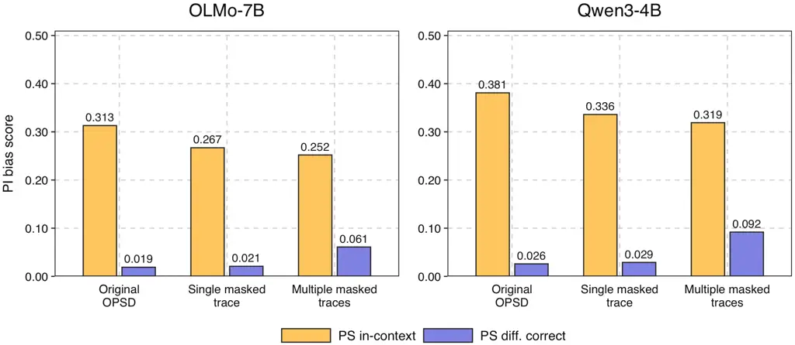
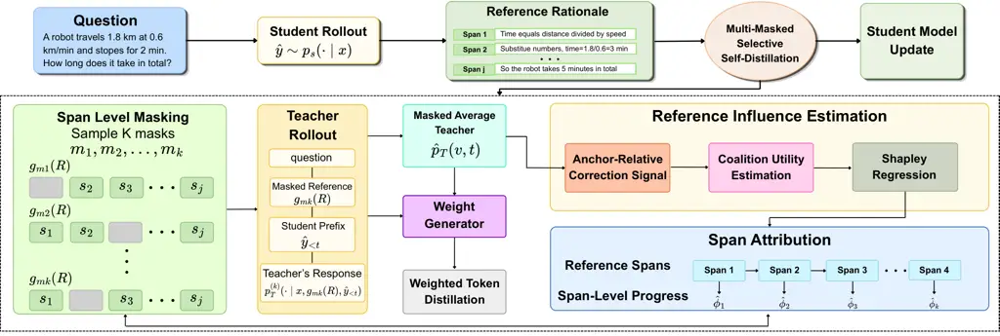
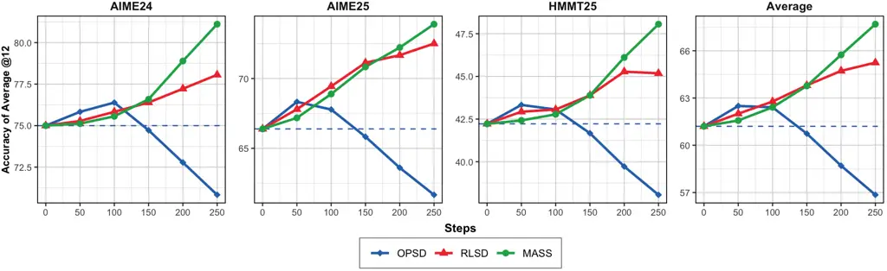
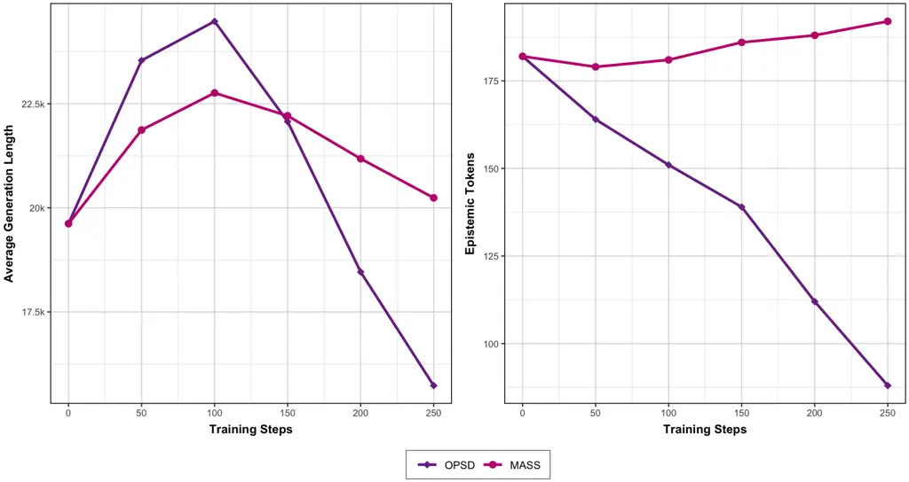
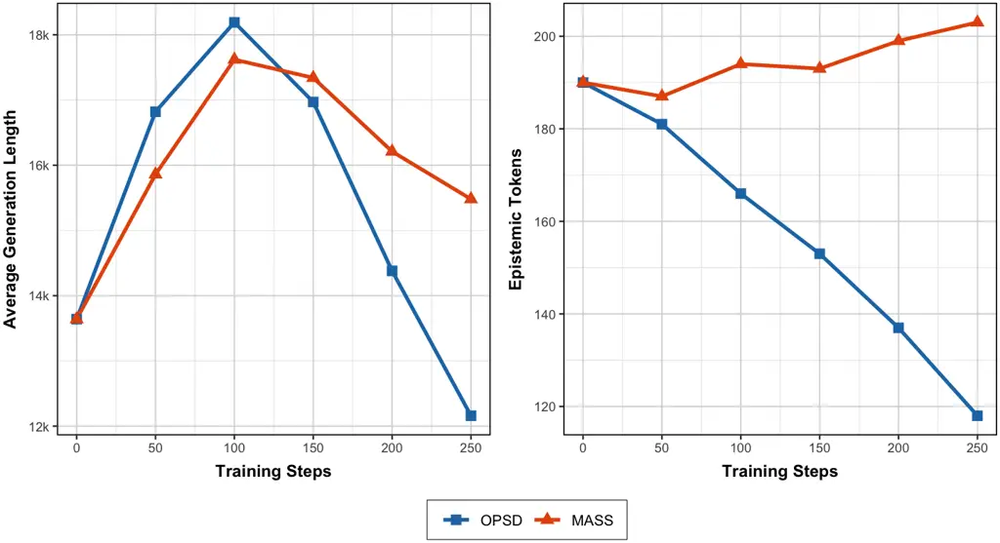
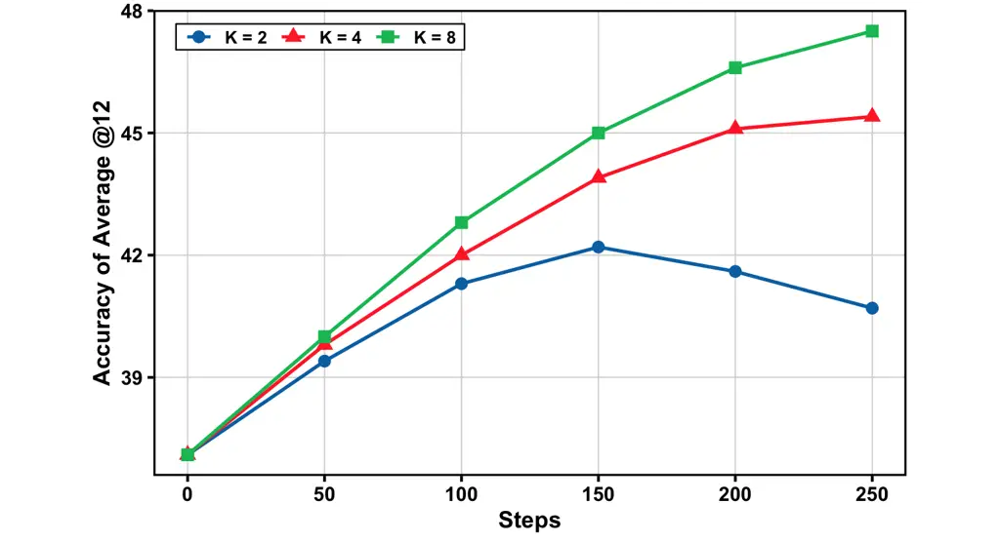
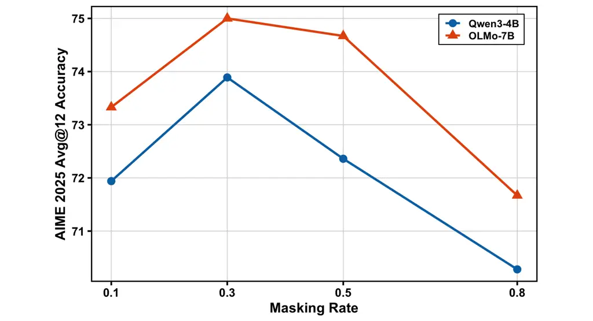
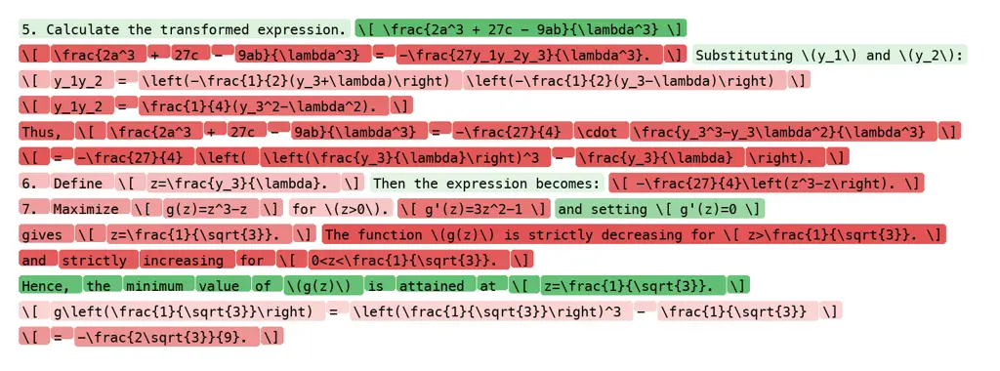

# MASS: Multi-mask Selective Self-Distillation for Leakage-Resilient Reasoning

Xiuqi Liu Affiliation: Chongqing Bashu Secondary School
Email: <lxq20080805@gmail.com>    Oveys Delafrooz Noroozi
Affiliation: University of California, Santa Barbara
Email: [oveys@ucsb.edu](mailto:)    Upamanyu Madhow
Affiliation: University of California, Santa Barbara
Email: [madhow@ucsb.edu](mailto:)

###### Abstract

On-policy self-distillation enables the same model to act as student and
teacher, with dense token-level supervision obtained by the teacher
being given access to privileged information. However, conditioning the
teacher on a single reference can concentrate its predictions on one
reasoning trajectory and limit transfer to the student. We propose
Multi-Mask Selective Self-Distillation (MASS), which approximates the
unavailable marginal over diverse reference realizations using multiple
independently masked views of one verified solution. MASS aggregates
these complementary teacher predictions, selectively transfers reliable
token-level corrections, and adaptively focuses masking on influential
reference spans. Across mathematical reasoning benchmarks and model
families, MASS consistently outperforms strong self-distillation
baselines.

## 1 Introduction

Large language models (LLMs) demonstrate strong reasoning capabilities
through post training approaches such as Reinforcement Learning with
Verifiable Rewards (Shao et al., 2024; Guo et al., 2025; Ouyang et al., 2022) (RLVR) and Supervised Fine Tuning (SFT) (Zelikman et al., 2022).
However, the substantial computational and deployment costs of large
models have motivated growing interest in transferring their
capabilities to smaller, more efficient models through knowledge
distillation (Wang et al., 2020; Hsieh et al., 2023; Hinton et al.,
2015). Conventional off-policy distillation, while effective, suffers
from distribution mismatch between teacher demonstrations and student
trajectories(Ross et al., 2011). On-policy distillation (OPD) (Agarwal
et al., 2024) addresses this mismatch by training the student on its own
rollouts while obtaining dense token-level supervision from a teacher.
On-policy self-distillation (OPSD) (Zhao et al., 2026) further removes
the need for a separate large teacher: the same model plays both roles,
with the teacher distinguished by access to privileged information that
is unavailable to the student at inference time. This framework has
since been extended to privileged contexts such as rubrics, visual
inputs, and long-context information (Ye et al., 2026; Zhang et al.,
2026; Bablani et al., 2026).

Recent studies have identified several consequences of conditioning a
self-teacher on privileged information, including performance collapse,
unstable optimization, trajectory-specific preferences, and shifts
toward overly succinct reasoning behavior (Yang et al., 2026; Harne et
al., 2026; Pan et al., 2026; Kim et al., 2026). Although these effects
arise through different mechanisms, they expose a central risk: the
teacher may become overly confident in the particular reference it is
given, concentrating its supervision on one reasoning trajectory while
underrepresenting other continuations that remain plausible from the
student’s information state.

To address the problem, existing approaches improve the transferability
of privileged supervision by anchoring the update with verifier
feedback, contrasting different privileged contexts, or reshaping and
reweighting the teacher signal (Yang et al., 2026; Pan et al., 2026; Li
et al., 2026; Xu et al., 2026; Shen et al., 2026). However, these
methods primarily intervene only after the privileged distribution has
been produced by teacher. Since reference-specific bias originates from
conditioning the teacher on a complete solution, such post-hoc
adjustments may not fully address its source. This motivates intervening
at the level of the teacher’s conditioning context, thereby shaping the
supervision distribution before it is transferred to the student. A
potential solution, suggested by Yang et al. (2026), is to average
teacher predictions across multiple valid solutions, thereby reducing
the influence of any single reasoning trajectory. In practice, however,
obtaining multiple verified solution for each question is very
expensive.

Our approach: We generate diverse conditioning contexts for teacher from
a single reference by independently masking different spans of the
reference, so that their averaged prediction retains useful guidance
without being dominated by one complete trajectory. Our proposed method,
Multi-Mask Selective Self-Distillation (MASS), averages teacher
predictions from multiple partially masked references to construct a
less reference-specific target, selectively weights reliable token-level
supervision, and adapts masking toward influential reference spans.
Together, these components preserve useful privileged guidance while
encouraging support for a broader set of reasoning paths.



Figure 1: PI Bias Scores for the in-context solution and a distinct
correct solution under the full-reference teacher, a single masked view,
and the arithmetic mean of multiple masked views.

A sanity check: To test whether masked views recover support for
alternative reasoning paths, we estimated the PI Bias Score of Harne et
al. (2026). At each student-generated prefix, we ask the privileged
teacher and unprivileged student how much probability they assign to the
same fixed continuation, and compute the difference in their mean token
log-probabilities. We evaluate this continuation either as the reference
solution shown to the teacher (_PS in-context_) or as a different
verified-correct solution to the same problem (_PS different-correct_).
A larger gap between these two scores means the teacher is more anchored
to the solution that teacher sees as privileged information, while
smaller gap means the teacher is more broadly distributed across valid
reasoning alternatives. As shown in Figure 1, a single random mask
changes this gap only slightly, whereas averaging multiple independently
masked views substantially increases support for the different correct
solution while retaining positive support for the in-context one. This
suggests that multi-mask averaging can potentially encourage more
_diverse_ reasoning supervision while still preserving useful
reference-based guidance. This is supported by the extensive evaluations
of MASS in this paper.

## 2 Methodology

We describe here the key steps in MASS, with detailed derivations
provided in Appendix  A.

### 2.1 Multi-Mask Teacher

We build on the on-policy self-distillation (OPSD) reasoning framework.
Let $`x`$ be an input question and $`R`$ its reference solution, which
is available only during training. The student generates an on-policy
trajectory $`y=(y_{1},\ldots,y_{T})`$ from the question alone. At
position $`t`$, its visible state is $`s_{t}=(x,y_{<t})`$, and its
next-token distribution is $`p_{S,t}=p_{S}(\cdot\mid s_{t})`$. The
full-reference teacher (anchor teacher) uses the same model but
additionally observes $`R`$, producing
$`p_{0,t}=p_{T}(\cdot\mid s_{t},R)`$. All teacher distributions are
detached during the student update.

Unlike prior work, which typically constructs masked views by selecting
a cutoff and hiding the remaining suffix (Tan and Hong, 2026; Feng et
al., 2024; Nguyen et al., 2026), we independently mask spans throughout
the reference to produce complementary teacher views. Specifically, we
divide $`R`$ into $`J`$ spans (parsed based on punctuation) and use a
binary vector $`m\in\{0,1\}^{J}`$ to represent a masked reference
$`g_{m}(R)`$, where $`m_{j}=1`$ indicates that span $`j`$ is hidden. For
each span, the masking decision is sampled independently as
$`m_{j}\sim\operatorname{Bernoulli}(q_{j})`$. The probabilities
$`q=(q_{1},\ldots,q_{J})`$ are initially set to the same fixed masking
rate and are later adapted as described in Section 2.3. For each student
trajectory, we sample $`K\geq 2`$ masks $`m^{(1)},\ldots,m^{(K)}`$ and
evaluate their teacher predictions at the same student prefixes:

```math
p_{k,t}=p_{T}\!\left(\cdot\mid s_{t},g_{m^{(k)}}(R)\right),\qquad k=1,\ldots,K.
```

The training target is the arithmetic mean of the $`K`$ masked teachers

```math
\widehat{p}_{t}=\frac{1}{K}\sum_{k=1}^{K}p_{k,t} \tag{1}
```

which is a stochastic approximation to the population target

```math
\bar{p}_{t}=\mathbb{E}_{M\sim q}[p_{M,t}], \tag{2}
```

Section 2.2 examines the impact of the uncertainty due to finite $`K`$
and our proposed solution.



Figure 2: Overview of MASS. Multiple masked reference provide
complementary teacher predictions over the same student trajectory and
are averaged into a marginal target. MASS selectively distills this
target using reliability-aware weighting. In parallel, anchor-relative
coalition utilities are decomposed into span-level attributions, which
adapt future masking probabilities.

### 2.2 Stable and Reference-Aware Distillation

Mask averaging does not by itself determine how strongly the student
should follow the resulting target. The finite-sample uncertainty in the
estimate $`\widehat{p}_{t}`$ should be distinguished from view
diversity: different masked teachers may reveal useful alternative
continuations, while their empirical average may still be too unstable
to provide reliable supervision at a given position. We therefore design
the token-level weight from two complementary perspectives. First, it
should compare the magnitude of the mask-marginal correction with its
sampling uncertainty, retaining corrections with a strong signal
relative to noise. Second, it should preserve corrections that move the
student away from a preference shared with the full-reference teacher,
even when the masked views exhibit moderate disagreement. We use
$`p_{0,t}`$, the teacher distribution conditioned on the complete
reference $`R`$, as an anchor for identifying such shared preferences.

Under forward-KL distillation, the gradient with respect to the student
logits is the student distribution minus the detached teacher target. We
define the ideal mask-marginal gradient as $`g_{t}=p_{S,t}-\bar{p}_{t}`$
and its finite-view estimate as
$`\widehat{g}_{t}=p_{S,t}-\widehat{p}_{T}`$. Independent mask sampling
makes $`\widehat{g}_{t}`$ unbiased, while its covariance is governed by
the dispersion of masked-teacher predictions and decreases with $`K`$.
These properties motivate three population quantities: the correction
signal $`S_{t}`$, its finite-mask uncertainty $`V_{t}`$, and its
alignment with the full-reference anchor $`B_{t}`$:

```math
\begin{gathered}S_{t}=\lVert g_{t}\rVert_{2}^{2},\qquad V_{t}=\frac{1}{K}\operatorname{tr}\!\left(\operatorname{Cov}_{M\sim q}(p_{M,t})\right),\\
B_{t}=\left\langle p_{S,t}-\bar{p}_{t},\,p_{0,t}-\bar{p}_{t}\right\rangle.\end{gathered} \tag{3}
```

Here, $`S_{t}`$ measures the magnitude of the population correction,
while $`V_{t}=\mathbb{E}\lVert\widehat{g}_{t}-g_{t}\rVert_{2}^{2}`$
measures the expected error caused by estimating it with only $`K`$
masks. The anchor term $`B_{t}`$ is positive when the student and the
full-reference teacher deviate from $`\bar{p}_{t}`$ in similar
directions. In this case, moving the student toward the mask marginal
counteracts a preference reinforced by the complete reference. The three
quantities characterize the directional alignment, magnitude, and
reliability of the correction, respectively, providing a joint basis for
understanding the effect of distillation.

The population quantities in Eq. (3) cannot be computed directly.
However, the same $`K`$ teacher views used to form $`\widehat{p}_{t}`$
provide bias-corrected estimates:

```math
\displaystyle\widehat{V}_{t} \displaystyle=\frac{1}{K(K-1)}\sum_{k=1}^{K}\lVert p_{k,t}-\widehat{p}_{t}\rVert_{2}^{2}, \tag{4}
```

```math
\displaystyle\widehat{S}_{t} \displaystyle=\lVert p_{S,t}-\widehat{p}_{t}\rVert_{2}^{2}-\widehat{V}_{t},
```

```math
\displaystyle\widehat{B}_{t} \displaystyle=\left\langle p_{S,t}-\widehat{p}_{t},\,p_{0,t}-\widehat{p}_{t}\right\rangle-\widehat{V}_{t}.
```

The first line estimates the variance of the empirical mean. Because the
same sampled mean appears in both quadratic statistics, their
uncorrected values contain an additional $`\widehat{V}_{t}`$ term.
Subtracting it makes $`\widehat{V}_{t}`$, $`\widehat{S}_{t}`$, and
$`\widehat{B}_{t}`$ conditionally unbiased for $`V_{t}`$, $`S_{t}`$, and
$`B_{t}`$, respectively.

We next determine how much of the empirical gradient should be retained.
For a scalar $`w\in[0,1]`$, consider the population criterion
$`\mathbb{E}\lVert w\widehat{g}_{t}-g_{t}\rVert_{2}^{2}+\varepsilon w^{2}-2\lambda w[B_{t}]_{+}`$,
where $`[a]_{+}=\max(a,0)`$, $`\lambda\geq 0`$ controls the contribution
of the anchor-relative signal, and $`\varepsilon>0`$ provides numerical
regularization. Since
$`\mathbb{E}\lVert w\widehat{g}_{t}-g_{t}\rVert_{2}^{2}=(1-w)^{2}S_{t}+w^{2}V_{t}`$,
its clipped minimizer is
$`w_{t}^{*}=\min\{1,(S_{t}+\lambda[B_{t}]_{+})/(S_{t}+V_{t}+\varepsilon)\}`$.
Replacing the population quantities with their estimates gives the
practical weight

```math
\widehat{w}_{t}=\min\!\left\{1,\,\frac{[\widehat{S}_{t}]_{+}+\lambda[\widehat{B}_{t}]_{+}}{[\widehat{S}_{t}]_{+}+\widehat{V}_{t}+\varepsilon}\right\}. \tag{5}
```

We restrict $`\widehat{w}_{t}`$ to $`[0,1]`$ because it represents the
fraction of the empirical correction retained, rather than an
amplification factor. A value near one applies the multi-mask correction
almost fully, indicating that it is strong, reproducible, or supported
by the anchor-relative signal; a value near zero largely removes a
correction that can be explained by mask-sampling uncertainty. The
unconstrained ratio may exceed one when the anchor term is sufficiently
large, but this would extrapolate beyond the estimated correction and
potentially destabilize training. We therefore clip such values to one
and interpret them as sufficient evidence to retain the correction in
full. Finally, MASS applies the weight to token-level distillation:

```math
\mathcal{L}(\theta)=\frac{1}{T}\sum_{t=1}^{T}\operatorname{sg}(\widehat{w}_{t})\,\operatorname{KL}\!\left(\operatorname{sg}(\widehat{p}_{t})\,\|\,p_{S,t}\right), \tag{6}
```

where $`\operatorname{sg}`$ denotes stop-gradient. The scalar weight
controls the strength of supervision at each position while preserving
the relative probabilities of the arithmetic teacher target.

### 2.3 Adaptive Masking

Uniform masking assigns the same expected budget to all reference spans,
although their effects on the teacher may differ substantially. Some
spans provide only local details, while others determine the reasoning
direction or final answer. We therefore attribute useful mask-induced
changes to individual spans and adapt their masking probabilities on
later visits to the same example. The utility of a span cannot be
evaluated by masking it in isolation, because the effect depends on
which other spans remain visible. Instead, as discussed below, we treat
spans as players in a cooperative game and masked spans as a coalition
to compute approximate Shapley values(Shapley and others, 1953) for each
span. These are then used to update the masking probabilities.

Let $`A\subseteq\{1,\ldots,J\}`$ denote a coalition of masked spans and
let $`p_{A,t}=p_{T}(\cdot\mid s_{t},g_{A}(R))`$ be the corresponding
teacher distribution. During one visit, all coalitions are evaluated
against the same detached correction direction:

```math
v(A)=\frac{1}{T}\sum_{t=1}^{T}\left\langle\operatorname{sg}(p_{S,t}-\widehat{p}_{t}),\,p_{0,t}-p_{A,t}\right\rangle. \tag{7}
```

A positive $`v(A)`$ means that masking coalition $`A`$ changes the
teacher in a direction consistent with the student update toward the
common mask average. Fixing the first factor makes coalition values
comparable. The unmasked teacher provides a zero-utility baseline: when
$`A=\varnothing`$,$`p_{\varnothing,t}=p_{0,t}`$ and
$`v(\varnothing)=0`$.

For a coalition $`A`$ that excludes span $`j`$, define the marginal
contribution of $`j`$ as $`\delta_{j}(A)=v(A\cup\{j\})-v(A)`$. The
Shapley value of span $`j`$ is

```math
\phi_{j}=\sum_{A\subseteq\{1,\ldots,J\}\setminus\{j\}}\frac{|A|!(J-|A|-1)!}{J!}\,\delta_{j}(A). \tag{8}
```

Hence, $`\phi_{j}>0`$ indicates that masking span $`j`$ supports the
current mask-marginal correction on average over the states of the other
spans.

Instead of considering the $`2^{J}`$ coalitions required for the exact
computation in (8), we reuse the $`K`$ masks already evaluated for
distillation. For mask $`m^{(k)}\in\{0,1\}^{J}`$, let $`A_{k}`$ denote
its masked-span coalition and $`R^{(k)}=v(A_{k})`$ its utility. We
estimate span attributions using a Shapley-kernel weighted regression
(Lundberg and Lee, 2017):

```math
\begin{split}\widehat{\phi}={}&\arg\min_{\beta}\sum_{k=1}^{K}\omega_{k}\left(R^{(k)}-m^{(k)\top}\beta\right)^{2}+\tau\lVert\beta-z\rVert_{2}^{2}\\
&\text{s.t.}\quad\sum_{j=1}^{J}\beta_{j}=v(\{1,\ldots,J\}).\end{split} \tag{9}
```

where $`\beta_{j}`$ is the attribution assigned to span $`j`$, $`z_{j}`$
is its running estimate from previous visits updated through exponential
moving average, and $`\tau\geq 0`$ stabilizes the fit when $`K<J`$. The
weight $`\omega_{k}`$ is the Shapley-kernel weight corrected by the
sampling probability of $`m^{(k)}`$ under $`q`$.

We set the masking priority of span $`j`$ to
$`I_{j}=[\widehat{\phi}_{j}]_{+}`$. Let $`q_{j}`$ be the probability of
masking span $`j`$, so $`\operatorname{Ber}(q_{j})`$ denotes the
corresponding Bernoulli mask distribution. We update $`q`$ by

```math
\begin{split}q^{(n+1)}={}&\arg\max_{q\in\mathcal{Q}}\left\{\sum_{j=1}^{J}I_{j}H_{\mathrm{Ber}}(q_{j})\vphantom{\frac{1}{\eta}}\right.\\
&\left.-\frac{1}{\eta}\sum_{j=1}^{J}\operatorname{KL}\!\left(\operatorname{Ber}(q_{j})\,\|\,\operatorname{Ber}(q_{j}^{(n)})\right)\right\},\end{split} \tag{10}
```

where
$`H_{\mathrm{Ber}}(q_{j})=-q_{j}\log q_{j}-(1-q_{j})\log(1-q_{j})`$,
$`\mathcal{Q}=\{q:\sum_{j}q_{j}=\rho J,\,\epsilon\leq q_{j}\leq 1-\epsilon\}`$,
and $`\eta>0`$ controls the adaptation rate. The entropy term keeps
influential spans sampled in both masked and visible states, while the
KL term prevents abrupt changes in their masking probabilities.

## 3 Experiments

| Model      | Method | AIME24 | AIME25 | HMMT25 | Avg.  |
| ---------- | ------ | ------ | ------ | ------ | ----- |
| Qwen3-1.7B | Base   | 51.39  | 36.67  | 23.06  | 37.04 |
|            | OPSD   | 55.56  | 41.11  | 26.94  | 41.20 |
|            | AVSD   | 59.17  | 45.28  | 29.72  | 44.72 |
|            | RLSD   | 58.89  | 45.83  | 30.00  | 44.91 |
|            | MASS   | 60.83  | 47.50  | 30.83  | 46.39 |
| Qwen3-4B   | Base   | 75.00  | 66.39  | 42.22  | 61.20 |
|            | OPSD   | 76.39  | 68.33  | 43.33  | 62.68 |
|            | AVSD   | 78.33  | 72.78  | 45.56  | 65.56 |
|            | RLSD   | 78.06  | 72.50  | 45.28  | 65.28 |
|            | MASS   | 81.11  | 73.89  | 48.06  | 67.69 |
| Qwen3-8B   | Base   | 78.89  | 70.83  | 48.33  | 66.02 |
|            | OPSD   | 81.67  | 74.44  | 50.83  | 68.98 |
|            | AVSD   | 83.89  | 77.50  | 53.06  | 71.48 |
|            | RLSD   | 83.61  | 77.22  | 52.78  | 71.20 |
|            | MASS   | 85.56  | 79.44  | 54.72  | 73.24 |
| OLMo-7B    | Base   | 71.9   | 66.9   | 45.0   | 61.3  |
|            | OPSD   | 73.1   | 70.0   | 46.1   | 63.1  |
|            | AVSD   | 74.7   | 71.9   | 47.8   | 64.8  |
|            | RLSD   | 75.6   | 72.8   | 48.3   | 65.6  |
|            | MASS   | 78.1   | 75.0   | 51.1   | 68.1  |

Table 1: Performance comparison on mathematical reasoning benchmarks. We
report Avg@12 accuracy on AIME 2024, AIME 2025, and HMMT 2025. MASS
consistently achieves the strongest average performance across all
evaluated model settings.

### 3.1 Experimental Setup

We conduct experiments on Qwen3-1.7B, Qwen3-4B, Qwen3-8B (Yang et al.,
2025), and OLMo-7B(Olmo et al., 2026), covering multiple model scales
and families to evaluate whether MASS generalizes across both weaker and
stronger reasoners as well as different model families. Following the
OPSD training protocol, we use 30K mathematical reasoning samples from
OpenThoughts (Guha et al., 2025) for training.

We evaluate on AIME 2024, AIME 2025, and HMMT 2025 (Dekoninck et al.,
2026). For each problem, we sample 12 independent reasoning
trajectories, resulting in 360 responses per benchmark. We report Avg@12
accuracy, defined as the proportion of sampled responses that reach the
correct final answer.

Experiment details for the MASS implementation are provided Appendix C,
while additional experimental results are provided in Appendix B.



Figure 3: Performance Dynamics over 250 Training Steps. We compare MASS
with OPSD and RLSD on Qwen3-4B reporting Avg@12 accuracy on AIME25
within 250 training steps. OPSD peaks early, while RLSD and MASS sustain
improvement throughout training.

We compare MASS with three representative post-training baselines. OPSD
(Zhao et al., 2026) is the direct single-view self-distillation
baseline, where the teacher is conditioned on the full reference
solution. RLSD (Yang et al., 2026) addresses privileged-information
leakage through an RLVR-based formulation. Although it belongs to a
different methodological family, we include it as a strong reasoning
baseline and to compare token efficiency, since RLSD relies on grouped
rollouts and verifiable rewards while MASS performs dense token-level
distillation from a single student trajectory. AVSD (Nguyen et al., 2026) is the closest multi-view baseline. It combines heterogeneous
privileged views by separating cross-view consensus from view-specific
residual signals. In contrast, MASS constructs complementary views by
masking different spans of the same reference and uses arithmetic
aggregation to preserve alternative reasoning branches.

### 3.2 Main Results

Table 1 shows that MASS consistently outperforms the compared
post-training baselines across model scales and model families. The
improvement over OPSD indicates that directly distilling from a fully
privileged teacher can become limiting when the supervision is overly
tied to a particular reference trajectory. MASS also remains stronger
than AVSD, suggesting that the benefit cannot be attributed to
multi-view supervision alone; how the views are constructed and
aggregated is important for preserving transferable reasoning signals.
Compared with RLSD, MASS achieves a smaller but consistent advantage,
despite relying on a substantially different training mechanism. These
results suggest that marginalizing over complementary masked views
provides an effective alternative to reward-guided leakage mitigation.
The gains persist from smaller to stronger Qwen3 models and transfer to
OLMo, indicating that the method is not restricted to a particular model
capacity or family.

Figure 3 provides a complementary view of how these differences emerge
during training. OPSD typically improves fastest in the early stage, but
its performance peaks early and subsequently deteriorates. RLSD exhibits
substantially more stable improvement, while MASS initially progresses
more slowly and gradually closes the gap as training continues. Around
the middle of training, MASS catches up with or crosses RLSD, after
which it continues to improve and achieves the strongest late-stage
performance. Although the exact crossover point varies across
benchmarks, the same qualitative pattern is visible in the averaged
trajectory. These dynamics suggest that the advantage of MASS does not
come from more aggressive early optimization, but from providing a
supervision target that remains useful over longer training horizons.

Motivated by Kim et al. (2026), we further examine response length and
epistemic token usage as indirect behavioral indicators of
overconfidence during self-distillation. Epistemic tokens refer to
expressions such as wait, perhaps, and maybe, which verbalize
uncertainty and can signal reconsideration of an intermediate reasoning
path. Prior work shows that privileged conditioning tends to suppress
such verbalization, producing shorter and more confident responses; when
this suppression becomes excessive, it can remove signals useful for
error correction and robust reasoning.

As shown in Figure 4, both OPSD and MASS exhibit an early increase in
response length followed by compression as training progresses. However,
the contraction under OPSD is substantially stronger, whereas MASS
maintains longer reasoning traces and decreases more gradually. A
similar distinction appears in epistemic token usage. OPSD progressively
suppresses epistemic expressions, while MASS shows only a small initial
reduction followed by a gradual recovery, with some variation across
checkpoints. These patterns suggest that MASS mitigates the
confidence-inducing effect of privileged self-distillation: it still
learns to compress reasoning, but does so without aggressively
eliminating uncertainty-aware behavior that may help preserve
alternative reasoning possibilities.

### 3.3 Ablation Study

#### Anchor-target ablation.

We examine whether the full-reference teacher should also participate in
target construction. In the original MASS, the target is the arithmetic
mean of the $`K`$ masked teachers. In the anchor variant, we instead use
$`\widetilde{p}_{t}=(p_{0,t}+\sum_{k=1}^{K}p_{k,t})/(K+1)`$, treating
the full-reference teacher as one additional view. Since $`p_{0,t}`$ is
fixed with respect to mask sampling, we rescale the estimated target
variance by $`(K/(K+1))^{2}`$. All other components, including the
sampled masks, selective weight, adaptive masking, training schedule,
and evaluation protocol, remain unchanged. We conduct this comparison on
Qwen3-4B and OLMo-7B using AIME 2025 Avg@12.

| Model    | Target                   | Acc.  |
| -------- | ------------------------ | ----- |
| Qwen3-4B | Masked avg. (Base)       | 73.89 |
|          | Masked avg. $`+`$ anchor | 72.50 |
| OLMo-7B  | Masked avg. (Base)       | 75.00 |
|          | Masked avg. $`+`$ anchor | 73.89 |

Table 2: Ablation on the anchor teacher. AIME 2025 Avg@12 accuracy is
reported.

As shown in Table 2, adding the anchor to the target produces a modest
decrease on both models. The degradation remains limited because the
$`K`$ masked teachers still contribute most of the averaged target,
while the anchor can provide a stable and confident signal.
Nevertheless, its inclusion shifts supervision back toward the fully
observed reference and dilutes continuations supported only by masked
views. The consistent decrease suggests that the full-reference teacher
is more effective as a signal for selecting useful corrections than as a
direct component of the distillation target.



(a) Qwen3-8B



(b) OLMo-7B

Figure 4: Reasoning behavior during self-distillation. We measured
average response length and epistemic token usage for (a) Qwen3-8B and
(b) OLMo-7B on AIME25 evaluation.

#### Sensitivity to Teacher Route Scaling and Masking Strength.

We then study how MASS scales with the number of teacher routes. As
shown in Figure 5, performance improves as more masked teacher routes
are introduced. With only a small number of routes, the aggregated
target is still determined by a limited set of privileged views.
Increasing the number of routes provides broader coverage over
complementary masked contexts, reducing dependence on any particular
privileged trajectory and allowing the aggregated teacher to preserve a
richer set of valid reasoning signals. The gains become more pronounced
as route coverage increases, suggesting that sufficiently diverse
teacher routes are important for effective marginalization.



Figure 5: Sensitivity to the number of teacher routes. Increasing the
number of routes improves AIME 2025 Avg@12 accuracy on Qwen3-1.7B.

We next vary the masking ratio while keeping the remaining training
setup fixed. Figure 6 exhibits an inverted-U pattern, with a masking
ratio of $`0.3`$ achieving the strongest performance. When the masking
ratio is too small, most of the reference solution remains visible to
the teacher, leaving the supervision strongly privileged and
insufficiently mitigating overconfident, trajectory-specific guidance.
Conversely, overly aggressive masking removes too much useful reasoning
evidence and weakens the informativeness of the teacher target. The
intermediate masking ratio provides the best trade-off between reducing
privileged-information bias and retaining sufficient supervision signal.



Figure 6: Sensitivity to masking strength. On Qwen3-4B, a moderate
masking ratio gives the best AIME 2025 Avg@12 accuracy.

#### Reliability Weighting and Adaptive Masking.

To isolate the contribution of the two components in MASS, we ablate
reliability weighting and adaptive masking on Qwen3-4B and evaluate on
AIME 2025. We compare three reduced variants against the full model:
removing both components, retaining only reliability weighting, and
retaining only adaptive masking.

| Variant        | Weighting | Adaptive Masking | AIME25 |
| -------------- | --------- | ---------------- | ------ |
| Neither        | ✗         | ✗                | 70.83  |
| Weighting only | ✓         | ✗                | 72.22  |
| Adaptive only  | ✗         | ✓                | 72.78  |
| Full MASS      | ✓         | ✓                | 73.89  |

Table 3: Ablation of reliability weighting and adaptive masking. Both
components improve AIME 2025 performance on Qwen3-4B, with the full
configuration achieving the strongest result.

The results show that both components contribute independently and are
complementary. Reliability weighting reduces the influence of less
reliable masked teacher signals, while adaptive masking improves the
construction of informative masked views during training. Adaptive
masking provides a slightly larger gain when used alone, but the
strongest performance is obtained when both mechanisms are enabled. This
suggests that MASS benefits from jointly controlling _which_ masked
views are constructed and _how_ their supervision is weighted.

#### Out-of-Distribution (OOD) Generalization.

To examine whether the improvements of MASS transfer beyond the
mathematical reasoning domain used for training, we conduct an
out-of-distribution evaluation on GPQA(Rein et al., 2023) and BBH
(Suzgun et al., 2023). These benchmarks cover scientific knowledge and
diverse reasoning tasks, respectively, and therefore differ from our
mathematical training distribution. We evaluate the Qwen3-8B and
OLMo3-7B-Think models and compare MASS with the corresponding base
models, OPSD, and AVSD. As shown in Table 4, MASS achieves the strongest
performance across both benchmarks and model families. In contrast, OPSD
and AVSD generally reduce out-of-distribution accuracy, suggesting that
conventional privileged self-distillation can over-specialize the model
to the training-domain reasoning patterns. By marginalizing over
complementary masked references and selectively retaining reliable
corrections, MASS may reduce this specialization and preserve more of
the models’ general reasoning capabilities.

| Model          | Method | GPQA | BBH  |
| -------------- | ------ | ---- | ---- |
| Qwen3-8B       | Base   | 57.7 | 84.4 |
|                | OPSD   | 54.8 | 82.9 |
|                | AVSD   | 56.6 | 83.7 |
|                | MASS   | 58.3 | 84.6 |
| OLMo3-7B-Think | Base   | 46.2 | 86.6 |
|                | OPSD   | 43.9 | 85.0 |
|                | AVSD   | 44.1 | 85.9 |
|                | MASS   | 46.9 | 86.8 |

Table 4: OOD evaluation. GPQA Avg@8 and BBH Avg@1 accuracy are reported.

## 4 Related Work

#### Knowledge Distillation and On-Policy Self-Distillation.

Knowledge distillation transfers predictive knowledge from a capable
teacher to a smaller student (Hinton et al., 2015; Wang et al., 2020;
Hsieh et al., 2023). Conventional off-policy distillation relies on
fixed teacher demonstrations and can therefore suffer from a mismatch
with student-induced states (Ross et al., 2011). On-policy distillation
instead evaluates the teacher along student trajectories (Agarwal et
al., 2024), while on-policy self-distillation uses the same model as
both student and teacher, with the latter receiving privileged
information such as a verified solution (Zhao et al., 2026). This
efficient framework has also been extended to rubrics, visual inputs,
and long-context information (Ye et al., 2026; Zhang et al., 2026;
Bablani et al., 2026). Its central challenge is whether supervision
produced with privileged information remains transferable when that
information is unavailable at inference time.

#### Distillation from Privileged Information.

Recent studies identify several consequences of privileged conditioning,
including reference-dependent signals, unstable optimization,
trajectory-specific preferences, style drift, and suppressed epistemic
behavior (Yang et al., 2026; Harne et al., 2026; Pan et al., 2026; Kim
et al., 2026). Existing methods address these effects by anchoring or
contrasting teacher signals (Yang et al., 2026; Pan et al., 2026; He et
al., 2026), or by interpolating, reshaping, and selectively applying the
privileged target (Li et al., 2026; Xu et al., 2026; Shen et al., 2026).
PAINT varies partial-solution exposure (Tan and Hong, 2026), whereas
AVSD combines multiple types of privileged information through
cross-view consensus (Nguyen et al., 2026). MASS focuses on the setting
where only one verified solution is available. It creates complementary
views through independent span masking and averages their predictions as
an empirical masked-reference marginal. Selective weighting and adaptive
masking further control finite-view uncertainty and focus masking on
influential spans, allowing MASS to broaden the teacher target rather
than only rescale supervision from a fixed privileged view.

## 5 Conclusion

We introduced Multi-Mask Selective Self-Distillation (MASS), which
combines multi-mask teacher aggregation, selective distillation, and
adaptive masking to outperform existing baselines across models and
reasoning benchmarks. Beyond these gains, our results suggest that
constructing complementary teacher contexts can broaden support beyond
the demonstrated trajectory, while reliability aware weighting separates
useful view diversity from finite mask uncertainty. More broadly, MASS
highlights teacher-context design as an important dimension of
privileged self-distillation. Future work may incorporate MASS-derived
token-level correction signals into RLVR to provide dense, reliable
advantage weighting within an GRPO framework.

Several limitations remain. While MASS requires no additional
autoregressive rollouts and is substantially more token-efficient than
group-based generation, evaluating multiple masked teacher routes still
increases peak accelerator-memory usage. This overhead may be reduced
through memory-aware route batching or adaptive allocation of teacher
routes. The current implementation also relies on fixed span
segmentation and sampled Shapley attribution, motivating learned
segmentation and more efficient attribution estimators. Finally, our
evaluation mainly focuses on reasoning. Extending MASS to other domains
such as coding remains an important direction.

## 6 Acknowledgement

This research was initiated through the UC Santa Barbara Research
Mentorship Program (RMP), which we gratefully acknowledge. We thank Dr.
Lina Kim and Dr. Teresa Holden for directing the program. The work begun
during the program was subsequently continued and extended to produce
this paper.

## 7 Reproducibility Statement

To facilitate reproducibility, we provide detailed descriptions of the
model architecture in Section 2, the training and evaluation strategy in
Section 3.1, and the hyperparameters and other training details in
Appendix C. The source code used in our experiments is publicly
available at
[https://github.com/researcheranoymous-oss/MASS_2027](https://github.com/researcheranoymous-oss/MASS_2027)

## References

- Agarwal et al. (2024) R. Agarwal, N. Vieillard, Y. Zhou, P.
  Stanczyk, S. Ramos Garea, M. Geist, and O. Bachem On-policy
  distillation of language models: learning from self-generated
  mistakes. In International Conference on Learning Representations,
  Vol. 2024, pp. 21246–21263. Cited by: §1, §4.
- Bablani et al. (2026) D. Bablani, A. Gupta, and W. Chen Rubrics as
  privileged information for open-ended generation. arXiv preprint
  arXiv:2608.02948. Cited by: §1, §4.
- Dekoninck et al. (2026) J. Dekoninck, N. Jovanović, T. Gehrunger, K.
  Rögnvaldsson, I. Petrov, C. Sun, and M. Vechev Beyond benchmarks:
  MathArena as an evaluation platform for mathematics with LLMs. arXiv
  preprint arXiv:2605.00674. Cited by: §3.1.
- Feng et al. (2024) K. Feng, C. Li, X. Zhang, J. Zhou, Y. Yuan, and G.
  Wang Keypoint-based progressive chain-of-thought distillation for
  llms. arXiv preprint arXiv:2405.16064. Cited by: §2.1.
- Guha et al. (2025) E. Guha, R. Marten, S. Keh, N. Raoof, G.
  Smyrnis, H. Bansal, L. Schmidt, et al. OpenThoughts: data recipes for
  reasoning models. arXiv preprint arXiv:2506.04178. Cited by: §3.1.
- Guo et al. (2025) D. Guo, D. Yang, H. Zhang, J. Song, P. Wang, Q.
  Zhu, R. Xu, R. Zhang, S. Ma, X. Bi, et al. Deepseek-r1: incentivizing
  reasoning capability in llms via reinforcement learning. arXiv
  preprint arXiv:2501.12948. Cited by: §1.
- Harne et al. (2026) S. Harne, C. Karkar, Y. Pandya, A. Awadallah,
  and A. Nambi Privileged, but biased: how pi-conditioned teachers break
  self-distillation. arXiv preprint arXiv:2608.04794. Cited by: §1, §1,
  §4.
- He et al. (2026) Q. He, Z. Wu, and Z. Wang Not all tokens deserve
  equal credit: counterfactual sensitivity credit reallocation for
  long-cot reasoning. arXiv preprint arXiv:2607.27888. Cited by: §4.
- Hinton et al. (2015) G. Hinton, O. Vinyals, and J. Dean Distilling the
  knowledge in a neural network. arXiv preprint arXiv:1503.02531. Cited
  by: §1, §4.
- Hsieh et al. (2023) C. Hsieh, C. Li, C. Yeh, H. Nakhost, Y. Fujii, A.
  Ratner, R. Krishna, C. Lee, and T. Pfister Distilling step-by-step!
  outperforming larger language models with less training data and
  smaller model sizes. In Findings of the association for computational
  linguistics: ACL 2023, pp. 8003–8017. Cited by: §1, §4.
- Kim et al. (2026) J. Kim, X. Luo, M. Kim, S. Lee, D. Kim, J. Jeon, D.
  Li, and Y. Yang Why does self-distillation (sometimes) degrade the
  reasoning capability of llms?. arXiv preprint arXiv:2603.24472. Cited
  by: §1, §3.2, §4.
- Li et al. (2026) Y. Li, H. Shi, W. Liu, M. Ruan, H. Hou, Z. Dai, S.
  Qiu, and L. Song DemoPSD: disagreement-modulated policy
  self-distillation. arXiv preprint arXiv:2607.02502. Cited by: §1, §4.
- Lundberg and Lee (2017) S. M. Lundberg and S. Lee A unified approach
  to interpreting model predictions. Advances in neural information
  processing systems 30. Cited by: §2.3.
- Nguyen et al. (2026) D. Nguyen, H. Xiao, A. Prasad, Z. Khan, A.
  Das, A. Zhang, S. Sahu, H. Lee, E. Stengel-Eskin, and M. Bansal AVSD:
  adaptive-view self-distillation by balancing consensus and
  teacher-specific privileged signals. arXiv preprint arXiv:2605.20643.
  Cited by: §2.1, §3.1, §4.
- Olmo et al. (2026) T. Olmo, :, A. Ettinger, A. Bertsch, B. Kuehl, D.
  Graham, D. Heineman, D. Groeneveld, F. Brahman, F. Timbers, H.
  Ivison, J. Morrison, J. Poznanski, K. Lo, L. Soldaini, M. Jordan, M.
  Chen, M. Noukhovitch, N. Lambert, P. Walsh, P. Dasigi, R. Berry, S.
  Malik, S. Shah, S. Geng, S. Arora, S. Gupta, T. Anderson, T. Xiao, T.
  Murray, T. Romero, V. Graf, A. Asai, A. Bhagia, A. Wettig, A. Liu, A.
  Rangapur, C. Anastasiades, C. Huang, D. Schwenk, H. Trivedi, I.
  Magnusson, J. Lochner, J. Liu, L. J. V. Miranda, M. Sap, M. Morgan, M.
  Schmitz, M. Guerquin, M. Wilson, R. Huff, R. L. Bras, R. Xin, R.
  Shao, S. Skjonsberg, S. Z. Shen, S. S. Li, T. Wilde, V. Pyatkin, W.
  Merrill, Y. Chang, Y. Gu, Z. Zeng, A. Sabharwal, L. Zettlemoyer, P. W.
  Koh, A. Farhadi, N. A. Smith, and H. Hajishirzi Olmo 3. External
  Links: 2512.13961, [Link](https://arxiv.org/abs/2512.13961) Cited by:
  §3.1.
- Ouyang et al. (2022) L. Ouyang, J. Wu, X. Jiang, D. Almeida, C.
  Wainwright, P. Mishkin, C. Zhang, S. Agarwal, K. Slama, A. Ray, et al.
  Training language models to follow instructions with human feedback.
  Advances in neural information processing systems 35, pp. 27730–27744.
  Cited by: §1.
- Pan et al. (2026) L. Pan, S. Tao, Y. Zhai, L. Zhang, Z. Liu, B.
  Ding, A. Liu, and L. Wen RLCSD: reinforcement learning with
  contrastive on-policy self-distillation. arXiv preprint
  arXiv:2606.11709. Cited by: §1, §1, §4.
- Rein et al. (2023) D. Rein, B. L. Hou, A. C. Stickland, J.
  Petty, R. Y. Pang, J. Dirani, J. Michael, and S. R. Bowman Gpqa: a
  graduate-level google-proof q&a benchmark. arXiv preprint
  arXiv:2311.12022. Cited by: §3.3.
- Ross et al. (2011) S. Ross, G. Gordon, and D. Bagnell A reduction of
  imitation learning and structured prediction to no-regret online
  learning. In Proceedings of the fourteenth international conference on
  artificial intelligence and statistics, pp. 627–635. Cited by: §1, §4.
- Shao et al. (2024) Z. Shao, P. Wang, Q. Zhu, R. Xu, J. Song, X. Bi, H.
  Zhang, M. Zhang, Y. Li, Y. Wu, et al. Deepseekmath: pushing the limits
  of mathematical reasoning in open language models. arXiv preprint
  arXiv:2402.03300. Cited by: §1.
- Shapley et al. (1953) L. S. Shapley et al. A value for n-person games.
  Cited by: §2.3.
- Shen et al. (2026) G. Shen, X. Cheng, C. Zhao, L. Huang, J. Li, D.
  Zhao, and X. Yu Anti-self-distillation for reasoning rl via pointwise
  mutual information. arXiv preprint arXiv:2605.11609. Cited by: §1, §4.
- Suzgun et al. (2023) M. Suzgun, N. Scales, N. Schärli, S. Gehrmann, Y.
  Tay, H. W. Chung, A. Chowdhery, Q. Le, E. H. Chi, D. Zhou, et al.
  Challenging big-bench tasks and whether chain-of-thought can solve
  them. In Findings of the Association for Computational Linguistics:
  ACL 2023, pp. 13003–13051. Cited by: §3.3.
- Tan and Hong (2026) Z. Tan and Y. Hong PAINT: partial-solution
  adaptive interpolated training for self-distilled reasoners. arXiv
  preprint arXiv:2604.26573. Cited by: §2.1, §4.
- Wang et al. (2020) W. Wang, F. Wei, L. Dong, H. Bao, N. Yang, and M.
  Zhou Minilm: deep self-attention distillation for task-agnostic
  compression of pre-trained transformers. Advances in neural
  information processing systems 33, pp. 5776–5788. Cited by: §1, §4.
- Xu et al. (2026) J. Xu, M. Liu, J. Zhang, T. Goldstein, and F. Huang
  $`\beta`$-OPSD: deriving with policy optimization, training with
  self-distillation. External Links: 2607.28582,
  [Link](https://arxiv.org/abs/2607.28582) Cited by: §1, §4.
- Yang et al. (2025) A. Yang, A. Li, B. Yang, B. Zhang, B. Hui, B.
  Zheng, Z. Qiu, et al. Qwen3 technical report. arXiv preprint
  arXiv:2505.09388. Cited by: §3.1.
- Yang et al. (2026) C. Yang, C. Qin, Q. Si, M. Chen, N. Gu, D. Yao, Z.
  Lin, W. Wang, J. Wang, and N. Duan Self-distilled rlvr. arXiv preprint
  arXiv:2604.03128. Cited by: §1, §1, §3.1, §4.
- Ye et al. (2026) T. Ye, L. Dong, X. Wu, S. Huang, and F. Wei On-policy
  context distillation for language models. arXiv preprint
  arXiv:2602.12275. Cited by: §1, §4.
- Zelikman et al. (2022) E. Zelikman, Y. Wu, J. Mu, and N. Goodman Star:
  bootstrapping reasoning with reasoning. Advances in Neural Information
  Processing Systems 35, pp. 15476–15488. Cited by: §1.
- Zhang et al. (2026) X. Zhang, Z. Ding, T. Pan, R. Yang, C. Kang, X.
  Xiong, and J. Gu Opsdl: on-policy self-distillation for long-context
  language models. arXiv preprint arXiv:2604.17535. Cited by: §1, §4.
- Zhao et al. (2026) S. Zhao, Z. Xie, M. Liu, J. Huang, G. Pang, F.
  Chen, and A. Grover Self-distilled reasoner: on-policy
  self-distillation for large language models. arXiv preprint
  arXiv:2601.18734. Cited by: §1, §3.1, §4.

## Appendix A Theoretical Development

This appendix collects the derivations that Section 2 states without
proof and makes explicit the assumptions behind them. Throughout, we fix
a student prefix $`s_{t}`$, the model snapshot, and the masking
distribution $`q`$, and drop the position index $`t`$ when no confusion
arises. All probability vectors live in the simplex
$`\Delta_{\mathcal{V}}`$ over the vocabulary $`\mathcal{V}`$, and
$`\langle\cdot,\cdot\rangle`$, $`\|\cdot\|`$ denote the Euclidean inner
product and norm on $`\mathbb{R}^{|\mathcal{V}|}`$. The $`K`$ masks
$`m^{(1)},\dots,m^{(K)}`$ are i.i.d. draws from $`q`$, so the masked
teachers $`p_{k}=p_{T}(\cdot\mid s_{t},g_{m^{(k)}}(R))`$ are i.i.d.
random vectors with mean $`\bar{p}=\mathbb{E}_{M\sim q}[p_{M}]`$ and
covariance $`\Sigma=\mathrm{Cov}_{M\sim q}(p_{M})`$. We write
$`\widehat{p}=\frac{1}{K}\sum_{k}p_{k}`$, $`g=p_{S}-\bar{p}`$ and
$`\widehat{g}=p_{S}-\widehat{p}`$ as in Section 2.2.

### A.1 Forward-KL distillation acts on the logits through the target gap

###### Lemma A.1 (Logit gradient of forward KL).

Let $`p_{S}=\mathrm{softmax}(z)`$ for logits
$`z\in\mathbb{R}^{|\mathcal{V}|}`$ and let $`p\in\Delta_{\mathcal{V}}`$
be fixed. Then $`\nabla_{z}D_{\mathrm{KL}}(p\,\|\,p_{S})=p_{S}-p`$.

###### Proof.

$`D_{\mathrm{KL}}(p\|p_{S})=\sum_{v}p_{v}\log p_{v}-\sum_{v}p_{v}z_{v}+\log\sum_{v}e^{z_{v}}`$.
The first term is constant in $`z`$, the second has gradient $`-p`$, and
the third has gradient $`\mathrm{softmax}(z)=p_{S}`$. ∎

Applied to the MASS objective in Eq. (6), Lemma A.1 gives

```math
\nabla_{z_{t}}\mathcal{L}(\theta)=\tfrac{1}{T}\,\widehat{w}_{t}\,(p_{S,t}-\widehat{p}_{t})=\tfrac{1}{T}\,\widehat{w}_{t}\,\widehat{g}_{t}, \tag{11}
```

so the per-position update is exactly the empirical mask-marginal
gradient $`\widehat{g}_{t}`$ scaled by the selective weight. The weight
in Section 2.2 is therefore best read as controlling the error of
$`\widehat{w}_{t}\widehat{g}_{t}`$ as an estimator of the population
correction $`g_{t}`$.

### A.2 What the mask marginal removes

The introduction motivates the arithmetic mean of masked teachers as a
surrogate for a marginal over reference realisations. The following
identity makes precise which part of the masked-teacher signal is
discarded by distilling toward $`\bar{p}`$ instead of toward individual
views.

###### Proposition A.2 (Decomposition of masked-teacher distillation).

For any $`r\in\Delta_{\mathcal{V}}`$ with full support,

```math
\mathbb{E}_{M\sim q}D_{\mathrm{KL}}(p_{M}\,\|\,r)=D_{\mathrm{KL}}(\bar{p}\,\|\,r)+\mathbb{E}_{M\sim q}D_{\mathrm{KL}}(p_{M}\,\|\,\bar{p}).
```

Consequently, $`\bar{p}`$ is the unique minimiser of
$`r\mapsto\mathbb{E}_{M}D_{\mathrm{KL}}(p_{M}\|r)`$, and the second term
equals the mutual information $`I(M;Y)`$ between the mask $`M\sim q`$
and the next token $`Y\sim p_{M}`$.

###### Proof.

Expand the log-ratio as
$`\mathbb{E}_{M}\sum_{v}p_{M}(v)\log\frac{p_{M}(v)}{\bar{p}(v)}+\mathbb{E}_{M}\sum_{v}p_{M}(v)\log\frac{\bar{p}(v)}{r(v)}`$.
In the second term $`\mathbb{E}_{M}p_{M}(v)=\bar{p}(v)`$, which yields
$`D_{\mathrm{KL}}(\bar{p}\|r)`$. Uniqueness follows because the first
term does not depend on $`r`$ and $`D_{\mathrm{KL}}(\bar{p}\|r)\geq 0`$
with equality iff $`r=\bar{p}`$. The identification with $`I(M;Y)`$ is
the definition of mutual information for the joint law
$`q(M)\,p_{M}(Y)`$, whose $`Y`$-marginal is $`\bar{p}`$. ∎

Distilling toward $`\bar{p}`$ therefore equals average single-view
distillation minus $`I(M;Y)`$, the part of the teacher’s prediction
explained by _which_ spans happened to be visible. When $`q`$ is
degenerate at the empty mask, $`I(M;Y)=0`$ and MASS reduces to OPSD;
otherwise exactly the mask-specific variation is removed from the
target, which is the sense in which the marginal is “less
reference-specific” than any single view.

The choice of arithmetic rather than agreement-seeking (geometric)
pooling is a support statement:

###### Proposition A.3 (Arithmetic pooling preserves partially supported continuations).

Let $`p_{1},\dots,p_{K}\in\Delta_{\mathcal{V}}`$ and
$`\widehat{p}=\frac{1}{K}\sum_{k}p_{k}`$.

1.  (i)
    For every $`v`$, $`\widehat{p}(v)\geq\frac{1}{K}\max_{k}p_{k}(v)`$
    and $`\log\widehat{p}(v)\geq\frac{1}{K}\sum_{k}\log p_{k}(v)`$.
2.  (ii)
    The normalised geometric pool
    $`p^{\mathrm{geo}}(v)\propto\prod_{k}p_{k}(v)^{1/K}`$ satisfies
    $`p^{\mathrm{geo}}(v)=0`$ whenever $`p_{k}(v)=0`$ for some $`k`$,
    and its unnormalised mass is bounded by $`\widehat{p}(v)`$.
3.  (iii)
    For a fixed continuation $`c=(c_{1},\dots,c_{L})`$ scored at fixed
    prefixes, the PI Bias Score of the arithmetic teacher satisfies
    $`\mathrm{PS}_{\widehat{p}}(c)\geq\frac{1}{K}\sum_{k}\mathrm{PS}_{p_{k}}(c)`$.

###### Proof.

(i) The first inequality drops all but the largest term of the sum; the
second is Jensen’s inequality for the concave logarithm. (ii) A zero
factor annihilates the product; the bound is the arithmetic–geometric
mean inequality. (iii)
$`\mathrm{PS}(c)=\frac{1}{L}\sum_{l}[\log p_{T,l}(c_{l})-\log p_{S,l}(c_{l})]`$;
apply (i) position-wise, with the student term common to all views. ∎

Part (iii) guarantees that the mixed teacher never scores a fixed
continuation below the average single-view score. It does not predict
that support for a _different_ correct solution rises faster than for
the in-context one; that is the empirical content of Figure 1.

### A.3 Finite-mask statistics and the bias-corrected estimators

###### Lemma A.4 (Moments of the empirical teacher).

$`\mathbb{E}[\widehat{p}]=\bar{p}`$,
$`\mathrm{Cov}(\widehat{p})=\Sigma/K`$, $`\mathbb{E}[\widehat{g}]=g`$,
and
$`V:=\mathbb{E}\|\widehat{g}-g\|^{2}=\operatorname{tr}(\Sigma)/K\leq 2/K`$.

###### Proof.

The first three statements are the mean and covariance of an average of
$`K`$ i.i.d. vectors. For the bound,
$`\operatorname{tr}\Sigma=\mathbb{E}\|p_{M}-\bar{p}\|^{2}`$, and for
$`p,p^{\prime}\in\Delta_{\mathcal{V}}`$,
$`\|p-p^{\prime}\|_{2}^{2}\leq\|p-p^{\prime}\|_{1}\|p-p^{\prime}\|_{\infty}\leq 2`$.
∎

###### Proposition A.5 (Conditional unbiasedness of Eq. (4)).

With $`\widehat{V}=\frac{1}{K(K-1)}\sum_{k}\|p_{k}-\widehat{p}\|^{2}`$,
$`\widehat{S}=\|p_{S}-\widehat{p}\|^{2}-\widehat{V}`$ and
$`\widehat{B}=\langle p_{S}-\widehat{p},p_{0}-\widehat{p}\rangle-\widehat{V}`$,

```math
\begin{gathered}\mathbb{E}[\widehat{V}]=V,\qquad\mathbb{E}[\widehat{S}]=S=\|g\|^{2},\\
\mathbb{E}[\widehat{B}]=B=\langle p_{S}-\bar{p},\,p_{0}-\bar{p}\rangle.\end{gathered}
```

###### Proof.

Write $`p_{k}=\bar{p}+\xi_{k}`$ with $`\mathbb{E}\xi_{k}=0`$,
$`\mathrm{Cov}\xi_{k}=\Sigma`$, and
$`\bar{\xi}=\frac{1}{K}\sum_{k}\xi_{k}`$, so
$`\widehat{p}=\bar{p}+\bar{\xi}`$.

_Variance._
$`\sum_{k}\|p_{k}-\widehat{p}\|^{2}=\sum_{k}\|\xi_{k}\|^{2}-K\|\bar{\xi}\|^{2}`$.
Taking expectations,
$`K\operatorname{tr}\Sigma-K\cdot\operatorname{tr}\Sigma/K=(K-1)\operatorname{tr}\Sigma`$,
hence $`\mathbb{E}\widehat{V}=\operatorname{tr}\Sigma/K=V`$.

_Signal._
$`\|p_{S}-\widehat{p}\|^{2}=\|g-\bar{\xi}\|^{2}=\|g\|^{2}-2\langle g,\bar{\xi}\rangle+\|\bar{\xi}\|^{2}`$,
whose expectation is $`S+V`$. Subtracting $`\widehat{V}`$ removes the
$`V`$ term in expectation.

_Anchor._
$`\langle p_{S}-\widehat{p},p_{0}-\widehat{p}\rangle=\langle g-\bar{\xi},\,(p_{0}-\bar{p})-\bar{\xi}\rangle=B-\langle g,\bar{\xi}\rangle-\langle p_{0}-\bar{p},\bar{\xi}\rangle+\|\bar{\xi}\|^{2}`$;
the cross terms vanish in expectation (note $`p_{0}`$ is deterministic
given the state) and $`\mathbb{E}\|\bar{\xi}\|^{2}=V`$, so subtracting
$`\widehat{V}`$ again yields $`B`$. ∎

Both uncorrected statistics carry the same $`+V`$ because each is a
quadratic form in which $`\widehat{p}`$ appears twice, which is why a
single $`\widehat{V}`$ corrects both.

### A.4 The selective weight as a shrinkage estimator

###### Proposition A.6 (Optimal scalar weight).

Fix $`\lambda\geq 0`$, $`\varepsilon>0`$, and consider the population
criterion
$`J(w)=\mathbb{E}\|w\widehat{g}-g\|^{2}+\varepsilon w^{2}-2\lambda w[B]_{+}`$
over $`w\in[0,1]`$. Then
$`\mathbb{E}\|w\widehat{g}-g\|^{2}=(1-w)^{2}S+w^{2}V`$, $`J`$ is
strictly convex, and its constrained minimiser is

```math
w^{\star}=\min\Big\{1,\ \frac{S+\lambda[B]_{+}}{S+V+\varepsilon}\Big\}.
```

$`w^{\star}`$ is nondecreasing in $`S`$ and in $`[B]_{+}`$ and
nonincreasing in $`V`$.

###### Proof.

Since $`\widehat{g}=g+(\widehat{g}-g)`$ with
$`\mathbb{E}[\widehat{g}-g]=0`$,
$`\mathbb{E}\|w\widehat{g}-g\|^{2}=\|(w-1)g\|^{2}+w^{2}\mathbb{E}\|\widehat{g}-g\|^{2}=(1-w)^{2}S+w^{2}V`$.
Hence $`J(w)=(1-w)^{2}S+w^{2}(V+\varepsilon)-2\lambda w[B]_{+}`$ with
$`J^{\prime\prime}=2(S+V+\varepsilon)>0`$. Setting
$`J^{\prime}(w)=-2(1-w)S+2w(V+\varepsilon)-2\lambda[B]_{+}=0`$ gives the
unconstrained minimiser $`(S+\lambda[B]_{+})/(S+V+\varepsilon)`$, which
is nonnegative; projecting a strictly convex one-dimensional problem
onto $`[0,1]`$ clips it at $`1`$. Monotonicity follows by
differentiating the ratio. ∎

###### Corollary A.7 (Mean-squared-error gain over unweighted distillation).

With $`\lambda=0`$ and $`\varepsilon\to 0`$,
$`\min_{w}\mathbb{E}\|w\widehat{g}-g\|^{2}=\frac{SV}{S+V}\leq\min\{S,V\}`$.
Relative to the unweighted update $`w=1`$ (error $`V`$), the optimal
weight reduces the error by the factor $`S/(S+V)`$; relative to no
update $`w=0`$ (error $`S`$), by $`V/(S+V)`$.

###### Proof.

Substitute $`w^{\star}=S/(S+V)`$ into $`(1-w)^{2}S+w^{2}V`$. ∎

When $`V\gg S`$ the error is dominated by mask sampling and
$`w^{\star}\approx S/V\ll 1`$; when $`S\gg V`$ the correction is
reproducible and $`w^{\star}\approx 1`$. Since
$`V=\operatorname{tr}\Sigma/K`$, more masks move every position toward
$`w^{\star}=1`$. The anchor term enters $`J`$ linearly, so it only
raises the weight by $`\lambda[B]_{+}/(S+V+\varepsilon)`$: $`B>0`$ means
the student and the full-reference teacher lie on the same side of the
marginal, and the extra credit prevents such a correction from being
suppressed when $`V`$ is moderate. It is a statement about the geometry
of three distributions, not about correctness.

###### Remark A.8 (Plug-in weight).

Eq. (5) replaces $`(S,V,B)`$ by
$`([\widehat{S}]_{+},\widehat{V},[\widehat{B}]_{+})`$. Three departures
from Proposition A.6 follow. (a) A ratio of unbiased estimators is not
unbiased, and the clipping $`[\cdot]_{+}`$ introduces a nonnegative bias
when the true $`S`$ or $`B`$ is near zero. (b) $`\widehat{w}`$ and
$`\widehat{g}`$ share the same $`K`$ masks, so
$`\mathbb{E}[\widehat{w}\widehat{g}]\neq w^{\star}g`$ in general; sample
splitting across masks would restore this at the cost of a noisier
target. (c) Consistency: as $`K\to\infty`$, $`\widehat{S}\to S`$,
$`\widehat{B}\to B`$ and $`K\widehat{V}\to\operatorname{tr}\Sigma`$
almost surely by the strong law, so $`\widehat{V}\to 0`$ and
$`\widehat{w}\to\min\{1,(S+\lambda[B]_{+})/(S+\varepsilon)\}`$ by the
continuous mapping theorem. With infinitely many masks the marginal is
known exactly and no shrinkage is applied, as intended.

### A.5 Shapley attribution from the distillation masks

Let $`[J]=\{1,\dots,J\}`$, let $`v`$ be the coalition utility of Eq. (7)
with $`v(\emptyset)=0`$, and let
$`\pi(A)=\frac{J-1}{\binom{J}{|A|}|A|(J-|A|)}`$ for $`0<|A|<J`$ be the
Shapley kernel. We use the classical characterisation of Shapley values
as a weighted least-squares fit (Charnes et al., 1988; Lundberg & Lee,
2017): for any set function $`v`$,

```math
\begin{split}\phi={}&\arg\min_{\beta\in\mathbb{R}^{J}}\ \sum_{0<|A|<J}\pi(A)\Big(v(A)-\sum_{j\in A}\beta_{j}\Big)^{2}\\
&\text{s.t.}\quad\sum_{j}\beta_{j}=v([J]),\end{split} \tag{12}
```

where $`\phi`$ is the vector of Shapley values in Eq. (8). Note that
this holds for arbitrary (non-additive) $`v`$: the linear model is a
device for computing $`\phi`$, not an assumption on the game.

###### Proposition A.9 (Importance-corrected regression targets the Shapley objective).

Let $`A_{1},\dots,A_{K}`$ be the coalitions of the i.i.d. masks
$`m^{(k)}\sim\mathrm{Bernoulli}(q)`$, let
$`\Pr_{q}(A)=\prod_{j\in A}q_{j}\prod_{j\notin A}(1-q_{j})`$, and set
$`\omega_{k}=\pi(A_{k})/\Pr_{q}(A_{k})`$ for $`0<|A_{k}|<J`$ (samples
with $`A_{k}\in\{\emptyset,[J]\}`$ are discarded, their values being
fixed by the constraints). Then for every $`\beta`$,

```math
\displaystyle\mathbb{E}\Big[\sum_{k}\omega_{k}\big(R^{(k)}-m^{(k)\top}\beta\big)^{2}\Big]
```

```math
\displaystyle=K\sum_{0<|A|<J}\pi(A)\Big(v(A)-\sum_{j\in A}\beta_{j}\Big)^{2}.
```

Under the box constraint $`\epsilon\leq q_{j}\leq 1-\epsilon`$ every
coalition has $`\Pr_{q}(A)\geq\epsilon^{J}>0`$, so the weights are
finite and bounded by $`\pi(A)\epsilon^{-J}`$. If $`\tau>0`$ the
objective in Eq. (9) is strictly convex and its constrained minimiser
$`\widehat{\phi}`$ is unique; as $`K\to\infty`$ with $`\tau`$ fixed,
$`\widehat{\phi}\to\phi`$ almost surely.

###### Proof.

Each summand has expectation
$`\sum_{A}\Pr_{q}(A)\cdot\frac{\pi(A)}{\Pr_{q}(A)}(v(A)-\mathbf{1}_{A}^{\top}\beta)^{2}`$,
which is the Shapley-kernel objective; sum over $`k`$. Strict convexity
follows from the added $`\tau\|\beta-z\|^{2}`$ term. For consistency,
divide Eq. (9) by $`K`$: by the strong law the data term converges to
the objective in Eq. (12), the ridge term vanishes as $`\tau/K\to 0`$,
and the limit is a strictly convex quadratic on the constraint set (its
design matrix over all interior coalitions has full column rank for
$`J\geq 2`$). Minimisers of strictly convex quadratics depend
continuously on their coefficients, so $`\widehat{\phi}\to\phi`$. ∎

In practice Eq. (9) is solved through its KKT system
$`(\mathbf{M}^{\top}\Omega\mathbf{M}+\tau I)\beta+\nu\mathbf{1}=\mathbf{M}^{\top}\Omega\mathbf{R}+\tau z`$,
$`\mathbf{1}^{\top}\beta=v([J])`$; when $`K<J`$ the data term is
rank-deficient and $`\tau>0`$ is what makes $`\widehat{\phi}`$ well
defined, with $`z`$ fixing the components the current masks do not
identify.

### A.6 The adaptive masking update in closed form

###### Proposition A.10 (Solution of Eq. (10)).

Assume $`\epsilon\leq\rho\leq 1-\epsilon`$ so that
$`\mathcal{Q}\neq\emptyset`$, and let $`I_{j}\geq 0`$, $`\eta>0`$. The
objective in Eq. (10) is strictly concave on $`(0,1)^{J}`$ and
separable, so its maximiser on $`\mathcal{Q}`$ is unique and given by

```math
q^{(n+1)}_{j}=\mathrm{clip}_{[\epsilon,1-\epsilon]}\Big(\sigma\Big(\frac{\operatorname{logit}q^{(n)}_{j}-\eta\mu}{1+\eta I_{j}}\Big)\Big),
```

where $`\sigma`$ is the logistic function,
$`\operatorname{logit}=\sigma^{-1}`$, and $`\mu\in\mathbb{R}`$ is the
unique scalar for which $`\sum_{j}q^{(n+1)}_{j}=\rho J`$; $`\mu`$ can be
found by bisection because the left-hand side is continuous and
nonincreasing in $`\mu`$.

###### Proof.

Write $`F(q)=\sum_{j}F_{j}(q_{j})`$ with
$`F_{j}(u)=I_{j}H_{\mathrm{Ber}}(u)-\frac{1}{\eta}\operatorname{KL}_{\mathrm{Ber}}(u\|q^{(n)}_{j})`$.
Binary entropy and $`-\operatorname{KL}_{\mathrm{Ber}}(\cdot\|c)`$ are
strictly concave, so $`F`$ is strictly concave on the compact convex set
$`\mathcal{Q}`$, giving existence and uniqueness. Using
$`H^{\prime}_{\mathrm{Ber}}(u)=-\operatorname{logit}u`$ and
$`\frac{d}{du}\operatorname{KL}_{\mathrm{Ber}}(u\|c)=\operatorname{logit}u-\operatorname{logit}c`$,

```math
F_{j}^{\prime}(u)=-I_{j}\operatorname{logit}u-\tfrac{1}{\eta}\big(\operatorname{logit}u-\operatorname{logit}q^{(n)}_{j}\big).
```

For a separable concave objective with one linear equality and box
constraints, the KKT conditions state that $`q_{j}`$ is the projection
onto $`[\epsilon,1-\epsilon]`$ of the solution of
$`F_{j}^{\prime}(u)=\mu`$, where $`\mu`$ is the multiplier of the budget
(if the unconstrained root lies outside the box, $`F_{j}^{\prime}`$ is
monotone so the constraint that is violated is active). Solving
$`F_{j}^{\prime}(u)=\mu`$ gives
$`(I_{j}+\tfrac{1}{\eta})\operatorname{logit}u=\tfrac{1}{\eta}\operatorname{logit}q^{(n)}_{j}-\mu`$,
i.e. the displayed formula. Each $`q_{j}(\mu)`$ is continuous and
nonincreasing in $`\mu`$, with
$`\sum_{j}q_{j}(\mu)\to(1-\epsilon)J\geq\rho J`$ as $`\mu\to-\infty`$
and $`\to\epsilon J\leq\rho J`$ as $`\mu\to\infty`$, so a root exists;
uniqueness of the maximiser makes any choice among tied roots
immaterial. ∎

###### Corollary A.11 (Behaviour of the update).

1.  (i)
    Spans with $`I_{j}=0`$ receive a common shift of their log-odds,
    $`\operatorname{logit}q_{j}^{(n+1)}=\operatorname{logit}q_{j}^{(n)}-\eta\mu`$:
    their relative odds are preserved and they absorb whatever budget
    the influential spans release.
2.  (ii)
    Before clipping and up to the common shift, the log-odds of span
    $`j`$ are contracted toward $`0`$ (i.e. $`q_{j}`$ toward
    $`\tfrac{1}{2}`$) by the factor $`1/(1+\eta I_{j})`$; if the budget
    constraint is inactive ($`\mu=0`$) and $`I_{j}`$ is held fixed
    across visits, $`q_{j}^{(n)}\to\tfrac{1}{2}`$ geometrically at rate
    $`1/(1+\eta I_{j})`$; small $`\eta`$ yields the proximity behaviour
    of Section 2.3.

###### Proof.

Read off the affine map on logits in Proposition A.10. ∎

The entropy reward also serves the attribution: in Proposition A.9 the
regression column for span $`j`$ has variance $`q_{j}(1-q_{j})`$, which,
like $`H_{\mathrm{Ber}}(q_{j})`$, peaks at $`\tfrac{1}{2}`$ and vanishes
at the box boundary. Moving an influential span toward $`\tfrac{1}{2}`$
therefore maximises the information future masks carry about
$`\phi_{j}`$, and the box $`[\epsilon,1-\epsilon]`$ is exactly what
keeps every span identifiable in Eq. (9).

All results above use only that masks are i.i.d. from $`q`$ within an
update, that $`p_{0}`$ and $`p_{S}`$ are fixed given the state (teachers
are detached), and that $`\epsilon\leq q_{j}\leq 1-\epsilon`$. None
requires the coalition model to be additive or $`\bar{p}`$ to coincide
with a marginal over genuinely distinct solutions; Proposition A.2
characterises what the mask marginal removes without claiming more. The
finite-$`K`$ guarantees are conditional on a state, and with the small
$`K`$ used in practice the regularisers $`\varepsilon,\tau`$ and the
clipping in Eq. (5) are what keep the plug-in quantities stable.

## Appendix B Additional Experimental Results

### B.1 Sensitivity Analysis of the Masking Probability Clipping Threshold

The adaptive masking component in MASS updates the masking probability
of each reference span based on its estimated contribution. To prevent
the masking probabilities from collapsing to deterministic states, we
constrain each span masking probability $`q_{j}`$ within a bounded
range:

```math
\epsilon\leq q_{j}\leq 1-\epsilon.
```

Here, $`\epsilon`$ controls the degree of clipping applied during
adaptive masking. A smaller value allows more aggressive adaptation but
may introduce instability due to noisy Shapley-based attribution
estimates, while a larger value provides stronger regularization but can
limit the flexibility of span selection. We investigate the effect of
this hyperparameter by evaluating MASS with four different clipping
thresholds: $`\epsilon\in\{0.01,0.03,0.05,0.10\}`$ while keeping all
other configurations unchanged.

| Model    | $`\epsilon=0.01`$ | $`\epsilon=0.03`$ | $`\epsilon=0.05`$ | $`\epsilon=0.10`$ |
| -------- | ----------------- | ----------------- | ----------------- | ----------------- |
| Qwen3-8B | 79.08             | 79.44             | 79.17             | 78.61             |
| OLMo-7B  | 74.62             | 75.00             | 74.72             | 73.89             |

Table 5: Sensitivity analysis of the masking probability clipping We
report Avg@12 performance on AIME 2025. All experiments use the same
MASS training configuration except for the clipping threshold.

As shown in Table 5, MASS achieves the best performance with
$`\epsilon=0.03`$ on both Qwen3-8B and OLMo-7B. When using a smaller
clipping threshold ($`\epsilon=0.01`$), the performance slightly
decreases, suggesting that overly flexible masking adaptation may
amplify noise in the estimated span importance and lead to less stable
supervision. Increasing the threshold to $`\epsilon=0.05`$ results in a
minor degradation, while a more aggressive constraint
($`\epsilon=0.10`$) causes a larger drop, indicating that excessive
clipping restricts the ability of adaptive masking to focus on
influential reasoning spans. Overall, the results suggest that a
moderate clipping threshold provides a suitable balance between
exploration of alternative masked views and stable adaptive masking.

### B.2 Effect of the KL Divergence Direction

MASS constructs the distillation target by averaging predictions from
multiple masked teacher views. In the default formulation, we optimize
the student with a forward KL objective:

```math
\mathcal{L}_{\mathrm{FKL}}=\frac{1}{T}\sum_{t=1}^{T}\mathrm{sg}(\widehat{w}_{t})\mathrm{KL}(\operatorname{sg}(\hat{p}_{t})\|p_{S,t}),
```

where $`\hat{p}_{t}`$ denotes the aggregated masked teacher distribution
and $`\operatorname{sg}(\cdot)`$ indicates stop-gradient. We investigate
whether the choice of KL direction affects the effectiveness of MASS by
comparing forward KL with the reverse direction:

```math
\mathcal{L}_{\mathrm{BKL}}=\frac{1}{T}\sum_{t=1}^{T}\mathrm{sg}(\widehat{w}_{t})\mathrm{KL}(p_{S,t}\|\operatorname{sg}(\hat{p}_{t})).
```

All experiments are conducted on Qwen3-4B with the same training setup,
and performance is evaluated on AIME 2025 and AIME 2024 using Avg@12
accuracy.

| Distillation Objective | AIME24 | AIME25 |
| ---------------------- | ------ | ------ |
| Backward KL            | 79.28  | 72.50  |
| Forward KL (MASS)      | 81.11  | 73.89  |

Table 6: Effect of KL divergence direction on Qwen3-4B. Results are
reported as Avg@12 accuracy on AIME 2024 and AIME 2025.

As shown in Table 6, forward KL achieves better performance than
backward KL under the MASS framework. We hypothesize that this
difference comes from the different optimization behaviors of the two
objectives. The forward KL objective encourages the student to preserve
the support of the aggregated teacher distribution, which is beneficial
when the teacher target combines complementary reasoning trajectories
from multiple masked views. In contrast, backward KL is more
mode-seeking and encourages the student to concentrate on
high-probability regions of the teacher distribution, which may reduce
the diversity preserved by the multi-mask aggregation. These results
support the use of forward KL for transferring the broader supervision
signal constructed by MASS.

### B.3 Prompt Example

Figure 7 provides a concrete example of the teacher prompts used in OPSD
and MASS to clarify how the two methods differ at the level of
privileged conditioning. In both settings, all prompt components other
than the reference solution are kept identical, so that the difference
in teacher behavior is attributable to how the reference information is
exposed. OPSD conditions the teacher on the complete reference solution,
whereas MASS constructs multiple teacher views by independently masking
spans of the same reference solution; the figure shows one such masked
view for illustration. The labels \[S1\]–\[S5\] and the surrounding
braces are included only in the figure to make the span boundaries and
masking units explicit. These span identifiers are _not_ included in the
actual teacher prompts used during training; in practice, the teacher
receives only the original reference text with selected spans replaced
by \[MASK\].

Figure 7: Teacher prompts in OPSD and MASS. OPSD uses the complete
reference solution, while MASS constructs multiple teacher views from
independently masked versions of the same reference; one example is
shown. Labels \[S1\]–\[S5\] and the surrounding braces are added only
for visualization to clarify the span boundaries and are not included in
the actual prompts. During training, selected spans are directly
replaced by \[MASK\].

### B.4 Computational Cost Analysis

We report the estimated training floating point operations (FLOPs) per
optimization step to compare the computational overhead of different
training paradigms. We use the standard approximation of $`6N`$ FLOPs
per token for transformer training, where $`N`$ denotes the number of
model parameters. The cost of rollout generation, teacher inference, and
student optimization are counted separately.

All methods are estimated under the same Qwen3-4B setting with a batch
size of 32 and a maximum response length of 1024 tokens. For MASS, we
use $`K=8`$ masked teacher routes. FLOPs are normalized by OPSD.

| Method | FLOPs / Step           | Relative to OPSD |
| ------ | ---------------------- | ---------------- |
| OPSD   | $`1.31\times 10^{15}`$ | $`1.00\times`$   |
| MASS   | $`3.41\times 10^{15}`$ | $`2.60\times`$   |
| RLSD   | $`8.39\times 10^{15}`$ | $`6.40\times`$   |

Table 7: Estimated training computation per optimization step. FLOPs are
normalized by OPSD.

### B.5 Masking Attribution Heatmap



Figure 8: Normalized span-level masking attribution Heatmap

Reference spans are colored according to their normalized positive
Shapley attribution, from green (low) through red (high). Higher
attribution indicates that masking the span produces a
teacher-distribution change more strongly aligned with the current
multi-mask correction.

The system assigns high attribution to the algebraic transformations
that reduce the original expression to a single-variable optimization
problem, while transition phrases and recoverable intermediate
statements receive lower attribution.

## Appendix C Experiment Details

### C.1 Span Segmentation and Masking

MASS requires partitioning each reference solution $`R`$ into a sequence
of contiguous spans before applying independent span masking. In our
implementation, we use a rule-based segmentation strategy based on
structural boundaries in the reference text.

Specifically, we identify segmentation boundaries using punctuation
marks, LaTeX delimiters, and formatting symbols that naturally separate
reasoning units. The boundary candidates include sentence-level
punctuation (e.g., periods, question marks, exclamation marks,
semicolons, and colons), mathematical delimiters (e.g., “\$”, “\\ \\”,
and “\\ \\”), and LaTeX line-breaking commands. Tokens between two
consecutive boundaries are grouped into one span.

After obtaining the span sequence $`R=[s_{1},s_{2},\ldots,s_{J}]`$, we
perform span-level masking by replacing the selected spans with a
special mask token. Specifically, for a sampled binary mask vector
$`m\in\{0,1\}^{J}`$, each span $`s_{j}`$ is replaced by “\[MASK\]” if
$`m_{j}=1`$, while the remaining spans are kept unchanged. The resulting
masked reference is then used as the teacher input for constructing
different teacher views.

### C.2 Method Hyperparameters

We summarize the hyperparameters used in MASS in Table 10. Here, $`K`$
is the number of masked teacher routes, $`\rho`$ is the expected masking
ratio, $`\lambda`$ controls the anchor-relative signal, and
$`\varepsilon`$ is the numerical stabilizer in the selective weighting.

For adaptive masking, $`\tau`$ regularizes the Shapley regression,
$`\epsilon`$ bounds the masking probabilities away from $`0`$ and $`1`$,
and $`\eta`$ controls the masking-distribution update rate. We maintain
the historical attribution estimate $`z`$ using an exponential moving
average,

```math
z^{(n+1)}=\gamma_{\mathrm{EMA}}z^{(n)}+(1-\gamma_{\mathrm{EMA}})\widehat{\phi}^{(n)}, \tag{13}
```

where $`\gamma_{\mathrm{EMA}}`$ controls the smoothing of span
attributions across repeated visits. Unless otherwise specified, we use
the same hyperparameters across all experiments.

| Hyperparameter                               | Value               |
| -------------------------------------------- | ------------------- |
| Number of teacher routes ($`K`$)             | 8                   |
| Masking ratio ($`\rho`$)                     | 0.3                 |
| Anchor coefficient ($`\lambda`$)             | 0.5                 |
| Weight regularization ($`\varepsilon`$)      | $`1\times 10^{-6}`$ |
| Shapley regression regularization ($`\tau`$) | 0.1                 |
| EMA smoothing ($`\gamma_{\mathrm{EMA}}`$)    | 0.9                 |
| Mask probability lower bound ($`\epsilon`$)  | 0.03                |
| Mask adaptation rate ($`\eta`$)              | 0.5                 |

Table 8: Method hyperparameters used in MASS.

We also provide the training configuration used in our experiments in
Table 9. The evaluation settings are summarized in Table 11.

| Training Parameter               | Value               |
| -------------------------------- | ------------------- |
| Learning rate                    | $`5\times 10^{-6}`$ |
| Effective batch size             | 32                  |
| Maximum sequence length          | 1024 tokens         |
| Training steps                   | 250                 |
| Number of Generations Per Prompt | 1                   |
| Sampling temperature             | 1.1                 |

Table 9: Training configuration used in MASS.

| Hyperparameter                               | Value               |
| -------------------------------------------- | ------------------- |
| Number of teacher routes ($`K`$)             | 8                   |
| Masking ratio ($`\rho`$)                     | 0.3                 |
| Anchor coefficient ($`\lambda`$)             | 0.5                 |
| Weight regularization ($`\varepsilon`$)      | $`1\times 10^{-6}`$ |
| Shapley regression regularization ($`\tau`$) | 0.1                 |
| EMA smoothing ($`\gamma_{\mathrm{EMA}}`$)    | 0.9                 |
| Mask probability lower bound ($`\epsilon`$)  | 0.03                |
| Mask adaptation rate ($`\eta`$)              | 0.5                 |

Table 10: Method hyperparameters used in MASS.

| Evaluation Parameter | Value   |
| -------------------- | ------- |
| Maximum new tokens   | 38912   |
| Thinking mode        | Enabled |
| Sampling temperature | 1.0     |
| Top-$`p`$            | 0.95    |
| Top-$`k`$            | -1      |
| Min-$`p`$            | 0.0     |
| Presence penalty     | 0.0     |
| Samples per prompt   | 12      |

Table 11: Evaluation configuration used in MASS.
