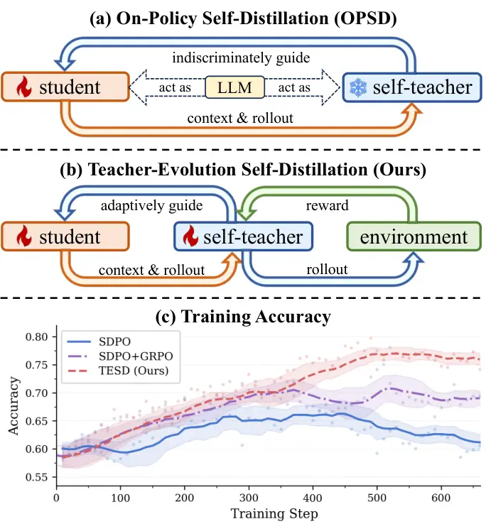
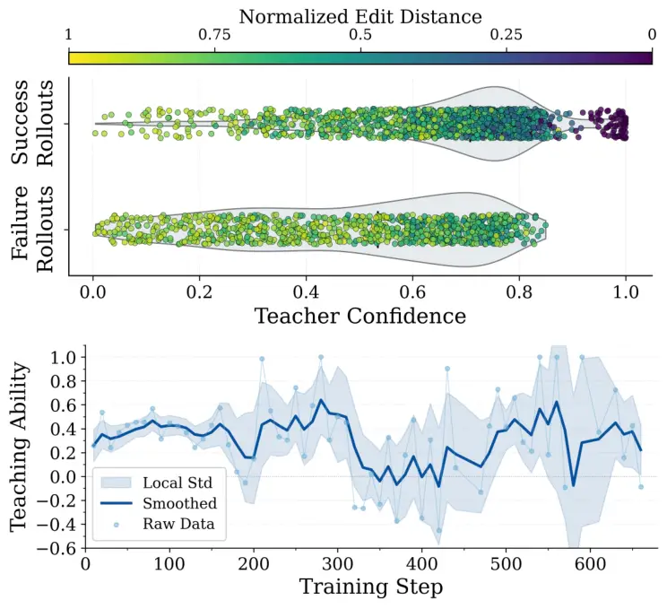
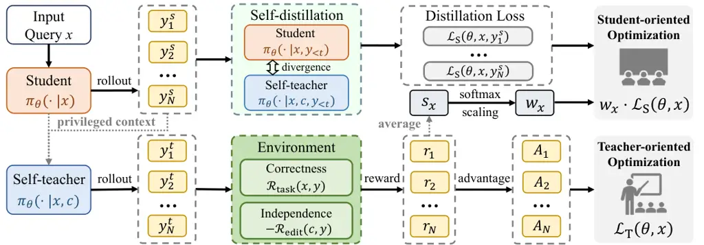
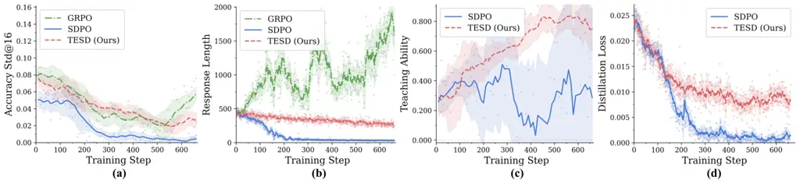
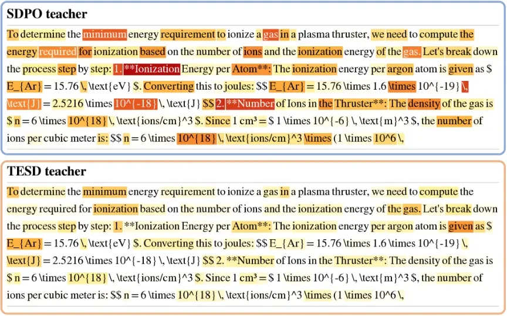
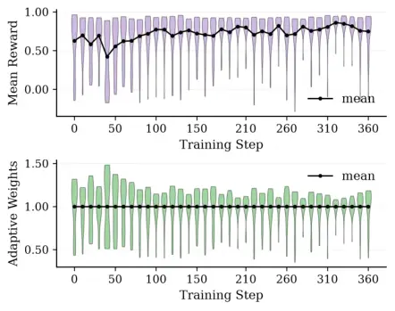
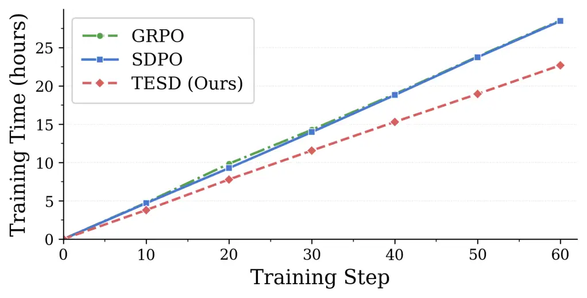

# On-Policy Self-Distillation with Teacher Evolution

Shufan Shen Affiliation:  State Key Lab. of AI Safety, Institute of
Computing TechnologyChinese Academy of Sciences Affiliation:  University
of Chinese Academy of Sciences Email: [shenshufan22z@ict.ac.cn](mailto:)
   Zhongni Hou²² 2 Corresponding authors. Affiliation:  Meituan    Chao
Bi Affiliation:  State Key Lab. of AI Safety, Institute of Computing
TechnologyChinese Academy of Sciences    Yufei Zhang Affiliation: 
Meituan    Guojun Yin  Shuhui Wang²² 2 Corresponding authors.
Affiliation:  State Key Lab. of AI Safety, Institute of Computing
TechnologyChinese Academy of Sciences Affiliation:  Meituan

###### Abstract

On-Policy Self-Distillation (OPSD), which aligns a student model’s
token-level distribution with that of its self-teacher prompted by
privileged context, has emerged as a promising direction to mitigate
reward sparsity in sequence-level post-training paradigms. However, OPSD
often fails to achieve continuous performance gains during training. In
this paper, we find that the model’s limited self-teaching capability
underlies this phenomenon by generating unreliable guidance on certain
samples. To address this problem, we propose Teacher-Evolution
Self-Distillation (TESD), which enables the self-teacher to generate
rollouts and receive environmental feedback based on task correctness
and context independence. First, using these rewards as training
objectives, we perform teacher-oriented optimization to continuously
enhance the model’s self-teaching capability during distillation.
Second, by estimating teacher guidance reliability from these rewards,
we apply adaptive student-oriented optimization to down-weight samples
with unreliable guidance. Extensive experiments across multiple datasets
and model scales show that TESD consistently outperforms representative
token-level and sequence-level methods, highlighting the necessity of
improving supervision quality in OPSD.

## 1 Introduction



Figure 1: (a) In OPSD, the self-teacher provides guidance
indiscriminately across all samples without improving its own
capabilities, thereby degrading the quality of supervision delivered to
the student. (b) TESD improves the self-teacher using the environmental
rewards of its rollouts while delivering adaptive guidance by
down-weighting samples with unreliable supervision. (c) TESD achieves
more continuous performance improvement than current OPSD methods.

Post-training has emerged as a crucial stage for enhancing the reasoning
abilities of large language models (LLMs) Achiam et al. (2023); Kumar et
al. (2025); Zheng et al. (2025); Shen et al. (2026a). Among various
post-training techniques, reinforcement learning with verifiable
rewards (RLVR) has proven to be a practical paradigm in domains where
model outcomes can be automatically verified Shao et al. (2024). Despite
achieving strong performance, representative RLVR methods assign the
same reward to all tokens within a response. This sparse sequence-level
scheme overlooks the varying significance of individual tokens,
hindering the model’s ability to focus on important tokens during
optimization Li et al. (2026).

To address this limitation, On-Policy Self-Distillation (OPSD) offers
dense supervision by introducing a self-teacher as shown in
Figure 1 Zhao et al. (2026b); Shenfeld et al. (2026). The self-teacher
is constructed by prompting the student with a self-generated privileged
context, which usually consists of a correct solution to the input
query. By computing the per-token logits of the self-teacher on the
student’s rollouts, OPSD delivers token-level supervision while
preserving the on-policy property. Therefore, it can maintain alignment
between the dense supervision signal and the model’s current
behavior Hübotter et al. (2026).

However, existing OPSD methods fail to continuously improve performance
during training Yang et al. (2026); Li et al. (2026), leading to
suboptimal results as shown in Figure 1(c). This phenomenon is
correlated with their reliance on the assumption of the model’s strong
self-teaching ability, i.e., the self-teacher can always correctly guide
diverse student rollouts based on the limited privileged context. First,
this assumption deviates from practical implementations. The
self-teacher only has the additional privileged context compared to the
student, without any improvements in model capability. Thus, the
self-teacher may fail to associate the limited privileged context with
diverse student rollouts Yu et al. (2026), leading to unreliable
guidance. This insufficient self-teaching capability also struggles to
improve during training, as the current OPSD paradigm optimizes the
model solely as a student. Second, relying on this unrealistic
assumption, current methods overlook the teacher’s potential to deliver
unreliable guidance on certain samples. Consequently, the student is
forced to follow the teacher’s guidance across all samples
indiscriminately Hübotter et al. (2026), thereby injecting misleading
signals into its optimization process. These two problems limit the
quality of supervision received by the student, making it difficult for
OPSD to achieve continuous performance improvement during the
distillation process.

In this paper, we propose the Teacher-Evolution Self-Distillation (TESD)
framework to enhance the supervision quality of OPSD. As shown in
Figure 1(b), rather than generating rollouts only through the student,
TESD enables the self-teacher to generate rollouts and receive rewards.
Based on these rewards, TESD introduces two complementary mechanisms to
address the aforementioned problems: teacher-oriented optimization to
improve the model’s self-teaching ability, and adaptive student-oriented
optimization to mitigate the impact of unreliable teacher guidance.
Specifically, for the reward function, we design it with both
task-correctness and context-independence to estimate the model’s
self-teaching ability. For teacher-oriented optimization, these rewards
serve directly as training objectives for the self-teacher. This
objective encourages the self-teacher to generate correct and distinct
solutions from privileged contexts, thereby improving its ability to
associate the privileged context with diverse student rollouts. For
adaptive student-oriented optimization, these rewards reflect the
reliability of teacher guidance across different samples and serve as
sample-wise weights that adaptively scale the student’s loss values. By
suppressing gradient updates from samples with unreliable guidance,
their negative impact on student optimization can be mitigated.

In experiments, we evaluate the effectiveness of TESD on pre-trained
LLMs Yang et al. (2025); Olmo et al. (2025) with different parameter
sizes and multiple downstream tasks Feng et al. (2024); Tang et al.
(2023); Jain et al. (2025). The evaluation results show that TESD
consistently outperforms current representative OPSD Hübotter et al.
(2026) and sequence-level RLVR Shao et al. (2024) methods. The superior
performance of TESD demonstrates the significance of improving
supervision quality during the self-distillation process. Our
contributions are summarized as follows:

- •
  We introduce TESD, an OPSD framework that allows the self-teacher to
  generate rollouts and receive rewards regarding task correctness and
  context independence.
- •
  With the rewards from teacher rollouts, we enhance OPSD’s supervision
  quality through teacher-oriented and adaptive student-oriented
  optimization, explicitly improving the model across its dual roles as
  teacher and student.
- •
  Extensive experiments demonstrate the superior performance of TESD,
  which reflects the importance of enhancing the supervision quality in
  the OPSD paradigm.

## 2 Related Work

### 2.1 RL with Verifiable Rewards

RL with verifiable rewards (RLVR) has been widely used to improve the
reasoning ability of pre-trained LLMs Guo et al. (2025). As a
representative RLVR method, GRPO Shao et al. (2024) estimates
group-relative advantages from sampled responses and removes the need
for a separate critic model. Subsequent studies further improve the GRPO
by modifying the objective Chu et al. (2025), normalization Yu et al.
(2025a), and clipping Zhao et al. (2026b). Despite differences in
training strategies and loss formulations, these methods uniformly
utilize sequence-level rewards to optimize the model as a student, which
is prompted solely by input queries. In contrast, we design a reward
function incorporating task-correctness and context-independence terms
to optimize the model as a self-teacher, which receives both the input
query and privileged context. By optimizing the self-teacher with this
reward, we leverage sequence-level feedback to enhance the supervision
quality of the token-level OPSD.

### 2.2 On-Policy Self-Distillation

Unlike classical knowledge distillation, which forces the student to
strictly fit the teacher’s output trajectory Gu et al. (2024), on-policy
distillation (OPD) enables the teacher to provide guidance based on the
student’s trajectory Agarwal et al. (2024); Lu and Lab (2025). This
approach can transfer the teacher’s token-level knowledge while
preserving the distribution of the student, making it widely adopted in
LLM post-training Yang et al. (2025); Zeng et al. (2026). Building upon
this, the on-policy self-distillation (OPSD) paradigm guides the student
using a self-teacher, which is built by prompting the student with
privileged contexts, thereby achieving OPD without the external
teacher Hübotter et al. (2026); Zhao et al. (2026a); Shenfeld et al.
(2026). However, the OPSD paradigm fails to achieve performance
improvement continuously during training. To tackle this problem,
current studies suggest incorporating more privileged context Yu et al.
(2026), degrading OPSD as a weighted module of GRPO Yang et al. (2026),
and implementing an entropy-based routing update strategy Jin et al.
(2026). Different from these studies relying solely on student-generated
rollouts, we empower the self-teacher to generate rollouts and obtain
rewards from the environment. Using these rewards, we optimize the
self-teacher and adaptively adjust the intensity of its sample-wise
supervision, thereby achieving more consistent performance gains over
existing methods through enhanced supervision quality.

## 3 Method

### 3.1 Preliminaries: On-Policy Self-Distillation

Given an input query $`x`$, a privileged context $`c`$, and a student
rollout $`y^{s}`$ sampled from the current policy
$`\pi_{\theta}(\cdot|x)`$, the OPSD loss function is formulated as:

```math
\displaystyle\mathcal{L}_{\text{S}}(\theta,x,y^{s})=\frac{1}{|y^{s}|}\sum_{t=1}^{|y^{s}|}\mathbb{D}\Big(\pi_{\theta}(\cdot\mid x,y^{s}_{<t}) \tag{1}
```

```math
\displaystyle\parallel\text{stopgrad}\big[\pi_{\theta}(\cdot\mid x,c,y^{s}_{<t})\big]\Big),
```

where $`\text{stopgrad}[\cdot]`$ denotes the stop-gradient operator and
$`|y^{s}|`$ is the length of the rollout in tokens. $`\mathbb{D}`$
represents an arbitrary divergence metric (e.g., KL-divergence or
JS-divergence), which measures the distribution gap between the student
and the self-teacher. By computing a per-token distribution gap between
the self-teacher and the student along the student’s own sampled
rollouts, OPSD yields dense, token-level supervision in an on-policy
manner. In practice, the self-teacher is usually updated as an
exponential moving average (EMA) of the student during training Hübotter
et al. (2026).

### 3.2 Teaching Ability Investigation



Figure 2: Top: We plot the task correctness and teacher confidence
(measured by mean token probability) of each student rollout, with the
color representing its edit distance to the privileged context. Bottom:
The evolution of the model’s teaching ability during the training
process, which is estimated by the mean spearman correlation between
teacher confidence and actual rewards. Experiments are conducted on the
Physics subset of SciKnowEval using Qwen3-8B.



Figure 3: Overall framework of TESD. Given an input query, the student
first generates rollouts, which provide the privileged context for the
self-teacher. Then, TESD optimizes the student and the self-teacher,
respectively. For the self-teacher, it interacts with the environment
and learns from the obtained rewards of correctness and independence.
For the student, it is supervised by the logits of the self-teacher. The
loss value is adaptively weighted by the teacher’s mean reward of the
corresponding input query, which estimates the quality of teacher
guidance.

Given that all supervision signals in the training objective of
Equation 1 are exclusively generated by the self-teacher
$`\pi_{\theta}(\cdot\mid x,c,y^{s}_{<t})`$, its teaching ability is
crucial to the success of the OPSD paradigm. At the top of Figure 2, we
investigate this ability via the correlation between the self-teacher’s
confidence in student rollouts and their verifiable rewards. This
correlation reveals whether the self-teacher can assign high confidence
to correct rollouts and low confidence to incorrect ones. Moreover, we
visualize the similarity between each rollout and its privileged
context. The normalized edit distance is selected as the similarity
metric following previous studies Zheng et al. (2023). First, we find
that the self-teacher struggles to distinguish the correctness of
student rollouts, as it assigns low confidence (0.0$`\sim`$0.5) to
certain correct rollouts, while giving high confidence (0.5$`\sim`$0.8)
to a substantial number of incorrect ones. Second, the self-teacher
tends to assign higher confidence to rollouts that resemble the
privileged context. This confidence-resemblance bias is supported by the
observation that high-confidence rollouts tend to have smaller edit
distances from the privileged context, while a large number of correct
yet context-dissimilar rollouts are assigned low confidence.

Furthermore, we track the evolution of self-teaching ability during the
training process at the bottom of Figure 2. Rather than improving as the
training progresses, the self-teacher’s ability exhibits a downward
trend coupled with significant instability. The results demonstrate that
only student-oriented optimization in Equation 1 is insufficient for
improving the model’s teaching ability. This stagnant or declining
teaching ability acts as a bottleneck, preventing the OPSD from
obtaining continuous performance improvements.

According to the above analysis, the self-teacher faces a challenge in
providing reliable guidance on student rollouts, and this challenge does
not diminish as training progresses. This phenomenon emphasizes the
importance of improving the quality of supervision received by the
student.

### 3.3 Teacher-Oriented Optimization

To improve the quality of guidance generated by the self-teacher, we
enable it to interact with the environment. The rewards obtained from
the environment are directly utilized to optimize the self-teacher,
thereby continuously enhancing its teaching ability during the
self-distillation process. Given a input query $`x`$ and a privileged
context $`c`$, the self-teacher $`\pi_{\theta}(\cdot|x,c)`$ samples a
set of $`N`$ teacher rollouts
$`\{y^{t}_{1},y^{t}_{2},\ldots,y^{t}_{N}\}`$. Based on the insights into
the confidence-resemblance bias shown at the top of Figure 2, the reward
function $`r`$ is defined as a combination of a verifiable task
correctness and an edit-distance term:

```math
r_{i}=r(x,c,y^{t}_{i})=\mathcal{R}_{\text{task}}(x,y^{t}_{i})+\lambda_{\text{edit}}\mathcal{R}_{\text{edit}}(c,y^{t}_{i}), \tag{2}
```

where $`\mathcal{R}_{\text{task}}\in\{0,1\}`$ is the task correctness.
$`\mathcal{R}_{\text{edit}}\in[0,1]`$ measures the normalized edit
distance between the rollout and the privileged context, and
$`\lambda_{\text{edit}}`$ is a balancing hyperparameter. As formulated
in Equation 2, the edit-distance reward encourages the self-teacher to
generate rollouts distinct from the privileged context, thereby
simulating scenarios where the teacher must generate responses
conditioned on diverse student rollouts under a fixed context.
Concurrently, the task-correctness reward encourages the teacher to
provide token-level guidance that steers these trajectories toward
correct solutions.

With this reward, we compute the group-wise advantage
$`A_{i}=\frac{r_{i}-\text{mean}(r)}{\text{std}(r)}`$ following GRPO Shao
et al. (2024). The self-teacher is then optimized via the following
objective:

```math
\mathcal{L}_{\text{T}}(\theta,x)=\frac{1}{N}\sum_{i=1}^{N}\min\left(\rho_{i}A_{i},\text{clip}\left(\rho_{i},1\pm\epsilon\right)A_{i}\right), \tag{3}
```

where
$`\rho_{i}=\frac{\pi_{\theta}(y^{t}_{i}\mid x,c)}{\pi_{\text{old}}(y^{t}_{i}\mid x,c)}`$
is the importance sampling ratio, $`\pi_{\text{old}}`$ represents the
previous policy before the current training step. $`\epsilon`$ defines
the clipping threshold to restrict policy updates. This teacher-oriented
optimization promotes rollouts that are correct and dissimilar to
privileged contexts, while penalizing those that are incorrect or overly
similar to privileged contexts. As a result, the self-teacher learns to
assign high and low confidence to these two categories of student
rollouts, respectively. Moreover, continuously optimizing the
self-teacher during the self-distillation process mitigates the
degradation of teaching ability in the bottom of Figure 2.

### 3.4 Adaptive Student-Oriented Optimization

With the proposed teacher-oriented optimization, we can gradually
improve the ability of the self-teacher during the training process.
However, it remains insufficient to alleviate the impact of unreliable
teacher guidance on students during the early stages of training, when
the self-teacher is still weak. To mitigate this problem, we propose an
adaptive mechanism to identify queries with unreliable guidance and
reduce their impact on the student-oriented optimization.

Specifically, given an input query $`x`$ from the sampled batch
$`\mathcal{B}`$, we compute the mean reward of the corresponding teacher
rollouts to estimate the quality of teacher guidance:

```math
s_{x}=\frac{1}{N}\sum\limits_{i=1}^{N}r(x,c,y^{t}_{i}). \tag{4}
```

Based on this score, we can adjust the impact of different input queries
on the model’s update by weighting their loss values. Unlike
hard-dropping methods that lead to insufficient training Yuan et al.
(2023), we utilize a softmax normalization over the batch to compute the
weights $`w_{x}`$. The normalized weights are scaled by the batch size
$`|\mathcal{B}|`$ to preserve the overall scale of loss values.

```math
w_{x}=|\mathcal{B}|\cdot\frac{\exp(s_{x})}{\sum_{x^{\prime}\in\mathcal{B}}\exp(s_{x^{\prime}})}, \tag{5}
```

During optimization, the distillation losses of different queries are
adaptively weighted:

```math
\mathcal{L}_{\text{S}}(\theta,x)=w_{x}\cdot\frac{1}{N}\cdot\sum\limits_{i=1}^{N}\mathcal{L}_{\text{S}}(\theta,x,y^{s}_{i}), \tag{6}
```

where $`\mathcal{L}_{\text{S}}(\theta,x,y^{s}_{i})`$ denotes the
on-policy self-distillation loss in Equation 1, N represents the number
of student rollouts. Overall, the training objective of TESD on batch
$`\mathcal{B}`$ is formulated as:

```math
\mathcal{L}(\theta)=\frac{1}{|\mathcal{B}|}\sum_{x\in\mathcal{B}}\Big(\mathcal{L}_{\text{S}}(\theta,x)+\mathcal{L}_{\text{T}}(\theta,x)\Big) \tag{7}
```

By integrating the teacher-oriented (Equation 3) and adaptive
student-oriented optimization (Equation 6), TESD improves the
self-teacher while mitigating the impact of unreliable guidance on the
student. This joint formulation encourages the OPSD to achieve
continuous performance gains.

## 4 Experiments

| Model    | Method      | Chemistry | Physics | Biology | Material | Tooluse | Mean  |
| -------- | ----------- | --------- | ------- | ------- | -------- | ------- | ----- |
| Qwen3-4B | SDPO        | 80.92     | 71.48   | 56.63   | 73.07    | 66.18   | 69.66 |
|          | GRPO        | 81.52     | 78.83   | 60.87   | 82.11    | 63.69   | 73.40 |
|          | SDPO+GRPO   | 79.58     | 75.37   | 54.62   | 81.85    | 62.87   | 70.86 |
|          | TESD (Ours) | 80.30     | 77.50   | 63.50   | 83.31    | 67.00   | 74.32 |
| Qwen3-8B | SDPO        | 77.83     | 67.73   | 62.63   | 79.99    | 62.87   | 70.21 |
|          | GRPO        | 80.71     | 80.47   | 63.13   | 82.11    | 68.29   | 74.94 |
|          | SDPO+GRPO   | 77.62     | 76.80   | 60.25   | 79.32    | 67.37   | 72.27 |
|          | TESD (Ours) | 81.55     | 80.55   | 64.13   | 81.78    | 70.02   | 75.61 |
| Olmo3-7B | SDPO        | 79.73     | 56.25   | 61.37   | 73.27    | 63.60   | 66.84 |
|          | GRPO        | 78.42     | 67.27   | 55.37   | 76.99    | 65.60   | 68.42 |
|          | SDPO+GRPO   | 78.69     | 66.02   | 52.50   | 75.47    | 62.32   | 67.00 |
|          | TESD (Ours) | 80.30     | 73.98   | 54.50   | 77.39    | 62.59   | 69.75 |

Table 1: Performance comparisons on SciKnowEval and Tooluse benchmarks.
All methods are trained to convergence, and scores are reported as the
maximum mean@16 accuracy (%) achieved during training.

### 4.1 Experimental Setup

Models and Datasets. Qwen3-1.7B/4B/8B Yang et al. (2025) and
Olmo3-7B-Instruct Olmo et al. (2025) are selected as the base models.
For datasets, we train models separately on six datasets following the
prior work Hübotter et al. (2026). The first four datasets are
question-answering benchmarks from the reasoning subset (L3) of
SciKnowEval Feng et al. (2024), which cover scientific reasoning in
Chemistry, Physics, Biology, and Materials Science. Moreover, we use a
tool-use dataset from ToolAlpaca Tang et al. (2023), where the model is
required to map a tool-API specification and a user request to the
correct tool call. Additionally, we adopt the v6 subset of
LiveCodeBench Jain et al. (2025), a set of coding problems ranging from
simple to competition-level. Each dataset is split into a training set
and a test set. Furthermore, we evaluate the model across several
holdout tasks to measure the ability of TESD to mitigate catastrophic
forgetting Zhou et al. (2023); Verschueren et al. (2018); Lin et al.
(2022); Cobbe et al. (2021); Hendrycks et al. (2021); Clark et al.
(2018); Chen et al. (2021); Li et al. (2023).

Baselines. We compare TESD with two baselines using the standard RLVR
setting Hübotter et al. (2026). First, we adopt a strengthened
implementation of GRPO in accordance with recent best practices Khatri
et al. (2025). This implementation integrates recent refinements to
GRPO, such as asymmetric clipping Yu et al. (2025b), unbiased
normalization Liu et al. (2025), and off-policy correction for efficient
inference-based rollout generation Yao et al. (2025). Second, we utilize
SDPO Hübotter et al. (2026), a representative OPSD method that functions
in the same verifier-only RLVR setting as our method. SDPO provides the
self-teacher with successful rollouts sampled by the current policy as
the privileged context to offer token-level guidance. We do not
incorporate other OPSD methods, like SDFT Shenfeld et al. (2026), due to
their reliance on human-labeled solutions.

| Method      | Qwen3-1.7B | Qwen3-4B | Qwen3-8B | Mean  |
| ----------- | ---------- | -------- | -------- | ----- |
| SDPO        | 45.35      | 56.97    | 62.38    | 54.90 |
| GRPO        | 44.96      | 56.12    | 60.85    | 53.98 |
| SDPO+GRPO   | 46.38      | 59.88    | 61.95    | 56.07 |
| TESD (Ours) | 45.98      | 60.07    | 63.31    | 56.45 |

Table 2: Performance comparisons on LCBv6 benchmark using different base
models.

Implementation Details. For fair comparisons, the number of generated
rollouts is fixed at 16 across all methods. TESD allocates 8 rollouts
each to the teacher and the student, whereas other methods generate all
16 rollouts using the student. For evaluation, we use 16 sampled
responses per problem and report the mean accuracy (mean@16). Additional
training and evaluation details are provided in the supplementary
materials.

|        |         |               |          |            |       |         |               |           |          |       |
| ------ | ------- | ------------- | -------- | ---------- | ----- | ------- | ------------- | --------- | -------- | ----- |
|        | Task    | Holdout Tasks |          |            |       |         |               |           |          |       |
| Method | Physics | IFEval        | MMLU-Pro | TruthfulQA | GSM8K | Math500 | ARC-Challenge | HumanEval | HaluEval | Mean  |
| Base   | 58.44   | 87.05         | 73.70    | 86.05      | 91.89 | 82.13   | 90.53         | 64.02     | 75.93    | 81.41 |
| SDPO   | 65.08   | 86.33         | 68.70    | 87.64      | 87.19 | 74.60   | 89.33         | 65.85     | 75.68    | 79.42 |
| GRPO   | 78.75   | 87.65         | 71.70    | 85.68      | 91.28 | 79.20   | 89.16         | 64.63     | 76.01    | 80.66 |
| TESD   | 79.24   | 86.21         | 72.70    | 88.98      | 91.51 | 80.40   | 90.36         | 67.68     | 76.31    | 81.77 |

Table 3: Performance on avoiding catastrophic forgetting. We compare the
base model (Qwen3-8B) and the final checkpoint of GRPO, SDPO and TESD on
the training task (Physics) and holdout tasks.

| Method          | Physics | Biology | Material | Mean  |
| --------------- | ------- | ------- | -------- | ----- |
| Baseline        | 71.48   | 56.63   | 73.07    | 67.06 |
| +Seq-level Loss | 75.37   | 54.62   | 81.85    | 70.61 |
| +Priv-Context   | 73.20   | 51.88   | 82.98    | 69.35 |
| +Edit-Reward    | 76.48   | 63.75   | 81.65    | 73.96 |

Table 4: Ablations of the teacher-oriented optimization. Based on SDPO,
we sequentially incorporating sequence-level loss (+Seq-level Loss),
optimizing the self-teacher with privileged context (+Priv-Context), and
adopting an edit-distance reward (+Edit-Reward).

### 4.2 Performance on Downstream Tasks

Learning without rich feedback. In Table 1, we evaluate the
effectiveness of TESD on tasks without rich feedback, i.e., only one
correct student rollout is selected as the privileged context. First, we
observe that although SDPO is claimed to achieve faster convergence
through the token-level supervision Hübotter et al. (2026), a
substantial performance gap remains compared to the sequence-level GRPO
upon full convergence (e.g., 69.66% vs. 73.40% on Qwen3-4B). Second,
when SDPO and GRPO are directly combined, the resulting performance lies
between that of the two individual methods (e.g., 72.27% vs. 74.94% on
Qwen3-8B). This phenomenon indicates that a naive summation at the loss
level fails to promote mutual enhancement. Finally, TESD outperforms all
aforementioned baselines across different base models.

Learning with rich feedback. In Table 2, we present the performance of
TESD and other baselines on the task with rich feedback, i.e., the
privileged context including a correct student rollout and other code
execution results such as runtime errors and failed unit tests. First,
SDPO can outperform GRPO with rich feedback, reflecting the importance
of the information density within the privileged context for OPSD.
Second, combining SDPO and GRPO achieves the best performance on
Qwen3-1.7B, yet lags behind TESD on larger model scales (Qwen3-4B/8B).
This discrepancy stems from the limited capability of Qwen3-1.7B, where
direct supervision of the student effectively accelerates its
convergence. In contrast, for stronger models, integrating the
self-teacher into the optimization framework improves the quality of
supervision signals and then achieves better performance. Finally, TESD
consistently outperforms SDPO and GRPO across different base models,
indicating that the effectiveness of TESD is compatible with the
expansion of privileged context.

| Method       | Physics | Biology | Material | Mean  |
| ------------ | ------- | ------- | -------- | ----- |
| Baseline     | 77.66   | 62.50   | 81.12    | 73.76 |
| +Mean Reward | 74.84   | 55.37   | 78.39    | 69.53 |
| +Softmax     | 73.67   | 58.75   | 79.26    | 70.56 |
| +Scaling     | 80.55   | 64.13   | 81.78    | 75.49 |

Table 5: Ablations of the adaptive weighting mechanism. We evaluate the
impact of weighting the query losses based on the mean reward of teacher
rollouts (+Mean Reward), normalizing these rewards via
softmax (+Softmax), and scaling the normalized results (+Scaling).

Performance on Holdout Tasks. We evaluate the catastrophic forgetting of
the model on other tasks after being trained with different methods on a
specific task. As Table 3 shows, TESD learns the new task while
mitigating the degradation of initial capabilities, achieving a better
performance-forgetting tradeoff than SDPO and GRPO.

### 4.3 Ablation Studies

Teacher-Oriented Optimization. We provide ablations of the
teacher-oriented optimization on three datasets of the SciKnowEval
benchmark using Qwen3-4B in Table 4. First, applying sequence-level
optimization to the student can improve the performance of OPSD (67.06%
vs. 70.61%), highlighting the necessity of leveraging environment
feedback. Second, optimizing the self-teacher using sequence loss
achieves performance improvements over OPSD (67.06% vs. 69.35%), yet
fails to outperform optimizing the student (70.61% vs. 69.35%). This is
because training only with a correctness reward encourages the teacher
to copy the privileged context as the answer, thereby undermining its
ability to guide diverse student rollouts. By introducing a reward term
based on edit distance in Equation 2, this copying behavior can be
effectively mitigated, thereby enhancing the teacher’s ability and
resulting in enhanced performance.



Figure 4: We report the evolution of the standard deviation of accuracy
across 16 evaluations (a), the model’s average response length (b),
teaching ability (c), and the distillation loss (d) across the training
process.



Figure 5: Token-level teacher credit heatmaps of SDPO and TESD with
Qwen3-8B on the Physics dataset.

Adaptive Loss Weighting. As shown in Table 5, we investigate the
effectiveness of the proposed weighting mechanism on three datasets of
the SciKnowEval benchmark using Qwen3-8B. We observe that directly
weighting the distillation loss of input queries using the mean reward
in Equation 2 leads to a performance degradation (69.53% vs. 73.76%).
Introducing softmax normalization alleviates this issue, yet the
performance remains worse than the unweighted baseline with
teacher-oriented optimization (70.56% vs. 73.76%). After incorporating
scaling and clipping, a significant performance boost is
achieved (75.49% vs. 70.56%). This result not only validates the
effectiveness of the proposed weighting mechanism but also reveals the
importance of maintaining the overall scale of loss values during the
weighting process.

Additional ablations of the rollout numbers and
$`\lambda_{\textbf{edit}}`$ are provided in the supplementary materials.

### 4.4 Analysis

Model Uncertainty. We explore the impact of TESD on the model’s
uncertainty through the accuracy standard deviation and response length
of the model. Experiments are conducted on the Physics subset of
SciKnowEval using Qwen3-8B. First, as Figure 4(a) shows, both GRPO and
TESD maintain a higher accuracy standard deviation compared to SDPO.
Second, for response length in Figure 4(b), GRPO exhibits an increasing
trend as training progresses, while SDPO shows a rapid decline in the
early training stages before stabilizing. TESD falls between these two
trajectories, presenting a gradual decrease in both metrics. These
results indicate that, compared to SDPO, TESD tends to maintain more
uncertainty in model outputs and prevents the over-confidence phenomenon
during training. Meanwhile, TESD preserves a key characteristic of the
OPSD paradigm: it attempts to generate shorter responses rather than
relying on extended reasoning paths to boost performance like GRPO.

Teaching Ability. For the teaching ability, we adopt the same metric as
in Figure 2. As shown in Figure 4(c), integrating the self-teacher into
the optimization framework can gradually enhance its ability during
training. Moreover, we find that the teaching ability in TESD exhibits
greater stability (as reflected by smaller local variance), while SDPO
suffers from severe fluctuations. Additionally, we present the
distillation loss in Figure 4(d). Compared to SDPO, TESD shows higher
losses during the middle and late stages of training. By optimizing the
self-teacher, it can continuously provide significant guidance during
training. As a result, the student is prevented from overfitting to an
unoptimized self-teacher in the early stages, a pitfall that typically
leads to performance stagnation in later phases. Furthermore, we provide
qualitative analysis in Figure 5. In contrast to SDPO, which strongly
supervises almost every token, TESD exhibits a sparser pattern. It
diminishes the focus on common words like "a", "the", and "of", allowing
the model to focus primarily on query-relevant keywords such as
"ionization", "gas", and "E\_{Ar}".



Figure 6: Distributions of the mean reward (top) and the adaptive
weight (bottom) of the input batch.

Evolution of Adaptive Weights. In Figure 6, we investigate the
distribution of the mean teacher reward (Equation 4) and the
corresponding adaptive weight (Equation 5) within the input batch during
training. In the early stages of training, due to the weak ability of
the self-teacher, the adaptive mechanism decreases the loss of samples
with unreliable teacher guidance to around 0.5. As teacher-oriented
optimization improves the self-teacher over time, the teacher reward
rises with the adaptive weights shifting toward 1.0. These results
demonstrate the complementary relationship between the teacher-oriented
and the adaptive student-oriented optimization throughout the training
process.

Additional case studies and training time analysis are provided in the
supplementary materials.

## 5 Conclusion

In this paper, we propose a method called Teacher-Evolution
Self-Distillation (TESD) to achieve on-policy self-distillation with
continuous performance improvements by enhancing the quality of the
self-teacher’s supervision. First, we design a reward function
considering both correctness and independence to evaluate the
self-teacher’s ability to guide diverse student rollouts. Then, using
this reward, we perform teacher-oriented optimization to improve the
model’s self-teaching capability during training. Finally, we utilize
this reward for adaptive student-oriented optimization, which suppresses
updates on queries with potentially unreliable teacher supervision.
Extensive experiments indicate the stronger performance of TESD compared
to representative OPSD methods, indicating the importance of enhancing
the supervision quality. In future, we will investigate the optimization
geometry of TESD and apply it to other domains such as multimodal
reasoning Shen et al. (2026b).

## References

- Achiam et al. (2023) J. Achiam, S. Adler, S. Agarwal, L. Ahmad, I.
  Akkaya, F. L. Aleman, D. Almeida, J. Altenschmidt, S. Altman, S.
  Anadkat, et al. Gpt-4 technical report. External Links: 2303.08774,
  [Link](https://arxiv.org/abs/2303.08774) Cited by: §1.
- Agarwal et al. (2024) R. Agarwal, N. Vieillard, Y. Zhou, P.
  Stanczyk, S. R. Garea, M. Geist, and O. Bachem On-policy distillation
  of language models: learning from self-generated mistakes. In The
  Twelfth International Conference on Learning Representations, ICLR
  2024, Vienna, Austria, May 7-11, 2024, External Links:
  [Link](https://openreview.net/forum?id=3zKtaqxLhW) Cited by: §2.2.
- Chen et al. (2021) M. Chen, J. Tworek, H. Jun, Q. Yuan, H. Pondé, J.
  Kaplan, H. Edwards, Y. Burda, N. Joseph, G. Brockman, A. Ray, R.
  Puri, G. Krueger, M. Petrov, H. Khlaaf, G. Sastry, P. Mishkin, B.
  Chan, S. Gray, N. Ryder, M. Pavlov, A. Power, L. Kaiser, M.
  Bavarian, C. Winter, P. Tillet, F. P. Such, D. W. Cummings, M.
  Plappert, F. Chantzis, E. Barnes, A. Herbert-Voss, W. H. Guss, A.
  Nichol, I. Babuschkin, S. Balaji, S. Jain, A. Carr, J. Leike, J.
  Achiam, V. Misra, E. Morikawa, A. Radford, M. M. Knight, M.
  Brundage, M. Murati, K. Mayer, P. Welinder, B. McGrew, D. Amodei, S.
  McCandlish, I. Sutskever, and W. Zaremba Evaluating large language
  models trained on code. External Links: 2107.03374,
  [Link](https://arxiv.org/abs/2107.03374) Cited by: §4.1.
- Chu et al. (2025) X. Chu, H. Huang, X. Zhang, F. Wei, and Y. Wang Gpg:
  a simple and strong reinforcement learning baseline for model
  reasoning. External Links: 2504.02546,
  [Link](https://arxiv.org/abs/2504.02546) Cited by: §2.1.
- Clark et al. (2018) P. Clark, I. Cowhey, O. Etzioni, T. Khot, A.
  Sabharwal, C. Schoenick, and O. Tafjord Think you have solved question
  answering? try arc, the ai2 reasoning challenge. External Links:
  1803.05457, [Link](https://arxiv.org/abs/1803.05457) Cited by: §4.1.
- Cobbe et al. (2021) K. Cobbe, V. Kosaraju, M. Bavarian, M. Chen, H.
  Jun, L. Kaiser, M. Plappert, J. Tworek, J. Hilton, R. Nakano, C.
  Hesse, and J. Schulman Training verifiers to solve math word problems.
  External Links: 2110.14168, [Link](https://arxiv.org/abs/2110.14168)
  Cited by: §4.1.
- Feng et al. (2024) K. Feng, X. Shen, W. Wang, X. Zhuang, Y. Tang, Q.
  Zhang, and K. Ding Sciknoweval: evaluating multi-level scientific
  knowledge of large language models. External Links: 2406.09098,
  [Link](https://arxiv.org/abs/2406.09098) Cited by: §1, §4.1.
- Gao et al. (2024) L. Gao, J. Tow, B. Abbasi, S. Biderman, S. Black, A.
  DiPofi, C. Foster, L. Golding, J. Hsu, A. Le Noac’h, H. Li, K.
  McDonell, N. Muennighoff, C. Ociepa, J. Phang, L. Reynolds, H.
  Schoelkopf, A. Skowron, L. Sutawika, E. Tang, A. Thite, B. Wang, K.
  Wang, and A. Zou The language model evaluation harness. Zenodo.
  External Links:
  [Document](https://dx.doi.org/10.5281/zenodo.12608602),
  [Link](https://zenodo.org/records/12608602) Cited by: §A.1.2.
- Gu et al. (2024) Y. Gu, L. Dong, F. Wei, and M. Huang MiniLLM:
  knowledge distillation of large language models. In The Twelfth
  International Conference on Learning Representations, ICLR 2024,
  Vienna, Austria, May 7-11, 2024, External Links:
  [Link](https://openreview.net/forum?id=5h0qf7IBZZ) Cited by: §2.2.
- Guo et al. (2025) D. Guo, D. Yang, H. Zhang, J. Song, R. Zhang, R.
  Xu, Q. Zhu, S. Ma, P. Wang, X. Bi, et al. Deepseek-r1: incentivizing
  reasoning capability in llms via reinforcement learning. External
  Links: 2501.12948, [Link](https://arxiv.org/abs/2501.12948) Cited by:
  §2.1.
- Hendrycks et al. (2021) D. Hendrycks, C. Burns, S. Kadavath, A.
  Arora, S. Basart, E. Tang, D. Song, and J. Steinhardt Measuring
  mathematical problem solving with the math dataset. ArXiv
  abs/2103.03874. Cited by: §4.1.
- Hübotter et al. (2026) J. Hübotter, F. Lübeck, L. Behric, A.
  Baumann, M. Bagatella, D. Marta, I. Hakimi, I. Shenfeld, T. K.
  Buening, C. Guestrin, et al. Reinforcement learning via
  self-distillation. External Links: 2601.20802,
  [Link](https://arxiv.org/abs/2601.20802) Cited by: §A.1.1, §A.1.3,
  §A.4.1, §1, §1, §1, §2.2, §3.1, §4.1, §4.1, §4.2.
- Jain et al. (2025) N. Jain, K. Han, A. Gu, W. Li, F. Yan, T. Zhang, S.
  Wang, A. Solar-Lezama, K. Sen, and I. Stoica LiveCodeBench: holistic
  and contamination free evaluation of large language models for code.
  In The Thirteenth International Conference on Learning
  Representations, ICLR 2025, Singapore, April 24-28, 2025, External
  Links: [Link](https://openreview.net/forum?id=chfJJYC3iL) Cited by:
  §1, §4.1.
- Jin et al. (2026) W. Jin, T. Min, Y. Yang, S. R. Kadhe, Y. Zhou, D.
  Wei, N. Baracaldo, and K. Lee Entropy-aware on-policy distillation of
  language models. External Links: 2603.07079,
  [Link](https://arxiv.org/abs/2603.07079) Cited by: §2.2.
- Khatri et al. (2025) D. Khatri, L. Madaan, R. Tiwari, R. Bansal, S. S.
  Duvvuri, M. Zaheer, I. S. Dhillon, D. Brandfonbrener, and R. Agarwal
  The art of scaling reinforcement learning compute for llms. External
  Links: 2510.13786, [Link](https://arxiv.org/abs/2510.13786) Cited by:
  §4.1.
- Kumar et al. (2025) K. Kumar, T. Ashraf, O. Thawakar, R. M. Anwer, H.
  Cholakkal, M. Shah, M. Yang, P. H. Torr, F. S. Khan, and S. Khan Llm
  post-training: a deep dive into reasoning large language models.
  External Links: 2502.21321, [Link](https://arxiv.org/abs/2502.21321)
  Cited by: §1.
- Li et al. (2023) J. Li, X. Cheng, X. Zhao, J. Nie, and J. Wen
  HaluEval: a large-scale hallucination evaluation benchmark for large
  language models. In Proceedings of the 2023 Conference on Empirical
  Methods in Natural Language Processing, H. Bouamor, J. Pino, and K.
  Bali (Eds.), Singapore, pp. 6449–6464. External Links:
  [Document](https://dx.doi.org/10.18653/v1/2023.emnlp-main.397),
  [Link](https://aclanthology.org/2023.emnlp-main.397/) Cited by: §4.1.
- Li et al. (2026) Y. Li, Y. Zuo, B. He, J. Zhang, C. Xiao, C. Qian, T.
  Yu, H. Gao, W. Yang, Z. Liu, et al. Rethinking on-policy distillation
  of large language models: phenomenology, mechanism, and recipe.
  External Links: 2604.13016, [Link](https://arxiv.org/abs/2604.13016)
  Cited by: §A.2.2, §1, §1.
- Lin et al. (2022) S. Lin, J. Hilton, and O. Evans TruthfulQA:
  measuring how models mimic human falsehoods. In Proceedings of the
  60th Annual Meeting of the Association for Computational Linguistics
  (Volume 1: Long Papers), S. Muresan, P. Nakov, and A. Villavicencio
  (Eds.), Dublin, Ireland, pp. 3214–3252. External Links:
  [Document](https://dx.doi.org/10.18653/v1/2022.acl-long.229),
  [Link](https://aclanthology.org/2022.acl-long.229/) Cited by: §4.1.
- Liu et al. (2025) Z. Liu, C. Chen, W. Li, P. Qi, T. Pang, C. Du, W. S.
  Lee, and M. Lin Understanding r1-zero-like training: a critical
  perspective. External Links: 2503.20783,
  [Link](https://arxiv.org/abs/2503.20783) Cited by: §4.1.
- Lu and Lab (2025) K. Lu and T. M. Lab On-policy distillation. Thinking
  Machines Lab: Connectionism. Note:
  https://thinkingmachines.ai/blog/on-policy-distillation External
  Links: [Document](https://dx.doi.org/10.64434/tml.20251026) Cited by:
  §2.2.
- Olmo et al. (2025) T. Olmo, A. Ettinger, A. Bertsch, B. Kuehl, D.
  Graham, D. Heineman, D. Groeneveld, F. Brahman, F. Timbers, H. Ivison,
  et al. Olmo 3. External Links: 2512.13961,
  [Link](https://arxiv.org/abs/2512.13961) Cited by: §1, §4.1.
- Pan et al. (2026) L. Pan, S. Tao, Y. Zhai, L. Zhang, Z. Liu, B.
  Ding, A. Liu, and L. Wen RLCSD: reinforcement learning with
  contrastive on-policy self-distillation. External Links: 2606.11709,
  [Link](https://arxiv.org/abs/2606.11709) Cited by: §A.3.1, §A.3.2.
- Shao et al. (2024) Z. Shao, P. Wang, Q. Zhu, R. Xu, J. Song, X. Bi, H.
  Zhang, M. Zhang, Y. Li, Y. Wu, et al. Deepseekmath: pushing the limits
  of mathematical reasoning in open language models. External Links:
  2402.03300, [Link](https://arxiv.org/abs/2402.03300) Cited by: §1, §1,
  §2.1, §3.3.
- Shen et al. (2026a) S. Shen, Z. Hou, J. Sun, Y. Zhang, W. Lin, G.
  Yin, Q. Huang, and S. Wang On-policy parameter update direction
  underlies generalization in llm post-training. External Links:
  2609.36659, [Link](https://arxiv.org/abs/2609.36659) Cited by: §1.
- Shen et al. (2026b) S. Shen, J. Sun, Q. Huang, and S. Wang Vl-sae:
  interpreting and enhancing vision-language alignment with a unified
  concept set. Advances in Neural Information Processing Systems 38,
  pp. 45235–45265. Cited by: §5.
- Shen et al. (2024) S. Shen, J. Sun, X. Ji, Q. Huang, and S. Wang
  Expanding sparse tuning for low memory usage. Advances in Neural
  Information Processing Systems 37, pp. 76616–76642. Cited by: §A.4.1.
- Shen et al. (2026c) S. Shen, J. Sun, S. Wang, and Q. Huang Kernelized
  sparse fine-tuning with bi-level parameter competition for vision
  models. IEEE Transactions on Pattern Analysis and Machine
  Intelligence. Cited by: §A.4.1.
- Shenfeld et al. (2026) I. Shenfeld, M. Damani, J. Hübotter, and P.
  Agrawal Self-distillation enables continual learning. External Links:
  2601.19897, [Link](https://arxiv.org/abs/2601.19897) Cited by: §1,
  §2.2, §4.1.
- Sheng et al. (2024) G. Sheng, C. Zhang, Z. Ye, X. Wu, W. Zhang, R.
  Zhang, Y. Peng, H. Lin, and C. Wu HybridFlow: a flexible and efficient
  rlhf framework. External Links: 2409.19256,
  [Link](https://arxiv.org/abs/2409.19256) Cited by: §A.1.1.
- Tang et al. (2023) Q. Tang, Z. Deng, H. Lin, X. Han, Q. Liang, B. Cao,
  and L. Sun Toolalpaca: generalized tool learning for language models
  with 3000 simulated cases. External Links: 2306.05301,
  [Link](https://arxiv.org/abs/2306.05301) Cited by: §1, §4.1.
- Verschueren et al. (2018) S. Verschueren, J. van Aalst, A. Bangels, J.
  Toelen, K. Allegaert, C. Buffel, and G. V. Stichele (Preprint). Cited
  by: §4.1.
- Yang et al. (2025) A. Yang, A. Li, B. Yang, B. Zhang, B. Hui, B.
  Zheng, B. Yu, C. Gao, C. Huang, C. Lv, et al. Qwen3 technical report.
  External Links: 2505.09388, [Link](https://arxiv.org/abs/2505.09388)
  Cited by: §1, §2.2, §4.1.
- Yang et al. (2026) C. Yang, C. Qin, Q. Si, M. Chen, N. Gu, D. Yao, Z.
  Lin, W. Wang, J. Wang, and N. Duan Self-distilled rlvr. External
  Links: 2604.03128, [Link](https://arxiv.org/abs/2604.03128) Cited by:
  §A.3.2, §1, §2.2.
- Yao et al. (2025) F. Yao, L. Liu, D. Zhang, C. Dong, J. Shang, and J.
  Gao Your efficient rl framework secretly brings you off-policy rl
  training, august 2025. URL https://fengyao. notion.
  site/off-policy-rl. Cited by: §4.1.
- Yu et al. (2025a) Q. Yu, Z. Zhang, R. Zhu, Y. Yuan, X. Zuo, Y. Yue, W.
  Dai, T. Fan, G. Liu, J. Liu, L. Liu, X. Liu, H. Lin, Z. Lin, B. Ma, G.
  Sheng, Y. Tong, C. Zhang, M. Zhang, R. Zhang, W. Zhang, H. Zhu, J.
  Zhu, J. Chen, J. Chen, C. Wang, H. Yu, Y. Song, X. Wei, H. Zhou, J.
  Liu, W. Ma, Y. Zhang, L. Yan, Y. Wu, and M. Wang DAPO: an open-source
  LLM reinforcement learning system at scale. In Advances in Neural
  Information Processing Systems 38: Annual Conference on Neural
  Information Processing Systems 2025, NeurIPS 2025, San Diego, CA, USA,
  December 2-7, 2025 / Mexico City, Mexico, November 30 - December 5,
  2025, D. Belgrave, C. Zhang, L. N. Montoya, H. Lin, R. Pascanu, P.
  Koniusz, M. Ghassemi, N. Chen, I. V. M. Ruíz, and A. Loaiza-Bonilla
  (Eds.), External Links:
  [Link](http://papers.nips.cc/paper_files/paper/2025/hash/a4277440d50f1f15d2cb4c14f7e0c0d2-Abstract-Conference.html)
  Cited by: §2.1.
- Yu et al. (2025b) Q. Yu, Z. Zhang, R. Zhu, Y. Yuan, X. Zuo, Y. Yue, W.
  Dai, T. Fan, G. Liu, J. Liu, L. Liu, X. Liu, H. Lin, Z. Lin, B. Ma, G.
  Sheng, Y. Tong, C. Zhang, M. Zhang, R. Zhang, W. Zhang, H. Zhu, J.
  Zhu, J. Chen, J. Chen, C. Wang, H. Yu, Y. Song, X. Wei, H. Zhou, J.
  Liu, W. Ma, Y. Zhang, L. Yan, Y. Wu, and M. Wang DAPO: an open-source
  LLM reinforcement learning system at scale. In Advances in Neural
  Information Processing Systems 38: Annual Conference on Neural
  Information Processing Systems 2025, NeurIPS 2025, San Diego, CA, USA,
  December 2-7, 2025 / Mexico City, Mexico, November 30 - December 5,
  2025, D. Belgrave, C. Zhang, L. N. Montoya, H. Lin, R. Pascanu, P.
  Koniusz, M. Ghassemi, N. Chen, I. V. M. Ruíz, and A. Loaiza-Bonilla
  (Eds.), External Links:
  [Link](http://papers.nips.cc/paper_files/paper/2025/hash/a4277440d50f1f15d2cb4c14f7e0c0d2-Abstract-Conference.html)
  Cited by: §4.1.
- Yu et al. (2026) W. Yu, X. Li, Y. Zhao, X. Liu, R. Zhang, H. Wang, Y.
  Luo, C. H. Wu, G. Mittal, M. Fredrikson, et al. Multi-rollout
  on-policy distillation via peer successes and failures. External
  Links: 2605.12652, [Link](https://arxiv.org/abs/2605.12652) Cited by:
  §A.3.1, §1, §2.2.
- Yuan et al. (2023) Z. Yuan, H. Yuan, C. Li, G. Dong, K. Lu, C. Tan, C.
  Zhou, and J. Zhou Scaling relationship on learning mathematical
  reasoning with large language models. External Links: 2308.01825,
  [Link](https://arxiv.org/abs/2308.01825) Cited by: §3.4.
- Zeng et al. (2026) A. Zeng, X. Lv, Z. Hou, Z. Du, Q. Zheng, B.
  Chen, D. Yin, C. Ge, C. Huang, C. Xie, et al. Glm-5: from vibe coding
  to agentic engineering. External Links: 2602.15763,
  [Link](https://arxiv.org/abs/2602.15763) Cited by: §2.2.
- Zhao et al. (2026a) S. Zhao, Z. Xie, M. Liu, J. Huang, G. Pang, F.
  Chen, and A. Grover Self-distilled reasoner: on-policy
  self-distillation for large language models. External Links:
  2601.18734, [Link](https://arxiv.org/abs/2601.18734) Cited by: §2.2.
- Zhao et al. (2026b) Z. Zhao, Z. Ren, J. Zou, L. Yang, Z. Xu, X. Ge, Z.
  Chen, X. Ma, D. Shi, S. Wang, D. Yin, and X. Xin Reinforced efficient
  reasoning via semantically diverse exploration. In Proceedings of the
  64th Annual Meeting of the Association for Computational Linguistics
  (Volume 1: Long Papers), M. Liakata, V. P. Moreira, J. Zhang, and D.
  Jurgens (Eds.), San Diego, California, United States, pp. 47994–48007.
  External Links:
  [Document](https://dx.doi.org/10.18653/v1/2026.acl-long.2216), ISBN
  979-8-89176-390-6,
  [Link](https://aclanthology.org/2026.acl-long.2216/) Cited by: §1,
  §2.1.
- Zheng et al. (2025) C. Zheng, S. Liu, M. Li, X. Chen, B. Yu, C.
  Gao, K. Dang, Y. Liu, R. Men, A. Yang, et al. Group sequence policy
  optimization. External Links: 2507.18071,
  [Link](https://arxiv.org/abs/2507.18071) Cited by: §1.
- Zheng et al. (2023) L. Zheng, W. Chiang, Y. Sheng, S. Zhuang, Z.
  Wu, Y. Zhuang, Z. Lin, Z. Li, D. Li, E. P. Xing, H. Zhang, J. E.
  Gonzalez, and I. Stoica Judging llm-as-a-judge with mt-bench and
  chatbot arena. In Advances in Neural Information Processing Systems
  36: Annual Conference on Neural Information Processing Systems 2023,
  NeurIPS 2023, New Orleans, LA, USA, December 10 - 16, 2023, A. Oh, T.
  Naumann, A. Globerson, K. Saenko, M. Hardt, and S. Levine (Eds.),
  External Links:
  [Link](http://papers.nips.cc/paper_files/paper/2023/hash/91f18a1287b398d378ef22505bf41832-Abstract-Datasets_and_Benchmarks.html)
  Cited by: §3.2.
- Zhou et al. (2023) J. Zhou, T. Lu, S. Mishra, S. Brahma, S. Basu, Y.
  Luan, D. Zhou, and L. Hou Instruction-following evaluation for large
  language models. External Links: 2311.07911,
  [Link](https://arxiv.org/abs/2311.07911) Cited by: §4.1.

## Appendix A Supplement Material

### A.1 Implementation Details

Figure 7: System prompt for ScienceQA.

Figure 8: User prompt for ScienceQA.

Figure 9: User prompt for ToolUse.

Figure 10: Teacher input template.

#### A.1.1 Training Strategies

All methods are implemented on top of the verl framework Sheng et al.
(2024) and trained with FSDP on a single 8$`\times`$H20 node. All
training rollouts use temperature $`T{=}1.0`$, top-$`p{=}1.0`$,
top-$`k{=}{-}1`$ with sampling enabled. The thinking mode of the Qwen3
family is disabled. Inputs and responses are bounded by 2048 and 8192
tokens, respectively. All methods use AdamW
($`\beta_{1}{=}0.9,\ \beta_{2}{=}0.999`$) with weight decay $`0.01`$,
gradient clipping at $`1.0`$, a constant learning-rate schedule with
$`10`$ warmup steps, and $`1`$ PPO epoch per iteration. The training
batch size is $`32`$ prompts per step. Checkpoint and validation
frequency are set to every $`200`$ and $`10`$ training steps,
respectively. We train the model for 30 epochs on both the science
question-answering tasks and for 15 epochs on the ToolUse task. For
LCBv6, we train the model for 40 steps across all methods.

For GRPO, we sample $`16`$ rollouts per prompt with a mini-batch size of
$`8`$. The policy-gradient loss adopts asymmetric PPO clipping with
$`\epsilon_{\text{low}}{=}0.2`$, $`\epsilon_{\text{high}}{=}0.28`$ and a
dual-clip lower bound $`c{=}3.0`$. To support efficient inference-based
rollout generation, we apply token-level truncated importance-sampling
(IS) correction with a threshold of $`2.0`$. No KL penalty is used. The
learning rate is selected from 1e-5 and 1e-6 based on validation
performance.

For SDPO, we adopt its official implementations Hübotter et al. (2026).
The self-teacher is maintained as an exponential moving average (EMA) of
the student with an update rate of $`0.05`$. The distillation loss is
the generalized Jensen–Shannon divergence over the full logit
distribution, approximated by the top-$`100`$ logits with an explicit
tail bucket. The distillation importance-sampling ratio is clipped at
$`2.0`$. The same asymmetric clipping and token-level IS correction as
in the GRPO baseline are applied to the student policy. Successful
student rollouts are selected as the privileged context, with the
self-success exclusion enabled and thinking traces removed from the
demonstration.

For TESD, it samples $`8`$ student rollouts and $`8`$ teacher rollouts.
The teacher reward follows Eq. (2): task correctness
$`R_{\text{task}}\in\{0,1\}`$ minus an independence reward
$`\lambda_{\text{edit}}\,R_{\text{edit}}`$. $`R_{\text{edit}}\in[0,1]`$
is the token-level normalized edit distance computed using the
SequenceMatcher of difflib package in Python. $`\lambda_{\text{edit}}`$
is set as 1.0 across all experiments. The EMA teacher update rate is
reduced to $`0.01`$ for stabilizing the training process. For the
adaptive student-oriented optimization (Eq. 5–7), the weight $`w_{x}`$
is computed with temperature $`\tau{=}1.0`$, then clipped to
$`[0.05,5.0]`$. Table 6 summarizes the method-specific hyperparameters.

|                                                       |                  |        |                     |
| ----------------------------------------------------- | ---------------- | ------ | ------------------- |
| Hyperparameter                                        | GRPO             | SDPO   | TESD                |
| Rollouts / prompt (total)                             | 16               | 16     | 16                  |
|    student rollouts                                   | —                | 16     | 8                   |
|    teacher rollouts                                   | —                | 0      | 8                   |
| PPO mini-batch size                                   | 8                | 32     | 32                  |
| Advantage estimator                                   | GRPO             | GRPO   | GRPO                |
| Policy loss                                           | student PG       | KL-Div | KL-Div + teacher PG |
| Clip $`\epsilon_{\text{low}}/\epsilon_{\text{high}}`$ | $`0.2\,/\,0.28`$ |        |                     |
| Dual-clip $`c`$                                       | $`3.0`$          |        |                     |
| IS correction (token, thr.)                           | token, $`2.0`$   |        |                     |
| Distillation $`\alpha`$ (JSD)                         | —                | 0.5    | 0.5                 |
| Distillation top-$`k`$                                | —                | 100    | 100                 |
| Distillation IS clip                                  | —                | 2.0    | 2.0                 |
| Teacher regularization                                | —                | EMA    | EMA                 |
| EMA update rate $`\tau`$                              | —                | 0.05   | 0.01                |
| Edit Reward $`\lambda_{\text{edit}}`$                 | —                | 0      | 1.0                 |
| Gate strategy                                         | —                | —      | reward_mean         |
| Gate normalization                                    | —                | —      | softmax             |

Table 6: Hyperparameter settings of different methods.

#### A.1.2 Evaluation Strategies

For in-distribution evaluation, we evaluate the model on the test split
of each task every $`10`$ training steps. For each test problem, we
sample $`16`$ responses with a temperature of $`0.6`$ and
top-$`p=0.95`$, and report the mean accuracy (mean@16), i.e., the
fraction of correct responses averaged over the $`16`$ samples. The
final reported metric is the maximum mean@16 observed across the
training trajectory, ensuring a fair comparison of convergence upper
bounds. The task correctness reward $`R_{\text{task}}`$ is rule-based
and task-specific:

- •
  SciKnowEval (multiple-choice questions): The model is prompted to
  output the option letter inside the \<answer\>...\</answer\> tags via
  a system instruction. We extract the letter inside the tags and set
  $`\mathcal{R}_{\text{task}}=1`$ if it matches the ground-truth option,
  and $`0`$ otherwise.
- •
  ToolUse: Given a tool-API specification and a user request, the model
  generates a Thought-Action-Action*Input trace. We set
  $`R*{\text{task}}=1`$ if the model prediction matches the ground-truth
tool call, and $`0`$ otherwise.
- •
  LCBv6 (coding problems): The model outputs a Python program in a
  fenced code block. We set $`R_{\text{task}}=1`$ if the program passes
  all hidden test cases within the time limit in a sandbox environment,
  and $`0`$ otherwise.

For hold-out task evaluation in Table 3 of the main paper, we evaluate
the final converged checkpoint of each method on eight hold-out tasks.
For IFEval, MMLU-Pro, TruthfulQA, ARC-Challenge, HumanEval, and
HaluEval, we utilize the lm-evaluation-harness Gao et al. (2024)
framework with a generation budget of $`32768`$ tokens and greedy
decoding. We apply the model’s default settings for the chat template,
except for HumanEval, where generation is performed in the raw
completion format. ARC-Challenge is evaluated in the multiple-choice
setting. Regarding the evaluation metrics, IFEval reports strict
instruction-following accuracy, MMLU-Pro and TruthfulQA report
exact-match accuracy, HumanEval reports pass@1, and HaluEval reports
exact-match accuracy for hallucination avoidance on the dialogue subset.
For mathematical reasoning tasks (MATH-500 and GSM8K), we evaluate using
a temperature of $`0.6`$ and top-$`p=1.0`$, reporting pass@1. Answers
are extracted and normalized before comparison with the ground truth.

| Dataset               | Train | Test |
| --------------------- | ----- | ---- |
| SciKnowEval-Biology   | 450   | 50   |
| SciKnowEval-Physics   | 720   | 80   |
| SciKnowEval-Chemistry | 1890  | 210  |
| SciKnowEval-Materials | 841   | 94   |
| ToolUse (ToolAlpaca)  | 4046  | 68   |
| LCBv6 (LiveCodeBench) | 131   | 131  |

Table 7: Train/test sizes of the six tasks.

Figure 11: Case studies of different methods on the Physics subset of
the SciKnowEval benchmark using Qwen3-8B.

#### A.1.3 Prompt Templates

Following SDPO Hübotter et al. (2026), we use the same dataset prompts
for student rollout and evaluation. For Qwen models, we disable the
thinking-mode chat-template option during prompt construction. The
concrete ScienceQA and ToolUse prompt templates are shown in
Figures 7, 8, and 9. The prompt used as input to the self-teacher is
shown in Figure 10.

#### A.1.4 Normalized Edit Distance

For each teacher rollout $`y`$ and its associated privileged-context
solution $`c`$, we first decode the rollout while removing special
tokens. We then lowercase both strings and split them on whitespace,
obtaining token sequences $`\tilde{y}`$ and $`\tilde{c}`$. We compute
their similarity using Python’s difflib.SequenceMatcher.ratio() with its
default settings. Let $`M(\tilde{y},\tilde{c})`$ be the total number of
tokens in the matching blocks identified by SequenceMatcher. The
normalized similarity and its complementary distance are

```math
\displaystyle S_{\mathrm{edit}}(y,c) \displaystyle=\frac{2M(\tilde{y},\tilde{c})}{|\tilde{y}|+|\tilde{c}|},
```

```math
\displaystyle D_{\mathrm{edit}}(y,c) \displaystyle=1-S_{\mathrm{edit}}(y,c).
```

Thus, identical token sequences have $`S_{\mathrm{edit}}=1`$ and
$`D_{\mathrm{edit}}=0`$, whereas sequences with no matching tokens have
$`S_{\mathrm{edit}}=0`$ and $`D_{\mathrm{edit}}=1`$.

### A.2 Additional Experiments

#### A.2.1 Scaling of Rollouts

| Methods | $`N=16`$ | $`N=32`$ | $`N=48`$ |
| ------- | -------- | -------- | -------- |
| SDPO    | 54.62    | 55.25    | 55.12    |
| TESD    | 54.87    | 56.63    | 59.62    |

Table 8: Performance comparison of SDPO and TESD across different
numbers of rollouts $`N`$. The experiments are conducted on the Biology
subset of the SciKnowEval benchmark using Qwen3-4B over $`10`$ training
epochs.

In Table 8, we evaluate the efficiency of SDPO and TESD in leveraging
scaling rollouts to achieve performance improvements. The performance of
SDPO does not improve significantly with the increasing number of
rollouts (e.g., when $`N`$ increases from 32 to 48, the performance
drops from 55.25% to 55.12%). In contrast, the performance of TESD
improves consistently as the number of rollouts grows. This demonstrates
that, by allocating partial rollout computation to the self-teacher,
TESD can more effectively leverage increased training time to yield
consistent performance gains.

#### A.2.2 Qualitative Results

In Figure 11, we present the responses generated by models trained with
different methods. First, compared to OPSD methods, GRPO generates
significantly longer responses that contain a large amount of redundant
reasoning (such as repetitive "wait" tokens), leading to wasted
computations. Second, while SDPO produces shorter answers, it lacks
genuine reasoning depth, dedicating numerous tokens to excessive
self-affirmations. This phenomenon highlights the overconfidence issue
inherent in existing OPSD paradigms Li et al. (2026). Finally, in
contrast to both methods, TESD successfully solves the problems with
concise responses dominated almost entirely by effective,
substance-driven reasoning.

#### A.2.3 Effects of $`\lambda_{\text{edit}}`$

In Table 9, we investigate the impact of the hyperparameter
$`\lambda_{\text{edit}}`$ in Equation 2 on the performance of TESD.
First, we observe that different subsets require different optimal
values for $`\lambda_{\text{edit}}`$. For instance, the optimal
$`\lambda_{\text{edit}}`$ is 1.0 for the biology subset and 0.7 for the
materials subset. Second, setting $`\lambda_{\text{edit}}=1.0`$ achieves
the highest average performance across all three subsets. Therefore, to
avoid dataset-specific hyperparameter tuning, we fix
$`\lambda_{\text{edit}}=1.0`$ for all main experiments.

| $`\lambda_{\text{edit}}`$ | Biology | Material | Physics | Mean  |
| ------------------------- | ------- | -------- | ------- | ----- |
| 0.1                       | 51.88   | 78.99    | 76.48   | 69.12 |
| 0.3                       | 53.75   | 79.45    | 76.25   | 69.82 |
| 0.5                       | 54.00   | 79.92    | 75.23   | 69.72 |
| 0.7                       | 50.88   | 82.78    | 73.05   | 68.90 |
| 1.0                       | 54.87   | 81.65    | 75.37   | 70.63 |

Table 9: Ablation studies on the hyperparameter
$`\lambda_{\text{edit}}`$. Experiments are conducted on SciKnowEval
benchmark using Qwen3-4B over 10 training epochs.

#### A.2.4 Training Efficiency

In Figure 12, we compare the time cost of different methods on the LCBv6
benchmark. We observe that as training progresses, TESD requires
increasingly less time compared to GRPO and SDPO. This efficiency gain
arises because a substantial portion of the training time in coding
tasks is consumed by code execution and sandbox evaluation. Since TESD
better enhances the model’s capabilities throughout the training
process, it generates programs that are more structured and efficient to
execute, thereby accelerating training speed.



Figure 12: The time cost of different methods during the training
process. Experiments are conducted on the LCBv6 benchmark using
Qwen3-8B.

### A.3 Discussion

#### A.3.1 Relation with Methods improving Privileged Context

Recently, several concurrent studies have improved OPSD from the
perspective of privileged context by increasing its volume Yu et al.
(2026) or strengthening it through contrastive exemplars Pan et al.
(2026). In this section, we discuss the similarities and differences
between them.

- •
  Similarity. Both TESD and these concurrent methods identify the
  quality of teacher guidance as the primary bottleneck that constrains
  the performance of the OPSD paradigm, and actively seek to improve it.
- •
  Difference. While these concurrent methods focus heavily on the
  quality of the context provided to the self-teacher, TESD focuses on
  the self-teacher’s inherent capability to leverage this context to
  effectively guide diverse student rollouts. These two paradigms
  stabilize the performance gains of OPSD from complementary angles,
  suggesting a promising potential for integration.

#### A.3.2 Relation with Methods integrating GRPO and SDPO

Several concurrent studies have explored combining token-level OPSD with
sequence-level GRPO Yang et al. (2026); Pan et al. (2026). In this
section, we discuss both the similarities and differences between TESD
and these approaches.

- •
  Similarity. Both TESD and these methods integrate supervision at both
  the sequence level and token level.
- •
  Difference. (i) For the motivation, these concurrent studies degrade
  OPSD to an advantage-weighting component within GRPO. Conversely, TESD
  leverages GRPO to empower the self-teacher for improving OPSD’s
  supervision quality. (ii) For the loss formulation, these studies
  adopt the standard GRPO objective, while TESD preserves the
  divergence-based loss of OPSD for the student model. (iii) For the
  optimization framework, these studies apply the GRPO and OPSD to a
  single student model. In contrast, TESD differentiates the model’s
  dual roles, utilizing GRPO with specifically designed rewards for the
  self-teacher and OPSD with proposed adaptive weighting mechanism for
  the student, offering a principled framework rather than a naive
  objective blend.

### A.4 Ethical Considerations

This work aims to improve the reasoning capabilities of large language
models. We acknowledge that enhanced reasoning capabilities could also
be misused for harmful purposes. Therefore, we emphasize the importance
of deploying such models with robust safety alignment mechanisms to
mitigate potential risks. All datasets used in our experiments are
publicly available open-source resources. We adhere to their respective
licenses and use them in accordance with their intended purposes.

#### A.4.1 Limitations

Despite outperforming representative token-level and sequence-level
methods, TESD introduces additional hyperparameters, such as
$`\lambda_{\text{edit}}`$, due to the inclusion of extra training
objectives and rewards. Furthermore, TESD remains constrained by the
teacher updating mechanism of the current OPSD paradigm Hübotter et al.
(2026), which maintains a separate set of weights for the teacher and
updates it via an exponential moving average to ensure training
stability. This mechanism inherently smooths out the improvement of the
teacher’s capabilities, thereby limiting the speed at which the teacher
evolves. In the future, to address these limitations, we will attempt to
develop an adaptive independence term for the teacher reward and
investigate the internal mechanism of the relationship between teacher
updates and training stability. Moreover, investigating whether TESD
exhibits sparse update patterns Shen et al. (2024); Shen et al. (2026c)
offers an interesting direction for further understanding the
student–teacher co-evolution framework.
