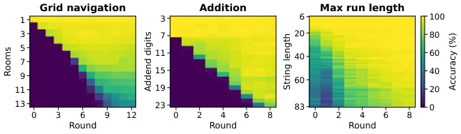
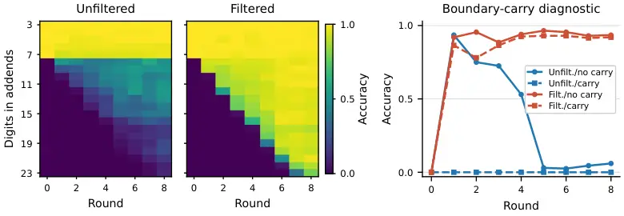
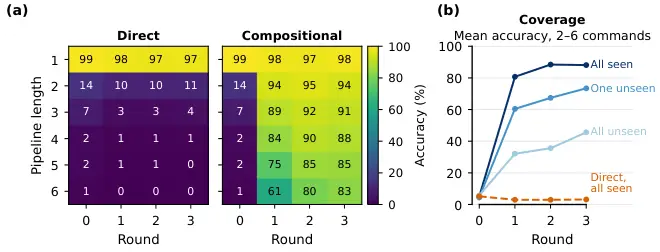
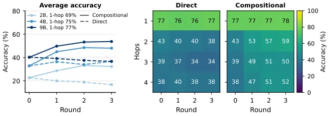
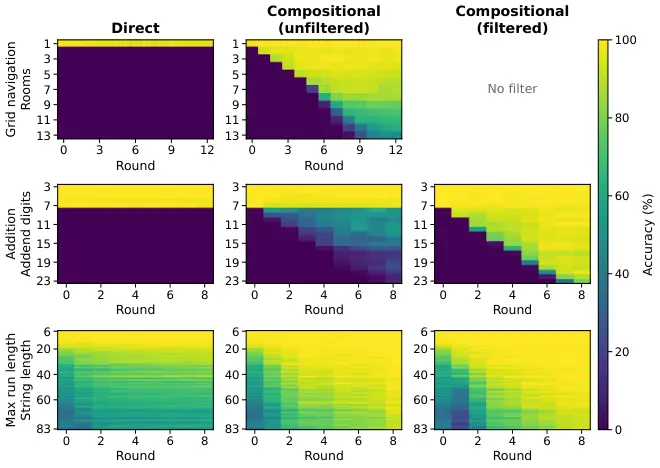
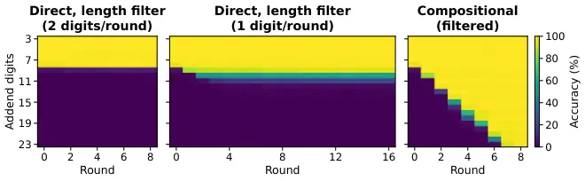
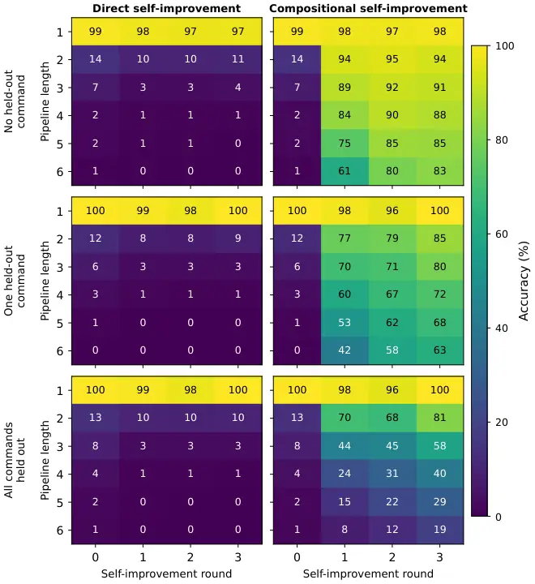
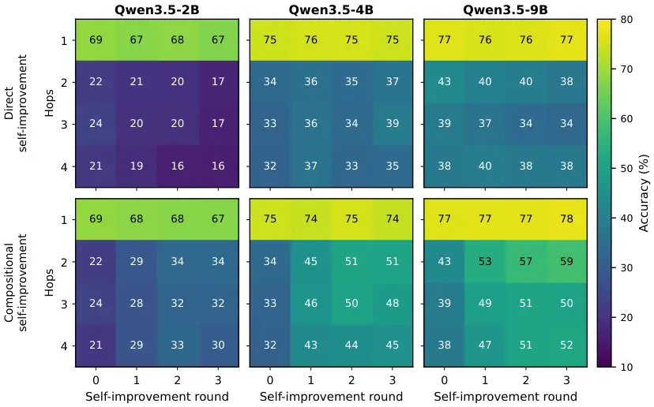

# Compositional Self-Improvement: Promises and Pitfalls

Changho Shin Affiliation: Department of Computer Science, Princeton
University, Princeton, NJ    Daiwei Chen Affiliation: Department of
Electrical and Computer Engineering, University of Wisconsin–Madison,
Madison, WI    Brenden Lake Affiliation: Department of Computer Science,
Princeton University, Princeton, NJ Affiliation: Department of
Psychology, Princeton University, Princeton, NJ    Frederic Sala
Affiliation: Department of Computer Sciences, University of
Wisconsin–Madison, Madison, WI    Ramya Korlakai Vinayak
Affiliation: Department of Electrical and Computer Engineering,
University of Wisconsin–Madison, Madison, WI

###### Abstract

Although self-improvement is becoming increasingly important as tasks
become more complex, models struggle to generate reliable supervision
for harder, out-of-distribution instances. One way to address this
challenge is to exploit compositional structure: models often solve
simpler subproblems more reliably than full problems, so their
subproblem predictions can be composed into supervision for harder ones.
We systematically study when this kind of composed supervision supports
self-improvement and when it fails. Our controlled experiments identify
three failure modes: unreliable subproblem predictions, errors
introduced by composition, and limited supervision coverage. Beyond
controlled settings, these findings carry over to more realistic coding
and reasoning tasks: composed labels are more accurate than direct
self-generated labels and improve performance even on compositions
longer than those seen during training, while the failure modes remain
visible. Further, although these failure modes often keep compositional
self-improvement from fully succeeding on its own, a short SFT warmup
with compositional self-improvement can bootstrap reinforcement learning
on tasks that require composing skills the model already has,
particularly when direct exploration rarely succeeds. Together, these
findings characterize when compositional self-improvement can provide
sufficiently reliable supervision to expand model capabilities.

|     |
| --- |
|     |

## 1 Introduction

As models tackle increasingly complex tasks, reliable human supervision
can become costly or difficult to obtain. This motivates methods that
can improve models with less reliance on human annotations. One approach
to _self-improvement_ is to learn from self-generated supervision, such
as pseudo-labels or model-generated feedback (Lee, 2013; Huang et al.,
2023; Lee et al., 2025). However, extending self-improvement beyond the
range of problems the model can already solve reliably requires
supervision on harder, out-of-distribution instances — precisely where
the model’s own predictions may be unreliable.

We explore whether compositional structure can bypass this bottleneck.
Even when a model cannot solve a complex problem directly, it may still
be able to solve its components. This suggests a route to supervision:
predictions on these components can be combined into a training target
for the full problem. We study this iterative setting as _compositional
self-improvement_: the model constructs supervision for harder instances
from predictions on simpler components, trains on the resulting targets,
and repeats the process as its capabilities expand.

This approach builds on a broader literature using compositional
structure to construct training data by recombining existing examples or
their constituent parts, usually with the goal of improving
generalization to novel compositions (Jia and Liang, 2016; Andreas,
2020; Qiu et al., 2022). More recent work similarly composes existing
problems into harder or longer-horizon instances for reasoning
evaluation and training (Xiao and Zhao, 2025; Motwani et al., 2025; Lu
et al., 2026; Xu et al., 2026). Iterated amplification provides a closer
conceptual precedent, constructing supervision for difficult problems
from solutions to easier subproblems (Christiano et al., 2018).

Yet prior work leaves open when compositional supervision can sustain
genuine self-improvement. Once the component solutions themselves are
model-generated, errors can propagate through composition. Moreover, the
composition rule can fail even with correct components, while filtering
such errors can leave important regions without supervision.

We systematically investigate these challenges and identify three
bottlenecks to continued compositional self-improvement: _unreliable
component predictions_, _structural errors in composition_, and _limited
supervision coverage_. Each bottleneck calls for different remedies.
Improving the underlying model reduces errors inherited from the
components; repairing or restricting the composition rule addresses
errors introduced during composition; and when filtering creates
coverage gaps, further progress requires supervision that reaches the
missing patterns. Thus, making composed labels more accurate is not by
itself sufficient for continued self-improvement.

Our experiments illustrate both these promises and pitfalls. In
controlled experiments on three algorithmic tasks, composed supervision
progressively extends reliable prediction beyond the model’s initial
range, and each bottleneck appears clearly: weaker starting models gain
less, invalid composition rules cause improvement to break down, and
filtering restores progress but can leave coverage gaps (Section 3).
Beyond controlled tasks, composed supervision also outperforms direct
self-improvement in program generation and multi-hop reasoning, although
unreliable component predictions limit further gains, and incomplete
supervision coverage leads to weaker generalization on unseen
compositions (Section 4). Finally, we show that even imperfect composed
supervision can provide a useful warm start for reinforcement learning
(Section 5).

Our contributions are as follows:

1.  1.  We develop a framework for analyzing compositional self-improvement,
        relating the reliability of composed supervision to component
        errors, composition errors, and supervision coverage.
2.  2.  We identify three bottlenecks to continued improvement—_unreliable
        component predictions_, _structural errors in composition_, and
        _limited supervision coverage_—and use controlled experiments to
        systematically study their effects and the limitations of filtering.
3.  3.  We show that composed supervision enables models to improve beyond
        the problems they can initially solve reliably. Even when the
        identified failure modes limit the extent of self-improvement,
        composed supervision can still provide a useful warm start for
        reinforcement learning.

## 2 Related Work

Compositional generalization. Compositional generalization concerns
handling novel combinations of familiar components (Lake and Baroni,
2018; Keysers and others, 2020; Kim and Linzen, 2020). Prior work
studies the roles of architectural biases, training scale, and data
coverage (Bahdanau et al., 2019; Redhardt et al., 2025). Least-to-most
and decomposed prompting use simpler subproblems to improve predictions
at inference time (Zhou et al., 2023; Khot et al., 2023). We examine
whether training on composed targets improves direct prediction,
including generalization to longer compositions and to cases not
directly covered by the composed supervision.

Synthetic data generation using compositionality. Compositional data
augmentation constructs new training examples by recombining existing
examples or their constituent parts (Jia and Liang, 2016; Andreas, 2020;
Akyürek et al., 2021). Qiu et al. (2022) further show that
grammar-generated training data can improve predictions beyond the
generator’s coverage. Recent work similarly composes existing problems
into harder instances for curriculum reinforcement learning (Motwani et
al., 2025; Xu et al., 2026). A closely related use of compositional
structure appears in iterated amplification, which constructs supervised
targets for harder problems through decomposition and model-generated
subanswers (Christiano et al., 2018). Our work studies a related
question in the setting of self-improvement: when predictions on simpler
components can provide reliable supervision for harder problems, and
what limits the resulting capability expansion.

Self-improvement. Models can improve by training on self-generated
solutions or feedback (Zelikman et al., 2022; Huang et al., 2023; Singh
et al., 2024). Iterative self-training can extend performance to harder
algorithmic instances, although errors in self-generated labels can
propagate across rounds (Lee et al., 2025). System 2 distillation trains
a model on answers produced by its own multi-step inference procedures
to improve direct prediction (Yu et al., 2024). Our study examines how
component errors, composition errors, and supervision coverage constrain
repeated training on composed predictions. Complementing work on
learning compositions of familiar operations through RL (Yuan et al.,
2025), we also test composed supervision as an RL warm start.

## 3 Understanding Compositional Self-Improvement

We first formalize compositional self-improvement and its training
procedure. We then use controlled algorithmic tasks to understand when
it works and why it can fail. These tasks let us separately vary
component reliability, composition validity, and supervision coverage.
After showing that composed supervision can extend reliable prediction
beyond the initial range, we examine how each of these factors can limit
further improvement. We provide theoretical characterizations of these
failure modes in Appendix B.

Figure 1: Overview of compositional self-improvement. Direct
pseudo-labeling can be unreliable on harder instances. Compositional
self-improvement constructs targets by combining predictions on simpler
subproblems, filters the resulting examples, and trains the model to
solve larger problems directly. Updated predictions provide supervision
for subsequent rounds.

### 3.1 Compositional Self-Improvement

0:  initial model $`\hat{f}_{0}`$, schedule $`\mathcal{S}`$, rule $`A`$,
filter $`G`$, rounds $`T`$

1:  for $`t=1,\ldots,T`$ do

2:   $`\widetilde{D}_{t}\leftarrow\emptyset`$

3:   for all $`(x,\pi)`$ selected by $`\mathcal{S}`$ at round $`t`$ do

4:    obtain $`\hat{y}_{1},\ldots,\hat{y}_{m}`$ by following $`\pi`$
with $`\hat{f}_{t-1}`$

5:    $`\tilde{y}\leftarrow A(\pi,\hat{y}_{1},\ldots,\hat{y}_{m})`$

6:    add $`(x,\tilde{y})`$ to $`\widetilde{D}_{t}`$ if accepted by
$`G`$

7:   end for

8:   train $`\hat{f}_{t}`$ on $`\widetilde{D}_{t}`$ with task-specific
replay

9:  end for

10:  return $`\hat{f}_{T}`$

Algorithm 1 Compositional self-improvement

Let $`f^{\star}:\mathcal{X}\to\mathcal{Y}`$ be the unknown target
function and $`\hat{f}_{0}`$ an initial model trained on simpler
problems. For the controlled tasks below, a task-specific level
$`\ell:\mathcal{X}\to\mathbb{N}`$ indexes problem scale, such as string
length or the number of rooms. This level describes the task, not the
model’s accuracy. Compositional self-improvement uses predictions on
simpler components to construct supervision for higher-level problems
(Figure 1).

For a parent problem $`x`$, a supplied decomposition $`\pi`$ specifies
how to obtain its subproblems $`x_{1},\ldots,x_{m}`$, including their
order and any dependencies on earlier answers. A composition rule $`A`$
combines their answers. We say the composition is valid if using correct
answers at every step produces the correct answer to the parent:

```math
A\bigl(\pi,f^{\star}(x_{1}),\ldots,f^{\star}(x_{m})\bigr)=f^{\star}(x). \tag{1}
```

Parent problems can be constructed from available components or paired
with supplied decompositions. At round $`t`$, the model follows $`\pi`$
to obtain predictions $`\hat{y}_{1},\ldots,\hat{y}_{m}`$, using earlier
predictions in later queries when required. The candidate target is
$`\tilde{y}=A(\pi,\hat{y}_{1},\ldots,\hat{y}_{m})`$, where aggregation
may be performed by a fixed program or a model. An optional filter $`G`$
retains examples based on their structure or predicted answers, without
consulting reference answers for the parent problems.

The model trains on retained examples and repeats with its updated
predictions (Algorithm 1).

### 3.2 Experimental Setup

We first study compositional self-improvement on three algorithmic tasks
where the composition procedure and sources of error can be controlled.
These tasks let us test whether composed supervision expands the range
of problems models can reliably solve and separately examine component
accuracy, composition errors, and supervision coverage.

[TABLE]

Table 1: Composition examples for the controlled tasks. Grid routes are
joined by the moves through the corridor between rooms, addition
concatenates block sums, and max run length keeps the longer run.
Filters reject carries across blocks and runs across the join. Blue and
purple mark the components; orange marks parts added by the rule.

##### Tasks.

We consider three controlled tasks with different composition rules
(Table 1). _Grid navigation_ requires predicting a route from a start to
a goal in a grid. We construct larger grids by connecting smaller rooms
with corridors and compose their predicted routes by inserting the
corridor moves between them. _Addition_ requires predicting the sum of
two integers. We construct longer operands by concatenating smaller
blocks and compose their predicted sums by concatenation, filtering
cases where carries cross block boundaries. _Max run length_ requires
identifying the symbol and length of the longest run of repeated symbols
in a string. We concatenate two strings and select the longer of their
predicted runs, filtering cases where a longer run crosses the
concatenation boundary.

For each task, the difficulty level corresponds to the number of rooms,
the maximum addend length, and the string length, respectively, with
seed ranges of one room, $`3`$–$`7`$ digits, and lengths $`6`$–$`10`$.
The self-improvement schedules progressively extend these ranges: grid
navigation adds one room per round for 12 rounds (up to 13 rooms),
addition adds two digits per round for 8 rounds (up to 23 digits), and
max run length first extends to length 20, then adds nine symbols per
round for 8 rounds total (up to length 83). Each round generates
composed examples across all expanded levels up to the current maximum
(Section A.2).

##### Models and training.

All three tasks use 14.2M-parameter character-level Transformers. For
each task, we first train a model on the initial difficulty range and
then construct supervision for progressively harder instances from
predictions on simpler components. Each round trains on these composed
examples alongside replay at the initial training levels to help
preserve previously learned capabilities. We evaluate held-out instances
across both the seed and expanded difficulty ranges after each round.
For all three tasks, we additionally compare against direct
self-improvement, which uses the model’s prediction on the full harder
instance as its pseudo-label under the same expansion schedule
(Section C.1). Full training details appear in Section A.2.

### 3.3 Composed Supervision Expands What Models Can Solve



Figure 2: Compositional self-improvement expands the range of instances
solved by the model. Each heatmap shows accuracy across self-improvement
rounds. From left to right: grid navigation by the number of rooms,
addition by addend digit length, and max run length by string length. In
all three tasks, reliable prediction extends beyond the initial model’s
reliable range.

Figure 2 shows that compositional self-improvement extends reliable
prediction beyond the initial range in all three tasks, while direct
self-improvement under the same schedules yields little or no such
improvement on addition and grid navigation (Section C.1). Predictions
on simpler instances can thus supervise instances beyond the model’s
reliable range. At the supervision level, our analysis makes this
advantage precise: composed labels are more accurate than direct
self-labels whenever the combined component and composition errors fall
below the model’s direct error on the same problems, a simple sufficient
condition formalized in Equation 10.

### 3.4 Failure Modes of Compositional Self-Improvement

While Section 3.3 shows that compositional self-improvement yields
consistent gains, these gains are based on three conditions: reliable
component predictions, valid composition, and supervision that covers
the harder instances. We illustrate how the gains are limited when each
condition fails: weaker starting models plateau early in grid
navigation, invalid compositions stall progress in addition unless
filtered, and in max run length, composed labels never contain runs
longer than those of their components, and accuracy on such runs falls
sharply.

Figure 3: Weaker starting models can limit compositional
self-improvement, as illustrated by experiments on the grid navigation
task. Left: mean accuracy on 2–13 rooms across rounds. Right: accuracy
by room count after the final round. The legend gives initial-training
updates and one-room accuracy. Curves average three seeds.

##### Failure mode I: Low component accuracy.

Compositional self-improvement relies on accurate component predictions
to construct reliable supervision for larger instances. We examine this
failure mode in grid navigation by varying the initial model’s accuracy
and applying the same twelve-round schedule to each starting model
(Section A.2). Weaker starting models plateau earlier, while stronger
models sustain larger gains (Figure 3). Models with initial one-room
accuracies of $`79.9\%`$ and $`99.4\%`$ reach final mean accuracies of
$`19.4\%`$ and $`80.9\%`$ on $`2`$–$`13`$ rooms, respectively. Reliable
component predictions are therefore crucial for gains by compositional
self-improvement. Our analysis captures this directly: under a valid
composition rule, component errors pass directly into the composed label
(Proposition B.2).



Figure 4: Structural errors can undermine self-improvement, although
filtering can restore gains in the “addition” tasks including on test
sums with boundary carries. Left and middle: accuracy by addend length
across rounds without and with filtering. Right: accuracy at each
round’s newest lengths (up to $`22`$–$`23`$ digits), on sums with and
without a carry across the block boundary.

##### Failure mode II: Structural errors from invalid composition rules.

In practice, composition rules designed for self-improvement may be
imperfect, introducing errors even when all component predictions are
correct. We illustrate this with addition: concatenating blockwise sums
can produce incorrect labels when a carry crosses the block boundary.
When such failure conditions are known, we can filter out invalid
compositions. This removes incorrect labels but also every parent with a
carry across its own block boundary. Figure 4 shows that unfiltered
composition degrades after initial gains, while filtering restores
self-improvement. The filtered model still solves test sums with
boundary carries (Figure 4, right). Since filtering still permits
correct carries within individual blocks, this may reflect
generalization of learned carry operations to different digit positions.

Figure 5: Boundary-crossing accuracy in the max run length task. Excess
run length is the difference between the longest run in the concatenated
string and the longest run in either component.

##### Failure mode III: Limited supervision coverage.

Even when composed labels are correct, they may cover only some of the
output patterns that arise in harder instances. In max run length, for
example, if we build ten-symbol strings only from pairs of five-symbol
strings, the rule can correctly supervise runs of at most five symbols:
concatenating 01111 and 11200 requires 1\|6, but the rule produces 1\|4.
Filtering removes such errors but leaves longer runs without correct
supervision. Thus, although self-improvement achieves high overall max
run length accuracy (Figure 2), this aggregate success conceals poor
performance on runs beyond the coverage of composed supervision.
Figure 5 breaks down accuracy by excess run length, the amount by which
a boundary-crossing run exceeds the longest run in either component.
Accuracy drops sharply as this excess increases, approaching zero at an
excess of three symbols, both with and without filtering.

Our analysis formalizes this limitation: if composition stays within a
restricted output space, valid composition cannot directly supervise
outputs outside it (Proposition B.3). Unlike the boundary carries in
addition, these runs require outputs that no composed label contains,
and the model does not extrapolate to them.

## 4 Compositional Self-Improvement Beyond Controlled Tasks

Next, we analyze compositional self-improvement on two real-world tasks
with natural compositional structure: program generation and multi-hop
reasoning. In both, the compositional and direct methods label the same
parent problems under the same schedule (Table 2).

| Task                | Component 1                                                        | Component 2                                     | Composed parent $`\to`$ label                                                                  | Filter                                      |
| ------------------- | ------------------------------------------------------------------ | ----------------------------------------------- | ---------------------------------------------------------------------------------------------- | ------------------------------------------- |
| Program generation  | Output the first 5 lines $`\to`$ head -5                           | Sort in descending order $`\to`$ sort -r        | Step 1: output the first 5 lines. Step 2: sort in descending order. $`\to`$ head -5 \| sort -r | Parses as a pipeline                        |
| Multi-hop reasoning | Who issued the Royal Proclamation of 1763? $`\to`$ King George III | What year did King George III die? $`\to`$ 1820 | What year did the person who issued the Royal Proclamation of 1763 die? $`\to`$ 1820           | Answer format; answer found in the passages |

Table 2: Composition examples for program generation and multi-hop
reasoning.

### 4.1 Program generation

Many programs are assembled from smaller programs, making program
generation a natural target for composition. We study Bash pipeline
generation, where the model takes a natural-language description of a
sequence of text-processing steps and generates a pipeline implementing
them. Compositional self-improvement constructs supervision for the full
pipeline by joining commands predicted for individual steps using the
pipe operator ($`|`$), which passes the output of one command to the
next (Table 2).



Figure 6: Compositional self-improvement improves program generation,
with less transfer to commands absent from training compositions. The
initial model is trained on all individual commands; a command is _seen_
if it also appears in training compositions. (a) Accuracy of direct and
compositional self-improvement on test pipelines of seen commands;
length 1 tests single commands. (b) Mean accuracy on 2- to 6-command
test pipelines whose commands are all seen, include one unseen command,
or are all unseen. Round 0 is the initial model; round $`r`$ trains on
pipelines of length $`r+1`$.

##### Setup.

We build pipelines from 119 command variants in TLDR¹¹ 1
[https://github.com/tldr-pages/tldr](https://github.com/tldr-pages/tldr)
and NL2Bash (Lin et al., 2018). Both methods start from Qwen3.5-2B
trained on all 119 individual commands, rehearse them every round, and
run three rounds on two-, three-, and four-command pipelines.
Compositional self-improvement joins its predicted commands for the
individual steps with pipes, while direct self-improvement predicts the
full pipeline; both keep a label only if it parses. We evaluate
generated pipelines by execution, averaging four seeds. Details are in
Section A.1.4.

##### Results.

Figure 6(a) shows that composed supervision substantially improves
program generation on pipelines using commands seen in training
compositions, including five- and six-command pipelines that are longer
than those used for training. Direct self-improvement makes little
progress.

Additionally, to examine the effects of limited coverage in composed
supervision, we evaluate the same models on pipelines containing 30
commands excluded from multi-command training but retained in initial
single-command training and replay. After three rounds, mean accuracy on
two- to six-command pipelines drops from 88% when all commands appear in
training compositions to 73% with one held-out command and 46% when all
are held out (Figure 6 (b)). This shows that limited supervision
coverage can constrain generalization even when individual commands are
learned.

### 4.2 Multi-hop reasoning

Reasoning often chains simple steps, each using the last one’s result.
We study this with multi-hop question answering, using the
decompositions annotated in MuSiQue. Unlike in program generation, later
steps depend on earlier predictions: the model answers the sub-questions
in order, substituting each answer into the next, and its final answer
becomes the label.



Figure 7: Composed supervision improves multi-hop reasoning on MuSiQue.
Left: mean accuracy on 2- to 4-hop questions for all sizes, labeled with
each initial model’s single-hop accuracy. Middle and right: exact-match
accuracy of Qwen3.5-9B by hop count under direct and compositional
self-improvement. Round 0 is the initial model, trained on single-hop
questions; rounds 1–3 train on 2-, 3-, and 4-hop questions.

##### Setup.

We use MuSiQue (Trivedi et al., 2022), which provides 2- to 4-hop
questions with annotated decompositions, and train Qwen3.5-2B, 4B, and
9B to examine how the gains depend on model size. Each model is first
trained on single-hop questions with gold answers and then runs three
rounds on 2-, 3-, and 4-hop questions, respectively. The compositional
method follows the annotated decomposition, while direct
self-improvement answers the original question in one step. Filters
check the answer format and whether the answer occurs in the passages or
the question, without reference answers; the compositional method
applies the same checks to its intermediate answers. At evaluation, the
model answers each question directly from the provided passages, without
decompositions. Results average three seeds; details are in
Section A.1.5.

##### Results.

Figure 7 shows that composed supervision improves multi-hop reasoning at
all three model sizes, while direct self-improvement makes little
progress. The gains extend beyond the hop counts used for training:
4-hop accuracy rises during the first two rounds, which train only on 2-
and 3-hop questions. Component reliability limits the gains, consistent
with failure mode I. Errors in intermediate answers can propagate
through composition, and first-round composed-label accuracy rises from
45% for 2B to 65% for 9B, with most errors arising at the final step.
The 2B model, whose components are least reliable, gains least.
Additional analyses of label errors appear in Section C.6.

[TABLE]

Table 3: Composition examples for the RL warm-start tasks, showing two
functions of longer chains.

Figure 8: A compositional SFT warmup improves subsequent RL on
five-operation string transformations and three-function Python
programs. CSI+RL first fine-tunes on labels from compositional
self-improvement (CSI), then runs RL, using half the token budget of
direct RL. Curves show mean test accuracy over three seeds; dotted
segments mark the SFT warmup. Token counts include label generation, RL
samples, and warmup targets.

## 5 Compositional Supervision as an RL Warm Start

Although the failure modes above limit compositional self-improvement on
its own, it can still give RL a useful starting point. Yuan et al.
(2025) show that RL can teach a model to compose existing skills, but
learning can be extremely inefficient when correct samples are rare. We
show that a short SFT warmup stage on composed targets, even imperfect
ones, can accelerate RL.

##### Setup.

We use string transformations from Yuan et al. (2025) and Python
programs composed from type-compatible functions in MBPP+ and HumanEval+
(Austin et al., 2021; Chen et al., 2021; Liu et al., 2023). In string
transformations, the model takes an input string and a sequence of
operations and predicts their intermediate and final outputs. In Python
program generation, the model takes natural-language specifications of
type-compatible functions and generates code that applies them in
sequence. Table 3 illustrates their composition rules: for string
transformations, each predicted output becomes the next operation’s
input; for Python, separately generated functions are assembled into a
wrapper that calls them in sequence. For initial training, we train a
six-layer Transformer on one- and two-operation chains for string
transformations and Qwen3.5-2B on single-function problems for Python.
We then compare direct RL against RL following a short SFT warmup on
composed targets, using five-operation chains and three-function Python
programs. Both use GRPO (Shao et al., 2024) with binary outcome rewards.
We compare test accuracy against token usage, counting warmup label
generation, warmup target tokens, and all RL samples. Additional details
are in Sections C.9 and A.2.

##### Results.

Figure 8 shows that composed supervision provides an effective warm
start for RL. On five-operation string chains, direct RL never samples a
correct composition and receives no reward, even with twice the
generation budget, whereas RL after a short compositional SFT warmup
improves steadily. On typed Python, where direct RL also makes progress,
RL after the warmup reaches $`55.6\%`$ with half the generation budget,
while direct RL needs the full budget to reach $`54.3\%`$. Here
composition plays a different role from Sections 3 and 4: the composed
targets need not be the final training signal, only move the model to a
regime where correct compositions are sampled often enough for outcome
rewards to guide learning. Nor must they be fully correct; only $`77\%`$
of the string warmup labels are. More results appear in Sections C.9
and C.6.

## 6 Theoretical Analysis

We provide a theoretical characterization of when compositional
self-improvement succeeds and why it can fail. Our analysis proceeds as
follows. First, we show how the reliability of composed supervision
depends on errors in component predictions and the composition rule.
Second, we use these results to characterize the three failure modes
observed in our experiments: unreliable components, invalid composition,
and limited supervision coverage. Finally, we establish a sufficient
condition under which training on composed labels improves the model.
Full statements and proofs appear in Appendix B.

##### Setup.

We follow the notation of Section 3.1. At difficulty level $`k`$, let
$`X\sim D_{k}`$ be a candidate parent problem. The current model
$`\hat{f}`$ predicts answers to simpler components, which are combined
into a composed label $`\widetilde{Y}`$. An optional filter
$`G\in\{0,1\}`$ determines whether the resulting example is retained for
training.

To distinguish errors inherited from the model from errors introduced by
composition, let $`\widetilde{Y}^{\circ}`$ denote the label obtained by
executing the same composition procedure with correct component answers.
This label need not equal the correct parent answer $`f^{\star}(X)`$ if
the composition rule is invalid.

We define three error rates on the accepted examples:

```math
\displaystyle\rho_{k} \displaystyle=\Pr_{k}[\widetilde{Y}\neq f^{\star}(X)\mid G=1], \tag{2}
```

```math
\displaystyle\epsilon_{k} \displaystyle=\Pr_{k}[E_{\mathrm{comp}}\mid G=1],
```

```math
\displaystyle\xi_{k} \displaystyle=\Pr_{k}[\widetilde{Y}^{\circ}\neq f^{\star}(X)\mid G=1],
```

where $`E_{\mathrm{comp}}`$ is the event that at least one component
prediction is incorrect, and $`\Pr_{k}`$ denotes probability over the
candidate-sampling and composition process. Here, $`\rho_{k}`$ measures
the overall composed-label error, $`\epsilon_{k}`$ measures errors in
the component predictions, and $`\xi_{k}`$ measures errors that remain
even with correct components. All three quantities are evaluated on the
same accepted examples ($`G=1`$).

##### When is composed supervision more reliable?

The key observation is simple: a composed label can differ from
$`\widetilde{Y}^{\circ}`$ only if at least one component prediction is
incorrect. This gives the following bound.

###### Proposition 6.1 (Reliability of composed labels).

The composed-label error satisfies

```math
|\rho_{k}-\xi_{k}|\leq\epsilon_{k},\qquad\rho_{k}\leq\min\{1,\epsilon_{k}+\xi_{k}\}. \tag{3}
```

If each execution makes at most $`m`$ component calls, then
$`\epsilon_{k}\leq\sum_{i=1}^{m}\epsilon_{k,i}`$, where
$`\epsilon_{k,i}`$ is the probability, conditional on $`G=1`$, that call
$`i`$ occurs and is answered incorrectly.

The bound does not require component errors to be independent, and it
allows filtering decisions to depend on model predictions
(Proposition B.1).

This result also provides a sufficient condition for composed
supervision to outperform direct self-improvement. Let
$`\rho_{k}^{\mathrm{direct}}=\Pr_{k}[\hat{f}(X)\neq f^{\star}(X)\mid G=1]`$
be the current model’s error when answering the same accepted parent
problems directly. Composed labels are more accurate whenever

```math
\epsilon_{k}+\xi_{k}<\rho_{k}^{\mathrm{direct}}. \tag{4}
```

Thus, composed labels need not be perfect: their combined component and
composition errors must simply be smaller than the model’s direct
prediction error on the harder problems.

##### Three failure modes.

The reliability bound also helps explain when compositional
self-improvement breaks down.

_(I) Unreliable component predictions (Proposition B.2)._ Even with a
valid composition rule, errors in individual components can accumulate.
For fixed-query compositions in which component errors cannot be masked,
we have $`\rho_{k}=\epsilon_{k}`$, with

```math
\max_{i}\epsilon_{k,i}\leq\rho_{k}\leq\min\Bigl\{1,\sum_{i=1}^{m}\epsilon_{k,i}\Bigr\}
```

. The resulting error depends not only on component accuracy but also on
how component errors overlap. Consequently, composing more components
can make labels unreliable even when each component is relatively
accurate. This helps explain why weaker starting models plateau earlier
in grid navigation (Figure 3) and why component reliability limits gains
in multi-hop reasoning.

_(II) Invalid composition rules._ Improving component accuracy cannot
eliminate errors introduced by the composition rule. In particular,
Proposition 6.1 gives $`\rho_{k}\geq\xi_{k}-\epsilon_{k}`$, and hence
$`\rho_{k}=\xi_{k}`$ when the components are perfectly accurate.
Addressing this failure requires correcting the rule or excluding
invalid compositions. For example, filtering addition problems with
carries across block boundaries removes a source of structural errors
(Figure 4). However, such filtering also reduces the set of examples
available for training.

_(III) Limited supervision coverage (Proposition B.3)._ Even perfectly
accurate labels may fail to cover the outputs needed for harder
problems. Consider a set of outputs $`C\subseteq\mathcal{Y}`$ that is
closed under composition: if all correct component answers belong to
$`C`$, the composed answer also belongs to $`C`$. For deterministic
compositions with fixed component queries, let $`p_{k,C}`$ be the
fraction of accepted parent problems whose correct answers lie outside
$`C`$. Then

```math
p_{k,C}\leq\xi_{k}+\sum_{i=1}^{m}\Pr_{k}[f^{\star}(X_{i})\notin C\mid G=1]
```

When the rule is valid on accepted examples ($`\xi_{k}=0`$), outputs
outside $`C`$ can receive supervision only if they already occur among
the correct component answers. This explains the max run length example:
selecting the longer of two component runs cannot produce a run longer
than either component, while filtering boundary-crossing runs removes
the corresponding invalid labels (Figure 5).

Moreover, when such outputs are rare in the accepted data, a model that
never predicts them can still achieve nearly optimal pseudo-label
accuracy. Under realizability and a closure assumption on the hypothesis
class, the additional training error from restricting predictions to
$`C`$ is exactly $`p_{k,C}`$ (Proposition B.4). Thus, accurate composed
supervision alone does not guarantee coverage of the patterns needed for
further improvement.

##### When does reliable supervision improve the model?

The preceding results concern the quality of composed labels. We now ask
whether training on these labels actually improves prediction accuracy.

Let $`R_{k}^{+}(h)=\Pr_{k}[h(X)\neq f^{\star}(X)\mid G=1]`$ denote the
true-label error of a predictor $`h`$ on accepted examples. Suppose a
finite hypothesis class $`\mathcal{H}`$ contains $`f^{\star}`$, and the
updated model $`\hat{f}_{\mathrm{new}}\in\mathcal{H}`$ approximately
minimizes empirical pseudo-label error over $`n`$ independent accepted
examples, up to optimization error $`\tau\geq 0`$. Then, with
probability at least $`1-\delta`$,

```math
R_{k}^{+}(\hat{f}_{\mathrm{new}})\leq 2\rho_{k}+2\sqrt{\frac{\log(2|\mathcal{H}|/\delta)}{2n}}+\tau \tag{5}
```

(Theorem B.5).

The bound separates three factors: composed-label error, finite-sample
estimation error, and optimization error. Combined with Proposition 6.1,
it guarantees improvement over the current model on accepted examples
whenever

```math
2(\epsilon_{k}+\xi_{k})+2\sqrt{\frac{\log(2|\mathcal{H}|/\delta)}{2n}}+\tau<R_{k}^{+}(\hat{f}).
```

Together, these results characterize the conditions for compositional
self-improvement: reliable component predictions and valid composition
rules determine the quality of composed supervision, while coverage
determines which problems receive that supervision. When the resulting
labels are sufficiently reliable and learnable, they can support further
model improvement.

## 7 Conclusion

We studied the promises and pitfalls of self-improvement that exploits
the compositional structure of tasks, and our analysis yields three
practical lessons. First, teach atomic skills well: component errors can
propagate into composed labels and limit further improvement. Second,
find where the composition rule breaks: even correct components can
yield incorrect labels, so identifying and filtering invalid
compositions is crucial. Third, check which outputs composed labels can
reach: some rules restrict the outputs they can generate, leaving
coverage gaps that more rounds or stricter filtering cannot fill.

Our study focuses on tasks with supplied decomposition plans and
composition rules, leaving open how to discover and validate such
structures in less controlled settings. Another important direction is
to expand supervision coverage without introducing additional
composition errors. Our results also suggest a complementary approach:
even when the identified failure modes limit self-improvement on its
own, composed supervision can provide a useful warm start for
reinforcement learning. More broadly, these findings highlight the
potential of task structure as a source of supervision, while
emphasizing the importance of understanding its reliability and
coverage.

### AI Use Statement

We used generative AI assistants (Claude and ChatGPT) extensively
throughout this project.

Not used for. AI tools were not used to originate the central research
question or hypotheses. The authors determined the research direction
and made the final decisions on experimental design, analysis,
interpretation, and the claims presented in this work.

Used for. We used AI assistants for the following tasks:

- •
  _Software implementation and experiment execution:_ Developing and
  debugging training, evaluation, data-construction, and plotting code,
  and preparing and running experiments on GPU clusters.
- •
  _Experimental design and analysis:_ Suggesting baselines, ablations,
  diagnostic analyses, experimental parameters, and possible
  interpretations of results.
- •
  _Theoretical analysis:_ Assisting with mathematical formulations,
  proof development and verification, and Lean 4 formalization.
- •
  _Manuscript preparation:_ Assisting with identifying relevant prior
  work, preparing figures, and polishing manuscript text.

The authors reviewed AI-assisted implementations and checked reported
results against saved experimental outputs. The theoretical arguments
were developed and reviewed by the authors, with AI assistance in
refining mathematical formulations, checking proofs, and formalizing
claims in Lean 4 for machine verification. Cited references were
manually verified against their sources. All AI-assisted suggestions and
outputs were subject to author review, and the authors take full
responsibility for the final content of this work.

## References

- Akyürek et al. (2021) E. Akyürek, A. F. Akyürek, and J. Andreas
  Learning to recombine and resample data for compositional
  generalization. In International Conference on Learning
  Representations, External Links:
  [Link](https://openreview.net/forum?id=PS3IMnScugk) Cited by: §2.
- Andreas (2020) J. Andreas Good-enough compositional data augmentation.
  In Proceedings of the 58th Annual Meeting of the Association for
  Computational Linguistics, pp. 7556–7566. External Links:
  [Document](https://dx.doi.org/10.18653/v1/2020.acl-main.676),
  [Link](https://aclanthology.org/2020.acl-main.676/) Cited by: §1, §2.
- Austin et al. (2021) J. Austin, A. Odena, M. Nye, M. Bosma, H.
  Michalewski, D. Dohan, E. Jiang, C. Cai, M. Terry, Q. Le, and C.
  Sutton Program synthesis with large language models. arXiv preprint
  arXiv:2108.07732. External Links:
  [Link](https://arxiv.org/abs/2108.07732) Cited by: §A.1.7, §5.
- Bahdanau et al. (2019) D. Bahdanau, S. Murty, M. Noukhovitch, T. H.
  Nguyen, H. de Vries, and A. Courville Systematic generalization: what
  is required and can it be learned?. In International Conference on
  Learning Representations, Cited by: §2.
- Chen et al. (2021) M. Chen, J. Tworek, H. Jun, Q. Yuan, H. P. d. O.
  Pinto, J. Kaplan, H. Edwards, Y. Burda, N. Joseph, G. Brockman, et al.
  Evaluating large language models trained on code. arXiv preprint
  arXiv:2107.03374. Cited by: §A.1.7, §5.
- Christiano et al. (2018) P. Christiano, B. Shlegeris, and D. Amodei
  Supervising strong learners by amplifying weak experts. External
  Links: 1810.08575, [Link](https://arxiv.org/abs/1810.08575) Cited by:
  §1, §2.
- Hoeffding (1963) W. Hoeffding Probability inequalities for sums of
  bounded random variables. Journal of the American Statistical
  Association 58 (301), pp. 13–30. External Links:
  [Document](https://dx.doi.org/10.1080/01621459.1963.10500830) Cited
  by: §B.3.
- Huang et al. (2023) J. Huang, S. Gu, L. Hou, Y. Wu, X. Wang, H. Yu,
  and J. Han Large language models can self-improve. In Proceedings of
  the 2023 Conference on Empirical Methods in Natural Language
  Processing, Cited by: §1, §2.
- Jia and Liang (2016) R. Jia and P. Liang Data recombination for neural
  semantic parsing. In Proceedings of the 54th Annual Meeting of the
  Association for Computational Linguistics (Volume 1: Long Papers),
  pp. 12–22. External Links:
  [Document](https://dx.doi.org/10.18653/v1/P16-1002),
  [Link](https://aclanthology.org/P16-1002/) Cited by: §1, §2.
- Keysers et al. (2020) D. Keysers et al. Measuring compositional
  generalization: a comprehensive method on realistic data. In
  International Conference on Learning Representations, Cited by: §2.
- Khot et al. (2023) T. Khot, H. Trivedi, M. Finlayson, Y. Fu, K.
  Richardson, P. Clark, and A. Sabharwal Decomposed prompting: a modular
  approach for solving complex tasks. In International Conference on
  Learning Representations, External Links:
  [Link](https://arxiv.org/abs/2210.02406) Cited by: §2.
- Kim and Linzen (2020) N. Kim and T. Linzen COGS: a compositional
  generalization challenge based on semantic interpretation. In
  Proceedings of the 2020 Conference on Empirical Methods in Natural
  Language Processing, Cited by: §2.
- Lake and Baroni (2018) B. Lake and M. Baroni Generalization without
  systematicity: on the compositional skills of sequence-to-sequence
  recurrent networks. In Proceedings of the 35th International
  Conference on Machine Learning, Cited by: §2.
- Lee (2013) D. Lee Pseudo-label: the simple and efficient
  semi-supervised learning method for deep neural networks. In Workshop
  on Challenges in Representation Learning, Cited by: §1.
- Lee et al. (2025) N. Lee, Z. Cai, A. Schwarzschild, K. Lee, and D.
  Papailiopoulos Self-improving transformers overcome easy-to-hard and
  length generalization challenges. In Proceedings of the 42nd
  International Conference on Machine Learning, Cited by: §A.1.1, Figure
  15, §C.2, §C.2, §1, §2.
- Lin et al. (2018) X. V. Lin, C. Wang, L. Zettlemoyer, and M. D. Ernst
  NL2Bash: a corpus and semantic parser for natural language interface
  to the Linux operating system. In Proceedings of the Eleventh
  International Conference on Language Resources and Evaluation (LREC
  2018), Miyazaki, Japan. External Links:
  [Link](https://aclanthology.org/L18-1491/) Cited by: §A.1.4, §4.1.
- Liu et al. (2023) J. Liu, C. S. Xia, Y. Wang, and L. Zhang Is your
  code generated by ChatGPT really correct? rigorous evaluation of large
  language models for code generation. In Thirty-seventh Conference on
  Neural Information Processing Systems, External Links:
  [Link](https://openreview.net/forum?id=1qvx610Cu7) Cited by: §A.1.7,
  §5.
- Lu et al. (2026) Y. Lu, J. Wang, L. Guo, W. He, H. Tang, T. Gui, X.
  Huang, X. Cao, W. Wang, and X. Cai R-Horizon: how far can your large
  reasoning model really go in breadth and depth?. In International
  Conference on Learning Representations, External Links:
  [Link](https://arxiv.org/abs/2510.08189) Cited by: §1.
- Motwani et al. (2025) S. R. Motwani, A. Ivanova, Z. Cai, P. Torr, R.
  Islam, S. Shah, C. Schroeder de Witt, and C. London h1: bootstrapping
  LLMs to reason over longer horizons via reinforcement learning.
  External Links: 2510.07312, [Link](https://arxiv.org/abs/2510.07312)
  Cited by: §1, §2.
- Qiu et al. (2022) L. Qiu, P. Shaw, P. Pasupat, P. Nowak, T. Linzen, F.
  Sha, and K. Toutanova Improving compositional generalization with
  latent structure and data augmentation. In Proceedings of the 2022
  Conference of the North American Chapter of the Association for
  Computational Linguistics: Human Language Technologies, pp. 4341–4362.
  External Links:
  [Document](https://dx.doi.org/10.18653/v1/2022.naacl-main.323),
  [Link](https://aclanthology.org/2022.naacl-main.323/) Cited by: §1,
  §2.
- Redhardt et al. (2025) F. Redhardt, Y. Akram, and S. Schug Scaling can
  lead to compositional generalization. In Advances in Neural
  Information Processing Systems, Cited by: §2.
- Shao et al. (2024) Z. Shao, P. Wang, Q. Zhu, R. Xu, J. Song, X. Bi, H.
  Zhang, M. Zhang, Y. K. Li, Y. Wu, and D. Guo DeepSeekMath: pushing the
  limits of mathematical reasoning in open language models. arXiv
  preprint arXiv:2402.03300. Cited by: §A.2, §5.
- Singh et al. (2024) A. Singh, J. D. Co-Reyes, R. Agarwal, A. Anand, P.
  Patil, X. Garcia, P. J. Liu, J. Harrison, J. Lee, K. Xu, A. Parisi, A.
  Kumar, A. Alemi, A. Rizkowsky, A. Nova, B. Adlam, B. Bohnet, G.
  Elsayed, H. Sedghi, I. Mordatch, I. Simpson, I. Gur, J. Snoek, J.
  Pennington, J. Hron, K. Kenealy, K. Swersky, K. Mahajan, L. Culp, L.
  Xiao, M. L. Bileschi, N. Constant, R. Novak, R. Liu, T. Warkentin, Y.
  Qian, Y. Bansal, E. Dyer, B. Neyshabur, J. Sohl-Dickstein, and N.
  Fiedel Beyond human data: scaling self-training for problem-solving
  with language models. Transactions on Machine Learning Research.
  External Links: [Link](https://arxiv.org/abs/2312.06585) Cited by: §2.
- Trivedi et al. (2022) H. Trivedi, N. Balasubramanian, T. Khot, and A.
  Sabharwal MuSiQue: multihop questions via single-hop question
  composition. Transactions of the Association for Computational
  Linguistics 10, pp. 539–554. External Links:
  [Document](https://dx.doi.org/10.1162/tacl%5Fa%5F00475),
  [Link](https://aclanthology.org/2022.tacl-1.31/) Cited by: §4.2.
- Xiao and Zhao (2025) X. Xiao and H. Zhao From a and B to A+B: can
  large language models solve compositional math problems?. In
  Proceedings of the 2025 Conference on Empirical Methods in Natural
  Language Processing, pp. 13057–13078. External Links:
  [Document](https://dx.doi.org/10.18653/v1/2025.emnlp-main.660),
  [Link](https://aclanthology.org/2025.emnlp-main.660/) Cited by: §1.
- Xu et al. (2026) X. Xu, C. Bai, K. Yang, T. Chen, Y. Chen, W. Liu, H.
  Chen, Y. Wang, S. Yang, and C. Yang Composition-RL: compose your
  verifiable prompts for reinforcement learning of large language
  models. External Links: 2602.12036,
  [Link](https://arxiv.org/abs/2602.12036) Cited by: §1, §2.
- Yu et al. (2024) P. Yu, J. Xu, J. Weston, and I. Kulikov Distilling
  system 2 into system 1. External Links: 2407.06023,
  [Link](https://arxiv.org/abs/2407.06023) Cited by: §2.
- Yuan et al. (2025) L. Yuan, W. Chen, Y. Zhang, G. Cui, H. Wang, Z.
  You, N. Ding, Z. Liu, M. Sun, and H. Peng From $`f(x)`$ and $`g(x)`$
  to $`f(g(x))`$: LLMs learn new skills in RL by composing old ones.
  External Links: 2509.25123 Cited by: §A.1.6, §A.2, §2, §5, §5.
- Zelikman et al. (2022) E. Zelikman, Y. Wu, J. Mu, and N. D. Goodman
  STaR: bootstrapping reasoning with reasoning. In Advances in Neural
  Information Processing Systems, Cited by: §2.
- Zhou et al. (2023) D. Zhou, N. Schärli, L. Hou, J. Wei, N. Scales, X.
  Wang, D. Schuurmans, C. Cui, O. Bousquet, Q. Le, and E. Chi
  Least-to-most prompting enables complex reasoning in large language
  models. In International Conference on Learning Representations,
  External Links: [Link](https://arxiv.org/abs/2205.10625) Cited by: §2.

## Appendix

Appendix A defines the tasks and gives the experimental setups,
Appendix B provides the theoretical analysis, and Appendix C reports
additional results and analyses.

## Appendix A Experimental Details

### A.1 Task Definitions

For each task, we give the task itself (input, target, and how
correctness is scored), the composition rule that builds a parent’s
label from the model’s answers to its components, the filter, and the
data. Grid navigation, program generation, string transformations, and
typed Python compose exactly; addition and max run length need a filter
to exclude parents on which the rule fails. Tables 1, 2 and 3 show an
example of each rule, and Figures 9, 10, 11, 12 and 13 show the full
model inputs and saved outputs for one training label per task.

#### A.1.1 Grid navigation

##### Task.

An instance is a chain of $`k`$ rooms drawn as one text grid (\# wall, .
free, S start, G goal), and the model outputs a route over
$`\{\texttt{U},\texttt{D},\texttt{L},\texttt{R}\}`$. Many routes reach
the goal, so a route is correct if executing it from the start reaches
the goal within a step cap set by the grid size. Lee et al. (2025)
self-improve on maze shortest paths given as adjacency lists; the room
structure is introduced here and released as ModularGrid.

##### Composition.

Adjacent rooms are joined by a corridor of three columns, open only at
the left room’s exit row, across the rows between the exit and the
entry, and at the right room’s entry row. Every route must therefore
leave each room by its exit and enter the next by its entry, and the
corridor actions $`b_{i}`$ between rooms $`i`$ and $`i+1`$ are fixed by
these two rows: RR, then U or D once per row between them, then RR. The
shortest route of a chain is the concatenation of its rooms’ shortest
routes and the corridor actions,

```math
f^{\star}_{\mathrm{grid}}(x_{1}\circ\cdots\circ x_{k})=f^{\star}_{\mathrm{grid}}(x_{1})\|b_{1}\|\cdots\|b_{k-1}\|f^{\star}_{\mathrm{grid}}(x_{k}).
```

##### Filter.

None: the corridors make the rule valid on every chain.

##### Data.

Each room has a $`5\times 5`$ interior with wall probability $`0.28`$
and a shortest entry-to-exit path of $`4`$–$`12`$ steps. Initial
training uses $`200{,}000`$ one-room grids. Each round builds
$`15{,}000`$ new chains per room count, for every count from $`2`$ to
the current maximum, from the replay rooms. The test set contains
$`200`$ chains per room count from $`1`$ to $`13`$, generated before any
training data. Test chains never appear in training, and their rooms are
excluded from the composed pools, although many of them occur among the
initial-training rooms, which come from the same generator.

#### A.1.2 Addition

##### Task.

The input is a pair of decimal integers $`(A,B)`$, and the target is
their sum $`A+B`$.

##### Composition.

Both addends are split into aligned blocks, $`A=a_{1}\|\cdots\|a_{k}`$
and $`B=b_{1}\|\cdots\|b_{k}`$, where block $`i`$ has $`d_{i}`$ digits
and $`\|`$ denotes concatenation. Each component is one block sum
$`s_{i}=a_{i}+b_{i}`$, and the label concatenates the leading sum
$`s_{1}`$, which may overflow its width, with the lower sums padded to
their widths.

##### Filter.

The label is correct exactly when no carry crosses a block boundary,
that is, $`s_{i}<10^{d_{i}}`$ for every non-leading block
$`i=2,\ldots,k`$. The filter accepts only such parents; without it, a
boundary carry gives a wrong label.

##### Data.

Initial training uses addends of $`3`$–$`7`$ digits (Table 4). Each
round samples $`10{,}000`$ new composed problems per addend length, for
every length from $`8`$ to the current maximum, and $`5{,}000`$ new
replay problems per seed length, labeled by the current model. The test
set contains $`100`$ problems per length from $`3`$ to $`23`$, sampled
uniformly and excluded from every training pool.

#### A.1.3 Max run length

##### Task.

The input is a string $`x`$ over the digits $`0`$–$`9`$. A run is a
maximal block of equal symbols, and the target is the symbol and length
of the longest run, written symbol\|length; among runs of equal length,
the leftmost counts.

##### Composition.

A parent is the concatenation $`xy`$ of two components, and its label is
the answer of the component with the longer run, taking $`x`$ on ties
because every run of $`x`$ precedes every run of $`y`$:

```math
f^{\star}_{\mathrm{run}}(xy)=\begin{cases}f^{\star}_{\mathrm{run}}(x),&L(x)\geq L(y),\\
f^{\star}_{\mathrm{run}}(y),&L(y)>L(x),\end{cases}
```

where $`L`$ is the length of the longest run.

##### Filter.

The rule fails when a run continues across the boundary, since the
merged run can be longer than both component runs. The filter
$`G(x,y)=\mathbf{1}\{x_{|x|}\neq y_{1}\}`$ accepts a parent only if the
last symbol of $`x`$ differs from the first symbol of $`y`$.

##### Data.

Initial training uses $`50{,}000`$ strings per length from $`6`$ to
$`10`$, which are replayed with true labels in every round. Each round
draws $`2{,}000`$ new composed strings per length, for every length from
$`12`$ to the current maximum. The test set contains $`100`$ strings per
length from $`6`$ to $`83`$, drawn before any training data and excluded
from it. For the boundary sweep of Figure 5, which tests inputs the
filter excludes from training, we take a same-length reference string
whose longest run has length $`r`$, build an input whose longest run has
length $`r+\Delta`$ and crosses the midpoint, and evaluate the saved
models of rounds $`0`$–$`7`$ on their current length ranges.

Grid navigation

Component 1 input

```ltx_verbatim
Q:
#######
#S....#
##.#..#
#..##.#
#....G#
#.#.###
#######
A:
```

Component 2 input

```ltx_verbatim
Q:
#######
#.....#
#.....#
#....G#
##...##
#S.##.#
#######
A:
```

Parent input

```ltx_verbatim
Q:
###############
#S....###.....#
##.#..###.....#
#..##.###....G#
#.......##...##
#.#.###....##.#
###############
A:
```

|                     |                                                       |
| ------------------- | ----------------------------------------------------- |
| Component 1 output: | RRRDRDD                                               |
| Component 2 output: | RUURRR                                                |
| Composed target:    | RRRDRDD RRDRR RUURRR (corridor actions in the middle) |

 

Addition

Component 1 input

```ltx_verbatim
Q: 6133 + 8894 = ?
A:
```

Component 2 input

```ltx_verbatim
Q: 34355 + 50024 = ?
A:
```

Parent input

```ltx_verbatim
Q: 613334355 + 889450024 = ?
A:
```

Component outputs 15027 and 84379; composed target 1502784379.

 

Max run length

Component 1 input

```ltx_verbatim
Q: runlen(493036) = ?
A:
```

Component 2 input

```ltx_verbatim
Q: runlen(887476) = ?
A:
```

Parent input

```ltx_verbatim
Q: runlen(493036887476) = ?
A:
```

Composed target 8\|2, accepted because the boundary symbols 6 and 8
differ.

Figure 9: Saved round-1 labels for the algorithmic tasks, with the
prompts the model sees. The composed targets and all inputs are
transcribed from the saved label files. Grid child routes are recovered
by splitting the saved label at the corridor actions; addition component
outputs are the model’s saved labels for the same component prompts; max
run length component outputs were not saved. All three labels are
correct.

#### A.1.4 Program generation

##### Task.

The input is an instruction listing $`k`$ steps, each a natural-language
description of one text-processing command, and the target is a one-line
Bash pipeline that reads standard input and applies the steps in order.
A program is correct if its output matches that of the reference
pipeline on all $`24`$ test inputs of its parent.

##### Composition.

A component is one step, whose answer is one command, and the label
joins the component answers with pipes,

```math
A(\hat{y}_{1},\ldots,\hat{y}_{k})=\hat{y}_{1}\,\texttt{|}\,\hat{y}_{2}\,\texttt{|}\,\cdots\,\texttt{|}\,\hat{y}_{k}.
```

A pipe passes each command’s output to the next command’s input, so the
label is correct whenever every component command is correct (Figure 10
shows the full prompts).

##### Filter.

Structural only: the label must parse as a pipeline.

##### Data.

Commands come from TLDR²² 2
[https://github.com/tldr-pages/tldr](https://github.com/tldr-pages/tldr)
(common and Linux pages) and NL2Bash (Lin et al., 2018), restricted to
$`21`$ standard text utilities. Of $`143`$ extracted single-command
examples, we keep the $`119`$ that run deterministically on $`24`$ probe
inputs, produce at least $`4`$ distinct outputs, and do not act as the
identity ($`71`$ from TLDR, $`48`$ from NL2Bash). Within each utility, a
hash ranking holds out $`30`$ commands from training compositions, so
each held-out command has a seen command of the same utility; all
$`119`$ are still trained and rehearsed as single commands. Pipelines
are split into training, validation, and test partitions ($`70`$,
$`15`$, and $`15\%`$) by a hash of their unordered command set, so no
command set appears in two partitions. Training rounds use $`2{,}447`$,
$`4{,}096`$, and $`4{,}096`$ parents of length two, three, and four; the
two-command pool has only $`2{,}447`$ pipelines. The $`24`$ inputs of a
parent come from six seeded generators (logs, CSV, words, key–value
pairs, numbers, and tab-separated text) and are shared by all parents of
a test set and length. Every checkpoint is evaluated on the $`119`$
single commands and on three pipeline test sets, split equally between
two and three commands: $`800`$ pipelines of seen commands, $`800`$ with
one held-out command, and $`600`$ with only held-out commands. Longer
pipelines use a separate test set of seen commands, with all $`568`$
eligible two-command pipelines of the test partition and $`1{,}000`$
pipelines at each length from three to six. No test pipeline equals a
training composition, although $`83`$–$`99\%`$ of the three- to
six-command test pipelines contain a two-command training composition as
a contiguous part.

[TABLE]

Figure 10: Saved Bash composition example label2_00059 from round 1. The
shared instruction block shown above is inserted after the opening
sentence in each prompt; the remaining prompt text and selected outputs
are transcribed unchanged. Execution inputs are passed to the program at
evaluation and are not part of the prompt. Line wrapping is for display.

#### A.1.5 Multi-hop reasoning

##### Task.

The input is a MuSiQue question $`q`$ with its released paragraphs
$`P`$, and the target is a short answer, scored by exact match under the
official answer aliases. At evaluation, the model answers each question
directly from its paragraphs, without a decomposition.

##### Composition.

The released decomposition splits $`q`$ into sub-questions
$`(q_{1},\ldots,q_{k})`$, $`k\in\{2,3,4\}`$, where $`q_{j}`$ may refer
to an earlier answer through a placeholder \#$`i`$. The model answers
the sub-questions in order, seeing its earlier answers and with each
placeholder filled by the corresponding answer. For the last step, it
answers the original question, with the filled last sub-question given
as the final reasoning step (Figure 11):

```math
\hat{a}_{j}=h\bigl(q_{j}[\texttt{\#}i\mapsto\hat{a}_{i}],\,P,\,\hat{a}_{<j}\bigr)\ \ (j<k),\qquad A(x)=\hat{a}_{k}=h\bigl(q,\,P,\,\hat{a}_{<k},\,q_{k}[\texttt{\#}i\mapsto\hat{a}_{i}]\bigr),
```

where $`h`$ is the current model. Later queries therefore depend on the
model’s earlier answers, and the rule is valid when the released
decomposition leads to the released answer.

##### Filter.

Every answer $`\hat{a}_{j}`$ must be non-empty, short, free of
unresolved placeholders, and present in $`P`$ or $`q`$ (Section A.2).

##### Data.

Parents come from the $`19{,}938`$ answerable MuSiQue training
questions, ordered by a fixed hash. We take the first $`512`$ eligible
questions of each hop count, excluding the parents of the seed questions
and $`22`$ questions that match a development question or sub-question;
$`14{,}019`$, $`4{,}269`$, and $`1{,}144`$ questions were eligible. The
three-hop parents contain $`437`$ 3hop1 and $`75`$ 3hop2 questions, and
the four-hop parents $`274`$ 4hop1, $`63`$ 4hop2, and $`175`$ 4hop3
questions. The seed set contains $`1{,}024`$ single-hop sub-questions
with gold-filled references and gold answers, drawn from $`484`$
training questions. We evaluate on all $`2{,}417`$ answerable
development questions ($`1{,}252`$ two-hop, $`760`$ three-hop, and
$`405`$ four-hop); the single-hop row uses $`512`$ deduplicated
development steps.

Component 1 input (released first sub-question)

```ltx_verbatim
Answer the question using the passages. Reply with the answer only: a name
or short phrase.

[1] Henry Wolf (engraver): Henry Wolf (1852-1916) was a French-born wood
engraver who lived and worked in the United States during his most
influential work period and until his death.

[2] Jeanette Wohl: Jeanette Wohl (October 16, 1783, Frankfurt am Main -
November 27, 1861, Paris) was a longtime friend and correspondent of ...

[... paragraphs 3-20 ...]

Question: Michael Schwerner >> place of death
Answer:
```

Component 1 output: Mississippi

 

Component 2 input (final step)

```ltx_verbatim
Answer the question using the passages. Reply with the answer only: a name
or short phrase.

[1] Henry Wolf (engraver): ...
[... paragraphs 2-20 ...]

Earlier model predictions (may be incorrect):
#1: Michael Schwerner >> place of death -> Mississippi
Final reasoning step: when did Mississippi become a right to work state

Question: When did the state where Michael Schwerner died become a right to
work state?
Answer:
```

Component 2 output: 1954

 

Parent input

```ltx_verbatim
Answer the question using the passages. Reply with the answer only: a name
or short phrase.

[1] Henry Wolf (engraver): ...
[... paragraphs 2-20 ...]

Question: When did the state where Michael Schwerner died become a right to
work state?
Answer:
```

Composed target: 1954

Figure 11: Saved multi-hop reasoning label 2hop\_\_333835_77060 from the
2B model in round 1. The prompts are rendered from the prompt template
with the saved sub-questions and answers; the $`20`$ paragraphs
($`10{,}973`$ characters) are truncated for display. The parent input is
also the prompt of direct self-improvement. The label is correct.

#### A.1.6 String transformations

##### Task.

Following the controlled setting of Yuan et al. (2025), the input is a
source string $`x_{0}`$ and an ordered chain of functions
$`(f_{1},\ldots,f_{D})`$ from a library of $`21`$ string functions, and
the target is the trace $`x_{i}=f_{i}(x_{i-1})`$ for $`i=1,\ldots,D`$,
ending with the final answer $`x_{D}`$. The library removes operators of
Yuan et al. (2025) that duplicate another operator on these inputs or
leave most inputs unchanged. The standard configurations use all $`21`$
functions with $`D=4`$ and $`D=5`$; the length-preserving configuration
uses the $`11`$ functions that keep string length unchanged, with
$`D=4`$. A parent is kept only if every intermediate value is nonempty
and at most $`96`$ characters and every function changes the final
answer.

##### Composition.

A component applies one function to the model’s previous answer, and the
label concatenates the step answers,

```math
\hat{x}_{i}=h(f_{i},\hat{x}_{i-1}),\qquad A(x)=(\hat{x}_{1},\ldots,\hat{x}_{D}).
```

As in multi-hop reasoning, each query takes the model’s own earlier
answer, and the rule is valid on every parent (Figure 12). A controller
supplies the parent question, the current function, and the model’s
earlier values at each step; it never executes a function or supplies a
correct intermediate value, and the same controller is used for both
methods in training and evaluation.

##### Filter.

Structural only: each value must parse and have at most $`96`$
characters.

##### Data.

The initial model is trained on $`200{,}000`$ chains of one function and
$`200{,}000`$ chains of two functions, covering all $`21`$ functions and
all $`441`$ ordered pairs, with lowercase sources of $`4`$–$`8`$
characters. Each parent has one fresh lowercase source of $`4`$–$`10`$
characters and functions drawn with replacement. Parents are assigned to
$`2{,}048`$ training, $`128`$ development, and $`512`$ test parents by a
hash of their multiset of functions, so every reordering of the same
functions falls in one split; multisets used in earlier screening are
excluded.

|             |                      |                       |
| ----------- | -------------------- | --------------------- |
|             | Model input          | Saved output          |
| Component 1 | Q: func_2(bnqi) = ?  | func_2=binq =\> binq  |
| Component 2 | Q: func_15(binq) = ? | func_15=elqt =\> elqt |
| Component 3 | Q: func_15(elqt) = ? | func_15=hotw =\> hotw |
| Component 4 | Q: func_4(hotw) = ?  | func_4=hOtW =\> hOtW  |
| Component 5 | Q: func_13(hOtW) = ? | func_13=WhOt =\> WhOt |

Parent input

```ltx_verbatim
Q: func_13(func_4(func_15(func_15(func_2(bnqi))))) = ?
A:
```

Composed target

```ltx_verbatim
func_2=binq | func_15=elqt | func_15=hotw | func_4=hOtW | func_13=WhOt => WhOt
```

Figure 12: Saved compositional warmup label for strings of depth five.
Each input is written as Q: … = ? followed by a new line and A:; each
component input applies one function to the model’s previous output. The
parent input is also the prompt of direct RL. All text is transcribed
from the saved files, and the label is correct.

#### A.1.7 Typed Python

##### Task.

The input is the natural-language specification of three type-compatible
unary functions $`(g_{1},g_{2},g_{3})`$, and the target is the body of
solve(x) that applies them in order. A program is correct if it passes
all $`24`$ test inputs of its parent.

##### Composition.

A component asks for a program $`\hat{p}_{i}`$ for one specification,
and the label places the component programs in a fixed wrapper
(Figure 13),

```math
A(\hat{p}_{1},\hat{p}_{2},\hat{p}_{3})=\bigl[\,\texttt{solve(x)}:\ \texttt{return}\ \hat{p}_{3}(\hat{p}_{2}(\hat{p}_{1}(\texttt{x})))\,\bigr],
```

so the label is correct whenever every component program is correct on
its inputs.

##### Filter.

Structural only: the label must parse as one Python function.

##### Data.

Functions come from MBPP+ and HumanEval+ (Austin et al., 2021; Chen et
al., 2021; Liu et al., 2023): $`189`$ unary functions over integers,
strings, and lists with at least $`48`$ extended test inputs and at
least $`4`$ distinct outputs. The initial model is Qwen3.5-2B after
$`128`$ fine-tuning updates on its own single-function programs that
pass $`12`$ acceptance inputs, and we use the $`106`$ functions it then
solves reliably. Parents are chains with matching input and output types
and no repeated function, assigned to $`2{,}048`$ training, $`128`$
development, and $`512`$ test parents by a hash of their function
multiset. The $`24`$ inputs of a parent are extended test inputs of its
first function on which the whole chain runs with the expected types;
the first $`12`$ form the RL reward, and all $`24`$ are used for
evaluation.

Shared instruction block

```ltx_verbatim
Complete the body of the Python function solve(x). The response already
starts with ‘def solve(x):‘ and indentation; continue with its body without
repeating the header. You may import standard-library modules and define
helper functions inside solve. Apply the following operations in order,
passing each output as the next input. Return the final value. Inputs satisfy
the listed preconditions at every step. Output only the Python continuation,
with correct indentation and no Markdown fences.
```

 

Component 1 input

```ltx_verbatim
Step 1:
"""
Write a function to remove lowercase substrings
from a given string.
assert remove_lowercase("PYTHon")==(’PYTH’)
"""

Input preconditions:
assert isinstance(str1, str), "invalid inputs"
```

Component 1 output

```ltx_verbatim
def solve(x):
    if not isinstance(x, str):
        raise ValueError(’Input must be a string’)
    return ’’.join((c for c in x if c.isupper()))
```

Component 2 input

```ltx_verbatim
Step 1:
"""
Write a python function to convert the given
string to lower case.
assert is_lower("InValid") == "invalid"
"""
```

Component 2 output

```ltx_verbatim
def solve(x):
    return x.lower()
```

Component 3 input

```ltx_verbatim
Step 1:
"""
Write a python function to split a string into
characters.
assert split(’python’) == [’p’,’y’,’t’,’h’,’o’,’n’]
"""
```

Component 3 output

```ltx_verbatim
def solve(x):
    if not isinstance(x, str):
        raise ValueError(’invalid inputs’)
    return list(x)
```

Parent input

The instruction block followed by the three step blocks, numbered Steps
1–3.

Composed target

```ltx_verbatim
def solve(x):
    def _component_0(_value):

        def solve(x):
            if not isinstance(x, str):
                raise ValueError(’Input must be a string’)
            return ’’.join((c for c in x if c.isupper()))
        return solve(_value)
    def _component_1(_value):

        def solve(x):
            return x.lower()
        return solve(_value)
    def _component_2(_value):

        def solve(x):
            if not isinstance(x, str):
                raise ValueError(’invalid inputs’)
            return list(x)
        return solve(_value)
    value = x
    value = _component_0(value)
    value = _component_1(value)
    value = _component_2(value)
    return value
```

Figure 13: Saved compositional warmup label for typed Python (MBPP+
functions 478, 477, and 565). The response of every prompt begins with
def solve(x):, which the model continues; the component preconditions of
Steps 2 and 3 are omitted for space. All text is transcribed from the
saved files, and the composed program passes all $`24`$ test inputs of
its parent.

### A.2 Training Setup

This subsection gives the training setup of every experiment. In all of
them, every round runs to completion and no checkpoint is selected on
validation data.

##### Algorithmic tasks (Section 3).

All three tasks use a $`14.2`$M-parameter Transformer with six layers,
hidden size $`384`$, six attention heads, and no positional encoding,
trained with AdamW ($`\beta_{1}=0.9`$, $`\beta_{2}=0.99`$,
$`\epsilon=10^{-12}`$) in bfloat16. Labels are generated with greedy
decoding. Table 4 lists the seed training, round schedule, composed and
replay data, and filter of each task. For the component-accuracy study
of grid navigation (Figure 3), we train three initial models with
different seeds (batch size $`128`$) and run the grid schedule of
Table 4 from their checkpoints after $`400`$, $`1{,}500`$, $`2{,}500`$,
$`3{,}000`$, $`6{,}000`$, $`8{,}000`$, and $`30{,}000`$ updates.

|                          | Grid navigation                                                   | Addition                                                      | Max run length                                               |
| ------------------------ | ----------------------------------------------------------------- | ------------------------------------------------------------- | ------------------------------------------------------------ |
| Model                    | $`14.2`$M-parameter character-level Transformer                   |                                                               |                                                              |
| Learning rate            | $`5\times 10^{-4}`$                                               | $`5\times 10^{-4}`$                                           | $`5\times 10^{-4}`$                                          |
| Weight decay             | $`0.1`$                                                           | $`0.1`$                                                       | $`0.1`$                                                      |
| Batch size               | $`256`$                                                           | $`256`$                                                       | $`256`$                                                      |
| Initial training         | $`200{,}000`$ one-room grids, $`30{,}000`$ updates                | 3–7 digits, $`50{,}000`$ per length, $`10{,}000`$ updates     | Lengths 6–10, $`50{,}000`$ per length, $`15{,}000`$ updates  |
| Rounds                   | 12                                                                | 8                                                             | 8                                                            |
| Range                    | 1 to 13 rooms, $`+1`$ per round                                   | 7 to 23 digits, $`+2`$ per round                              | Length 10 to 83: $`20`$ after round 1, then $`+9`$ per round |
| Composed examples        | $`15{,}000`$ per room count up to the maximum, redrawn each round | $`10{,}000`$ per length up to the maximum, redrawn each round | $`2{,}000`$ per length up to the maximum, redrawn each round |
| Replay at initial levels | $`5{,}000`$                                                       | $`25{,}000`$                                                  | $`250{,}000`$                                                |
| Filter                   | None                                                              | No boundary carry                                             | Boundary symbols differ                                      |
| Training per round       | $`9{,}000`$ updates                                               | $`3{,}000`$ updates                                           | $`3{,}000`$ updates                                          |
| Test set                 | $`200`$ per room count, $`1`$–$`13`$                              | $`100`$ per length, $`3`$–$`23`$                              | $`100`$ per length, $`6`$–$`83`$                             |

Table 4: Training setup for the algorithmic tasks.

##### Program generation and multi-hop reasoning (Section 4).

Both experiments fine-tune Qwen3.5 models with LoRA (Table 5). Initial
training uses components with reference answers: single commands for
Bash and single-hop questions for MuSiQue. Each round labels its parents
with the model from the preceding round, continues training from that
model, and mixes the new labels with rehearsal of the initial examples.
Labels are never executed or checked against reference answers; only the
filters of Section A.1 are applied.

|                    | Program generation                                                                             | Multi-hop reasoning                                                                                     |
| ------------------ | ---------------------------------------------------------------------------------------------- | ------------------------------------------------------------------------------------------------------- |
| Model              | Qwen3.5-2B; LoRA rank $`16`$, $`\alpha=32`$                                                    | Qwen3.5-2B, 4B, 9B; LoRA rank $`16`$ on attention and feed-forward projections                          |
| Initial training   | All $`119`$ commands, $`96`$ updates, learning rate $`10^{-4}`$                                | $`1{,}024`$ single-hop questions, $`100`$ updates, batch size $`16`$, learning rate $`2\times 10^{-4}`$ |
| Rounds             | $`3`$ (pipelines of $`2`$, $`3`$, $`4`$ commands)                                              | $`3`$ ($`2`$-, $`3`$-, $`4`$-hop questions)                                                             |
| Parents per round  | $`2{,}447`$, $`4{,}096`$, $`4{,}096`$                                                          | $`512`$                                                                                                 |
| Training per round | $`192`$ AdamW updates, learning rate $`10^{-4}`$, batch size $`16`$, gradient clipping $`1.0`$ | $`64`$ AdamW updates, learning rate $`10^{-4}`$, batch size $`8`$                                       |
| Rehearsal          | $`25\%`$ of each batch                                                                         | $`2`$ of $`8`$ examples per batch                                                                       |
| Seeds              | $`4`$                                                                                          | $`3`$                                                                                                   |

Table 5: Hyperparameters for the experiments in Section 4.

##### RL warm start (Section 5).

The compositional warmup labels the first $`512`$ training parents, in a
fixed hash order, with the initial model and fine-tunes on them
(Section A.1); RL samples prompts from all $`2{,}048`$ training parents.
Both methods then run GRPO (Shao et al., 2024) with the configuration
released by Yuan et al. (2025) (Table 6). The reward is $`1`$ for a
correct final answer and $`0`$ otherwise; for Python, it uses $`12`$ of
the $`24`$ inputs of each parent, and evaluation uses all $`24`$ with
greedy decoding. Generated tokens include warmup label generation and
every sampled RL token, including groups discarded for uniform reward,
and the learning curves also charge the target tokens of the warmup
fine-tuning; prompt tokens and evaluation are excluded. On strings, the
warmup-then-RL runs generate $`40`$M tokens and direct RL $`80`$M, with
checkpoints every $`10`$M tokens up to $`40`$M and at $`80`$M. On
Python, they generate $`524{,}288`$ and $`1{,}048{,}576`$ tokens, with
checkpoints every $`262{,}144`$ tokens; continuations restore the
optimizer and random-number state without new labels, so label costs are
charged once. The reported checkpoints are fixed in advance, and three
seeds share the initial model and data.

|                                          |                                           |                                             |
| ---------------------------------------- | ----------------------------------------- | ------------------------------------------- |
|                                          | Strings                                   | Typed Python                                |
| _Initial model and compositional warmup_ |                                           |                                             |
| Initial model                            | $`14.2`$M character Transformer           | Qwen3.5-2B, LoRA rank $`16`$, $`\alpha=32`$ |
| Initial training                         | Chains of $`1`$–$`2`$ functions           | $`128`$ updates on single functions         |
| Warmup SFT                               | $`24`$ updates, learning rate $`10^{-4}`$ | $`24`$ updates, learning rate $`10^{-5}`$   |
| Target tokens per update                 | $`8{,}192`$                               | $`4{,}096`$                                 |
| _GRPO_                                   |                                           |                                             |
| Optimizer, learning rate                 | AdamW, $`10^{-5}`$                        |                                             |
| Samples per group                        | $`16`$                                    | $`8`$                                       |
| Groups with varied rewards per update    | $`16`$                                    | $`4`$                                       |
| Sampling temperature                     | $`1.0`$                                   |                                             |
| Maximum generation length                | $`96`$ characters per step                | $`4{,}096`$ tokens                          |
| Clip ratio, KL coefficient               | $`0.2`$, $`0`$                            |                                             |

Table 6: Hyperparameters for the RL experiments in Section 5.

## Appendix B Theoretical Analysis

When can predictions on simpler problems provide useful supervision for
harder ones? We examine three requirements: reliable component
predictions, valid composition, and sufficient supervision coverage. We
first analyze how component and composition errors affect label
reliability, then characterize the limitations of supervision coverage.
Finally, we give a sufficient condition under which training on composed
labels improves accuracy on accepted examples.

### B.1 Setup: task levels and composed supervision

##### Task levels.

Let $`f^{\star}:\mathcal{X}\to\mathcal{Y}`$ be the target function. We
use finite input, answer, and probability spaces with exact-match loss.
A task-specific level $`\ell:\mathcal{X}\to\mathbb{N}`$ indexes problem
scale. Write

```math
\mathcal{X}_{k}=\{x:\ell(x)=k\},\qquad\mathcal{X}_{<k}=\{x:\ell(x)<k\}. \tag{6}
```

Levels describe problem scale, without assuming that lower-level
problems are solved or that accuracy decreases with level. For example,
a shorter addition problem requiring more carry propagation may be
harder than a longer one. Initial training may cover only part of a
level, and subsequent rounds may revisit earlier levels while
introducing new ones.

Fix a level $`k`$, the current model $`\hat{f}`$, and an available
source pool $`S\subseteq\mathcal{X}_{<k}`$. We consider decompositions
whose component queries remain in $`S`$, both with model-predicted and
correct intermediate answers. For decompositions with fixed queries,
this requires $`\ell(x_{i})<k=\ell(x)`$ for each component. We use this
level ordering to analyze supervision coverage.

##### Candidate and training examples.

Let $`D_{k}`$ be the distribution of candidate problems at level $`k`$.
These problems can be generated by composing simpler problems or
selected from existing problems with supplied decompositions. For each
candidate with an available decomposition, the current model constructs
a composed pseudo-label, and a filter $`G\in\{0,1\}`$ determines whether
the example is retained for training. Let $`\Pr_{k}`$ denote probability
over this sampling and labeling process, conditional on the current
model and training history, and let $`q_{k}:=\Pr_{k}(G=1)>0`$ be the
probability that a sampled candidate is retained. For example, in
addition, $`D_{k}`$ samples problems at level $`k`$, and the filter
rejects compositions with carries across block boundaries. Here,
$`q_{k}`$ measures the fraction of candidate compositions that pass this
check.

Importantly, $`D_{k}`$ need not cover all problems in
$`\mathcal{X}_{k}`$. Our analysis therefore concerns the candidate
distribution and, when conditioned on $`G=1`$, the examples retained for
training. The resulting guarantees do not necessarily extend to all
problems at level $`k`$ or to other evaluation distributions.

##### Comparison with correct components.

Consider a candidate problem $`X`$ with a decomposition $`\pi`$. The
current model predicts answers to its subproblems, which are combined by
the composition rule $`A`$ to produce a pseudo-label $`\widetilde{Y}`$.
To distinguish component errors from composition errors, let
$`\widetilde{Y}^{\circ}`$ denote the composed label obtained using
correct component answers instead of the model’s predictions. This label
may still be incorrect if the composition rule is invalid. For
sequential tasks, such as string transformations, correcting
intermediate answers also changes the inputs to subsequent steps. We
compare the two executions using the same initial state and
non-component random choices, assuming a finite number of component
calls. For fixed queries and deterministic composition,
$`\widetilde{Y}^{\circ}`$ is given by

```math
\widetilde{Y}^{\circ}=A\bigl(\pi,f^{\star}(X_{1}),\ldots,f^{\star}(X_{m})\bigr).
```

When all component predictions are correct,
$`\widetilde{Y}=\widetilde{Y}^{\circ}`$. Let $`E_{\mathrm{comp}}`$
denote the event that at least one component prediction is incorrect on
the query actually issued. We then define three error rates:

```math
\displaystyle\rho_{k} \displaystyle=\Pr_{k}[\widetilde{Y}\neq f^{\star}(X)\mid G=1], \tag{7}
```

```math
\displaystyle\epsilon_{k} \displaystyle=\Pr_{k}[E_{\mathrm{comp}}\mid G=1],
```

```math
\displaystyle\xi_{k} \displaystyle=\Pr_{k}[\widetilde{Y}^{\circ}\neq f^{\star}(X)\mid G=1].
```

Here $`\rho_{k}`$ measures the overall composed-label error,
$`\epsilon_{k}`$ the probability of any component error, and $`\xi_{k}`$
the error remaining even with correct components. All three are
evaluated on examples accepted by the original filter $`G`$, so they
refer to the same training population. When composition uses a learned
aggregator, $`\xi_{k}`$ also includes its errors with correct component
answers.

### B.2 Reliability and Failure Modes of Composed Supervision

We first relate composed-label error to component and composition
errors. We then examine the three failure modes: unreliable component
predictions, invalid composition rules, and limited supervision
coverage.

Correcting the component answers leaves the composed label unchanged
whenever those answers were already correct. This observation gives a
reliability bound that allows correlated component mistakes and
prediction-dependent filtering.

###### Proposition B.1 (Reliability at a task level).

The composed-label error satisfies

```math
|\rho_{k}-\xi_{k}|\leq\epsilon_{k}, \tag{8}
```

and hence

```math
\rho_{k}\leq\min\{1,\epsilon_{k}+\xi_{k}\}. \tag{9}
```

If each execution uses at most $`m`$ component calls, let
$`\epsilon_{k,i}`$ be the probability, conditional on $`G=1`$, that call
$`i`$ occurs and its answer is incorrect. Then

```math
\epsilon_{k}\leq\sum_{i=1}^{m}\epsilon_{k,i}.
```

No independence between component mistakes is required.

###### Proof.

The two labels coincide whenever all component predictions are correct.
Therefore,

```math
\left|\mathbf{1}\{\widetilde{Y}\neq f^{\star}(X)\}-\mathbf{1}\{\widetilde{Y}^{\circ}\neq f^{\star}(X)\}\right|\leq\mathbf{1}\{E_{\mathrm{comp}}\}.
```

Taking expectations conditional on $`G=1`$ and applying the triangle
inequality gives $`|\rho_{k}-\xi_{k}|\leq\epsilon_{k}`$. The upper bound
on $`\rho_{k}`$ follows immediately, and a conditional union bound gives
the bound on $`\epsilon_{k}`$. When later queries depend on earlier
answers, the two executions remain identical in the absence of component
errors: each correct answer produces the same subsequent query under the
shared composition procedure and random choices. ∎

##### When composition improves the supervision.

To compare composed and direct labels, evaluate both on the same
accepted candidates. Let

```math
\rho_{k}^{\mathrm{direct}}=\Pr_{k}[\hat{f}(X)\neq f^{\star}(X)\mid G=1]
```

be the current model’s direct prediction error on these problems. By
Proposition B.1, a sufficient condition for composed labels to be more
accurate is

```math
\epsilon_{k}+\xi_{k}<\rho_{k}^{\mathrm{direct}}. \tag{10}
```

Thus, composition need not produce perfect labels to improve
supervision: its combined component and composition errors need only
fall below the model’s direct error. The comparison must use the same
candidates. Evaluating the two labeling methods on separately filtered
populations does not establish this advantage.

We now examine these three failure modes in turn.

##### Failure mode I: Low component accuracy.

Composed supervision relies on accurate predictions across all
components. Even when individual components are reliable, their errors
can accumulate during composition. The extent of this problem depends
not only on component accuracy, but also on how their errors overlap
across problems. We characterize this relationship without assuming
independent errors.

###### Proposition B.2 (Error propagation in composed supervision).

For fixed-query deterministic composition, suppose the composition rule
is valid for every accepted candidate and that component errors are not
masked: whenever at least one component prediction is incorrect, the
composed answer differs from that obtained with correct components. Then

```math
\rho_{k}=\epsilon_{k}, \tag{11}
```

and

```math
\max_{1\leq i\leq m}\epsilon_{k,i}\leq\rho_{k}\leq\min\!\left\{1,\sum_{i=1}^{m}\epsilon_{k,i}\right\}. \tag{12}
```

###### Proof.

Since the composition rule is valid, correct component predictions
produce a correct label. Under the no-masking assumption, any component
error makes the composed label incorrect. Thus,
$`\rho_{k}=\epsilon_{k}`$, the probability of at least one component
error. This probability is at least that of any individual component
error and at most their sum. The lower bound is attained when error
events are nested, and the upper bound when they are disjoint or jointly
cover all accepted examples. ∎

The main implication is that accurate component predictions are
essential for reliable composed supervision. Even with a valid
composition rule, a single incorrect component can make the composed
label wrong. However, individual component accuracy does not fully
determine label reliability: how component errors overlap across
problems also matters.

For example, consider ten components, each with 90% accuracy. If their
errors occur on the same 10% of problems, composed-label accuracy
remains 90%, attaining the lower error bound. If their errors occur on
disjoint subsets, every composed label is incorrect, attaining the upper
bound. Thus, even highly accurate components can produce unreliable
supervision when their errors accumulate across different problems.

##### Failure mode II: Composition errors.

Even perfect component predictions cannot guarantee correct composed
labels when the composition rule is invalid. Recall that $`\xi_{k}`$
measures the error of the composition procedure when all component
answers are correct. By Equation 8,

```math
\rho_{k}\geq\max\{0,\xi_{k}-\epsilon_{k}\}. \tag{13}
```

In particular,

```math
\epsilon_{k}=0\quad\Longrightarrow\quad\rho_{k}=\xi_{k}. \tag{14}
```

Thus, improving component accuracy alone cannot eliminate errors
introduced by an invalid composition rule. When component errors are
rare, composed-label error remains close to $`\xi_{k}`$. If
$`\xi_{k}-\epsilon_{k}\geq\rho_{k}^{\mathrm{direct}}`$, composed
supervision cannot outperform direct predictions on the same accepted
examples.

Unlike Failure mode I, addressing this limitation requires correcting
the composition rule or filtering out invalid compositions. A
_structurally sound_ filter retains only examples for which composition
yields the correct answer when all component predictions are correct,
ensuring $`\xi_{k}=0`$. However, filters based on uncertain model
predictions may not provide this guarantee. Moreover, component errors
can occasionally cancel errors introduced by an invalid rule, so
correcting component predictions does not always improve label accuracy.
Thus, filtering offers a way to remove structural errors, but at a cost:
excluding invalid compositions may leave important problems without
supervision. This leads to our third failure mode.

##### Failure mode III: Limited supervision coverage.

Accurate composed labels may still provide little supervision for some
output patterns required by harder problems. This limitation concerns
both the construction of supervision and its effect on learning:
composition may rarely supply certain outputs, and ignoring those
outputs may incur little penalty during training. We characterize these
two aspects below.

Let $`C\subseteq\mathcal{Y}`$ be a nonempty set of commonly supervised
outputs, and let

```math
U_{k,C}=\{x\in\mathcal{X}_{k}:f^{\star}(x)\notin C\}
```

contain the level-$`k`$ problems requiring outputs outside $`C`$. Write

```math
p_{k,C}=\Pr_{k}[X\in U_{k,C}\mid G=1]
```

for the fraction of accepted examples belonging to this group. We allow
$`p_{k,C}`$ to be small but positive, rather than assuming that these
problems are entirely absent from supervision.

Consider deterministic composition whose component queries are fixed by
the decomposition. Suppose the rule preserves $`C`$:

```math
A(\pi,y_{1},\ldots,y_{m})\in C\quad\text{whenever }y_{1},\ldots,y_{m}\in C\text{ and }\pi\text{ is allowed}. \tag{15}
```

With correct component answers, producing a label outside $`C`$
therefore requires at least one component answer outside $`C`$.

###### Proposition B.3 (Coverage depends on component answers).

Under the preceding closure condition,

```math
p_{k,C}\leq\xi_{k}+\sum_{i=1}^{m}\Pr_{k}[f^{\star}(X_{i})\notin C\mid G=1]. \tag{16}
```

For a structurally sound filter, $`\xi_{k}=0`$. The fraction of accepted
problems requiring outputs outside $`C`$ is therefore bounded by how
often their components require such outputs.

###### Proof.

If all correct component answers lie in $`C`$, closure ensures that
$`\widetilde{Y}^{\circ}\in C`$. Thus, an accepted problem in $`U_{k,C}`$
must either have an incorrect composed label even with correct
components, or have at least one component whose correct answer lies
outside $`C`$. A union bound conditional on $`G=1`$ proves the result. ∎

Thus, composition need not distribute supervision evenly across the
output patterns required by harder problems. When the sum in Equation 16
is small, a structurally sound filter retains few problems requiring
outputs outside $`C`$. If no sampled component supplies such an answer,
their coverage is zero. Generating harder inputs alone does not remove
this restriction; the construction must also draw on components or rules
that can supply the missing outputs.

_Why limited coverage can leave errors unresolved._ A predictor that
never produces outputs outside $`C`$ fails on every problem in
$`U_{k,C}`$. Yet this restriction may cost little when fitting the
composed supervision. To make this precise, consider a finite hypothesis
class $`\mathcal{H}`$ and define

```math
L_{k}(h)=\Pr_{k}[h(X)\neq\widetilde{Y}\mid G=1],
```

the exact-match error against accepted composed labels. Let

```math
\mathcal{H}_{C}=\{h\in\mathcal{H}:h(x)\in C\text{ for every }x\in\mathcal{X}_{k}\}
```

contain the predictors whose level-$`k`$ outputs are restricted to
$`C`$. The following result isolates coverage from label errors by
assuming that the accepted labels are correct.

###### Proposition B.4 (The training penalty for ignoring output patterns).

Suppose $`\rho_{k}=0`$ and $`f^{\star}\in\mathcal{H}`$. Assume that, for
any $`h\in\mathcal{H}`$, replacing all of its level-$`k`$ predictions
outside $`C`$ with a fixed answer in $`C`$ gives another predictor in
$`\mathcal{H}`$. Then

```math
\min_{h\in\mathcal{H}_{C}}L_{k}(h)-\min_{h\in\mathcal{H}}L_{k}(h)=p_{k,C}. \tag{17}
```

Nevertheless, every $`h\in\mathcal{H}_{C}`$ satisfies

```math
\Pr_{X\sim D_{k}}[h(X)\neq f^{\star}(X)]\geq D_{k}(U_{k,C}). \tag{18}
```

In particular, if $`p_{k,C}=0`$, a predictor can minimize $`L_{k}`$
while being wrong on every problem in $`U_{k,C}`$.

###### Proof.

Since the accepted labels are correct and $`f^{\star}\in\mathcal{H}`$,
the minimum unrestricted error is zero. Every predictor in
$`\mathcal{H}_{C}`$ is wrong whenever the correct answer lies outside
$`C`$, giving $`L_{k}(h)\geq p_{k,C}`$.

To attain this bound, replace the level-$`k`$ outputs of $`f^{\star}`$
outside $`C`$ with a fixed answer in $`C`$. By assumption, the resulting
predictor belongs to $`\mathcal{H}_{C}`$. It is correct outside
$`U_{k,C}`$ and wrong throughout $`U_{k,C}`$, so its error on accepted
examples is exactly $`p_{k,C}`$. This proves Equation 17. Every
predictor in $`\mathcal{H}_{C}`$ also fails on all candidate problems in
$`U_{k,C}`$, giving Equation 18. ∎

The result explains how high average training accuracy can coexist with
systematic failure on underrepresented outputs. If $`p_{k,C}`$ is small,
a predictor that never produces those outputs can be nearly optimal on
the accepted distribution, despite having zero accuracy on the
corresponding problems. For example, if these problems constitute only
$`0.1\%`$ of accepted examples, ignoring them need cost only $`0.1\%`$
in average exact-match accuracy. If $`p_{k,C}=0`$, the objective does
not distinguish the restricted predictor from the correct one at all.

Together, the two results connect supervision construction to this
learning limitation. Composition can provide accurate labels while
giving little or no weight to certain required outputs; fitting those
labels then imposes little or no penalty for never producing them. More
examples can help when coverage is positive, while increasing the
representation of these patterns strengthens their contribution to the
objective. Additional examples confined to $`C`$ cannot resolve the
zero-coverage case.

### B.3 From Composed Supervision to Model Improvement

The preceding analysis characterizes when composed supervision is
reliable and what problems it can cover. We now ask whether training on
these labels actually improves the model. We analyze a single training
round, deriving conditions under which composed supervision improves
prediction accuracy on accepted examples. We then examine how limited
supervision coverage constrains this guarantee.

Let $`R_{k}^{+}(h)`$ denote the true-label error on accepted examples,
and recall that $`L_{k}(h)`$ denotes the corresponding pseudo-label
error.

```math
R_{k}^{+}(h)=\Pr_{k}[h(X)\neq f^{\star}(X)\mid G=1],\qquad L_{k}(h)=\Pr_{k}[h(X)\neq\widetilde{Y}\mid G=1].
```

For every predictor $`h`$,

```math
|R_{k}^{+}(h)-L_{k}(h)|\leq\rho_{k}, \tag{19}
```

and also

```math
|R_{k}^{+}(h)-\rho_{k}|\leq L_{k}(h). \tag{20}
```

The first inequality follows because true-label and pseudo-label losses
coincide when the pseudo-label is correct. The second follows because
the student and pseudo-labeler have the same correctness whenever their
answers agree. In particular,

```math
R_{k}^{+}(h)\geq\xi_{k}-\epsilon_{k}-L_{k}(h). \tag{21}
```

When the composition rule is valid and component errors are not masked,
Equation 11 gives

```math
R_{k}^{+}(h)\geq\epsilon_{k}-L_{k}(h). \tag{22}
```

A student that closely matches the composed pseudo-labels also inherits
most of their errors. Correcting these errors requires deviating from
some pseudo-labels. Fitting a finite training set alone does not
establish a small population imitation loss $`L_{k}(h)`$.

###### Theorem B.5 (Learning on supervised examples at a level).

Fix a nonempty finite class $`\mathcal{H}`$ containing $`f^{\star}`$
before sampling. Draw $`n\geq 1`$ independent examples from the
conditional law of $`(X,\widetilde{Y})`$ given $`G=1`$. Suppose
$`\hat{f}_{\mathrm{new}}\in\mathcal{H}`$ minimizes empirical exact-match
pseudo-label error up to an additive $`\tau\geq 0`$. For
$`\delta\in(0,1)`$, with probability at least $`1-\delta`$,

```math
R_{k}^{+}(\hat{f}_{\mathrm{new}})\leq 2\rho_{k}+2\sqrt{\frac{\log(2|\mathcal{H}|/\delta)}{2n}}+\tau. \tag{23}
```

###### Proof.

Let $`u_{n}=\sqrt{\log(2|\mathcal{H}|/\delta)/(2n)}`$. Hoeffding’s
inequality (Hoeffding, 1963) and a union bound give uniform deviation at
most $`u_{n}`$ between empirical and population pseudo-label risks. On
this event, approximate minimization and $`f^{\star}\in\mathcal{H}`$
imply
$`L_{k}(\hat{f}_{\mathrm{new}})\leq L_{k}(f^{\star})+2u_{n}+\tau=\rho_{k}+2u_{n}+\tau`$.
Equation 19 proves the result. ∎

The theorem shows that reliable composed supervision can translate into
improved predictions, provided that sampling and optimization errors are
sufficiently small. More training examples and better optimization
tighten the guarantee, but the bound remains dependent on pseudo-label
accuracy.

##### A sufficient condition on the supervised population.

Combining the theorem with Proposition B.1 certifies improvement over
the current model on the same accepted parent population whenever

```math
2(\epsilon_{k}+\xi_{k})+2\sqrt{\frac{\log(2|\mathcal{H}|/\delta)}{2n}}+\tau<R_{k}^{+}(\hat{f}). \tag{24}
```

The condition separates label error, sampling error, and optimization
error. It is sufficient for improvement on accepted parents, without
pointwise noise assumptions or independence among component mistakes. It
does not guarantee improvement on excluded problems.

##### Evaluation across the level.

To evaluate a predictor on the pre-filter level-$`k`$ population, write
$`R_{k}(h)=\Pr_{X\sim D_{k}}[h(X)\neq f^{\star}(X)]`$. When
$`0<q_{k}<1`$, the law of total probability gives

```math
R_{k}(h)=q_{k}R_{k}^{+}(h)+(1-q_{k})\Pr_{k}[h(X)\neq f^{\star}(X)\mid G=0]. \tag{25}
```

For $`q_{k}=1`$, $`R_{k}(h)=R_{k}^{+}(h)`$. The theorem controls error
on accepted examples; error on rejected examples remains unconstrained.
Bounding the latter by one gives the conservative full-population bound

```math
R_{k}(\hat{f}_{\mathrm{new}})\leq q_{k}\min\{1,2\rho_{k}+2u_{n}+\tau\}+(1-q_{k}),
```

where $`u_{n}`$ is defined in the proof above. Thus high retention
limits the mass left uncontrolled under $`D_{k}`$. It says nothing about
problems that $`D_{k}`$ omits or about a different evaluation law.

## Appendix C Additional Experimental Results

### C.1 Direct Self-Improvement and Filtering

Figure 2 shows compositional self-improvement alone. This subsection
compares it with direct self-improvement on the three algorithmic tasks
and, for addition and max run length, with composition without the
filter. It then shows the Bash and RL warm-start comparisons of
Sections 4.1 and 5 alike.

##### Setup.

For each task, all runs share the initial model, parent inputs, round
schedule, and replay at the initial difficulty levels specified in
Table 4; the runs differ only in how new labels are produced. Direct
self-improvement labels each parent with the current model’s greedy
prediction on the full parent. Unfiltered composition keeps every
composed label. Filtered composition applies the filters of Table 1,
which reject addition pairs with a carry across a block boundary and max
run length pairs with equal boundary symbols. Grid navigation has no
filter.

##### Results.

Figure 14 shows that direct self-improvement fails to extend reliable
prediction beyond the initial training range in grid navigation or
addition: after the last round, its accuracy is $`0\%`$ at every room
count above one and every addend length above seven, while compositional
self-improvement reaches $`80.9\%`$ mean accuracy on $`2`$–$`13`$ rooms.
On max run length, the initial model already reaches $`59.8\%`$ mean
accuracy on lengths $`11`$–$`83`$; direct self-improvement raises this
to $`75.9\%`$, and unfiltered and filtered composition reach $`97.0\%`$
and $`97.6\%`$. The filter has the largest effect on addition, where
unfiltered composition reaches $`33.5\%`$ mean accuracy on
$`8`$–$`23`$-digit addends and $`11.0\%`$ at $`23`$ digits, compared
with $`93.7\%`$ and $`80.0\%`$ with the filter.



Figure 14: Accuracy by instance size across self-improvement rounds for
the algorithmic tasks of Section 3.3, by label source. Runs in a row
share the initial model, parents, and schedule. Grid navigation has no
filter. The compositional panel for grid navigation and the filtered
panels for addition and max run length are the runs in Figure 2; the
addition panels also appear in Figure 4.

##### Bash and RL warm start.

Neither experiment filters labels by correctness. The structural check
(Tables 2 and 3) rejected none of the $`42{,}556`$ composed Bash labels
and none of the $`512`$ warmup labels for strings of depth five or typed
Python, so the runs in Figures 6 and 8 are unfiltered composition.
Figure 6(a) shows the Bash runs next to direct self-improvement, and
Figure 8 shows the RL runs next to direct RL. After three rounds,
compositional self-improvement reaches $`83`$–$`94\%`$ accuracy on Bash
pipelines of two to six commands, while direct self-improvement stays at
or below $`11\%`$. On strings of depth five, RL after the compositional
warmup reaches $`19.2\%`$ accuracy at $`40`$M tokens, and direct RL
remains at $`0\%`$ through $`80`$M tokens.

### C.2 Length-Filtered Direct Self-Improvement on Addition

Lee et al. (2025) show that direct self-improvement can extend addition
to long operands, whereas our direct baseline fails beyond the initial
training range (Section C.1). Their method adds one digit per round and
discards labels more than two tokens shorter than the longest prediction
for the same length; they also find that forward addition, as in our
setting, requires such filtering while reversed addition does not. We
test whether this curriculum and length filter let direct
self-improvement match compositional self-improvement.

##### Setup.

All runs use the training setup of Table 4 and start from the same two
initial models, retrained on addends of $`3`$–$`7`$ digits so that they
are accurate at eight digits, as the length filter requires. We compare
compositional self-improvement, adding two digits per round for eight
rounds, with length-filtered direct self-improvement on the same
curriculum and on the one-digit curriculum of Lee et al. (2025) for
$`16`$ rounds. All runs end at $`23`$ digits.

##### Results.

Figure 15 shows that compositional self-improvement reaches $`23`$
digits in eight rounds, while length-filtered direct self-improvement
adds at most one digit. Compositional self-improvement reaches at least
$`97\%`$ accuracy at every length. Direct self-improvement on the
one-digit curriculum solves nine digits in the first round and no longer
lengths after $`16`$ rounds, with about twice the GPU time.

Direct self-improvement extends only to neighboring lengths the model
already generalizes to. The model labels nine-digit parents correctly
because it generalizes from eight digits, but from ten digits on its
labels are mostly wrong, and the length filter cannot detect wrong sums
of the correct length. Direct self-improvement therefore depends on how
far the model generalizes beyond its training range, which is small here
and hard to know in advance. Compositional self-improvement instead
builds labels from components the model already solves: concatenating
block sums of solved lengths gives correct labels for longer addends,
however far the model generalizes on its own.



Figure 15: Addition accuracy by addend length across self-improvement
rounds, averaged over two retrained initial models. All runs share these
initial models and end at $`23`$ digits; panel widths are proportional
to the number of rounds. Length filter: labels shorter than the longest
prediction for the same length minus two tokens are discarded (Lee et
al., 2025). Compositional runs use the boundary-carry filter of Table 1.

### C.3 Pipeline Length in Bash

Figure 6 shows that training on pipelines of two to four commands
improves accuracy on pipelines of up to six commands. This subsection
examines that improvement by length and how the number of commands in
the model’s outputs changes across rounds.

##### Setup.

We use the test pipelines of seen commands from Section A.1.4: $`568`$
two-command pipelines and $`1{,}000`$ pipelines at each length from
three to six. For each greedy output, we count its commands and record
whether the same checkpoint writes each requested command correctly when
asked for it alone. Panel (c) of Figure 16 uses this record. For
example, the test pipeline head -5 \| sort -r enters panel (c) only if
the model answers head -5 and sort -r when asked for each step
separately; it then counts as correct only if the model’s one-line
answer to the full two-step instruction is also correct, which fails if
it swaps the two steps or drops the -r flag.

##### Results.

Figure 16(a) shows that later rounds mainly help on the longest
pipelines. From round 1 to round 3, accuracy increases by $`10.3`$
points at length five and $`21.4`$ points at length six, compared with
at most $`4.1`$ points at shorter lengths. Direct self-improvement stays
near zero beyond two commands. Figure 16(b) explains part of the early
gain: the initial model answers about $`70\%`$ of multi-step
instructions with a single command, and one round of training on
two-command pipelines teaches the model to produce the correct number of
commands at most lengths. Figure 16(c) shows that at lengths four to
six, accuracy also rises on pipelines for which the model writes every
step correctly as a single command, so later rounds improve how the
model combines these commands.

Figure 16: Bash outputs on test pipelines of seen commands, by pipeline
length. (a) Accuracy. (b) Share of outputs with the correct number of
commands, regardless of whether the output is right, and the initial
model’s share of single-command outputs. (c) Accuracy on pipelines whose
every step the same checkpoint writes correctly alone (see Setup).
Panels (b) and (c) pool the four seeds.

### C.4 Transfer to Held-Out Commands in Bash

Training compositions in Section 4.1 use only $`89`$ of the $`119`$
commands; we call the other $`30`$ held-out commands. Figure 6 shows
compositional self-improvement on test pipelines with no, one, or only
held-out commands. This subsection describes these test sets and adds
direct self-improvement on each of them.

##### Setup.

All $`119`$ commands are trained as single commands at initialization
and rehearsed in every round (Section A.1.4). We evaluate every
checkpoint on the single-command test and on pipelines of two to six
commands in three test sets: no held-out command (Section C.3), one
held-out command ($`400`$ pipelines per length for lengths two and three
and $`1{,}000`$ for four to six), and only held-out commands ($`300`$
and $`1{,}000`$ per length).

##### Results.

Figure 17 shows that composition transfers to commands that never appear
in training compositions, although less fully than to seen commands.
Accuracy decreases as more commands in a pipeline are held out and as
pipelines get longer, while the model still writes each held-out command
correctly on its own, so the gap arises when held-out commands are
composed. The third round narrows the gap, most visibly for pipelines
built only from held-out commands. Direct self-improvement stays near
zero on all three test sets.



Figure 17: Bash accuracy by pipeline length and self-improvement round
for test pipelines with no, one, or all commands held out. The same
checkpoints are evaluated on three test sets, which differ in how many
of their commands were excluded from training pipelines. Length 1 is the
single-command test on the 89 seen commands (top) or the 30 held-out
commands (middle and bottom). Cells average four seeds; round 0 is the
shared initial model.

### C.5 Multi-Hop Reasoning at All Model Sizes

Figure 7 shows per-hop accuracy for the 9B model only. Figure 18 shows
it for all three model sizes.



Figure 18: MuSiQue results for all three model sizes. Cells show
direct-answer exact-match accuracy (%), averaged over three seeds. Top:
direct self-improvement. Bottom: compositional self-improvement. The 9B
panels repeat Figure 7. After three rounds, compositional
self-improvement exceeds direct self-improvement on 2- to 4-hop
questions by $`15.5`$, $`11.3`$, and $`17.1`$ points on average for 2B,
4B, and 9B, respectively.

### C.6 Decomposition of Composed-Label Error

Compositional self-improvement helps when composed labels are more
accurate than the model’s direct predictions on the same parents. This
subsection first compares the two label sources and then asks where the
errors of composed labels come from, splitting them into the two terms
of Proposition B.1: errors inherited from the components and errors
introduced by the composition rule.

##### Setup.

We audit the saved labels of each round against reference answers after
training; the audit never affects which labels are kept. Following
Equation 7, all rates are computed on the accepted labels of one round:

- •
  _wrong labels_ ($`\rho`$): the share of labels that differ from the
  reference answer;
- •
  _summed component errors_ ($`\hat{\Sigma}=\sum_{i}\epsilon_{i}`$): the
  share of labels whose $`i`$-th component answer is wrong
  ($`\epsilon_{i}`$), summed over components;
- •
  _rule errors_ ($`\xi`$): the share of parents whose label is wrong
  even with correct component answers.

In words, Proposition B.1 says that wrong labels cannot exceed summed
component errors plus rule errors; this holds in every measured round. A
component answer is the child route in grid navigation, recovered by
splitting the label at the corridor actions (on six rounds of the
seed-accuracy study, where child routes were also stored, the recovery
matches them); each command in Bash, run on the reference output of the
preceding commands (in rounds 2 and 3, the first component is the
predicted multi-command prefix); each function answer in strings and
typed Python; and each step answer in MuSiQue, scored against the
released step answer without aliases. For addition and max run length,
component answers were not logged, so only $`\rho`$ and $`\xi`$ are
available: $`\xi`$ is recorded during label generation for addition and
measured on three regenerated candidate pools for max run length.

##### Findings.

- •
  Composed labels are far more accurate than direct labels. A composed
  label only requires the model to solve components it already handles,
  while a direct label requires it to solve the harder parent. In Bash,
  $`91\%`$ of composed labels are correct in the first round, compared
  with $`8\%`$ of direct labels, and in MuSiQue at every model size and
  round (Table 8).
- •
  With a valid rule, every wrong label traces back to a wrong component.
  No label is wrong when all of its components are correct, and almost
  every wrong component produces a wrong label (Table 7). Label quality
  is therefore set by the least reliable component, such as the
  multi-command prefix in Bash or the last functions of a string chain.
- •
  In MuSiQue, errors arise mostly at the final step. There the model
  answers the original question from its own earlier answers, and this
  step has the highest error at every size and round (Table 8).
- •
  Without a filter, addition labels are wrong almost exactly when the
  rule is. The share of wrong labels matches the share of parents with a
  boundary carry, so nearly all label errors come from the rule rather
  than the components. The filter removes these parents, after which few
  labels are wrong.
- •
  The filter keeps max run length labels within the coverage of the seed
  set. A filtered label never contains a run longer than those in the
  seed set, as Equation 15 requires, so inputs with longer runs never
  receive composed supervision; Figure 5 evaluates such inputs.
- •
  In the grid study, label quality follows the accuracy of the initial
  model. Every wrong label has a wrong child route, so weaker initial
  models produce mostly wrong labels (Table 9).

| Task                       | Labels             | Kept | Wrong labels ($`\rho`$) | Summed component errors ($`\hat{\Sigma}`$) | Rule errors ($`\xi`$) | Wrong with correct components | Correct with a wrong component |
| -------------------------- | ------------------ | ---- | ----------------------- | ------------------------------------------ | --------------------- | ----------------------------- | ------------------------------ |
| Grid navigation            | 2 rooms            | 100  | 0.9                     | 0.9                                        | 0.0                   | 0.0                           | 0.0                            |
|                            | 2–13 rooms         | 100  | 3.5                     | 3.5                                        | 0.0                   | 0.0                           | 0.0                            |
| Bash                       | length 2           | 100  | 8.8                     | 9.1                                        | 0.0                   | 0.0                           | 0.1                            |
|                            | length 4           | 100  | 30.3                    | 32.3                                       | 0.0                   | 0.0                           | 0.3                            |
| Strings                    | depth 5            | 100  | 23.0                    | 26.8                                       | 0.0                   | 0.0                           | 0.0                            |
| Typed Python               | depth 3            | 100  | 5.9                     | 7.4                                        | 0.0                   | 0.0                           | 1.6                            |
| Addition, unfiltered       | up to 9 digits     | 100  | 60.9                    | –                                          | 60.8                  | –                             | –                              |
|                            | up to 23 digits    | 100  | 83.5                    | –                                          | 83.3                  | –                             | –                              |
| Addition, filtered         | all rounds         | 100  | 0.1–2.4                 | –                                          | 0.0                   | –                             | –                              |
| Max run length, unfiltered | length $`\leq 20`$ | 100  | 5.9                     | –                                          | 5.9                   | –                             | –                              |
|                            | length $`\leq 83`$ | 100  | 6.0                     | –                                          | 3.1                   | –                             | –                              |
| Max run length, filtered   | all rounds         | 90.0 | 0.2–1.2                 | –                                          | 0.0                   | –                             | –                              |

Table 7: Where the errors of composed labels come from (%), measured on
the kept labels of one round. Wrong labels: share of labels that are
wrong. Summed component errors: share of labels with a wrong answer in
each component, summed over components. Rule errors: share of parents
whose label would be wrong even if every component answer were correct.
The last two columns count labels that are wrong although every
component is correct, and labels that are correct although some
component is wrong. Symbols refer to Proposition B.1. Addition and max
run length logged no component answers, so only wrong labels and rule
errors are available. Grid navigation rows cover all labels of rounds 1
and 12 (2 and 2–13 rooms), while Figure 19 reports only the newest room
count.

| Model | Quantity                                | Round 1 (2 hops) | Round 2 (3 hops) | Round 3 (4 hops)       |
| ----- | --------------------------------------- | ---------------- | ---------------- | ---------------------- |
| 2B    | Compositional labels correct            | 44.8             | 42.3             | 49.9                   |
|       | Direct labels correct                   | 28.9             | 21.6             | 24.3                   |
|       | Step error, step 1 to final             | 12.9, 58.3       | 15.9, 27.2, 61.8 | 19.7, 32.6, 33.8, 55.9 |
|       | Wrong labels, first error at final step | 83.4             | 60.7             | 39.4                   |
|       | Correct labels with a wrong step        | 6.8              | 15.9             | 30.8                   |
| 4B    | Compositional labels correct            | 60.5             | 63.1             | 65.6                   |
|       | Direct labels correct                   | 44.5             | 42.0             | 44.6                   |
|       | Step error, step 1 to final             | 11.1, 43.2       | 12.7, 21.6, 42.5 | 13.3, 27.3, 29.0, 43.8 |
|       | Wrong labels, first error at final step | 84.9             | 62.5             | 47.7                   |
|       | Correct labels with a wrong step        | 8.2              | 19.6             | 36.3                   |
| 9B    | Compositional labels correct            | 65.2             | 66.5             | 70.5                   |
|       | Direct labels correct                   | 53.2             | 44.7             | 46.1                   |
|       | Step error, step 1 to final             | 8.9, 39.3        | 11.5, 19.5, 40.0 | 13.2, 24.9, 28.2, 39.2 |
|       | Wrong labels, first error at final step | 88.1             | 63.4             | 47.0                   |
|       | Correct labels with a wrong step        | 8.9              | 18.6             | 36.8                   |

Table 8: Training labels in the MuSiQue experiment (%), averaged over
three seeds. Label accuracy is scored with the official answer aliases.
Step error gives, for each step of the composed labels in order, the
share whose answer differs from the released step answer (scored without
aliases); the last value is the final step. The last two rows give the
share of wrong composed labels whose first wrong step is the final step,
and the share of composed labels that are correct although some step
answer differs from the released one. Label acceptance never uses
reference answers.

| Initial-training updates | One-room accuracy | Mean child error | $`\rho`$, 2 rooms | $`\rho`$, 13 rooms |
| ------------------------ | ----------------- | ---------------- | ----------------- | ------------------ |
| 400                      | 28.4              | 76.3             | 94.3              | 99.4               |
| 1,500                    | 58.3              | 44.1             | 68.3              | 93.7               |
| 2,500                    | 73.7              | 29.1             | 49.7              | 86.0               |
| 3,000                    | 79.9              | 21.4             | 38.1              | 77.1               |
| 6,000                    | 90.4              | 9.2              | 17.5              | 48.5               |
| 8,000                    | 95.0              | 5.3              | 10.3              | 32.2               |
| 30,000                   | 99.4              | 0.6              | 1.2               | 4.7                |

Table 9: Composed-label error in the grid seed-accuracy study (Figure 3;
%), averaged over three seeds. One-room accuracy is the initial model’s
test accuracy. Mean child error is $`\hat{\Sigma}/2`$ on the 2-room
labels of the first round. In every cell, all wrong labels have at least
one wrong child route and the rule error is $`0`$.

### C.7 Decomposed Inference with the Initial Model

Compositional self-improvement uses the decomposition only to build
training labels; the trained model answers full problems in one pass. A
natural alternative is to skip training and supply the decomposition at
test time: the initial model answers each subproblem, and the
composition rule combines its answers. This subsection compares the two.

##### Setup.

Each test instance is split into simpler subproblems, which the initial
model answers greedily; the rule then combines the answers
(Section A.1). Grid chains are split into single rooms, Bash pipelines
into single commands, string chains and Python problems into single
functions, and MuSiQue questions into their released sub-questions.
Addends are split into blocks of $`3`$ to $`7`$ digits in which no block
starts with $`0`$, and max run length strings into $`\lceil L/10\rceil`$
blocks of near-equal length. The rule is applied to every test instance,
including those on which it is invalid: $`23.3\%`$ of $`8`$–$`23`$-digit
test sums have no carry across a block boundary, and $`66.2\%`$ of
$`11`$–$`83`$-symbol test strings have no run crossing a block boundary.
Test sets and metrics are those of the main experiments, and so are the
initial models, except that the initial model for max run length is
retrained with its recorded settings; answering directly, it reaches
$`98`$–$`100\%`$ on the seed lengths (recorded: $`99`$–$`100\%`$) and
$`54.2\%`$ on lengths $`11`$–$`83`$ (recorded: $`59.8\%`$). The
“Initial, direct” columns report the recorded models.

##### Findings.

- •
  Where the rule holds on every instance, decomposed inference is more
  accurate than the final compositional model. The initial model already
  answers most components correctly, for example $`118`$ of the $`119`$
  single commands, so composing its answers at test time works well
  (Tables 10 and 11). The exception is 4-hop MuSiQue with the 4B and 9B
  models, where four sub-answers must all be correct.
- •
  Where the rule fails on part of the test set, the final compositional
  model is more accurate. Decomposed inference inherits every failure of
  the rule: in addition, it answers correctly almost exactly the sums
  without a carry across a block boundary, and in max run length, it
  errs mainly on strings with a run that continues across a block
  boundary.
- •
  The two approaches need different information at test time. Decomposed
  inference requires the reference decomposition and one model call per
  subproblem. Compositional self-improvement uses the decomposition only
  to build training labels, answers in one pass, and, with a filter,
  learns to handle instances on which the rule fails.

|                 |                |                 |                     |                     |
| --------------- | -------------- | --------------- | ------------------- | ------------------- |
| Task            | Test instances | Initial, direct | Initial, decomposed | Final round, direct |
| Grid navigation | 2–13 rooms     | 0.0             | 88.6                | 80.9                |
|                 | 13 rooms       | 0.0             | 76.5                | 47.0                |
| Addition        | 8–23 digits    | 0.0             | 23.2                | 93.7                |
|                 | 23 digits      | 0.0             | 4.0                 | 80.0                |
| Max run length  | 11–83 symbols  | 59.8            | 87.9                | 97.6                |
|                 | 83 symbols     | 37.0            | 81.0                | 94.0                |
| Bash            | 2–6 commands   | 5.2             | 94.9                | 88.1                |
|                 | 6 commands     | 0.6             | 92.9                | 82.6                |
| MuSiQue 2B      | 2 hops         | 22.4            | 50.5                | 33.8                |
|                 | 3 hops         | 24.0            | 48.9                | 32.4                |
|                 | 4 hops         | 21.4            | 36.8                | 30.4                |
| MuSiQue 4B      | 2 hops         | 34.0            | 60.5                | 50.5                |
|                 | 3 hops         | 32.7            | 58.6                | 48.3                |
|                 | 4 hops         | 31.8            | 44.3                | 45.1                |
| MuSiQue 9B      | 2 hops         | 43.1            | 63.4                | 59.2                |
|                 | 3 hops         | 39.2            | 55.7                | 50.3                |
|                 | 4 hops         | 38.3            | 43.9                | 51.5                |

Table 10: Accuracy (%) of the initial model with direct inference and
with decomposed inference, and of the final compositional model with
direct inference. Decomposed inference receives the decomposition of
each test instance, which direct inference does not. Rows with a size
range average the accuracy per size. Bash values average four seeds for
the final model; the initial model is shared. MuSiQue values average
three seeds and use the 2,417 development questions of Figure 7.

| Task                       | Initial, direct | Initial, decomposed | After warmup | After warmup and RL |
| -------------------------- | --------------- | ------------------- | ------------ | ------------------- |
| Strings, depth 5           | 0.0             | 77.3                | 11.5         | 19.2                |
| Strings, depth 4           | 0.2             | 85.4                | 38.7         | 50.1                |
| Length-preserving, depth 4 | 0.0             | 90.0                | 47.5         | 61.7                |
| Typed Python               | 3.3             | 92.2                | 22.1         | 55.6                |

Table 11: Test accuracy (%, $`512`$ parents) in the RL warm-start
experiments of Section 5 and Section C.9. The initial model is the
shared initial model; the warmup and RL columns average three seeds,
after the warmup and at the last checkpoint ($`40`$M tokens for strings,
$`524`$K for Python).

### C.8 Pseudo-Label Accuracy by Round

This subsection reports the accuracy of the training labels in every
round of the main experiments, audited against reference answers after
training.

##### Setup.

For the algorithmic tasks, a label is audited if its parent has the size
added in that round; replay examples at the initial difficulty levels
are excluded. Grid routes are scored by execution, and addition and max
run length labels by exact match. Bash labels are scored on all $`24`$
inputs of their parent, and the RL warmup labels by the final answer
(strings) or all $`24`$ test inputs (typed Python). MuSiQue label
accuracy by round is in Table 8.

##### Results.

Composed labels remain more accurate than direct labels in every round.
In grid navigation, $`99.1\%`$ of composed labels are correct in round 1
and $`93.8\%`$ in round 12, while every direct label is wrong
(Figure 19). With the filter, max run length and addition labels stay
above $`96\%`$ in every round. Without it, max run length label accuracy
decreases from $`94.5\%`$ to $`89.5\%`$ and addition label accuracy from
$`38.0\%`$ to $`3.2\%`$, since the share of boundary carries grows with
the number of blocks. Direct max run length labels decrease from
$`87.1\%`$ to $`54.9\%`$, and direct addition labels are wrong in every
round. In Bash (Table 12), composed label accuracy decreases from
$`90.6\%`$ in round 1 to $`80.6\%`$ in round 3, and direct label
accuracy from $`7.9\%`$ to $`0.5\%`$. The RL warmup labels are correct
for $`77.0\%`$ of parents for strings of depth five and $`94.1\%`$ for
typed Python.

Figure 19: Accuracy of the training labels for the instance size added
in each round, audited against reference answers after training. Grid
navigation has no filter.

\(a\) Bash

| Label source  | Round 1 | Round 2 | Round 3 |
| ------------- | ------- | ------- | ------- |
| Compositional | 90.6    | 83.6    | 80.6    |
| Direct        | 7.9     | 2.0     | 0.5     |

\(b\) RL warmup

| Configuration              | Warmup labels |
| -------------------------- | ------------- |
| Strings, depth 5           | 77.0          |
| Strings, depth 4           | 87.5          |
| Length-preserving, depth 4 | 87.7          |
| Typed Python               | 94.1          |

Table 12: Accuracy (%) of training labels. (a) Bash, by self-improvement
round, averaged over four seeds. (b) The $`512`$ labels of the single
compositional warmup in each RL configuration.

### C.9 Additional RL Warm-Start Experiments

Figure 8 reports results for depth-five string transformations and typed
Python programs. Here, we repeat the RL comparison on two depth-four
string configurations: chains drawn from all $`21`$ functions and chains
restricted to the $`11`$ length-preserving functions.

##### Setup.

Length-preserving functions leave the input string length unchanged,
including rotations, character shifts, and case changes (Section A.1).
Both configurations follow the training and evaluation protocol of
Section A.2. We evaluate CSI+RL after the compositional warmup and at
$`40`$M tokens, and compare it with direct RL trained for up to $`80`$M
tokens.

##### Results.

Figure 20 shows a similar pattern to depth-five strings. The
compositional warmup already achieves approximately $`40\%`$ accuracy
with all functions and $`48\%`$ with length-preserving functions.
Subsequent RL improves accuracy to approximately $`50\%`$ and $`61\%`$,
respectively. In contrast, direct RL remains below $`3\%`$ accuracy even
with twice the token budget. These results further show that
compositional supervision can provide a useful starting point for RL
when correct rollouts are otherwise rare.

Figure 20: Test accuracy on 512 held-out problems for two depth-four
string configurations: (a) all $`21`$ functions and (b) the $`11`$
length-preserving functions. Results are averaged over three seeds. The
dotted segment denotes the compositional SFT warmup; token accounting
follows Figure 8.
