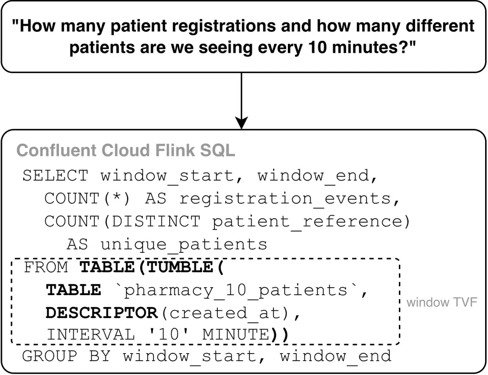
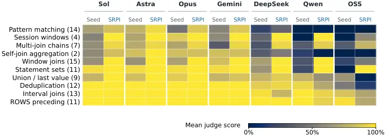
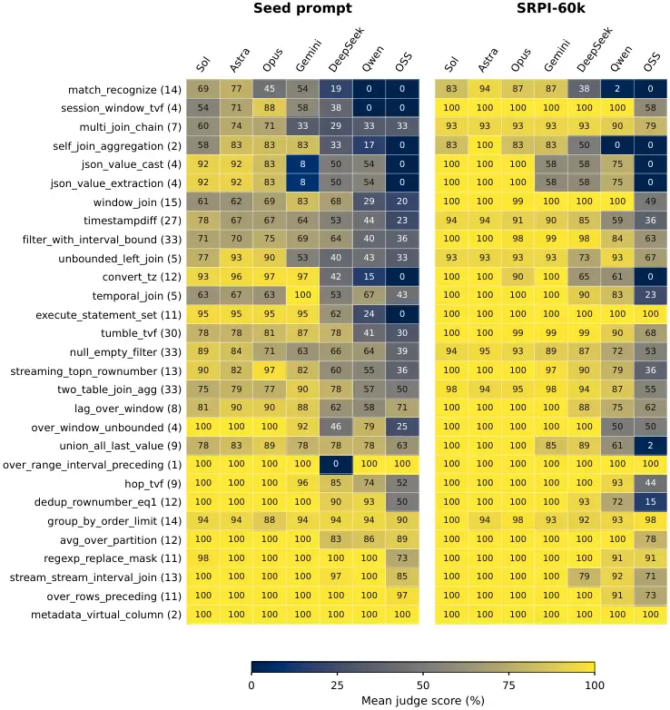

# Self-Refining Prompt Induction for Streaming Text-to-SQL

Gaetano Rossiello    Alfio Gliozzo    Nandana Mihindukulasooriya   
Erick Lee Affiliation: IBM  Confluent    Nabila Siregar    Lisa Amini

###### Abstract

Text-to-SQL assistants for streaming engines must handle
dialect-specific types, windowing rules, and temporal semantics,
including constructs poorly handled by generic prompts. We present
Self-Refining Prompt Induction (SRPI), an offline method that converts
generation failures into reusable dialect instructions while keeping
model weights fixed. A Refiner revises the Generator’s prompt using
reference-conditioned feedback from three LLM judges; a sampled
regression guard checks earlier successes, and a separate Compressor
reduces prompt length. Inference uses the frozen prompt without
retrieval or query repair. We evaluate cross-domain and cross-model
transfer on Confluent Cloud Flink SQL using a controlled synthetic
workload seeded by 30 expert-written examples, with 335 induction
examples and 257 questions from held-out domains. The same induced
prompt improves mean judge scores across seven Generators by 7.1–19.2
percentage points, including an increase from 85.3% to 97.5% for the
induction model. A separate compression study reduces prompt length by
52.7% with a 0.19-percentage-point score decrease. An assistant using
the induced prompt is in early access, with initial user feedback to
inform subsequent refinement.

## 1 Introduction

Text-to-SQL assistants broaden access to data platforms, but success on
Spider and BIRD does not establish reliability on a particular
production engine (Yu et al., 2018; Li et al., 2023). Cross-dialect
evaluation exposes backend differences (Perlitz et al., 2026), while
enterprise workloads add schema and domain complexity (Chen et al.,
2024).

Figure 1: A natural-language request and a Flink SQL query over a
stream. The dashed region highlights the window table-valued function
(TVF), which assigns events to ten-minute windows.

Figure 2: SRPI separates offline induction and compression from online
generation. Reference SQL is visible to the judges and Refiner, never to
the Generator. The guard tests each rewrite before commitment; the
requested compression budget need not be met. Online use requires one
Generator call with the static prompt.

Our assistant generates Confluent Cloud Flink SQL from English requests
and definitions of user-selected tables (Figure 1). Streaming SQL
unifies operations over streams and tables (Begoli et al., 2019), but
correct queries still depend on timestamp types, event-time semantics,
window membership, and engine-specific conventions. For example, the
managed service exposes the Kafka record timestamp through \$rowtime;
confusing it with a business event timestamp can change a query’s
meaning (Confluent, 2026a). Errors can reject a statement or silently
change its answer.

Supervised fine-tuning (SFT) adapts weights for specialised Text-to-SQL
tasks (Tritto et al., 2026; Glass et al., 2025). We instead keep
Generator weights fixed and learn reusable instructions. Prompts can be
inspected, versioned, and rolled back across Generators without
model-specific retraining. This suits inference-only access and frequent
model changes, at the cost of longer inputs. Comparison with SFT remains
open.

_Self-Refining Prompt Induction_ (SRPI) targets a practical maintenance
problem: converting failures on long-tail dialect constructs into
guidance reusable across domains and Generators. The aim is to encode
the target engine’s syntax and usage constraints in a prompt. SRPI
rewrites instructions using three judges’ reference-conditioned
feedback, checks earlier successes, and compresses the result. The
Generator and Refiner use the same model; judges and optimisation
procedure remain fixed.

We study this process in a controlled synthetic workload executed on a
live managed cluster. Judge-score targets are 95% for single-construct
questions and 75% for questions combining at least three constructs. The
assistant is in early access, with initial real-user feedback
forthcoming. Informal feedback from Flink and streaming-data experts has
been encouraging.

The contributions are:

- •
  System design: an offline adaptation workflow integrating
  reference-based feedback, whole-prompt self-refinement, a regression
  guard, and separate compression.
- •
  Data and transfer: a controlled workload testing reuse of one induced
  prompt across seven Generators and held-out domains within a shared
  dialect repertoire.
- •
  Engineering evidence: measured trade-offs in prompt growth, regression
  checks, compression, and feedback sources.

|                    |       |      |            |                      |      |            |                     |       |            |       |      |            |
| ------------------ | ----- | ---- | ---------- | -------------------- | ---- | ---------- | ------------------- | ----- | ---------- | ----- | ---- | ---------- |
|                    | Micro |      |            | Tier 1 ($`n{=}191`$) |      |            | Tier 3 ($`n{=}22`$) |       |            | U-Yes |      |            |
| Generator          | Seed  | SRPI | $`\Delta`$ | Seed                 | SRPI | $`\Delta`$ | Seed                | SRPI  | $`\Delta`$ | Seed  | SRPI | $`\Delta`$ |
| GPT-6.1 Sol        | 85.3  | 97.5 | +12.2      | 87.2                 | 97.3 | +10.1      | 68.9                | 100.0 | +31.1      | 72.0  | 95.7 | +23.7      |
| GPT-6 Astra        | 86.2  | 97.4 | +11.2      | 88.3                 | 96.9 | +8.6       | 69.7                | 100.0 | +30.3      | 75.1  | 94.9 | +19.8      |
| Claude Opus 5.5    | 85.3  | 97.1 | +11.8      | 88.8                 | 97.5 | +8.7       | 69.7                | 94.7  | +25.0      | 72.4  | 93.8 | +21.4      |
| Gemini 3.8 Flash   | 82.3  | 95.8 | +13.5      | 85.3                 | 96.5 | +11.2      | 69.7                | 90.9  | +21.2      | 71.2  | 92.2 | +21.0      |
| DeepSeek 4.1 Flash | 70.0  | 89.2 | +19.2      | 72.6                 | 89.9 | +17.3      | 62.9                | 87.9  | +25.0      | 57.2  | 81.7 | +24.5      |
| Qwen3.8 27B        | 61.3  | 77.6 | +16.3      | 66.1                 | 77.3 | +11.2      | 31.1                | 84.8  | +53.7      | 48.2  | 72.8 | +24.6      |
| GPT-OSS 120B       | 46.4  | 53.5 | +7.1       | 49.7                 | 53.4 | +3.7       | 13.6                | 39.4  | +25.8      | 35.8  | 45.5 | +9.7       |

Table 1: Domain-held-out evaluation ($`n=257`$), one scored output per
question and condition. Scores are percentages; U-Yes is unanimous Yes.
$`\Delta`$ (pp) is SRPI minus Seed from the reported rounded scores.
Bold: within-Generator gains. The same 59,787-character SRPI-60k prompt
is used throughout; only Sol was used for induction.

## 2 Workload and Evaluation Data

SRPI needs questions, table definitions (DDL), and reference SQL. These
can be annotated by experts or generated synthetically; the refinement
loop accepts either source. Expert annotation requires dialect
expertise. We evaluate the synthetic pathway, seeded by 30
expert-written question–SQL pairs validated on a live cluster.

An LLM proposes domain specifications, which are compiled into Flink
DDL. The portfolio covers 50 schemas, 45 business domains, 304 tables,
and 1,752 columns. Populated tables undergo live integrity checks. The
expert examples and official documentation yield 42 SQL patterns in 14
groups, covering windows, joins, pattern matching, JSON operations, and
sink statements. Pattern instantiations are executed on the cluster;
failures are discarded. An LLM then writes questions from accepted SQL.
This checks engine acceptance, not every question–SQL alignment.
Evaluated questions explicitly name tables and columns.

The pool contains 3,940 examples with 31 construct labels. Tier 1 has
one label (2,864 examples), Tier 2 two (639), and Tier 3 at least three
(437). Holding out education, insurance, and retail yields 257
evaluation questions: 191, 44, and 22 by tier, covering 29 labels. The
remaining 3,683 form the training pool. Domains and exact SQL are
disjoint while pattern templates are shared, directly testing reuse of
dialect guidance across domains within the same construct repertoire.

The induction set comprises 335 synthetic examples stratified by domain
and construct label. The Refiner sees no evaluation examples. Appendix A
details generation and coverage.

## 3 Self-Refining Prompt Induction

Figure 2 shows three stages. _Induction_ starts with a 337-character
seed prompt and turns errors on training examples into reusable
instructions. _Compression_ shortens those instructions separately. At
_inference_, the Generator receives only the static prompt, question,
and table definitions. Reference SQL is available to the offline judges
and Refiner, never to the Generator. The judges assess SQL, the Refiner
edits instructions, and the guard checks earlier successes before a
revision is accepted.

#### Generate and judge.

The Generator answers a training question using the current prompt and
DDL. Three judges compare this SQL with the reference, given the same
question and DDL. Each returns Yes, Maybe, or No with an explanation.
Their fixed instructions cover semantics, timestamp types, windows,
joins, and dialect validity. Result-set fields are left empty for the
live-streaming evaluation protocol (§4.1). An example passes only when
all three judges return Yes.

#### Rewrite from a failure.

For a failing example, the Refiner receives the current prompt, fixed
user template, question, DDL, reference and generated SQL, judge
feedback, and summaries of failed attempts on that example. It returns a
complete replacement prompt and a change summary. Instructions require
construct-level rules without copying instance-specific identifiers or
literals, and treat judge explanations as fallible evidence. Appendix G
examines a recorded edit.

#### Check earlier successes.

A candidate must first pass the target example. The guard then
re-generates and re-judges examples fixed earlier in the current round
and 12 randomly sampled passing examples. A candidate is accepted if at
most one checked example fails. Rejected candidates leave the accepted
prompt unchanged; their outcomes enter the attempt history. Up to five
attempts are made per target. This sampled check controls acceptance
while allowing limited regression.

#### Repeat and retain a checkpoint.

Each round scores the induction sample, attempts repairs on up to 40
failing examples, and scores the resulting prompt again. The accepted
prompt carries into the next round. After seven rounds, we retain
round 6 using induction performance and saturation of prompt growth
(§4.3). Model assignments and sources are given in §4.1; Appendix B
lists implementation settings.

Figure 3: Construct highlights: the four lowest seed means, four largest
mean gains, and all four declines across seven Generators (10 unique
labels). Adjacent cells show Seed/SRPI-60k scores (%); parentheses give
question counts. All 29 labels and values appear in Appendix E.

#### Compress for inference.

An early 50,000-character cap caused 123 rewrite rejections. We instead
allow growth and compress afterwards. The Compressor receives only the
prompt and a character budget, with instructions to preserve distinct
constraints and rare-construct rules. It runs at temperature 0.1 for up
to five attempts, aiming at 97% of the budget. A candidate must be
shorter and retain specified output-contract words. If the budget is
missed, the shortest valid candidate is retained and its actual length
reported. The 59,787-character version is denoted SRPI-60k.

## 4 Evaluation

We assess the system in Figure 2 for prompt transfer, induction and
compression, and alternative feedback sources. Selected execution checks
complement the judge scores.

### 4.1 Protocol and metrics

We compare the unchanged SRPI-60k prompt with the seed on seven
Generators (Table 1), with one scored output per question and condition.
GPT-6.1 Sol (OpenAI, 2026b) performs induction, refinement, and
compression. The other six test transfer: GPT-6 Astra (OpenAI, 2026a),
Claude Opus 5.5 (Anthropic, 2026), Gemini 3.8 Flash (Doshi and Popa,
2026), DeepSeek 4.1 Flash (DeepSeek-AI, 2026), Qwen3.8 27B (Qwen Team,
2026), and GPT-OSS 120B (OpenAI, 2025). Astra, Claude, and Gemini also
form the judge panel. Appendix B details model attribution. For
reporting, Yes, Maybe, and No map to 100%, 50%, and 0%. Micro averages
these scores over judges and questions. Unanimous Yes (U-Yes) is the
percentage of questions receiving Yes from all three judges. Tier scores
average judge scores within each tier; differences use percentage points
(pp). Appendix H retains construct-balanced Macro results. Judges accept
semantically equivalent SQL formulations; scores are not calibrated
correctness probabilities.

We use the configurable LLM judge in the Text-to-SQL Evaluation Toolkit
(Hassanzadeh et al., 2026). Judges receive the question, SQL, and DDL
without result sets. Live gold and generated queries can observe
different records and temporal boundaries; arrival timing and state
retention can also affect outputs (Confluent, 2026b). Comparing these
unaligned results would confound query quality with execution context.
SQL-level judging provides a common assessment across the workload,
complemented by cluster acceptance. The 95% bootstrap intervals resample
questions 10,000 times, conditional on recorded outputs.

### 4.2 Transfer across Generators

SRPI improves every Generator’s micro score by 7.1–19.2 pp, Tier 1 score
by 3.7–17.3 pp, and Tier 3 score by 21.2–53.7 pp (Table 1). DeepSeek has
the largest micro gain, rising from 70.0% to 89.2%. GPT-6.1 Sol improves
from 85.3% to 97.5%, with a paired 95% bootstrap interval of
$`[8.8,15.6]`$ pp for the gain. Its unanimous-Yes rate rises from 72.0%
to 95.7%. Final scores of 53.5–97.5% still reflect differences in
Generator capability. Appendix H plots all metric and tier comparisons.

Four Generators exceed the provisional Tier 1 and Tier 3 thresholds on
_mean judge-score point estimates_. This statement changes under the
stricter unanimity measure: Tier 1 unanimous-Yes rates are 95.8%, 94.2%,
94.8%, and 94.2% for Sol, Astra, Claude, and Gemini, respectively. Only
Sol exceeds 95% by that measure. Tier 3 contains 22 examples; unanimity
offers a stricter development criterion.

Across all 29 labels, scores improve for 24, remain unchanged for one,
and decline for four when averaged over Generators. From the rounded
per-label scores, statement sets rise from 67% to 100%, and multi-join
chains from 48% to 91%. Figure 3 highlights difficult constructs, large
gains, and every declining label. Pattern matching remains difficult for
several Generators. Appendix E contains the complete heatmap.

### 4.3 Induction, convergence, and compression

Figure 4: Induction and compression (GPT-6.1 Sol). (a) Induction and
domain-held-out scores; the latter track generalisation. (b) Prompt
length by round. Round 6 is selected using induction performance and
saturation of prompt growth; round 7 adds 0.97% characters while
induction performance falls. (c) A separate compression study starts
from a 68,497-character prompt and reports actual lengths; only the 60k
target is met. Score axes use different ranges.

Figure 4 tracks seven rounds. We select round 6 using induction-set
performance and saturation of prompt growth: its score reaches 99.6%,
then round 7 adds only 721 characters to 74,513 (0.97%) while the score
falls to 99.2%. The held-out curve tracks generalisation and is not a
checkpoint-selection criterion. This is a refinement trajectory, not a
learning curve over training-set sizes.

#### Regression burden.

In rounds 3–7, 88 candidate rewrites pass their target and 52 (59.1%)
are rejected by the guard. Target-local success therefore often
co-occurs with sampled regressions, although stochastic generation and
judging may contribute. A no-guard comparison would be needed to
quantify its causal benefit.

#### Compression.

In a separate compression study, a 68,497-character parent shrinks to
32,400 characters (52.7% shorter), while micro changes from 98.05% to
97.86% in one scoring run. At 15,420 characters it is 97.28%. Five of
six requested budgets are missed; these single-run measurements describe
an observed trade-off, not established non-inferiority. Transfer uses
the 59,787-character SRPI-60k version. Appendix I provides fixed
workflow prompts and selected induced-rule excerpts; Appendix D gives
all compression results.

### 4.4 Alternative feedback sources

We compare prompts constructed from the same seed using 54 documentation
pages, 18 parser-grammar slices, or three rounds of live execution
errors on 300 induction examples. SRPI achieves the highest judge score
among these configurations (Table 2). Lengths, supervision, and budgets
differ; these are development alternatives, not controlled ablations or
implementations of DIAL (Zhang et al., 2026b) or TAHOE (Chen et al.,
2026).

| Prompt source      | Chars | Micro% | $`\Delta`$ pp | U-Yes% |
| ------------------ | ----- | ------ | ------------- | ------ |
| Seed               | 337   | 84.2   | –             | 71.2   |
| Documentation      | 19.9k | 85.2   | 1.0           | 74.3   |
| Parser grammar     | 18.5k | 84.9   | 0.7           | 73.5   |
| Execution errors   | 19.2k | 85.8   | 1.6           | 76.3   |
| SRPI, uncompressed | 68.5k | 98.1   | 13.9          | 96.5   |

Table 2: Alternative prompt sources, GPT-6.1 Sol. Bold: best score;
$`\Delta`$ is in pp. SRPI uses reference SQL and more optimisation, so
the comparison does not isolate the feedback source.

Reported cluster acceptance is 78.3% for the seed, 85.2% for
execution-error rules, and 94.2% for SRPI-60k. This indicates fewer
rejected statements; acceptance alone does not establish result
equivalence. Documentation and execution feedback may still complement
SRPI.

### 4.5 Panel sensitivity and execution checks

We examine panel sensitivity and selected execution cases to understand
remaining errors.

The evaluation comprises 1,799 outputs per prompt condition, each
assessed by three judges. To probe panel sensitivity, we exclude a
Generator’s own judge where applicable: Astra improves from 89.8% to
98.1%, Claude from 83.9% to 96.9%, and Gemini from 78.7% to 94.9%. Gains
therefore persist when these Generators do not score their own outputs.
This check addresses self-evaluation within the existing panel, not
validation by independent judges. Since induction and evaluation reuse
the panel, optimisation toward its preferences remains possible; Sol
also shares a model family with Astra.

Three selected seed outputs with split verdicts illustrate the
distinction. Two TIMESTAMPDIFF queries mix timestamp types and fail on
the cluster, agreeing with the majority rejection. A SESSION query also
receives majority rejection but executes successfully. The cases help
distinguish engine acceptance from semantic judgment. A schema-neutral
rule diff also exposes reference bias (Appendix G).

## 5 Related Work

#### Dialect adaptation.

CrackSQL translates dialects, Dialect-SQL uses an intermediate
representation, and SQL-GEN uses synthetic data and model merging (Zhou
et al., 2025; Shi et al., 2025; Pourreza et al., 2024). Query-plan
approaches compile dialect-agnostic relational plans into SQL (Royer et
al., 2026), requiring compiler support for each backend; SRPI retains
direct SQL generation and adds prompt context. DIAL combines
dialect-aware planning, a hierarchical knowledge base, execution repair,
and semantic verification (Zhang et al., 2026b). TAHOE retrieves hints
learned from compiler and semantic feedback (Chen et al., 2026). SRPI
instead consolidates guidance offline, requiring neither retrieval nor
repair at inference.

#### Prompt optimisation.

APE and OPRO select prompts by score (Zhou et al., 2023; Yang et al.,
2024); ProTeGi combines textual gradients, beam search, and bandit
selection (Pryzant et al., 2023); TextGrad propagates feedback through
computation graphs (Yuksekgonul et al., 2025); GEPA reflects on
trajectories and evolves a Pareto frontier (Agrawal et al., 2026). ACE
incrementally updates a playbook to avoid context collapse (Zhang et
al., 2026a). SRPI retains one accepted prompt, rewrites it per failure
using three judges’ explanations and attempt history, checks
regressions, and compresses separately. Self-Refine revises outputs,
Reflexion maintains agent memory, and STOP modifies the optimisation
scaffold (Madaan et al., 2023; Shinn et al., 2023; Zelikman et al.,
2024). SRPI’s judges, Refiner instructions, and guard stay fixed:
optimisation is single-level and externally supervised.

#### SQL judging.

LLM judges and panels provide scalable feedback (Zheng et al., 2023;
Verga et al., 2024). Distilled test suites broaden execution coverage
(Zhong et al., 2020); FLEX uses execution-informed judges (Kim et al.,
2025). The Text-to-SQL Evaluation Toolkit combines execution and LLM
metrics (Hassanzadeh et al., 2026); we use SQL-level judging.
Judge-specific overfitting during prompt optimisation has been observed
in legal QA (Elganayni et al., 2026), motivating separate scrutiny of
evaluator transfer.

## 6 Discussion and Conclusion

SRPI converts generation failures into explicit dialect specifications.
Its 24 prompt sections cover timestamp compatibility, windows, joins,
NULL handling, numeric contracts, and a final checklist. Gains across
seven Generators and held-out domains support reuse of this guidance
beyond the induction examples. The resulting artifact can be versioned
or rolled back without retraining models or adding inference stages. The
transferable unit is a SQL constraint. The Refiner expresses such
constraints through schema-neutral placeholders for reuse by the
Generator across domains. Curated failures can guide later offline
prompt updates.

#### Monitor construct-level behaviour.

Session-window TVFs improve from 44% to 94% averaged across Generators,
whereas deduplication and interval joins decline by about 8 and 6 pp.
The guard rejects 52 of 88 target-passing rewrites, showing why a local
repair merits checks on earlier successes. These observations support
retaining representative passing cases alongside new failures.
Versioning prompt, Generator, and engine together would make later
changes traceable.

#### Budget the whole request.

SRPI-60k adds about 7,400 input words per call. Mean completion tokens
fall from 248.1 to 209.6 for Sol ($`-15.5\%`$), but rise from 1,131.2 to
2,915.4 for DeepSeek ($`+157.7\%`$) and 1,415.3 to 3,187.2 for Gemini
($`+125.2\%`$). Model choice therefore affects output size as well as
quality. Compression measures a prompt-character/score trade-off;
input-token costs, billing, and latency remain unmeasured (Appendix E).

#### Early access and continued refinement.

The assistant using the induced prompt is in early access. Encouraging
informal feedback from Flink and streaming-data experts motivates
further evaluation; initial real-user feedback is forthcoming. We plan
to curate recurring failures from user query logs into question–DDL
examples with validated reference SQL, refine the prompt offline, and
regression-check versioned replacements before release. This would
extend the evaluated workflow into an ongoing maintenance process. SRPI
serves the generation component after schema selection; the surrounding
assistant can retain schema retrieval and resource controls. The frozen
prompt requires one Generator call without runtime retrieval or repair.
Future user-log refinements will be evaluated separately from the
controlled results reported here. User feedback will guide priorities
for expanding construct coverage.

## Limitations

Evaluation and deployment stage. SQL-level judge scores and cluster
acceptance provide complementary development evidence. Measurements are
offline; real-user feedback and operational outcomes are forthcoming.
Expert feedback is informal, without a documented human evaluation.
Induction and evaluation share judges in a SQL-only configuration;
systematic human scoring and quantified human–judge disagreement are
absent. Independent scoring or a disjoint panel could clarify semantic
errors. Live result-set comparisons require aligned inputs and temporal
boundaries; controlled replay or fixed-input tests remain possible
complements.

Workload coverage and intended generalisation. The controlled workload
tests reuse across domains and Generators within a defined construct
repertoire. Domains and exact SQL instances are disjoint, but pattern
templates overlap. This tests reuse of failure-derived rules when
recurring windowing and join patterns are applied across schemas.
Unseen-template generalisation and representativeness of production
traffic are untested; mishandled constructs may occur in pretraining.
Explicit schema names, three held-out domains and 22 Tier 3 questions
delimit the evidence. Schema ambiguity, multi-turn interaction and other
engines remain untested.

Experimental variability. Results reflect one induction run and one
scored output per question and condition. Bootstrap intervals measure
question variability, not model sampling or future versions. Guard
activity is reported without isolating rewrite, panel or guard effects;
compression and cluster acceptance are single-run measurements.
Matched-budget comparisons with SFT, other optimisers and
retrieval/repair pipelines, plus training-set-size ablations, remain
open.

Operational trade-offs and artifacts. Single-call inference simplifies
serving but adds prompt context; end-to-end cost and latency are
unmeasured. The sampled guard permits limited regressions, and
anti-copying instructions cannot eliminate reference-derived
assumptions. The supplement supplies fixed workflow prompts, selected
learned-rule excerpts, a recorded diff and request, numerical tables and
plotting code (Appendix I). Full induced/compressed prompts, induction
logs and per-example evaluation records are absent, so artifacts support
inspection rather than exact reruns.

## Ethical Considerations

The study uses synthetic data rather than customer or personal records.
Generated SQL may still expose information or trigger costly or
destructive operations when deployed; the workload includes sink and
background statements as well as reads. Appropriate permissions,
explicit approval of writes, resource limits, and reviewable SQL are
therefore necessary deployment safeguards, not capabilities established
by this study. Planned user-log curation will require access controls
and removal of customer-sensitive content before examples are sent to
hosted models. The multi-model offline loop incurs unmeasured
computational and energy costs.

## References

- Agrawal et al. (2026) L. A. Agrawal, S. Tan, D. Soylu, N. Ziems, R.
  Khare, K. Opsahl-Ong, A. Singhvi, H. Shandilya, M. J. Ryan, M.
  Jiang, C. Potts, K. Sen, A. Dimakis, I. Stoica, D. Klein, M. Zaharia,
  and O. Khattab GEPA: reflective prompt evolution can outperform
  reinforcement learning. In The Fourteenth International Conference on
  Learning Representations, pp. 8479–8565. External Links:
  [Link](https://proceedings.iclr.cc/paper_files/paper/2026/hash/0e9e708b6f48e14fd0ac29e167413f76-Abstract-Conference.html)
  Cited by: §5.
- Anthropic (2026) Anthropic Introducing Claude Opus 5.5. Note: Accessed
  October 28, 2026 External Links:
  [Link](https://www.anthropic.com/claude-opus-5-5) Cited by: Table 5,
  §4.1.
- Begoli et al. (2019) E. Begoli, T. Akidau, F. Hueske, J. Hyde, K.
  Knight, and K. Knowles One sql to rule them all - an efficient and
  syntactically idiomatic approach to management of streams and tables.
  In Proceedings of the 2019 International Conference on Management of
  Data, SIGMOD ’19, New York, NY, USA, pp. 1757–1772. External Links:
  ISBN 9781450356435, [Link](https://doi.org/10.1145/3299869.3314040),
  [Document](https://dx.doi.org/10.1145/3299869.3314040) Cited by: §1.
- Chen et al. (2024) P. B. Chen, D. Yang, W. Li, F. Wenz, Y. Zhang, N.
  Tatbul, M. Cafarella, Ç. Demiralp, and M. Stonebraker BEAVER: an
  enterprise benchmark for text-to-SQL. arXiv preprint arXiv:2409.02038.
  External Links: [Link](https://arxiv.org/abs/2409.02038) Cited by: §1.
- Chen et al. (2026) Z. Chen, J. Song, and P. Li TAHOE: text-to-SQL with
  automated hint optimization from experience. arXiv preprint
  arXiv:2606.12387. External Links:
  [Link](https://arxiv.org/abs/2606.12387) Cited by: Appendix F, §4.4,
  §5.
- Confluent (2026a) Confluent CREATE TABLE statement in Confluent Cloud
  for Apache Flink. Note:
  [https://docs.confluent.io/cloud/current/flink/reference/statements/create-table.html](https://docs.confluent.io/cloud/current/flink/reference/statements/create-table.html)Accessed
  October 28, 2026 Cited by: §1.
- Confluent (2026b) Confluent Determinism in continuous queries on
  Confluent Cloud for Apache Flink. Note:
  [https://docs.confluent.io/cloud/current/flink/concepts/determinism.html](https://docs.confluent.io/cloud/current/flink/concepts/determinism.html)Accessed
  October 28, 2026 Cited by: §A.3, §4.1.
- Confluent (2026c) Confluent Snapshot queries in Confluent Cloud for
  Apache Flink. Note:
  [https://docs.confluent.io/cloud/current/flink/concepts/snapshot-queries.html](https://docs.confluent.io/cloud/current/flink/concepts/snapshot-queries.html)Accessed
  October 28, 2026 Cited by: §A.3.
- DeepSeek-AI (2026) DeepSeek-AI DeepSeek-V4.1-Flash: pushing the limits
  of KV cache compression. Note: Model card. Accessed October 28, 2026
  External Links:
  [Link](https://huggingface.co/deepseek-ai/DeepSeek-V4.1-Flash) Cited
  by: Table 5, §4.1.
- Doshi and Popa (2026) T. Doshi and R. A. Popa Introducing Gemini 3.8
  Flash and 3.8 Flash Cyber. Note: Google. Accessed October 28, 2026
  External Links:
  [Link](https://blog.google/innovation-and-ai/models-and-research/gemini-models/3-8-flash-and-3-8-flash-cyber/)
  Cited by: Table 5, §4.1.
- Elganayni et al. (2026) M. H. Elganayni, R. Chen, S. Nagl, and M.
  Grabmair Exploiting LLM-as-a-judge disposition on free text legal QA
  via prompt optimization. arXiv preprint arXiv:2604.20726. External
  Links: [Document](https://dx.doi.org/10.48550/arXiv.2604.20726),
  [Link](https://arxiv.org/abs/2604.20726) Cited by: §5.
- Glass et al. (2025) M. Glass, M. Eyceoz, D. Subramanian, G.
  Rossiello, L. Vu, and A. Gliozzo Extractive schema linking for
  text-to-SQL. arXiv preprint arXiv:2501.17174. External Links:
  [Document](https://dx.doi.org/10.48550/arXiv.2501.17174),
  [Link](https://arxiv.org/abs/2501.17174) Cited by: §1.
- Hassanzadeh et al. (2026) O. Hassanzadeh, Y. Perlitz, N. Pham, T.
  Kaple, K. Źróbek, L. Vu, M. Glass, D. Subramanian, M. Pourreza, and D.
  Rafiei Text-to-SQL evaluation toolkit. Proceedings of the VLDB
  Endowment 19 (12), pp. 4582–4585. External Links:
  [Document](https://dx.doi.org/10.14778/3827998.3828071),
  [Link](https://doi.org/10.14778/3827998.3828071) Cited by: §4.1, §5.
- Kim et al. (2025) H. Kim, J. Taeyang, S. Choi, S. Choi, and H. Cho
  FLEX: expert-level false-less EXecution metric for text-to-SQL
  benchmark. In Proceedings of the 2025 Conference of the Nations of the
  Americas Chapter of the Association for Computational Linguistics:
  Human Language Technologies (Volume 1: Long Papers), pp. 4448–4475.
  External Links:
  [Document](https://dx.doi.org/10.18653/v1/2025.naacl-long.228),
  [Link](https://aclanthology.org/2025.naacl-long.228/) Cited by: §5.
- Li et al. (2023) J. Li, B. Hui, G. Qu, J. Yang, B. Li, B. Li, B.
  Wang, B. Qin, R. Geng, N. Huo, X. Zhou, C. Ma, G. Li, K. C. C.
  Chang, F. Huang, R. Cheng, and Y. Li Can LLM already serve as a
  database interface? A BIg bench for large-scale database grounded
  text-to-SQLs. In Advances in Neural Information Processing Systems,
  Vol. 36, pp. 42330–42357. External Links:
  [Document](https://dx.doi.org/10.52202/075280-1835),
  [Link](https://proceedings.neurips.cc/paper_files/paper/2023/hash/83fc8fab1710363050bbd1d4b8cc0021-Abstract-Datasets_and_Benchmarks.html)
  Cited by: §1.
- Madaan et al. (2023) A. Madaan, N. Tandon, P. Gupta, S. Hallinan, L.
  Gao, S. Wiegreffe, U. Alon, N. Dziri, S. Prabhumoye, Y. Yang, S.
  Gupta, B. P. Majumder, K. Hermann, S. Welleck, A. Yazdanbakhsh, and P.
  Clark Self-refine: iterative refinement with self-feedback. In
  Advances in Neural Information Processing Systems, Vol. 36,
  pp. 46534–46594. External Links:
  [Link](https://proceedings.neurips.cc/paper_files/paper/2023/hash/91edff07232fb1b55a505a9e9f6c0ff3-Abstract-Conference.html),
  [Document](https://dx.doi.org/10.52202/075280-2019) Cited by: §5.
- OpenAI (2025) OpenAI gpt-oss-120b & gpt-oss-20b model card. External
  Links: 2508.10925, [Link](https://arxiv.org/abs/2508.10925) Cited by:
  Table 5, §4.1.
- OpenAI (2026a) OpenAI GPT-6 Astra: a new generation of intelligence.
  Note: Accessed October 28, 2026 External Links:
  [Link](https://openai.com/index/gpt-6-astra/) Cited by: Table 5, §4.1.
- OpenAI (2026b) OpenAI Introducing GPT-6.1 Sol. Note: Accessed October
  28, 2026 External Links:
  [Link](https://openai.com/index/introducing-gpt-6-1-sol/) Cited by:
  Table 5, §4.1.
- Perlitz et al. (2026) Y. Perlitz, E. Venezian, C. Royer, F. Fusco,
  and A. Giovannini PolySQL: scaling text-to-SQL evaluation across SQL
  dialects via automated backend isomorphism. In Proceedings of the 2026
  Conference on Empirical Methods in Natural Language Processing,
  pp. 499–512. External Links:
  [Link](https://aclanthology.org/2026.emnlp-main.23/) Cited by: §1.
- Pourreza et al. (2024) M. Pourreza, R. Sun, H. Li, L. Miculicich, T.
  Pfister, and S. O. Arik SQL-GEN: bridging the dialect gap for
  text-to-SQL via synthetic data and model merging. arXiv preprint
  arXiv:2408.12733. External Links:
  [Link](https://arxiv.org/abs/2408.12733) Cited by: §5.
- Pryzant et al. (2023) R. Pryzant, D. Iter, J. Li, Y. T. Lee, C. Zhu,
  and M. Zeng Automatic prompt optimization with “gradient descent” and
  beam search. In Proceedings of the 2023 Conference on Empirical
  Methods in Natural Language Processing, pp. 7957–7968. External Links:
  [Document](https://dx.doi.org/10.18653/v1/2023.emnlp-main.494),
  [Link](https://aclanthology.org/2023.emnlp-main.494/) Cited by: §5.
- Qwen Team (2026) Qwen Team Qwen3.8-27B. Note: Model card. Accessed
  October 28, 2026 External Links:
  [Link](https://huggingface.co/Qwen/Qwen3.8-27B) Cited by: Table 5,
  §4.1.
- Royer et al. (2026) C. Royer, R. Oester, Y. Perlitz, Y. Metz, A.
  Giovannini, and M. El-Assady Closing the cross-dialect gap: query
  plans as a portable interface in text-to-SQL. In Findings of the
  Association for Computational Linguistics: EMNLP 2026,
  pp. 52002–52021. External Links:
  [Link](https://aclanthology.org/2026.findings-emnlp.2422/) Cited by:
  §5.
- Shi et al. (2025) J. Shi, X. Cao, B. Xu, J. Liang, Y. Xiao, J.
  Chen, P. Wang, and W. Wang Dialect-SQL: an adaptive framework for
  bridging the dialect gap in text-to-SQL. In Proceedings of the 2025
  Conference on Empirical Methods in Natural Language Processing,
  pp. 3604–3619. External Links:
  [Document](https://dx.doi.org/10.18653/v1/2025.emnlp-main.178),
  [Link](https://aclanthology.org/2025.emnlp-main.178/) Cited by: §5.
- Shinn et al. (2023) N. Shinn, F. Cassano, A. Gopinath, K. Narasimhan,
  and S. Yao Reflexion: language agents with verbal reinforcement
  learning. In Advances in Neural Information Processing Systems, Vol.
  36, pp. 8634–8652. External Links:
  [Link](https://proceedings.neurips.cc/paper_files/paper/2023/hash/1b44b878bb782e6954cd888628510e90-Abstract-Conference.html),
  [Document](https://dx.doi.org/10.52202/075280-0377) Cited by: §5.
- Tritto et al. (2026) M. Tritto, G. Farano, D. Di Palma, G.
  Rossiello, D. Subramanian, F. Narducci, and T. Di Noia GradeSQL:
  outcome reward models for intelligent text-to-SQL generation from
  LLMs. Journal of Intelligent Information Systems 64 (5),
  pp. 2545–2568. External Links:
  [Document](https://dx.doi.org/10.1007/s10844-026-01071-6),
  [Link](https://doi.org/10.1007/s10844-026-01071-6) Cited by: §1.
- Verga et al. (2024) P. Verga, S. Hofstätter, S. Althammer, Y. Su, A.
  Piktus, A. Arkhangorodsky, M. Xu, N. White, and P. Lewis Replacing
  judges with juries: evaluating LLM generations with a panel of diverse
  models. arXiv preprint arXiv:2404.18796. External Links:
  [Link](https://arxiv.org/abs/2404.18796) Cited by: §5.
- Yang et al. (2024) C. Yang, X. Wang, Y. Lu, H. Liu, Q. V. Le, D. Zhou,
  and X. Chen Large language models as optimizers. In The Twelfth
  International Conference on Learning Representations, External Links:
  [Link](https://arxiv.org/abs/2309.03409) Cited by: §5.
- Yu et al. (2018) T. Yu, R. Zhang, K. Yang, M. Yasunaga, D. Wang, Z.
  Li, J. Ma, I. Li, Q. Yao, S. Roman, Z. Zhang, and D. Radev Spider: a
  large-scale human-labeled dataset for complex and cross-domain
  semantic parsing and text-to-SQL task. In Proceedings of the 2018
  Conference on Empirical Methods in Natural Language Processing,
  pp. 3911–3921. External Links:
  [Link](https://aclanthology.org/D18-1425/) Cited by: §1.
- Yuksekgonul et al. (2025) M. Yuksekgonul, F. Bianchi, J. Boen, S.
  Liu, P. Lu, Z. Huang, C. Guestrin, and J. Zou Optimizing generative AI
  by backpropagating language model feedback. Nature 639, pp. 609–616.
  External Links:
  [Document](https://dx.doi.org/10.1038/s41586-025-08661-4),
  [Link](https://doi.org/10.1038/s41586-025-08661-4) Cited by: §5.
- Zelikman et al. (2024) E. Zelikman, E. Lorch, L. Mackey, and A. T.
  Kalai Self-taught optimizer (STOP): recursively self-improving code
  generation. In First Conference on Language Modeling, External Links:
  [Link](https://arxiv.org/abs/2310.02304) Cited by: §5.
- Zhang et al. (2026a) Q. Zhang, C. Hu, S. Upasani, B. Ma, F. Hong, V.
  Kamanuru, J. Rainton, C. Wu, M. Ji, H. Li, U. Thakker, J. Zou, and K.
  Olukotun Agentic context engineering: evolving contexts for
  self-improving language models. In The Fourteenth International
  Conference on Learning Representations, External Links:
  [Link](https://arxiv.org/abs/2510.04618) Cited by: §5.
- Zhang et al. (2026b) X. Zhang, H. Xu, L. Zhou, W. Zhou, X. Zhou, G.
  Li, Y. Luo, C. Liu, G. Chen, J. Liao, and F. Wu Dial: a
  knowledge-grounded dialect-specific NL2SQL system. Proceedings of the
  VLDB Endowment 19 (11), pp. 3718–3731. External Links:
  [Document](https://dx.doi.org/10.14778/3836663.3836720),
  [Link](https://arxiv.org/abs/2603.07449) Cited by: Appendix F, §4.4,
  §5.
- Zheng et al. (2023) L. Zheng, W. Chiang, Y. Sheng, S. Zhuang, Z.
  Wu, Y. Zhuang, Z. Lin, Z. Li, D. Li, E. P. Xing, H. Zhang, J. E.
  Gonzalez, and I. Stoica Judging LLM-as-a-judge with MT-Bench and
  chatbot arena. In Advances in Neural Information Processing Systems,
  Vol. 36, pp. 46595–46623. External Links:
  [Link](https://proceedings.neurips.cc/paper_files/paper/2023/hash/91f18a1287b398d378ef22505bf41832-Abstract-Datasets_and_Benchmarks.html),
  [Document](https://dx.doi.org/10.52202/075280-2020) Cited by: §5.
- Zhong et al. (2020) R. Zhong, T. Yu, and D. Klein Semantic evaluation
  for text-to-SQL with distilled test suites. In Proceedings of the 2020
  Conference on Empirical Methods in Natural Language Processing
  (EMNLP), pp. 396–411. External Links:
  [Document](https://dx.doi.org/10.18653/v1/2020.emnlp-main.29),
  [Link](https://aclanthology.org/2020.emnlp-main.29/) Cited by: §5.
- Zhou et al. (2025) W. Zhou, Y. Gao, X. Zhou, and G. Li Cracking SQL
  barriers: an LLM-based dialect translation system. Proceedings of the
  ACM on Management of Data 3 (3), pp. 1–26. External Links:
  [Document](https://dx.doi.org/10.1145/3725278),
  [Link](https://doi.org/10.1145/3725278) Cited by: §5.
- Zhou et al. (2023) Y. Zhou, A. I. Muresanu, Z. Han, K. Paster, S.
  Pitis, H. Chan, and J. Ba Large language models are human-level prompt
  engineers. In The Eleventh International Conference on Learning
  Representations, External Links:
  [Link](https://arxiv.org/abs/2211.01910) Cited by: §5.

#### Artifact inventory.

The supplement includes fixed workflow prompts, the seed and user
template, three learned-rule excerpts, a recorded diff and Refiner
request, numerical tables, and plotting code. Complete
induced/compressed prompts, full induction logs, and per-example
evaluation records are not included. ARTIFACT_MANIFEST.txt maps supplied
files to the analyses. Appendix I reproduces the fixed prompts;
Appendix K labels the compaction examples as editorial illustrations,
not recorded Compressor outputs.

## Appendix A Data construction and split

### A.1 Synthetic schemas and stream data

The seed of the pipeline is a set of 30 question–SQL pairs written by
experts and run end to end on a live Confluent Cloud Flink cluster. The
schema portfolio has 50 schemas over 45 business domains, with 304
tables and 1,752 columns. Schemas are drawn from ten structural families
(normalised entity networks, header–detail, many-to-many, hierarchies
and graphs, supertype–subtype, star, snowflake, fact constellations,
temporal/event history, semi-structured data) and sixteen features
(composite keys, alternative join paths, temporal histories, nested
data, and others). For every portfolio slot, an LLM receives the
specification format, summaries of the other slots and a list of Flink
capability constraints, and writes the grain, columns, keys, relations
and value rules of each table, plus a real-time component. A
deterministic validator checks keys, types, tenant-scoped joins and
watermark columns, and an LLM structure judge checks that the intended
family and features are really exercised. Accepted specifications are
compiled deterministically to Flink DDL (primary keys NOT ENFORCED,
event-time watermarks).

Tables are populated by workflows with three strategies: _seed_ (fixed
rows for small reference tables), _Faker_ (bounded, append-only Flink
Faker sources followed by an INSERT ... SELECT that derives dependent
columns) and _derived_ (child records and events computed from populated
tables in snapshot mode). A linter checks the workflows. Live SQL
assertions test row counts, key uniqueness, foreign keys, allowed
values, ranges and domain rules. A further LLM review checks the
plausibility of values and times. In the documented 50-schema run all
4,207 live integrity checks passed and the realism loop reduced
error-level findings from 52 to 4.

### A.2 Pattern taxonomy

The 42 SQL patterns come from the 30 human pairs and from the official
documentation and how-to guides, and are organised in 14 groups
(Table 3). The construct labels used for macro scores and heatmaps are
the pattern names; 31 of them occur in the pool and 29 in the evaluation
set.

| Group                 | Patterns                                                                                                                         |
| --------------------- | -------------------------------------------------------------------------------------------------------------------------------- |
| Windowed aggregation  | tumble_tvf, hop_tvf, session_window_tvf, windowed_count_having                                                                   |
| Window join           | window_join                                                                                                                      |
| OVER windows          | over_rows_preceding, over_range_interval_preceding, over_window_unbounded, lag_over_window, lead_over_window, avg_over_partition |
| Dedup / Top-N         | dedup_rownumber_eq1, streaming_topn_rownumber                                                                                    |
| Stream–stream joins   | stream_stream_interval_join, unbounded_inner_join, unbounded_left_join                                                           |
| Temporal / enrichment | temporal_join, multi_join_chain, two_table_join_agg, self_join_aggregation                                                       |
| Filter / data quality | filter_with_interval_bound, null_empty_filter                                                                                    |
| Snapshot queries      | group_by_order_limit, set_snapshot_mode                                                                                          |
| CEP                   | match_recognize, union_all_last_value                                                                                            |
| JSON / serialisation  | json_value_extraction, json_value_cast, metadata_virtual_column                                                                  |
| UDFs / extensibility  | scalar_udf_call, table_udf_lateral, ptf_call, ml_over_window                                                                     |
| Sink / background     | execute_statement_set, ctas_passthrough, regexp_replace_mask                                                                     |
| Schema definition     | set_state_ttl, faker_connector_ddl, create_function_jar                                                                          |
| Scalar expressions    | convert_tz, timestampdiff, time_series_math                                                                                      |

Table 3: The 14 pattern groups and their 42 patterns.

### A.3 Cluster-grounded generation and splits

Given the populated environment, the pipeline lists the Kafka topics and
reads their schemas from Schema Registry, writes Flink DDL with
watermark and metadata columns, and instantiates the pattern templates
against the schemas. Every candidate statement is submitted to the
cluster, and failures are discarded. An LLM then writes the
natural-language question at several levels of explicitness; the
experiments use the form that explicitly names tables and columns. This
reduces schema-linking ambiguity relative to unconstrained user
requests. Labels and tiers are assigned automatically from the
pattern(s) a query uses. Gold queries were run on the cluster when the
pool was built. Their result sets exist for 73% of the pool and are
capped at 200 rows. They are stored with the dataset but are not shown
to the judges. These outputs were collected during pool construction,
not as paired executions with each generated query. Even snapshot
queries read the current state, so separate executions can use different
input cutoffs (Confluent, 2026c). Streaming outputs can additionally
depend on arrival timing and retained state (Confluent, 2026b).
Supplying such unaligned, truncated results to a judge would mix query
differences with execution-context differences. We therefore configure
the toolkit to assess the SQL with the question and DDL; controlled
replay or fixed-input testing would be a separate evaluation protocol.

|                                   |                     |                   |               |
| --------------------------------- | ------------------- | ----------------- | ------------- |
|                                   | Pool                | Train             | Eval.         |
| Questions                         | 3,940               | 3,683             | 257           |
| Domains                           | 45                  | 42                | 3             |
| Labels                            | 31                  | 31                | 29            |
| Tier 1 / 2 / 3                    | 2,864 / 639 / 437   | 2,673 / 595 / 415 | 191 / 44 / 22 |
| Snapshot / streaming / background | 2,432 / 1,356 / 152 | –                 | 154 / 92 / 11 |

Table 4: Pool, training pool and evaluation set. Evaluation domains:
education (67), insurance (98), retail (92). The evaluation mean
question length is about 45 words and the mean gold SQL length about 580
characters. Tier 3 in the evaluation set has one 5-label, eleven 4-label
and ten 3-label queries.

Domains and exact SQL strings are disjoint between the training pool and
evaluation set, while pattern templates are shared. The controlled split
tests whether guidance induced from failures on known construct families
transfers to new domain instances. Evaluation across Generators
separately tests reuse of the same frozen instructions by other LLMs.
Unseen-template generalisation is outside this experimental objective.
Checkpoint selection uses induction-set performance and saturation of
prompt growth (Appendix C); the evaluation curve is used only to track
generalisation.

The induction sample of 335 questions has 222 / 71 / 42 questions per
tier, 42 domains and 31 labels. It starts from 300 questions stratified
by label and domain; 35 further questions are added for 13 long-tail
labels. Round 1 of the run used the 300 base questions and the sample
was extended to 335 from round 2.

## Appendix B Implementation details

### B.1 Models and source attribution

Table 5 identifies the model releases and their roles. All seven
generate SQL in the transfer evaluation. Sol also performs induction,
refinement, and compression; Astra, Claude, and Gemini form the judge
panel. Release citations identify the named models; exact serving
snapshots and run dates are not available in the supplied records.

| Model              | Role                                           | Release or model-card source |
| ------------------ | ---------------------------------------------- | ---------------------------- |
| GPT-6.1 Sol        | Induction, refinement, compression, evaluation | OpenAI (2026b)               |
| GPT-6 Astra        | Judge; transfer evaluation                     | OpenAI (2026a)               |
| Claude Opus 5.5    | Judge; transfer evaluation                     | Anthropic (2026)             |
| Gemini 3.8 Flash   | Judge; transfer evaluation                     | Doshi and Popa (2026)        |
| DeepSeek 4.1 Flash | Transfer evaluation                            | DeepSeek-AI (2026)           |
| Qwen3.8 27B        | Transfer evaluation                            | Qwen Team (2026)             |
| GPT-OSS 120B       | Transfer evaluation                            | OpenAI (2025)                |

Table 5: Model attribution and roles. Sources refer to public releases,
not inferred experimental snapshot identifiers.

### B.2 Hyperparameters

| Generator temperature                      | 0.2                 |
| ------------------------------------------ | ------------------- |
| Refiner temperature / max output tokens    | 0.4 / 24,000        |
| Refiner format retries                     | 2                   |
| Attempts per failing instance              | 5                   |
| Failing instances repaired per round       | $`\leq 40`$         |
| Guard sample (random passing instances)    | 12                  |
| Guard tolerance (flips allowed)            | 1                   |
| Compressor temperature / target / attempts | 0.1 / 0.97$`L`$ / 5 |

Table 6: Settings of the run. A Refiner reply without a
\<system_prompt\> block, or a prompt identical to its input, is
rejected.

An instance with only infrastructure errors (a failed generation or
judge call) is reported to the Refiner as “no verdict; retry” and is not
used as evidence about the prompt. The Compressor accepts a candidate
only if it is shorter than its input and still contains the
output-contract words (_fenced_, _code block_, _only_, _one_). If the
limit is missed after the last attempt, the shortest valid prompt is
kept and scored anyway.

A candidate that fails the target may serve as the next local rewrite
base when its verdicts are informative, but it is not committed as the
accepted prompt.

Appendix I reproduces the complete static workflow prompts. Appendix J
gives induced-rule excerpts and Appendix K illustrates the compression
instructions.

## Appendix C Induction trajectory

The number of instances attempted falls from 31 in round 2 to 2 in
round 7, and the Refiner needs fewer attempts: 23 of the 36 instances
fixed in rounds 3–7 were fixed by the first rewrite. The share of
rewrites rejected by the guard is highest in rounds 3 and 4 (36 of 46
and 13 of 28 passing candidates). Rounds 1–2 and 3–7 come from two
consecutive stretches of one run, and round 3 starts from the round-2
prompt. We select round 6 from induction performance and saturation of
prompt growth, without using the evaluation curve for selection. The
induction sample changes from 300 to 335 questions after round 1. From
round 6 to 7, prompt length increases by only 721 characters (0.97%)
while induction micro decreases from 99.6% to 99.2%. These observations
indicate diminishing returns and support retaining round 6. The
compression study below independently reports measurements for its
68,497-character input prompt.

| Round    | Chars  | Eval. micro / macro (%) |      | Full agr. (%) | Ind. micro (%) | Ind. $`n`$ |
| -------- | ------ | ----------------------- | ---- | ------------- | -------------- | ---------- |
| 0 (seed) | 337    | 84.2                    | 84.8 | 71.2          | –              | –          |
| 1        | 29,701 | 88.8                    | 89.5 | 79.0          | 89.8           | 300        |
| 2        | 49,179 | 92.9                    | 94.1 | 86.4          | 93.7           | 335        |
| 3        | 51,614 | 95.5                    | 97.1 | 92.6          | 95.4           | 335        |
| 4        | 68,497 | 98.1                    | 98.8 | 96.5          | 97.9           | 335        |
| 5        | 71,294 | 96.8                    | 97.9 | 92.2          | 99.0           | 335        |
| 6        | 74,513 | 97.7                    | 98.6 | 95.7          | 99.6           | 335        |
| 7        | 75,234 | 97.5                    | 98.5 | 95.3          | 99.2           | 335        |

Table 7: Evaluation and induction-sample scores after each round. _Full
agr._: share of answers where all three judges say Yes. Bold marks the
largest value in each score column, not a checkpoint-selection
criterion.

| Round | Chars  | Failing | Fixed | Refiner calls | Passed target | Guard-rej. | Lines kept (%) |
| ----- | ------ | ------- | ----- | ------------- | ------------- | ---------- | -------------- |
| 1     | 29,701 | 20      | 4     | –             | –             | –          | 0              |
| 2     | 49,179 | 31      | 8     | –             | –             | –          | 11             |
| 3     | 51,614 | 18      | 10    | 57            | 46            | 36         | 6              |
| 4     | 68,497 | 17      | 15    | 38            | 28            | 13         | 12             |
| 5     | 71,294 | 8       | 6     | 17            | 7             | 1          | 59             |
| 6     | 74,513 | 5       | 4     | 13            | 6             | 2          | 80             |
| 7     | 75,234 | 2       | 1     | 6             | 1             | 0          | 97             |

Table 8: Repair activity per round. _Failing_: instances attempted;
_Fixed_: instances for which a rewrite was accepted; _Passed target_:
Refiner calls whose output passed the target instance; _Guard-rej._: of
these, rejected by the guard; _Lines kept_: share of the non-empty lines
of the new prompt that occur verbatim in the previous prompt. For rounds
1–2, the calls rejected for exceeding the old 50,000-character limit
were not logged individually (123 rejections in that earlier setting),
so the call counts are omitted.

## Appendix D Compression results

| Limit       | Reached | Micro (%) | Macro (%) | Full agr. (%) | Limit met |
| ----------- | ------- | --------- | --------- | ------------- | --------- |
| (parent)    | 68,497  | 98.05     | 98.80     | 96.1          | –         |
| 60k         | 59,787  | 98.05     | 98.75     | 96.5          | yes       |
| 50k         | 55,088  | 97.92     | 98.27     | 95.7          | no        |
| 40k         | 53,717  | 97.73     | 98.79     | 95.3          | no        |
| 30k         | 45,372  | 98.05     | 98.80     | 96.5          | no        |
| 20k         | 32,400  | 97.86     | 98.36     | 96.1          | no        |
| 10k         | 15,420  | 97.28     | 96.63     | 94.2          | no        |
| Seed prompt | 337     | 84.7      | 84.9      | 71.6          | –         |

Table 9: A separate compression study with a 68,497-character input
prompt, GPT-6.1 Sol, and 257 evaluation questions, one scoring per
prompt. The parent scored 98.05%; the seed prompt was scored again in
this experiment (84.7%) and differs from its other scoring (84.2%). Bold
marks the largest score in each column; ties are retained.

The Compressor reaches only the 60k limit. The first pass lands at about
61k, 59k, 59k, 53k, 41k and 21k characters for the six limits, and later
passes gain little. Within the flat region, differences of 0.3
percentage points or less are smaller than the re-scoring differences
observed elsewhere in the study. Each compression candidate was scored
once; there is no paired non-inferiority analysis or repeated-run
estimate.

## Appendix E Additional evaluation results

### E.1 Tier scores for all Generators

|                    | Tier 1 (%; $`n{=}191`$) |      | Tier 2 (%; $`n{=}44`$) |      | Tier 3 (%; $`n{=}22`$) |       |
| ------------------ | ----------------------- | ---- | ---------------------- | ---- | ---------------------- | ----- |
| Generator          | Seed                    | SRPI | Seed                   | SRPI | Seed                   | SRPI  |
| GPT-6.1 Sol        | 87.2                    | 97.3 | 85.6                   | 97.0 | 68.9                   | 100.0 |
| GPT-6 Astra        | 88.3                    | 96.9 | 85.2                   | 98.1 | 69.7                   | 100.0 |
| Claude Opus 5.5    | 88.8                    | 97.5 | 77.7                   | 96.6 | 69.7                   | 94.7  |
| Gemini 3.8 Flash   | 85.3                    | 96.5 | 75.8                   | 95.5 | 69.7                   | 90.9  |
| DeepSeek 4.1 Flash | 72.6                    | 89.9 | 62.1                   | 87.1 | 62.9                   | 87.9  |
| Qwen3.8 27B        | 66.1                    | 77.3 | 55.7                   | 75.0 | 31.1                   | 84.8  |
| GPT-OSS 120B       | 49.7                    | 53.4 | 48.1                   | 61.0 | 13.6                   | 39.4  |

Table 10: Mean judge score (%) by tier, seed prompt vs. SRPI-60k. Bold
marks the largest value in each column.

|                    | Tier 1 (%) |      | Tier 2 (%) |      | Tier 3 (%) |       |
| ------------------ | ---------- | ---- | ---------- | ---- | ---------- | ----- |
| Generator          | Seed       | SRPI | Seed       | SRPI | Seed       | SRPI  |
| GPT-6.1 Sol        | 73.8       | 95.8 | 72.7       | 93.2 | 54.5       | 100.0 |
| GPT-6 Astra        | 77.5       | 94.2 | 75.0       | 95.5 | 54.5       | 100.0 |
| Claude Opus 5.5    | 76.4       | 94.8 | 63.6       | 90.9 | 54.5       | 90.9  |
| Gemini 3.8 Flash   | 73.8       | 94.2 | 63.6       | 88.6 | 63.6       | 81.8  |
| DeepSeek 4.1 Flash | 59.7       | 82.7 | 50.0       | 79.5 | 50.0       | 77.3  |
| Qwen3.8 27B        | 52.9       | 72.3 | 45.5       | 72.7 | 13.6       | 77.3  |
| GPT-OSS 120B       | 37.7       | 45.0 | 38.6       | 52.3 | 13.6       | 36.4  |

Table 11: Full agreement (% of answers) by tier. Tier sizes are 191, 44
and 22. Bold marks the largest value in each column.

#### Confidence intervals.

95% bootstrap intervals (10,000 resamples of the 257 questions, GPT-6.1
Sol, GPT-6 Astra, Claude Opus 5.5, Gemini 3.8 Flash): micro with
SRPI-60k (%) \[95.8, 98.9\], \[95.8, 98.8\], \[95.5, 98.5\] and \[93.8,
97.7\]; paired gain over the seed prompt (percentage points) \[8.8,
15.6\], \[8.0, 14.7\], \[8.7, 15.0\] and \[9.9, 17.4\]. Tier 1 (%)
\[95.2, 99.1\], \[94.9, 98.7\], \[95.7, 99.0\] and \[94.1, 98.5\].
Tier 3 (%; 22 questions) \[100, 100\], \[100, 100\], \[84.8, 100\] and
\[81.8, 98.5\]. These intervals resample questions from one run; they do
not quantify judge error or run-to-run variation. The degenerate Tier 3
intervals arise because all observed scores equal 100%; they do not
establish perfect population performance.

### E.2 Judge-panel sensitivity

| Judge scoring its own outputs | seed own | seed others | SRPI own | SRPI others |
| ----------------------------- | -------- | ----------- | -------- | ----------- |
| GPT-6 Astra                   | 79.0     | 89.8        | 96.1     | 98.1        |
| Claude Opus 5.5               | 87.9     | 83.9        | 97.5     | 96.9        |
| Gemini 3.8 Flash              | 89.5     | 78.7        | 97.7     | 94.9        |

Table 12: Mean judge score (%) of a model’s own outputs, assessed by
itself and by the other two judges. Bold marks the largest score per
column; it is not a measure of judge validity.

Excluding the Generator itself from the panel gives SRPI-60k micro
scores of 98.1%, 96.9% and 94.9% for GPT-6 Astra, Claude Opus 5.5 and
Gemini 3.8 Flash, respectively (seed: 89.8%, 83.9%, 78.7%). GPT-6.1 Sol
is not a judge: its reported 97.5% (seed: 85.3%) uses the complete panel
and is not a leave-one-family-out result; GPT-6 Astra remains in its
panel. These checks measure sensitivity to panel membership, not
agreement with independently established correctness.

#### Labels with lower scores.

Averaged over the seven Generators, 24 of the 29 labels improve, one is
unchanged, and four score lower with SRPI-60k: dedup_rownumber_eq1
($`-7.6`$ pp), stream_stream_interval_join ($`-5.7`$ pp),
over_rows_preceding ($`-4.7`$ pp) and union_all_last_value ($`-1.4`$
pp). These averages are calculated from the rounded per-model cells in
Figure 5; metadata_virtual_column remains at 100%. Averaged over the
seven Generators, session_window_tvf goes from 44% to 94%.

#### Judge disagreement.

Table 13 juxtaposes judge verdicts and cluster outcomes for three
selected evaluation answers of GPT-6.1 Sol with the seed prompt.
Instances 1006299 and 3706282 omit CAST(\$rowtime AS TIMESTAMP(3))
inside TIMESTAMPDIFF, mixing TIMESTAMP and TIMESTAMP_LTZ. Instance
2006212 uses FROM SESSION(...) without an enclosing TABLE(...). The
table records each judge’s verdict. The seed-prompt statements were also
run on the cluster. Instances 1006299 and 3706282 fail there with
_TIMESTAMP_LTZ only supports diff between the same type_, so the two
judges who said No on 3706282 were right and the Yes on 1006299 was
wrong. Instance 2006212 runs and returns rows, so the cluster accepts
the SESSION call without TABLE(...) and the two No verdicts there are
not confirmed by execution. The induced prompt contains a rule for both
forms and its outputs pass all three judges.

| Instance | Claude | Astra | Gemini | Engine |
| -------- | ------ | ----- | ------ | ------ |
| 1006299  | No     | No    | Yes    | Fails  |
| 2006212  | No     | Yes   | No     | Runs   |
| 3706282  | No     | Yes   | No     | Fails  |

Table 13: Selected judge-disagreement cases, not a population estimate.
The two timestamp queries fail on the cluster; the SESSION query runs
and returns rows. Engine acceptance alone does not establish semantic
equivalence.

These cases illustrate two corroborated typing errors and one
unsupported syntax objection. They were selected for disagreement and
contain no unanimous verdicts. Representative joint counts of judge
verdicts and execution outcomes are not available, so they cannot
estimate how often consensus conflicts with engine behaviour. Per-tier
human–judge disagreement rates are not reported.

### E.3 Completion tokens

| Generator          | Seed   | SRPI-60k | Change (%) |
| ------------------ | ------ | -------- | ---------- |
| Qwen3.8 27B        | 190.8  | 195.9    | $`+2.7`$   |
| GPT-6 Astra        | 239.7  | 201.0    | $`-16.1`$  |
| GPT-6.1 Sol        | 248.1  | 209.6    | $`-15.5`$  |
| Claude Opus 5.5    | 503.3  | 493.8    | $`-1.9`$   |
| GPT-OSS 120B       | 704.0  | 829.1    | $`+17.8`$  |
| DeepSeek 4.1 Flash | 1131.2 | 2915.4   | $`+157.7`$ |
| Gemini 3.8 Flash   | 1415.3 | 3187.2   | $`+125.2`$ |

Table 14: Average completion tokens per question; bold marks the lower
count per model. Change is $`100(\mathrm{SRPI}/\mathrm{Seed}-1)`$,
derived from the recorded averages, not repeated runs. Counts from
different tokenizers need not be comparable.

SRPI-60k adds about 7,400 words of prompt text to every request.
Input-token counts, timings, billing records, and completion
measurements across compression variants are not available. The table
describes output-length changes; it does not establish an end-to-end
cost or latency frontier.

### E.4 Per-label scores

Figure 5: Per-label mean judge scores for all seven Generators, seed
(left) and SRPI-60k (right). Labels are sorted by seed-prompt mean;
parentheses give the number of evaluation questions carrying each label.
Scores are percentages, based on source values originally rounded to two
decimal places on the unit scale. Short model names follow Table 1.

Figure 5 displays the reported per-label values. The exact source tables
are preserved in generated/labels_v1.tex and generated/labels_rsi.tex.
Small supports, such as two questions for self_join_aggregation, make
individual label estimates unstable.

## Appendix F Alternative feedback configurations

| Prompt                   | How it was built                                                                                                                                           |
| ------------------------ | ---------------------------------------------------------------------------------------------------------------------------------------------------------- |
| Documentation (19.9k)    | An LLM agent read 54 pages of the official documentation, extracted 623 declarative rules and consolidated them to 164.                                    |
| Parser grammar (18.5k)   | An agent read 18 slices of the Calcite/Flink parser grammar, extracted 139 rules and consolidated them to 96.                                              |
| Execution errors (19.2k) | The Generator’s SQL was run on the live cluster for three rounds over 300 induction questions; each error class was turned into a general rule (16 rules). |
| SRPI (68.5k)             | An uncompressed prompt produced from the seed by the loop of §3.                                                                                           |

Table 15: How the prompts of Table 2 were produced. All start from the
seed prompt; none include rules from another column.

The share of evaluation queries that the cluster accepts (“execution
rate”) was 78.3% for the seed prompt and 85.2% with the execution-error
prompt; the execution-rate table of the study reports 94.2% for
SRPI-60k. These rates come from the study’s summary table. Execution
acceptance is a weak proxy for correctness: a statement can run on the
cluster and answer the wrong question, so these rates cannot establish
semantic correctness or explain the score difference by themselves.

Limits of this comparison: one run per prompt; prompt sizes differ
(18.5k to 68.5k); SRPI had more optimisation steps and used the gold
SQL, whereas the documentation and grammar prompts did not; and the
three signals were not stacked. The reported configurations favour SRPI
on the judge metric. They do not isolate the causal contribution of the
feedback source, compare with full DIAL (Zhang et al., 2026b) or TAHOE
(Chen et al., 2026) systems, or show that documentation and execution
feedback are unnecessary.

## Appendix G Induced rules and failure analysis

SRPI encodes failure-derived guidance in the prompt; the examples below
illustrate both useful rules and reference bias. SRPI-60k has 59,787
characters and 24 sections. Its largest sections cover measures, NULLs
and numeric contracts (5.8k characters), MATCH_RECOGNIZE (4.4k), join
planning (4.2k), OVER windows and row selection (4.2k), clocks and
temporal scope (3.6k), unified event feeds (3.5k), and semantic planning
(3.2k). A final silent checklist occupies 2.4k characters.

### G.1 Ambiguous categorical values

An induction question asks for at least two consecutive failed handovers
followed by a success within ten minutes. The Generator uses ’failed’
and ’succeeded’, while the reference uses outcome \<\> ’success’ and
outcome = ’success’. The DDL comment states “Success changes the serving
cell; failure leaves it unchanged”, but does not enumerate the stored
literals. Thus the reference supplies a categorical convention that is
not unambiguously specified to the Generator.

All three judges answer No. One asserts that the schema specifies
’success’; two explanations discuss empty predicted results even though
the result placeholders are empty. These explanations overstate the
supplied evidence. The example exposes a risk of reference-conditioned
judging: the loop can turn a reference convention into a general rule
without verifying its premise.

In round 3, five attempts leave the instance unfixed (one fails on the
target and four are rejected by the guard). In round 4, the first
rewrite fails and the second is accepted. The new rule makes category
names authoritative even when mentioned in behavioral prose. The exact
accepted diff and final rule are preserved in
generated/diff_024_hunk.txt and generated/excerpt_category.txt.
Acceptance establishes compatibility with the panel and sampled guard;
it does not establish the rule’s validity for schemas with undocumented
values. A deployed assistant would need explicit value metadata or
clarification for such ambiguity.

#### Generalisation and instance copying.

The fixed Refiner instructions prohibit copying instance-specific table
names, columns, literals, identifiers, or reference SQL, and require
neutral placeholders. The recorded accepted addition contains these
exact predicate snippets:

A AS A.col \<\> '\<positive_label\>'

B AS B.col = '\<positive_label\>'

These placeholders avoid copying the handover schema’s names or values.
This is lexical generalisation, not a leakage audit: prevention is
instruction-based, with no automated leakage rate measured. The
reference ambiguity shows why schema-neutral wording alone cannot
establish a rule’s validity.

### G.2 Illustrative evaluated outputs

These evaluated outputs illustrate induced guidance; they are not
identified as the training examples that introduced it.

#### Mixed timestamp types.

Cluster execution rejects the mixed TIMESTAMP/TIMESTAMP_LTZ arguments in
seed outputs 1006299 and 3706282 (Table 13). The final prompt instructs
local type adaptation while preserving requested time semantics
(generated/excerpt_timestampdiff.txt). A reported SRPI-60k output uses:

TIMESTAMPDIFF(SECOND, enrolled_at,

CAST(\`\$rowtime\` AS TIMESTAMP(3)))

All judges answer Yes. Execution confirms the seed typing problem;
unanimity does not verify every aspect of the corrected answer.

#### Session syntax.

For 2006212, the final query wraps SESSION in TABLE with a partition
specification. All judges approve, but the seed also runs and returns
rows. Its two No verdicts therefore do not establish that the wrapper
was required. See generated/excerpt_session.txt for the rule. Judge
approval does not demonstrate an engine correction.

## Appendix H Graphical comparison of Seed and SRPI

Figures 6 and 8 visualise the aggregate metrics in Table 1. Figure 7
adds the construct-balanced Macro comparison; Figure 9 expands the tier
comparison using Table 10. All panels retain the same Generator order,
percentage scale, and Seed–SRPI colour pairing. Bar labels give the
reported point estimates.

Figure 6: Micro score (%): mean question-level judge score over the 257
evaluation questions.

Figure 7: Macro score (%): unweighted mean of 29 construct-specific
scores. A multi-label question contributes to each of its labels.

Figure 8: Unanimous Yes (%): percentage of evaluation questions
receiving Yes from all three judges.

Figure 9: Mean judge score (%) by tier for Seed and SRPI-60k. Tier 1
contains 191 questions, Tier 2 contains 44, and Tier 3 contains 22.
Tier 1 and Tier 3 SRPI values match Table 1; all Seed values and Tier 2
results come from Table 10.

## Appendix I Complete static workflow prompts

Tables 16–20 reproduce the seed, user template, and complete static
Judge, Refiner, and Compressor prompts verbatim. These are the fixed
instructions of SRPI; only the Generator’s induced system prompt changes
during refinement. The Judge listing retains its original internal
scores of 1, 0.5, and 0; all reported paper metrics multiply these
scores by 100. Historical wording such as “failing test instance” in the
Refiner prompt denotes an induction example.

#### Artifact availability.

The supplied supplement contains these fixed prompts, three induced-rule
excerpts, a recorded accepted diff and Refiner request, numerical result
tables, and figure-generation code. It does not contain complete induced
or compressed prompts, including SRPI-60k, full induction logs, or
per-example evaluation records. The file inventory is in
ARTIFACT_MANIFEST.txt. Appendix J reproduces the available excerpts; the
request record below identifies its omitted prompt context.

### I.1 Seed prompt and Generator user template

The seed is the Generator’s initial system message. The schema and
question appear separately in the fixed user template below.

|                                                                                                                                     |
| ----------------------------------------------------------------------------------------------------------------------------------- |
| You are an expert in Confluent Cloud Flink SQL (CC Flink SQL dialect). Translate natural-language requests into valid CC Flink SQL. |
| \## Output format - Output ONLY a fenced SQL code block -- no explanation, no CoT, no prose.                                        |
| - Always output a single SQL statement. Never combine CREATE TABLE + INSERT or multiple statements in one reply.                    |

Table 16: Seed system prompt for the SQL Generator.

|                         |
| ----------------------- |
| \### Table DDL {ddl}    |
| \### Request {nl_input} |

Table 17: Fixed Generator user template. DDL and the natural-language
request are supplied separately from the system prompt.

### I.2 Judge prompt

All three judges receive this same template. In the reported runs,
ground_truth_df and predicted_df are empty, so no result sets are
available to the judges. The template explicitly instructs them to
assess SQL when results are absent.

|                                                                                                                                                                                                                                                                                                                                                                                                                                                                                                                                                         |
| ------------------------------------------------------------------------------------------------------------------------------------------------------------------------------------------------------------------------------------------------------------------------------------------------------------------------------------------------------------------------------------------------------------------------------------------------------------------------------------------------------------------------------------------------------- |
| You are an expert evaluator of Confluent Cloud for Flink SQL. Decide whether predicted_sql correctly answers the natural-language question.                                                                                                                                                                                                                                                                                                                                                                                                             |
| Use all supplied inputs: question, schema, ground_truth_sql, ground_truth_df, predicted_sql, and predicted_df. Apply Confluent Cloud Flink SQL semantics.                                                                                                                                                                                                                                                                                                                                                                                               |
| \## Establish the intended answer - Start with the question. Identify the requested rows, values, columns, filters, aggregation grain, ranking scope, and temporal meaning.                                                                                                                                                                                                                                                                                                                                                                             |
| - Use ground_truth_sql as a reference for resolving genuine ambiguity, not as a required string or structural template.                                                                                                                                                                                                                                                                                                                                                                                                                                 |
| - If ground_truth_sql directly contradicts an explicit requirement in the question, judge predicted_sql against the question and mention the reference mismatch in the explanation.                                                                                                                                                                                                                                                                                                                                                                     |
| - Use ground_truth_df as evidence of the reference query's observed output, including columns and example values.                                                                                                                                                                                                                                                                                                                                                                                                                                       |
| - Accept different aliases, CTEs, subqueries, join order, and SQL formulations when they implement the same required behavior.                                                                                                                                                                                                                                                                                                                                                                                                                          |
| \## Compare relational semantics Check whether the queries can differ on valid data, even if their supplied results match. Compare required columns and values, row multiplicity, filters, joins and join cardinality, grouping keys, aggregates, HAVING, DISTINCT, set operations, NULL behavior, and boundary conditions. Check COUNT(\*) versus COUNT(column), predicates on the correct side of outer joins, and aggregation before versus after joins when relevant.                                                                               |
| For top-k, compare the ranking measure, direction, limit, and scope: global, per group, or per window. A ranking operation need not display its final rows in rank order unless the question requires that order. Require deterministic tie-breaking only when ties could change a specifically required row or value.                                                                                                                                                                                                                                  |
| \## Compare temporal semantics For each applicable item below, determine the behavior of ground_truth_sql and predicted_sql, then compare them. Do not assume matching results on the supplied data establish equivalence.                                                                                                                                                                                                                                                                                                                              |
| 1. Time source and reference point Identify the timestamp used by each query: a named event-time attribute, Kafka \`\$rowtime\`, or a wall-clock function. Check whether they represent the same events and reference time. Do not infer that a named timestamp is watermarked solely from its name. Account for TIMESTAMP versus TIMESTAMP_LTZ, session time zone, and evaluation of CURRENT_TIMESTAMP when these can change the answer.                                                                                                               |
| 2. Time range Compare duration, lower and upper bounds, inclusiveness, and time zone. Distinguish a rolling range such as "the last 24 hours" from a calendar day, a single current window, and separate results for every window. A WHERE time predicate is not automatically equivalent to a window aggregation.                                                                                                                                                                                                                                      |
| 3. Window membership Determine which input events contribute to each output window: - TUMBLE creates fixed-size, non-overlapping windows. - HOP creates fixed-size windows at a specified slide; windows can overlap, so an event can contribute to multiple windows. - CUMULATE expands windows in steps from a shared start until a specified maximum, then resets. - SESSION groups activity separated by less than an inactivity gap, independently for each specified partition key.                                                               |
| Compare time attribute, size, slide, step, gap, offset, partition keys, window boundaries, and output grain. Check whether both queries cover the same periods and produce results for the same keys and windows. Compare the windows actually defined; different function names or SQL forms alone do not establish a mismatch.                                                                                                                                                                                                                        |
| 4. Window operations and execution mode For streaming window TVFs, check that the selected column is an appropriate event-time attribute. For window aggregations, window deduplication, and window Top-N, check the relevant window_start and window_end grouping or partitioning. Check whether later time-based operations use the intended window time. SESSION window TVFs are not supported in snapshot mode. Do not assume snapshot or streaming mode can always be determined from SQL text: snapshot mode may be set as an execution property. |
| 5. Ordered temporal calculations Distinguish a row-level OVER aggregate from an aggregate that returns one row per group or window. Compare PARTITION BY, ORDER BY, ROWS or RANGE frame, and whether the calculation is running or bounded. For streaming OVER aggregates, check the ascending time-attribute ordering and supported frame bounds. Do not apply that restriction indiscriminately to ROW_NUMBER-based Top-N or deduplication; compare their ordering direction against the requested first, last, highest, or lowest rows.              |
| 6. Time-dependent joins Distinguish enrichment with a dimension version as of an event, a current-value lookup, a bounded interval join, a matching-window join, and a regular join. Compare join keys, left-side time attribute, temporal bounds, and required matching window boundaries. A temporal join on a regular versioned table using FOR SYSTEM_TIME AS OF is not supported in snapshot mode.                                                                                                                                                 |
| 7. Result timing Where it affects the requested answer, consider watermark progress, late events, and whether the query produces updates or a final result when a window closes. Do not treat a difference in when rows appear as a different logical answer unless timing or output behavior is part of the request.                                                                                                                                                                                                                                   |
| \## Check Confluent Cloud Flink SQL validity - Check supported syntax, functions, types, identifiers, time attributes, join requirements, and the input and output table types relevant to the query. A general streaming ORDER BY requires an append-only input and an ascending time attribute as its first ordering expression; batch ordering does not have that restriction.                                                                                                                                                                       |
| - Check the supported ROW_NUMBER pattern and outer rank predicate for Top-N and deduplication. Do not reject descending ranking merely because it is descending.                                                                                                                                                                                                                                                                                                                                                                                        |
| - Do not require the predicted query to copy the reference's window TVF spelling or structure. Judge an alternative window formulation by its actual semantics and established Confluent dialect validity.                                                                                                                                                                                                                                                                                                                                              |
| - Consider sink keys, changelog compatibility, and write shape when an INSERT, sink, or explicit operational requirement makes them relevant.                                                                                                                                                                                                                                                                                                                                                                                                           |
| - Do not penalize efficiency, state size, or style unless they cause a concrete execution failure or violate an explicit requirement.                                                                                                                                                                                                                                                                                                                                                                                                                   |
| \## Use both observed results Examine ground_truth_df and predicted_df independently. Determine whether each is a successful, complete result, a sample or truncated display, a changelog, an empty result, or an error. Compare required columns, values, NULLs, and duplicate counts; compare displayed row order only when required.                                                                                                                                                                                                                 |
| If results are missing or incomparable, judge from the question and SQL; do not automatically choose Maybe.                                                                                                                                                                                                                                                                                                                                                                                                                                             |
| \## Verdicts - Yes -- score 1: The predicted SQL is valid Confluent Cloud Flink SQL and semantically equivalent to the intended ground-truth behavior. Any differences are cosmetic or logically equivalent.                                                                                                                                                                                                                                                                                                                                            |
| - Maybe -- score 0.5: The prediction is a reasonable interpretation, but correctness depends on genuine ambiguity or an unstated assumption, or it has a minor output-shape omission that preserves the core requested answer. Do not use Maybe merely because the SQL differs from the ground truth.                                                                                                                                                                                                                                                   |
| - No -- score 0: The prediction has a material semantic error, references an incompatible schema element, uses unsupported or invalid Confluent Cloud Flink SQL, or can produce a different answer from the ground truth on valid data.                                                                                                                                                                                                                                                                                                                 |
| \## Required response format Return exactly three lines. Name the decisive SQL constructs in one concise explanation, and mention the observed results when they materially inform the verdict.                                                                                                                                                                                                                                                                                                                                                         |
| \<Yes\|Maybe\|No\> Score: \<1\|0.5\|0\> Explanation: \<concise, evidence-based explanation naming the decisive tables, columns, predicates, joins, aggregations, windows, time semantics, or dialect rule\>                                                                                                                                                                                                                                                                                                                                             |
| Do not output additional headings, rewritten SQL, or hidden reasoning.                                                                                                                                                                                                                                                                                                                                                                                                                                                                                  |
| \### Table Schema (CREATE TABLE DDL for the tables relevant to this question): {schema}                                                                                                                                                                                                                                                                                                                                                                                                                                                                 |
| \### Question: {question}                                                                                                                                                                                                                                                                                                                                                                                                                                                                                                                               |
| \### Ground-Truth SQL (reference implementation of the intended semantics; may be empty if unavailable): \`\`\`sql {ground_truth_sql} \`\`\`                                                                                                                                                                                                                                                                                                                                                                                                            |
| \### Ground-Truth Result (if available): {ground_truth_df}                                                                                                                                                                                                                                                                                                                                                                                                                                                                                              |
| \### Predicted SQL: \`\`\`sql {predicted_sql} \`\`\`                                                                                                                                                                                                                                                                                                                                                                                                                                                                                                    |
| \### Predicted Result (if any): {predicted_df}                                                                                                                                                                                                                                                                                                                                                                                                                                                                                                          |
| \### Verdict and Explanation:                                                                                                                                                                                                                                                                                                                                                                                                                                                                                                                           |

Table 18: Complete static Judge prompt, shared by all three judges.

### I.3 Refiner system prompt

The Refiner receives the current Generator prompt, fixed user template,
one induction failure, reference and generated SQL, three judge
explanations, and summaries of unsuccessful attempts on that failure.
The instructions below govern the complete rewrite.

|                                                                                                                                                                                                                                                                                                                                                                                                                                       |
| ------------------------------------------------------------------------------------------------------------------------------------------------------------------------------------------------------------------------------------------------------------------------------------------------------------------------------------------------------------------------------------------------------------------------------------- |
| You are a senior prompt engineer for NL-to-SQL systems targeting the Confluent Cloud Flink SQL dialect.                                                                                                                                                                                                                                                                                                                               |
| You maintain a SYSTEM PROMPT that a code-generation LLM uses to translate natural-language questions into one valid Confluent Cloud Flink SQL statement. You are given: the current system prompt, the user-message template the generator also sees, ONE failing test instance with the generated SQL and the hints (explanations) of three LLM judges, and earlier rewrites of this prompt that did NOT fix the instance.           |
| Your job: return an improved, COMPLETE system prompt that makes this kind of instance come out right.                                                                                                                                                                                                                                                                                                                                 |
| How to improve the prompt - Reshape, reframe, fix, adjust and compact. Merge duplicated rules, resolve contradictions, tighten wording, reorder sections so the most decisive rules are easy to find, and delete or rewrite any rule that plausibly caused the error. Do not merely append a patch.                                                                                                                                   |
| - Treat judge hints as evidence, not as truth. Judges saw the reference SQL and may be wrong or disagree with each other. Act only on hints that point to a real dialect rule, a semantic interpretation rule, or an ambiguity in the prompt. If a hint is only stylistic or contradicts Flink semantics, ignore it.                                                                                                                  |
| - Generalise. Express every rule at the level of SQL constructs and question patterns (window TVFs, OVER frames, temporal joins, JSON functions, time-range wording, ...). NEVER mention table names, column names, literals or ids from the test instance, and never copy the reference SQL. Short illustrative snippets are allowed only with neutral placeholders (t, key, ts, col).                                               |
| - Preserve what works. Other instances depend on the existing rules: keep every rule that is unrelated to the failure, and do not weaken prohibitions without a concrete reason.                                                                                                                                                                                                                                                      |
| - Do not repeat a strategy listed under "Earlier attempts that did not work"; try a different angle (different wording, a disambiguation rule, a counter-example, a changed default).                                                                                                                                                                                                                                                 |
| - Keep the output contract of the prompt: the generator must answer with ONLY one fenced SQL code block.                                                                                                                                                                                                                                                                                                                              |
| - Write information-dense rules. Every word must earn its place: prefer a precise one-line rule over a verbose paragraph, use concrete SQL snippets with neutral placeholders (t, key, ts, col) instead of prose explanations, and merge rules that share a root cause into a single crisp statement. The length budget in the request is advisory -- correctness comes first, but never add words that do not carry new information. |
| Answer in exactly this format and nothing else: \<change_summary\> 1-5 short bullets: what you changed and why (generic wording, no instance specifics) \</change_summary\> \<system_prompt\> the complete new system prompt \</system_prompt\>                                                                                                                                                                                       |

Table 19: Complete static Refiner system prompt.

#### Recorded Refiner request.

The full request text for the handover example is preserved in
generated/refiner_request.txt, including the DDL, reference SQL,
generated SQL, and judge explanations. The then-current 49,179-character
prompt is elided in that file, so the request is an illustrative record
rather than a complete executable trace.

### I.4 Compressor system prompt

The Compressor receives the induced Generator prompt and a character
budget only. It does not receive induction questions, reference queries,
or judge feedback.

|                                                                                                                                                                                                                                                                                                |
| ---------------------------------------------------------------------------------------------------------------------------------------------------------------------------------------------------------------------------------------------------------------------------------------------- |
| You are a prompt engineer specialising in distillation of NL-to-SQL system prompts.                                                                                                                                                                                                            |
| You will receive a system prompt that is too long. Your task is to reduce it to fit within the character budget while preserving every distinct semantic constraint -- rules that determine which SQL construct is used, how it is formed, or what errors to avoid.                            |
| How to distill - Preserve every distinct semantic constraint. A constraint is distinct if removing or weakening it would cause a different SQL construct to be generated on at least one query.                                                                                                |
| - Merge rules that share a root cause or cover the same construct into a single crisp statement. Two rules that say the same thing from different angles count as one.                                                                                                                         |
| - Drop or drastically shorten rules that restate what a capable LLM already knows about standard SQL (basic SELECT, simple GROUP BY, WHERE filters with no dialect subtlety). Keep rules that address Confluent Cloud Flink SQL dialect specifics, rare constructs, and common error patterns. |
| - Prioritise rare and complex constructs (MATCH_RECOGNIZE, SESSION/HOP/TUMBLE TVFs, temporal joins, OVER frames, JSON functions, CDC patterns, EXECUTE STATEMENT SET) over common ones. If space is tight, compress common-construct rules harder than rare-construct rules.                   |
| - Replace verbose prose explanations with a precise one-line rule plus a compact SQL snippet using neutral placeholders (t, key, ts, col) where a snippet is clearer than words.                                                                                                               |
| - Preserve the output-contract rules exactly as written (the generator must answer with ONLY one fenced SQL code block containing one top-level statement, no prose).                                                                                                                          |
| - Do not add new rules. Do not add commentary, preamble, or code fences around your answer.                                                                                                                                                                                                    |
| Answer with ONLY the distilled system prompt text.                                                                                                                                                                                                                                             |

Table 20: Complete static Compressor system prompt.

## Appendix J Induced-rule excerpts

Tables 21–23 preserve the supplied final-prompt excerpts verbatim. They
show how the Refiner expresses reusable constraints with neutral SQL
placeholders. They are not a complete inventory of the 24-section
prompt.

### J.1 Timestamp-family compatibility

The excerpt addresses the mixed-timestamp failures discussed in
Appendix G while preserving the requested units and time meaning.

|                                                                                                                                                                                    |
| ---------------------------------------------------------------------------------------------------------------------------------------------------------------------------------- |
| - Never pass mixed TIMESTAMP/TIMESTAMP_LTZ: adapt LTZ locally to declared TIMESTAMP family/precision, e.g. \`TIMESTAMPDIFF(SECOND, ts, CAST(CURRENT_TIMESTAMP AS TIMESTAMP(3)))\`. |
| - DATE-to-LTZ: adapt LTZ to supported TIMESTAMP; retain DATE if supported or cast compatibly without changing membership.                                                          |
| - Compatible pairs need no cast merely because an endpoint is metadata/current time.                                                                                               |
| - Honor requested types/zone meaning; integer minutes/hours are not fractional seconds divided by constants.                                                                       |

Table 21: Induced timestamp-family compatibility rules, reproduced
verbatim.

### J.2 Window table-valued function syntax

The syntax excerpt encodes argument order and the partition
specification. As the SESSION example shows, a rule’s presence is not by
itself proof that every alternative syntax is invalid.

|                                                                                                                 |
| --------------------------------------------------------------------------------------------------------------- |
| \### Syntax TUMBLE: \`FROM TABLE(TUMBLE(TABLE t, DESCRIPTOR(ts), INTERVAL '5' MINUTE))\`                        |
| HOP, slide before size: \`FROM TABLE(HOP(TABLE t, DESCRIPTOR(ts), INTERVAL '5' MINUTE, INTERVAL '20' MINUTE))\` |
| SESSION: \`FROM TABLE(SESSION(TABLE t PARTITION BY (key, col), DESCRIPTOR(ts), INTERVAL '5' MINUTE))\`          |
| - SESSION has three logical arguments: relation with partition specification, descriptor, inactivity gap.       |

Table 22: Induced window table-valued function rules, reproduced
verbatim.

### J.3 Category names and operational polarity

This excerpt is the final form of the handover-related rule. The
accepted edit is separately preserved in generated/diff_024_hunk.txt.
The ambiguity discussed in Appendix G remains relevant: a behavioural
description does not necessarily enumerate stored values.

|                                                                                                                                                                                                                                                                                                                                                                    |
| ------------------------------------------------------------------------------------------------------------------------------------------------------------------------------------------------------------------------------------------------------------------------------------------------------------------------------------------------------------------ |
| \## Categorical predicates: names before classes Resolve relevant-column vocabulary before predicates/pattern stages; compare stored tokens, not request grammar.                                                                                                                                                                                                  |
| \### Category-name authority Evidence precedence: 1. Explicit stored values, quoted labels, enumerations, examples, CHECK constraints, documented vocabularies. 2. Relevant-column category names in schema prose, including unquoted behavioral descriptions distinguishing named outcomes. 3. Request terminology only if schema provides no corresponding name. |
| - Prose category names establish terminology without enums/quotes; unconstrained STRING does not invalidate them.                                                                                                                                                                                                                                                  |
| - Map verbs/adjectives/inflections to schema categories; grammar mismatch does not authorize changing a schema noun to a past-tense verb.                                                                                                                                                                                                                          |
| - Preserve documented stored spelling; otherwise use the schema term's ordinary lowercase. Sentence-initial capitalization is not stored-case evidence.                                                                                                                                                                                                            |
| - Named categories do not prove exhaustive domains; use vocabulary attached to the relevant field/concept, not unrelated prose.                                                                                                                                                                                                                                    |
| - If unresolved, infer narrowly from field semantics/request; terminal events have no default past-tense conversion.                                                                                                                                                                                                                                               |
| - Choose one supported/narrowly inferred label. No synonym IN lists, case folding, substrings, extra categories, UPPER/LOWER/TRIM, or stored-string replacement unless requested.                                                                                                                                                                                  |
| - Resolve each concept once; reuse across tense, aliases, and pattern-variable names.                                                                                                                                                                                                                                                                              |
| \### Operational polarity After naming, distinguish category selection from operational positive/negative classes.                                                                                                                                                                                                                                                 |
| - Retry/recovery described as unsuccessful attempts followed by positive completion, without explicit negative-label/failure-value selection, defaults to positive complement: \`A AS A.col \<\> '\<positive_label\>', B AS B.col = '\<positive_label\>'\`.                                                                                                        |
| - Descriptive negative categories may establish vocabulary without restricting the operational negative class to that singleton.                                                                                                                                                                                                                                   |
| - Unconstrained STRING need not be binary: negative equality and positive inequality differ on other non-positive values.                                                                                                                                                                                                                                          |
| - Explicit negative values, exhaustive constraints, or requested failure subtype override complement; do not broaden named subtypes.                                                                                                                                                                                                                               |
| - Independent pending/cancelled/unknown lifecycle states are not automatically dichotomies; ordinary status filters do not get this retry/recovery default.                                                                                                                                                                                                        |
| - Inequality excludes NULL; add no COALESCE, IS NULL alternative, normalization, or synonyms unless requested.                                                                                                                                                                                                                                                     |
| - Classify stages independently of repetition/navigation/measures/time bounds; complementary stages share the positive label.                                                                                                                                                                                                                                      |

Table 23: Induced rules for category names and operational polarity,
reproduced verbatim.

## Appendix K Illustrating the compression instructions

The Compressor is instructed to merge duplicate constraints, replace
verbose explanations with compact SQL, preserve rare-construct rules,
and add no new rules. The supplied artifact contains final rule excerpts
and aggregate compression results, but no paired rule-level outputs from
the experimental Compressor. The examples below are therefore editorial
illustrations of those instructions, not recorded Compressor outputs or
additional experimental results. The left-hand text is taken from the
supplied excerpts; the right-hand text illustrates a compact
restatement. Neither illustration was used to obtain the reported
scores.

| Supplied induced rule                                                                                                                                                                      | Illustrative compact restatement                                                                                                        |
| ------------------------------------------------------------------------------------------------------------------------------------------------------------------------------------------ | --------------------------------------------------------------------------------------------------------------------------------------- |
| “Never pass mixed TIMESTAMP/TIMESTAMP_LTZ: adapt LTZ locally to declared TIMESTAMP family/precision”; “Compatible pairs need no cast merely because an endpoint is metadata/current time.” | For TIMESTAMPDIFF, cast only a mismatched LTZ operand to the declared TIMESTAMP family/precision; do not cast already compatible pairs. |
| “HOP, slide before size” followed by FROM TABLE(HOP(TABLE t, DESCRIPTOR(ts), INTERVAL ’5’ MINUTE, INTERVAL ’20’ MINUTE))                                                                   | HOP arguments are relation, time descriptor, slide, size: HOP(TABLE t, DESCRIPTOR(ts), slide, size).                                    |
| “SESSION has three logical arguments: relation with partition specification, descriptor, inactivity gap.”                                                                                  | SESSION = partitioned relation + time descriptor + inactivity gap.                                                                      |

Table 24: Illustrative compaction operations. The retained constraints
are timestamp compatibility, HOP argument order, and SESSION argument
roles. Surrounding rules on types, time semantics, and supported
invocation syntax must also be retained.

Character reduction is not semantic validation. The experiment’s
aggregate evidence is Table 9; a rule-level preservation study would
require the actual before/after prompt versions and paired checks on
affected queries.
