# ANCHOR: KL-Anchored Adaptation for Stable Offline-to-Online RL

Geonwoo Cho Affiliation: University of Michigan, Ann Arbor
Email: <mailto:geonwoo@umich.edublackgeonwoo@umich.edu>    Jaegyun Im
Affiliation: Gwangju Institute of Science and Technology    Doyoon Kim
Affiliation: Pohang University of Science and Technology    Lexin Li
Affiliation: University of California, Berkeley

###### Abstract

Offline-to-online reinforcement learning (RL) follows the
pretrain-finetune paradigm: an agent is first pretrained on historical
data and then adapted through online interaction. We study
offline-to-online adaptation without offline replay, where the agent
must improve using only the pretrained model and newly collected
experience. A key challenge is to avoid _catastrophic failure_, a sharp
early performance collapse during online fine-tuning, while still
achieving strong _asymptotic performance_. Through controlled
experiments, we show that removing offline replay can induce
catastrophic failure, while retaining strong conservative regularization
from offline RL can suppress final online performance. We also find that
common stabilization strategies do not reliably prevent early collapse,
and that the critic-side mechanisms we test are insufficient on their
own. Motivated by these findings, we propose ANCHOR, a simple adaptation
method that anchors the actor to the offline-pretrained policy early in
online fine-tuning, anneals this constraint over time, and retains only
a small residual conservative critic regularizer. We provide a
theoretical interpretation showing that KL anchoring helps preserve
critic reliability across nearby occupancy distributions, with a
two-phase regret bound explaining when anchoring should be maintained or
relaxed. Across FrankaKitchen, AntMaze, and Adroit tasks, ANCHOR
substantially reduces catastrophic failure while maintaining strong
asymptotic performance. Ablations show that KL annealing and the
residual conservative weight are important for balancing early stability
and online adaptation, while additional analysis shows that ANCHOR is
most beneficial when the pretrained policy contains useful behavior to
preserve. Code is available at
[https://github.com/Cho-Geonwoo/ANCHOR](https://github.com/Cho-Geonwoo/ANCHOR).

   

|     |
| --- |
|     |

## 1 Introduction

The pretrain-finetune paradigm has driven much of the recent success in
modern machine learning across diverse domains such as natural language
processing and computer vision (Min et al., 2023; Khan et al., 2024).
Inspired by these advances, reinforcement learning (RL) has adopted a
similar paradigm: an agent is first pretrained on historical offline
data and then fine-tuned through online interaction with the target
environment (Agarwal et al., 2022; Luo et al., 2024). This setting,
known as offline-to-online RL, allows the agent to effectively leverage
prior knowledge while adapting to the target environment with fewer
costly or risky online interactions.

Prior work in this direction has shown that modifying the training
objective or algorithmic structure during the online phase leads to
better performance than naively deploying offline RL algorithms without
modification (Nakamoto et al., 2023; Zhou et al., 2025; Xiao et al.,
2025). However, catastrophic failure often occurs, i.e., there is an
early collapse in performance when the agent first transitions from
offline to online. This raises a central question: how can we adapt a
pretrained agent online while avoiding early collapse and maintaining
strong asymptotic performance? This question is particularly critical in
safety-sensitive applications such as healthcare and robotics (Singh
et al., 2022; Liu et al., 2020). In such settings, catastrophic failure
is not merely a transient performance drop; it can lead to unsafe or
harmful decisions during deployment.

We study this question on robot-control benchmarks, including
FrankaKitchen and AntMaze from D4RL (Fu et al., 2020) and Adroit
dexterous manipulation tasks (Nair et al., 2020). Controlled experiments
show that removing offline replay can induce catastrophic failure, while
retaining the conservative regularization inherited from offline RL can
reduce final online performance. We further find that common
stabilization strategies, including UTD-ratio tuning (Xiao et al., 2025)
and warmup-based online data collection (Zhou et al., 2025), do not
reliably prevent early collapse. We also show that the critic-side
mechanisms we test can be insufficient on their own.

Motivated by these findings, we propose ANCHOR, a simple KL-anchored
adaptation method for offline-to-online fine-tuning without offline
replay. ANCHOR regularizes the online actor toward the
offline-pretrained policy on online replay states during the vulnerable
early phase, and gradually removes this constraint through KL annealing
to enable online improvement. For the critic, ANCHOR keeps only a small
residual conservative regularization term, avoiding excessive pessimism
while retaining mild protection against overestimation.

We provide theoretical and empirical support for this design. Our
analysis interprets KL anchoring as a mechanism for preserving critic
reliability across nearby occupancy distributions, and gives a two-phase
regret bound explaining when anchoring should be maintained or relaxed
depending on pretrained policy quality. Empirically, ANCHOR
substantially reduces catastrophic failure while achieving strong
asymptotic performance, with the best average final success rate across
the six tasks. Ablations show that KL annealing improves over both
keeping the KL constraint fixed and removing it from the start, that the
residual conservative regularization controls the stability-adaptation
balance, and that ANCHOR is most beneficial when the pretrained policy
contains useful behavior to preserve.

## 2 Preliminaries

### 2.1 Conservative Q-Learning (CQL)

In offline RL, an agent is trained on a fixed dataset $`\mathcal{D}`$
collected by a behavior policy, without interacting with the
environment. A key challenge is that standard Q-learning objectives can
assign erroneously high values to actions not present in the dataset,
leading to poor policy performance when deployed online. CQL (Kumar
et al., 2020) addresses this issue by adding a regularization term to
the standard temporal-difference (TD) loss, $`\mathcal{L}_{\text{TD}}`$,
that penalizes Q-values of actions sampled from the policy relative to
those from the dataset:

```math
\mathcal{L}_{\text{CQL}}=\mathcal{L}_{\text{TD}}+\alpha\left(\mathbb{E}_{s\sim\mathcal{D},\,a\sim\pi(\cdot|s)}[Q_{\theta}(s,a)]-\mathbb{E}_{(s,a)\sim\mathcal{D}}[Q_{\theta}(s,a)]\right), \tag{1}
```

where $`\alpha>0`$ controls the penalty strength. This discourages
overly optimistic Q-values for out-of-distribution actions. We adopt CQL
as the backbone of our method.

### 2.2 Offline-to-Online Reinforcement Learning

Offline-to-online (O2O) RL considers the setting in which an agent is
first pretrained on a fixed offline dataset and then further adapted
through online interaction with the target environment (Nakamoto et al.,
2023; Zhou et al., 2025; Xiao et al., 2025; Wen et al., 2024). We focus
on the setting where the original offline trajectories are not available
during online adaptation. In this case, the agent must reuse knowledge
encoded in the pretrained model while learning from an online data
distribution.

This setting presents two simultaneous requirements: the agent should
avoid early performance degradation during the transition, while still
improving beyond the offline solution through online interaction. We
evaluate these two aspects using two metrics. _Catastrophic failure_
measures the drop from the initial online performance to the minimum
success rate observed within the first 100K online steps; we use _early
stability_ to refer to low catastrophic failure. _Asymptotic
performance_ measures the average success rate over the final 50K online
steps, corresponding to the 350K-400K window, and captures the
late-stage plateau. Together, these metrics assess whether an O2O method
can maintain early stability while enabling further online improvement.
Further justification for these evaluation windows is provided in
Appendix L.

## 3 Diagnosing Failure Modes in Replay-Free Offline-to-Online RL

### 3.1 How Do Offline Data and Conservative Regularization Shape Online Adaptation?

(a)

(b)

Figure 1: Controlled analysis of offline data and conservative
regularization. Success rates of CQL during online fine-tuning across
four tasks. (a) Keeping the conservative regularizer $`\alpha`$ during
online fine-tuning can reduce asymptotic performance. (b) Removing
offline replay can induce early performance degradation.

We first examine the individual roles of offline data access and
conservative regularization during the offline-to-online transition. To
isolate their effects, we conduct controlled CQL experiments. Unless
otherwise noted, all reported experiments are run with five random
seeds, and we report the mean with 95% confidence intervals shown as
shaded regions. Step 0 denotes the beginning of online fine-tuning. In
Figure 1, “with offline replay” mixes offline data into online
fine-tuning batches, while “without offline replay” uses only newly
collected online data. Similarly, “with $`\alpha`$” retains the CQL
conservative regularizer during online fine-tuning, whereas “without
$`\alpha`$” removes it.

Our first observation is that conservative regularization can limit
asymptotic online performance. To isolate the effect of the CQL
regularizer, we remove offline replay in both settings and compare two
variants: one that retains the conservative regularization coefficient
$`\alpha`$, and one that removes it. As shown in Figure 1(a), removing
$`\alpha`$ achieves comparable or better final performance across all
four tasks. This suggests that the pessimism induced by CQL, while
useful for offline pretraining, can become restrictive once the policy
must improve beyond the support of the offline dataset.

Our second observation is that removing offline data access can induce
catastrophic early degradation. To isolate this effect, we compare
standard CQL fine-tuning with and without offline replay. Figure 1(b)
shows that removing offline replay often causes a sharp performance drop
at the beginning of online fine-tuning. The main exception is
door-binary, where the initial success rate after offline pretraining is
already low, making the drop less pronounced. This indicates that
offline replay serves as an important stabilizing mechanism during the
early online phase.

Together, these results identify two distinct factors that shape
offline-to-online adaptation: offline replay stabilizes the early online
phase, while strong conservative regularization can restrict asymptotic
improvement. When offline replay is unavailable, we therefore need an
adaptation mechanism that prevents early catastrophic failure without
maintaining overly conservative regularization throughout online
fine-tuning.

### 3.2 Can Existing Stabilization Strategies Prevent Catastrophic Failure?

Section 3.1 shows that offline-to-online fine-tuning can become unstable
without offline replay. We therefore test whether existing stabilization
strategies can mitigate catastrophic failure in this setting. The
diagnostic plots are provided in Appendix M.

We first show that standard stabilization strategies fail to
consistently resolve early collapse across tasks. We consider the
update-to-data (UTD) ratio, which increases the number of critic updates
per online interaction and has been suggested to alleviate catastrophic
failure (Xiao et al., 2025). As shown in the top row of Figure 15,
varying the UTD ratio does not consistently reduce early collapse across
tasks. We next evaluate a warmup phase, where the agent collects online
trajectories with the offline-pretrained policy before parameter
updates, following Zhou et al. (2025). As shown in the middle row of
Figure 15, varying the warmup length also fails to reliably prevent
catastrophic failure. Additional tuning attempts, including changes to
batch size, learning rate, network width, hidden dimension, and
LayerNorm, are reported in Appendix B. None of these modifications
consistently prevent catastrophic failure across tasks.

We next test whether online calibration of the conservatively pretrained
Q-function can stabilize fine-tuning. Cal-QL provides a natural testbed
for this question, as it modifies the CQL conservative penalty to
calibrate the Q-function using an online evidence-based reference
value (Nakamoto et al., 2023). The coefficient
$`\alpha_{\mathrm{Cal\text{-}QL}}`$ controls the strength of this
calibrated conservative regularization. As shown in the bottom row of
Figure 15, tuning $`\alpha_{\mathrm{Cal\text{-}QL}}`$ can reduce early
collapse in antmaze-large-diverse and antmaze-large-play, but the effect
is not consistent across tasks or hyperparameter values. Moreover,
Appendix L shows that ANCHOR achieves lower catastrophic failure than
Cal-QL on average, suggesting that there remains room for improvement.

The limited effectiveness of Cal-QL raises the question of whether
critic-side stabilization alone is sufficient. Motivated by the
hypothesis of Zhou et al. (2025) that rapid critic shift contributes to
early collapse, we test this question by explicitly penalizing deviation
from the offline-pretrained critic:

```math
\min_{\theta}\ \mathcal{L}_{\mathrm{TD}}(\theta)+\alpha_{\mathrm{KL}}\,\mathbb{E}_{(s,a)\sim\mathcal{B}}\left[D_{\mathrm{KL}}\left(\mathrm{softmax}\big(Q_{\mathrm{offline}}(s,\cdot)\big)\,\|\,\mathrm{softmax}\big(Q_{\mathrm{online}}(s,\cdot)\big)\right)\right],
```

where $`\mathcal{B}`$ is the online replay buffer, $`D_{\mathrm{KL}}`$
denotes the KL divergence, $`Q_{\mathrm{offline}}`$ is the
offline-pretrained critic, and $`Q_{\mathrm{online}}`$ is the critic
being updated during online fine-tuning. The coefficient
$`\alpha_{\mathrm{KL}}>0`$ controls the strength of this critic-shift
penalty. As shown in Figure 16, increasing $`\alpha_{\mathrm{KL}}`$
slows critic distribution shift, yet the corresponding success curves
show that catastrophic failure persists. Appendix C further shows that
Q-driven metrics do not reliably predict early collapse. These findings
do not rule out critic instability as a contributing factor, but suggest
that the critic-side stabilization strategies tested here are
insufficient on their own, motivating policy-side stabilization.

## 4 Method

Building on Sections 3.1 and 3.2, we propose ANCHOR, a KL-anchored
adaptation scheme that mitigates catastrophic failure while preserving
high asymptotic performance during offline-to-online adaptation. We also
provide a theoretical interpretation of ANCHOR.

### 4.1 ANCHOR: KL-anchored checkpoint adaptation

Let $`\pi_{\mathrm{off}}`$ denote the actor obtained after offline
pretraining, and let $`\pi_{t}`$ and $`Q_{t}`$ denote the online actor
and critic at online step $`t`$. ANCHOR regularizes the actor toward
$`\pi_{\mathrm{off}}`$ during the early adaptation phase and gradually
relaxes this constraint. Concretely, we use the actor objective

```math
\mathcal{J}^{\text{ANCHOR}}_{\pi,t}(\phi)=\mathbb{E}_{s\sim\mathcal{D}_{\mathrm{on}},\,a\sim\pi_{\phi}(\cdot|s)}\left[Q_{t}(s,a)\right]-\beta_{t}\,\mathbb{E}_{s\sim\mathcal{D}_{\mathrm{on}}}\left[D_{\mathrm{KL}}\big(\pi_{\phi}(\cdot|s)\,\|\,\pi_{\mathrm{off}}(\cdot|s)\big)\right], \tag{2}
```

where $`\beta_{t}\geq 0`$ is the KL regularization weight. The standard
entropy term is omitted here for clarity; implementation details are in
Appendix N.1.

The critic is updated with the usual online TD loss together with a
conservative CQL term whose coefficient is fixed to
$`\alpha_{\mathrm{on}}`$ during online fine-tuning:

```math
\mathcal{L}^{\text{ANCHOR}}_{Q}(\theta)=\mathcal{L}_{\mathrm{TD}}(\theta;\mathcal{D}_{\mathrm{on}})+\alpha_{\mathrm{on}}\Big(\mathbb{E}_{s\sim\mathcal{D}_{\mathrm{on}},\,a\sim\pi_{t}(\cdot|s)}[Q_{\theta}(s,a)]-\mathbb{E}_{(s,a)\sim\mathcal{D}_{\mathrm{on}}}[Q_{\theta}(s,a)]\Big). \tag{3}
```

Here, $`\alpha_{\mathrm{on}}\geq 0`$ denotes the residual conservative
regularization strength used throughout online fine-tuning, which is set
smaller than the coefficient used during offline pretraining. This
design avoids excessive conservatism that may limit online improvement,
while retaining a small amount of critic regularization to prevent
abrupt critic distribution shift and stabilize adaptation.

For intuition, consider a fixed state $`s`$ and an unconstrained policy
class over a continuous action space $`\mathcal{A}`$. Assuming policies
are absolutely continuous with respect to $`\pi_{\mathrm{off}}`$ and the
normalizer is finite, the state-wise objective in Equation 2 admits the
closed-form solution (Foster et al., 2025)

```math
\pi_{t}^{\star}(a|s)=\frac{\pi_{\mathrm{off}}(a|s)\exp\!\left(Q_{t}(s,a)/\beta_{t}\right)}{Z_{t}(s)},\qquad Z_{t}(s)=\int_{\mathcal{A}}\pi_{\mathrm{off}}(a^{\prime}|s)\exp\!\left(Q_{t}(s,a^{\prime})/\beta_{t}\right)\,da^{\prime}. \tag{4}
```

Thus, $`\beta_{t}`$ controls the strength of anchoring: as
$`\beta_{t}\to 0`$, the ideal policy concentrates on high-$`Q_{t}`$
actions, while large $`\beta_{t}`$ keeps it close to
$`\pi_{\mathrm{off}}`$. In our continuous-control experiments, we do not
compute this nonparametric solution explicitly; instead, we optimize the
actor using Equation 2.

In practice, ANCHOR uses a linear KL annealing schedule:

```math
\beta_{t}=\beta_{0}\cdot\max\left(1-\frac{t}{T_{\mathrm{KL}}},\,0\right),
```

where $`\beta_{0}`$ is the initial KL regularization weight and
$`T_{\mathrm{KL}}`$ is the KL annealing interval. Thus, $`\beta_{t}`$
decreases linearly from $`\beta_{0}`$ to $`0`$ during the first
$`T_{\mathrm{KL}}`$ online steps. After $`t\geq T_{\mathrm{KL}}`$, the
KL anchoring term is completely removed and the actor is optimized using
the standard online objective. Exact hyperparameter settings are
reported in Appendix I. We detail the difference from trust-region
methods such as TRPO (Schulman et al., 2015) in Appendix G.

### 4.2 Theoretical Interpretation

We provide a formal interpretation of ANCHOR through two supporting
lemmas. The first lemma shows that KL anchoring can control the
distribution-shift component of critic instability. The second lemma
gives a two-phase regret bound that quantifies the cost of using KL
anchoring during the early online phase before switching to the
unanchored online learner. Detailed assumptions and proofs are deferred
to Appendix A.

###### Lemma 1 (Critic error difference under KL-occupancy control).

Let $`\widehat{Q}_{t}`$ denote the learned critic at online step $`t`$,
and let $`Q^{\pi}`$ denote the true action-value function of an
arbitrary target policy $`\pi`$. Define

```math
e_{t}(s,a)=|\widehat{Q}_{t}(s,a)-Q^{\pi}(s,a)|.
```

If $`|\widehat{Q}_{t}(s,a)|\leq Q_{\max}`$ and
$`|Q^{\pi}(s,a)|\leq Q_{\max}`$, then for any two occupancy measures
$`d`$ and $`d^{\prime}`$,

```math
\left|\mathbb{E}_{d}[e_{t}]-\mathbb{E}_{d^{\prime}}[e_{t}]\right|\leq 2Q_{\max}\|d-d^{\prime}\|_{1}.
```

If the online actor additionally satisfies a KL constraint around the
offline policy,

```math
D_{\rho^{\pi_{\mathrm{off}}}}(\pi_{t}\|\pi_{\mathrm{off}})\leq\delta_{t},
```

where $`\rho^{\pi_{\mathrm{off}}}`$ is the offline policy’s state
marginal, and the occupancy shift is locally controlled by policy
divergence, then

```math
\left|\mathbb{E}_{d^{\pi_{t}}}[e_{t}]-\mathbb{E}_{d^{\pi_{\mathrm{off}}}}[e_{t}]\right|=O(\sqrt{\delta_{t}}).
```

Lemma 1 is a distribution-transfer bound for critic error. It does not
assume that the critic error is small; instead, it shows that if the
critic is accurate under the offline-policy occupancy, then its error
under the current online-policy occupancy remains controlled when
$`\pi_{t}`$ stays close to $`\pi_{\mathrm{off}}`$. Thus, if the
pretrained critic is reliable under the offline-policy occupancy and
this reliability is preserved during early online updates, KL anchoring
prevents the online policy from moving too quickly into regions where
critic error may be much larger.

In practice, ANCHOR computes the KL penalty on online replay states
rather than under the offline-policy occupancy used in the lemma.
Although these distributions differ, the replay-buffer KL serves the
same local role: it constrains policy updates on states encountered
during fine-tuning and thereby limits abrupt policy drift.

###### Lemma 2 (Two-phase regret decomposition).

Over $`T=T_{1}+T_{2}`$ steps, suppose phase I uses KL anchoring around
$`\pi_{\mathrm{off}}`$ with budgets $`\delta_{t}`$. In phase II, suppose
the actor-side KL anchor is removed, and the resulting online learner
has regret $`\mathrm{Reg}_{\mathrm{base}}(T_{2})`$. Then under bounded
advantage and local occupancy control,

```math
\mathrm{Reg}_{T}\leq T_{1}\Delta_{\mathrm{off}}+C\sum_{t=1}^{T_{1}}\sqrt{\delta_{t}}+\mathrm{Reg}_{\mathrm{base}}(T_{2}),
```

where $`\Delta_{\mathrm{off}}=J(\pi^{*})-J(\pi_{\mathrm{off}})`$ and
$`C`$ is a problem-dependent constant.

Lemma 2 separates the regret into the cost of staying near the offline
policy, the cost of controlled policy deviation during the anchored
phase, and the regret after the anchor is removed. This decomposition
clarifies how the usefulness of KL anchoring depends on the quality of
the pretrained policy. When $`\pi_{\mathrm{off}}`$ is weak,
$`\Delta_{\mathrm{off}}`$ is large, so remaining close to the offline
policy for too long can incur substantial regret; in this case,
annealing the KL coefficient is important for allowing the actor to move
beyond the pretrained solution. When $`\pi_{\mathrm{off}}`$ is strong,
$`\Delta_{\mathrm{off}}`$ is small, so the cost of staying near the
offline policy is limited, and stronger or longer anchoring can be
justified if it prevents unstable online updates.

Overall, the analysis supports the central design of ANCHOR: KL
anchoring limits early distribution shift and helps preserve critic
reliability near the pretrained policy, while annealing removes this
constraint when online improvement beyond the pretrained solution is
needed. The results should be viewed as an interpretation of the
stabilizing role of anchoring, rather than a convergence guarantee.

## 5 Experiments

### 5.1 Experimental Setup

Environments and tasks. We evaluate ANCHOR on three widely used
offline-to-online RL benchmarks: FrankaKitchen and AntMaze from D4RL (Fu
et al., 2020), and Adroit dexterous manipulation tasks (Nair et al.,
2020). Our main benchmark consists of six tasks: kitchen-mixed,
kitchen-partial, antmaze-large-diverse, antmaze-large-play, door-binary,
and pen-binary. All offline pretraining datasets match those used in
WSRL (Zhou et al., 2025). Further environment details and task
visualizations are provided in Appendices I and K.

Training procedure. We first perform offline pretraining for 1M steps in
AntMaze, 250K steps in FrankaKitchen, and 40K steps in Adroit, followed
by 400K steps of online fine-tuning. All methods are trained without
offline data replay and use the same online interaction budget.

Baselines. We compare ANCHOR against WSRL (Zhou et al., 2025),
PORL (Xiao et al., 2025), Cal-QL (Nakamoto et al., 2023), CQL (Kumar
et al., 2020), IQL (Kostrikov et al., 2022), and SAC (Haarnoja et al.,
2018). Detailed descriptions of the baselines are provided in
Appendix H.

For baseline reproduction, we largely follow the experimental setup of
WSRL (Zhou et al., 2025). Any modifications made to stabilize training
are described in Appendix I.3. ANCHOR is implemented on top of CQL, with
modifications to the online training objective. Details of the ANCHOR
implementation and hyperparameters are provided in Appendix I.

### 5.2 ANCHOR Improves Both Early Stability and Final Performance

Figure 2: ANCHOR improves both early stability and final performance.
Existing methods do not consistently achieve both low catastrophic
failure and strong asymptotic performance across tasks. In contrast,
ANCHOR reduces early performance collapse while attaining strong final
performance across tasks. The aggregate curve reports the mean success
rate averaged over the six tasks.

Figure 2 summarizes the main benchmark results. Across the six-task
suite, ANCHOR achieves the best average final performance while
substantially reducing catastrophic failure. In door-binary, where the
offline-pretrained policy starts from relatively low performance, the
benefit of preventing catastrophic failure is less pronounced;
nevertheless, ANCHOR achieves the best asymptotic performance.

Existing baselines often fail to achieve both early stability and strong
final performance. Cal-QL, which retains stronger conservative
regularization, can reduce early collapse but often adapts more slowly,
whereas more aggressive online adaptation methods, including WSRL and
PORL, can suffer larger early performance drops. Full numerical results,
reported as mean $`\pm`$ standard error, are provided in Appendix L.

We further evaluate ANCHOR in additional environments that stress
different failure modes: near-zero pretrained performance in
kitchen-complete and relocate-binary, and harder sparse-reward
exploration in antmaze-ultra-diverse (Appendix F). In kitchen-complete,
ANCHOR remains competitive with the KL coefficient set to zero, but,
like other baselines, fails to improve asymptotic performance in
relocate-binary. In antmaze-ultra-diverse, ANCHOR also fails to improve
over the pretrained policy. These results suggest that KL anchoring is
useful when there is pretrained behavior to preserve, but may need to be
combined with stronger exploration or adaptation mechanisms in harder
failure cases.

We also analyze whether KL-anchored adaptation can be integrated with
another offline RL backbone, IQL. Appendix E shows that adding KL
anchoring to IQL reduces early catastrophic failure compared to naive
online fine-tuning, although it does not improve asymptotic performance.

Additional comparisons with policy-side adaptations and BC controls,
aggregate statistical analysis, RND diagnostics, and FQL/IFQL extensions
are reported in Appendix N.

### 5.3 Analysis of ANCHOR

Annealing the KL constraint balances early anchoring and later
adaptation. We first ask whether the KL constraint should be kept
throughout online fine-tuning, removed from the beginning, or annealed
over time. To answer this, we compare ANCHOR against two alternatives:
fixed-KL, which keeps the initial KL weight throughout online
fine-tuning without annealing, and no-KL, which does not use KL
regularization.

Figure 3: KL annealing improves early stability while preserving final
performance. ANCHOR is compared with the fixed-KL and no-KL variants.
The fixed-KL variant improves early stability but can limit final
improvement, while the no-KL variant adapts aggressively but causes
early collapse.

As shown in Figure 3, ANCHOR most consistently achieves both low
catastrophic failure and strong final performance across the three
tasks. The fixed-KL variant demonstrates the benefit of anchoring:
keeping the actor close to the pretrained policy can suppress early
collapse. However, because this constraint is never annealed, it can
remain overly restrictive and reduce asymptotic performance, especially
when the offline-pretrained policy is not already strong, as in
antmaze-large-play and kitchen-mixed. Conversely, the no-KL variant
removes this restriction entirely and allows more aggressive online
adaptation, but it exhibits large catastrophic failure across all three
tasks because the policy can drift away from the pretrained behavior too
abruptly. These patterns justify the annealing design of ANCHOR: KL
annealing provides a middle path by using strong anchoring when online
fine-tuning is most vulnerable, and then relaxing the constraint as the
online policy and critic adapt.

The benefit of ANCHOR depends on the quality of the pretrained policy.
We next examine when ANCHOR is most beneficial by varying the quality of
the offline-pretrained policy. We compare ANCHOR with the no-KL variant
across pretrained checkpoints with different initial success rates.

Figure 4: Benefit of ANCHOR depends on pretrained policy quality. ANCHOR
reduces catastrophic failure more clearly when the offline-pretrained
policy starts from a higher initial success rate. Curves with the same
color correspond to the same pretrained policy. Results are averaged
over three seeds.

Figure 4 shows that the effect of ANCHOR depends on the quality of the
offline-pretrained policy. In both pen-binary and kitchen-mixed, when
the pretrained policy starts with a low initial success rate, the
difference in catastrophic failure between ANCHOR and the no-KL variant
is less pronounced. In contrast, when the pretrained policy starts from
a stronger initial success rate, the gap becomes much clearer: ANCHOR
substantially reduces catastrophic failure relative to the no-KL
variant.

Importantly, even in the low-initial-success regime, ANCHOR remains a
reasonable design choice. Compared to the no-KL variant, it still
achieves strong asymptotic performance in pen-binary and comparable
asymptotic performance in kitchen-mixed. Taken together, these results
indicate that the main value of ANCHOR lies in protecting useful
pretrained behavior when it exists, while not substantially hindering
final online performance even when the pretrained policy is less
reliable. Results with full confidence intervals are provided in
Appendix L.

How sensitive is ANCHOR to its hyperparameters? We finally study the
sensitivity of ANCHOR to three hyperparameters: the initial KL weight
$`\beta_{0}`$, the KL annealing interval $`T_{\mathrm{KL}}`$, and the
residual online conservative regularization strength
$`\alpha_{\mathrm{on}}`$. The full analysis and Figure 17 are provided
in Appendix M.

## 6 Conclusion

Offline-to-online adaptation without offline replay requires balancing
early stability with online improvement. ANCHOR addresses this by
anchoring the actor to the offline-pretrained policy during the
vulnerable early phase, annealing this constraint as online learning
progresses, and retaining only a small residual conservative penalty for
the critic. Across FrankaKitchen, AntMaze, and Adroit tasks, this simple
design reduces catastrophic failure while maintaining strong asymptotic
performance.

Our analysis and ablations clarify the operating conditions of ANCHOR.
The theoretical results suggest that anchoring is most useful when the
pretrained policy induces nearby occupancy distributions under which the
critic remains reliable, while the two-phase regret bound explains why
the anchor should eventually be relaxed when further online improvement
is needed. Empirically, the ablations show that ANCHOR is not simply a
fixed constraint: its benefit comes from using the pretrained policy as
a temporary behavioral prior, while allowing both the actor and critic
to adapt as online data accumulates. They also show that the residual
conservative penalty should be kept small enough to avoid limiting final
performance, but can still help stabilize the early online phase in some
tasks.

These findings suggest that offline-to-online RL methods should control
how strongly and how long they rely on the pretrained policy during
deployment-time adaptation. Future work could develop adaptive anchoring
schedules that adjust the KL constraint based on online signals. Another
important direction is to better disentangle the roles of actor drift
and critic error in catastrophic failure, which may lead to more
targeted stabilization mechanisms. Finally, settings where the
pretrained policy provides little useful guidance may require combining
anchoring with stronger exploration mechanisms that enable online
improvement without reintroducing early collapse. Additional limitations
are discussed in Appendix J.

## References

- Agarwal et al. (2021) Rishabh Agarwal, Max Schwarzer, Pablo Samuel
  Castro, Aaron C. Courville, and Marc G. Bellemare. Deep reinforcement
  learning at the edge of the statistical precipice. In _Advances in
  Neural Information Processing Systems_, volume 34, pages
  29304–29320, 2021. URL
  [https://agarwl.github.io/rliable/](https://agarwl.github.io/rliable/).
- Agarwal et al. (2022) Rishabh Agarwal, Max Schwarzer, Pablo Samuel
  Castro, Aaron C Courville, and Marc Bellemare. Reincarnating
  reinforcement learning: Reusing prior computation to accelerate
  progress. _Advances in Neural Information Processing Systems_,
  35:28955–28971, 2022.
- An et al. (2021) Gaon An, Seungyong Moon, Jang-Hyun Kim, and Hyun Oh
  Song. Uncertainty-based offline reinforcement learning with
  diversified q-ensemble. _Advances in Neural Information Processing
  Systems_, 34:7436–7447, 2021.
- Ba et al. (2016) Jimmy Lei Ba, Jamie Ryan Kiros, and Geoffrey E.
  Hinton. Layer normalization. _arXiv preprint arXiv:1607.06450_, 2016.
- Ball et al. (2023) Philip J. Ball, Laura Smith, Ilya Kostrikov, and
  Sergey Levine. Efficient online reinforcement learning with offline
  data. In _Proceedings of the International Conference on Machine
  Learning (ICML)_, pages 1577–1594. PMLR, 2023.
- Beeson and Montana (2022) Alex Beeson and Giovanni Montana. Improving
  TD3-BC: Relaxed policy constraint for offline learning and stable
  online fine-tuning. In _NeurIPS Offline Reinforcement Learning
  Workshop_, 2022. URL
  [https://arxiv.org/abs/2211.11802](https://arxiv.org/abs/2211.11802).
- Brandfonbrener et al. (2021) David Brandfonbrener, Will Whitney,
  Rajesh Ranganath, and Joan Bruna. Offline rl without off-policy
  evaluation. _Advances in Neural Information Processing Systems_,
  34:4933–4946, 2021.
- Burda et al. (2019) Yuri Burda, Harrison Edwards, Amos Storkey, and
  Oleg Klimov. Exploration by random network distillation. In
  _International Conference on Learning Representations_, 2019. URL
  [https://arxiv.org/abs/1810.12894](https://arxiv.org/abs/1810.12894).
- Chen et al. (2024) Xiaocong Chen, Siyu Wang, Julian McAuley, Dietmar
  Jannach, and Lina Yao. On the opportunities and challenges of offline
  reinforcement learning for recommender systems. _ACM Transactions on
  Information Systems_, 42(6):1–26, 2024.
- Chen et al. (2021) Xinyue Chen, Che Wang, Zijian Zhou, and Keith Ross.
  Randomized ensembled double q-learning: Learning fast without a model.
  In _Proceedings of the International Conference on Learning
  Representations (ICLR)_, 2021. arXiv preprint arXiv:2101.05982.
- Chitnis et al. (2024) Rohan Chitnis, Yingchen Xu, Bobak Hashemi, Lucas
  Lehnert, Urun Dogan, Zheqing Zhu, and Olivier Delalleau. Iql-td-mpc:
  Implicit q-learning for hierarchical model predictive control. In
  _2024 IEEE International Conference on Robotics and Automation
  (ICRA)_, pages 9154–9160. IEEE, 2024.
- Eysenbach et al. (2022) Benjamin Eysenbach, Tianjun Zhang, Sergey
  Levine, and Russ R Salakhutdinov. Contrastive learning as
  goal-conditioned reinforcement learning. _Advances in Neural
  Information Processing Systems_, 35:35603–35620, 2022.
- Feng et al. (2024) Jiaheng Feng, Mingxiao Feng, Haolin Song, Wengang
  Zhou, and Houqiang Li. Suf: Stabilized unconstrained fine-tuning for
  offline-to-online reinforcement learning. In _Proceedings of the AAAI
  Conference on Artificial Intelligence_, volume 38, pages
  11961–11969, 2024.
- Foster et al. (2025) Dylan J. Foster, Zakaria Mhammedi, and Dhruv
  Rohatgi. Is a good foundation necessary for efficient reinforcement
  learning? the computational role of the base model in exploration. In
  _Proceedings of the Thirty Eighth Conference on Learning Theory_,
  Proceedings of Machine Learning Research. PMLR, 2025.
- Fu et al. (2020) Justin Fu, Aviral Kumar, Ofir Nachum, George Tucker,
  and Sergey Levine. D4rl: Datasets for deep data-driven reinforcement
  learning. _arXiv preprint arXiv:2004.07219_, 2020.
- Fujimoto and Gu (2021) Scott Fujimoto and Shixiang Shane Gu. A
  minimalist approach to offline reinforcement learning. _Advances in
  Neural Information Processing Systems_, 34:20132–20145, 2021.
- Garg et al. (2023) Divyansh Garg, Joey Hejna, Matthieu Geist, and
  Stefano Ermon. Extreme q-learning: Maxent rl without entropy. _arXiv
  preprint arXiv:2301.02328_, 2023.
- Guo et al. (2023) Siyuan Guo, Yanchao Sun, Jifeng Hu, Sili Huang,
  Hechang Chen, Haiyin Piao, Lichao Sun, and Yi Chang. A simple unified
  uncertainty-guided framework for offline-to-online reinforcement
  learning. _arXiv preprint arXiv:2306.07541_, 2023.
- Haarnoja et al. (2018) Tuomas Haarnoja, Aurick Zhou, Pieter Abbeel,
  and Sergey Levine. Soft actor-critic: Off-policy maximum entropy deep
  reinforcement learning with a stochastic actor. In _Proceedings of the
  International Conference on Machine Learning (ICML)_, pages 1861–1870.
  PMLR, 2018.
- Hu et al. (2024) Hao Hu, Yiqin Yang, Jianing Ye, Chengjie Wu, Ziqing
  Mai, Yujing Hu, Tangjie Lv, Changjie Fan, Qianchuan Zhao, and Chongjie
  Zhang. Bayesian design principles for offline-to-online reinforcement
  learning. In _Proceedings of the International Conference on Machine
  Learning (ICML)_, ICML’24. JMLR.org, 2024.
- Hu et al. (2023) Hengyuan Hu, Suvir Mirchandani, and Dorsa Sadigh.
  Imitation bootstrapped reinforcement learning. _arXiv preprint
  arXiv:2311.02198_, 2023.
- Khan et al. (2024) Asifullah Khan, Anabia Sohail, Mustansar Fiaz,
  Mehdi Hassan, Tariq Habib Afridi, Sibghat Ullah Marwat, Farzeen Munir,
  Safdar Ali, Hannan Naseem, Muhammad Zaigham Zaheer, et al. A survey of
  the self supervised learning mechanisms for vision transformers.
  _arXiv preprint arXiv:2408.17059_, 2024.
- Kidambi et al. (2020) Rahul Kidambi, Aravind Rajeswaran, Praneeth
  Netrapalli, and Thorsten Joachims. Morel: Model-based offline
  reinforcement learning. _Advances in Neural Information Processing
  Systems_, 33:21810–21823, 2020.
- Kingma and Ba (2014) Diederik P. Kingma and Jimmy Ba. Adam: A method
  for stochastic optimization. _arXiv preprint arXiv:1412.6980_, 2014.
- Kostrikov et al. (2021) Ilya Kostrikov, Rob Fergus, Jonathan Tompson,
  and Ofir Nachum. Offline reinforcement learning with fisher divergence
  critic regularization. In _Proceedings of the International Conference
  on Machine Learning (ICML)_, pages 5774–5783. PMLR, 2021.
- Kostrikov et al. (2022) Ilya Kostrikov, Ashvin Nair, and Sergey
  Levine. Offline reinforcement learning with implicit q-learning. In
  _Proceedings of the International Conference on Learning
  Representations (ICLR)_, 2022.
- Kumar et al. (2020) Aviral Kumar, Aurick Zhou, George Tucker, and
  Sergey Levine. Conservative q-learning for offline reinforcement
  learning. In _Advances in Neural Information Processing Systems_,
  volume 33, pages 1179–1191, 2020.
- Lee et al. (2022) Seunghyun Lee, Younggyo Seo, Kimin Lee, Pieter
  Abbeel, and Jinwoo Shin. Offline-to-online reinforcement learning via
  balanced replay and pessimistic q-ensemble. In _Conference on Robot
  Learning_, pages 1702–1712. PMLR, 2022.
- Li et al. (2023) Jianxiong Li, Xiao Hu, Haoran Xu, Jingjing Liu,
  Xianyuan Zhan, and Ya-Qin Zhang. PROTO: Iterative policy regularized
  offline-to-online reinforcement learning. _arXiv preprint
  arXiv:2305.15669_, 2023. URL
  [https://arxiv.org/abs/2305.15669](https://arxiv.org/abs/2305.15669).
- Liu et al. (2020) Siqi Liu, Kay Choong See, Kee Yuan Ngiam,
  Leo Anthony Celi, Xudong Sun, and Mengling Feng. Reinforcement
  learning for clinical decision support in critical care: Comprehensive
  review. _Journal of Medical Internet Research_, 22(7):e18477, 2020.
  doi: 10.2196/18477.
- Luo et al. (2024) Qin-Wen Luo, Ming-Kun Xie, Yewen Wang, and Sheng-Jun
  Huang. Optimistic critic reconstruction and constrained fine-tuning
  for general offline-to-online rl. _Advances in Neural Information
  Processing Systems_, 37:108167–108207, 2024.
- Min et al. (2023) Bonan Min, Hayley Ross, Elior Sulem, Amir Pouran Ben
  Veyseh, Thien Huu Nguyen, Oscar Sainz, Eneko Agirre, Ilana Heintz, and
  Dan Roth. Recent advances in natural language processing via large
  pre-trained language models: A survey. _ACM Computing Surveys_,
  56(2):1–40, 2023.
- Nair et al. (2020) Ashvin Nair, Abhishek Gupta, Murtaza Dalal, and
  Sergey Levine. Awac: Accelerating online reinforcement learning with
  offline datasets. _arXiv preprint arXiv:2006.09359_, 2020.
- Nakamoto et al. (2023) Mitsuhiko Nakamoto, Simon Zhai, Anikait Singh,
  Max Sobol Mark, Yi Ma, Chelsea Finn, Aviral Kumar, and Sergey Levine.
  Cal-ql: Calibrated offline rl pre-training for efficient online
  fine-tuning. In _Advances in Neural Information Processing Systems_,
  volume 36, pages 62244–62269, 2023.
- Newey and Powell (1987) Whitney K Newey and James L Powell. Asymmetric
  least squares estimation and testing. _Econometrica: Journal of the
  Econometric Society_, pages 819–847, 1987.
- Nikulin et al. (2023) Alexander Nikulin, Vladislav Kurenkov, Denis
  Tarasov, and Sergey Kolesnikov. Anti-exploration by random network
  distillation. In _Proceedings of the International Conference on
  Machine Learning (ICML)_, pages 26228–26244. PMLR, 2023.
- Park and Lee (2025) Kwanyoung Park and Youngwoon Lee. Model-based
  offline reinforcement learning with lower expectile q-learning. In
  _Proceedings of the International Conference on Learning
  Representations (ICLR)_, 2025.
- Park et al. (2025a) Seohong Park, Kevin Frans, Benjamin Eysenbach, and
  Sergey Levine. OGBench: Benchmarking offline goal-conditioned RL. In
  _International Conference on Learning Representations_, 2025a. URL
  [https://arxiv.org/abs/2410.20092](https://arxiv.org/abs/2410.20092).
- Park et al. (2025b) Seohong Park, Qiyang Li, and Sergey Levine. Flow
  q-learning. _Proceedings of the International Conference on Machine
  Learning (ICML)_, 2025b.
- Peng et al. (2019) Xue Bin Peng, Aviral Kumar, Grace Zhang, and Sergey
  Levine. Advantage-weighted regression: Simple and scalable off-policy
  reinforcement learning. _arXiv preprint arXiv:1910.00177_, 2019.
- Prudencio et al. (2023) Rafael Figueiredo Prudencio, Marcos ROA
  Maximo, and Esther Luna Colombini. A survey on offline reinforcement
  learning: Taxonomy, review, and open problems. _IEEE Transactions on
  Neural Networks and Learning Systems_, 35(8):10237–10257, 2023.
- Rajeswaran et al. (2017) Aravind Rajeswaran, Vikash Kumar, Abhishek
  Gupta, Giulia Vezzani, John Schulman, Emanuel Todorov, and Sergey
  Levine. Learning complex dexterous manipulation with deep
  reinforcement learning and demonstrations. _arXiv preprint
  arXiv:1709.10087_, 2017.
- Schulman et al. (2015) John Schulman, Sergey Levine, Pieter Abbeel,
  Michael I. Jordan, and Philipp Moritz. Trust region policy
  optimization. In _Proceedings of the International Conference on
  Machine Learning (ICML)_. PMLR, 2015.
- Shin et al. (2025) Yongjae Shin, Jeonghye Kim, Whiyoung Jung, Sunghoon
  Hong, Deunsol Yoon, Youngsoo Jang, Geonhyeong Kim, Jongseong Chae,
  Youngchul Sung, Kanghoon Lee, et al. Online pre-training for
  offline-to-online reinforcement learning. In _Proceedings of the
  International Conference on Machine Learning (ICML)_, 2025. URL
  [https://openreview.net/forum?id=5anr1H5vR5](https://openreview.net/forum?id=5anr1H5vR5).
- Singh et al. (2022) Bharat Singh, Rajesh Kumar, and Vinay Pratap
  Singh. Reinforcement learning in robotic applications: A comprehensive
  survey. _Artificial Intelligence Review_, 55(2):945–990, 2022. doi:
  10.1007/s10462-021-10067-x.
- Tarasov et al. (2023) Denis Tarasov, Vladislav Kurenkov, Alexander
  Nikulin, and Sergey Kolesnikov. Revisiting the minimalist approach to
  offline reinforcement learning. _Advances in Neural Information
  Processing Systems_, 36:11592–11620, 2023.
- Uchendu et al. (2023) Ikechukwu Uchendu, Ted Xiao, Yao Lu, Banghua
  Zhu, Mengyuan Yan, Joséphine Simon, Matthew Bennice, Chuyuan Fu, Cong
  Ma, Jiantao Jiao, et al. Jump-start reinforcement learning. In
  _Proceedings of the International Conference on Machine Learning
  (ICML)_, pages 34556–34583. PMLR, 2023.
- Wang et al. (2020) Ziyu Wang, Alexander Novikov, Konrad Zolna, Josh S
  Merel, Jost Tobias Springenberg, Scott E Reed, Bobak Shahriari, Noah
  Siegel, Caglar Gulcehre, Nicolas Heess, et al. Critic regularized
  regression. _Advances in Neural Information Processing Systems_,
  33:7768–7778, 2020.
- Wen et al. (2024) Xiaoyu Wen, Xudong Yu, Rui Yang, Haoyuan Chen,
  Chenjia Bai, and Zhen Wang. Towards Robust Offline-to-Online
  Reinforcement Learning via Uncertainty and Smoothness. _Journal of
  Artificial Intelligence Research_, 81:481–509, 2024. doi:
  10.1613/jair.1.16457. URL
  [https://jair.org/index.php/jair/article/view/16457](https://jair.org/index.php/jair/article/view/16457).
- Xiao et al. (2025) Wei Xiao, Jiacheng Liu, Zifeng Zhuang, Runze Suo,
  Shangke Lyu, and Donglin Wang. Efficient online rl fine tuning with
  offline pre-trained policy only. _arXiv preprint
  arXiv:2505.16856_, 2025.
- Xu et al. (2023) Haoran Xu, Li Jiang, Jianxiong Li, Zhuoran Yang,
  Zhaoran Wang, Victor Wai Kin Chan, and Xianyuan Zhan. Offline rl with
  no ood actions: In-sample learning via implicit value regularization.
  In _Proceedings of the International Conference on Learning
  Representations (ICLR)_, 2023.
- Yu et al. (2020) Tianhe Yu, Garrett Thomas, Lantao Yu, Stefano Ermon,
  James Y Zou, Sergey Levine, Chelsea Finn, and Tengyu Ma. Mopo:
  Model-based offline policy optimization. _Advances in Neural
  Information Processing Systems_, 33:14129–14142, 2020.
- Yu et al. (2021) Tianhe Yu, Aviral Kumar, Rafael Rafailov, Aravind
  Rajeswaran, Sergey Levine, and Chelsea Finn. Combo: Conservative
  offline model-based policy optimization. _Advances in Neural
  Information Processing Systems_, 34:28954–28967, 2021.
- Yu and Zhang (2023) Zishun Yu and Xinhua Zhang. Actor-Critic Alignment
  for Offline-to-Online Reinforcement Learning. In _Proceedings of the
  International Conference on Machine Learning (ICML)_, pages
  40452–40474, 2023.
- Zhang et al. (2023) Haichao Zhang, Wei Xu, and Haonan Yu. Policy
  expansion for bridging offline-to-online reinforcement learning. In
  _International Conference on Learning Representations_, 2023. URL
  [https://arxiv.org/abs/2302.00935](https://arxiv.org/abs/2302.00935).
- Zhao et al. (2024) Kai Zhao, Jianye Hao, Yi Ma, Jinyi Liu, Yan Zheng,
  and Zhaopeng Meng. Enoto: Improving offline-to-online reinforcement
  learning with q-ensembles. In _Proceedings of the 23rd International
  Conference on Autonomous Agents and Multiagent Systems_, AAMAS ’24,
  pages 2609–2611. International Foundation for Autonomous Agents and
  Multiagent Systems, 2024.
- Zhou et al. (2025) Zhiyuan Zhou, Andy Peng, Qiyang Li, Sergey Levine,
  and Aviral Kumar. Efficient online reinforcement learning fine-tuning
  need not retain offline data. In _Proceedings of the International
  Conference on Learning Representations (ICLR)_, 2025.

## Appendix A Theoretical Discussion

This appendix provides a formal discussion of ANCHOR in the
offline-to-online setting. For simplicity, we present the formal
argument for finite action spaces. The same interpretation extends to
continuous actions by replacing sums with integrals under standard
absolute-continuity and boundedness assumptions. Our goal is to
formalize the local occupancy-control intuition rather than to provide a
full convergence guarantee for the continuous-control implementation.

#### Notation.

We consider an infinite-horizon discounted MDP with discount factor
$`\gamma\in(0,1)`$, finite action set $`\mathcal{A}`$, reward function
$`r(s,a)`$, and normalized discounted state-action occupancy

```math
d^{\pi}(s,a):=(1-\gamma)\sum_{k=0}^{\infty}\gamma^{k}\Pr_{\pi}(s_{k}=s,a_{k}=a).
```

Write $`\rho^{\pi}(s)=\sum_{a}d^{\pi}(s,a)`$ for the state marginal.
With this normalization, $`d^{\pi}`$ is a probability distribution over
$`(s,a)`$ and

```math
J(\pi)=\frac{1}{1-\gamma}\,\mathbb{E}_{(s,a)\sim d^{\pi}}[r(s,a)].
```

For two probability distributions $`P`$ and $`Q`$ over a finite set, we
define

```math
D_{\mathrm{KL}}(P\|Q):=\sum_{x}P(x)\log\frac{P(x)}{Q(x)},\qquad\mathrm{TV}(P,Q):=\frac{1}{2}\sum_{x}|P(x)-Q(x)|=\frac{1}{2}\|P-Q\|_{1}.
```

Under this convention, $`\mathrm{TV}(P,Q)\in[0,1]`$ and Pinsker’s
inequality gives

```math
\mathrm{TV}(P,Q)\leq\sqrt{\frac{1}{2}D_{\mathrm{KL}}(P\|Q)}.
```

For two policies $`\pi,\mu`$ and a reference state distribution
$`\rho`$, define the state-averaged KL and TV distances as

```math
D_{\rho}(\pi\|\mu):=\mathbb{E}_{s\sim\rho}\!\left[D_{\mathrm{KL}}(\pi(\cdot|s)\|\mu(\cdot|s))\right],\qquad\mathrm{TV}_{\rho}(\pi,\mu):=\mathbb{E}_{s\sim\rho}\!\left[\mathrm{TV}(\pi(\cdot|s),\mu(\cdot|s))\right].
```

We also write

```math
A^{\mu}(s,a):=Q^{\mu}(s,a)-V^{\mu}(s).
```

#### Performance difference lemma.

We will repeatedly use the standard identity

```math
J(\pi)-J(\mu)=\frac{1}{1-\gamma}\,\mathbb{E}_{(s,a)\sim d^{\pi}}\!\left[A^{\mu}(s,a)\right]. \tag{5}
```

This is the classical performance difference lemma.

###### Assumption 1 (Local occupancy control around the offline policy).

There exists a constant $`C_{\mathrm{occ}}>0`$ such that, for every
policy $`\pi`$ in the anchored phase,

```math
\|d^{\pi}-d^{\pi_{\mathrm{off}}}\|_{1}\leq C_{\mathrm{occ}}\,\mathrm{TV}_{\rho^{\pi_{\mathrm{off}}}}(\pi,\pi_{\mathrm{off}}).
```

Assumption 1 is a local smoothness condition on the policy-to-occupancy
map around $`\pi_{\mathrm{off}}`$: within the anchored region, small
policy deviations lead to proportionally controlled occupancy shifts. It
excludes pathological cases in which a change on states with negligible
offline visitation produces a large downstream change in the trajectory
distribution. Since ANCHOR applies KL anchoring precisely during the
early phase to keep the policy close to $`\pi_{\mathrm{off}}`$ on
sampled states, our lemma is intended to characterize this local
anchored regime rather than arbitrary policies far from the offline
reference.

### A.1 Lemma 1: Critic error under occupancy shift

###### Lemma 1 (Critic error difference under occupancy shift).

Let $`\widehat{Q}_{t}`$ be a critic trained on online data collected
from occupancy $`d_{t}`$. Fix any target policy $`\pi`$, and define

```math
e_{t}(s,a):=\big|\widehat{Q}_{t}(s,a)-Q^{\pi}(s,a)\big|.
```

Assume that

```math
|\widehat{Q}_{t}(s,a)|\leq Q_{\max},\qquad|Q^{\pi}(s,a)|\leq Q_{\max}\qquad\text{for all }(s,a).
```

Then, for any two occupancy measures $`d`$ and $`d^{\prime}`$,

```math
\left|\mathbb{E}_{(s,a)\sim d}[e_{t}(s,a)]-\mathbb{E}_{(s,a)\sim d^{\prime}}[e_{t}(s,a)]\right|\leq 2Q_{\max}\|d-d^{\prime}\|_{1}. \tag{6}
```

In particular, if the online actor satisfies

```math
D_{\rho^{\pi_{\mathrm{off}}}}(\pi_{t}\|\pi_{\mathrm{off}})\leq\delta_{t},
```

then under Assumption 1,

```math
\|d^{\pi_{t}}-d^{\pi_{\mathrm{off}}}\|_{1}\leq C_{\mathrm{occ}}\sqrt{\delta_{t}/2}, \tag{7}
```

and therefore

```math
\left|\mathbb{E}_{d^{\pi_{t}}}[e_{t}]-\mathbb{E}_{d^{\pi_{\mathrm{off}}}}[e_{t}]\right|\leq 2Q_{\max}C_{\mathrm{occ}}\sqrt{\delta_{t}/2}. \tag{8}
```

###### Proof.

By the boundedness assumptions and the triangle inequality,

```math
e_{t}(s,a)=|\widehat{Q}_{t}(s,a)-Q^{\pi}(s,a)|\leq|\widehat{Q}_{t}(s,a)|+|Q^{\pi}(s,a)|\leq 2Q_{\max}.
```

Thus, for any two occupancy measures $`d`$ and $`d^{\prime}`$,

```math
\mathbb{E}_{d}[e_{t}]-\mathbb{E}_{d^{\prime}}[e_{t}]=\sum_{s,a}\big(d(s,a)-d^{\prime}(s,a)\big)e_{t}(s,a).
```

Taking absolute values and applying Hölder’s inequality,

```math
\left|\mathbb{E}_{d}[e_{t}]-\mathbb{E}_{d^{\prime}}[e_{t}]\right|\leq\|e_{t}\|_{\infty}\|d-d^{\prime}\|_{1}\leq 2Q_{\max}\|d-d^{\prime}\|_{1}.
```

This proves (6).

Now suppose

```math
D_{\rho^{\pi_{\mathrm{off}}}}(\pi_{t}\|\pi_{\mathrm{off}})\leq\delta_{t}.
```

By Pinsker’s inequality, for each state $`s`$,

```math
\mathrm{TV}(\pi_{t}(\cdot|s),\pi_{\mathrm{off}}(\cdot|s))\leq\sqrt{\frac{1}{2}D_{\mathrm{KL}}(\pi_{t}(\cdot|s)\|\pi_{\mathrm{off}}(\cdot|s))}.
```

Taking expectation over $`s\sim\rho^{\pi_{\mathrm{off}}}`$ and applying
Jensen’s inequality,

```math
\mathrm{TV}_{\rho^{\pi_{\mathrm{off}}}}(\pi_{t},\pi_{\mathrm{off}})\leq\sqrt{\frac{1}{2}D_{\rho^{\pi_{\mathrm{off}}}}(\pi_{t}\|\pi_{\mathrm{off}})}\leq\sqrt{\delta_{t}/2}.
```

Combining this with Assumption 1 gives

```math
\|d^{\pi_{t}}-d^{\pi_{\mathrm{off}}}\|_{1}\leq C_{\mathrm{occ}}\sqrt{\delta_{t}/2}.
```

Finally, applying (6) with $`d=d^{\pi_{t}}`$ and
$`d^{\prime}=d^{\pi_{\mathrm{off}}}`$ yields

```math
\left|\mathbb{E}_{d^{\pi_{t}}}[e_{t}]-\mathbb{E}_{d^{\pi_{\mathrm{off}}}}[e_{t}]\right|\leq 2Q_{\max}C_{\mathrm{occ}}\sqrt{\delta_{t}/2}.
```

∎

### A.2 Lemma 2: Two-phase regret decomposition

###### Lemma 2 (Two-phase regret decomposition).

Let $`T=T_{1}+T_{2}`$, and define the policy-sequence regret as

```math
\mathrm{Reg}_{T}:=\sum_{t=1}^{T}\left(J(\pi^{*})-J(\pi_{t})\right),
```

where $`\pi^{*}`$ is an optimal policy. In phase I
($`1\leq t\leq T_{1}`$), suppose ANCHOR uses KL anchoring satisfying

```math
D_{\rho^{\pi_{\mathrm{off}}}}(\pi_{t}\|\pi_{\mathrm{off}})\leq\delta_{t}.
```

In phase II ($`T_{1}+1\leq t\leq T`$), suppose the base online learner
satisfies

```math
\sum_{t=T_{1}+1}^{T}\left(J(\pi^{*})-J(\pi_{t})\right)\leq\mathrm{Reg}_{\mathrm{base}}(T_{2}).
```

Assume that

```math
|A^{\pi_{\mathrm{off}}}(s,a)|\leq A_{\max}\qquad\text{for all }(s,a),
```

and define

```math
\Delta_{\mathrm{off}}:=J(\pi^{*})-J(\pi_{\mathrm{off}}).
```

Then under Assumption 1,

```math
\mathrm{Reg}_{T}\leq T_{1}\Delta_{\mathrm{off}}+\frac{A_{\max}C_{\mathrm{occ}}}{1-\gamma}\sum_{t=1}^{T_{1}}\sqrt{\delta_{t}/2}+\mathrm{Reg}_{\mathrm{base}}(T_{2}). \tag{9}
```

###### Proof.

By definition,

```math
\mathrm{Reg}_{T}=\sum_{t=1}^{T}\big(J(\pi^{*})-J(\pi_{t})\big)=\sum_{t=1}^{T_{1}}\big(J(\pi^{*})-J(\pi_{t})\big)+\sum_{t=T_{1}+1}^{T}\big(J(\pi^{*})-J(\pi_{t})\big).
```

For phase I, add and subtract $`J(\pi_{\mathrm{off}})`$:

```math
J(\pi^{*})-J(\pi_{t})=\Delta_{\mathrm{off}}+\big(J(\pi_{\mathrm{off}})-J(\pi_{t})\big).
```

Thus it remains to bound $`|J(\pi_{t})-J(\pi_{\mathrm{off}})|`$.

By the performance difference lemma (5),

```math
J(\pi_{t})-J(\pi_{\mathrm{off}})=\frac{1}{1-\gamma}\mathbb{E}_{(s,a)\sim d^{\pi_{t}}}\!\left[A^{\pi_{\mathrm{off}}}(s,a)\right].
```

Also,

```math
\mathbb{E}_{(s,a)\sim d^{\pi_{\mathrm{off}}}}\!\left[A^{\pi_{\mathrm{off}}}(s,a)\right]=0,
```

because

```math
\sum_{a}\pi_{\mathrm{off}}(a|s)A^{\pi_{\mathrm{off}}}(s,a)=0\qquad\text{for every state }s.
```

Therefore,

```math
J(\pi_{t})-J(\pi_{\mathrm{off}})=\frac{1}{1-\gamma}\sum_{s,a}\big(d^{\pi_{t}}(s,a)-d^{\pi_{\mathrm{off}}}(s,a)\big)A^{\pi_{\mathrm{off}}}(s,a).
```

Using $`|A^{\pi_{\mathrm{off}}}(s,a)|\leq A_{\max}`$,

```math
|J(\pi_{t})-J(\pi_{\mathrm{off}})|\leq\frac{A_{\max}}{1-\gamma}\,\|d^{\pi_{t}}-d^{\pi_{\mathrm{off}}}\|_{1}.
```

By Assumption 1 and Pinsker,

```math
\|d^{\pi_{t}}-d^{\pi_{\mathrm{off}}}\|_{1}\leq C_{\mathrm{occ}}\,\mathrm{TV}_{\rho^{\pi_{\mathrm{off}}}}(\pi_{t},\pi_{\mathrm{off}})\leq C_{\mathrm{occ}}\sqrt{\delta_{t}/2}.
```

Hence

```math
J(\pi^{*})-J(\pi_{t})\leq\Delta_{\mathrm{off}}+\frac{A_{\max}C_{\mathrm{occ}}}{1-\gamma}\sqrt{\delta_{t}/2}.
```

Summing over $`t=1,\dots,T_{1}`$ yields

```math
\sum_{t=1}^{T_{1}}\big(J(\pi^{*})-J(\pi_{t})\big)\leq T_{1}\Delta_{\mathrm{off}}+\frac{A_{\max}C_{\mathrm{occ}}}{1-\gamma}\sum_{t=1}^{T_{1}}\sqrt{\delta_{t}/2}.
```

For phase II, apply the assumed regret guarantee of the base learner:

```math
\sum_{t=T_{1}+1}^{T}\big(J(\pi^{*})-J(\pi_{t})\big)\leq\mathrm{Reg}_{\mathrm{base}}(T_{2}).
```

Combining the two parts proves (9). ∎

## Appendix B Other Attempts to Mitigate Catastrophic Failure

Figure 5: Hyperparameter and architectural tweaks do not consistently
mitigate catastrophic failure. From top to bottom, the plots correspond
to: batch size, actor learning rate, critic learning rate, critic hidden
dimension, actor hidden dimension, LayerNorm in the critic, LayerNorm in
the actor, and the duration of the offline pretraining phase. Across all
settings and tasks, none of these factors consistently mitigates
catastrophic failure.

In Section 3.2, we examined whether tuning the UTD ratio, varying warmup
length, adjusting the Cal-QL conservative weight
$`\alpha_{\text{Cal-QL}}`$, or regularizing the critic shift via
$`D_{\mathrm{KL}}\big(\mathrm{softmax}(Q^{\mathrm{offline}})\,\|\,\mathrm{softmax}(Q^{\mathrm{online}})\big)`$
could mitigate catastrophic failure. None of these interventions proved
effective. Here, we extend this investigation to additional settings:
batch size, actor learning rate, critic learning rate, critic layer
hidden dimension size, actor layer hidden dimension size, LayerNorm in
the critic, LayerNorm in the actor, and the duration of the offline
pretraining phase. As shown in Figure 5, none of these choices
consistently reduces catastrophic failure across the four tasks,
reinforcing our conclusion that such collapses are not reliably resolved
by existing stabilization strategies.

## Appendix C Can Q-Driven Metrics Explain Catastrophic Failure?

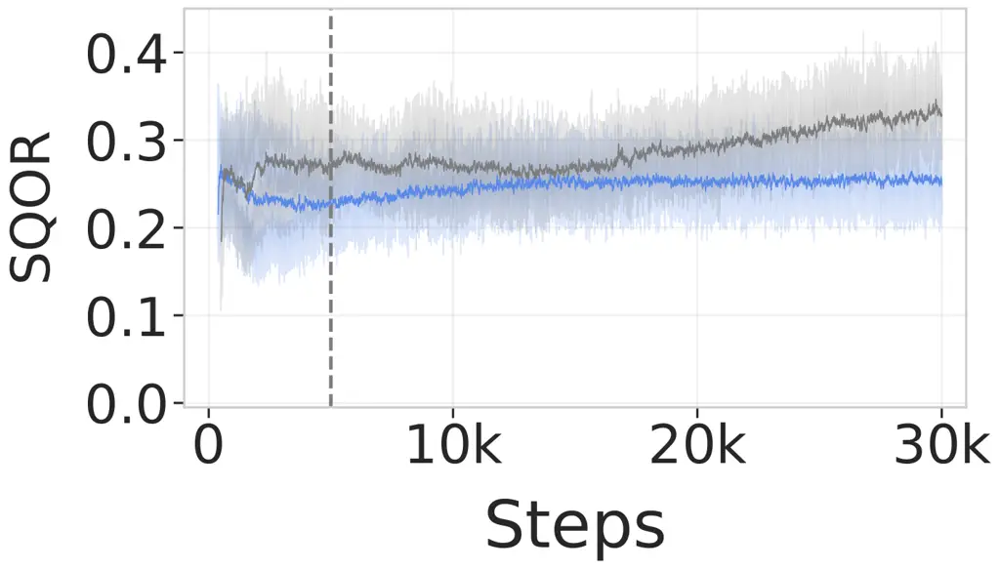

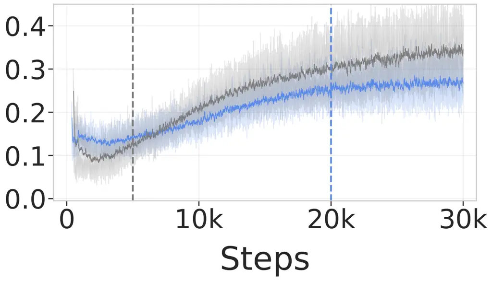

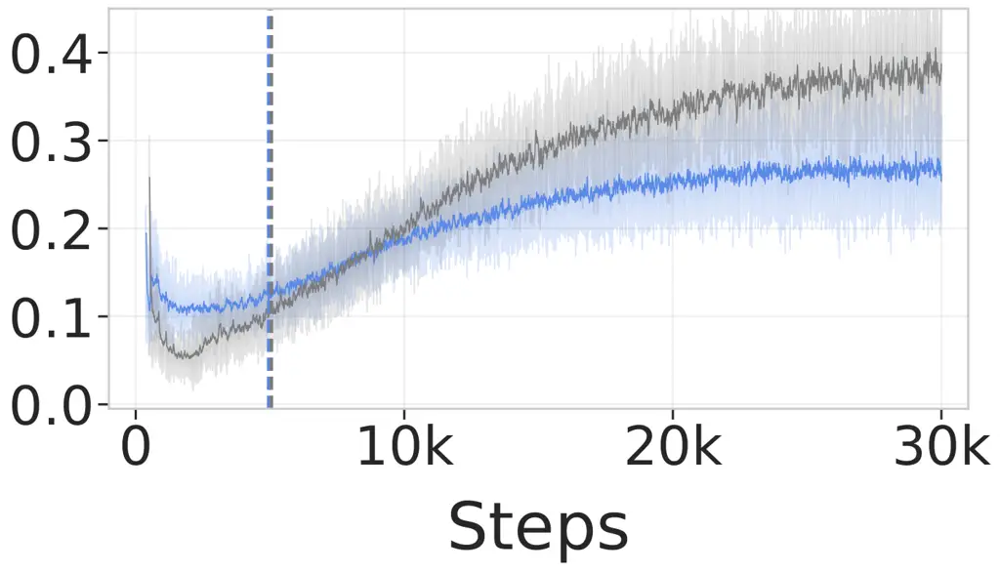

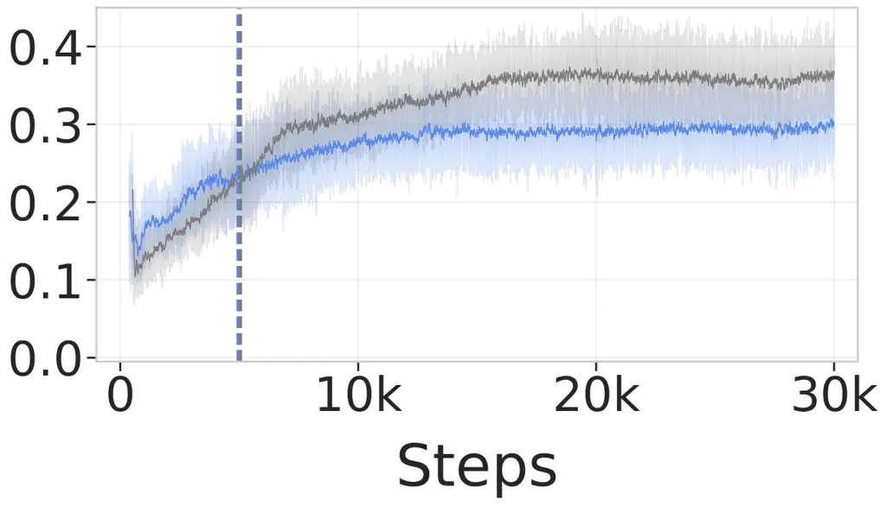

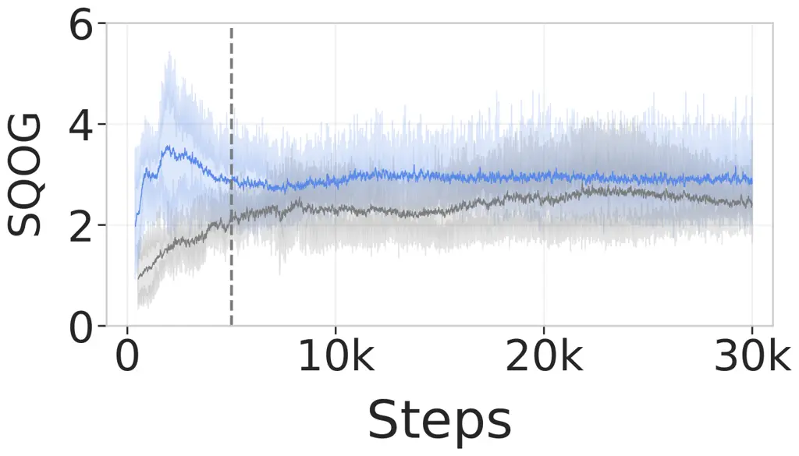

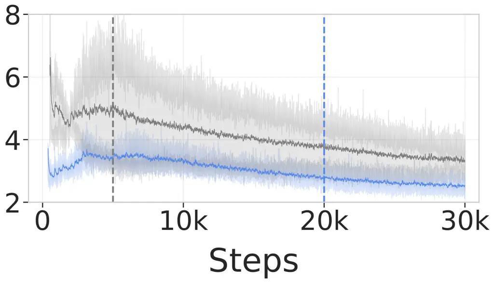

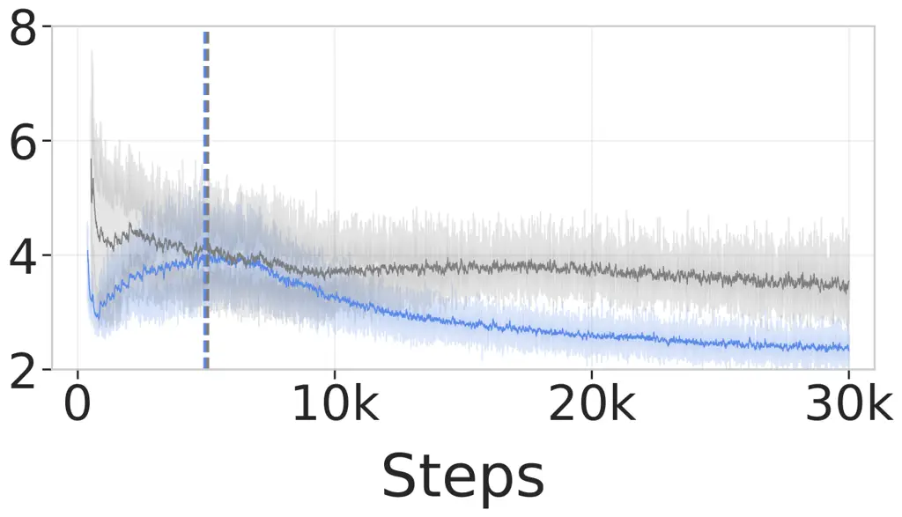

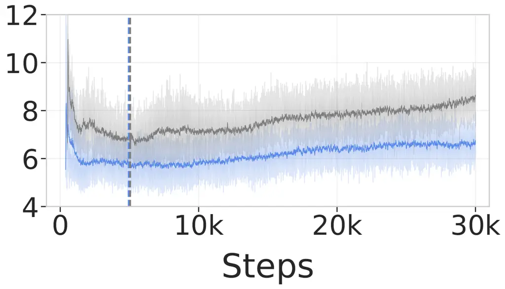

Figure 6: SQOR and SQOG do not reliably predict catastrophic failure. We
compare success rate, the spurious Q-optimism ratio (SQOR), and the
spurious Q-optimism gap (SQOG) across four tasks. Both metrics show
task-dependent and inconsistent alignment with early performance
collapse. The vertical dashed line marks the timestep at which the
largest performance drop occurs.

In Section 3.2, we showed that explicitly slowing the critic’s
distributional shift does not reliably prevent catastrophic failure.
Here, we further examine whether other Q-driven diagnostics can explain
or predict early collapse. We focus on the setting in Figure 1(b), where
online fine-tuning proceeds without offline replay while retaining the
conservative regularizer.

We evaluate four tasks: antmaze-large-diverse, kitchen-partial,
kitchen-mixed, and pen-binary. Since catastrophic failure typically
occurs early in online fine-tuning, we report all metrics over the first
$`30\mathrm{K}`$ online steps. Due to computational constraints, this
analysis is run with three random seeds.

For a minibatch of states $`s`$, let $`a_{t}\sim\pi_{t}(\cdot|s)`$
denote an action sampled from the current online policy and let
$`a_{\mathrm{off}}\sim\pi_{\mathrm{off}}(\cdot|s)`$ denote an action
sampled from the offline-pretrained policy. Let $`Q_{t}`$ denote the
critic at online step $`t`$, and let $`Q_{\mathrm{final}}`$ denote the
critic checkpoint after $`400\mathrm{K}`$ online steps for the same
random seed. We define

```math
\Delta_{t}(s)=Q_{t}(s,a_{t})-Q_{t}(s,a_{\mathrm{off}}),\qquad\Delta_{\mathrm{final}}(s)=Q_{\mathrm{final}}(s,a_{t})-Q_{\mathrm{final}}(s,a_{\mathrm{off}}).
```

Intuitively, $`\Delta_{t}`$ measures the current critic’s relative
preference between the online-policy action and the offline-policy
action, while $`\Delta_{\mathrm{final}}`$ provides a post-hoc reference
after online fine-tuning has stabilized.

Spurious Q-optimism ratio and mismatch magnitude. We first examine two
preference-based Q diagnostics. Let $`\mathcal{B}_{t}`$ denote the
minibatch of states sampled from the online replay buffer at step $`t`$,
and let $`\mathrm{sgn}(\cdot)`$ denote the sign function. The first
metric is the spurious Q-optimism ratio:

```math
\mathrm{SQOR}(t)=\frac{1}{|\mathcal{B}_{t}|}\sum_{s\in\mathcal{B}_{t}}\mathbf{1}\left[\Delta_{t}(s)>0\;\wedge\;\Delta_{\mathrm{final}}(s)<0\right].
```

SQOR measures the fraction of batch states where the current critic
favors the current-policy action, while the final critic favors the
offline-policy action. The second metric measures the magnitude of
preference mismatch. Define the set of mismatched states within the
current online batch as

```math
\mathcal{M}_{t}=\left\{s\in\mathcal{B}_{t}:\mathrm{sgn}(\Delta_{t}(s))\neq\mathrm{sgn}(\Delta_{\mathrm{final}}(s))\right\}.
```

We define the spurious Q-optimism gap as

```math
\mathrm{SQOG}(t)=\frac{1}{|\mathcal{M}_{t}|}\sum_{s\in\mathcal{M}_{t}}\left|\Delta_{t}(s)-\Delta_{\mathrm{final}}(s)\right|,
```

with the value set to zero when $`\mathcal{M}_{t}`$ is empty.

As shown in Figure 6, neither SQOR nor SQOG consistently tracks
catastrophic failure across tasks and stress settings. In some cases,
the metrics increase without a corresponding collapse; in others, early
performance drops are not preceded by a clear rise in either metric.
This suggests that these preference-based Q diagnostics alone do not
provide a reliable explanation for catastrophic failure.

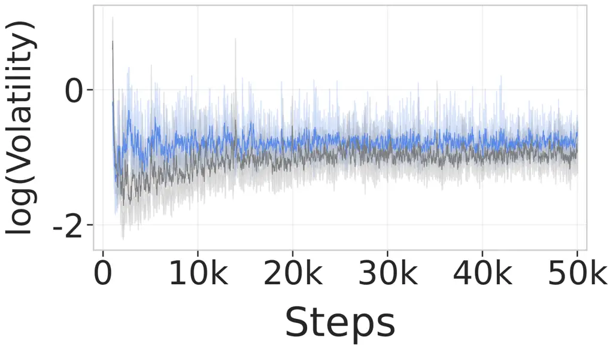

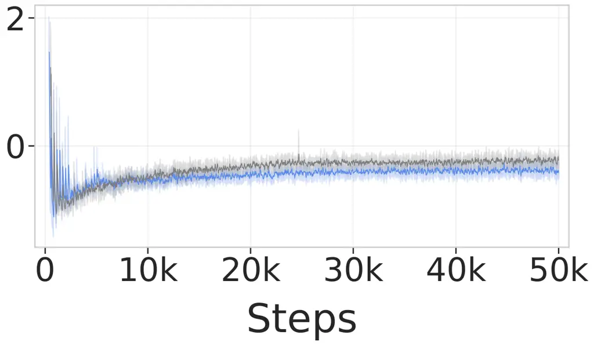

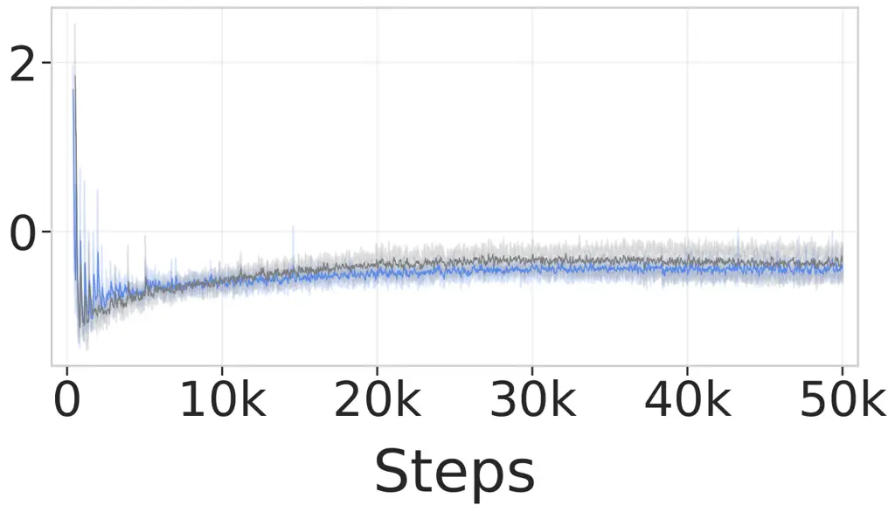

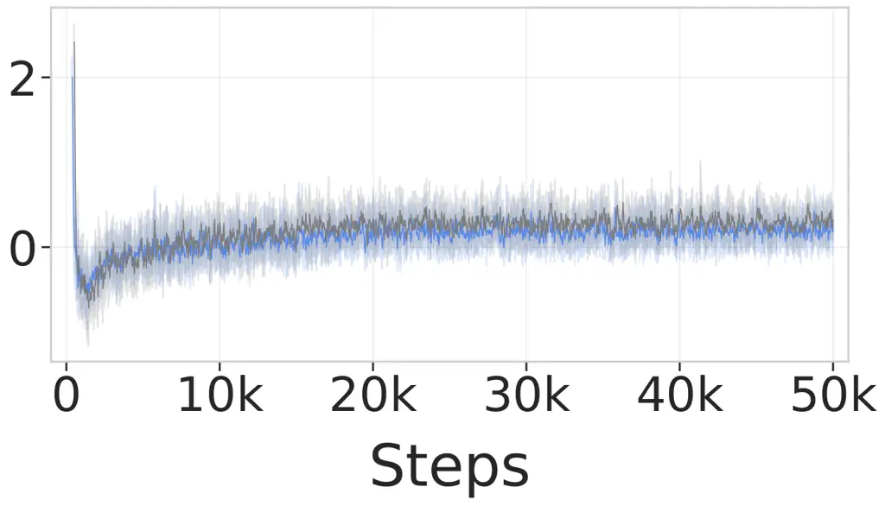

Figure 7: Q-update volatility does not reliably predict catastrophic
failure. We compare success rate and critic-update volatility across
four tasks. Volatility shows weak and inconsistent correspondence with
early performance collapse.

Q-update volatility. We also examine whether abrupt critic updates
explain early collapse. We define volatility as the square root of the
bias-corrected exponential moving average of squared one-step
Q-updates \[Kingma and Ba, 2014\]:

```math
\mathrm{Volatility}_{t}=\sqrt{\frac{m_{t}}{1-\beta^{t}}},\qquad m_{t}=\beta m_{t-1}+(1-\beta)\mathbb{E}_{(s,a)\sim\mathcal{B}_{t}}\left[\left(\Delta Q_{t}(s,a)\right)^{2}\right],
```

where $`\Delta Q_{t}(s,a)=Q_{t+1}(s,a)-Q_{t}(s,a)`$ and $`\beta=0.9`$.
This metric measures the aggregate magnitude of critic changes over
minibatch state-action pairs.

Figure 7 shows that Q-update volatility also fails to consistently align
with catastrophic failure. High volatility does not always lead to
collapse, and severe collapse can occur without a distinctive volatility
pattern. Together with the critic-shift regularization results in
Section 3.2, these analyses do not rule out critic instability as a
contributing factor. Rather, they suggest that critic-side stabilization
alone may be insufficient to explain or prevent catastrophic failure,
motivating our focus on policy-side stabilization through KL anchoring.

## Appendix D Additional Ablation Studies

### D.1 Sensitivity to Batch Size and UTD Ratio

Figure 8: Sensitivity to batch size and UTD ratio. We vary the batch
size (top) and UTD ratio (bottom) across three tasks. ANCHOR is
generally robust to these choices, although larger batch size and larger
UTD can increase learning instability.

Figure 8 further evaluates the sensitivity of ANCHOR to batch size and
UTD ratio. Overall, ANCHOR remains robust across the tested variants in
kitchen-mixed and pen-binary, with similar early stability and
asymptotic performance. In antmaze-large-diverse, however, the larger
batch size of $`1024`$ and the larger UTD ratio of $`16`$ lead to
greater learning instability and weaker prevention of catastrophic
failure. Nevertheless, compared with the baselines in Figure 2, these
variants still achieve competitive catastrophic failure and asymptotic
performance. These results indicate that ANCHOR is not highly sensitive
to batch size or UTD ratio, although overly aggressive update
configurations can reduce early stability.

### D.2 A Larger Initial KL Weight Yields Stronger Early Anchoring

We check whether increasing the KL coefficient actually reduces the
measured deviation between the online actor and the offline-pretrained
policy. This is not automatic in practice, since the KL term is
optimized jointly with the online RL objective and may not be minimized
effectively under online updates. We compare two initial KL weights,
$`\beta_{0}=0.5`$ and $`\beta_{0}=2.0`$. Figure 9 reports the KL loss
during online fine-tuning.

Figure 9: Effect of the initial KL weight. A larger initial KL weight
($`\beta_{0}=2.0`$) produces lower KL loss early in online fine-tuning,
indicating that the KL penalty more strongly constrains deviation from
the offline policy. As the KL coefficient is annealed, the gap between
$`\beta_{0}=0.5`$ and $`\beta_{0}=2.0`$ gradually narrows.

Across all three tasks, the larger initial KL weight consistently
produces lower KL loss during the early phase of online adaptation. This
verifies that $`\beta_{0}`$ controls the effective strength of actor
anchoring in practice: increasing $`\beta_{0}`$ keeps the online actor
closer to the offline-pretrained policy despite simultaneous
optimization of the RL objective. As training proceeds and the KL
coefficient is annealed, the KL losses under the two settings become
increasingly similar. This behavior is consistent with the design of
ANCHOR, where KL anchoring is strongest early in online fine-tuning and
gradually weakens as standard online improvement takes over.

## Appendix E Can ANCHOR Extend to Other Offline RL Backbones?

Figure 10: Applying KL anchoring to IQL. Adding KL anchoring with
annealing to IQL reduces the initial performance drop, but does not
improve asymptotic performance over the IQL baseline.

We additionally test whether the actor-side KL anchoring used in ANCHOR
can be applied to another offline RL backbone. Specifically, we apply KL
anchoring with annealing to IQL. Since IQL does not use an explicit
CQL-style conservative regularizer, we only add the actor-side KL term
toward the offline-pretrained policy and anneal its coefficient during
online fine-tuning. We conduct experiments on kitchen-mixed and
pen-binary, where IQL exhibits nontrivial pretrained behavior with an
initial success rate above $`0.4`$. For both tasks, we use
$`\beta_{0}=5.0`$ and $`T_{\mathrm{KL}}=320\mathrm{K}`$.

Figure 10 shows that KL anchoring can also stabilize IQL during the
early online phase. Compared to naive online fine-tuning of IQL, the
KL-anchored variant reduces the initial performance drop, indicating
that actor-side anchoring is not specific to the CQL backbone. However,
the asymptotic performance does not improve substantially over the IQL
baseline. We hypothesize that this is because IQL retains its offline
inductive bias during online fine-tuning, which can limit its ability to
adapt to the online data distribution even when the actor is stabilized
by KL anchoring. Developing backbone-specific mechanisms that remove or
relax such offline biases while preserving early stability is an
interesting direction for future work.

## Appendix F Additional Environments and Failure Cases

We further evaluate ANCHOR in three additional environments that
highlight challenging regimes for offline-to-online adaptation:
kitchen-complete, relocate-binary, and antmaze-ultra-diverse. The first
two environments have near-zero initial success after offline
pretraining, leaving little useful pretrained behavior to preserve. In
contrast, antmaze-ultra-diverse is a larger and more complex maze than
antmaze-large-diverse, where sparse rewards and severe exploration
mismatch make online improvement difficult. The offline pretraining
duration follows the domain-specific setup used in the main experiments:
250K steps for kitchen-complete, 40K steps for relocate-binary, and 1M
steps for antmaze-ultra-diverse.

Figure 11: Additional environments reveal limitations of KL-anchored
adaptation. In kitchen-complete, ANCHOR remains competitive despite
near-zero initial success. In relocate-binary, all methods fail to make
meaningful progress. In antmaze-ultra-diverse, most methods do not
improve over the offline-pretrained policy, suggesting that harder
sparse-reward exploration requires mechanisms beyond KL anchoring alone.

For all three environments, we set the residual conservative
regularization coefficient $`\alpha_{\mathrm{on}}`$ to zero during
online fine-tuning. Since kitchen-complete and relocate-binary start
with near-zero success rates, we set the initial KL weight to
$`\beta_{0}=0`$, reflecting the fact that there is little useful
pretrained behavior to preserve. In kitchen-complete, ANCHOR attains the
highest mean final performance and matches WSRL and PORL when confidence
intervals are considered, while outperforming the remaining baselines.
This behavior is consistent with Lemma 2: when the pretrained policy is
weak, keeping the actor close to the offline policy can be costly, and
the KL constraint should be relaxed or removed to enable online
improvement. In relocate-binary, however, all methods remain near zero
success throughout online fine-tuning, suggesting that this environment
requires additional exploration or adaptation mechanisms beyond the
scope of ANCHOR.

For antmaze-ultra-diverse, we use $`\beta_{0}=1.0`$ and set the KL
annealing interval to $`T_{\mathrm{KL}}=400\mathrm{K}`$, covering the
full online fine-tuning phase. Despite this longer anchoring schedule,
ANCHOR’s final asymptotic performance remains below its initial
offline-pretrained performance. Except for Cal-QL, none of the methods
achieve meaningful improvement over the offline-pretrained success rate.
This suggests that in extremely challenging sparse-reward environments,
preserving the pretrained policy alone may be insufficient; the agent
may also require exploration or online adaptation mechanisms.

Figure 12: Stronger preservation is insufficient in
antmaze-ultra-diverse. Keeping both the conservative coefficient and KL
coefficient fixed yields a higher mean success rate than ANCHOR during
online fine-tuning, but does not significantly improve asymptotic
performance.

To further test whether stronger preservation of offline-pretrained
behavior helps in antmaze-ultra-diverse, we evaluate an additional
variant that keeps the conservative coefficient at its
offline-pretraining value, $`\alpha=1.0`$, and keeps the KL coefficient
fixed at $`\beta_{t}=1.0`$ without annealing. As shown in Figure 12,
this variant achieves a higher mean success rate than ANCHOR across much
of online fine-tuning, but its asymptotic performance does not improve
significantly. These results indicate that, in extremely challenging
exploration settings, simply retaining conservative regularization or
maintaining a fixed KL anchor is not sufficient. Developing mechanisms
for online exploration and adaptation in such environments remains an
important direction for future work.

## Appendix G Related Works

Offline RL. Online reinforcement learning requires interaction with the
environment, which can be expensive, unsafe, or impractical in domains
such as robotics, healthcare, and recommender systems \[Singh et al.,
2022, Liu et al., 2020, Chen et al., 2024\]. Offline RL addresses this
limitation by learning policies from a static dataset collected by a
behavior policy \[Prudencio et al., 2023\]. However, because the dataset
provides limited coverage of the state-action space, offline-trained
policies can suffer when they encounter unseen or poorly covered regions
at deployment \[Prudencio et al., 2023\].

A large body of work has been developed to address this challenge,
including regularization-based methods \[Fujimoto and Gu, 2021, Park
et al., 2025b, Tarasov et al., 2023, Kumar et al., 2020\],
uncertainty-aware methods \[An et al., 2021, Nikulin et al., 2023\],
model-based methods \[Kidambi et al., 2020, Yu et al., 2020, Yu et al.,
2021, Chitnis et al., 2024, Park and Lee, 2025\], one-step
methods \[Brandfonbrener et al., 2021, Eysenbach et al., 2022, Park
et al., 2025b\], weighted-regression methods \[Peng et al., 2019, Wang
et al., 2020\], and in-sample maximization methods \[Garg et al., 2023,
Kostrikov et al., 2022, Xu et al., 2023\]. Among these approaches, we
build on Conservative Q-Learning (CQL) \[Kumar et al., 2020\], which
directly mitigates value overestimation by penalizing high Q-values for
actions outside the dataset support. We also include Implicit Q-Learning
(IQL) \[Kostrikov et al., 2022\] as a baseline, as it improves over the
behavior policy through value-based policy extraction without explicitly
evaluating out-of-distribution actions.

Offline-to-Online RL. Offline-to-online RL studies how to further
improve an offline-pretrained agent through online interaction. Although
offline RL methods such as CQL \[Kumar et al., 2020\], IQL \[Kostrikov
et al., 2022\], and related approaches \[Kostrikov et al., 2021, Tarasov
et al., 2023\] can be fine-tuned online, simply continuing the offline
objective often yields limited improvement \[Nakamoto et al., 2023\].
This has motivated methods that explicitly adapt the offline-trained
agent to the online learning regime.

Existing approaches include relaxing excessive conservatism in value
estimates \[Nakamoto et al., 2023, Luo et al., 2024, Hu et al., 2024\],
introducing an intermediate adaptation phase between offline pretraining
and online fine-tuning \[Zhou et al., 2025, Shin et al., 2025, Xiao
et al., 2025\], using multiple Q-functions \[Lee et al., 2022, Zhao
et al., 2024\], tuning the update-to-data (UTD) ratio \[Feng et al.,
2024, Xiao et al., 2025\], and incorporating uncertainty
estimation \[Guo et al., 2023, Wen et al., 2024\]. Another line of work
focuses on leveraging pretrained policies directly, rather than updating
both the actor and critic \[Uchendu et al., 2023, Xiao et al., 2025, Hu
et al., 2023\].

A key challenge in this transition is catastrophic failure: performance
can drop sharply at the start of online fine-tuning due to distribution
shift and unstable value learning \[Wen et al., 2024, Nakamoto et al.,
2023\]. Prior work has addressed this issue through uncertainty
estimation \[Wen et al., 2024\], calibration penalties \[Nakamoto
et al., 2023\], and actor-critic alignment \[Yu and Zhang, 2023\]. In
contrast, ANCHOR stabilizes the early online phase by anchoring the
actor to the offline-pretrained policy with a KL penalty. The KL
coefficient is linearly annealed to zero, allowing the method to move
from conservative checkpoint adaptation to unconstrained online
improvement. For the critic, ANCHOR immediately reduces the CQL
coefficient to a small residual value $`\alpha_{\mathrm{on}}`$ and keeps
it fixed during online fine-tuning, avoiding excessive conservatism
while retaining mild regularization against overestimation. Thus, ANCHOR
addresses catastrophic failure with a simple adaptation schedule while
preserving strong asymptotic performance, without requiring additional
uncertainty models or complex auxiliary modules.

Trust-region and KL-regularized policy optimization. Our actor-side KL
regularization is related in form to trust-region methods such as
TRPO \[Schulman et al., 2015\], which constrain the KL divergence
between consecutive policies to stabilize online policy updates.
However, ANCHOR differs in both purpose and reference distribution. TRPO
imposes a local trust region around the previous policy at each update
to support stable on-policy improvement. In contrast, ANCHOR regularizes
the online actor toward a fixed offline-pretrained policy during the
early phase of offline-to-online adaptation. This anchor is not intended
to enforce a monotonic policy improvement guarantee; rather, it
preserves useful pretrained behavior when offline replay is unavailable
and prevents abrupt policy drift into regions where the critic may be
unreliable. Moreover, ANCHOR anneals the KL coefficient to zero,
explicitly removing the constraint once the online actor and critic have
adapted. Thus, while both approaches use KL-based control of policy
updates, ANCHOR uses KL regularization as a temporary
checkpoint-adaptation mechanism for offline-to-online RL, rather than as
a per-update trust region for standard online RL.

Policy-side approaches and scheduling precedents. PEX \[Zhang et al.,
2023\] freezes the offline policy and adds an online policy, using
Q-based action selection to combine them. This retains the offline
policy as a component of a composite policy. PROTO \[Li et al., 2023\]
instead uses an evolving reference in an iterative policy-regularized
objective. Improving TD3-BC \[Beeson and Montana, 2022\] first relaxes
the offline BC constraint, then uses online-buffer action matching with
a decaying coefficient during fine-tuning. These works already study
stable adaptation and relaxation of behavioral constraints. ANCHOR’s
distinction is its temporary penalty against one fixed checkpoint,
separated from CQL’s critic penalty, in a setting without offline
replay. This is a design choice among related stabilization mechanisms,
not the invention of policy regularization or scheduling.

Expressive policies and evaluation. Flow Q-learning \[Park et al.,
2025b\] combines an expressive flow model with value-based policy
improvement and evaluates offline-to-online adaptation. OGBench \[Park
et al., 2025a\] supplies manipulation and navigation settings beyond the
original D4RL suite. Our flow-policy extension uses an action-distance
proxy and therefore supports a broader checkpoint-anchoring principle
rather than an exact-KL implementation for all backbones. RND \[Burda
et al., 2019\] is used only to characterize visitation; it does not
provide an intrinsic reward in ANCHOR. We follow the aggregate
reliability methodology of Agarwal et al. \[2021\] to distinguish
cross-task evidence from individual task comparisons.

## Appendix H Details on Baseline Algorithms

Soft Actor-Critic (SAC) \[Haarnoja et al., 2018\]. SAC extends standard
actor-critic methods by incorporating entropy maximization into the RL
objective. Instead of maximizing only the expected return, SAC also
maximizes the entropy of the policy to encourage exploration and prevent
premature convergence to deterministic policies. The resulting objective
is to maximize the expected sum of rewards and entropies:

```math
J(\pi)=\mathbb{E}_{\pi}\left[\sum_{t=0}^{\infty}\gamma^{t}\left(r(s_{t},a_{t})+\alpha\mathcal{H}(\pi(\cdot|s_{t}))\right)\right],
```

where
$`\mathcal{H}(\pi(\cdot|s_{t}))=-\mathbb{E}_{a_{t}\sim\pi}[\log\pi(a_{t}|s_{t})]`$
denotes the entropy of the policy at state $`s_{t}`$, and $`\alpha>0`$
is the temperature parameter that balances reward maximization and
entropy.

Conservative Q-Learning (CQL) \[Kumar et al., 2020\]. CQL learns a
Q-function by explicitly regularizing Q-values to mitigate
overestimation issues common in offline RL \[Prudencio et al., 2023\]:

```math
\displaystyle\mathcal{L}(\theta) \displaystyle=\alpha\underbrace{\Big(\mathbb{E}_{s\sim\mathcal{D},a\sim\pi}[Q_{\theta}(s,a)]-\mathbb{E}_{s,a\sim\mathcal{D}}[Q_{\theta}(s,a)]\Big)}_{\text{Conservative regularizer}}+\mathcal{L}_{\text{TD}}(\theta)
```

Here, $`\pi`$ represents the current policy, $`\mathcal{D}`$ is the
offline dataset, and $`\alpha`$ controls the intensity of the
conservative regularization. The term $`\mathcal{L}_{TD}`$ is the
temporal difference loss used in Q-learning methods, while the
conservative regularization penalizes Q-values for state-action pairs
not present in the offline dataset $`\mathcal{D}`$.

Implicit Q-learning (IQL) \[Kostrikov et al., 2022\]. The IQL algorithm
learns a state-value function
$`V_{\theta_{V}}:\mathcal{S}\rightarrow\mathbb{R}`$ and an action-value
function
$`Q_{\theta_{Q}}:\mathcal{S}\times\mathcal{A}\rightarrow\mathbb{R}`$ by
minimizing:

```math
\mathcal{L}_{V}(\theta_{V})=\mathbb{E}_{(s,a)\sim\mathcal{D}}\left[\ell_{\kappa}^{2}\left(V_{\theta_{V}}(s)-Q_{\bar{\theta}_{Q}}(s,a)\right)\right],
```

```math
\mathcal{L}_{Q}(\theta_{Q})=\mathbb{E}_{(s,a,r,s^{\prime})\sim\mathcal{D}}\left[\left(Q_{\theta_{Q}}(s,a)-r-\gamma V_{\theta_{V}}(s^{\prime})\right)^{2}\right],
```

where the expectile loss is defined as
$`\ell_{\kappa}^{2}(x)=|\kappa-\mathbf{1}[x<0]|x^{2}`$ \[Newey and
Powell, 1987\], and $`\bar{\theta}_{Q}`$ represents the target network
parameters. Unlike standard MSE loss, expectile loss asymmetrically
weights positive and negative errors, with $`\kappa>0.5`$ emphasizing
higher Q-values. By doing so, IQL evaluates only actions from the
dataset, which enables policy improvement without querying
out-of-distribution actions, thereby inducing implicit conservatism.

Calibrated Q-Learning (Cal-QL) \[Nakamoto et al., 2023\]. Cal-QL adjusts
CQL by calibrating the learned Q-function relative to a reference policy
to avoid initial degradation caused by overly pessimistic Q-values
during fine-tuning. The conservative regularization term in CQL is
altered by substituting
$`\mathbb{E}_{s\sim\mathcal{D},a\sim\pi}[Q_{\theta}(s,a)]`$ with
$`\mathbb{E}_{s\sim\mathcal{D},a\sim\pi}[\max(Q_{\theta}(s,a),V^{\mu}(s))]`$,
where $`V^{\mu}(s)`$ represents the value function of the reference
policy $`\mu`$, which can be estimated via Monte-Carlo return. This
calibration prevents the conservative penalty from further suppressing
actions whose estimated values are already below the reference value,
thereby mitigating the overly pessimistic Q-values that can hinder
online fine-tuning.

Policy-Only Reinforcement Learning Fine-Tuning (PORL) \[Xiao et al.,
2025\]. PORL focuses on the challenge of fine-tuning online RL using
only a pretrained policy, without relying on pretrained Q-functions or
offline datasets. This approach is especially beneficial when pretrained
Q-functions are either unreliable due to pessimism or unavailable, such
as in imitation learning scenarios. PORL begins by training the randomly
initialized Q-function at the beginning of the online fine-tuning phase.
Training data is collected based on the online interaction of the
pretrained policy using an epsilon-greedy exploration strategy. During
this initial sampling phase, the Q-function is trained via temporal
difference learning with a high UTD ratio. After this pre-sampling
period, PORL transitions to standard SAC fine-tuning, updating both the
policy and the Q-function.

Warm-start RL (WSRL) \[Zhou et al., 2025\]. WSRL addresses the
distribution shift issue from offline to online data in fine-tuning
without offline data by introducing a warmup phase. This phase utilizes
a frozen pretrained policy to collect online rollouts. The data
collected during warmup bridges the distribution mismatch and helps
recalibrate the offline Q-function to the online distribution, allowing
the method to adapt in the online environment quickly. Once the warmup
phase is complete, WSRL proceeds with conventional online RL using SAC,
employing a high UTD ratio.

## Appendix I Implementation Details

### I.1 Details on Environments

AntMaze. The AntMaze environment, part of the D4RL benchmark suite \[Fu
et al., 2020\], tasks an 8-DoF ant quadruped robot with navigating
through a large and complex maze to reach a designated goal position.
The agent receives a binary reward of +1 only upon successfully reaching
the goal. The observation space is 29-dimensional, including the robot’s
position, orientation, and velocity, while the action space is a
continuous 8-dimensional vector, normalized to the range $`[-1,1]`$. We
use three variants: antmaze-large-diverse-v2, which contains
trajectories collected by commanding the agent to random goals from
random start positions; antmaze-large-play-v2, which contains
trajectories directed to a specific location; and
antmaze-ultra-diverse-v2, which uses a larger and more complex maze with
the same diverse data collection strategy. The two large-maze variants
share a maximum episode length of 1000 steps, while
antmaze-ultra-diverse-v2 allows up to 700 steps.

FrankaKitchen. The FrankaKitchen environment contained in D4RL \[Fu
et al., 2020\] requires controlling a 9-DoF Franka Panda robotic arm to
manipulate various kitchen appliances and configure the environment into
a predefined target state. Each task consists of four subtasks, and the
agent receives a reward between 0 and 4 based on the number of
successfully completed subtasks. The observation space is
60-dimensional, encompassing joint positions and object states, and the
action space is a 9-dimensional continuous vector normalized to
$`[-1,1]`$. We use three benchmark environments from D4RL:
kitchen-partial-v0, kitchen-mixed-v0, and kitchen-complete-v0.
kitchen-partial-v0 includes a mix of complete and incomplete
demonstrations, where task elements involve operating the microwave,
kettle, light switch, and slide cabinet. kitchen-mixed-v0 contains only
incomplete demonstrations, with task components including the microwave,
kettle, bottom burner, and light switch. kitchen-complete-v0 contains
only complete demonstrations covering the same four subtasks as
kitchen-partial-v0: microwave, kettle, light switch, and slide cabinet.
All three environments use a maximum episode length of 280 steps.

Adroit. The Adroit suite \[Rajeswaran et al., 2017\] evaluates dexterous
manipulation using a high-DoF robotic hand. Specifically, we use three
tasks from the D4RL benchmark: pen-binary-v0, door-binary-v0, and
relocate-binary-v0. In pen-binary-v0, a 24-DoF shadow hand must reorient
a pen to match a target pose, while in door-binary-v0, a 28-DoF hand
must grasp and rotate a door handle to open it. In relocate-binary-v0, a
30-DoF hand must pick up an object and relocate it to a target position.
All three environments have sparse binary rewards: a reward of +1 is
given only upon successful task completion. The observation space is
45-dimensional for the pen task, 39-dimensional for the door and
relocate tasks, consisting of hand joint angles and object poses. The
action space is continuous, 24-dimensional for the pen task,
28-dimensional for the door task, and 30-dimensional for the relocate
task, each normalized to $`[-1,1]`$. The maximum episode lengths are 100
steps for the pen task and 200 steps for the door and relocate tasks.

### I.2 Network Architectures

ANCHOR uses the same network architecture as the CQL baseline in the
WSRL codebase \[Zhou et al., 2025\]. The agent follows an actor-critic
framework. The actor takes an observation as input and outputs the mean
and log standard deviation of a Gaussian action distribution. The critic
takes the concatenated observation-action pair as input and uses an
ensemble of ten Q-functions, each producing a scalar Q-value. For
stability, two Q-functions are randomly subsampled during target
computation, and the minimum of the two values is used. Both the actor
and critic are implemented as multilayer perceptrons (MLPs) with ReLU
activations. A learnable temperature parameter controls the entropy
regularization. The hidden dimensions for each domain are reported in
Table 1.

### I.3 Reproducing Baselines

All baseline methods are reproduced under a unified experimental setup.
For WSRL, Cal-QL, CQL, IQL, and SAC, we use the implementations and
hyperparameters provided in the WSRL codebase \[Zhou et al., 2025\],
with several stability-oriented modifications applied consistently
across methods. Specifically, (i) we increase the batch size from
$`256`$ to $`512`$; (ii) we use an ensemble of ten Q-functions and
compute target values using the minimum over two critics randomly
subsampled at each update, following REDQ \[Chen et al., 2021\]; and
(iii) we apply layer normalization \[Ba et al., 2016\] to both the
policy and critic networks to mitigate uncontrolled extrapolation
effects \[Ball et al., 2023\]. Since no public implementation of PORL
was available, we reimplement it following Xiao et al. \[2025\] and use
the authors’ reported settings.

### I.4 Hyperparameters

Table 1 reports the hyperparameters used to train ANCHOR. For
hyperparameters not specific to ANCHOR, we follow the default CQL
settings used by Zhou et al. \[2025\], except for the UTD ratio in
door-binary, where we use the WSRL setting. All main baseline runs and
ANCHOR use 5K collection-only warmup steps. For ANCHOR-specific
hyperparameters, we select the best-performing configuration per
environment from $`\alpha_{\mathrm{on}}\in\{0.0,1.0\}`$,
$`T_{\mathrm{KL}}\in\{40\mathrm{K},80\mathrm{K},160\mathrm{K}\}`$, and
$`\beta_{0}\in\{0.2,0.4,1.0\}`$.

|                           |                        |            |                     |        |                     |         |
| ------------------------- | ---------------------- | ---------- | ------------------- | ------ | ------------------- | ------- |
|                           | AntMaze                |            | Adroit              |        | Kitchen             |         |
|                           | large diverse          | large play | door                | pen    | partial             | mixed   |
| ANCHOR                    |                        |            |                     |        |                     |         |
| $`\alpha_{\mathrm{on}}`$  | 0.0                    | 0.0        | 0.0                 | 0.0    | 1.0                 | 1.0     |
| $`T_{\mathrm{KL}}`$       | 80,000                 | 80,000     | 40,000              | 80,000 | 160,000             | 160,000 |
| $`\beta_{0}`$             | 0.4                    | 0.2        | 0.2                 | 1.0    | 1.0                 | 1.0     |
| Optimization              |                        |            |                     |        |                     |         |
| Actor Learning Rate       | $`1\times 10^{-4}`$    |            | $`1\times 10^{-4}`$ |        | $`1\times 10^{-4}`$ |         |
| Critic Learning Rate      | $`3\times 10^{-4}`$    |            | $`3\times 10^{-4}`$ |        | $`3\times 10^{-4}`$ |         |
| Batch Size                | 512                    |            | 512                 |        | 512                 |         |
| UTD                       | 1                      | 1          | 16                  | 1      | 1                   | 1       |
| Offline Steps             | 1,000,000              |            | 40,000              |        | 250,000             |         |
| $`\alpha_{\mathrm{off}}`$ | 5.0                    |            | 1.0                 |        | 5.0                 |         |
| Warmup Steps              | 5,000                  |            | 5,000               |        | 5,000               |         |
| Architecture              |                        |            |                     |        |                     |         |
| Critic Network            | \[256, 256, 256, 256\] |            | \[512, 512, 512\]   |        | \[512, 512, 512\]   |         |
| Actor Network             | \[256, 256\]           |            | \[512, 512\]        |        | \[512, 512, 512\]   |         |
| Activations               | ReLU                   |            | ReLU                |        | ReLU                |         |
| Q-ensemble                | 10                     |            | 10                  |        | 10                  |         |

Table 1: Hyperparameters of ANCHOR.

### I.5 Online Training Time Comparison

Table 2 compares the online training time of ANCHOR and the baselines.
ANCHOR has a similar average training time to WSRL and PORL, despite the
additional actor-side KL regularization. While it is slower than
lightweight baselines such as IQL and SAC, these methods suffer from
substantially weaker asymptotic performance and/or larger catastrophic
failure in our main results. Considering the gains of ANCHOR in both
early stability and final performance, its computational overhead is
moderate and comparable to other competitive offline-to-online methods.

|                          |                   |                   |                   |                   |                   |                   |                   |
| ------------------------ | ----------------- | ----------------- | ----------------- | ----------------- | ----------------- | ----------------- | ----------------- |
| Task                     | ANCHOR (Ours)     | WSRL              | PORL              | Cal-QL            | CQL               | IQL               | SAC               |
| antmaze-large-diverse-v2 | 2.75 $`\pm`$ 0.02 | 2.73 $`\pm`$ 0.01 | 3.35 $`\pm`$ 0.07 | 3.44 $`\pm`$ 0.01 | 2.82 $`\pm`$ 0.02 | 2.08 $`\pm`$ 0.02 | 1.53 $`\pm`$ 0.0  |
| antmaze-large-play-v2    | 2.75 $`\pm`$ 0.01 | 3.48 $`\pm`$ 0.08 | 3.54 $`\pm`$ 0.06 | 3.26 $`\pm`$ 0.03 | 2.34 $`\pm`$ 0.03 | 2.09 $`\pm`$ 0.03 | 1.52 $`\pm`$ 0.0  |
| kitchen-partial-v0       | 4.31 $`\pm`$ 0.02 | 3.37 $`\pm`$ 0.0  | 3.41 $`\pm`$ 0.03 | 4.35 $`\pm`$ 0.01 | 3.28 $`\pm`$ 0.05 | 1.41 $`\pm`$ 0.01 | 1.38 $`\pm`$ 0.0  |
| kitchen-mixed-v0         | 3.88 $`\pm`$ 0.03 | 3.61 $`\pm`$ 0.01 | 3.51 $`\pm`$ 0.13 | 4.36 $`\pm`$ 0.0  | 3.33 $`\pm`$ 0.02 | 1.46 $`\pm`$ 0.02 | 1.36 $`\pm`$ 0.0  |
| door-binary-v0           | 3.07 $`\pm`$ 0.01 | 2.9 $`\pm`$ 0.01  | 2.93 $`\pm`$ 0.01 | 3.55 $`\pm`$ 0.01 | 2.43 $`\pm`$ 0.01 | 1.28 $`\pm`$ 0.02 | 0.78 $`\pm`$ 0.01 |
| pen-binary-v0            | 2.33 $`\pm`$ 0.02 | 2.77 $`\pm`$ 0.01 | 2.79 $`\pm`$ 0.01 | 3.51 $`\pm`$ 0.01 | 2.29 $`\pm`$ 0.01 | 1.13 $`\pm`$ 0.1  | 0.67 $`\pm`$ 0.0  |
| Average                  | 3.18              | 3.14              | 3.25              | 3.75              | 2.75              | 1.58              | 1.21              |

Table 2: Online training time (in decimal hours) comparison across
baselines.

### I.6 Experimental Setup and Reproducibility

All experiments were conducted on a compute node equipped with 8 NVIDIA
A100 GPUs (80GB each), an AMD EPYC 7543 32-Core CPU, and 885 GB of RAM.
The software environment was based on Python 3.10.18, Pytorch 2.7.0, JAX
0.4.25 with CUDA 12.2.

## Appendix J Limitations

While ANCHOR provides a simple and effective recipe for
offline-to-online adaptation without offline replay, several limitations
remain.

Scope of evaluation. Our experiments focus on single-agent
continuous-control benchmarks, including AntMaze, FrankaKitchen, Adroit,
and selected OGBench tasks. We do not evaluate ANCHOR under hard safety
constraints, non-stationary dynamics, partial observability, or
multi-agent settings. Therefore, its effectiveness in these regimes is
not guaranteed.

Dependence on pretrained policy quality. ANCHOR is most effective when
the offline-pretrained policy contains useful behavior to preserve. When
the pretrained policy has near-zero success, as in relocate-binary, KL
anchoring provides limited benefit. This suggests that ANCHOR is better
suited for stabilizing useful pretrained behavior than for solving tasks
where the offline policy provides little meaningful guidance.

Limited exploration in hard sparse-reward environments. ANCHOR controls
policy drift during online fine-tuning, but it does not introduce a new
exploration mechanism. In challenging sparse-reward environments such as
antmaze-ultra-diverse, most methods fail to improve substantially over
the offline-pretrained policy. Addressing such settings may require
combining KL anchoring with stronger exploration or task-specific
adaptation mechanisms.

Hand-designed KL schedules. ANCHOR uses a manually specified initial KL
weight and annealing interval. Although our ablations show robustness to
moderate changes in these hyperparameters, selecting the schedule still
requires some environment-level tuning. Future work could develop
adaptive KL schedules based on online uncertainty, critic reliability,
or measured policy drift.

Backbone dependence. The main benchmark instantiates ANCHOR on top of
CQL. The FQL/IFQL extension uses a coupled action-distance proxy rather
than an exact policy KL, and its stability benefits are mixed. The
exact-KL occupancy interpretation does not automatically extend to this
proxy. We also test actor-side KL anchoring with IQL and find that it
reduces early catastrophic failure, but does not improve asymptotic
performance. This suggests that different offline RL backbones may
require backbone-specific mechanisms for relaxing offline inductive
biases during online adaptation.

Statistical coverage. Unless otherwise noted, experiments are run with
five random seeds due to computational constraints, and some auxiliary
analyses use fewer seeds. Although confidence intervals are reported,
rare failure modes may still be under-sampled.

Protocol and evidence limitations. The additional policy-side
comparisons adapt prior methods to CQL and online-only replay, but their
supplied defaults do not match every critic setting of the main ANCHOR
configuration. BC controls use offline data for actor regularization.
The two-seed shared-duration check lacks a retained initial-weight
value, and the OGBench summaries do not specify the final-score
evaluation window. We report these limitations rather than treating
these experiments as exact single-factor ablations. Aggregate bootstrap
summaries are retained from the experiment record; raw seed-level traces
are needed for independent recomputation.

## Appendix K Visualizations

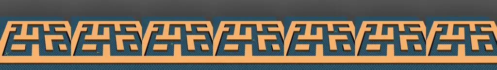

(a) antmaze-large-diverse-v2: 8-DoF ant navigating through a maze to
reach the goal.

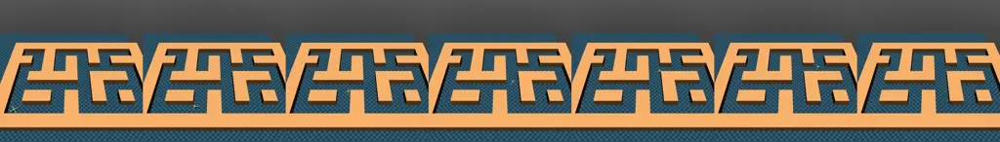

(b) antmaze-large-play-v2: Same evaluation as diverse-v2, different
training data.

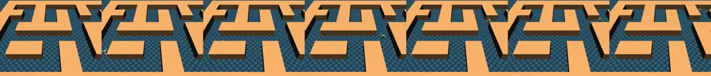

(c) antmaze-ultra-diverse-v2: 8-DoF ant navigating through a larger maze
than large-diverse-v2.


(d) kitchen-partial-v0: Completing subtasks: microwave, kettle, light
switch, and slide cabinet.


(e) kitchen-mixed-v0: Completing subtasks: microwave, kettle, bottom
burner, and light switch.


(f) kitchen-complete-v0: Completing subtasks: microwave, kettle, light
switch, and slide cabinet.


(g) pen-binary-v0: 24-DoF shadow hand reorienting a pen to target pose.

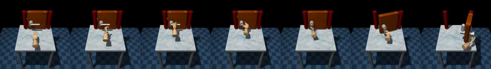

(h) door-binary-v0: 28-DoF hand opening a door by rotating the handle.


(i) relocate-binary-v0: 30-DoF shadow hand relocating an object to a
target location.

Figure 13: Representative episodes across nine tasks. Each row shows
temporally ordered frames from a trajectory, demonstrating navigation
(antmaze-ultra-diverse-v2, antmaze-large-diverse-v2,
antmaze-large-play-v2), kitchen manipulation (kitchen-partial-v0,
kitchen-mixed-v0, kitchen-complete-v0), and dexterous control
(pen-binary-v0, door-binary-v0, relocate-binary-v0).

## Appendix L Numerical Results

### L.1 Raw Performance and Catastrophic Failure Values

|                          |                   |                   |                   |                   |                   |                   |                   |
| ------------------------ | ----------------- | ----------------- | ----------------- | ----------------- | ----------------- | ----------------- | ----------------- |
| Task                     | ANCHOR (Ours)     | WSRL              | PORL              | Cal-QL            | CQL               | IQL               | SAC               |
| antmaze-large-diverse-v2 | 0.97 $`\pm`$ 0.01 | 0.68 $`\pm`$ 0.17 | 0.9 $`\pm`$ 0.07  | 0.97 $`\pm`$ 0.01 | 0.92 $`\pm`$ 0.05 | 0.06 $`\pm`$ 0.05 | 0.0 $`\pm`$ 0.0   |
| antmaze-large-play-v2    | 0.96 $`\pm`$ 0.02 | 0.95 $`\pm`$ 0.02 | 0.47 $`\pm`$ 0.2  | 0.9 $`\pm`$ 0.07  | 0.95 $`\pm`$ 0.03 | 0.01 $`\pm`$ 0.01 | 0.0 $`\pm`$ 0.0   |
| kitchen-partial-v0       | 1.0 $`\pm`$ 0.0   | 0.93 $`\pm`$ 0.06 | 0.91 $`\pm`$ 0.06 | 0.7 $`\pm`$ 0.09  | 0.44 $`\pm`$ 0.12 | 0.4 $`\pm`$ 0.05  | 0.49 $`\pm`$ 0.07 |
| kitchen-mixed-v0         | 0.81 $`\pm`$ 0.09 | 0.72 $`\pm`$ 0.11 | 0.88 $`\pm`$ 0.06 | 0.45 $`\pm`$ 0.12 | 0.4 $`\pm`$ 0.06  | 0.31 $`\pm`$ 0.09 | 0.3 $`\pm`$ 0.05  |
| door-binary-v0           | 1.0 $`\pm`$ 0.0   | 0.8 $`\pm`$ 0.2   | 0.6 $`\pm`$ 0.24  | 0.19 $`\pm`$ 0.19 | 0.18 $`\pm`$ 0.18 | 0.0 $`\pm`$ 0.0   | 0.2 $`\pm`$ 0.2   |
| pen-binary-v0            | 1.0 $`\pm`$ 0.0   | 0.97 $`\pm`$ 0.01 | 0.99 $`\pm`$ 0.01 | 0.94 $`\pm`$ 0.02 | 0.81 $`\pm`$ 0.09 | 0.33 $`\pm`$ 0.1  | 0.78 $`\pm`$ 0.04 |
| Mean of displayed tasks  | 0.957             | 0.842             | 0.792             | 0.692             | 0.617             | 0.185             | 0.295             |

Table 3: Performance at 400k online steps. Bold indicates the best
performance per task, and underline indicates the second best.

|                          |                   |                   |                   |                   |                   |                   |                   |
| ------------------------ | ----------------- | ----------------- | ----------------- | ----------------- | ----------------- | ----------------- | ----------------- |
| Task                     | ANCHOR (Ours)     | WSRL              | PORL              | Cal-QL            | CQL               | IQL               | SAC               |
| antmaze-large-diverse-v2 | 0.97 $`\pm`$ 0.01 | 0.73 $`\pm`$ 0.18 | 0.84 $`\pm`$ 0.07 | 0.95 $`\pm`$ 0.03 | 0.96 $`\pm`$ 0.02 | 0.03 $`\pm`$ 0.03 | 0.0 $`\pm`$ 0.0   |
| antmaze-large-play-v2    | 0.96 $`\pm`$ 0.02 | 0.98 $`\pm`$ 0.01 | 0.37 $`\pm`$ 0.23 | 0.89 $`\pm`$ 0.07 | 0.95 $`\pm`$ 0.03 | 0.01 $`\pm`$ 0.01 | 0.0 $`\pm`$ 0.0   |
| kitchen-partial-v0       | 1.0 $`\pm`$ 0.0   | 0.95 $`\pm`$ 0.05 | 0.9 $`\pm`$ 0.06  | 0.7 $`\pm`$ 0.09  | 0.44 $`\pm`$ 0.12 | 0.39 $`\pm`$ 0.05 | 0.47 $`\pm`$ 0.06 |
| kitchen-mixed-v0         | 0.83 $`\pm`$ 0.1  | 0.7 $`\pm`$ 0.12  | 0.88 $`\pm`$ 0.06 | 0.45 $`\pm`$ 0.12 | 0.4 $`\pm`$ 0.06  | 0.3 $`\pm`$ 0.08  | 0.25 $`\pm`$ 0.03 |
| door-binary-v0           | 0.97 $`\pm`$ 0.01 | 0.8 $`\pm`$ 0.2   | 0.6 $`\pm`$ 0.24  | 0.17 $`\pm`$ 0.17 | 0.19 $`\pm`$ 0.19 | 0.0 $`\pm`$ 0.0   | 0.2 $`\pm`$ 0.2   |
| pen-binary-v0            | 0.94 $`\pm`$ 0.02 | 0.96 $`\pm`$ 0.02 | 0.95 $`\pm`$ 0.02 | 0.96 $`\pm`$ 0.01 | 0.72 $`\pm`$ 0.05 | 0.4 $`\pm`$ 0.05  | 0.84 $`\pm`$ 0.02 |
| Mean of displayed tasks  | 0.945             | 0.853             | 0.757             | 0.687             | 0.610             | 0.188             | 0.293             |

Table 4: Performance at 350k online steps. Bold indicates the best
performance per task, and underline indicates the second best.

Tables 3 and 4 report success rates (mean $`\pm`$ SE) after 400k and at
350k online fine-tuning, respectively, averaged over five seeds. The
endpoint values provide context for the 350K–400K late-stage window, but
do not by themselves establish convergence. Mean rows are unweighted
arithmetic means of the six displayed task means (rounded to three
decimals); aggregate SEs cannot be recovered without seed-level data and
are therefore not assigned. These means are distinct from the IQM in
Appendix N.4.

|                          |                   |                   |                   |                   |                   |                   |
| ------------------------ | ----------------- | ----------------- | ----------------- | ----------------- | ----------------- | ----------------- |
| Task                     | ANCHOR (Ours)     | WSRL              | PORL              | Cal-QL            | CQL               | IQL               |
| antmaze-large-diverse-v2 | 0.33 $`\pm`$ 0.09 | 0.24 $`\pm`$ 0.05 | 0.39 $`\pm`$ 0.04 | 0.26 $`\pm`$ 0.04 | 0.26 $`\pm`$ 0.05 | 0.03 $`\pm`$ 0.02 |
| antmaze-large-play-v2    | 0.29 $`\pm`$ 0.05 | 0.29 $`\pm`$ 0.02 | 0.37 $`\pm`$ 0.02 | 0.24 $`\pm`$ 0.04 | 0.28 $`\pm`$ 0.05 | 0.0 $`\pm`$ 0.0   |
| kitchen-partial-v0       | 0.7 $`\pm`$ 0.03  | 0.73 $`\pm`$ 0.06 | 0.7 $`\pm`$ 0.04  | 0.68 $`\pm`$ 0.05 | 0.7 $`\pm`$ 0.06  | 0.3 $`\pm`$ 0.06  |
| kitchen-mixed-v0         | 0.47 $`\pm`$ 0.06 | 0.47 $`\pm`$ 0.06 | 0.49 $`\pm`$ 0.07 | 0.52 $`\pm`$ 0.06 | 0.58 $`\pm`$ 0.03 | 0.4 $`\pm`$ 0.04  |
| door-binary-v0           | 0.26 $`\pm`$ 0.04 | 0.31 $`\pm`$ 0.19 | 0.24 $`\pm`$ 0.03 | 0.21 $`\pm`$ 0.07 | 0.08 $`\pm`$ 0.08 | 0.05 $`\pm`$ 0.04 |
| pen-binary-v0            | 0.69 $`\pm`$ 0.03 | 0.66 $`\pm`$ 0.05 | 0.74 $`\pm`$ 0.03 | 0.75 $`\pm`$ 0.05 | 0.58 $`\pm`$ 0.03 | 0.89 $`\pm`$ 0.04 |
| Mean of displayed tasks  | 0.457             | 0.450             | 0.488             | 0.443             | 0.413             | 0.278             |

Table 5: Performance after the offline phase.

Table 5 reports success rates (mean $`\pm`$ SE) at the end of the
offline pretraining phase, i.e., the start of online fine-tuning,
averaged over five seeds. Initial performance differs across algorithms
and runs; these values should not be interpreted as evidence of
identical pretrained checkpoints. Low CF must be assessed alongside the
initial success rate.

|                          |                   |                   |                   |                   |                   |                   |
| ------------------------ | ----------------- | ----------------- | ----------------- | ----------------- | ----------------- | ----------------- |
| Task                     | ANCHOR (Ours)     | WSRL              | PORL              | Cal-QL            | CQL               | IQL               |
| antmaze-large-diverse-v2 | 0.12 $`\pm`$ 0.07 | 0.07 $`\pm`$ 0.04 | 0.39 $`\pm`$ 0.04 | 0.17 $`\pm`$ 0.07 | 0.21 $`\pm`$ 0.04 | 0.03 $`\pm`$ 0.02 |
| antmaze-large-play-v2    | 0.11 $`\pm`$ 0.09 | 0.2 $`\pm`$ 0.06  | 0.37 $`\pm`$ 0.02 | 0.16 $`\pm`$ 0.05 | 0.16 $`\pm`$ 0.07 | 0.0 $`\pm`$ 0.0   |
| kitchen-partial-v0       | 0.15 $`\pm`$ 0.08 | 0.68 $`\pm`$ 0.09 | 0.7 $`\pm`$ 0.04  | 0.68 $`\pm`$ 0.05 | 0.7 $`\pm`$ 0.06  | 0.19 $`\pm`$ 0.04 |
| kitchen-mixed-v0         | 0.22 $`\pm`$ 0.11 | 0.42 $`\pm`$ 0.09 | 0.48 $`\pm`$ 0.07 | 0.52 $`\pm`$ 0.06 | 0.58 $`\pm`$ 0.03 | 0.35 $`\pm`$ 0.04 |
| door-binary-v0           | 0.26 $`\pm`$ 0.04 | 0.31 $`\pm`$ 0.19 | 0.24 $`\pm`$ 0.03 | 0.21 $`\pm`$ 0.07 | 0.08 $`\pm`$ 0.08 | 0.05 $`\pm`$ 0.04 |
| pen-binary-v0            | 0.14 $`\pm`$ 0.04 | 0.52 $`\pm`$ 0.04 | 0.66 $`\pm`$ 0.04 | 0.33 $`\pm`$ 0.08 | 0.58 $`\pm`$ 0.03 | 0.87 $`\pm`$ 0.03 |
| Mean of displayed tasks  | 0.167             | 0.367             | 0.473             | 0.345             | 0.385             | 0.248             |

|                          |                   |                   |                   |                   |                   |                   |
| ------------------------ | ----------------- | ----------------- | ----------------- | ----------------- | ----------------- | ----------------- |
| Task                     | ANCHOR (Ours)     | WSRL              | PORL              | Cal-QL            | CQL               | IQL               |
| antmaze-large-diverse-v2 | 0.1 $`\pm`$ 0.08  | 0.07 $`\pm`$ 0.04 | 0.39 $`\pm`$ 0.04 | 0.17 $`\pm`$ 0.07 | 0.21 $`\pm`$ 0.04 | 0.03 $`\pm`$ 0.02 |
| antmaze-large-play-v2    | 0.11 $`\pm`$ 0.09 | 0.2 $`\pm`$ 0.06  | 0.37 $`\pm`$ 0.02 | 0.16 $`\pm`$ 0.05 | 0.16 $`\pm`$ 0.07 | 0.0 $`\pm`$ 0.0   |
| kitchen-partial-v0       | 0.06 $`\pm`$ 0.02 | 0.68 $`\pm`$ 0.09 | 0.7 $`\pm`$ 0.04  | 0.68 $`\pm`$ 0.05 | 0.7 $`\pm`$ 0.06  | 0.18 $`\pm`$ 0.04 |
| kitchen-mixed-v0         | 0.03 $`\pm`$ 0.01 | 0.42 $`\pm`$ 0.09 | 0.48 $`\pm`$ 0.07 | 0.52 $`\pm`$ 0.06 | 0.58 $`\pm`$ 0.03 | 0.33 $`\pm`$ 0.03 |
| door-binary-v0           | 0.26 $`\pm`$ 0.04 | 0.31 $`\pm`$ 0.19 | 0.24 $`\pm`$ 0.03 | 0.21 $`\pm`$ 0.07 | 0.08 $`\pm`$ 0.08 | 0.05 $`\pm`$ 0.04 |
| pen-binary-v0            | 0.14 $`\pm`$ 0.04 | 0.52 $`\pm`$ 0.04 | 0.66 $`\pm`$ 0.04 | 0.33 $`\pm`$ 0.08 | 0.58 $`\pm`$ 0.03 | 0.83 $`\pm`$ 0.04 |
| Mean of displayed tasks  | 0.117             | 0.367             | 0.473             | 0.345             | 0.385             | 0.237             |

Table 7: Catastrophic failure (0-100K window).

Table 6: Catastrophic failure (0-400K window).

Tables 7 and 7 report catastrophic failure over the 0-400K and 0-100K
windows, respectively. Per-task values are averaged over five seeds and
reported as mean $`\pm`$ SE; the final rows are arithmetic means of the
displayed tasks without an inferred aggregate SE. The estimates are
similar across the two windows, indicating that most failures occur
early in the offline-to-online transition. ANCHOR achieves the lowest
average catastrophic failure. Low CF for IQL on some tasks must be
interpreted together with its low initial and final success. On
door-binary, all methods reach zero success at some point during the
main online run.

### L.2 Pretrained Policy Quality Analysis with Confidence Intervals

Figure 14: Benefit of ANCHOR depends on pretrained policy quality.
ANCHOR reduces catastrophic failure more clearly when the
offline-pretrained policy starts from a higher initial success rate.
Curves with the same color correspond to the same pretrained policy.
Results are averaged over three seeds.

Figure 14 reports the pretrained-policy-quality analysis from
Section 5.3 with full confidence intervals. The results are consistent
with the interpretation of Figure 4: when the pretrained policy starts
from a higher initial success rate, the gap between ANCHOR and the no-KL
variant becomes clearer. This shows that ANCHOR reduces catastrophic
failure more effectively when there is useful pretrained behavior to
preserve.

## Appendix M Supplementary Diagnostic and Sensitivity Figures

These figures accompany the original stabilization analysis in
Section 3.2 and the hyperparameter analysis in Section 5.3.

Figure 15: Common stabilization strategies do not prevent catastrophic
failure. Effects of varying standard online fine-tuning choices across
four tasks. _Top_: UTD ratio; _Middle_: warmup length; _Bottom_: Cal-QL
conservative-regularizer weight, $`\alpha_{\mathrm{Cal\text{-}QL}}`$.
Increasing UTD, extending warmup, or tuning
$`\alpha_{\mathrm{Cal\text{-}QL}}`$ does not reliably prevent early
performance collapse.

Figure 16: Critic-shift regularization does not prevent catastrophic
failure. Effects of varying the critic-shift penalty strength
$`\alpha_{\mathrm{KL}}`$ across four tasks. _Top_: critic distribution
shift during online fine-tuning, measured by
$`D_{\mathrm{KL}}\big(\mathrm{softmax}(Q_{\mathrm{off}})\,\|\,\mathrm{softmax}(Q_{\theta})\big)`$.
_Bottom_: corresponding success rates. Increasing
$`\alpha_{\mathrm{KL}}`$ slows the critic shift, but does not reliably
prevent early performance collapse.

How sensitive is ANCHOR to its hyperparameters? We finally study the
sensitivity of ANCHOR to three hyperparameters: the initial KL weight
$`\beta_{0}`$, the KL annealing interval $`T_{\mathrm{KL}}`$, and the
residual online conservative regularization strength
$`\alpha_{\mathrm{on}}`$.

Figure 17: Hyperparameter sensitivity of ANCHOR. We vary the initial KL
weight $`\beta_{0}`$ (top), the KL annealing interval
$`T_{\mathrm{KL}}`$ (middle), and the residual online conservative
weight $`\alpha_{\mathrm{on}}`$ (bottom). Here, $`\alpha^{*}`$ denotes
an intermediate value between $`0`$ and $`\alpha_{\mathrm{off}}`$, where
$`\alpha_{\mathrm{off}}`$ is the conservative regularization weight used
during offline pretraining. ANCHOR remains stable under moderate changes
to KL-related hyperparameters, while $`\alpha_{\mathrm{on}}`$ controls
the balance between early stability and final improvement.

Figure 17 shows that ANCHOR is robust to moderate changes in its
KL-related hyperparameters. Although different choices of $`\beta_{0}`$
and $`T_{\mathrm{KL}}`$ can affect learning stability, all tested
variants continue to reduce catastrophic failure across the three tasks
and achieve similar asymptotic performance within confidence intervals.
Thus, ANCHOR’s gains are not driven by a single carefully tuned
configuration, but reflect a robust effect of KL-anchored adaptation.

The residual conservative weight $`\alpha_{\mathrm{on}}`$ controls a
different aspect of the method. As shown in Figure 17, we compare three
choices: removing the conservative penalty, using an intermediate
residual value between zero and the offline-pretraining weight, and
retaining the full offline-pretraining weight. Retaining the full
offline conservative weight leads to the lowest asymptotic performance
in antmaze-large-diverse and kitchen-mixed, consistent with the analysis
in Section 3. Removing the conservative penalty entirely achieves strong
final performance across tasks, but causes larger catastrophic failure
in kitchen-mixed. These results support the design choice of ANCHOR:
reducing conservative regularization can improve online adaptability,
while retaining a small residual penalty can help stabilize the early
online phase depending on the task. Additional ablation studies on other
hyperparameters and an analysis of how the initial KL weight affects
policy distribution shift are provided in Appendix D.

## Appendix N Additional Experiments and Protocol Details

The additional experiments below use the final five-seed summaries where
available, superseding earlier smaller-seed summaries. Values are mean
$`\pm`$ SE unless explicitly labeled as bootstrap confidence intervals.
The shared-duration sensitivity check remains a two-seed study. We
distinguish these additional protocols from the original six-task
benchmark: the available implementations do not justify treating every
comparison as a change to the actor regularizer alone.

### N.1 Implementation and Interpretation of the Main Objective

Equations 2–4 present the entropy-free actor objective to expose the
role of the anchor. The CQL/SAC implementation also retains its learned
entropy temperature $`\tau_{t}`$, so its actor maximizes

```math
\mathbb{E}_{s\sim\mathcal{D}_{\mathrm{on}},\,a\sim\pi_{\phi}}[Q_{t}(s,a)-\tau_{t}\log\pi_{\phi}(a|s)]-\beta_{t}\mathbb{E}_{s\sim\mathcal{D}_{\mathrm{on}}}D_{\mathrm{KL}}(\pi_{\phi}(\cdot|s)\|\pi_{\mathrm{off}}(\cdot|s)).
```

The KL is computed analytically between the underlying diagonal Gaussian
policies; the common invertible action squashing preserves it. The
reference actor remains frozen. Schedule time $`t`$ counts adaptation
steps after the collection-only warmup. The main critic retains a fixed
residual CQL coefficient, whereas some additional diagnostic protocols
below anneal it.

The lemmas in Appendix A concern local occupancy control and a KL budget
under the offline policy’s state marginal. A soft penalty on online
replay states does not guarantee that budget. Reliability under
offline-policy occupancy is a separate premise; that occupancy need not
equal the offline dataset distribution. The explicit constants in
Equations 8 and 9 bound additional error exposure and regret under the
stated assumptions, rather than establishing a convergence guarantee or
an optimal annealing schedule for the neural implementation.

### N.2 Related Policy-Side Adaptations

Table 8 evaluates the defining mechanisms of PEX, PROTO, and Improving
TD3-BC with CQL initialization. All three use online-only replay, a 5K
collection-only warmup, batch size 512, UTD 1, and a 400K interaction
budget. The implementation defaults disable the online CQL penalty,
while the original ANCHOR configuration uses $`\alpha_{\mathrm{on}}=1`$
for kitchen-partial and zero for the other two tasks. Without run-level
configuration records establishing an override, this difference prevents
attributing every performance gap solely to fixed versus moving policy
references.

PEX adaptation. We freeze the offline CQL actor, initialize a separate
online actor, and transfer the critic. Their action proposals are
selected using a Q-based softmax with inverse temperature 10 on all
three tasks. The online actor uses the PEX-SAC composite-action update.
Original PEX uses offline and online replay; our adaptation changes data
access and initialization \[Zhang et al., 2023\].

PROTO adaptation. The current-policy versus delayed-reference log ratio
enters both the actor loss and Bellman target. The reference follows a
Polyak update after each actor update, with rate $`5\times 10^{-5}`$.
The initial regularization coefficient and linear annealing duration
match ANCHOR’s task-specific KL settings. Unlike the original
mixed-replay pipeline \[Li et al., 2023\], this adaptation uses
online-only replay.

Improving TD3-BC adaptation. The actor uses a Q objective normalized by
the minibatch mean absolute Q-value and an action-level mean squared
error against actions from online replay. Its coefficient decreases
geometrically from 0.4 to 0.2 over 245K updates \[Beeson and Montana,
2022\]. We retain the CQL/SAC network and critic instead of replacing
the backbone with deterministic TD3. These experiments compare complete
adapted configurations and should not be interpreted as reproductions of
the original methods’ published results.

| Task               | Metric | PEX            | PROTO          | ITD3-BC        | ANCHOR         |
| ------------------ | ------ | -------------- | -------------- | -------------- | -------------- |
| antmaze-large-play | Final  | $`0.91\pm.02`$ | $`0.97\pm.02`$ | $`0.52\pm.11`$ | $`0.96\pm.02`$ |
|                    | CF     | $`0.13\pm.03`$ | $`0.07\pm.04`$ | $`0.08\pm.04`$ | $`0.11\pm.09`$ |
| kitchen-partial    | Final  | $`0.58\pm.11`$ | $`0.97\pm.02`$ | $`0.89\pm.06`$ | $`1.00\pm.00`$ |
|                    | CF     | $`0.71\pm.07`$ | $`0.47\pm.11`$ | $`0.69\pm.07`$ | $`0.06\pm.02`$ |
| pen-binary         | Final  | $`0.94\pm.04`$ | $`0.95\pm.03`$ | $`0.86\pm.06`$ | $`1.00\pm.00`$ |
|                    | CF     | $`0.49\pm.01`$ | $`0.46\pm.06`$ | $`0.15\pm.03`$ | $`0.14\pm.04`$ |

Table 8: Policy-side adaptations under CQL initialization. Five-seed
mean $`\pm`$ SE; final success is higher-is-better and 0–100K CF is
lower-is-better. ITD3-BC abbreviates the Improving TD3-BC-style
adaptation.

### N.3 Fixed and Annealed Behavior-Cloning Controls

The additional BC results use weights 1 and 10. Annealed weights
decrease linearly to zero over ANCHOR’s task-specific interval; fixed
weights remain constant. Table 9 reports the final five-seed summaries.
In the available implementation, the default actor penalty is

```math
\lambda_{t}\mathbb{E}_{(s,a)\sim\mathcal{D}_{\mathrm{off}}}[-\log\pi_{\phi}(a|s)],
```

with a separate offline reference minibatch, whereas critic training
uses newly collected data. An optional alternative imitates actions in
the current online batch. Neither is action matching to a frozen policy
checkpoint by default. The launchers also enable CQL-coefficient
annealing to zero, rather than the main method’s fixed residual penalty.
We therefore identify these as offline-data-assisted BC controls and
avoid a claim that Table 9 isolates exact KL versus action-level BC
under identical replay and critic conditions.

A larger annealed BC coefficient substantially improves Kitchen and pen
stability, but degrades both reported metrics on antmaze-large-play.
Fixed BC 10 is more stable than ANCHOR on pen-binary but reaches lower
final success. The pattern illustrates a retention–adaptation tradeoff;
it does not demonstrate that stronger regularization is always inferior.

| Task               | Annealed BC $`1\to 0`$      | Annealed BC $`10\to 0`$     | ANCHOR                       |
| ------------------ | --------------------------- | --------------------------- | ---------------------------- |
| antmaze-large-play | $`.94\pm.02\,/\,.23\pm.04`$ | $`.85\pm.05\,/\,.31\pm.05`$ | $`.96\pm.02\,/\,.11\pm.09`$  |
| kitchen-partial    | $`.99\pm.01\,/\,.69\pm.07`$ | $`.99\pm.01\,/\,.11\pm.06`$ | $`1.00\pm.00\,/\,.06\pm.02`$ |
| pen-binary         | $`.95\pm.02\,/\,.62\pm.07`$ | $`.98\pm.01\,/\,.15\pm.06`$ | $`1.00\pm.00\,/\,.14\pm.04`$ |
| Task               | Fixed BC 1                  | Fixed BC 10                 | ANCHOR                       |
| kitchen-partial    | $`.96\pm.02\,/\,.68\pm.10`$ | $`.57\pm.08\,/\,.22\pm.08`$ | $`1.00\pm.00\,/\,.06\pm.02`$ |
| pen-binary         | $`.97\pm.02\,/\,.57\pm.03`$ | $`.93\pm.02\,/\,.07\pm.04`$ | $`1.00\pm.00\,/\,.14\pm.04`$ |

Table 9: Five-seed BC controls. Each cell gives final success / 0–100K
CF, both as mean $`\pm`$ SE. Data access and critic schedules are
detailed in Appendix N.3.

### N.4 Aggregate Statistical Reliability

Following Agarwal et al. \[2021\], we report the IQM over task-run
scores and stratified-bootstrap 95% confidence intervals (50,000
replications), and PoI with 2,000 bootstrap replications.
Final-performance statistics use the 400K endpoint of the original
six-task benchmark. For CF, the values are sign-flipped when computing
PoI, so larger PoI always favors ANCHOR. SAC has no reported CF
comparison because it has no offline-pretrained policy to retain.

| Metric                | ANCHOR                 | Strongest baseline           |
| --------------------- | ---------------------- | ---------------------------- |
| Final success at 400K | 0.993 \[0.981, 1.000\] | WSRL: 0.944 \[0.879, 0.972\] |
| CF over 0–100K        | 0.081 \[0.048, 0.123\] | IQL: 0.135 \[0.104, 0.171\]  |

Table 10: Aggregate IQM and 95% bootstrap confidence intervals. The
baseline in each row is the strongest by that aggregate metric.

| Baseline | Final success at 400K  | CF over 0–100K         |
| -------- | ---------------------- | ---------------------- |
| WSRL     | 0.710 \[0.607, 0.813\] | 0.767 \[0.653, 0.880\] |
| PORL     | 0.657 \[0.553, 0.763\] | 0.857 \[0.763, 0.940\] |
| Cal-QL   | 0.790 \[0.693, 0.880\] | 0.747 \[0.627, 0.853\] |
| CQL      | 0.853 \[0.763, 0.937\] | 0.757 \[0.653, 0.860\] |
| IQL      | 1.000 \[1.000, 1.000\] | 0.590 \[0.513, 0.667\] |
| SAC      | 0.983 \[0.950, 1.000\] | —                      |

Table 11: Probability of improvement of ANCHOR, with 95% bootstrap
confidence intervals. These compare aggregate distributions across the
six tasks.

Every reported PoI interval has a lower bound above 0.5. This supports
aggregate improvement within the evaluated task set; overlapping
per-task uncertainty bands are not themselves hypothesis tests, and the
aggregate analysis does not establish per-environment significance. The
confidence intervals and PoI values are retained from the experimental
summaries, not reconstructed from rounded task means and SEs.

### N.5 RND State-Novelty Diagnostics

The monitor follows Random Network Distillation \[Burda et al., 2019\].
States are normalized using offline dataset statistics and clipped to
$`[-5,5]`$. Five independently initialized two-layer predictors (width 128) fit a fixed 64-dimensional random target for 10K updates with batch
size 256 and learning rate $`10^{-4}`$. The mean feature prediction
error, averaged across predictors, defines the novelty score. A snapshot
of the offline-fitted predictors is frozen for evaluation. The
high-novelty threshold is the 95th percentile on up to 10K offline
calibration states; the reported rate is the fraction of measured online
states exceeding that threshold. States are measured every 10 steps and
logged in 1K-step windows. The monitor is diagnostic only and does not
affect the actor or critic objective.

These runs use 100K online steps for kitchen-mixed and 60K for
door-binary, batch size 512, UTD 1, and a 5K warmup. The diagnostic
launcher linearly reduces the conservative weight from 5 to 0 over 160K
on kitchen-mixed and from 1 to 0 over 40K on door-binary. The
$`\alpha`$-only control uses the same schedule without actor anchoring;
WSRL disables both penalties. BC uses a separate offline reference batch
for its actor penalty. Thus the ANCHOR versus $`\alpha`$-only comparison
isolates the actor anchor within this diagnostic protocol, whereas the
BC comparison also differs in data access. These are distinct runs from
the main 400K benchmark.

On kitchen-mixed, the frozen-checkpoint anchor accompanies lower early
novelty and smaller failure. On door-binary, the weak initial policy has
little performance to lose and all methods show similarly high novelty.
The differing novelty and CF windows do not establish temporal
precedence. These summaries support an association, not a causal claim
that novelty causes collapse or that the critic is irrelevant.

| Task          | Metric  | WSRL          | $`\alpha`$-only | Annealed BC   | ANCHOR        |
| ------------- | ------- | ------------- | --------------- | ------------- | ------------- |
| kitchen-mixed | Novelty | $`.85\pm.01`$ | $`.79\pm.02`$   | $`.77\pm.01`$ | $`.44\pm.01`$ |
|               | CF      | $`.61\pm.02`$ | $`.57\pm.03`$   | $`.58\pm.03`$ | $`.03\pm.01`$ |
| door-binary   | Novelty | $`.98\pm.02`$ | $`.96\pm.03`$   | $`.96\pm.03`$ | $`.95\pm.04`$ |
|               | CF      | $`.06\pm.06`$ | $`.05\pm.05`$   | $`.08\pm.08`$ | $`.07\pm.07`$ |

Table 12: Five-seed novelty and failure diagnostics. Novelty is measured
over 0–30K; CF over 0–100K for kitchen-mixed and 0–60K for door-binary.
Novelty is a visitation statistic, not an objective to minimize.

### N.6 Implicit-Policy Extension

We extend temporary anchoring to FQL and IFQL \[Park et al., 2025b\] on
four OGBench tasks \[Park et al., 2025a\]. Their implicit policies lack
tractable action densities, so we use a coupled action-distance proxy,
not an exact KL between flow-policy distributions. For the same latent
noise $`z`$, current and frozen actors produce actions $`a_{\phi}(s,z)`$
and $`a_{\mathrm{off}}(s,z)`$, and we penalize

```math
\mathbb{E}_{s,z}\frac{\|a_{\phi}(s,z)-a_{\mathrm{off}}(s,z)\|_{2}^{2}}{2\sigma^{2}},\qquad\sigma=1. \tag{10}
```

This is the KL between equal-variance Gaussian kernels centered on the
coupled actions; it is not the original policies’ KL. The shared
coefficient starts at 1 and decreases linearly to zero over 400K steps.
Neither backbone receives a CQL penalty or other critic modification.

The task names in Table 13 are scene-play-singletask,
puzzle-4x4-play-singletask, humanoidmaze-medium-navigate-singletask, and
antsoccer-arena-navigate-singletask. The reported extension uses the
same initial anchor weight 1 and linear 400K annealing interval for
every task and backbone, without task-specific anchor tuning. FQL and
IFQL keep their base critic objectives.

The implementation freezes the one-step flow actor for FQL and the
iterative flow actor for IFQL at the start of the online phase. It draws
shared standard-normal latent noise for the current and frozen actors,
clips both resulting actions to $`[-1,1]`$, and computes Equation 10
with smoothing scale 1. For IFQL the current-policy gradient passes
through its flow integration. This is a coupled action-space penalty
with a Gaussian-kernel interpretation; it does not evaluate the
intractable action-density KL of either implicit policy. Accordingly,
the occupancy lemmas for exact policy KL cannot be applied directly to
these runs.

The supplied OGBench launchers default to 1M offline and 1M online
steps, batch size 256, UTD 1, 5K online warmup, and evaluation every 10K
steps over 50 episodes. The aggregate record reports five seeds and
final scores but does not preserve their exact evaluation-window
selection or all runtime overrides. We therefore retain them as reported
final scores and do not combine them with the six-task 400K endpoint
IQM. In particular, antsoccer’s final improvement should not be
described as a reduction in early failure, and neither FQL task shows a
final-performance gain in the five-seed results.

| Backbone | Task                | Base final     | +A final       | Base CF        | +A CF          |
| -------- | ------------------- | -------------- | -------------- | -------------- | -------------- |
| FQL      | scene               | $`1.00\pm.00`$ | $`1.00\pm.00`$ | $`0.26\pm.06`$ | $`0.16\pm.07`$ |
| FQL      | puzzle-4x4          | $`0.40\pm.22`$ | $`0.40\pm.22`$ | $`0.07\pm.01`$ | $`0.09\pm.01`$ |
| IFQL     | humanoidmaze-medium | $`0.25\pm.07`$ | $`0.92\pm.01`$ | $`0.71\pm.02`$ | $`0.19\pm.08`$ |
| IFQL     | antsoccer-arena     | $`0.08\pm.05`$ | $`0.40\pm.04`$ | $`0.18\pm.03`$ | $`0.21\pm.06`$ |

Table 13: OGBench extension, five seeds (mean $`\pm`$ SE). “+A” uses the
implicit-policy proxy in Equation 10. Short task names are expanded in
Appendix N.6. CF is measured over 0–100K.

### N.7 Additional Offline-Replay Control

The original diagnostic figure makes two one-factor comparisons.
Table 14 adds the previously unreported replay-enabled,
no-conservative-penalty condition alongside two controls. It is an
additional three-condition summary, not a numerical table of all four
factorial cells; the remaining original condition is shown in Figure 1.

| Task            | Replay, no $`\alpha`$        | No replay, no $`\alpha`$    | Replay, with $`\alpha`$     |
| --------------- | ---------------------------- | --------------------------- | --------------------------- |
| kitchen-partial | $`.69\pm.07\,/\,.76\pm.08`$  | $`.68\pm.06\,/\,.60\pm.06`$ | $`.58\pm.10\,/\,.62\pm.13`$ |
| kitchen-mixed   | $`.49\pm.06\,/\,.70\pm.02`$  | $`.49\pm.07\,/\,.41\pm.13`$ | $`.48\pm.07\,/\,.70\pm.05`$ |
| door-binary     | $`.15\pm.04\,/\,1.00\pm.00`$ | $`.25\pm.03\,/\,.79\pm.20`$ | $`.28\pm.03\,/\,.74\pm.19`$ |
| pen-binary      | $`.65\pm.06\,/\,.93\pm.03`$  | $`.61\pm.04\,/\,.89\pm.03`$ | $`.28\pm.09\,/\,.94\pm.03`$ |
| Average         | $`.50\pm.06\,/\,.85\pm.03`$  | $`.51\pm.04\,/\,.67\pm.07`$ | $`.40\pm.05\,/\,.75\pm.06`$ |

Table 14: Replay/conservatism control, five seeds. Cells give CF / final
success (mean $`\pm`$ SE). The average row is the reported aggregate.

Replay without conservatism does not reduce mean CF relative to removing
both. With replay retained, conservatism reduces average CF but also
lowers average final success. This qualifies any blanket claim that
retaining replay alone prevents collapse.

### N.8 Exploratory Shared-Weight Duration Check

An additional two-seed check held the initial KL weight shared across
tasks, kept the residual critic settings unchanged, and varied only the
duration between 40K and 160K. Table 15 retains the reported values. The
experiment summary does not retain the numerical shared initial weight,
and the available launcher grid contains multiple candidates; we do not
infer a value from the outcomes. This table is exploratory evidence
about duration, not a fully specified tuning-free configuration or a
statistical-significance claim.

| Task               | $`T_{\mathrm{KL}}=40\mathrm{K}`$ | $`T_{\mathrm{KL}}=160\mathrm{K}`$ |
| ------------------ | -------------------------------- | --------------------------------- |
| antmaze-large-play | $`.90\pm.05\,/\,.05\pm.00`$      | $`1.00\pm.00\,/\,.12\pm.07`$      |
| kitchen-partial    | $`1.00\pm.00\,/\,.03\pm.01`$     | $`.99\pm.01\,/\,.04\pm.03`$       |
| pen-binary         | $`1.00\pm.00\,/\,.35\pm.10`$     | $`1.00\pm.00\,/\,.18\pm.12`$      |

Table 15: Two-seed shared-weight duration check. Cells give final
success / 0–100K CF, mean $`\pm`$ SE. The initial-weight value is
unresolved in the retained experiment record.
