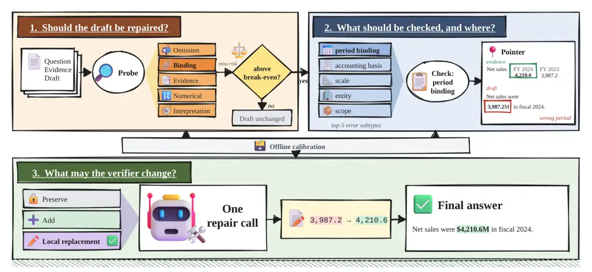
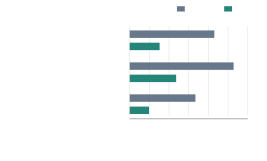

# When Self-Verification Hurts: Calibrated Answer Repair for Financial Question Answering

Celine Guo Affiliation: National University of Singapore, Singapore   
Weida Liang Affiliation: National University of Singapore, Singapore   
Yujian Fu Affiliation: National University of Singapore, Singapore   
Anqi Dang Affiliation: Nanyang Technological University, Singapore   
Yanzheng Jin Affiliation: National University of Singapore, Singapore   
Kenji Kawaguchi Affiliation: National University of Singapore, Singapore
   Wenya Wang Affiliation: Nanyang Technological University, Singapore

###### Abstract

Financial question answering can fail even when a model extracts a
plausible number from the supplied evidence: the answer may attach it to
the wrong entity, period, unit, or accounting concept. Asking the model
to verify and revise its draft can help, but open-ended revision may
alter content that was already correct or inspect the wrong relation and
reinforce the original error. We formulate repair as a decision that
balances the information it may recover against the correct content it
may damage. Based on this trade-off, we introduce Calibrated Answer
Repair (CAR), which first estimates whether a draft is likely to benefit
from repair, then selects a targeted check, localizes the relevant
evidence or draft span, and limits the permitted edit. Across FinRank,
Fin-RATE, and FinQA with three open-weight models, CAR outperforms
generic verification in all dataset–model settings. At the system level,
it recovers 14.6% of initially missed answer requirements while damaging
2.1% of initially correct ones. Its post-draft token cost is over 30
percent lower than the iterative revision alternatives. Ablations on two
dataset–model settings show that evidence localization and bounded
editing are the main contributors to CAR’s gains.

^(†)^(†)affiliationnotice: Equal contribution

## 1 Introduction

Financial reports rarely present an answer as an isolated number. Even a
simple numerical question may require a system to combine narrative
text, tables, and intermediate calculations, and then determine which
company, reporting period, unit, and accounting concept a value
describes (Zhu et al., 2021; Chen et al., 2021; Chen et al., 2022).
Financial question answering therefore requires both numerical reasoning
and precise grounding in the supplied evidence. Language models can
succeed at finding or computing a value while failing to ground it
correctly: a number may appear in the filing but belong to a different
period or entity. Because related figures often occur in the same
passage or table, the resulting answer can still appear precise and well
supported while expressing the wrong relation (Mansouri et al., 2026;
Jiang et al., 2026; Stolfo, 2024).

A natural response is to ask the model to verify its draft against the
evidence and revise any detected error (Madaan et al., 2023; Zhao et
al., 2023; Dhuliawala et al., 2024; Gou et al., 2024). However,
self-verification can introduce errors of its own (Huang et al., 2024;
Kamoi et al., 2024). We explore two main risks: (1) over-editing, in
which the verifier changes correct content while fixing a local error,
and (2) misdirected verification, in which it checks the wrong relation
or evidence and consequently preserves the original error or adds an
irrelevant claim. Reliable repair must therefore decide whether to
repair, what to check and where to inspect, and which edit contract to
apply.

Figure 1 illustrates the problem. The draft contains both values
reported in the filing, but assigns each value to the other column. A
generic verifier confirms that both numbers occur in the evidence and
therefore leaves the swap uncorrected. It may even add a valid but
irrelevant detail, supporting the current answer without fixing the
error.

Figure 1: A value–concept binding error: both values appear in the
filing, but the draft assigns them to the wrong accounting concepts.
Generic verification checks presence without confirming what each value
refers to.

This example shows why confirming the presence of a number is
insufficient: the verifier must check what that number refers to.
Revision carries a second risk when it changes parts of the draft that
were already correct. CAR addresses both risks by deciding when to
repair, what relation to inspect, and how narrowly to edit.

Motivated by this trade-off, we propose Calibrated Answer Repair (CAR).
It first estimates whether a draft is likely to benefit from revision
and leaves it unchanged when repair is unlikely to help. If revision is
worthwhile, it tells the model what to check and where to look, pointing
to relevant source text or the sentence or calculation in the draft. It
then limits edits to adding supported information or correcting only a
confirmed error, leaving unrelated content unchanged.

We evaluate CAR on FinRank, Fin-RATE, and FinQA, which cover evidence
grounding, multi-document financial analysis, and numerical reasoning.
Across three open-weight models, CAR outperforms Draft, generic
verification, and CoVe in all nine dataset–model settings, and SC-Verify
and RARR in eight. At the system level, it recovers 14.6% of initially
missed information while damaging 2.1% of initially correct information.
Its token cost is 35.2–55.3% lower than the iterative revision
alternatives. A blinded audit further finds lower rates of over-editing,
misdirected verification, and newly introduced contradictions. Our
contributions are:

1.  1.  We derive a break-even rule that balances the information a repair
        can recover against the correct content it may damage.
2.  2.  We introduce CAR, which combines a calibrated repair gate, targeted
        verification, and bounded editing.
3.  3.  We evaluate repair across three financial QA benchmarks and test
        routing, evidence localization, and edit scope through controlled
        ablations in two dataset–model settings.

## 2 Related Work

#### Financial question answering.

Financial QA benchmarks cover a range of evidence structures and
reasoning demands. TAT-QA combines numerical reasoning over tables and
text, FinQA provides program supervision for multi-step calculations,
and ConvFinQA extends financial reasoning to conversational questions
(Zhu et al., 2021; Chen et al., 2021; Chen et al., 2022). FinRank
focuses on answer grounding and provenance within released per-question
candidate pools containing supporting passages and hard negatives, an
emphasis shared by evidence-based QA evaluations of source quality and
answer attribution (Gao et al., 2023b; Schimanski et al., 2024). It is
not a full-filing retrieval setting. Fin-RATE evaluates detailed
reasoning, cross-company comparison, and longitudinal analysis over
financial filings using benchmark-provided gold context (Mansouri et
al., 2026; Jiang et al., 2026). Together, these benchmarks span
confusable-evidence grounding, multi-document financial analysis, and
numerical reasoning.

#### Post-hoc verification and repair.

Existing methods improve generated answers through feedback, evidence
gathering, or structured verification. Self-Refine alternates
model-generated feedback and revision (Madaan et al., 2023).
Verify-and-Edit and RARR retrieve external evidence before editing
reasoning chains or unsupported claims (Zhao et al., 2023; Gao et al.,
2023a). Chain-of-Verification generates dedicated questions for checking
an initial response, while CRITIC incorporates feedback from external
tools (Dhuliawala et al., 2024; Gou et al., 2024). Sampling-based
methods additionally use agreement or disagreement across generations as
a reliability signal (Wang et al., 2023; Manakul et al., 2023). Recent
studies also examine the conditions under which models can successfully
correct their own outputs (Huang et al., 2024; Kamoi et al., 2024).
Building on this literature, CAR treats verification as a selective
repair process that jointly determines whether to edit, what relation to
check, and how much of the draft to change.

#### Selective prediction and fine-grained evaluation.

Selective prediction allows a system to abstain when its confidence is
insufficient, while model cascades allocate additional computation to
selected examples (Geifman and El-Yaniv, 2017; Kamath et al., 2020;
Varshney and Baral, 2022). These approaches motivate using additional
computation only where it is likely to improve the output. CAR applies
this principle after an answer has been generated, choosing between
preserving the draft and invoking repair. Fine-grained evaluation
provides a complementary perspective: FActScore decomposes long-form
outputs into atomic claims so that supported and unsupported content can
be assessed separately (Min et al., 2023). We similarly assess answer
requirements before and after repair, distinguishing recovered
requirements from regressions that aggregate answer accuracy can
obscure.

## 3 When Is Repair Worthwhile?

To formalize when repair is worthwhile, we score answers against atomic
_answer requirements_: facts a complete answer must state correctly,
including what each value refers to. In Figure 1, both values appear but
are assigned to the wrong relations, so neither requirement is met.
_Requirement coverage_ is the fraction of requirements satisfied, and
the missing or incorrect fraction is the _miss rate_ $`m`$. The rubric
for each question lists these requirements. Rubrics provide supervision
during development. At test time, they are used only by the evaluator
and are never shown to CAR.

### 3.1 A Break-Even Rule

Repair can recover missed requirements but may also damage those already
satisfied. Let $`f`$ be the recovery rate (the fraction of missed
requirements recovered) and $`d`$ the damage rate (the fraction of
satisfied requirements lost). For each dataset–model setting, we
estimate these rates by applying the repair to every calibration draft
and comparing requirement satisfaction before and after repair.

For miss rate $`m`$, the expected change in requirement coverage is

```math
G(m)=mf-(1-m)d. \tag{1}
```

Repair is worthwhile when $`G(m)\geq 0`$, which gives

```math
m\geq m^{\star}=\frac{d}{f+d}. \tag{2}
```

The threshold falls as recovery improves and rises as damage increases,
so an error alone does not make repair worthwhile. Because $`f`$ and
$`d`$ are averages estimated on calibration data, this is a calibrated
decision rule for expected coverage on new questions, not a guarantee of
positive gain on every individual question.

### 3.2 Turning the Rule into a Gate

At test time, the rubric and miss rate are unavailable. CAR predicts
$`\widehat{m}`$ from the question, evidence, draft, and a non-editing,
evidence-grounded probe, using rubric-based miss rates from calibration
drafts as supervision. The probe runs on every question, whether or not
repair follows.

At test time, CAR opens the repair gate when

```math
\widehat{m}\geq m^{\star}, \tag{3}
```

and otherwise returns the draft unchanged. The threshold is determined
by the observed recovery and damage rates rather than tuned as an
additional hyperparameter. Because the probe has already inspected the
evidence, the gate decides whether to proceed from diagnosis to targeted
repair, not whether to perform verification. Section 4 describes check
selection and the permitted edit.

## 4 Calibrated Answer Repair

CAR structures repair around three decisions: whether it is worthwhile,
what to check and where, and how much of the answer to change. These
decisions address unnecessary revision, misdirected verification, and
over-editing. Figure 2 illustrates them with a period-binding error: the
draft assigns FY 2023 net sales to FY 2024, and a targeted local repair
corrects the value using the supplied evidence while preserving the rest
of the draft.



Figure 2: Overview of CAR: diagnosis gates repair, predicted error
subtypes guide the check and pointer, and an edit limit constrains one
repair call.

### 4.1 Learning from Calibration Errors

CAR learns from labeled calibration data. The draft model first answers
each calibration question, and the rubric identifies which answer
requirements are missing or incorrect. For each unmet requirement, a
fixed language model uses the question, evidence, draft, and requirement
to write a short description of the error.

We organize these descriptions at two levels. Five broad error families
capture the main questions a verifier may need to ask. Within each
family, similar calibration errors are grouped and named once, producing
25 more specific error subtypes. The probe predicts the five broad
families, while the subtypes are used later to choose specific checks.
The resulting error types are fixed before test time and listed in
Appendix A.

The same calibration data show how repair changes an answer. We repair
every calibration draft and compare its requirements before and after
repair to estimate the overall recovery and damage rates. Additional
trials vary the verification check and allowed edit, showing which
checks recover each subtype and how often each edit limit damages
correct content. Rubric-based miss rates provide the supervision for the
diagnostic predictor. These estimates are computed separately for each
dataset–model setting.

### 4.2 Should the Draft Be Repaired?

Because the rubric and true miss rate are unavailable at test time, a
non-editing, evidence-grounded probe examines the question, evidence,
and draft and returns five binary judgments, one for each broad error
family. A ridge regression model combines these judgments with input
features to estimate the draft’s miss rate $`\widehat{m}`$.

If $`\widehat{m}`$ is below the break-even point $`m^{\star}`$, CAR
returns the draft unchanged. Otherwise, it proceeds from diagnosis to
targeted repair according to Equation 3, and the gate controls whether
the answer may be edited, not whether evidence is inspected.

### 4.3 What Should Be Checked, and Where?

The probe examines the current question, evidence, and draft. Its five
family-level judgments, combined with text features, estimate the likely
missed share for the repair gate, not which check to run. Separately,
error labels from semantically similar calibration questions suggest
which relation may be wrong. The selected check tests that relation,
while a pointer directs inspection to the relevant span in the current
draft or supplied evidence. Calibration-measured check recovery weights
the subtype hypotheses. The resulting weights determine check selection
within a fixed budget. Retrieval, smoothing, check-scoring, and
pointer-construction details appear in Appendices A, E, and C.

### 4.4 What May the Verifier Change?

Even a well-targeted check can damage correct content if it triggers a
full rewrite. CAR preserves the draft when no edit has positive expected
gain. Otherwise, it selects an addition or local replacement according
to the suspected error and pointer. For an omission, it inspects the
source passage and permits addition only. For binding errors, it
inspects the draft span against the source row or column. For evidence
errors, it inspects the claim and its strongest supporting passage. For
numerical errors, it inspects the calculation span and operands. For
interpretation errors, it inspects the requested relation and evidence.
These latter checks permit only local replacement.

For each action, calibration trials provide a recovery rate and a damage
rate. CAR applies the expected-gain rule from Equation 1, using the
predicted miss rate in place of the unknown true rate. It selects the
action with the largest positive expected gain and preserves the draft
if none is expected to help.

In Figure 1, the selected check asks which value belongs to each column,
the pointer identifies the affected sentence and table columns, and the
edit is limited to replacing the two swapped values.

The selected checks, pointer, and edit action are combined in one repair
call. The prompt format and edit-validation procedure are detailed in
Appendix E. Each question receives one diagnostic probe, and only those
passing the gate receive a repair call.

## 5 Experimental Setup

### 5.1 Benchmarks and Primary Metrics

Our evaluation covers three financial question-answering benchmarks with
complementary evidence and reasoning demands:

- •
  FinRank (Mansouri et al., 2026) evaluates answer grounding and
  provenance over per-question evidence. We report Grounded Answer
  Accuracy (GAA), which counts an answer as correct only when its
  content is correct and at least one returned passage identifier
  belongs to the gold support set. This joint criterion measures both
  answer quality and evidence attribution, rather than passage ranking
  alone.
- •
  Fin-RATE (Jiang et al., 2026) covers detailed reasoning (DR-QA),
  cross-company comparison (EC-QA), and longitudinal tracking (LT-QA).
  We use its gold-context setting, giving every method the same
  benchmark-provided supporting context. The official evaluator assigns
  each answer one of four labels—Correct, Partial, Incorrect, or
  Failure. Correctness Rate (CR) is the percentage labeled Correct, and
  we report it by subtask and use their unweighted mean as a summary.
- •
  FinQA (Chen et al., 2021) tests numerical reasoning over financial
  text and tables. We report Numerical Answer Accuracy (NAA), the
  proportion of normalized final answers that match the gold execution
  result. NAA directly evaluates the requested numerical result without
  requiring a generated program.

Further evidence-pool, input-cap, and normalization details appear in
Appendices F and C.

### 5.2 Models and Data Partitions

Answer-generation and repair calls use Qwen3-8B and Qwen3-14B (Yang et
al., 2025), and Mistral-Small-24B-Instruct-2501 (Mistral AI, 2025).
Within each dataset–model configuration, the same model generates the
shared draft and handles subsequent diagnostic, verification, and repair
calls. Model weights remain fixed. Serving and decoding details are
provided in Appendix E. Table 1 summarizes the calibration, development,
and held-out test partitions.

|               |         |          |       |
| ------------- | ------- | -------- | ----- |
| Partition     | FinRank | Fin-RATE | FinQA |
| Calibration   | 910     | 5,250    | 6,251 |
| Development   | 140     | 750      | 883   |
| Held-out test | 135     | 1,500    | 1,147 |

Table 1: Partition sizes by benchmark.

FinRank uses the released held-out-ticker split. Fin-RATE uses fixed
70/10/20 splits within each subtask, grouped by filing bundle
(1,750/250/500 questions per subtask). FinQA uses its official split.

Fin-RATE uses the official three-judge fusion of GPT-5, DeepSeek-V3.2,
and Qwen3-235B. Labels map to 0 (Failure), 1 (Incorrect), 3 (Partial),
and 5 (Correct) before fusion. Weights, ordered as DeepSeek/Qwen/GPT-5,
are 0.70/0.10/0.20 for DR-QA and 0.14/0.12/0.74 for EC-QA and LT-QA.
Only a fused Correct label counts toward CR. This benchmark evaluator is
separate from the requirement judge. We use Claude Sonnet 5 (Anthropic, 2026) to label each answer-requirement/candidate-answer pair with the
prompt in Appendix E. Those labels measure requirement transitions and
support calibration of the gate and edit actions. On 400 stratified
requirement decisions, Claude’s labels agree with adjudicated human
judgments in 91.8% of cases ($`\kappa=0.83`$). Calibration data provide
labels and paired repair outcomes, development data select non-test
hyperparameters, and held-out data provide benchmark scores. Gold
answers, requirements, and scoring annotations are reserved for
evaluation or offline calibration. The Fin-RATE gold context is the
shared inference-time evidence.

### 5.3 Comparison Methods

- •
  Draft returns the shared initial answer without post-draft processing.
- •
  Verify applies one generic evidence-grounded check-and-revise pass.
- •
  SC-Verify generates three independent reviews and returns the
  majority-voted normalized answer. Aggregation and tie-breaking are
  specified in Appendix E.
- •
  CoVe (Dhuliawala et al., 2024) uses factored verification: it answers
  draft-generated questions independently from evidence alone, then
  revises the shared draft.
- •
  RARR (Gao et al., 2023a) checks draft-derived claims against the
  shared evidence pool, localizes mismatches, and minimally edits them
  under its edit-distance limit.
- •
  CAR uses the calibrated gate to decide whether to proceed from
  diagnosis to repair, then selects a check and pointer and constrains
  the edit.

Implementation details for the supplied-evidence CoVe and RARR
adaptations appear in Appendix E.2.

### 5.4 Evaluation and Cost

Within each dataset–model configuration, all methods receive the same
question, evidence, and initial draft. For Fin-RATE this evidence is the
benchmark-provided gold context. Requirement coverage, recovery, and
damage follow the definitions in Section 3.

Inference cost is the additional post-draft input and output tokens. For
CAR,

```math
C_{\textsc{CAR}}=C_{\mathrm{probe}}+\mathbb{1}[\text{repair gate opens}]C_{\mathrm{repair}}. \tag{4}
```

The evidence-grounded probe runs on every question, so its cost is
included whether or not the gate opens. The cost of SC-Verify includes
all three reviews. Recovery, damage, calls, and token totals are
macro-averaged over the dataset–model configurations. A blinded
two-annotator audit compares Verify and CAR on 144 paired drafts for
over-editing, misdirected verification, and newly introduced
contradictions.

## 6 Results

### 6.1 End-to-End Performance

Table 2 shows that CAR improves over Draft, Verify, and CoVe in all nine
settings, and over SC-Verify and RARR in eight. It trails the latter two
only on Qwen3-14B FinRank (35.56% vs. 36.30%).

|                     |             |           |           |           |           |           |           |
| ------------------- | ----------- | --------- | --------- | --------- | --------- | --------- | --------- |
| Dataset / Metric    | Model       | Draft     | Verify    | SC-Verify | CoVe      | RARR      | CAR       |
| FinRank / GAA       | Qwen3-8B    | $`23.70`$ | $`22.96`$ | $`25.19`$ | $`25.93`$ | $`28.15`$ | 29.63     |
|                     | Qwen3-14B   | $`31.11`$ | $`31.85`$ | 36.30     | $`34.07`$ | 36.30     | $`35.56`$ |
|                     | Mistral-24B | $`29.63`$ | $`30.37`$ | $`31.11`$ | $`31.11`$ | $`33.33`$ | 34.81     |
| Fin-RATE / Macro CR | Qwen3-8B    | $`5.53`$  | $`5.73`$  | $`6.13`$  | $`6.67`$  | $`7.47`$  | 8.20      |
|                     | Qwen3-14B   | $`11.27`$ | $`11.60`$ | $`12.33`$ | $`13.07`$ | $`14.07`$ | 14.67     |
|                     | Mistral-24B | $`16.73`$ | $`17.13`$ | $`17.87`$ | $`18.07`$ | $`19.40`$ | 20.07     |
| FinQA / NAA         | Qwen3-8B    | $`63.21`$ | $`62.77`$ | $`64.08`$ | $`62.95`$ | $`65.65`$ | 66.43     |
|                     | Qwen3-14B   | $`68.35`$ | $`68.00`$ | $`69.22`$ | $`70.27`$ | $`71.32`$ | 72.01     |
|                     | Mistral-24B | $`70.18`$ | $`69.66`$ | $`70.88`$ | $`71.05`$ | $`72.28`$ | 72.97     |

Table 2: Held-out benchmark scores (percent, with higher values
indicating better performance). Bold marks the best method per setting.

Fin-RATE Macro CR is the unweighted mean of the official DR-QA, EC-QA,
and LT-QA Correctness Rates. The full subtask results appear in
Appendix F.1.

Effects vary by task and model. On FinRank, CAR exceeds SC-Verify by
4.44 points for Qwen3-8B and 3.70 for Mistral-24B, but trails by 0.74
for Qwen3-14B. Fin-RATE task-level gains appear in Section 7.4. On
FinQA, generic verification lowers accuracy, while CAR gains 2.09–2.79
points over SC-Verify by avoiding changes to correct calculations.

### 6.2 How Does Generic Verification Fail?



Figure 3: Failure rates in the blinded 144 paired drafts.

Figure 3 shows that CAR reduces all three audited failure modes, with
the largest difference in misdirected verification. Inter-annotator
agreement ranged from 87.8% to 95.1% across labels (Cohen’s
$`\kappa=0.75`$–$`0.82`$).

### 6.3 Repair Safety and Cost

Table 3 separates repair behavior from benchmark score. Generic Verify
recovers 8.1% of initially missed requirements but damages 6.7% of those
already satisfied. SC-Verify recovers 9.8% and damages 5.5% at three
calls per question. CoVe recovers 11.7% and damages 4.8% at 4.00 calls
per question, while RARR recovers 13.8% and damages 2.4% at 3.58 calls
per question. At the system level, CAR has the highest recovery rate at
14.6% and the lowest damage rate at 2.1%, with 1.54 calls per question.
Because this aggregate includes drafts for which the gate stays closed,
it does not by itself isolate the safety of the edit policy.

|           |              |            |          |                     |               |
| --------- | ------------ | ---------- | -------- | ------------------- | ------------- |
| Method    | Recovery (%) | Damage (%) | Calls/q  | Tokens per question | Rel. cost (%) |
| Draft     | —            | —          | $`0.00`$ | $`0`$               | $`0.0`$       |
| Verify    | $`8.1`$      | $`6.7`$    | $`1.00`$ | $`3,417`$           | $`100.0`$     |
| SC-Verify | $`9.8`$      | $`5.5`$    | $`3.00`$ | $`10,467`$          | $`306.3`$     |
| CoVe      | $`11.7`$     | $`4.8`$    | $`4.00`$ | $`11,960`$          | $`350.0`$     |
| RARR      | $`13.8`$     | $`2.4`$    | $`3.58`$ | $`8,240`$           | $`241.1`$     |
| CAR       | 14.6         | 2.1        | $`1.54`$ | $`5,343`$           | $`156.4`$     |

Table 3: Requirement transitions and post-draft cost, macro-averaged
across settings. Relative cost is normalized to Verify at 100.0%.

We also separate system-level transitions from outcomes conditional on
intervention and actual edits. Gate-open recovery and damage are
measured only on drafts sent to repair. Changed-answer damage is
conditioned on an answer change, while edit rate is the share of all
questions whose final answer differs from the draft (Table 4).

|                       |          |
| --------------------- | -------- |
| CAR metric            | Rate (%) |
| Overall recovery      | $`14.6`$ |
| Overall damage        | $`2.1`$  |
| Gate-open recovery    | $`20.3`$ |
| Gate-open damage      | $`5.3`$  |
| Changed-answer damage | $`8.4`$  |
| Edit rate             | $`35.0`$ |

Table 4: System-level and conditional repair outcomes.

Among gate-open drafts, recovery is 20.3% and damage is 5.3%, while only
35.0% of final answers change, and 8.4% of changed answers damage a
satisfied requirement. The lower overall damage therefore reflects both
selective intervention and outcomes after editing. These aggregate rates
do not isolate the causal contribution of the gate from that of the edit
limit.

The saving is not obtained by ignoring diagnosis. Every CAR example pays
for the probe, and 54.1% additionally invoke repair, for an average of
1.54 calls per question. Including both calls, CAR uses 5,343 additional
post-draft tokens per question. This is 156.4% of the 3,417 tokens used
by Verify, or 56.4% more. It uses 49.0% fewer tokens than SC-Verify,
55.3% fewer than CoVe, and 35.2% fewer than RARR.

### 6.4 Component Ablations

Table 5 reports Qwen3-14B FinRank performance when changing the gate,
pointer, check selection, or edit constraint.

|                   |           |
| ----------------- | --------- |
| Variant           | GAA       |
| Full CAR          | $`35.56`$ |
| Always repair     | $`30.37`$ |
| No pointer        | $`28.89`$ |
| Fixed checklist   | $`31.85`$ |
| Unbounded rewrite | $`27.41`$ |

Table 5: FinRank GAA for Qwen3-14B CAR variants.

We repeat the four single-factor ablations on FinQA with Mistral-24B to
test the component effects on another dataset, model family, and a
larger numerical-answer test set. The results and one-factor controls
appear in Appendix F.2.

## 7 Analysis

### 7.1 Does Selective Repair Help?

|          |                     |                     |               |                    |
| -------- | ------------------- | ------------------- | ------------- | ------------------ |
| Dataset  | Always-repair $`f`$ | Always-repair $`d`$ | $`m^{\star}`$ | Gate-open rate (%) |
| FinRank  | $`0.142`$           | $`0.095`$           | $`0.401`$     | $`62.7`$           |
| Fin-RATE | $`0.115`$           | $`0.089`$           | $`0.436`$     | $`55.4`$           |
| FinQA    | $`0.068`$           | $`0.081`$           | $`0.543`$     | $`44.1`$           |

Table 6: Break-even quantities averaged across models.

The calibration pattern follows the break-even rule. On FinRank,
recovery exceeds damage ($`f=0.142`$, $`d=0.095`$), giving the lowest
threshold ($`m^{\star}=0.401`$) and the highest gate-open rate (62.7%).
On FinQA, damage exceeds recovery ($`f=0.068`$, $`d=0.081`$), so the
threshold rises to 0.543 and the gate opens for 44.1% of drafts.
Fin-RATE falls between these cases. Relative to always applying the
repair pipeline, selective repair raises requirement coverage by 1.48,
0.80, and 0.81 points on FinRank, Fin-RATE, and FinQA, respectively.
Across models, thresholds range from 0.395 to 0.408 on FinRank, 0.427 to
0.453 on Fin-RATE, and 0.527 to 0.566 on FinQA. Their gate-open rates
range from 59.8 to 66.7%, 52.6 to 58.9%, and 40.2 to 47.8%, respectively
(Appendix D). The separated ranges show greater threshold variation
across benchmarks than across models within a benchmark.

We compare miss-rate predictors using text features, probe verdicts, and
their combination (Table 7.1).

|                     |                    |                            |
| ------------------- | ------------------ | -------------------------- |
| Miss-rate input     | MAE $`\downarrow`$ | Pearson $`r`$ $`\uparrow`$ |
| Dataset mean only   | $`0.196`$          | —                          |
| Text features only  | $`0.171`$          | $`0.344`$                  |
| Probe verdicts only | $`0.158`$          | $`0.473`$                  |
| Text + probe        | 0.146              | 0.512                      |

Table 7: Miss-rate prediction on grouped development folds.

Adding the five evidence-grounded verdicts reduces MAE from 0.171 to
0.146, a 14.6% reduction, and raises Pearson correlation from 0.344 to
0.512 versus text features alone. Probe verdicts alone also outperform
text features, while combining both gives the lowest error. These
results support using the probe to diagnose each draft, separately from
the later gate decision to permit an edit.

### 7.2 Which Repair Components Matter?

On Qwen3-14B FinRank, question-specific routing adds 3.71 GAA points
over the fixed checklist (35.56 vs. 31.85). Always repair, no pointer,
and unbounded rewrite score 30.37, 28.89, and 27.41, respectively,
making localization and edit scope the larger contributors in this
setting. The FinQA–Mistral-24B ablation shows the same ordering on
numerical answer accuracy: removing the pointer costs 2.70 points and
removing the edit bound costs 4.01, compared with 2.44 for always
repairing. The fixed-checklist gap is 0.87 points, small relative to the
pointer and edit-scope effects (Appendix F.2).

### 7.3 Do Pointers Localize Relevant Content?

Among omissions, source pointers place a supporting passage in the top
three for 72.8% of FinRank cases and 52.4% of Fin-RATE cases, compared
with 46.9% and 20.1% under random ranking. On FinQA numerical failures,
calculation pointers overlap the reference span in 68.9% of cases and
localize all required operands in 51.7%, versus 41.6% and 27.4% with
answer-sentence pointers. For Fin-RATE, penalizing passages that
resemble the draft lowers source Hit@3 from 52.4% to 29.2%. The drop
suggests that an omitted fact often appears in context topically related
to content already in the draft. Question relevance is therefore a
better ranking signal here than draft novelty. Full definitions and
breakdowns appear in Appendix C.

### 7.4 How Do Fin-RATE Gains Vary by Task?

CAR improves all Fin-RATE model–subtask pairs. Absolute gains are
largest on DR, while EC and LT also improve from lower baselines.
Table 7.4 reports model-level point changes: DR gains range from 4.4 to
5.4, EC from 1.4 to 2.8, and LT from 2.2 to 2.8. For Qwen3-8B, EC rises
from 0.4 to 1.8. Point changes are more informative than relative
percentages from a near-zero starting value. Full Correctness Rates
appear in Appendix F.1.

|             |         |         |         |
| ----------- | ------- | ------- | ------- |
| Model       | DR-QA   | EC-QA   | LT-QA   |
| Qwen3-8B    | $`4.4`$ | $`1.4`$ | $`2.2`$ |
| Qwen3-14B   | $`5.4`$ | $`2.0`$ | $`2.8`$ |
| Mistral-24B | $`4.8`$ | $`2.8`$ | $`2.4`$ |

Table 8: Fin-RATE CAR minus Draft CR.

## 8 Conclusion

CAR makes repair selective, targeted, and bounded. It outperforms
standard verification approaches in all nine benchmark–model settings
and stronger verification variants in eight. Its post-draft token cost
is higher than a single verification pass but lower than the iterative
revision alternatives. Controlled ablations show that evidence
localization and bounded edits matter across both judge-based and
numerical-answer evaluation, while the fixed-checklist gap is small on
FinQA.

## Limitations

Our evaluation covers three English-language financial benchmarks and
three open-weight models. Results may not transfer directly to other
domains, languages, or model families, and the calibrated repair policy
relies on paired development outcomes. Fin-RATE uses benchmark-provided
gold context, so our experiments focus on answer repair rather than
end-to-end retrieval. Requirement-level outcomes use an independent
judge, while benchmark metrics and a blinded audit provide complementary
checks.

## Ethical Considerations

Higher requirement coverage does not make a financial answer safe for
investment, accounting, or regulatory use. Deployed systems should
expose their evidence, avoid unsupported repairs, and retain qualified
human review for consequential decisions.

The benchmarks are based on public financial disclosures, but
redistribution remains subject to the corresponding dataset licenses.
Failure annotation, calibration, and repeated model inference also incur
compute and data-transfer costs.

#### Writing assistance.

A generative AI assistant helped organize and edit the manuscript and
check internal consistency.

## References

- Anthropic (2026) Anthropic Introducing Claude Sonnet 5. Note:
  Anthropic External Links:
  [Link](https://www.anthropic.com/news/claude-sonnet-5) Cited by: §5.2.
- Chen et al. (2021) Z. Chen, W. Chen, C. Smiley, S. Shah, I. Borova, D.
  Langdon, R. Moussa, M. Beane, T. Huang, B. Routledge, and W. Y. Wang
  FinQA: a dataset of numerical reasoning over financial data. In
  Proceedings of the 2021 Conference on Empirical Methods in Natural
  Language Processing, pp. 3697–3711. External Links:
  [Link](https://aclanthology.org/2021.emnlp-main.300/) Cited by: §E.1,
  §1, §2, 3rd item.
- Chen et al. (2022) Z. Chen, S. Li, C. Smiley, Z. Ma, S. Shah,
  and W. Y. Wang ConvFinQA: exploring the chain of numerical reasoning
  in conversational finance question answering. In Proceedings of the
  2022 Conference on Empirical Methods in Natural Language Processing,
  pp. 6279–6292. External Links:
  [Document](https://dx.doi.org/10.18653/v1/2022.emnlp-main.421),
  [Link](https://aclanthology.org/2022.emnlp-main.421/) Cited by: §1,
  §2.
- Dhuliawala et al. (2024) S. Dhuliawala, M. Komeili, J. Xu, R.
  Raileanu, X. Li, A. Celikyilmaz, and J. Weston Chain-of-verification
  reduces hallucination in large language models. In Findings of the
  Association for Computational Linguistics: ACL 2024, pp. 3563–3578.
  External Links:
  [Document](https://dx.doi.org/10.18653/v1/2024.findings-acl.212),
  [Link](https://aclanthology.org/2024.findings-acl.212/) Cited by: §1,
  §2, 4th item.
- Gao et al. (2023a) L. Gao, Z. Dai, P. Pasupat, A. Chen, A. T.
  Chaganty, Y. Fan, V. Zhao, N. Lao, H. Lee, D. Juan, and K. Guu RARR:
  researching and revising what language models say, using language
  models. In Proceedings of the 61st Annual Meeting of the Association
  for Computational Linguistics (Volume 1: Long Papers),
  pp. 16477–16508. External Links:
  [Document](https://dx.doi.org/10.18653/v1/2023.acl-long.910),
  [Link](https://aclanthology.org/2023.acl-long.910/) Cited by: §2, 5th
  item.
- Gao et al. (2023b) T. Gao, H. Yen, J. Yu, and D. Chen Enabling large
  language models to generate text with citations. In Proceedings of the
  2023 Conference on Empirical Methods in Natural Language Processing,
  pp. 6465–6488. External Links:
  [Document](https://dx.doi.org/10.18653/v1/2023.emnlp-main.398),
  [Link](https://aclanthology.org/2023.emnlp-main.398/) Cited by: §2.
- Geifman and El-Yaniv (2017) Y. Geifman and R. El-Yaniv Selective
  classification for deep neural networks. In Advances in Neural
  Information Processing Systems, Vol. 30. External Links:
  [Link](https://proceedings.neurips.cc/paper_files/paper/2017/hash/4a8423d5e91fda00bb7e46540e2b0cf1-Abstract.html)
  Cited by: §2.
- Gou et al. (2024) Z. Gou, Z. Shao, Y. Gong, Y. Shen, Y. Yang, N. Duan,
  and W. Chen CRITIC: large language models can self-correct with
  tool-interactive critiquing. In International Conference on Learning
  Representations, External Links:
  [Link](https://openreview.net/forum?id=Sx038qxjek) Cited by: §1, §2.
- Huang et al. (2024) J. Huang, X. Chen, S. Mishra, H. S. Zheng, A. W.
  Yu, X. Song, and D. Zhou Large language models cannot self-correct
  reasoning yet. In International Conference on Learning
  Representations, External Links:
  [Link](https://arxiv.org/abs/2310.01798) Cited by: §1, §2.
- Jiang et al. (2026) Y. Jiang, J. Chen, E. Makri, J. Chen, P. Li, A.
  Maatouk, L. Tassiulas, E. Brenner, B. Xiang, and R. Ying Fin-RATE: a
  real-world financial analytics and tracking evaluation benchmark for
  LLMs on SEC filings. In Proceedings of the 32nd ACM SIGKDD Conference
  on Knowledge Discovery and Data Mining, External Links:
  [Document](https://dx.doi.org/10.1145/3770855.3817528),
  [Link](https://doi.org/10.1145/3770855.3817528) Cited by: §E.1, §1,
  §2, 2nd item.
- Kamath et al. (2020) A. Kamath, R. Jia, and P. Liang Selective
  question answering under domain shift. In Proceedings of the 58th
  Annual Meeting of the Association for Computational Linguistics,
  pp. 5684–5696. External Links:
  [Document](https://dx.doi.org/10.18653/v1/2020.acl-main.503),
  [Link](https://aclanthology.org/2020.acl-main.503/) Cited by: §2.
- Kamoi et al. (2024) R. Kamoi, Y. Zhang, N. Zhang, J. Han, and R. Zhang
  When can LLMs actually correct their own mistakes? A critical survey
  of self-correction of LLMs. Transactions of the Association for
  Computational Linguistics 12, pp. 1417–1440. External Links:
  [Link](https://aclanthology.org/2024.tacl-1.78/) Cited by: §1, §2.
- Madaan et al. (2023) A. Madaan, N. Tandon, P. Gupta, S. Hallinan, L.
  Gao, S. Wiegreffe, U. Alon, N. Dziri, S. Prabhumoye, Y. Yang, S.
  Gupta, B. P. Majumder, K. Hermann, S. Welleck, A. Yazdanbakhsh, and P.
  Clark Self-Refine: iterative refinement with self-feedback. In
  Advances in Neural Information Processing Systems, Vol. 36. External
  Links:
  [Link](https://papers.nips.cc/paper_files/paper/2023/hash/91edff07232fb1b55a505a9e9f6c0ff3-Abstract-Conference.html)
  Cited by: §1, §2.
- Manakul et al. (2023) P. Manakul, A. Liusie, and M. Gales
  SelfCheckGPT: zero-resource black-box hallucination detection for
  generative large language models. In Proceedings of the 2023
  Conference on Empirical Methods in Natural Language Processing,
  pp. 9004–9017. External Links:
  [Document](https://dx.doi.org/10.18653/v1/2023.emnlp-main.557),
  [Link](https://aclanthology.org/2023.emnlp-main.557/) Cited by: §2.
- Mansouri et al. (2026) S. Mansouri, D. Saad, M. Wahrenburg, M.
  Weissel, and F. Woebbeking FinRank: an evidence-grounded benchmark for
  financial question answering and retrieval over SEC filings. arXiv
  preprint arXiv:2608.07400. External Links: 2608.07400,
  [Link](https://arxiv.org/abs/2608.07400) Cited by: §E.1, §1, §2, 1st
  item.
- Min et al. (2023) S. Min, K. Krishna, X. Lyu, M. Lewis, W. Yih, P.
  Koh, M. Iyyer, L. Zettlemoyer, and H. Hajishirzi FActScore:
  fine-grained atomic evaluation of factual precision in long-form text
  generation. In Proceedings of the 2023 Conference on Empirical Methods
  in Natural Language Processing, pp. 12076–12100. External Links:
  [Link](https://aclanthology.org/2023.emnlp-main.741/) Cited by: §2.
- Mistral AI (2025) Mistral AI Mistral-Small-24B-Instruct-2501 model
  card. Note: Hugging Face External Links:
  [Link](https://huggingface.co/mistralai/Mistral-Small-24B-Instruct-2501)
  Cited by: §E.1, §5.2.
- Schimanski et al. (2024) T. Schimanski, J. Ni, M. Kraus, E. Ash,
  and M. Leippold Towards faithful and robust LLM specialists for
  evidence-based question-answering. In Proceedings of the 62nd Annual
  Meeting of the Association for Computational Linguistics (Volume 1:
  Long Papers), pp. 1913–1931. External Links:
  [Document](https://dx.doi.org/10.18653/v1/2024.acl-long.105),
  [Link](https://aclanthology.org/2024.acl-long.105/) Cited by: §2.
- Stolfo (2024) A. Stolfo Groundedness in retrieval-augmented long-form
  generation: an empirical study. In Findings of the Association for
  Computational Linguistics: NAACL 2024, pp. 1537–1552. External Links:
  [Document](https://dx.doi.org/10.18653/v1/2024.findings-naacl.100),
  [Link](https://aclanthology.org/2024.findings-naacl.100/) Cited by:
  §1.
- Varshney and Baral (2022) N. Varshney and C. Baral Model cascading:
  towards jointly improving efficiency and accuracy of NLP systems. In
  Proceedings of the 2022 Conference on Empirical Methods in Natural
  Language Processing, pp. 11007–11021. External Links:
  [Document](https://dx.doi.org/10.18653/v1/2022.emnlp-main.756),
  [Link](https://aclanthology.org/2022.emnlp-main.756/) Cited by: §2.
- Wang et al. (2023) X. Wang, J. Wei, D. Schuurmans, Q. V. Le, E. H.
  Chi, S. Narang, A. Chowdhery, and D. Zhou Self-consistency improves
  chain of thought reasoning in language models. In International
  Conference on Learning Representations, External Links:
  [Link](https://openreview.net/forum?id=1PL1NIMMrw) Cited by: §2.
- Yang et al. (2025) A. Yang, A. Li, B. Yang, et al. Qwen3 technical
  report. arXiv preprint arXiv:2505.09388. External Links:
  [Link](https://arxiv.org/abs/2505.09388) Cited by: §E.1, §5.2.
- Zhao et al. (2023) R. Zhao, X. Li, S. Joty, C. Qin, and L. Bing
  Verify-and-edit: a knowledge-enhanced chain-of-thought framework. In
  Proceedings of the 61st Annual Meeting of the Association for
  Computational Linguistics (Volume 1: Long Papers), pp. 5823–5840.
  External Links:
  [Document](https://dx.doi.org/10.18653/v1/2023.acl-long.320),
  [Link](https://aclanthology.org/2023.acl-long.320/) Cited by: §1, §2.
- Zhu et al. (2021) F. Zhu, W. Lei, Y. Huang, C. Wang, S. Zhang, J.
  Lv, F. Feng, and T. Chua TAT-QA: a question answering benchmark on a
  hybrid of tabular and textual content in finance. In Proceedings of
  the 59th Annual Meeting of the Association for Computational
  Linguistics and the 11th International Joint Conference on Natural
  Language Processing (Volume 1: Long Papers), pp. 3277–3287. External
  Links: [Document](https://dx.doi.org/10.18653/v1/2021.acl-long.254),
  [Link](https://aclanthology.org/2021.acl-long.254/) Cited by: §1, §2.

## Appendix A Failure Families and Induction

#### Annotation source.

For each missed calibration requirement, a frozen LLM annotator receives
the question, supplied evidence, draft, and missed requirement and
writes a short failure description that abstracts away company names,
products, dates, and values. The annotator is used only on calibration
data. We manually review a subset to ensure that the descriptions
identify the failed relation without copying instance-specific content.

The annotation instruction is:

Describe why the draft fails to state the missed answer requirement.
Name the missing or incorrect relation, but abstract away
instance-specific entities, dates, products, and values. Do not propose
a repair and do not infer failures beyond the supplied requirement.

#### Fixed families, induced leaves.

The hierarchy contains five fixed families and 25 fine-grained leaves
induced from the pooled calibration descriptions. We embed the
descriptions, cluster them bottom-up, assign canonical names, and merge
clusters that receive the same name. The resulting hierarchy is frozen
before test evaluation and shared across dataset–model settings. Table 9
summarizes the five families. Table 10 gives all leaves used for
estimation and routing.

|                |                                                                                      |                                                                                              |
| -------------- | ------------------------------------------------------------------------------------ | -------------------------------------------------------------------------------------------- |
| Family         | Definition                                                                           | Typical checks and localization                                                              |
| Omission       | A requested entity, period, qualifier, comparison, or result is absent.              | Retrieve the supporting source passage and append only the supported missing relation.       |
| Binding        | A stated value is attached to the wrong entity, period, unit, or accounting concept. | Trace the value to its row, column, and passage, then locally replace the incorrect binding. |
| Evidence       | A claim is unsupported, weakly supported, or grounded in a distractor passage.       | Compare the draft sentence with its strongest evidence and verify provenance.                |
| Numerical      | The selected operands, operation, scale, sign, or computed result is wrong.          | Point to the calculation span and recompute from cited inputs.                               |
| Interpretation | The answer misstates a comparison, trend, aggregation, or requested relation.        | Re-read the question relation and check the conclusion against the evidence.                 |

Table 9: The five fixed failure families. Fine-grained leaves are
induced from calibration data and used for hierarchical smoothing and
routing.

|                |                           |                                                                                                       |
| -------------- | ------------------------- | ----------------------------------------------------------------------------------------------------- |
| Family         | Leaf                      | Definition                                                                                            |
| Omission       | f_omit_narrative          | A requested fact appears in narrative evidence but is absent from the answer.                         |
|                | f_omit_absent             | The requested fact is not supported by the supplied evidence and cannot be recovered by verification. |
|                | f_omit_derivable          | The required inputs are present, but the answer omits a value that must be derived.                   |
|                | f_omit_table              | A requested value appears in a supplied table but is not reported.                                    |
|                | f_omit_clause             | A multi-part question is answered only in part.                                                       |
| Binding        | f_entity                  | A value is attributed to the wrong company or entity.                                                 |
|                | f_concept                 | A related but different accounting concept is substituted for the requested one.                      |
|                | f_period                  | A value from the wrong fiscal year or quarter is used.                                                |
|                | f_unit                    | The currency, magnitude, or percentage-point unit is wrong.                                           |
|                | f_scope                   | Consolidated, segment, or regional reporting scopes are confused.                                     |
|                | f_version                 | A superseded value is used instead of its restated version.                                           |
|                | f_basis                   | GAAP and adjusted, reported and constant-currency, or similar bases are mixed.                        |
| Evidence       | f_unsupported             | The answer asserts a claim not supported by the supplied evidence.                                    |
|                | f_wrong_evidence          | A value or claim is taken from the wrong passage or table.                                            |
|                | f_cross_source            | Conflicting sources are combined without resolving the inconsistency.                                 |
| Numerical      | f_scale                   | Thousands, millions, percentages, or percentage points are confused.                                  |
|                | f_arithmetic              | The intended operation is correct but its arithmetic result is wrong.                                 |
|                | f_operation               | The wrong operation is used, such as a difference instead of percentage change.                       |
|                | f_sign                    | The direction of change or numerical sign is reversed.                                                |
|                | f_aggregation             | Components are double-counted or a subtotal is added to its own parts.                                |
|                | f_denominator             | A ratio or growth rate uses the wrong denominator.                                                    |
| Interpretation | f_unsupported_explanation | The stated explanation or reason is not given by the evidence.                                        |
|                | f_definition              | A financial term is defined or applied incorrectly.                                                   |
|                | f_wrong_driver            | A secondary driver is emphasized while the dominant driver is omitted.                                |
|                | f_causal_overclaim        | Correlation or co-occurrence is overstated as a causal relation.                                      |

Table 10: The complete 25-leaf taxonomy. Frequencies are computed from
the frozen calibration-label export rather than from test outputs. The
pooled calibration corpus contains 5,019 labeled errors.

In the frozen calibration export, Evidence leaves account for 5.4% of
labeled errors, and f_causal_overclaim is the only zero-observation
leaf. The accompanying label manifest reports the exact count and
percentage for every leaf. Test labels are not used to estimate these
frequencies.

#### Annotation record.

Each calibration record contains the question identifier, answer
requirement, draft, satisfaction and recoverability judgments, generated
failure description, induced leaf and family, reference error span when
existing content is wrong, and supporting-passage set. We retain
satisfied and unrecoverable requirements so that miss rates and
population-level transitions are computed over the complete cohort.

#### Question-conditioned leaf distribution.

At test time, a fixed all-MiniLM-L6-v2 encoder embeds the first 700
characters of the new question as a normalized 384-dimensional vector.
We compare it by cosine similarity with the calibration questions and
retrieve the 50 nearest questions. The retrieval unit is the question:
all failure labels attached to each neighbor contribute to the local
counts, so a question with multiple missed requirements contributes
multiple labels. No LLM is used in this retrieval stage.

Let $`n_{g}(q)`$ and $`n_{\ell}(q)`$ be the neighborhood counts for
family $`g`$ and leaf $`\ell`$, and let $`p_{g}`$ and $`p_{\ell\mid g}`$
be their global calibration frequencies. We smooth at both levels,

```math
\displaystyle P(g\mid q) \displaystyle=\frac{n_{g}(q)+\tau_{g}p_{g}}{\sum_{g^{\prime}}n_{g^{\prime}}(q)+\tau_{g}}, \tag{5}
```

```math
\displaystyle P(\ell\mid g,q) \displaystyle=\frac{n_{\ell}(q)+\tau_{\ell}p_{\ell\mid g}}{n_{g}(q)+\tau_{\ell}}, \tag{6}
```

and set $`\pi_{\ell}(q)=P(g(\ell)\mid q)P(\ell\mid g(\ell),q)`$. We use
$`\tau_{g}=2`$ and $`\tau_{\ell}=4`$ and pass the five highest-mass
leaves to the repair planner. The neighborhood size was selected on the
development split from $`\{20,50,120\}`$ using top-$`k`$ leaf recall,
and the choice was stable across this range. Question features used by
the gate are deliberately excluded from semantic retrieval.

#### Pooling and stability.

Leaf-specific check efficacy is shrunk toward its parent-family
estimate. We induce the hierarchy once from pooled calibration
descriptions so that leaf identities remain comparable across the nine
settings. The hierarchy, sentence encoder, neighbor count, and smoothing
strengths are frozen before test evaluation.

## Appendix B Diagnostic Probe

The probe receives the question, the same supplied evidence blocks and
identifiers shown to the draft, the draft, and the fixed family
definitions. Its instruction and output format are:

Inspect the draft without rewriting it. For each of the five error
families, decide whether the question and supplied evidence provide a
concrete reason to suspect that the draft omits or misstates information
requested by the question. Return one verdict and a short
evidence-grounded rationale per family. A verdict must be exactly yes or
no. Do not propose edits, use outside information, or assume access to
an evaluation rubric.  
Question: \<question\>  
Evidence: \<same evidence blocks and identifiers as Draft\>  
Draft: \<draft\>  
Error-family definitions: \<five fixed definitions\>  
Output format: Emit exactly five records in this fixed order: Omission:
\<yes\|no\>, rationale: \<reason\>, Binding: \<yes\|no\>, rationale:
\<reason\>, Evidence: \<yes\|no\>, rationale: \<reason\>, Numerical:
\<yes\|no\>, rationale: \<reason\>, Interpretation: \<yes\|no\>,
rationale: \<reason\>.

The predictor converts yes to 1 and no to 0, in the fixed order
Omission, Binding, Evidence, Numerical, Interpretation. The miss-rate
model combines this five-value vector with textual features of
$`(q,x,y^{0})`$: question length and number of requested relations,
named entities and periods, evidence length and structure, draft length,
and whether the draft explicitly states relevant entities, dates,
quantities, and comparison terms.

We select the ridge regularization strength with five question-grouped
folds, keeping all examples derived from the same question together. The
target is the calibration miss rate computed from answer requirements.
We search $`\alpha\in\{10^{-4},10^{-3},10^{-2},10^{-1},1,10,100\}`$ on
the development split. Neither the target nor the rubric is available to
the model at test time. The gate threshold is not tuned separately. It
is fixed by Equation 2.

## Appendix C Pointer Construction

The pointer candidate universe matches the evidence available to every
end-to-end method. For FinRank, candidates are the released per-question
supporting passages and hard negatives. For Fin-RATE, we segment the
benchmark-provided gold context at document and table boundaries into
overlapping, length-bounded chunks. Pointers rank only within this
shared context and perform no additional retrieval. For FinQA,
candidates come from the supplied pre_text, linearized table, and
post_text. The gold_inds are retained only for evaluation. A fixed
off-the-shelf text encoder embeds the question and candidates, and
cosine similarity ranks candidates by question relevance. The encoder is
not fine-tuned on any evaluation benchmark. We fix the encoder,
chunking, and $`k`$ on the development split.

For omissions, the repair call receives the top-$`k`$ passages ranked by
question relevance. We also evaluate the novelty-penalized retrieval
score

```math
s_{\mathrm{novel}}(c)=\operatorname{sim}(c,q)-\lambda\max_{u\in y^{0}}\operatorname{sim}(c,u). \tag{7}
```

as a pointer-ranking ablation.

For wrong content, a frozen off-the-shelf support scorer evaluates every
draft-sentence and passage pair. It is not trained on FinRank, Fin-RATE,
or FinQA and receives no gold support annotations at test time. For each
sentence, the scorer selects its best-matching passage and ranks the
pair by how poorly that passage supports the sentence. Reference error
spans are the minimal draft spans marked during calibration annotation
as asserting the incorrect value, entity, period, or concept. We report
sentence-overlap accuracy and joint sentence–passage accuracy. Encoder
and scorer configurations are fixed before test evaluation, and their
local compute is reported separately from generative token cost.

For FinQA, the test-time pointer is constructed from the question,
evidence, and numerical mentions in the natural-language draft. Gold
program operands and supporting facts are used only for evaluation:
after alignment to draft mentions, the smallest expression or sentence
containing the answer and required operands defines the reference
calculation span. A pointer is correct when its marked expression
overlaps this span. Operand localization additionally requires all
operands used by the gold program.

|          |              |                |                   |
| -------- | ------------ | -------------- | ----------------- |
| Setting  | Metric       | Pointer        | Comparison        |
| FinRank  | Source Hit@3 | 72.8           | 46.9 random       |
| Fin-RATE | Source Hit@3 | 52.4           | 20.1 random       |
| Fin-RATE | Source Hit@3 | 52.4 relevance | 29.2 novelty      |
| FinQA    | Span overlap | 68.9           | 41.6 answer sent. |
| FinQA    | All operands | 51.7           | 27.4 answer sent. |

Table 11: Pointer localization results. Values are percentages.
“Novelty” subtracts similarity to the draft from question relevance.

## Appendix D Hierarchical Calibration

For a candidate check $`a`$ and edit policy $`\eta`$, let $`y^{a,\eta}`$
be its repaired calibration answer, $`M_{\ell}(y^{0})`$ the missed
requirements assigned to leaf $`\ell`$, and $`C(y^{0})`$ the
requirements already satisfied. Single-check recovery and
policy-specific damage are

```math
\displaystyle e_{a\ell\eta} \displaystyle=P(J(z,y^{a,\eta})=1\mid z\in M_{\ell}(y^{0})), \tag{8}
```

```math
\displaystyle d_{a,\eta,b} \displaystyle=P(J(z,y^{a,\eta})=0\mid z\in C(y^{0}),\eta,b), \tag{9}
```

where $`\eta`$ is the edit policy and $`b`$ is the editable fraction of
the draft.

We stabilize sparse check–leaf pairs with a regularized multilevel logit
model,

```math
\operatorname{logit}(e_{a\ell\eta})=\mu+\alpha_{a}+\rho_{\eta}+\beta_{g(\ell)}+\gamma_{\ell}+\delta_{a,g(\ell)}, \tag{10}
```

where $`g(\ell)`$ is the parent family. The fitted terms provide
hierarchically smoothed efficacy estimates. They are not interpreted as
Bayesian posterior quantities.

For a set of checks $`S`$ under edit policy $`\eta`$, combined recovery
is discounted for overlap,

```math
G_{\ell}(S,\eta)=1-\prod_{a\in S}\left(1-\omega_{|S|}e_{a\ell\eta}\right), \tag{11}
```

where $`\omega`$ is estimated from randomized multi-check trials. The
check selector described in Section 4.3 uses $`\overline{G}_{\ell}(S)`$,
the calibration-average recovery for check set $`S`$ over admissible
edit policies. The same trials provide the plan-level damage estimate
$`\widehat{d}(S,\eta,b)`$, with separate parameters for append, local
replacement, unrestricted rewriting, and editable-span bins.

Gate-level $`f`$ and $`d`$ are micro-averaged requirement transitions
from the always-repair version of the complete downstream CAR pipeline.
We estimate them over the full paired calibration population, including
probe-negative questions. Check assignments in the calibration trials
are randomized within dataset–model strata, and the candidate edit
policies include append, bounded local replacement, and unrestricted
rewrite as a matched control. The semantic-neighborhood probabilities
$`\pi_{\ell}(q)`$, defined in Appendix A, weight likely error types for
routing. They do not imply that a draft contains exactly one failure.

|          |             |                     |                     |               |                |
| -------- | ----------- | ------------------- | ------------------- | ------------- | -------------- |
| Dataset  | Model       | Always-repair $`f`$ | Always-repair $`d`$ | $`m^{\star}`$ | Gate-open rate |
| FinRank  | Qwen3-8B    | 0.132               | 0.091               | 0.408         | 66.7%          |
| FinRank  | Qwen3-14B   | 0.153               | 0.100               | 0.395         | 61.5%          |
| FinRank  | Mistral-24B | 0.141               | 0.094               | 0.400         | 59.8%          |
| Fin-RATE | Qwen3-8B    | 0.104               | 0.086               | 0.453         | 58.9%          |
| Fin-RATE | Qwen3-14B   | 0.117               | 0.089               | 0.432         | 54.7%          |
| Fin-RATE | Mistral-24B | 0.125               | 0.093               | 0.427         | 52.6%          |
| FinQA    | Qwen3-8B    | 0.058               | 0.065               | 0.528         | 47.8%          |
| FinQA    | Qwen3-14B   | 0.071               | 0.079               | 0.527         | 44.3%          |
| FinQA    | Mistral-24B | 0.075               | 0.098               | 0.566         | 40.2%          |

Table 12: Setting-specific break-even quantities from always-repair
calibration trials.

## Appendix E Repair Prompts and Edit Policies

### E.1 Model and Decoding Configuration

Qwen3-8B, Qwen3-14B, and Mistral-Small-24B-Instruct-2501 are served with
vLLM and their official chat templates in BF16 with a 32,768-token
context. The Qwen models use non-thinking mode. Draft, probe,
verification, and repair calls use deterministic decoding ($`T=0`$),
while each SC-Verify run uses three independently seeded samples
($`T=0.7`$, top-$`p=0.95`$). Within each dataset–model setting, the same
pinned checkpoint generates the draft and handles subsequent
verification calls. Maximum new-token limits are 512 for draft
generation, 256 for the probe, and 384 for repair. The append contract
allows at most 80 new tokens. Local replacement allows at most two spans
covering no more than 20% of the draft tokens. The run manifest records
checkpoint and tokenizer SHAs, software and dataset versions, split
question identifiers, generation and bootstrap seeds, and hardware
inventory.

The evaluated checkpoints were released in 2025, before the public
releases of Fin-RATE and FinRank in 2026, so they could not have been
trained on these benchmark releases. FinQA was published in 2021,
however, and release chronology alone cannot rule out pretraining
exposure to FinQA or to source documents used by any benchmark. We
therefore do not make a blanket claim that pretraining contamination is
impossible (Yang et al., 2025; Mistral AI, 2025; Jiang et al., 2026;
Mansouri et al., 2026; Chen et al., 2021).

#### SC-Verify aggregation.

Each review is scored after dataset-specific normalization. The voting
key is the normalized answer and, for FinRank, the returned passage
identifier. A fixed sample order resolves a three-way tie. Each of the
three independent reviews receives the same question, evidence blocks,
and shared initial draft.

### E.2 Supplied-Evidence Baseline Adaptations

#### CoVe.

CoVe first generates verification questions from the shared draft. Each
question is answered in a separate call using the same evidence pool.
These factored answer calls receive neither the draft nor answers to
other verification questions. A final call uses the original draft and
the independently obtained answers to produce a corrected answer.

#### RARR.

RARR derives check questions from the shared draft and searches only
within the supplied evidence pool. It applies an agreement check between
draft claims and retrieved evidence. When they disagree, it localizes
the mismatch and minimally revises that content under an edit-distance
limit. It does not retrieve external evidence.

### E.3 Prompt Templates

All answer-generation and answer-verification methods receive identical
evidence blocks in the same order: the draft, diagnostic probe, generic
verifier (including each SC-Verify review), and CAR. CAR’s pointer
refers only to passage IDs in the shared evidence or to spans in the
draft or calculation. It neither introduces evidence nor repeats passage
text. No test-time generation or verification component receives the
evaluation rubric, gold answer, or gold passage annotations. The
requirement judge is an offline evaluator and receives only one answer
requirement and a candidate answer. Angle-bracketed fields below are
populated with instance-specific inputs. Dataset-specific output schemas
add only the required final-answer and passage-identifier fields.

Draft.

Answer the financial question using only the supplied evidence. Address
every part of the question. For each value or conclusion, make clear
which entity, reporting period, unit, scope, and accounting concept it
refers to whenever needed for an unambiguous answer. Do not use outside
information. Follow the required dataset output format and include
supporting passage identifiers when requested.  
Question: \<question\>  
Evidence: \<evidence blocks with identifiers\>

Diagnostic probe.

Its instruction and output format are given in Appendix B.

Generic verification.

Check the draft against the supplied evidence and revise it only when a
supported correction is needed. Ensure that the final answer addresses
the complete question and that each value or claim has the correct
entity, period, unit, accounting concept, and supporting evidence. If
the draft is already correct and complete, return it unchanged. Do not
use outside information.  
Question: \<question\>  
Evidence: \<same evidence blocks and identifiers as Draft\>  
Draft: \<shared initial draft\>

Calibrated repair.

Check only the listed relations, beginning from the supplied pointer.
Treat the five error hypotheses as possibilities, not as claims that the
draft is wrong. Use only the supplied evidence. Preserve all draft
content outside the allowed edit scope. Return an empty edit list if no
supported correction is found.  
Question: \<question\>  
Evidence: \<same evidence blocks and identifiers as Draft\>  
Draft: \<shared initial draft\>  
Selected checks: \<selected checks\>  
Top-5 error hypotheses: \<five predicted error subtypes and short
definitions\>  
Pointer: \<passage IDs and/or draft or calculation span, references
shared evidence\>  
Edit limit: \<add only, at most 80 tokens, or local replacement, at most
two spans and 20% of draft tokens\>  
Output format: Return JSON with an edits array:  
{"edits":\[  
{"type":"append",  
"target_span":"","new_text":"...",  
"passage_id":"..."}  
\]}  
For local replacement, set type to replace and target_span to the exact
draft text. For an addition, leave it empty. If no supported edit is
found, return {"edits":\[\]}.

Requirement judge.

Given one answer requirement and one candidate answer, decide whether
the answer clearly satisfies the requirement. Mark it unsatisfied if it
is absent, factually incorrect, attached to the wrong entity, period,
unit, scope, or accounting basis, contradicted elsewhere in the answer,
or left ambiguous by competing final values. Return only satisfied or
unsatisfied and one short rationale grounded in the requirement and
answer.  
Answer requirement: \<one requirement\>  
Candidate answer: \<candidate answer\>

### E.4 Checks, Pointers, and Validation

#### Checks.

Each check names a relation and an evidence-inspection procedure.
Representative checks trace a figure to its entity, match a quantity to
its reporting period, verify an accounting-concept binding, confirm
direct evidence support, or recompute an operation from cited inputs and
units. Checks are phrased as questions to resolve rather than assertions
that an error exists.

#### Pointer block.

For an omission, the pointer gives the IDs of the highest-ranked source
passages. For suspected wrong content, it identifies the least-supported
draft sentence and its best-matching passage ID. In short numerical
contexts, it marks the relevant expression or calculation span. Passage
text is not copied into the pointer: the verifier sees each shared
evidence block only once. The family scores accompany the pointer as
coarse guidance.

#### Bounded edit policies.

The append policy permits a supported addition without deleting the
draft. The local-replacement policy permits substitution only within a
specified span. Both policies limit output length and require the model
to cite the evidence used for the edit. Append is not assumed to be
semantically risk-free: a contradictory addition either fails validation
or is counted as damage during evaluation.

#### Structured response.

The repair call returns a list of records containing the edit type, the
source span for a replacement, the proposed text, and a
supporting-passage identifier. The validator locates replacement spans
first by exact match and then after canonicalizing quotation marks,
emphasis, and whitespace. It processes edits in response order and
rejects a replacement if its source span cannot be located or overlaps
an accepted edit. A parsing failure, unsupported evidence identifier, or
empty valid-edit set returns the original draft.

## Appendix F Additional Benchmark Results

### F.1 Fin-RATE Subtasks

Table F.1 reports official Correctness Rate separately for DR-QA, EC-QA,
and LT-QA. Each subtask test partition contains 500 questions, so Macro
CR also equals the Correctness Rate over the pooled 1,500-question test
partition. All methods receive the same benchmark-provided gold context.

|             |           |      |     |      |          |
| ----------- | --------- | ---- | --- | ---- | -------- |
| Model       | Method    | DR   | EC  | LT   | Macro CR |
| Qwen3-8B    | Draft     | 12.8 | 0.4 | 3.4  | 5.53     |
|             | Verify    | 13.2 | 0.4 | 3.6  | 5.73     |
|             | SC-Verify | 13.8 | 0.6 | 4.0  | 6.13     |
|             | CAR       | 17.2 | 1.8 | 5.6  | 8.20     |
| Qwen3-14B   | Draft     | 26.4 | 1.6 | 5.8  | 11.27    |
|             | Verify    | 26.8 | 1.8 | 6.2  | 11.60    |
|             | SC-Verify | 28.0 | 2.2 | 6.8  | 12.33    |
|             | CAR       | 31.8 | 3.6 | 8.6  | 14.67    |
| Mistral-24B | Draft     | 34.0 | 4.6 | 11.6 | 16.73    |
|             | Verify    | 34.6 | 4.8 | 12.0 | 17.13    |
|             | SC-Verify | 35.6 | 5.4 | 12.6 | 17.87    |
|             | CAR       | 38.8 | 7.4 | 14.0 | 20.07    |

Table 13: Official Fin-RATE Correctness Rate by subtask on the fixed
test partition. Macro CR is the unweighted mean of DR-QA, EC-QA, and
LT-QA. All values are percentages.

### F.2 FinQA Component Ablation

We repeat the four one-factor ablations on FinQA with Mistral-24B. The
1,147-question test split provides a larger numerical evaluation in a
different model family. Numerical Answer Accuracy (NAA) directly checks
the requested result. Each variant changes one component. Always repair
still runs the probe but forces the gate open. No pointer removes only
the localization cue while retaining the full evidence pool. Fixed
checklist replaces question-specific check selection. Unbounded rewrite
retains the other checks and pointer but removes the edit-scope limit.

|                   |         |                    |
| ----------------- | ------- | ------------------ |
| Variant           | NAA (%) | CAR advantage (pp) |
| Full CAR          | 72.97   | —                  |
| Always repair     | 70.53   | 2.44               |
| No pointer        | 70.27   | 2.70               |
| Fixed checklist   | 72.10   | 0.87               |
| Unbounded rewrite | 68.96   | 4.01               |

Table 14: FinQA NAA and CAR’s advantage over each variant on Mistral-24B
(percentage points).

### F.3 FinQA Normalization and Input Audit

The model input contains the released pre_text, linearized table, and
post_text, and each field is capped at 4,500 characters. The released
gold_inds are evaluation metadata and are excluded from model prompts.
We strip currency symbols and thousands separators, normalize
percentages to the scale implied by the reference answer, and accept an
absolute tolerance of $`10^{-4}`$ after normalization. Answers
containing two unresolved competing final values are marked incorrect.

In a manual audit of 300 FinQA questions, 289 (96.3%) retained all
answer-bearing content, although 25 (8.3%) had at least one input field
truncated by the 4,500-character cap. These categories are not mutually
exclusive.

### F.4 FinRank Evidence Pool

FinRank’s released supporting passages and curated hard negatives are
shuffled before inference. The resulting per-question candidate pool
contains a median of 7 passages (range 5–12). GAA jointly evaluates
answer correctness and provenance: a response must be correct and return
a passage identifier in the gold support set. This generation-oriented
metric is distinct from FinRank’s original ranking metric.

## Appendix G Illustrative Case Studies

Orange marks the relation requested by the question, red marks incorrect
or damaging content, and green marks correct or recovered content.


Which company reported the larger consolidated operating margin in
fiscal 2023, Halden Foods or Halden Logistics?

_Halden Foods 10-K:_ operating margin was 14.2% in FY 2023. _Halden
Logistics 10-K:_ operating margin was 11.8% in FY 2023 and 12.5% in
FY 2022.

Halden Foods reported the larger margin, 14.2% versus 12.5% for Halden
Logistics.

“Both figures appear in the filings. Since 14.2% is higher, the answer
appears consistent.”


What was the percentage change in capital expenditures from 2022 to
2023?

Cash-flow table (in millions): capital expenditures were \$1,284 in 2023
and \$1,142 in 2022.

Capital expenditures rose by \$142 million, or 12.4%.

“The increase is \$142 million. Using the 2023 value as the base gives
11.1%, so I would revise the percentage to 11.1%.”


How did net debt change over FY 2021–2023?

GAAP net debt was \$4.9B, \$4.3B, and \$3.6B in 2021–2023. Adjusted net
debt excluding leases was \$3.1B in 2023.

Net debt declined from \$4.9B in 2021 to \$4.3B in 2022 and \$3.6B in 2023.

“The trend is right. The filing also gives net debt of \$3.1B at the end
of 2023, so I would add that value.”


What were net sales in fiscal 2024?

Income statement (in millions): net sales were \$4,210.6 in FY 2024 and
\$3,987.2 in FY 2023.

Net sales were \$3,987.2 million in fiscal 2024.

“The value \$3,987.2 million appears in the statement, and sales
increased. The draft appears supported, so I would leave it unchanged.”

Figure 4: Four generic-verification failures: missed period binding, a
wrong-denominator revision, an irrelevant adjusted value, and
presence-only checking.


Which company reported the larger consolidated operating margin in
FY 2023, Halden Foods or Halden Logistics?

Halden Foods reported 14.2%, versus 12.5% for Halden Logistics.

Check period binding and compare the draft span with the Logistics
FY 2023 source figure, 11.8%.

Replace only the incorrect value: Halden Foods reported 14.2%, versus
11.8% for Halden Logistics.


What was the percentage change in capital expenditures from 2022 to
2023?

Capital expenditures were \$1,142 million in 2022 and \$1,284 million in 2023. They increased by \$142 million, or 12.4%.

The draft satisfies the request. The gate stays closed and no repair
call is made.

The original answer is returned unchanged.


How did free cash flow change over FY 2021–2023?

Free cash flow was \$612 million in 2021, \$688 million in 2022, and
\$741 million in 2023.

Free cash flow increased from \$688 million in 2022 to \$741 million in 2023. FY 2021 is omitted.

Point to the omitted value and add it: free cash flow rose from \$612
million in 2021 to \$688 million in 2022 and \$741 million in 2023.


What was total research and development expense in 2023?

The operating-expense table is in thousands and reports 2023 R&D expense
of 1,842.

R&D expense was \$1,842 million in 2023.

Check the reporting scale and replace only the unit: R&D expense was
\$1,842 thousand (\$1.842 million) in 2023.

Figure 5: CAR examples: local correction, no-op on a correct draft,
targeted addition, and unit correction.
