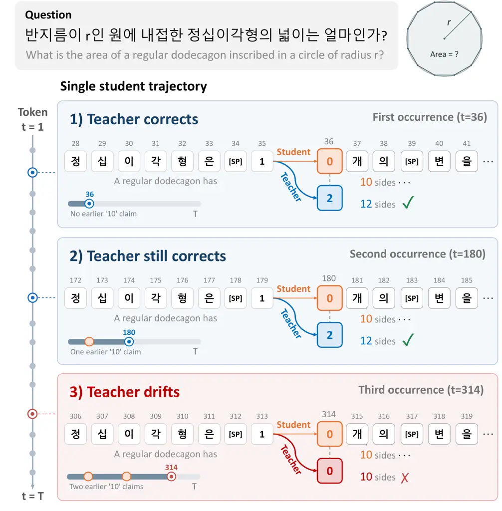
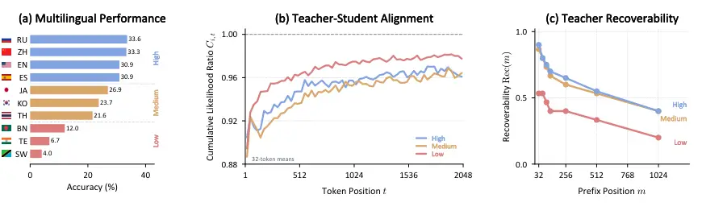
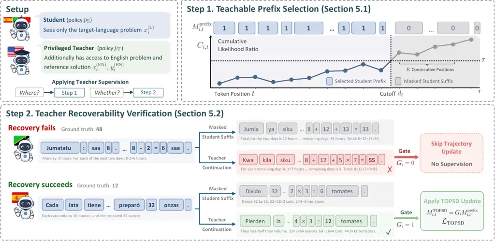

# Knowing When to Teach: Learning from Teachable Prefixes in Multilingual Reasoning Distillation

Jaewon Cho Affiliation: KAIST Email: <cho35750@kaist.ac.kr>    Minseo
Yoon Affiliation: KAIST Email: <yms020615@kaist.ac.kr>    Jinyoung Park
Affiliation: KAIST Email: <jinyoung.park@kaist.ac.kr>    Jinwoo Seo
Affiliation: KAIST Email: <sjwoo0612@kaist.ac.kr>    Jaewon Chu
Affiliation: Korea University Email: <hyunwoojkim@kaist.ac.kr>    Alice
Oh^(†) Affiliation: KAIST Email: <alice.oh@kaist.edu>    Hyunwoo J. Kim
^(†) Affiliation: KAIST Email: <allonsy07@korea.ac.kr>

###### Abstract

On-Policy Self-Distillation (OPSD) improves reasoning by training a
student on its own reasoning, using the same model conditioned on
reference solutions as a teacher. Applying OPSD to multilingual
reasoning requires the teacher to provide useful feedback across
languages, even when the student makes mistakes in intermediate steps.
We observe a phenomenon we call Teacher Drift: as these mistakes
accumulate, the teacher may follow the student’s incorrect steps instead
of correcting them. Our analysis shows that this shift tends to occur
earlier in lower-resource languages. To account for these differences
across languages, we propose Teachable On-Policy Self-Distillation
(TOPSD), which determines where and whether teacher supervision should
be applied to each reasoning trajectory. TOPSD uses teacher–student
likelihood to estimate where drift begins and select a prefix for
supervision. It then verifies whether the teacher can recover the
correct answer from that prefix, applying distillation only to prefixes
that pass verification. Experiments on multilingual mathematical
reasoning across ten languages and three model scales show that TOPSD
consistently outperforms conventional OPSD, particularly in low- and
medium-resource languages.

⁰⁰footnotetext: $`\dagger`$ Corresponding authors.

## 1 Introduction



Figure 1: Teacher Drift in a Korean reasoning example. The teacher’s
next-token predictions are evaluated on prefixes of one student
trajectory. At $`t=36`$ and $`180`$, it predicts $`2`$ instead of the
student’s $`0`$, correcting a dodecagon’s side count from $`10`$ to
$`12`$; at $`t=314`$, it predicts $`0`$, following the repeated error.
English translations are shown in gray.

Large language models (LLMs) (Brown et al., 2020; Achiam et al., 2023;
Team et al., 2023; Grattafiori et al., 2024; Yang et al., 2024; Guo et
al., 2025; Yang et al., 2025) have demonstrated strong reasoning
capabilities on complex tasks such as mathematical problem solving,
logical inference, and complex question answering. On-Policy
Distillation (Ross et al., 2011; Lin et al., 2020; Agarwal et al., 2024;
Zhang et al., 2026a) further improves these capabilities by training the
student with dense token-level supervision on reasoning it generates.
Specifically, the teacher conditions on the student’s prefix, the
sequence of tokens generated so far, and uses its next-token
distribution to supervise the student. On-Policy Self-Distillation
(OPSD) (Zhao et al., 2026) uses the same model as both student and
teacher, with reference solutions provided only to the teacher. This
enables learning from model-generated reasoning with dense teacher
feedback, without a separate heavy teacher model (Shenfeld et al., 2026;
Hübotter et al., 2026).

However, extending these benefits to multilingual reasoning is
challenging due to the limited reasoning capabilities of the teacher
model across languages. Since the language model is largely pretrained
on high-resource languages such as English, it shows substantially
weaker performance in lower-resource languages than in high-resource
languages (Zhao et al., 2025). Prior work, such as COPSD (Liu et al.,
2026), addresses it by using English reference solutions to draw on the
model’s stronger reasoning ability in English and improve teacher
supervision in the target language.

While this effort focuses on strengthening the teacher, it remains
underexplored whether the teacher can provide reliable supervision
throughout the student’s reasoning. We therefore investigate how the
reliability of teacher supervision changes as the student’s reasoning
unfolds across different languages. We observe that the teacher may
initially correct the student’s errors, but begin to follow the
student’s incorrect reasoning as these errors accumulate, even with
access to reference solutions. We refer to this shift as Teacher Drift.
Figure 1 illustrates this behavior in a Korean reasoning example, where
the student repeatedly states that a regular dodecagon has ten sides. At
the first two occurrences, the teacher predicts a token that corrects
the number to twelve; at a later occurrence, it predicts the same
incorrect token as the student. Our multilingual analysis further shows
that Teacher Drift tends to emerge earlier in lower-resource languages,
suggesting that the teacher’s ability to provide reliable supervision
varies across languages. These observations motivate identifying where
the teacher can still provide useful supervision within each reasoning
trajectory.

Based on these observations, we propose Teachable On-Policy
Self-Distillation (TOPSD), which determines _where_ teacher supervision
remains appropriate and _whether_ it should be applied. TOPSD estimates
where Teacher Drift begins to select a _teachable prefix_, and then
verifies whether the teacher can recover the correct answer from that
prefix. If verification succeeds, distillation is applied to the
teachable prefix.

Our contributions are summarized as follows:

- •
  We identify Teacher Drift, where the privileged teacher begins to
  follow the student’s incorrect reasoning as errors accumulate, and
  characterize its language-dependent patterns through likelihood and
  recovery analyses.
- •
  We propose TOPSD, which combines trajectory-specific prefix selection
  with teacher recovery verification to determine where and whether to
  apply supervision.
- •
  We demonstrate the effectiveness of TOPSD for multilingual
  mathematical reasoning across model scales, with improvements
  particularly in low- and medium-resource languages.

## 2 Related Work

Multilingual Reasoning. Despite advances in LLM reasoning, performance
remains uneven across languages, particularly in low-resource
settings (Shi et al., 2023; Xuan et al., 2025; Ghosh et al., 2025; Wang
et al., 2025). Prior work has sought to improve multilingual reasoning
through multilingual post-training (Payoungkhamdee et al., 2024; Chen et
al., 2024; Lai and Nissim, 2024; Ranaldi and Pucci, 2025; She et al.,
2024; Zhang et al., 2026b) and cross-lingual reasoning transfer (Huang
et al., 2023; Qin et al., 2023; Zhu et al., 2024; Tran et al., 2025;
Barua et al., 2026). More recently, COPSD (Liu et al., 2026) extends
on-policy self-distillation to multilingual reasoning by leveraging
English problems and reference solutions as privileged teacher
information. Our work complements these efforts by improving the
reliability of multilingual on-policy self-distillation, particularly
when errors accumulate in student-generated reasoning.

#### Post-Training for Reasoning.

Reasoning capabilities are commonly improved through self-training,
reinforcement learning, and knowledge distillation. Self-training
bootstraps from model-generated rationales (Zelikman et al., 2022),
while recent post-training methods learn from sampled reasoning
trajectories using verifiable outcomes, verifiers, or step-level
feedback (Shao et al., 2024; Trung et al., 2024; Chu et al., 2025;
Hosseini et al., 2024; Wang et al., 2024; Hwang et al., 2024; Xu et al.,
2025). Within knowledge distillation (Hinton et al., 2014), GKD and
related methods supervise student-generated sequences with teacher
predictions (Lin et al., 2020; Gu et al., 2024; Agarwal et al., 2024; Ko
et al., 2024; Ko et al., 2025), while OPSD uses the same model as
student and privileged teacher under different conditioning
contexts (Zhao et al., 2026). Recent work further improves the
distillation with guided or trust-region rollouts (Li et al., 2026;
Plyusov et al., 2026), selective or adaptive token-level
supervision (Wang et al., 2026; Jang et al., 2026), and trajectory
refinement (Jiang et al., 2026). We characterize language-dependent
Teacher Drift and verify Teacher Recoverability before distilling
selected prefixes of original student trajectories.

## 3 Preliminaries



Figure 2: Teacher Drift in multilingual reasoning. (a) Student accuracy
across languages. (b) Cumulative teacher-student likelihood ratio
$`C_{i,t}`$ indicates earlier alignment in low-resource languages. (c)
Teacher recoverability $`\mathrm{Rec}(m)`$ decreases with longer student
prefixes. Colors indicate language-resource groups.



Figure 3: Overview of TOPSD. The student generates a reasoning
trajectory in the target language, while the privileged teacher
additionally observes the English problem and reference solution. Step 1
(Teachable Prefix Selection) uses the cumulative teacher-student
likelihood ratio to select a candidate teachable prefix, determining
_where_ teacher supervision may be applied. Step 2 (Teacher
Recoverability Verification) checks whether the teacher can recover the
correct answer from the selected prefix, determining _whether_
supervision should be applied. Only prefixes that pass verification
receive distillation on the corresponding states of the original student
trajectory. English translations are shown in gray.

On-Policy Self-Distillation (OPSD) (Zhao et al., 2026) improves
reasoning by training a student on its own generated trajectories with
dense supervision from the same model conditioned on reference
solutions, without requiring a separate teacher model. Let
$`\mathcal{D}`$ denote a reasoning dataset consisting of a set of input
problems $`x`$ and their reference solutions $`y^{\star}`$. Rather than
relying on a separate teacher model, OPSD instantiates both the student
and the privileged teacher from the same underlying language model
$`\pi_{\theta}`$, while conditioning them on different information. The
student $`p_{\mathrm{S}}`$ observes only the problem $`x`$, whereas the
privileged teacher $`p_{\mathrm{T}}`$ additionally observes the
reference solution $`y^{\star}`$:

```math
\displaystyle p_{\mathrm{S}}(\cdot\mid x) \displaystyle\triangleq\pi_{\theta}(\cdot\mid x), \tag{1}
```

```math
\displaystyle p_{\mathrm{T}}(\cdot\mid x,y^{\star}) \displaystyle\triangleq\pi_{\theta}(\cdot\mid x,y^{\star}).
```

For each problem $`x`$, the student first samples a trajectory

```math
\hat{y}=\left(\hat{y}_{1},\dots,\hat{y}_{\left\lvert\hat{y}\right\rvert}\right)\sim p_{\mathrm{S}}(\cdot\mid x). \tag{2}
```

Then, OPSD trains the student by minimizing the token-level
distributional discrepancy between the two policies along the
student-generated trajectory:

```math
\mathcal{L}_{\mathrm{OPSD}}=\mathbb{E}_{(x,y^{\star})\sim\mathcal{D}}\mathbb{E}_{\hat{y}\sim p_{\mathrm{S}}(\cdot\mid x)}\left[\frac{1}{|\hat{y}|}\sum_{t=1}^{|\hat{y}|}D\!\left(p_{\mathrm{S},t},p_{\mathrm{T},t}\right)\right], \tag{3}
```

where $`p_{\mathrm{S},t}:=p_{\mathrm{S}}(\cdot\mid x,\hat{y}_{<t})`$ and
$`p_{\mathrm{T},t}:=p_{\mathrm{T}}(\cdot\mid x,y^{\star},\hat{y}_{<t})`$
are the student and teacher next-token distributions conditioned on the
same student-generated prefix, and $`D(\cdot,\cdot)`$ denotes a
distributional divergence.

The simple way to design a teacher prompt in multilingual settings is to
use a reference solution $`y^{(L)}`$ for each target language
$`L`$ (i.e., $`y^{\star}\triangleq y^{(L)}`$). However, the model may
find it harder to make use of a reasoning trace written in a non-English
language, since most of its reasoning ability is learned from English
data. So, COPSD (Liu et al., 2026) provides the English question
$`x^{(\mathrm{EN})}`$ and its reference solution $`y^{(\mathrm{EN})}`$
as the privileged knowledge $`y^{\star}`$ to leverage the reasoning
capabilities of LLMs. The teacher prompt for target language $`L`$ can
be written as:
$`y^{\star}\triangleq\left(x^{(\mathrm{EN})},y^{(\mathrm{EN})}\right)`$.

Even though OPSD variants have shown their success in multiple reasoning
tasks, it is still under-explored in multilingual settings. This is
particularly challenging because OPSD relies on the teacher to provide
reliable supervision over student-generated trajectories. In
multilingual settings, this supervision faces two potential challenges.
First, errors in student-generated prefixes may make it difficult for
the teacher to provide corrective guidance. Second, the teacher itself
may have limited reasoning capabilities in non-English languages, where
training data is often less abundant. These challenges raise concerns
about whether the teacher can consistently provide reliable supervision
throughout student rollouts.

## 4 Observation

### 4.1 Observing Teacher Drift

We investigate how the privileged teacher’s behavior changes as the
student-generated prefix grows, and whether these changes differ across
languages. In particular, we examine whether the teacher increasingly
follows the student-generated trajectory and whether this alignment is
accompanied by a reduced ability to correct erroneous reasoning.

#### Cumulative Teacher-Student Likelihood Ratio.

We first examine how the teacher’s likelihood assignments to
student-generated tokens change as the student prefix grows. For each
language $`L`$, let $`i`$ index problem instances and
$`\hat{y}_{i}^{(L)}`$ denote the corresponding student-generated
trajectory. We define a cumulative teacher-student likelihood ratio
$`C_{i,t}`$ to measure how producible the student-generated tokens are
from the teacher.

For each prefix position $`t>1`$, we define the cumulative
teacher-student likelihood ratio as

```math
C_{i,t}=\exp\!\left(\frac{1}{t-1}\sum_{s=1}^{t-1}N_{i,s}\right), \tag{4}
```

where
$`N_{i,t}=\log\!\bigl[p_{\mathrm{T},i,t}(\hat{y}_{i,t}^{(L)})/p_{\mathrm{S},i,t}(\hat{y}_{i,t}^{(L)})\bigr]`$
denotes the teacher-student log-likelihood gap at token $`t`$. Here
$`p_{\mathrm{S},i,t}`$ and $`p_{\mathrm{T},i,t}`$ denote the student and
privileged teacher next-token distributions under their respective
prompts and the same student prefix $`\hat{y}_{i,<t}^{(L)}`$. It
measures the geometric mean of the teacher-to-student likelihood ratios
on the observed student prefix. As $`C_{i,t}`$ approaches $`1`$, the
average teacher-student log-likelihood gap on the observed student
prefix approaches zero.

#### Language-Dependent Teacher Drift.

To examine how the teacher’s behavior changes over student-generated
trajectories, we analyze the cumulative teacher-student likelihood ratio
across prefix lengths and language-resource groups. Figure 2(b) shows
that $`C_{t}`$ generally increases toward $`1`$ as the student prefix
grows, indicating that the teacher and student assign increasingly
similar relative likelihoods to the observed student-generated tokens.
Notably, this trend emerges earlier and is more pronounced in
low-resource languages, suggesting that teacher is influenced by the
student at different rates across languages.

#### Degradation of Teacher Recoverability.

To assess the teacher’s ability to correct erroneous student reasoning,
we evaluate whether it can recover the correct answer from
student-generated prefixes. We consider a set of examples
$`\mathcal{I}`$ where the student answers incorrectly but the privileged
teacher solves the problem correctly without a student-generated prefix.

For each prefix position $`m`$, we condition the privileged teacher on
the first $`m-1`$ student-generated tokens and generate a continuation:

```math
\displaystyle z_{i,\geq m}^{(L)}=\operatorname{GreedyDecode}\!\left(p_{\mathrm{T}},x_{i}^{(L)},y_{i}^{\star},\hat{y}^{(L)}_{i,<m}\right)\!. \tag{5}
```

We measure _teacher recoverability_ as the fraction of examples for
which the teacher reaches the correct answer from the given prefix:

```math
\operatorname{Rec}(m)=\frac{1}{|\mathcal{I}|}\sum_{i\in\mathcal{I}}\mathcal{V}\left(\hat{y}^{(L)}_{i,<m}\oplus z_{i,\geq m}^{(L)},a_{i}\right), \tag{6}
```

where $`a_{i}`$ is the ground-truth answer to the $`i`$-th problem,
$`\mathcal{V}`$ evaluates answer correctness, and $`\oplus`$ denotes
sequence concatenation.

As shown in Figure 2(c), teacher recoverability decreases as the student
prefix grows. The teacher increasingly fails to reach the correct answer
when conditioned on longer student-generated prefixes. This means that
the teacher may lose its correct reasoning capability as the length of
student-generated prefix is longer.

Together, these findings show that increasing teacher-student likelihood
alignment is accompanied by declining teacher recoverability, while the
alignment patterns differ across languages. These observations show that
the reliability of teacher supervision may depend on the
student-generated prefix, motivating the identification of _teachable
prefixes_ rather than applying supervision uniformly throughout the
student trajectory.

## 5 Teachable On-Policy Self-Distillation

To address limitations of OPSD in multilinguality, such as Teacher Drift
and degradation of teacher recoverability, we propose _Teachable
On-Policy Self-Distillation_ (TOPSD), which determines _where_ and
_whether_ to apply teacher supervision along student-generated
trajectories. As illustrated in Figure 3, TOPSD consists of two stages:
Teachable prefix selection and Teacher Recoverability Verification.
Teachable prefix selection uses the cumulative teacher-student
likelihood ratio to identify a teachable prefix before sustained teacher
drift. Teacher recoverability verification then evaluates whether the
teacher can recover the correct answer from the selected prefix. Only
when verification succeeds does TOPSD apply distillation to the selected
states of the original student trajectory to provide the meaningful
guidance.

### 5.1 Teachable Prefix Selection

As observed in Section 4.1, Teacher Drift manifests as increasing
likelihood alignment between the teacher and student along
student-generated trajectories. To avoid applying supervision to later
states where the teacher may increasingly follow the student’s
reasoning, we select a candidate teachable prefix based on the
cumulative teacher-student likelihood ratio $`C_{i,t}`$.

Specifically, we identify the earliest position $`d_{i}`$ at which
$`C_{i,t}`$ exceeds a threshold $`\tau`$ for $`K`$ consecutive
positions, which determines the cutoff for prefix selection:

```math
d_{i}=\min\!\left\{j\;\middle|\;C_{i,j+k}>\tau,\;\forall k\in\{0,\ldots,K-1\}\right\}. \tag{7}
```

We use consecutive threshold crossings to identify sustained
teacher-student likelihood alignment rather than isolated fluctuations.

The corresponding prefix selection mask is
$`M_{i,t}^{\mathrm{prefix}}=\mathbb{I}[t<d_{i}]`$, such that only states
within the selected teachable prefix are eligible for teacher
supervision. If no valid position is detected, we set $`d_{i}=T_{i}+1`$,
where $`T_{i}`$ is the trajectory length, retaining the entire
trajectory as a candidate prefix. The selected prefix is then evaluated
through Teacher Recoverability Verification.

### 5.2 Teacher Recoverability Verification

To ensure that the selected prefixes provide reliable teacher
supervision, we further assess whether the privileged teacher can
successfully recover the correct answer from each prefix. Specifically,
we introduce _Teacher Recoverability Verification_, which verifies the
teacher’s ability to reach the correct solution before using its
predictions for distillation.

Given the selected prefix $`\hat{y}_{i,<d_{i}}^{(L)}`$, we generate a
teacher continuation using greedy decoding as in Eq. (5), with
$`m=d_{i}`$. We then concatenate the teacher continuation with the
selected student prefix and evaluate whether the resulting trajectory
reaches the correct answer:

```math
G_{i}=\mathcal{V}\!\left(\hat{y}_{i,<d_{i}}^{(L)}\oplus z_{i,\geq d_{i}}^{(L)},a_{i}\right)\in\{0,1\}, \tag{8}
```

where $`\mathcal{V}`$ denotes the answer verifier and $`a_{i}`$ is the
ground-truth answer.

We apply teacher supervision only when the teacher successfully recovers
the correct answer ($`G_{i}=1`$). Combining this verification result
with the prefix selection mask, we define the final supervision mask as

```math
M_{i,t}^{\mathrm{TOPSD}}=G_{i}M_{i,t}^{\mathrm{prefix}}. \tag{9}
```

Importantly, the teacher continuation is used only for verification, not
as a training target. Distillation is performed on the selected states
of the original student-generated trajectory, preserving the on-policy
nature of TOPSD.

### 5.3 TOPSD Objective

TOPSD follows the token-level distillation framework of OPSD while
restricting supervision using the final mask
$`M_{i,t}^{\mathrm{TOPSD}}`$. To prevent longer selected prefixes from
dominating the training objective and to balance supervision across
languages, we normalize the loss at the trajectory and language levels.

Let $`n_{i}=\sum_{t=1}^{T_{i}}M_{i,t}^{\mathrm{TOPSD}}`$ denote the
number of supervised tokens in trajectory $`i`$. We define the set of
eligible trajectories in language $`\ell`$ as
$`\mathcal{B}_{\ell}^{+}=\{i\in\mathcal{B}\mid\ell_{i}=\ell,\;n_{i}>0\}`$,
and the set of languages with eligible trajectories as
$`\mathcal{A}=\{\ell\mid|\mathcal{B}_{\ell}^{+}|>0\}`$. The resulting
TOPSD objective is

```math
\mathcal{L}_{\mathrm{TOPSD}}=\mathbb{E}_{\ell}\left[\mathbb{E}_{i\mid\ell}\left[\frac{1}{n_{i}}\sum_{t=1}^{T_{i}}M_{i,t}^{\mathrm{TOPSD}}D\!\left(p_{\mathrm{S},i,t},p_{\mathrm{T},i,t}\right)\right]\right], \tag{10}
```

where
$`\mathbb{E}_{\ell}[\cdot]:=\frac{1}{|\mathcal{A}|}\sum_{\ell\in\mathcal{A}}[\cdot]`$
and
$`\mathbb{E}_{i\mid\ell}[\cdot]:=\frac{1}{|\mathcal{B}_{\ell}^{+}|}\sum_{i\in\mathcal{B}_{\ell}^{+}}[\cdot]`$
denote uniform averaging over eligible languages and eligible
trajectories within each language, respectively.

## 6 Experiments

### 6.1 Experimental Settings

| Model      | Metric | Method  | Low   |       |       |       | Medium |       |       |       | High  |       |       |       |       | Overall |
| ---------- | ------ | ------- | ----- | ----- | ----- | ----- | ------ | ----- | ----- | ----- | ----- | ----- | ----- | ----- | ----- | ------- |
|            |        |         | BN    | TE    | SW    | Avg   | JA     | KO    | TH    | Avg   | EN    | ES    | RU    | ZH    | Avg   | Avg     |
| Qwen3-1.7B | Avg@3  | Vanilla | 2.13  | 0.00  | 0.27  | 0.80  | 11.47  | 6.40  | 6.13  | 8.00  | 17.87 | 15.73 | 14.93 | 17.33 | 16.47 | 9.23    |
|            |        | OPSD    | 2.93  | 1.07  | 1.60  | 1.87  | 10.13  | 6.40  | 6.93  | 7.82  | 21.33 | 14.67 | 12.53 | 18.40 | 16.73 | 9.60    |
|            |        | COPSD   | 3.47  | 1.07  | 1.07  | 1.87  | 9.87   | 8.53  | 8.27  | 8.89  | 20.27 | 13.87 | 13.07 | 20.00 | 16.80 | 9.95    |
|            |        | TOPSD   | 4.53  | 2.13  | 1.60  | 2.76  | 13.07  | 10.13 | 9.87  | 11.02 | 20.27 | 17.07 | 17.07 | 20.27 | 18.67 | 11.60   |
|            | Pass@3 | Vanilla | 4.80  | 0.00  | 0.80  | 1.87  | 18.40  | 11.20 | 10.40 | 13.33 | 26.40 | 28.00 | 25.60 | 28.80 | 27.20 | 15.44   |
|            |        | OPSD    | 4.80  | 3.20  | 4.00  | 4.00  | 21.60  | 12.00 | 12.80 | 15.47 | 30.40 | 28.00 | 21.60 | 28.00 | 27.00 | 16.64   |
|            |        | COPSD   | 6.40  | 2.40  | 3.20  | 4.00  | 18.40  | 15.20 | 12.80 | 15.47 | 32.00 | 23.20 | 21.60 | 30.40 | 26.80 | 16.56   |
|            |        | TOPSD   | 8.00  | 4.80  | 3.20  | 5.33  | 23.20  | 17.60 | 15.20 | 18.67 | 32.00 | 27.20 | 24.80 | 31.20 | 28.80 | 18.72   |
| Qwen3-4B   | Avg@3  | Vanilla | 5.60  | 2.67  | 1.87  | 3.38  | 17.87  | 18.40 | 15.47 | 17.24 | 21.87 | 23.20 | 26.13 | 21.87 | 23.27 | 15.49   |
|            |        | OPSD    | 6.93  | 3.20  | 2.13  | 4.09  | 17.60  | 16.53 | 13.07 | 15.73 | 27.47 | 25.33 | 26.93 | 28.00 | 26.93 | 16.72   |
|            |        | COPSD   | 5.33  | 2.93  | 1.60  | 3.29  | 17.07  | 15.73 | 12.00 | 14.93 | 27.20 | 26.13 | 26.67 | 27.20 | 26.80 | 16.19   |
|            |        | TOPSD   | 8.00  | 3.73  | 3.20  | 4.98  | 19.73  | 21.07 | 17.33 | 19.38 | 25.07 | 25.87 | 27.47 | 26.40 | 26.20 | 17.79   |
|            | Pass@3 | Vanilla | 11.20 | 4.00  | 4.80  | 6.67  | 23.20  | 25.60 | 23.20 | 24.00 | 30.40 | 32.00 | 35.20 | 29.60 | 31.80 | 21.92   |
|            |        | OPSD    | 12.00 | 8.00  | 5.60  | 8.53  | 27.20  | 24.80 | 20.00 | 24.00 | 38.40 | 38.40 | 38.40 | 38.40 | 38.40 | 25.12   |
|            |        | COPSD   | 10.40 | 6.40  | 4.80  | 7.20  | 27.20  | 24.80 | 21.60 | 24.53 | 38.40 | 39.20 | 40.00 | 36.00 | 38.40 | 24.88   |
|            |        | TOPSD   | 13.60 | 7.20  | 7.20  | 9.33  | 27.20  | 30.40 | 27.20 | 28.27 | 34.40 | 36.80 | 39.20 | 36.80 | 36.80 | 26.00   |
| Qwen3-8B   | Avg@3  | Vanilla | 12.00 | 6.67  | 4.00  | 7.56  | 26.93  | 23.73 | 21.60 | 24.09 | 30.93 | 30.93 | 33.60 | 33.33 | 32.20 | 22.37   |
|            |        | OPSD    | 11.20 | 5.07  | 3.20  | 6.49  | 25.87  | 20.53 | 18.40 | 21.60 | 37.87 | 28.53 | 34.67 | 38.40 | 34.87 | 22.37   |
|            |        | COPSD   | 9.60  | 5.07  | 1.87  | 5.51  | 26.13  | 21.87 | 18.93 | 22.31 | 37.87 | 29.87 | 34.40 | 39.20 | 35.33 | 22.48   |
|            |        | TOPSD   | 13.60 | 7.73  | 5.60  | 8.98  | 30.13  | 27.47 | 25.07 | 27.56 | 36.00 | 31.73 | 36.27 | 37.60 | 35.40 | 25.12   |
|            | Pass@3 | Vanilla | 20.00 | 11.20 | 8.00  | 13.07 | 39.20  | 36.00 | 32.00 | 35.73 | 39.20 | 40.80 | 42.40 | 42.40 | 41.20 | 31.12   |
|            |        | OPSD    | 16.80 | 8.00  | 6.40  | 10.40 | 39.20  | 31.20 | 29.60 | 33.33 | 48.00 | 42.40 | 47.20 | 50.40 | 47.00 | 31.92   |
|            |        | COPSD   | 16.80 | 8.80  | 4.80  | 10.13 | 39.20  | 33.60 | 27.20 | 33.33 | 48.80 | 41.60 | 46.40 | 50.40 | 46.80 | 31.76   |
|            |        | TOPSD   | 22.40 | 12.00 | 12.80 | 15.73 | 43.20  | 40.00 | 36.00 | 39.73 | 46.40 | 44.00 | 46.40 | 49.60 | 46.60 | 35.28   |

Table 1: Avg@3 and Pass@3 (%) on PolyMath High across ten languages
grouped by resource level. Group and Overall averages are mean
performance within each group and across all ten languages,
respectively. Bold and underlining indicate the best and second-best
scores.

| Prefix Selection        | Recoverability Filter  | Avg@3 (%) |        |       |         | $`\Delta_{\mathrm{COPSD}}`$ |
| ----------------------- | ---------------------- | --------- | ------ | ----- | ------- | --------------------------- |
|                         |                        | Low       | Medium | High  | Overall |                             |
| Full trajectory (COPSD) | None                   | 1.87      | 8.89   | 16.80 | 9.95    | –                           |
| Teachable prefix        | None (all)             | 2.40      | 10.53  | 17.20 | 10.76   | +0.81                       |
|                         | Failed only            | 1.96      | 9.87   | 16.67 | 10.21   | +0.26                       |
|                         | Successful only (Ours) | 2.76      | 11.02  | 18.67 | 11.60   | +1.65                       |

Table 2: Ablation of Teachable Prefix Selection and Teacher
Recoverability Verification. Avg@3 (%) on PolyMath High with Qwen3-1.7B.
$`\Delta_{\mathrm{COPSD}}`$ denotes the overall improvement over COPSD
in percentage points.

Figure 4: Qualitative comparison of COPSD and TOPSD on Bengali
mathematical reasoning. Starting from similar correct formulations,
COPSD becomes stuck in repeated divisibility statements, while TOPSD
continues the derivation to $`b=21`$ and $`b=49`$ and obtains the
correct answer $`70`$. English translations are shown in gray.

#### Dataset and Languages.

We use the multilingual OpenThoughts dataset released by COPSD (Liu et
al., 2026), sampling 500 training instances per language (5,000 in
total). We consider ten languages: Bengali (BN), English (EN), Spanish
(ES), Japanese (JA), Korean (KO), Russian (RU), Swahili (SW), Telugu
(TE), Thai (TH), and Chinese (ZH).

#### Models and Baselines.

We conduct experiments using Qwen3-1.7B, Qwen3-4B, and Qwen3-8B (Yang et
al., 2025). The student is trained with LoRA (Hu et al., 2022), while
the privileged teacher is the frozen base model conditioned on the
English problem and reference solution. We compare TOPSD against the
base model (Vanilla), OPSD (Zhao et al., 2026), and COPSD (Liu et al.,
2026).

#### Training and Evaluation.

Following OPSD  (Zhao et al., 2026) and COPSD (Liu et al., 2026), we use
a fixed privileged teacher and full-vocabulary logit distillation. We
evaluate multilingual mathematical reasoning on the PolyMath High
split (Wang et al., 2025), reporting Avg@3 and Pass@3 across ten
languages. Detailed training configurations and evaluation protocols are
provided in Appendix A.

### 6.2 Main Results

Overall Performance. Table 1 reports Avg@3 and Pass@3 on PolyMath High
across three Qwen3 model scales. TOPSD achieves the best overall
performance for both metrics at every scale. For Avg@3, TOPSD reaches
11.60%, 17.79%, and 25.12% with Qwen3-1.7B, 4B, and 8B, improving over
the strongest baseline by 1.65, 1.07, and 2.64 percentage points,
respectively. The corresponding Pass@3 scores are 18.72%, 26.00%, and
35.28%, with gains of 2.08, 0.88, and 3.36 points. These consistent
improvements indicate that selective teacher supervision remains
effective as model scale increases.

#### Performance Across Language Resource Levels.

The gains are most consistent in low- and medium-resource languages,
where TOPSD achieves the best Avg@3 and Pass@3 at all three model
scales. Relative to the strongest baseline, Avg@3 improves by 0.89-3.47
percentage points and Pass@3 by 0.80-4.00 points across these groups.
The gains are largest for Qwen3-8B in the medium-resource group,
improving Avg@3 from 24.09% to 27.56% and Pass@3 from 35.73% to 39.73%.
Overall, TOPSD delivers its strongest and most consistent improvements
in low- and medium-resource languages while remaining competitive in
high-resource languages.

### 6.3 Ablation Studies

#### Is Teachable Prefix Selection Alone Sufficient?

We investigate whether Teachable Prefix Selection alone provides
reliable supervision or whether Teacher Recoverability Verification is
also necessary. Table 2 compares COPSD with three variants that
supervise all selected prefixes, only failed-recovery prefixes, or only
successful-recovery prefixes (TOPSD). Prefix selection alone improves
Avg@3 from 9.95% to 10.76%, while verification further increases it to
11.60%. In contrast, supervising failed-recovery prefixes yields lower
performance than supervising all selected prefixes or
successful-recovery prefixes, highlighting the importance of verifying
teacher recoverability.

### 6.4 Additional Analysis

#### Teachable Prefix Selection Across Model Scales.

|            |                           |                              |        |       |         |
| ---------- | ------------------------- | ---------------------------- | ------ | ----- | ------- |
| Model      | Cutoff Detection Rate (%) | Relative Cutoff Position (%) |        |       |         |
|            |                           | Low                          | Medium | High  | Overall |
| Qwen3-1.7B | 95.94                     | 4.09                         | 13.65  | 13.02 | 10.47   |
| Qwen3-4B   | 98.60                     | 5.72                         | 9.24   | 8.00  | 7.69    |
| Qwen3-8B   | 99.28                     | 6.36                         | 10.19  | 5.03  | 6.98    |

Table 3: Teachable prefix selection statistics. Cutoff Detection Rate is
the percentage of trajectories with a detected cutoff. Relative Cutoff
Position reports the cutoff as a percentage of trajectory length,
averaged over trajectories with detected cutoffs. Overall is the mean
relative cutoff position over all trajectories with detected cutoffs
across the ten languages.

Table 3 analyzes the selected cutoff positions across model scales and
language-resource levels. Valid cutoffs are detected in over 95% of
trajectories across all model sizes, with average relative positions
ranging from 6.98% to 10.47%. The cutoff positions also vary across
resource levels, generally occurring earlier in low-resource languages
for Qwen3-1.7B and 4B. These results suggest that teachable prefix
lengths depend on both the language and model scale, supporting
trajectory-specific prefix selection.

#### Generalization Beyond Multilingual Reasoning.

To examine whether TOPSD generalizes beyond multilingual settings, we
additionally evaluate it on the English mathematical reasoning
benchmarks used in the original OPSD study (Zhao et al., 2026). We train
Qwen3-4B on 500 English mathematical reasoning problems sampled from
OpenThoughts Guha et al. (2026) for 160 optimization steps and compare
Vanilla, OPSD, and TOPSD. We evaluate on AIME 2024 (Zhang and Math-AI, 2024) and AIME 2025 (Zhang and Math-AI, 2025), reporting Avg@3 and
Pass@3.

As shown in Table 4, TOPSD achieves the highest Pass@3 on AIME 2024 and
improves both Avg@3 and Pass@3 on AIME 2025. These results suggest that
the benefits of TOPSD can extend beyond multilingual reasoning to
challenging English mathematical reasoning tasks.

### 6.5 Qualitative Results

To examine reasoning progression beyond final-answer accuracy, Figure 4
compares COPSD and TOPSD on a Bengali mathematical reasoning problem
asking for the sum of all integer bases $`b>9`$ such that $`17_{b}`$
divides $`97_{b}`$. Both models begin from a similar correct
formulation, expressing the two numbers as $`b+7`$ and $`9b+7`$ and
establishing the corresponding divisibility condition. COPSD then
repeatedly restates that $`9b+7`$ must be divisible by $`b+7`$, without
deriving further constraints on $`b`$, and fails to produce a formatted
final answer. In contrast, TOPSD introduces an integer quotient $`k`$
through $`9b+7=k(b+7)`$ and rearranges the equation into
$`(9-k)b=7(k-1)`$. It then identifies the valid bases $`b=21`$ and
$`b=49`$, corresponding to $`k=7`$ and $`k=8`$, respectively, and
obtains their sum, $`70`$. This example illustrates how the two models
diverge after a correct initial setup: COPSD becomes trapped in
repetition, whereas TOPSD develops the divisibility condition into
concrete constraints and completes the solution.

## 7 Conclusion

| Method           | AIME24 Avg@3 / Pass@3 | AIME25 Avg@3 / Pass@3 |
| ---------------- | --------------------- | --------------------- |
| Qwen3-4B Vanilla | 76.67 / 80.00         | 64.44 / 76.67         |
|    OPSD          | 76.67 / 86.67         | 67.78 / 83.33         |
|    TOPSD         | 76.67 / 90.00         | 71.11 / 86.67         |

Table 4: Generalization to English mathematical reasoning on AIME 2024
and AIME 2025. Results are reported in percentages. Bold indicates the
best result for each metric.

We identify _Teacher Drift_, a failure mode in which a privileged
teacher increasingly follows erroneous student reasoning as errors
accumulate in the prefix. To address this, we propose Teachable
On-Policy Self-Distillation (TOPSD), which combines Teachable Prefix
Selection and Teacher Recoverability Verification to determine when
teacher supervision remains appropriate and whether it should be
trusted. Experiments on PolyMath High across ten languages and three
Qwen3 model scales show that TOPSD consistently outperforms OPSD and
COPSD, with particularly strong gains in low- and medium-resource
languages. These results demonstrate that reliable on-policy
self-distillation requires not only a strong teacher, but also knowing
when the teacher remains able to teach and whether its guidance should
be trusted. Extending this approach beyond mathematical reasoning is a
promising direction for future work.

## Limitations

Our findings are limited to mathematical reasoning, and their
generalization to other reasoning domains and model families remains to
be explored. In multilingual settings, the usefulness of teacher
supervision may depend on the model’s existing capabilities in each
language, so the extent of improvement may vary across languages and
models. Our current setup also uses English reference solutions as
privileged information, leaving other source languages and settings
without such resources unexplored. Future work could investigate how the
language and quality of reference solutions affect supervision and
evaluate the approach across a broader range of multilingual reasoning
tasks.

## Ethical Considerations

#### AI assistance.

AI tools were used to assist with drafting and revising the manuscript.
The authors retain responsibility for all content, results, and claims.

#### Potential risks.

TOPSD improves multilingual mathematical reasoning, while performance
differences across languages remain. Models trained with TOPSD may
inherit biases and errors from their underlying models and training
data, which can affect the quality of assistance available to speakers
of underrepresented languages. We report results for individual
languages and resource groups to make these differences visible.
Applications should be evaluated in their intended languages and
contexts, with attention to whether aggregate improvements translate
into benefits for the users they serve. Training and teacher
verification also consume computational resources and have associated
environmental costs. We document our training configurations and
hardware to support reproducibility and assessment of computational
requirements. These costs should be considered alongside performance
gains when scaling the approach to additional models and languages.

## References

- Achiam et al. (2023) J. Achiam, S. Adler, S. Agarwal, L. Ahmad, I.
  Akkaya, F. L. Aleman, D. Almeida, J. Altenschmidt, S. Altman, S.
  Anadkat, et al. Gpt-4 technical report. arXiv:2303.08774. Cited by:
  §1.
- Agarwal et al. (2024) R. Agarwal, N. Vieillard, Y. Zhou, P.
  Stanczyk, S. Ramos Garea, M. Geist, and O. Bachem On-policy
  distillation of language models: learning from self-generated
  mistakes. In ICLR, Cited by: §1, §2.
- Barua et al. (2026) J. Barua, S. Eisape, K. Yin, and A. Suhr Long
  chain-of-thought reasoning across languages. In ICLR, Cited by: §2.
- Brown et al. (2020) T. Brown, B. Mann, N. Ryder, M. Subbiah, J. D.
  Kaplan, P. Dhariwal, A. Neelakantan, P. Shyam, G. Sastry, A. Askell,
  et al. Language models are few-shot learners. In NeurIPS, Cited by:
  §1.
- Chen et al. (2024) N. Chen, Z. Zheng, N. Wu, M. Gong, D. Zhang, and J.
  Li Breaking language barriers in multilingual mathematical reasoning:
  insights and observations. In Findings of EMNLP, Cited by: §2.
- Chu et al. (2025) T. Chu, Y. Zhai, J. Yang, S. Tong, S. Xie, D.
  Schuurmans, Q. V. Le, S. Levine, and Y. Ma SFT memorizes, RL
  generalizes: a comparative study of foundation model post-training. In
  ICML, Cited by: §2.
- Ghosh et al. (2025) A. Ghosh, D. Datta, S. Saha, and C. Agarwal A
  survey of multilingual reasoning in language models. In Findings of
  EMNLP, Cited by: §2.
- Grattafiori et al. (2024) A. Grattafiori, A. Dubey, A. Jauhri, A.
  Pandey, A. Kadian, A. Al-Dahle, A. Letman, A. Mathur, A. Schelten, A.
  Vaughan, et al. The Llama 3 herd of models. arXiv:2407.21783. Cited
  by: §1.
- Gu et al. (2024) Y. Gu, L. Dong, F. Wei, and M. Huang MiniLLM:
  knowledge distillation of large language models. In ICLR, Cited by:
  §2.
- Guha et al. (2026) E. K. Guha, R. Marten, S. Keh, N. Raoof, G.
  Smyrnis, H. Bansal, M. Nezhurina, J. Mercat, T. Vu, Z. R. Sprague, et
  al. Openthoughts: data recipes for reasoning models. In ICLR, Cited
  by: Appendix A, §6.4.
- Guo et al. (2025) D. Guo, D. Yang, H. Zhang, J. Song, P. Wang, Q.
  Zhu, R. Xu, R. Zhang, S. Ma, X. Bi, et al. DeepSeek-R1 incentivizes
  reasoning in LLMs through reinforcement learning. Nature 645 (8081),
  pp. 633–638. External Links:
  [Document](https://dx.doi.org/10.1038/s41586-025-09422-z) Cited by:
  §1.
- Hinton et al. (2014) G. E. Hinton, O. Vinyals, and J. Dean Distilling
  the knowledge in a neural network. In NIPS Workshop on Deep Learning
  and Representation Learning, Cited by: §2.
- Hosseini et al. (2024) A. Hosseini, X. Yuan, N. Malkin, A.
  Courville, A. Sordoni, and R. Agarwal V-STaR: training verifiers for
  self-taught reasoners. In COLM, Cited by: §2.
- Hu et al. (2022) E. J. Hu, Y. Shen, P. Wallis, Z. Allen-Zhu, Y. Li, S.
  Wang, L. Wang, and W. Chen LoRA: low-rank adaptation of large language
  models. In ICLR, Cited by: Appendix A, §6.1.
- Huang et al. (2023) H. Huang, T. Tang, D. Zhang, W. X. Zhao, T.
  Song, Y. Xia, and F. Wei Not all languages are created equal in llms:
  improving multilingual capability by cross-lingual-thought prompting.
  In Findings of EMNLP, Cited by: §2.
- Hübotter et al. (2026) J. Hübotter, F. Lübeck, L. D. Behric, A.
  Baumann, M. Bagatella, D. Marta, I. Hakimi, I. Shenfeld, T. Kleine
  Buening, C. Guestrin, et al. Reinforcement learning via
  self-distillation. In ICML, Cited by: §1.
- Hwang et al. (2024) H. Hwang, D. Kim, S. Kim, S. Ye, and M. Seo
  Self-explore: enhancing mathematical reasoning in language models with
  fine-grained rewards. In Findings of EMNLP, Cited by: §2.
- Jang et al. (2026) I. Jang, J. Yeom, J. Yeo, H. Lim, and T. Kim Stable
  on-policy distillation through adaptive target reformulation. In
  Findings of ACL, Cited by: §2.
- Jiang et al. (2026) L. Jiang, H. Xu, Y. Ding, and A. Zhang
  Trajectory-refined distillation. arXiv:2606.08432. Cited by: §2.
- Ko et al. (2025) J. Ko, T. Chen, S. Kim, T. Ding, L. Liang, I.
  Zharkov, and S. Yun DistiLLM-2: a contrastive approach boosts the
  distillation of LLMs. In ICML, Cited by: §2.
- Ko et al. (2024) J. Ko, S. Kim, T. Chen, and S. Yun DistiLLM: towards
  streamlined distillation for large language models. In ICML, Cited by:
  §2.
- Lai and Nissim (2024) H. Lai and M. Nissim mCoT: multilingual
  instruction tuning for reasoning consistency in language models. In
  ACL, Cited by: §2.
- Li et al. (2026) Y. Li, Y. Zuo, B. He, J. Zhang, C. Xiao, C. Qian, T.
  Yu, H. Gao, W. Yang, Z. Liu, et al. Rethinking on-policy distillation
  of large language models: phenomenology, mechanism, and recipe. In
  ICML Workshop on Foundations of Deep Generative Models, Cited by: §2.
- Lin et al. (2020) A. Lin, J. Wohlwend, H. Chen, and T. Lei
  Autoregressive knowledge distillation through imitation learning. In
  EMNLP, Cited by: §1, §2.
- Liu et al. (2026) Y. Liu, R. Zhao, M. A. Hedderich, and H. Schütze
  Crosslingual on-policy self-distillation for multilingual reasoning.
  arXiv:2605.09548. Cited by: Appendix A, Appendix A, Appendix B, §1,
  §2, §3, §6.1, §6.1, §6.1.
- Loshchilov and Hutter (2019) I. Loshchilov and F. Hutter Decoupled
  weight decay regularization. In ICLR, Cited by: Appendix A.
- Payoungkhamdee et al. (2024) P. Payoungkhamdee, P. Limkonchotiwat, J.
  Baek, P. Manakul, C. Udomcharoenchaikit, E. Chuangsuwanich, and S.
  Nutanong An empirical study of multilingual reasoning distillation for
  question answering. In EMNLP, Cited by: §2.
- Plyusov et al. (2026) D. Plyusov, A. Gorbatovski, A. Malakhov, N.
  Balagansky, B. Shaposhnikov, D. Korotyshova, and D. Gavrilov
  Trust-region behavior blending for on-policy distillation.
  arXiv:2605.31159. Cited by: §2.
- Qin et al. (2023) L. Qin, Q. Chen, F. Wei, S. Huang, and W. Che
  Cross-lingual prompting: improving zero-shot chain-of-thought
  reasoning across languages. In EMNLP, Cited by: §2.
- Ranaldi and Pucci (2025) L. Ranaldi and G. Pucci Multilingual
  reasoning via self-training. In NAACL, Cited by: §2.
- Ross et al. (2011) S. Ross, G. Gordon, and D. Bagnell A reduction of
  imitation learning and structured prediction to no-regret online
  learning. In AISTATS, Cited by: §1.
- Shao et al. (2024) Z. Shao, P. Wang, Q. Zhu, R. Xu, J. Song, X. Bi, H.
  Zhang, M. Zhang, Y. K. Li, Y. Wu, et al. DeepSeekMath: pushing the
  limits of mathematical reasoning in open language models.
  arXiv:2402.03300. Cited by: §2.
- She et al. (2024) S. She, W. Zou, S. Huang, W. Zhu, X. Liu, X. Geng,
  and J. Chen MAPO: advancing multilingual reasoning through
  multilingual-alignment-as-preference optimization. In ACL, Cited by:
  §2.
- Shenfeld et al. (2026) I. Shenfeld, M. Damani, J. Hübotter, and P.
  Agrawal Self-distillation enables continual learning. In ICML, Cited
  by: §1.
- Shi et al. (2023) F. Shi, M. Suzgun, M. Freitag, X. Wang, S.
  Srivats, S. Vosoughi, H. W. Chung, Y. Tay, S. Ruder, D. Zhou, et al.
  Language models are multilingual chain-of-thought reasoners. In ICLR,
  Cited by: §2.
- Team et al. (2023) G. Team, R. Anil, S. Borgeaud, Y. Wu, J.
  Alayrac, J. Yu, R. Soricut, J. Schalkwyk, A. M. Dai, A. Hauth, et al.
  Gemini: a family of highly capable multimodal models.
  arXiv:2312.11805. Cited by: §1.
- Tran et al. (2025) K. Tran, N. Vu, B. O’Sullivan, and H. D. Nguyen
  Disentangling language understanding and reasoning structures in
  cross-lingual chain-of-thought prompting. In Findings of EMNLP, Cited
  by: §2.
- Trung et al. (2024) L. Trung, X. Zhang, Z. Jie, P. Sun, X. Jin, and H.
  Li ReFT: reasoning with reinforced fine-tuning. In ACL, Cited by: §2.
- Wang et al. (2026) J. Wang, X. Ouyang, Z. Chen, Y. Hu, Z. Pan, X. Li,
  and L. Guo TRACE: distilling where it matters via token-routed self
  on-policy alignment. arXiv:2605.10194. Cited by: §2.
- Wang et al. (2024) P. Wang, L. Li, Z. Shao, R. Xu, D. Dai, Y. Li, D.
  Chen, Y. Wu, and Z. Sui Math-Shepherd: verify and reinforce LLMs
  step-by-step without human annotations. In ACL, Cited by: §2.
- Wang et al. (2025) Y. Wang, P. Zhang, J. Tang, H. Wei, B. Yang, R.
  Wang, C. Sun, F. Sun, J. Zhang, J. Wu, et al. PolyMath: evaluating
  mathematical reasoning in multilingual contexts. In NeurIPS, Cited by:
  Appendix A, §2, §6.1.
- Xu et al. (2025) H. Xu, X. Mao, F. Li, X. Wu, W. Chen, W. Zhang,
  and A. T. Luu Full-Step-DPO: self-supervised preference optimization
  with step-wise rewards for mathematical reasoning. In Findings of ACL,
  Cited by: §2.
- Xuan et al. (2025) W. Xuan, R. Yang, H. Qi, Q. Zeng, Y. Xiao, A.
  Feng, D. Liu, Y. Xing, J. Wang, F. Gao, et al. Mmlu-prox: a
  multilingual benchmark for advanced large language model evaluation.
  In EMNLP, Cited by: §2.
- Yang et al. (2025) A. Yang, A. Li, B. Yang, B. Zhang, B. Hui, B.
  Zheng, B. Yu, C. Gao, C. Huang, C. Lv, et al. Qwen3 technical report.
  arXiv:2505.09388. Cited by: Appendix A, §1, §6.1.
- Yang et al. (2024) A. Yang, B. Yang, B. Zhang, B. Hui, B. Zheng, B.
  Yu, C. Li, D. Liu, F. Huang, H. Wei, et al. Qwen2.5 technical report.
  arXiv:2412.15115. Cited by: §1.
- Zelikman et al. (2022) E. Zelikman, Y. Wu, J. Mu, and N. D. Goodman
  STaR: bootstrapping reasoning with reasoning. In NeurIPS, Cited by:
  §2.
- Zhang et al. (2026a) D. Zhang, Z. Yang, S. Janghorbani, J. Han, A.
  Ressler II, Q. Qian, G. D. Lyng, S. S. Batra, and R. E. Tillman Fast
  and effective on-policy distillation from reasoning prefixes. In
  Findings of ACL, Cited by: §1.
- Zhang et al. (2026b) X. Zhang, Y. Liang, F. Meng, S. Zhang, K.
  Huang, Y. Chen, J. Xu, and J. Zhou Think natively: unlocking
  multilingual reasoning with consistency-enhanced reinforcement
  learning. In ACL, Cited by: §2.
- Zhang and Math-AI (2024) Y. Zhang and T. Math-AI American invitational
  mathematics examination (aime) 2024. External Links:
  [Link](https://huggingface.co/datasets/math-ai/aime24) Cited by: §6.4.
- Zhang and Math-AI (2025) Y. Zhang and T. Math-AI American invitational
  mathematics examination (aime) 2025. External Links:
  [Link](https://huggingface.co/datasets/math-ai/aime25) Cited by: §6.4.
- Zhao et al. (2026) S. Zhao, Z. Xie, M. Liu, J. Huang, G. Pang, F.
  Chen, and A. Grover Self-distilled reasoner: on-policy
  self-distillation for large language models. In ICML, Cited by: §1,
  §2, §3, §6.1, §6.1, §6.4.
- Zhao et al. (2025) W. Zhao, J. Guo, Y. Deng, T. Wu, W. Zhang, Y.
  Hu, X. Sui, Y. Zhao, W. Che, B. Qin, et al. When less language is
  more: language-reasoning disentanglement makes LLMs better
  multilingual reasoners. In NeurIPS, Cited by: Appendix A, §1.
- Zhu et al. (2024) W. Zhu, S. Huang, F. Yuan, S. She, J. Chen, and A.
  Birch Question translation training for better multilingual reasoning.
  In Findings of ACL, Cited by: §2.

## Appendix A Additional Experimental Details

#### Training Details.

We use Qwen3-1.7B, Qwen3-4B, and Qwen3-8B as the underlying models for
both the student and the privileged teacher Yang et al. (2025). The
student is trained with LoRA (Hu et al., 2022), while the privileged
teacher is obtained by disabling the LoRA adapters and freezing the
underlying base model. Following the COPSD Liu et al. (2026)
configuration, we use LoRA with a rank of 64 and a scaling factor of 128. The adapters are applied to all attention and MLP projection layers
in each Transformer block, including q_proj, k_proj, v_proj, o_proj,
gate_proj, up_proj, and down_proj. We do not apply LoRA to the token
embeddings, language-model head, or normalization layers.

For each training instance, we sample one on-policy trajectory from the
student with a maximum completion length of 2,048 tokens and a sampling
temperature of 1.1. We train only the LoRA parameters for 160
optimization steps using AdamW Loshchilov and Hutter (2019) with
bfloat16 precision, a learning rate of $`1\times 10^{-6}`$, gradient
clipping of $`0.1`$, and an effective prompt batch size of 32. TOPSD
performs full-vocabulary logit distillation using the fixed privileged
teacher.

Unless otherwise specified, TOPSD uses a likelihood-ratio threshold of
$`\tau=0.9`$ and a persistence length of $`K=4`$. For Teacher
Recoverability Verification, the privileged teacher greedily generates a
continuation from the selected prefix. Its continuation is evaluated
using a rule-based verifier that extracts the final answer from
`\boxed{}` and compares it with the ground-truth answer. Only
trajectories that pass verification contribute to distillation, with the
loss averaged over supervised tokens per trajectory and balanced equally
across active languages.

#### Implementation Details.

| Hyperparameter                                | Value                                   |
| --------------------------------------------- | --------------------------------------- |
| Base models                                   | Qwen3-1.7B, 4B, 8B                      |
| Optimizer                                     | AdamW                                   |
| Training precision                            | bfloat16                                |
| Learning rate                                 | $`1\times 10^{-6}`$                     |
| Effective batch size                          | 32                                      |
| Training steps                                | 160                                     |
| Gradient clipping                             | 0.1                                     |
| LoRA rank                                     | 64                                      |
| LoRA alpha                                    | 128                                     |
| LoRA target modules                           | Attention and MLP projections           |
| Student rollouts per prompt                   | 1                                       |
| Maximum completion length                     | 2,048                                   |
| Sampling temperature                          | 1.1                                     |
| Distillation vocabulary                       | Full vocabulary                         |
| Teacher policy                                | Fixed                                   |
| Teacher verification decoding                 | Greedy Decoding                         |
| Likelihood-ratio threshold $`\tau`$           | 0.9                                     |
| Persistence length $`K`$                      | 4                                       |
| Checkpoint interval                           | 20 steps                                |
| Hardware                                      | 4$`\times`$RTX A6000 or 4$`\times`$H200 |
| Teacher verification max. continuation length | 8,192 (1.7B, 4B); 12,288 (8B)           |

Table 5: Training hyperparameters used for TOPSD. Unless otherwise
specified, the same configuration is used across all model scales.

All experiments are conducted using either four NVIDIA RTX A6000 GPUs or
four NVIDIA H200 GPUs. For Teacher Recoverability Verification, the
privileged teacher greedily generates a continuation from the selected
student prefix, with a maximum continuation length of 8,192 tokens for
Qwen3-1.7B and Qwen3-4B and 12,288 tokens for Qwen3-8B. We evaluate the
resulting trajectory using a rule-based verifier that extracts the final
answer from \boxed{} and compares it with the ground-truth answer. Under
the default TOPSD configuration with Qwen3-1.7B, $`K=4`$, and
$`\tau=0.9`$, a full 160-step training run takes approximately 9 hours
on four NVIDIA RTX A6000 GPUs. We save checkpoints every 20 optimization
steps. The main training hyperparameters are summarized in Table 5.

#### Dataset and Languages

We consider ten languages: Bengali (BN), English (EN), Spanish (ES),
Japanese (JA), Korean (KO), Russian (RU), Swahili (SW), Telugu (TE),
Thai (TH), and Chinese (ZH). We use the multilingual OpenThoughts
training set released with COPSD (Liu et al., 2026), which contains
OpenThoughts (Guha et al., 2026) problems translated into the target
languages. Using a fixed random seed of 42, we sample 500 training
instances for each of the ten languages, resulting in 5,000
language-specific training instances in total. A single model is jointly
trained on the combined multilingual training set. For resource-level
analysis, we group these languages into three tiers based on prior
resource-level taxonomies (Zhao et al., 2025) and the multilingual
reasoning performance of the base model: High (RU, EN, ZH, ES), Medium
(JA, KO, TH), and Low (BN, TE, SW).

#### Prompt Templates

The student receives only the problem written in the target language.
The privileged teacher receives the same target-language problem
together with the corresponding English problem and English reference
solution. Both the student and the privileged teacher receive a
target-language instruction appended to the user message, asking them to
reason and provide the final answer in the target language. No separate
system message is used. Generation is initialized with the \<think\>
token followed by a language-specific prefill. The exact user messages
and language-specific prefills are presented in Table 6.

Table 6: Student user messages and language-specific prefills used to
initialize multilingual reasoning generation.

|                    |      |        |       |         |
| ------------------ | ---- | ------ | ----- | ------- |
| Method             | Low  | Medium | High  | Overall |
| Avg@3 (%)          |      |        |       |         |
| Fixed Prefix (10%) | 2.22 | 9.42   | 18.00 | 10.69   |
| TOPSD              | 2.76 | 11.02  | 18.67 | 11.60   |
| Pass@3 (%)         |      |        |       |         |
| Fixed Prefix (10%) | 4.80 | 16.27  | 27.80 | 17.44   |
| TOPSD              | 5.33 | 18.67  | 28.80 | 18.72   |

Table 7: Comparison with fixed-prefix truncation. Avg@3 and Pass@3
accuracy (%) on PolyMath High using Qwen3-1.7B. The fixed-prefix
baseline retains the first 10% of each student trajectory, while TOPSD
adaptively selects teachable prefixes. Both methods use the same Teacher
Recoverability Verification procedure. Bold indicates the best result
for each metric.

#### Evaluation Details.

We evaluate all models on the PolyMath High split Wang et al. (2025) in
ten languages: BN, EN, ES, JA, KO, RU, SW, TE, TH, and ZH. For each
problem, we sample three completions. Avg@3 measures the average
correctness across these completions, while Pass@3 measures whether at
least one completion is correct. During evaluation, the model receives
only the problem in the target language and uses the same
language-specific prefill as during training. We use a maximum
completion length of 8,192 tokens for Qwen3-1.7B and Qwen3-4B, and
12,288 tokens for Qwen3-8B to accommodate its longer

 

Algorithm 1:  
Teachable On-Policy Self-Distillation (TOPSD)

 

1: Training batch
$`\mathcal{B}=\{(x_{i}^{(L)},y_{i}^{\star},a_{i},\ell_{i})\}_{i=1}^{B}`$

2: Student $`p_{\mathrm{S},\theta}`$, frozen teacher $`p_{\mathrm{T}}`$,
verifier $`V`$

3: Threshold $`\tau`$ and persistence length $`K`$

4: for $`i=1`$ to $`B`$ do

5:   Sample
$`\hat{y}_{i}^{(L)}\sim p_{\mathrm{S},\theta}(\cdot\mid x_{i}^{(L)})`$

6:   $`T_{i}\leftarrow|\hat{y}_{i}^{(L)}|`$

7:    Teachable prefix selection

8:   for $`t=1`$ to $`T_{i}`$ do

9:    Evaluate $`p_{\mathrm{S},i,t}`$ and $`p_{\mathrm{T},i,t}`$ on
$`\hat{y}_{i,<t}^{(L)}`$

10:
   $`N_{i,t}\leftarrow\log p_{\mathrm{T},i,t}(\hat{y}_{i,t}^{(L)})-\log p_{\mathrm{S},i,t}(\hat{y}_{i,t}^{(L)})`$

11:   end for

12:
  $`\displaystyle C_{i,t}\leftarrow\exp\!\left(\frac{1}{t-1}\sum_{s=1}^{t-1}N_{i,s}\right),\quad t=2,\ldots,T_{i}`$

13:
  $`\begin{aligned} &\mathcal{D}_{i}\leftarrow\bigl\{\,j\in\mathbb{Z}\mid 2\leq j\leq T_{i}-K+1,\\
&\qquad C_{i,j+k}>\tau,\;\forall k\in\{0,\ldots,K-1\}\,\bigr\}\end{aligned}`$

14:   if $`\mathcal{D}_{i}=\emptyset`$ then

15:    $`d_{i}\leftarrow T_{i}+1`$

16:   else

17:    $`d_{i}\leftarrow\min\mathcal{D}_{i}`$

18:   end if

19:
  $`M_{i,t}^{\mathrm{prefix}}\leftarrow\mathbb{I}[t<d_{i}],\quad t=1,\ldots,T_{i}`$

20:    Teacher recoverability verification

21:
  $`z_{i,\geq d_{i}}^{(L)}\leftarrow\textsc{GreedyDecode}(p_{\mathrm{T}},x_{i}^{(L)},y_{i}^{\star},\hat{y}_{i,<d_{i}}^{(L)})`$

22:
  $`G_{i}\leftarrow V\!\left(\hat{y}_{i,<d_{i}}^{(L)}\oplus z_{i,\geq d_{i}}^{(L)},a_{i}\right)`$

23:
  $`M_{i,t}^{\mathrm{TOPSD}}\leftarrow G_{i}M_{i,t}^{\mathrm{prefix}},\quad t=1,\ldots,T_{i}`$

24:   $`n_{i}\leftarrow\sum_{t=1}^{T_{i}}M_{i,t}^{\mathrm{TOPSD}}`$

25:   if $`n_{i}>0`$ then

26:                        Distill on original student states

27:
   $`\displaystyle\mathcal{L}_{i}\leftarrow\frac{1}{n_{i}}\sum_{t=1}^{T_{i}}M_{i,t}^{\mathrm{TOPSD}}D_{\mathrm{KL}}\left(p_{\mathrm{S},i,t}\middle\|\operatorname{sg}[p_{\mathrm{T},i,t}]\right)`$

28:   end if

29: end for

30: Language-balanced aggregation

31:
$`\mathcal{B}_{\ell}^{+}\leftarrow\{i\in\{1,\ldots,B\}\mid\ell_{i}=\ell,\;n_{i}>0\}`$

32: $`\mathcal{A}\leftarrow\{\ell\mid|\mathcal{B}_{\ell}^{+}|>0\}`$

33: if $`\mathcal{A}=\emptyset`$ then

34:   return $`0`$ $`\triangleright`$ Skip the student update

35: end if

36:
$`\displaystyle\mathcal{L}_{\mathrm{TOPSD}}\leftarrow\frac{1}{|\mathcal{A}|}\sum_{\ell\in\mathcal{A}}\frac{1}{|\mathcal{B}_{\ell}^{+}|}\sum_{i\in\mathcal{B}_{\ell}^{+}}\mathcal{L}_{i}`$

37: return $`\mathcal{L}_{\mathrm{TOPSD}}`$

 

reasoning trajectories. All models are decoded with a temperature of 1.0
and top-$`p`$ of 0.95, using a maximum context length of 20,000 tokens.
We use a rule-based verifier that extracts the final answer from
`\boxed{}` and compares it with the ground-truth answer.

## Appendix B Additional Method Details

Figure 5: Qualitative comparison on a high-resource Spanish problem.
Both the base model and COPSD omit the cross-term $`3a_{1}^{2}`$ and
incorrectly use $`3a_{2}=19`$, producing the answer 22. TOPSD correctly
matches the coefficient using $`3a_{1}^{2}+3a_{2}=19`$ and obtains the
correct answer 352. English translations are shown in gray.

Figure 6: Completion-based illustration of Teacher Drift. The same
privileged teacher is greedily continued from three progressively longer
prefixes of a single student completion. It recovers the correct answer
78 at $`t=600`$ and $`t=700`$, but follows the student’s incorrect
reasoning and returns 6 at $`t=768`$. This provides an outcome-level
view of how prefix accumulation affects teacher recovery. English
translations are shown in gray.

Figure 7: Qualitative comparison on a medium-resource Thai problem. The
base model uses an incorrect asymmetric parameter range, while COPSD
reports only an incomplete enumeration of five solutions. TOPSD
factorizes the equation as $`(4x-3y)(3x+2y)=0`$, counts both
parameterized solution families over their complete ranges, and obtains
the correct answer 117. English translations are shown in gray.

Figure 8: Qualitative comparison on a low-resource Telugu problem. The
base model forms an incorrect determinant-area expression, and COPSD
produces repetitive reasoning without a valid area derivation or boxed
answer. TOPSD correctly derives the triangle area as $`1012(i+j)`$,
computes $`S(n)=1012n(n+1)^{2}`$, and obtains the correct limiting value 1012. English translations are shown in gray.

| $`K`$ | Cutoff Detection Rate (%) | Relative Cutoff Position (%) | Avg@3 (%) |
| ----- | ------------------------- | ---------------------------- | --------- |
| 1     | 96.34                     | 9.54                         | 10.45     |
| 2     | 96.22                     | 9.87                         | 10.94     |
| 4     | 95.94                     | 10.47                        | 11.60     |
| 8     | 95.56                     | 11.55                        | 10.27     |

Table 8: Sensitivity to persistence length $`K`$ with Qwen3-1.7B. Bold
marks the default setting ($`K=4`$). Cutoff Detection Rate and Relative
Cutoff Position characterize the resulting prefix selection, and Avg@3
(%) is macro-averaged across ten languages on PolyMath High.

#### TOPSD Pseudocode

Algorithm A presents the complete training procedure of TOPSD.

#### Divergence Direction.

In Eq. (3), $`D(\cdot,\cdot)`$ denotes a general distributional
divergence. Throughout all experiments, we instantiate $`D`$ as the
reverse KL divergence,

```math
D(p_{\mathrm{S}},p_{\mathrm{T}})=D_{\mathrm{KL}}\left(p_{\mathrm{S}}\middle\|\operatorname{sg}[p_{\mathrm{T}}]\right),
```

following the COPSD implementation Liu et al. (2026). Here,
$`\operatorname{sg}[\cdot]`$ denotes the stop-gradient operator. We use
the same divergence direction for all distillation-based methods such as
OPSD, COPSD and TOPSD.

## Appendix C Additional Multilingual Results

#### Comparison with Fixed-Prefix Truncation.

To investigate whether the improvements of TOPSD arise simply from
restricting distillation to shorter prefixes, we compare our adaptive
prefix selection with a fixed-prefix baseline. Specifically, the
fixed-prefix baseline retains the first 10% of each student-generated
trajectory for distillation, regardless of the estimated drift point. We
choose 10% based on the average relative cutoff position of 10.47%
observed with Qwen3-1.7B under our default configuration ($`K=4`$,
$`\tau=0.9`$), as reported in Tables 3 and 8.

Both methods use the same Teacher Recoverability Verification procedure
and training configuration, differing only in their prefix selection
strategies. As shown in Table 7, TOPSD outperforms fixed-prefix
truncation, suggesting that its improvements cannot be explained solely
by restricting supervision to early reasoning states. Instead,
adaptively selecting teachable prefixes across languages and individual
student trajectories provides additional benefits over a fixed cutoff.

#### Sensitivity to $`K`$.

Table 8 examines how the persistence length $`K`$ affects cutoff
selection and downstream performance, with other hyperparameters fixed.
The cutoff detection rate measures the proportion of trajectories with a
detected cutoff, while the relative cutoff position denotes the cutoff
location normalized by trajectory length. As $`K`$ increases, the
detection rate decreases slightly, while cutoffs tend to occur later.
This reflects the stricter persistence requirement, which retains longer
prefixes for potential supervision. Avg@3 increases from $`K=1`$ to
$`K=4`$ but declines at $`K=8`$, with the default setting ($`K=4`$)
achieving the highest score of 11.60% among the evaluated values.

## Appendix D Additional Qualitative Analysis

#### Qualitative Comparison of Reasoning Trajectories

Figures 5, 7, and 8 compare the reasoning trajectories produced by the
Qwen3-1.7B vanilla model, COPSD, and TOPSD on three multilingual
mathematical reasoning problems spanning high-, medium-, and
low-resource languages. Rather than considering only final-answer
correctness, we highlight the local reasoning error that determines each
solution.

In the high-resource Spanish example, both the base model and COPSD omit
the cross-term $`3a_{1}^{2}`$ when matching the coefficient of
$`x^{2017}`$, whereas TOPSD correctly uses $`3a_{1}^{2}+3a_{2}=19`$. In
the medium-resource Thai example, the base model uses an incorrect
parameter range and COPSD reports only an incomplete set of solutions,
while TOPSD factorizes the equation and counts both solution families
over their full symmetric ranges. In the low-resource Telugu example,
the base model forms an incorrect triangle-area expression and COPSD
produces repetitive reasoning without a valid derivation, whereas TOPSD
derives the correct determinant-based area and obtains the limiting
value.

Across all three examples, the improvement from TOPSD is not limited to
changing the final answer. TOPSD corrects the key intermediate
derivation on which the remainder of the solution depends, resulting in
more coherent and complete reasoning trajectories across
language-resource levels.

#### Additional Examples of Teacher Drift.

While Figure 1 of the main paper directly examines the teacher’s
next-token predictions at distillation states, Figure 6 provides a
complementary completion-based view. We greedily continue the same
privileged teacher independently from progressively longer prefixes of a
single Swahili student trajectory.

The recurrence implies $`2*1=3`$, $`3*1=9`$, $`4*1=27`$, and $`5*1=81`$,
giving the correct answer $`81-3=78`$. However, the student incorrectly
substitutes $`4*1=3`$ into $`5*1=3\times(4*1)`$, obtaining $`5*1=9`$ and
the wrong answer $`9-3=6`$. The red highlights mark this incorrect
substitution and its propagation, which reappears later in the student’s
reasoning.

At $`t=600`$ and $`t=700`$, the teacher recovers despite the earlier
error already being present in the prefix. It correctly computes
$`4*1=27`$ and uses this value to obtain $`5*1=81`$, as highlighted in
blue, ultimately returning $`78`$. At $`t=768`$, the teacher instead
continues the incorrect derivation and returns $`6`$, matching the
student’s wrong answer. Thus, in this trajectory, the teacher can
initially recover from an erroneous prefix but fails to do so after the
prefix is extended with further incorrect reasoning.
