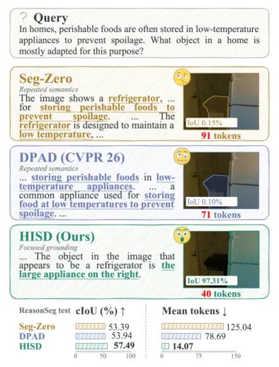
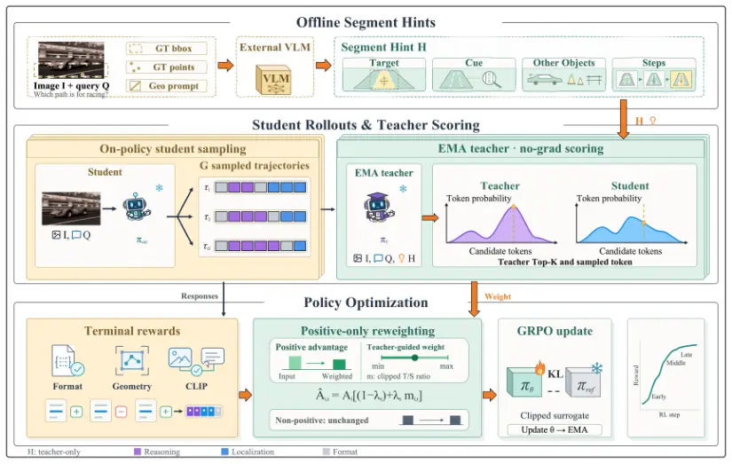
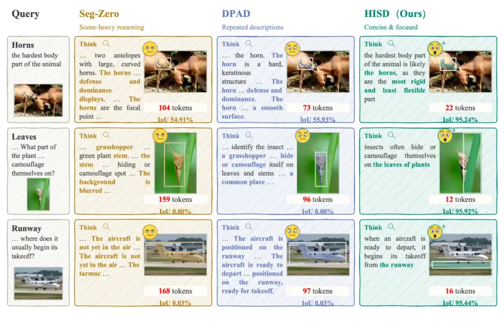

# Hint-Informed Self-Distillation for Reasoning Segmentation

Kunze Jiang Email: <kzejiang@mail.ustc.edu.cn>    Yuchen Wang
Email: <wangyuc@mail.ustc.edu.cn>    Kang Li Affiliation: University of
Science and Technology of China    Qixing Zhang Affiliation: University
of Science and Technology of China

###### Abstract

Reasoning segmentation requires identifying the target referred to by a
query among visually similar objects, yet trajectory-level rewards
cannot directly indicate which tokens provide relevant visual evidence.
We propose Hint-Informed Self-Distillation (HISD), which uses
target-disambiguation evidence for token-level credit assignment. An
external model generates Segment Hints offline from training images,
queries, and ground-truth target annotations, organizing target
identity, discriminative attributes, confusable objects, and anchoring
paths. A hint-conditioned exponential moving average teacher scores the
student’s own trajectories, and HISD computes the teacher-to-student
evidence ratio over a token support set to adjust only the magnitudes of
positive group-relative advantages, leaving nonpositive advantages
unchanged. This design encourages concise reasoning while retaining the
information needed for target disambiguation, and the student requires
neither hints nor a teacher at inference. Under a unified training
protocol, HISD improves ReasonSeg test gIoU and cIoU over our
reproduction of DPAD by 3.00 and 3.55 percentage points, respectively.
Across the five evaluated splits of ReasonSeg and the RefCOCO family,
HISD achieves higher segmentation metrics than this baseline and reduces
the average token count of valid reasoning spans by 80.17–91.83%.

Preprint

 

Hint-Informed Self-Distillation  
for Reasoning Segmentation

^(\$\ast\$)^(\$\ast\$)footnotetext: Equal contribution.

## 1 Introduction

Reasoning segmentation requires identifying the object implicitly
referred to by a query and determining its mask amid similar objects,
overlapping attributes, and ambiguous spatial relations. LISA \[7\]
established this task, while Seg-Zero \[10\] uses reinforcement learning
to generate reasoning and geometric prompts for segmentation. In
outcome-supervised group relative policy optimization (GRPO) \[17\],
tokens within the same response share a group-relative advantage. This
signal can reward localization outcomes but has difficulty
distinguishing tokens that support target identification from incidental
descriptions, motivating finer-grained credit assignment.



Figure 1: For the same query, HISD selects the refrigerator, while
Seg-Zero and DPAD select the black trash bin. The charts report
aggregate cIoU and average reasoning-token counts on the ReasonSeg test
set from local runs under the same budget.

Two complementary lines of progress refine this training signal.
DPAD \[22\] constructs a binary reward by contrasting the relevance of
an anchored description to the target region and the full image,
directly incentivizing the distinction between the target and its
context, while credit is still assigned at the response level.
OPSD \[25\] turns verified solutions into dense supervision from teacher
distributions along the student’s own trajectories, while SDPO \[6\]
extends this approach to rich environmental feedback. Self-distillation
thus makes the information available to the teacher a key design choice.
For reasoning segmentation, this information must link the query to
visible differences among candidate objects and translate these
differences into token-level guidance.

SWiM \[20\] provides such guidance through online working memory:
student responses ranked by segmentation quality retain complete
reasoning and localization information, and a memory-conditioned teacher
provides Jensen-Shannon divergence supervision over all sampled
responses, jointly optimized with GRPO. It can reuse continually updated
experience and also supports memory-free inference, with its guidance
evolving with the student’s sampled attempts. We explore a complementary
source: query-relevant visual evidence generated from annotated targets.
This choice links the content of the teacher’s evidence to its role in
optimization, using observations that support target disambiguation to
modulate how strongly tokens are reinforced.

We propose Hint-Informed Self-Distillation (HISD) to establish this
link. An external model generates Segment Hints offline from existing
training images, queries, and annotated target bounding boxes, without
requiring each hint to be written manually. Each hint organizes target
identity, visible cues, confusable objects, and a path from an anchor to
the target into query-conditioned localization evidence. Following
RLSD \[21\], we preserve the reward-determined sign of the advantage and
modulate its magnitude using a clipped, stop-gradient teacher-to-student
evidence ratio. RLSD applies direction-aware reweighting to both
positive and negative advantages; HISD uses hints for reinforcement
under positive advantages while retaining the base update for
nonpositive advantages, reflecting the intended use of hints to support
target-oriented reinforcement. During training, the teacher rescores
student trajectories with hint context; the student takes the image and
query as input and makes predictions independently at inference.

With the same backbone model and training data, HISD improves
segmentation accuracy on ReasonSeg and the RefCOCO family. Compared with
our reproduction of DPAD, ReasonSeg test gIoU and cIoU improve by 3.00
and 3.55 percentage points, respectively; the average token count of
valid reasoning spans decreases by 80.17–91.83% across the five
evaluated splits. Table 5 shows that, in the tested settings, Segment
Hint outperforms answer-only teacher inputs and teacher inputs with
Gaussian blur outside the bounding box, and answer-only guidance can
also improve performance on ReasonSeg. The reported input and
reweighting ablations support combining task-relevant evidence with
constrained credit weighting. Figure 1 shows the corresponding accuracy
and reasoning-length results. Our contributions are as follows:

- •
  Self-distillation with privileged segmentation hints. We propose an
  online self-distillation method in which the teacher receives
  additional segmentation hints, while the student receives only the
  image and the question. On successful and parseable trajectories, the
  teacher rescales only the scalar magnitude of the advantage.
- •
  Disambiguation-oriented evidence. We automatically generate
  query-relevant Segment Hints from existing target annotations, without
  manually written hint text.
- •
  Evidence on accuracy and length. Under a unified protocol, we
  demonstrate improved segmentation accuracy and shorter reasoning
  segments, and analyze teacher inputs and credit weighting through
  ablations.

## 2 Related Work

### 2.1 Reasoning Segmentation

Reasoning segmentation links query understanding to mask prediction, a
task paradigm established by LISA \[7\]. Methods such as
Seg-Zero \[10\], SAM-R1 \[5\], Seg-R1 \[24\], and VisionReasoner \[11\]
use outcome rewards in reinforcement learning to improve visual
localization, reducing reliance on annotated reasoning processes.
However, geometric outcomes still provide only indirect supervision for
disambiguation: trajectory-level scores cannot distinguish tokens that
rule out distractors from incidental narration. DPAD \[22\] introduces
semantic discrimination by comparing the CLIP \[13\] similarity of
generated anchored descriptions to ground-truth target-region crops and
to the full image. Its binary reward encourages target-oriented
reasoning and complements geometric rewards, but still acts on the
entire trajectory rather than providing token-specific credit. Thus, how
visual disambiguation evidence should influence individual token updates
remains to be specified.

### 2.2 Reinforcement Learning with Privileged Teachers

Methods that use privileged context differ both in their sources of
evidence and in how the evidence enters optimization. OPSD \[25\] uses
verified reasoning trajectories, while SDPO \[6\] uses rich
environmental feedback; both distill conditioned next-token
distributions along student-sampled trajectories, providing denser
supervision than scalar outcomes. SWiM \[20\] constructs such context
online from complete student trajectories selected by segmentation
quality. This self-generated memory contains reasoning processes and
localization proposals; teacher and student distributions are aligned
through JSD over all sampled trajectories and jointly optimized with
GRPO \[17\]. RLSD \[21\] instead scales reward-derived advantages using
a stop-gradient teacher-to-student evidence ratio, with clipping and
mixing. Using this direction–magnitude separation framework, HISD
studies how query-relevant disambiguation content informs token-level
credit assignment.

## 3 Method



Figure 2: Hint-Informed Self-Distillation (HISD) pipeline. Offline
Segment Hints condition an exponential moving average (EMA) teacher that
scores the same on-policy student responses. Terminal rewards supply
trajectory advantages; teacher-derived weights modulate
positive-advantage updates, while nonpositive advantages retain the
original reward signal. The token sequences, probability curves, and
reward curve are schematic. The hint and teacher are used only during
training.

### 3.1 HISD Framework Overview

We propose Hint-Informed Self-Distillation (HISD), a structured
self-distillation framework for reasoning segmentation. Figure 2
summarizes this setup: during training, an exponential moving average
(EMA) teacher conditioned on the Segment Hint $`H`$ rescores the same
completed student trajectory, while at test time the student receives
only the image and query. Formally, given an image–query pair
$`x=(I,Q)`$, the trainable vision–language policy $`\pi_{\theta}`$
autoregressively generates a response $`y=(y_{1},\ldots,y_{|y|})`$,
i.e., $`y\sim\pi_{\theta}(\cdot\mid x)`$. For a group of $`G`$ sampled
responses, the trajectory-level advantage is

```math
A^{(i)}=\frac{R(x,y^{(i)})-\bar{R}}{\sigma_{R}},\qquad\bar{R}=\frac{1}{G}\sum_{j=1}^{G}R(x,y^{(j)}). \tag{1}
```

Here, $`R`$ is the environment reward, and $`\sigma_{R}`$ is its
within-group standard deviation. This reward is inherently sparse: it
indicates only whether the entire response succeeds and cannot identify
which tokens perform target disambiguation and spatial anchoring. To
address this limitation, HISD adds two auxiliary components. First, a
teacher conditioned on privileged information provides token-level
evaluations along trajectories already generated by the student. Second,
an external model generates the privileged information offline from the
query, image, and ground-truth box. The teacher distribution is defined
as

```math
P_{\mathrm{T}}(y_{t}\mid x,H,y_{<t})=\pi_{\bar{\theta}}(y_{t}\mid I,Q\oplus H,y_{<t}). \tag{2}
```

Here, $`H`$ denotes the Segment Hint, $`\oplus`$ denotes text
concatenation, and $`\bar{\theta}`$ denotes the EMA teacher parameters
(Section 3.4).

For advantage reweighting, we apply the weight only to
positive-advantage trajectories; negative-advantage trajectories retain
their original GRPO advantages. The piecewise definition is given in
Section 3.3.

The overall training objective retains the policy-gradient form

```math
\displaystyle\nabla_{\theta}\mathcal{J}(\theta)={} \displaystyle\mathbb{E}_{x,y\sim\pi_{\theta}(\cdot\mid x)}\!\Bigl[ \tag{3}
```

```math
\displaystyle\frac{1}{|y|}\sum_{t=1}^{|y|}\hat{A}_{t}\nabla_{\theta}\log\pi_{\theta}(y_{t}\mid x,y_{<t})\Bigr].
```

Here, $`\hat{A}_{t}`$ is the reweighted token-level advantage defined in
Section 3.3.

### 3.2 Structured Segment Hint Generation

The design of the Segment Hint is based on one observation: failures in
reasoning segmentation may arise from misunderstanding the target,
misusing cues, mistaking a distractor for the target, or inconsistency
between the reasoning chain and the final localization. Even in a
successful response, only some tokens actually perform target
disambiguation and spatial anchoring. Distinguishing these cases is a
prerequisite for fine-grained credit assignment.

Given a training sample $`x=(I,Q)`$ and generic target annotation
$`B^{\mathrm{gt}}`$, the external hint generator $`\mathcal{G}`$
produces the structured Segment Hint offline under $`P_{\mathrm{gen}}`$
from the query, image, and annotation, instantiated here as a
ground-truth box supplemented with two positive interior points:

```math
H=\mathcal{G}\!\left(I,Q,B^{\mathrm{gt}};P_{\mathrm{gen}}\right)=\left(h^{\mathrm{tgt}},h^{\mathrm{cue}},h^{\mathrm{oth}},h^{\mathrm{step}}\right). \tag{4}
```

The field $`h^{\mathrm{tgt}}`$ specifies the target noun,
$`h^{\mathrm{cue}}`$ gives its key attributes, $`h^{\mathrm{oth}}`$
lists distractors in the scene and their distinguishing attributes, and
$`h^{\mathrm{step}}`$ describes a reasoning path from anchors to the
target. The hint $`H`$ is generated offline once per sample and then
serves as fixed teacher context for that sample.

### 3.3 Direction–Magnitude-Decoupled Advantage Reweighting

Given a completed trajectory, we compute the discrepancy between the
teacher and student distributions at each position over a Top-$`K`$
support. The support contains the teacher’s Top-$`K`$ tokens and the
sampled token $`y_{t}`$; $`\widetilde{P}_{\mathrm{T}}`$ and
$`\widetilde{P}_{\mathrm{S}}`$ denote the distributions renormalized to
sum to one over this support. The student signal distribution
$`P_{\mathrm{S}}(\cdot\mid x,y_{<t})=\pi_{\theta}(\cdot\mid x,y_{<t})`$
is obtained without gradients. We compute

```math
\displaystyle\Delta_{t}=\operatorname{sg}\!\big( \displaystyle\log\widetilde{P}_{\mathrm{T}}(y_{t}\mid x,H,y_{<t}) \tag{5}
```

```math
\displaystyle-\log\widetilde{P}_{\mathrm{S}}(y_{t}\mid x,y_{<t})\big).
```

Here, $`\operatorname{sg}`$ denotes the stop-gradient operator.

HISD incorporates this signal into policy optimization by decoupling
direction and magnitude. We define a token-level reweighting factor with
symmetric clipping:

```math
m_{t}^{(i)}=\operatorname{clip}\!\left(\exp(\Delta_{t}^{(i)}),\,1-\epsilon_{w},\,1+\epsilon_{w}\right). \tag{6}
```

Here, $`\epsilon_{w}`$ controls the weight clipping range. We apply this
weight only to positive-advantage trajectories, while negative-advantage
trajectories retain their original GRPO advantages. The token-level
advantage is defined piecewise as

```math
\hat{A}_{t}^{(i)}=\begin{cases}A^{(i)}\big[(1-\lambda)+\lambda m_{t}^{(i)}\big],&A^{(i)}>0,\\[2.0pt]
A^{(i)},&A^{(i)}\leq 0.\end{cases} \tag{7}
```

We reweight only positive advantages because $`H`$ describes a path to
the correct target rather than the cause of error in a particular failed
trajectory. On a negative-advantage trajectory, the teacher can judge
only whether a token is consistent with the hinted path. Strengthening
suppression on this basis would mistake inconsistency with the hint for
an error.

### 3.4 Stable Policy Optimization

Token-level credit assignment over long reasoning chains can amplify
training instability. HISD stabilizes optimization through three design
choices: curriculum scheduling, an EMA teacher, and a clipped surrogate
objective.

#### Curriculum decay.

Early in training, teacher-guided token-level reweighting modulates the
updates; as training progresses, the influence of self-distillation is
gradually annealed. The mixing coefficient $`\lambda`$ in Eq. (7) decays
linearly with optimizer steps. Let $`s`$ denote the current optimizer
step and $`T`$ the total number of optimization steps. The schedule is

```math
\lambda_{s}=\lambda_{0}\cdot\max\!\left(0,\,1-\frac{s}{\kappa T}\right). \tag{8}
```

Here, $`\lambda_{0}`$ is the initial coefficient and $`\kappa T`$ is the
decay duration.

#### EMA teacher.

To stabilize the teacher signal, we maintain an exponential moving
average of the policy parameters as the teacher parameters. Following
Mean Teacher \[18\], we update them after every optimizer step:

```math
\bar{\theta}\leftarrow(1-\beta)\bar{\theta}+\beta\theta. \tag{9}
```

Here, $`\beta`$ is the student mixing rate.

#### Token-wise GRPO clipped objective.

Finally, we optimize the policy with a GRPO-style clipped surrogate
objective. For token $`t`$ in trajectory $`i`$, let $`\rho_{t}^{(i)}`$
be the importance ratio between the current policy and the old policy
used for sampling. The token-wise clipped term is

```math
\displaystyle\ell_{t}^{(i)}(\theta)={} \displaystyle\min\!\Big(\rho_{t}^{(i)}\hat{A}_{t}^{(i)}, \tag{10}
```

```math
\displaystyle\operatorname{clip}\!\left(\rho_{t}^{(i)},1-\epsilon_{\mathrm{pg}},1+\epsilon_{\mathrm{pg}}\right)\hat{A}_{t}^{(i)}\Big)
```

```math
\displaystyle-\eta_{\mathrm{KL}}k_{t}^{(i)}+\eta_{\mathrm{H}}\mathcal{H}_{t}^{(i)}(\theta).
```

Here, $`\epsilon_{\mathrm{pg}}`$ is the policy-ratio clipping range. The
supplementary material provides the complete training procedure in
Algorithm 1 and summarizes the hyperparameters in Table A1.

## 4 Experiments

### 4.1 Experimental Setup

#### Data and comparison protocol.

Using the same set of 3,000 training examples from RefCOCOg \[12\], we
train Seg-Zero \[10\], DPAD \[22\], and HISD for one epoch. All three
methods use Qwen2.5-VL-7B-Instruct \[1\] as the trainable policy and a
frozen SAM2-Large \[14\] as the deterministic segmentation module. We
evaluate on a range of standard benchmarks for reasoning segmentation
and referring expression segmentation.

### 4.2 Evaluation Metrics

The gIoU metric first computes the intersection over union between the
prediction and annotation for each image, then averages these values
across all images. The cIoU metric separately sums the intersection
areas and union areas across all images, then divides the total
intersection area by the total union area.

In the diagnostic text–region alignment analysis, $`S_{1}`$ and
$`S_{2}`$ denote the mean cosine similarities between anchored
descriptions and the ground-truth bounding-box crop and the full image,
respectively. SNR is the mean of the per-example ROI/AOI similarity
ratios. $`TS_{1}`$, $`TS_{2}`$, and TSNR replace the anchored
descriptions with reasoning text. Thus, SNR and TSNR average per-example
ratios rather than dividing the mean similarities.

### 4.3 Implementation Details

HISD uses Gemini 2.5 Pro \[4\] to generate Segment Hints. The teacher is
initialized from the student and updated after every optimizer step by
mixing in $`\beta=0.05`$ of the current student parameters (Eq. (9)). We
use the teacher’s Top-$`K`$ support set with $`K=16`$ and symmetric
weight clipping with $`\epsilon_{w}=0.1`$. The mixing coefficient starts
at $`\lambda_{0}=0.5`$ and decays linearly to zero over the first 25% of
training steps.

### 4.4 Experimental Results

| Method                      | Val   |       | Test  |       |
| --------------------------- | ----- | ----- | ----- | ----- |
|                             | gIoU  | cIoU  | gIoU  | cIoU  |
| OVSeg \[8\]                 | 28.50 | 18.60 | 26.10 | 20.80 |
| ReLA / GRES \[9\]           | 22.40 | 19.90 | 21.30 | 22.00 |
| Grounded-SAM \[15\]         | 26.00 | 14.50 | 21.30 | 16.40 |
| LISA-7B \[7\]               | 53.60 | 52.30 | 48.70 | 48.80 |
| LISA-13B \[7\]              | 57.70 | 60.30 | 53.80 | 50.80 |
| SAM4MLLM \[2\]              | 46.70 | 48.10 | –     | –     |
| Qwen2.5-VL-3B + SAM2 \[19\] | 53.80 | 44.10 | 47.60 | 37.40 |
| SegZero^(†) \[10\]          | 60.05 | 53.97 | 56.36 | 53.39 |
| DPAD^(†) \[22\]             | 60.45 | 57.38 | 57.45 | 53.94 |
| HISD (Ours)                 | 63.76 | 61.98 | 60.45 | 57.49 |

Table 1: ReasonSeg results (%). $`\dagger`$: Results reproduced by us.

#### Reasoning segmentation.

HISD achieves the highest scores on all four ReasonSeg metrics reported
in Table 1. Relative to DPAD reproduced by us, it improves validation
gIoU/cIoU by 3.31/4.60 percentage points and test gIoU/cIoU by 3.00/3.55
percentage points. The examples in Figure 3 illustrate two types of
improvement consistent with these gains: avoiding the selection of
distractor objects as targets, and obtaining more accurate localization
when the target is correctly named.

| Method             | RefCOCO testA | RefCOCO+ testA | RefCOCOg test |
| ------------------ | ------------- | -------------- | ------------- |
| LAVT \[23\]        | 75.80         | 68.40          | 62.10         |
| ReLA / GRES \[9\]  | 76.50         | 71.00          | 66.00         |
| LISA-7B \[7\]      | 76.50         | 67.40          | 68.50         |
| PixelLM-7B \[16\]  | 76.50         | 71.70          | 70.50         |
| MagNet \[3\]       | 78.30         | 73.60          | 69.30         |
| SegZero^(†) \[10\] | 74.07         | 71.59          | 68.72         |
| DPAD^(†) \[22\]    | 79.12         | 75.02          | 71.24         |
| HISD (Ours)        | 80.10         | 76.31          | 73.24         |

Table 2: cIoU (%) on the RefCOCO-family datasets. All three evaluation
splits are shown. $`\dagger`$: Results reproduced by us.

#### Referring expression segmentation.

HISD improves both metrics across all three referring expression splits,
with cIoU shown in Table 2. Relative to the DPAD implementation, its
gIoU/cIoU gains are 1.11/0.98 percentage points on RefCOCO testA,
1.41/1.29 percentage points on RefCOCO+ testA, and 1.57/2.00 percentage
points on RefCOCOg test. The gains on the RefCOCO family are smaller
than those on ReasonSeg, possibly because referring expressions are
short and direct, making target disambiguation less demanding. The
consistent improvements across both types of datasets indicate that the
trained policy can retain gains on these evaluated expression
distributions.

#### Stratified performance and reasoning length.

We assign query types using a frozen Qwen2.5-VL-72B image-and-expression
classifier, with manual adjudication of 62 Logic examples, and use all
779 official ReasonSeg-Diff difficulty labels released by
PixelThink \[19\]. All three methods are evaluated using the same fixed
labels. Table 3 shows that HISD has higher gIoU than DPAD in every
stratum while using only 11.04–15.52 reasoning tokens on average. Its
mean reasoning lengths in the easy, medium, and hard groups are 13.24,
13.76, and 15.52 tokens, respectively, indicating that groups of harder
examples have longer mean reasoning spans, while reasoning remains short
in every group. The teacher increases the update magnitudes for tokens
in student trajectories that describe anchors and spatial relations,
helping short reasoning chains retain the necessary information.

|            |       |                |               |               |
| ---------- | ----- | -------------- | ------------- | ------------- |
| Stratum    | $`N`$ | SegZero        | DPAD          | HISD          |
| Query type |       |                |               |               |
| Attribute  | 99    | 59.26 / 129.02 | 61.49 / 75.07 | 62.79 / 11.51 |
| Relation   | 48    | 59.90 / 132.83 | 55.96 / 76.46 | 59.26 / 11.04 |
| Logic      | 632   | 55.63 / 123.80 | 56.93 / 79.42 | 60.18 / 14.70 |
| Difficulty |       |                |               |               |
| Easy       | 173   | 67.49 / 122.46 | 68.32 / 75.01 | 73.10 / 13.24 |
| Medium     | 417   | 57.48 / 125.72 | 58.12 / 78.57 | 60.64 / 13.76 |
| Hard       | 189   | 43.67 / 125.92 | 46.03 / 82.33 | 48.47 / 15.52 |

Table 3: ReasonSeg test-set results stratified by query type and
difficulty. Each entry is gIoU (%) $`\uparrow`$ / \#Tok $`\downarrow`$.
Bold indicates the best value for each metric in each stratum. \#Tok
denotes the mean number of tokens within successfully parsed, closed
\<think\> spans.

#### CLIP alignment diagnostic.

We use a frozen CLIP ViT-B/32 to compare anchored descriptions and
reasoning text with ground-truth bounding-box crops (ROI) and full
images (AOI). Table 4 shows that HISD uses 80.17–91.83% fewer reasoning
tokens than DPAD across the five splits. Its ROI/AOI ratios for both
anchored descriptions and reasoning text are higher on every split,
while its absolute ROI similarities are lower. This is consistent with
HISD’s design: after observing the target, cues, and distractors, the
teacher favors tokens describing the target and its key attributes in
student trajectories, increasing their relative update magnitudes on
positive-advantage trajectories. The resulting reasoning chains are
shorter and more focused on the target.

| Split          | Method  | \#Tok $`\downarrow`$ | $`S_{1}`$ | SNR  | $`TS_{1}`$ | TSNR |
| -------------- | ------- | -------------------- | --------- | ---- | ---------- | ---- |
| ReasonSeg test | SegZero | 125.04               | NA        | NA   | 28.92      | 0.93 |
|                | DPAD    | 78.69                | 28.27     | 1.13 | 29.09      | 0.99 |
|                | HISD    | 14.07                | 28.15     | 1.16 | 27.25      | 1.02 |
| ReasonSeg val  | SegZero | 126.95               | NA        | NA   | 29.84      | 0.93 |
|                | DPAD    | 77.36                | 29.56     | 1.14 | 29.83      | 1.00 |
|                | HISD    | 15.34                | 29.01     | 1.16 | 27.71      | 1.04 |
| RefCOCO testA  | SegZero | 135.14               | NA        | NA   | 29.46      | 0.91 |
|                | DPAD    | 69.26                | 30.44     | 1.32 | 29.16      | 1.08 |
|                | HISD    | 5.66                 | 30.07     | 1.35 | 25.36      | 1.10 |
| RefCOCO+ testA | SegZero | 135.28               | NA        | NA   | 29.49      | 0.91 |
|                | DPAD    | 70.55                | 30.15     | 1.32 | 29.35      | 1.08 |
|                | HISD    | 6.00                 | 29.93     | 1.36 | 26.18      | 1.16 |
| RefCOCOg test  | SegZero | 130.52               | NA        | NA   | 30.46      | 0.94 |
|                | DPAD    | 71.75                | 30.77     | 1.24 | 30.61      | 1.06 |
|                | HISD    | 9.18                 | 30.63     | 1.27 | 28.78      | 1.11 |

Table 4: CLIP alignment and reasoning length. Shown are ROI similarities
$`S_{1}`$ and $`TS_{1}`$ and the means of per-sample ROI/AOI ratios, SNR
and TSNR; full-image means $`S_{2}`$ and $`TS_{2}`$ are omitted. NA:
missing anchored descriptions. Bold: shortest reasoning and highest TSNR
per split.



Figure 3: Comparison on horns, plant leaves, and runway queries.
Predictions and verbatim output excerpts highlight HISD’s target cues.
Values are per-sample IoU and full reasoning-token counts. The leaves
and runway queries are abridged; ellipses mark omissions.

#### Qualitative analysis.

Figure 3 compares SegZero, DPAD, and HISD on three reasoning
segmentation queries. The excerpts show how the target is interpreted,
while the masks and per-sample IoU show how accurately it is localized.
Token counts refer to the lengths of full reasoning spans.

For “the hardest body part of the animal” (Fig. 3, horns example), HISD
identifies the horns and achieves 95.24% IoU with 22 tokens. SegZero
also names the horns but obtains 54.91% IoU with 104 tokens; DPAD
obtains 55.93% with 73 tokens. Mentioning the correct noun therefore
does not guarantee accurate localization. For the insect-camouflage
query (Fig. 3, leaves example), both baselines localize the insect
rather than the queried plant part, yielding 0% IoU with 159 and 96
tokens, respectively. HISD explicitly identifies the leaves and reaches
95.92% IoU with 12 tokens. For the aircraft-takeoff query (Fig. 3,
runway example), HISD selects the runway, achieving 95.44% IoU with 16
tokens. SegZero and DPAD instead localize the aircraft, using 168 and 97
tokens, respectively, and each scoring 0.03% IoU. These examples show
that HISD’s outputs provide concise target disambiguation and illustrate
the correspondence between this disambiguation and accurate
localization.

Figure 5 extends the reasoning-length comparison to five evaluation
splits. On every split, HISD has a lower mean token count (5.66–15.34
tokens) and smaller absolute standard deviation (2.82–10.26 tokens) than
SegZero and DPAD. The shaded bands describe variability across each
method’s valid samples. These results show that HISD strikes a favorable
balance between visual reasoning for localization and accurate
segmentation and has advantages in both reasoning and referring
expression segmentation.

Figure 5 compares reasoning-token counts for complete three-model paired
samples from ReasonSeg test. HISD uses fewer reasoning tokens on every
paired sample, averaging 14.10 tokens versus 78.73 for DPAD and 125.04
for SegZero.

### 4.5 Ablation Studies

We ablate three HISD design choices: teacher updates, privileged inputs,
and token reweighting. Each group changes only one factor while keeping
all other settings fixed.

| Variant                         | ReasonSeg test | ReasonSeg val | RefCOCO testA | RefCOCO+ testA | RefCOCOg test | Avg.          |
| ------------------------------- | -------------- | ------------- | ------------- | -------------- | ------------- | ------------- |
| (a) Teacher updates             |                |               |               |                |               |               |
| Current policy (every step)     | 58.52 / 53.64  | 61.80 / 53.87 | 80.33 / 78.98 | 77.44 / 75.39  | 74.79 / 72.66 | 70.58 / 66.91 |
| Hard update (every 10 steps)    | 54.64 / 48.23  | 58.92 / 49.23 | 80.40 / 79.46 | 77.39 / 75.04  | 74.30 / 72.18 | 69.13 / 64.83 |
| Frozen policy                   | 54.51 / 49.12  | 60.21 / 54.79 | 80.79 / 79.74 | 77.29 / 75.14  | 74.40 / 72.40 | 69.44 / 66.24 |
| EMA (Ours)                      | 60.45 / 57.49  | 63.76 / 61.98 | 80.96 / 80.10 | 78.19 / 76.31  | 75.02 / 73.24 | 71.68 / 69.83 |
| (b) Privileged inputs           |                |               |               |                |               |               |
| No privileged information       | 57.45 / 53.94  | 60.45 / 57.38 | 79.85 / 79.12 | 76.78 / 75.02  | 73.45 / 71.24 | 69.60 / 67.34 |
| Answer-only                     | 59.69 / 56.57  | 60.99 / 59.39 | 80.10 / 78.89 | 76.80 / 74.50  | 74.13 / 71.95 | 70.34 / 68.26 |
| Gaussian blur                   | 56.17 / 52.13  | 62.08 / 57.32 | 80.59 / 79.35 | 77.10 / 75.09  | 74.12 / 72.12 | 70.01 / 67.20 |
| Segment Hint (Ours)             | 60.45 / 57.49  | 63.76 / 61.98 | 80.96 / 80.10 | 78.19 / 76.31  | 75.02 / 73.24 | 71.68 / 69.83 |
| (c) Token reweighting           |                |               |               |                |               |               |
| Top-$`K`$, positive + negative  | 57.88 / 53.13  | 62.35 / 57.17 | 80.58 / 79.01 | 77.04 / 75.03  | 74.01 / 71.47 | 70.37 / 67.16 |
| Sampled token, positive only    | 57.73 / 54.09  | 62.30 / 56.67 | 80.52 / 79.23 | 77.00 / 74.81  | 74.48 / 72.28 | 70.41 / 67.41 |
| Top-$`K`$, positive only (Ours) | 60.45 / 57.49  | 63.76 / 61.98 | 80.96 / 80.10 | 78.19 / 76.31  | 75.02 / 73.24 | 71.68 / 69.83 |

Table 5: HISD ablations with Qwen2.5-VL-7B-Instruct. Panels vary (a)
teacher updates, (b) privileged inputs, and (c) token reweighting.
Entries are gIoU / cIoU (%); bold indicates the best result in each
panel.

Figure 4: Reasoning-token counts across five evaluation splits. Lines
show means; shaded bands indicate the mean $`\pm`$ one population
standard deviation computed from each method’s valid, closed, parsed
reasoning spans.

Figure 5: Per-sample reasoning-token counts on ReasonSeg test for the
same set of 762 complete three-model paired samples. Samples with
invalid reasoning spans are excluded, not counted as zeros.

#### Teacher updates.

With Segment Hints and positive-only Top-$`K`$ reweighting fixed, we
compare using the current student parameters at every step, hard
synchronization every 10 optimizer steps with freezing between updates,
a teacher frozen after initialization, and stepwise EMA (Eq. (9)). All
teachers rescore complete student trajectories without computing
gradients. Relative to EMA, the first three variants reduce cIoU on
ReasonSeg validation by 8.11, 12.75, and 7.19 percentage points,
respectively (Table 5(a)). By comparison, their cIoU gaps on the three
RefCOCO-family splits are at most 1.27 percentage points. These results
support the use of EMA among the update schemes tested under the current
configuration, especially on ReasonSeg, where EMA’s parameter averaging
can provide smoother teacher scores.

#### Privileged inputs.

With EMA and positive-only Top-$`K`$ reweighting fixed, we compare no
privileged information, the ground-truth bounding-box answer alone, a
visual input with Gaussian blur applied outside the ground-truth box,
and Segment Hints. Compared with no privileged information, Segment
Hints improve gIoU/cIoU by 3.00/3.55 percentage points on ReasonSeg test
and by 3.31/4.60 percentage points on validation (Table 5(b)).
Answer-only inputs improve performance on ReasonSeg but reduce cIoU on
RefCOCO testA and RefCOCO+ testA by 0.23 and 0.52 percentage points,
respectively; Gaussian blur reduces both metrics on ReasonSeg test. A
teacher given the ground-truth box can favor coordinate tokens
consistent with the true location but struggles to determine whether
reasoning tokens capture the correct discriminative cues. Without these
cues, the teacher signal acts more like a localization shortcut.
Gaussian blur also lowers the average cIoU below that of the
no-privileged-information variant. Because this variant changes the
teacher’s visual input, $`\Delta_{t}`$ also incorporates perceptual
differences caused by image perturbations unrelated to target
disambiguation.

#### Token reweighting.

As shown in Table 5(c), both modifications score below full HISD on both
metrics across all five splits. Compared with sampled-token reweighting,
full HISD improves cIoU by 3.40 and 5.31 percentage points on ReasonSeg
test and validation, respectively; compared with reweighting both
positive and negative advantages, it improves cIoU by 4.36 and 4.81
percentage points, respectively. These two modifications reduce average
cIoU by 2.42 and 2.67 percentage points, respectively. Both variants
also use Segment Hints, showing that Segment Hints do not automatically
improve performance: privileged information is effectively used only
when paired with an appropriate reweighting scheme.

## 5 Conclusion

HISD links query-relevant visual evidence to selective token-level
credit modulation for reasoning segmentation. Based on the
evidence-ratio principle, it uses annotation-derived Segment Hints to
modulate positive group-relative advantages. Compared with our
reproduction of DPAD \[22\], the evaluated model improves segmentation
accuracy while generating shorter valid reasoning spans. In the reported
ablations, Segment Hints outperform bounding-box-only answers and inputs
with Gaussian blur outside the bounding box, and Top-$`K`$ reweighting
of positive advantages only also outperforms the two tested weighting
variants. These comparisons support matching teacher evidence to its use
in optimization under the current evaluation setting. The independent
contributions of individual hint fields, as well as generalization to
other generators, model sizes, and data domains, remain to be evaluated.

## LLM Usage Statement

ChatGPT 6.1 SOL was used for English-language polishing throughout the
manuscript. GPT-based assistants also helped with figure preparation and
LaTeX formatting. In the research pipeline, Gemini 2.5 Pro generated
structured Segment Hints offline from training images, queries, and
target annotations, and a frozen Qwen2.5-VL-72B classifier assigned
query types for stratified evaluation, as described in the paper. The
authors retain full responsibility for all scientific claims,
experimental results, references, and the final manuscript.

## References

- \[1\] S. Bai, K. Chen, X. Liu, et al. Qwen2.5-VL technical
  report, 2025. arXiv:2502.13923.
- \[2\] Yi-Chia Chen, Wei-Hua Li, Cheng Sun, Yu-Chiang Frank Wang, and
  Chu-Song Chen. SAM4MLLM: Enhance multi-modal large language model for
  referring expression segmentation. In _Computer Vision – ECCV 2024_,
  pages 323–340. Springer, 2024.
- \[3\] Yong Xien Chng, Henry Zheng, Yizeng Han, Xuchong Qiu, and Gao
  Huang. Mask grounding for referring image segmentation. In
  _Proceedings of the IEEE/CVF Conference on Computer Vision and Pattern
  Recognition (CVPR)_, pages 26573–26583, 2024.
- \[4\] G. Comanici, E. Bieber, M. Schaekermann, et al. Gemini 2.5:
  Pushing the frontier with advanced reasoning, multimodality, long
  context, and next generation agentic capabilities, 2025.
  arXiv:2507.06261.
- \[5\] J. Huang, Z. Xu, J. Zhou, et al. SAM-R1: Leveraging SAM for
  reward feedback in multimodal segmentation via reinforcement learning.
  In _Advances in Neural Information Processing Systems_, 2025.
- \[6\] J. Hübotter, F. Lübeck, L. Behric, et al. Reinforcement
  learning via self-distillation, 2026. arXiv:2601.20802.
- \[7\] X. Lai, Z. Tian, Y. Chen, et al. LISA: Reasoning segmentation
  via large language model. In _Proceedings of the IEEE/CVF Conference
  on Computer Vision and Pattern Recognition_, 2024.
- \[8\] Feng Liang, Bichen Wu, Xiaoliang Dai, Kunpeng Li, Yinan Zhao,
  Hang Zhang, Peizhao Zhang, Peter Vajda, and Diana Marculescu.
  Open-vocabulary semantic segmentation with mask-adapted CLIP. In
  _Proceedings of the IEEE/CVF Conference on Computer Vision and Pattern
  Recognition (CVPR)_, pages 7061–7070, 2023.
- \[9\] Chang Liu, Henghui Ding, and Xudong Jiang. GRES: Generalized
  referring expression segmentation. In _Proceedings of the IEEE/CVF
  Conference on Computer Vision and Pattern Recognition (CVPR)_, pages
  23592–23601, 2023.
- \[10\] Y. Liu, B. Peng, Z. Zhong, et al. Seg-Zero: Reasoning-chain
  guided segmentation via cognitive reinforcement, 2025a.
  arXiv:2503.06520.
- \[11\] Y. Liu, T. Qu, Z. Zhong, et al. VisionReasoner: Unified
  reasoning-integrated visual perception via reinforcement learning,
  2025b. arXiv:2505.12081.
- \[12\] J. Mao, J. Huang, A. Toshev, et al. Generation and
  comprehension of unambiguous object descriptions. In _Proceedings of
  the IEEE Conference on Computer Vision and Pattern Recognition_, 2016.
- \[13\] A. Radford, J. W. Kim, C. Hallacy, et al. Learning
  transferable visual models from natural language supervision, 2021.
  arXiv:2103.00020.
- \[14\] N. Ravi, V. Gabeur, Y. T. Hu, et al. SAM 2: Segment anything
  in images and videos, 2024. arXiv:2408.00714.
- \[15\] Tianhe Ren, Shilong Liu, Ailing Zeng, Jing Lin, Kunchang Li, He
  Cao, Jiayu Chen, Xinyu Huang, Yukang Chen, Feng Yan, Zhaoyang Zeng,
  Hao Zhang, Feng Li, Jie Yang, Hongyang Li, Qing Jiang, and Lei Zhang.
  Grounded SAM: Assembling open-world models for diverse visual tasks,
  2024a.
- \[16\] Zhongwei Ren, Zhicheng Huang, Yunchao Wei, Yao Zhao, Dongmei
  Fu, Jiashi Feng, and Xiaojie Jin. PixelLM: Pixel reasoning with large
  multimodal model. In _Proceedings of the IEEE/CVF Conference on
  Computer Vision and Pattern Recognition (CVPR)_, pages 26374–26383,
  2024b.
- \[17\] Z. Shao, P. Wang, Q. Zhu, et al. DeepSeekMath: Pushing the
  limits of mathematical reasoning in open language models, 2024.
  arXiv:2402.03300.
- \[18\] A. Tarvainen and H. Valpola. Mean teachers are better role
  models: Weight-averaged consistency targets improve semi-supervised
  deep learning results. In _Advances in Neural Information Processing
  Systems_, 2017.
- \[19\] Song Wang, Gongfan Fang, Lingdong Kong, Xiangtai Li, Jianyun
  Xu, Sheng Yang, Qiang Li, Jianke Zhu, and Xinchao Wang. PixelThink:
  Towards efficient chain-of-pixel reasoning, 2025.
- \[20\] C. Yan, Y. Qiu, W. Zhang, et al. Revisit to segment: Working
  memory distillation for reasoning segmentation, 2026.
  arXiv:2609.34863.
- \[21\] C. Yang, C. Qin, Q. Si, et al. Self-distilled RLVR, 2026a.
  arXiv:2604.03128.
- \[22\] T. Yang, Q. Zhou, Y. Li, et al. Discriminative perception via
  anchored description for reasoning segmentation. In _Proceedings of
  the IEEE/CVF Conference on Computer Vision and Pattern Recognition_,
  2026b.
- \[23\] Zhao Yang, Jiaqi Wang, Yansong Tang, Kai Chen, Hengshuang Zhao,
  and Philip H.S. Torr. LAVT: Language-aware vision transformer for
  referring image segmentation. In _Proceedings of the IEEE/CVF
  Conference on Computer Vision and Pattern Recognition (CVPR)_, pages
  18155–18165, 2022.
- \[24\] Z. You and Z. Wu. Seg-R1: Segmentation can be surprisingly
  simple with reinforcement learning, 2025. arXiv:2506.22624.
- \[25\] S. Zhao, Z. Xie, M. Liu, et al. Self-distilled reasoner:
  On-policy self-distillation for large language models, 2026.
  arXiv:2601.18734.

Supplementary Material

## Appendix A Implementation Details

### A.1 Training Procedure and Hyperparameters

Algorithm 1: One-step HISD training procedure

1.  1.  Before training begins, use Gemini 2.5 Pro \[4\] offline to generate
        a structured Segment Hint $`H`$ once for each training sample
        $`(I,Q,B^{\mathrm{gt}})`$ according to Eq. (4); use it as the fixed
        teacher context for that sample.
2.  2.  For each $`x=(I,Q)`$ in the batch, sample $`G=8`$ responses
        $`y^{(i)}`$ from $`\pi_{\theta_{\mathrm{old}}}`$.
3.  3.  For each response, the frozen SAM2-Large \[14\] deterministically
        generates a mask from its predicted localization set; compute
        $`R(x,y^{(i)})`$.
4.  4.  Normalize rewards within each group according to Eq. (1) to obtain
        trajectory-level advantages $`A^{(i)}`$.
5.  5.  The exponential moving average (EMA) teacher replays and scores each
        completed trajectory under $`(I,Q\oplus H)`$ without gradients,
        while the student performs one no-gradient signal forward pass under
        $`(I,Q)`$. Use the union of the teacher’s Top-$`K`$ tokens and the
        sampled token $`y_{t}^{(i)}`$ as the restricted support set
        $`C_{t}`$. Compute the teacher–student endorsement gap
        $`\Delta_{t}^{(i)}`$ and reweighting factor $`m_{t}^{(i)}`$
        according to Eqs. (5) and (6).
6.  6.  Compute the current $`\lambda_{s}`$ according to Eq. (8), and obtain
        the corrected advantage $`\hat{A}_{t}^{(i)}`$ according to Eq. (7):
        apply teacher reweighting to trajectories with $`A^{(i)}>0`$, and
        retain the original advantage for trajectories with
        $`A^{(i)}\leq 0`$.
7.  7.  Perform a fresh gradient-enabled student forward pass, compute the
        loss
        $`\mathcal{L}_{\mathrm{HISD}}(\theta)=-\frac{1}{G}\sum_{i=1}^{G}\frac{1}{|y^{(i)}|}\sum_{t=1}^{|y^{(i)}|}\ell_{t}^{(i)}(\theta)`$
        according to Eq. (10), and backpropagate only to the student
        parameters $`\theta`$.
8.  8.  Take an optimizer step (learning rate $`1\times 10^{-6}`$ and weight
        decay $`0.01`$). After the step, apply the EMA update in Eq. (9):
        $`\bar{\theta}\leftarrow 0.95\bar{\theta}+0.05\theta`$.
9.  9.  The value of $`\lambda_{s}`$ automatically decays with the number of
        optimizer steps according to Eq. (8). Proceed to the next optimizer
        step and repeat Steps 2–8.

## Appendix B Additional Efficiency Analysis

#### Equal-budget replay.

For each data split, we set a shared response-token budget $`K`$ by
rounding HISD’s mean native response length after retokenization. We
truncate the existing responses to $`K`$ tokens and reapply each
method’s parser, assigning zero IoU to samples with parsing failures.
Thus, Table B1 estimates performance under truncation; it does not
evaluate the results of re-decoding with budget constraints imposed
during generation. The budget covers the full response, whereas the
reasoning-length analysis in Section 4.4 counts only closed reasoning
text. At $`K=98`$–106, HISD retains parseable predictions on
99.50–100.00% of samples, with a gIoU decrease of at most 0.11 points.
DPAD’s retention rate is 1.62–2.50%, whereas SegZero retains no samples
under its parser.

#### Pareto comparison.

We compute the frontier over the scanned replay points using the mean
token count of retained responses and gIoU: a point is dominated if
another point uses no more tokens and attains no lower gIoU, with at
least one strict improvement. Across all five data splits, every nonzero
frontier point belongs to HISD. On ReasonSeg test, HISD reaches 50.40
gIoU at $`K=80`$, 58.38 at $`K=88`$, and its native level of 60.45 at
$`K=112`$; on RefCOCO testA, it reaches its native level of 80.96 at
$`K=88`$.

Table A1: Summary of HISD training hyperparameters.

| Item                                    | Value                                                                                                       |
| --------------------------------------- | ----------------------------------------------------------------------------------------------------------- |
| Vision–language policy backbone         | Qwen2.5-VL \[1\] (trainable)                                                                                |
| Segmentation module                     | SAM2-Large \[14\], frozen during training                                                                   |
| Discriminative reward metric            | CLIP ViT-B/32 \[13\], frozen                                                                                |
| Training data                           | 3,000 RefCOCOg \[12\] samples                                                                               |
| Group size / batch size                 | $`G=8`$; batch size $`16`$                                                                                  |
| Optimizer                               | learning rate $`1\times 10^{-6}`$; weight decay $`0.01`$                                                    |
| Restricted support size                 | $`K=16`$                                                                                                    |
| Symmetric token-reweighting clip        | $`\epsilon_{w}=0.1`$ (range $`[0.9,1.1]`$)                                                                  |
| Curriculum-decay initial value / window | $`\lambda_{0}=0.5`$; $`\kappa=0.25`$ (linear decay to $`0`$ over the first $`25\%`$ of all optimizer steps) |
| EMA student mixing rate                 | $`\beta=0.05`$ (teacher retention $`0.95`$)                                                                 |

Table B1: Equal-response-token-budget replay. Each cell shows the native
result $`\to`$ the replay result at $`K`$; native decoding uses
max_new_tokens=1024. Retained is the percentage of samples with a
parseable prediction. Mean token counts measure the full response
actually retained. gIoU and retention fractions are expressed in %;
samples with parsing failures are assigned zero IoU. Bold indicates the
best gIoU before and after truncation.

|                            |                      |                      |                                     |
| -------------------------- | -------------------- | -------------------- | ----------------------------------- |
| Metric                     | SegZero              | DPAD                 | HISD                                |
| ReasonSeg test ($`K=105`$) |                      |                      |                                     |
| Mean tokens                | $`211.14\to 105.00`$ | $`166.55\to 105.00`$ | $`105.28\to 100.52`$                |
| gIoU                       | $`56.36\to 0.00`$    | $`57.45\to 1.27`$    | $`\mathbf{60.45}\to\mathbf{60.34}`$ |
| Retained                   | $`97.82\to 0.00`$    | $`100.00\to 1.93`$   | $`100.00\to 99.61`$                 |
| ReasonSeg val ($`K=106`$)  |                      |                      |                                     |
| gIoU                       | $`60.05\to 0.00`$    | $`60.45\to 1.53`$    | $`\mathbf{63.76}\to\mathbf{63.76}`$ |
| Retained                   | $`99.00\to 0.00`$    | $`100.00\to 2.50`$   | $`100.00\to 99.50`$                 |
| RefCOCO testA ($`K=99`$)   |                      |                      |                                     |
| gIoU                       | $`74.39\to 0.00`$    | $`79.85\to 1.57`$    | $`\mathbf{80.96}\to\mathbf{80.96}`$ |
| Retained                   | $`93.01\to 0.00`$    | $`99.95\to 1.92`$    | $`99.95\to 99.95`$                  |
| RefCOCO+ testA ($`K=98`$)  |                      |                      |                                     |
| gIoU                       | $`72.34\to 0.00`$    | $`76.78\to 1.31`$    | $`\mathbf{78.19}\to\mathbf{78.19}`$ |
| Retained                   | $`93.72\to 0.00`$    | $`99.90\to 1.62`$    | $`100.00\to 100.00`$                |
| RefCOCOg test ($`K=102`$)  |                      |                      |                                     |
| gIoU                       | $`70.56\to 0.00`$    | $`73.45\to 1.98`$    | $`\mathbf{75.02}\to\mathbf{75.02}`$ |
| Retained                   | $`95.56\to 0.00`$    | $`99.98\to 2.45`$    | $`100.00\to 100.00`$                |

## Appendix C Offline Segment Hint Generation Prompt


