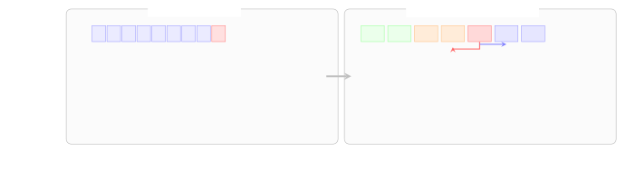
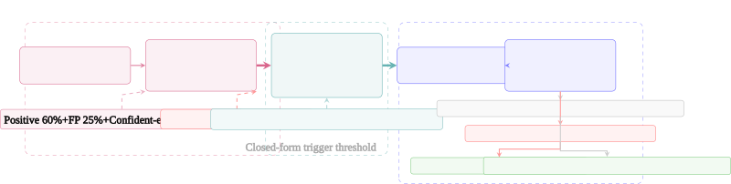

# Check Token: Real-Time Self-Verification and Precise Truncation in LLM Reasoning

Dingding & Yongkang Zhang  
Alibaba Group  
&Yuhao Liao, Zijian Zeng & Huiming Yang  
Tsinghua University Corresponding author: dignfei@gmail.com

###### Abstract

ECC memory embeds 8 parity bits for every 64 data bits and automatically
detects and corrects errors on each read. The parity bits carry no data
and only safeguard integrity, at $`\sim`$12.5% overhead. Yet the
reasoning chains of large language models lack such built-in
self-verification: once an error occurs it propagates along the chain,
and existing methods can only verify externally after generation
completes. We propose the check token, establishing built-in
self-verification for language model generation streams for the first
time: a functional marker \<CHECK\> is added to the vocabulary, and the
model triggers self-checking (analysis, localization, truncation,
rewriting) by outputting it at any position. The check token carries no
reasoning content (discarded after triggering) and only safeguards
reasoning correctness, directly corresponding to the role of ECC parity
bits, also at only $`\sim`$13% overhead. Speculative forking further
eliminates false-positive latency, and segmented reward makes trigger
timing end-to-end learnable. Experiments (Qwen3-32B / Qwen3-Next) show
that the check token achieves $`+10.8`$ pp improvement on HMMT25 at
$`1.13\times`$ overhead, with token efficiency $`88\times`$ that of
Best-of-$`8`$, and the precise truncation advantage monotonically
increases with chain length.



Figure 1: Analogy between ECC memory and check tokens. ECC embeds 8
parity bits per 64 data bits (12.5% overhead), auto-detecting and
correcting on each read. Check tokens embed self-verification into LLM
generation streams ($`\sim`$13% overhead), triggering self-checking,
precise truncation, and rewriting at any position. Both share the same
design philosophy: the verification mechanism carries no data/reasoning
content, only safeguards integrity/correctness, with constant overhead
independent of stream length.

## 1 Introduction

ECC memory embeds 8 parity bits for every 64 data bits and automatically
detects and corrects errors on each read. The parity bits carry no data,
only safeguard integrity, at merely $`\sim`$12.5% overhead. This idea of
“building self-verification into the data stream” is the cornerstone of
hardware reliability. Yet the reasoning chains of large language models
(Wei et al., 2022) still lack an analogous mechanism. Reasoning chains
have grown from a few steps to hundreds of steps, and an error at step
$`j`$ invalidates all subsequent $`N-j`$ steps (Theorem 1). Existing
error-correction paradigms rely on post-generation external verifiers
(Lightman et al., 2024) or majority voting (Wang et al., 2023),
equivalent to “running the entire program and then checking from
scratch,” unable to cut losses during generation. Recent o1/DeepSeek-R1
models have exhibited emergent natural-language self-correction, but
trigger words are constrained by grammar to appear only at sentence
boundaries, with effective frequency of only
$`1/\bar{L}_{\text{sent}}`$, far from the density of “per-token
verification.” To our knowledge, no existing method simultaneously
possesses all five capabilities: precise localization, error analysis,
truncation, learned triggering, and general reasoning verification
(Table 1).

We propose the check token mechanism, establishing built-in
self-verification for language model generation streams for the first
time. Just as ECC serves memory, the check token aims to become the
reliability infrastructure for AI reasoning: independent of external
verifiers, requiring no architectural changes, with controllable
overhead ($`\sim`$13%), embeddable in any autoregressive LLM. Our
contributions are:

1.  1.  Built-in self-verification infrastructure for LLM reasoning. We add
        \<CHECK\> to the vocabulary; the model triggers self-checking at any
        position (analysis $`\to`$ localization $`\to`$ truncation $`\to`$
        rewriting), with four-level fallback localization (only $`3.3\%`$
        complete failure). The mechanism is self-contained (no external
        verifier), zero-interference (discarded after triggering, no impact
        on original reasoning), and architecture-agnostic (vocabulary
        extension $`+`$ segmented reward applies to any autoregressive LLM).
        Just as ECC parity bits carry no data and only safeguard integrity,
        check tokens carry no reasoning and only safeguard correctness.
        AIME25/HMMT25/LiveCodeBench achieve $`+9.2`$/$`+10.8`$/$`+7.2`$ pp
        improvements, with token efficiency $`88\times`$ that of
        Best-of-$`8`$.
2.  2.  Breaking the structural bottleneck of natural-language
        self-correction. The trigger words of o1/DeepSeek-R1 are
        grammatically constrained to appear only at sentence boundaries;
        check tokens are unconstrained, increasing effective trigger
        frequency by $`\sim\bar{L}_{\text{sent}}\times`$, reducing the error
        length required to achieve the same detection probability by
        $`\bar{L}_{\text{sent}}\times`$ (Theorem 2).
3.  3.  Speculative forking inference. False-positive latency is zero;
        effective latency drops from serial $`\sim`$11% to $`\sim`$3.5%,
        with both modes producing identical outputs.
4.  4.  Complete theoretical guarantees. Three theorems: detection
        probability approaches $`1`$ exponentially; precise truncation
        preserves $`\Theta(N)`$ correct reasoning; joint bound reveals that
        the marginal value of improving $`a`$ exceeds that of improving
        $`p`$.
5.  5.  Segmented reward mechanism. The optimal trigger threshold $`q^{*}`$
        has a closed-form solution, and relative token overhead is
        independent of $`N`$ (theoretical $`\sim 11\%`$, measured
        $`\sim 13\%`$).

## 2 Related Work

#### LLM Reasoning and Self-Correction

CoT (Wei et al., 2022) enables step-by-step reasoning, but once an error
occurs subsequent steps fail accordingly. Tree-of-Thoughts (Yao et al.,
2023a) mitigates this through multi-path search but incurs $`O(b^{d})`$
overhead; Self-Refine (Madaan et al., 2023) iteratively improves through
multiple rounds but has limited effectiveness on reasoning tasks (Huang
et al., 2024); Self-Verification (Weng et al., 2023) operates only after
generation. All these methods belong to the “post-generation correction”
paradigm, losing $`\Theta(N)`$ already-generated information as chain
length $`N`$ increases (Theorem 1).

#### Process Rewards and Verification

PRM (Lightman et al., 2024) and Math-Shepherd (Wang et al., 2024)
require separately trained external verifiers and only provide post-hoc
scoring. Our segmented reward internalizes quality signals into the
generation model: rewards are jointly determined by trigger outcomes and
answer correctness, directly driving truncation-rewriting actions
without an independent scoring model.

#### Special Tokens and Generation Control

STaR (Zelikman et al., 2022) iteratively trains but does not trigger
in-generation correction; CRITIC (Gou et al., 2024) relies on external
tools with fixed thresholds; ReAct (Yao et al., 2023b) triggers actions
by rules without truncation; Self-RAG (Asai et al., 2024)’s critique
tokens do not perform truncation; Backtracking (Zhang et al., 2025)’s
\[RESET\] token performs unconditional rollback (designed for safety
alignment) without precise localization, differing in information
retention by $`\Theta(N)`$ (Appendix A). Table 1 summarizes the
comparison.

|              |              |                |            |            |               |
| ------------ | ------------ | -------------- | ---------- | ---------- | ------------- |
| Method       | Precise Loc. | Error Analysis | Truncation | Learned    | General Reas. |
| STaR         | $`\times`$   | $`\times`$     | $`\times`$ | ✓          | ✓             |
| CRITIC       | $`\times`$   | $`\times`$     | $`\times`$ | $`\times`$ | ✓             |
| ReAct        | $`\times`$   | $`\times`$     | $`\times`$ | $`\times`$ | ✓             |
| Self-RAG     | $`\times`$   | ✓              | $`\times`$ | ✓          | $`\times`$    |
| Refl. Conf.  | $`\times`$   | $`\times`$     | ✓          | $`\times`$ | ✓             |
| Backtracking | $`\times`$   | $`\times`$     | ✓          | ✓          | $`\times`$    |
| Ours         | ✓            | ✓              | ✓          | ✓          | ✓             |

Table 1: Functional comparison with existing methods. “Precise Loc.”:
text-level localization finer than reasoning-step granularity;
“Learned”: trigger mechanism learned through end-to-end training;
“General Reas.”: systematically evaluated on multi-step reasoning tasks.
Detailed analysis of each method is in Appendix C.

#### Test-Time Compute Scaling and RL Credit Assignment

The check token improves quality within a single trajectory,
orthogonally complementing Best-of-$`n`$/MCTS (Snell et al., 2025). The
natural-language triggering of o1/DeepSeek-R1 (Guo et al., 2025) has
structural bottlenecks: (a) trigger words can only appear at sentence
boundaries, with effective frequency of only
$`\sim 1/\bar{L}_{\text{sent}}`$; (b) internal rollback mechanisms are
undisclosed. Regarding RL, RLOO (Ahmadian et al., 2024) broadcasts the
final reward to all tokens, systematically misattributing credit and
penalizing correction behavior; our segmented reward fundamentally
resolves this credit assignment problem.

All five capabilities are individually necessary: without truncation,
errors continue propagating; without precise localization, $`\Theta(N)`$
steps of information are lost; without error analysis, rewriting lacks
direction; without learned triggering, timing cannot be optimized;
verification only in special scenarios cannot confirm general
effectiveness. Ablation experiments (Table 4) verify the nonlinear loss.

## 3 Method

Core idea: Just as ECC embeds parity bits in data streams, the check
token embeds self-verification capability at every position in the
generation stream. Specifically, \<CHECK\> is added to the vocabulary,
encoding error correction as part of next-token prediction. This section
covers: (1) mechanism definition (§3.1); (2) information retention
theorem (§3.2); (3) detection probability and joint bound (§3.3); (4)
segmented reward and training (§3.4–3.5). Key notation is in Table 2;
method overview in Figure 2.



Figure 2: Method overview. Stage 1: Vocabulary extension adds check
token $`c`$; SFT fine-tunes on constructed data (auxiliary trigger loss
guarantees $`p_{\min}>0`$), providing the model with triggering and
localization capability. Stage 2: RLOO with segmented reward fine-tunes
trigger precision; the optimal threshold $`q^{*}`$ has a closed-form
solution. Inference: upon outputting $`c`$, speculative forking creates
a main branch (speculative continuation) and a check branch (correction
analysis); true positives trigger truncation-rewriting, false positives
directly use the main branch (zero latency).

| Symbol       | Meaning                             | Symbol          | Meaning                                  |
| ------------ | ----------------------------------- | --------------- | ---------------------------------------- |
| $`c`$        | Check token                         | $`q_{t}`$       | Probability of error at position $`t`$   |
| $`p`$        | Per-token check trigger probability | $`a`$           | Error detection accuracy                 |
| $`L`$        | Error segment length                | $`\beta`$       | Probability of correctness after rewrite |
| $`N`$        | Total reasoning chain steps         | $`r^{+},r^{-}`$ | Segmented reward parameters              |
| $`\alpha`$   | Error start position ratio $`j/N`$  | $`q^{*}`$       | Optimal trigger threshold                |
| $`K_{\max}`$ | Maximum correction count            | $`C_{a}`$       | Tokens per correction analysis           |

Table 2: Key notation. Full notation table in Appendix B.

### 3.1 Check Token Mechanism

###### Definition 1 (Check Token).

Given vocabulary $`\mathcal{V}`$, the check token $`c\notin\mathcal{V}`$
is a special marker added to the extended vocabulary
$`\mathcal{V}^{\prime}=\mathcal{V}\cup\{c\}`$. The model triggers the
correction procedure by outputting $`y_{t}=c`$ at any position $`t`$.

Why vocabulary extension: Special prompts place correction instructions
in context, with trigger conditions implicit at the semantic level,
making them difficult to precisely optimize via RL. Vocabulary extension
encodes correction as an independent token, making the trigger behavior
fully equivalent to normal generation and directly optimizable via
segmented reward. $`c`$ does not appear in the final sequence and does
not consume context window. Comparison with natural-language
self-correction: The trigger words of o1/DeepSeek-R1 (“wait,” “no”) are
grammatically constrained to appear only at sentence boundaries and
cannot trigger mid-sentence, with effective trigger frequency of only
$`1/\bar{L}_{\text{sent}}`$
($`\bar{L}_{\text{sent}}\approx 20`$–$`30`$). By Theorem 2, the error
length required to achieve the same detection probability increases by
$`\bar{L}_{\text{sent}}\times`$. The check token can trigger at any
position, fully utilizing every generation position (detailed analysis
in Appendix D).

Figure 3 illustrates the workflow. After the model outputs $`c`$ at
position $`t`$, four steps execute:

1.  1.  Correction analysis: Generates structured analysis (judgment, error
        location, cause), length $`\leq C_{a}`$, not retained in the final
        sequence.
2.  2.  Error localization: Extracts error-start text ($`\sim`$10–20
    characters), localized via string matching. Four-level fallback:
    exact match $`\to`$ fuzzy match $`\to`$ step boundary $`\to`$ give
        up; only $`3.3\%`$ complete failure.
3.  3.  Truncation and rewriting: Truncates to $`y_{1:s-1}`$, regenerates
        from position $`s`$.
4.  4.  False-positive handling: If no error is found, $`c`$ is discarded
        and normal generation continues.



Figure 3: Check token workflow (true-positive path). After the error
segment $`s_{4}`$–$`s_{6}`$ (orange), outputting $`c`$ (red) triggers
self-checking. After precise localization, $`s_{1}`$–$`s_{3}`$ (green)
are retained, and truncation-rewriting (blue) proceeds. On false
positives, the check branch is discarded, and the main branch’s
speculative continuation directly becomes the final sequence (zero
latency cost).

0: Policy model $`\pi_{\theta}`$ (with $`c`$); input $`x`$; correction
prompt $`P_{\text{correct}}`$ (Appendix N); $`K_{\max}=5`$

1: $`y\leftarrow[]`$, $`t\leftarrow 0`$, $`k\leftarrow 0`$

2: while end-of-sequence not generated do

3:  $`y_{t}\sim\pi_{\theta}(\cdot|x,y_{1:t-1})`$

4:  if $`y_{t}=c`$ and $`k<K_{\max}`$ then

5:   $`k\leftarrow k+1`$

6:   Fork: share KV cache of $`y_{1:t-1}`$

7:    Main branch: continue generating $`y^{\text{spec}}`$ from
$`y_{1:t-1}`$

8:    Check branch:
$`\text{analysis}\leftarrow\pi_{\theta}(P_{\text{correct}}(x,y_{1:t-1}))`$

9:   if true positive with error-start text $`T_{s}`$ then

10:    Discard $`y^{\text{spec}}`$,
$`s\leftarrow\text{locate}(y_{1:t-1},T_{s})`$

11:    $`y\leftarrow y_{1:s-1}`$, $`t\leftarrow s-1`$, continue

12:   else

13:    Discard check branch, $`y\leftarrow y\|y^{\text{spec}}`$ {zero FP
latency}

14:   end if

15:  end if

16: end while

17: return $`y`$

Algorithm 1 Check token inference (speculative forking version)

Termination: $`K_{\max}`$ limits the maximum correction count; upon
reaching the limit, the model degrades to standard generation. Under
typical parameters, $`P(K\geq 5)\approx 4.8\%`$ (Proposition 3).

Speculative forking inference: In a naive implementation, false
positives waste latency. Speculative forking splits the sequence upon
triggering into a main branch (speculative continuation) and a check
branch (correction analysis), sharing the prefix KV cache. On false
positives, the main branch output directly serves as the final sequence
(zero latency cost); on true positives, the main branch is discarded and
truncation-rewriting executes. Analysis blocking latency is reduced by
$`\sim 77\%`$. Under resource constraints, serial mode can be used,
producing identical outputs (implementation details in Appendix G).

### 3.2 Information Retention Theorem

###### Theorem 1 (Information Retention).

In an $`N`$-step reasoning chain where the error starts at $`s_{j}`$ and
correction triggers at $`s_{k}`$: unconditional rollback discards all
$`k`$ steps, while precise truncation rewrites only $`k-j+1`$ steps. The
information retention advantage is $`\Delta=j-1`$. When $`j=\alpha N`$,
$`\Delta=\Theta(N)`$.

###### Proof.

$`\Delta=k-(k-j+1)=j-1`$. Let $`j=\alpha N`$; then
$`\Delta=\alpha N-1=\Theta(N)`$. ∎

###### Corollary 1.

If error positions are uniformly distributed,
$`\mathbb{E}[\Delta]=(N-1)/2=\Theta(N)`$. For $`N=60`$: $`29.5`$ steps
(LiveCodeBench); $`N=100`$: $`49.5`$ steps (AIME25); $`N=150`$: $`74.5`$
steps (HMMT25).

The uniform assumption is a conservative lower bound: empirically,
actual error positions on AIME25 concentrate in the later portion
(normalized $`>0.5`$ accounts for $`67.3\%`$), so the actual
$`\mathbb{E}[\Delta]`$ is higher. Detailed comparison with checkpoint
methods is in Appendix A.

### 3.3 Detection Probability, Token Overhead, and Joint Bound

###### Theorem 2 (Per-Token Correction Probability).

Each position independently generates $`c`$ with probability $`p`$. The
detection probability for an error segment of length $`L`$ is
$`1-(1-p)^{L}`$, approaching $`1`$ at exponential rate; the length
required to achieve $`1-\epsilon`$ is
$`L^{*}=\lceil\ln\epsilon/\ln(1-p)\rceil`$.

###### Proof.

The probability that none of $`L`$ positions triggers is $`(1-p)^{L}`$;
detection probability is $`1-(1-p)^{L}`$. Setting $`\geq 1-\epsilon`$
and solving yields $`L^{*}`$. ∎

The independence assumption generalizes to the non-uniform case (when
$`p_{t}\geq p_{\min}`$, the lower bound $`1-(1-p_{\min})^{L}`$ retains
the same form). Empirically, $`p_{\min}\approx 0.02`$ for
high-confidence errors, corresponding to $`L^{*}=228`$ tokens. Detailed
discussion in Appendix E.

###### Proposition 1 (Total Token Overhead).

Expected extra token overhead
$`T_{\text{extra}}=Np\cdot C_{a}+Np\cdot q^{*}\cdot a\cdot\mathbb{E}[L_{\text{err}}]`$;
relative overhead $`T_{\text{extra}}/N`$ is independent of $`N`$. Under
speculative forking, effective latency overhead
$`T_{\text{latency}}=Np\cdot q^{*}\cdot a\cdot(C_{a}+\mathbb{E}[L_{\text{err}}])`$,
with end-to-end latency reduction of $`\sim 69\%`$. Typical parameters
($`p=0.05`$, $`C_{a}=100`$, $`q^{*}=0.29`$, $`a=0.8`$): token overhead
$`\sim 11\%`$, latency $`\sim 3.5\%`$.

###### Theorem 3 (Detection-Retention Joint Bound).

For an error starting at $`j=\alpha N`$ with length $`L`$, the expected
retained steps under precise truncation:

```math
\mathbb{E}[\text{Retained steps}]\geq[1-(1-p)^{L}]\cdot a\cdot(\alpha N-1) \tag{1}
```

Approaching $`\Theta(N)`$ when $`L\geq L^{*}`$. The joint bound reveals:
when $`L`$ approaches saturation, the marginal value of improving $`a`$
exceeds that of improving $`p`$ (numerical example in Appendix F).

### 3.4 Segmented Reward RL Training

Standard RLOO broadcasts the final reward to all tokens, systematically
misattributing credit and penalizing correction behavior. Ablation
verification: SFT without auxiliary trigger loss has a false-positive
rate of $`44.2\%`$; adding auxiliary loss reduces it to $`38.7\%`$;
SFT+RL further reduces it to $`23.4\%`$. AIME25 accuracy progresses from
$`75.4\%`$ (no auxiliary loss) $`\to`$ $`77.1\%`$ (SFT-only) $`\to`$
$`82.1\%`$ (SFT+RL).

###### Definition 2 (Segmented Reward).

$`K`$ trigger points in a trajectory divide it into $`K+1`$ segments.
The reward for each check token:

```math
r_{k}=\begin{cases}r^{+}&\text{true positive + final correct}\\
r^{+}_{\text{small}}&\text{true positive + final incorrect}\\
r^{-}&\text{false positive}\end{cases} \tag{2}
```

where $`r^{+}>r^{+}_{\text{small}}>0>r^{-}`$. Truncated segments receive
$`-0.5`$; the final segment receives $`R_{\text{final}}`$ (correct
$`+1`$, incorrect $`-1`$). When $`K=0`$, this degrades to standard RLOO.
Rewards are entirely based on the model’s own analysis and final answer,
requiring no external annotation.

###### Proposition 2 (Optimal Trigger Policy).

Trigger if and only if
$`q_{t}>q^{*}=|r^{-}|/[a(r^{+}_{\text{avg}}+|r^{-}|)]`$, where
$`r^{+}_{\text{avg}}=\beta r^{+}+(1-\beta)r^{+}_{\text{small}}`$. With
default parameters $`r^{-}=-0.2`$ and $`a=0.8`$, $`q^{*}\approx 0.29`$.

###### Proof.

$`\mathbb{E}[r|\text{trigger}]=q_{t}\cdot a\cdot r^{+}_{\text{avg}}+(1-q_{t}\cdot a)\cdot r^{-}`$.
Setting $`>0`$ and solving yields $`q^{*}`$. ∎

$`q^{*}`$ is monotonically decreasing in $`a`$: stronger analysis
capability leads to a lower trigger threshold (parameter sensitivity in
Appendix I).

### 3.5 Training Pipeline

#### Stage 1: SFT

Fine-tuning on $`\sim`$10K constructed samples, including: positive
examples 60% (erroneous reasoning chains from the base model with errors
localized and correction analyses generated by GPT-5), false-positive
samples 25%, and confident-error samples 15%. In positive examples, all
token positions after the error location additionally compute auxiliary
cross-entropy with $`c`$ (weight $`\lambda=0.1`$), teaching the model to
trigger correction at any position after an error segment and directly
guaranteeing $`p_{\min}>0`$. SFT provides triggering and localization
capability; RL optimizes triggering precision.

#### Stage 2: RL

RLOO with segmented reward, trained for 1K steps on a mixed subset of
DeepMath-103K (He et al., 2026) and OpenCodeReasoning (Ahmad et al.,
2025). Segmented reward only modifies the reward assignment stage; the
policy gradient update rule remains identical to RLOO. $`c`$ is excluded
from the KL term to avoid numerical instability. SFT takes $`\sim`$128
GPU$`\cdot`$h; RL takes $`\sim`$384 GPU$`\cdot`$h (8$`\times`$A100).
Training details in Appendix H.

###### Proposition 3 (Expected Corrections per Trajectory).

$`K\sim\text{Binomial}(N,p)`$. With typical $`p=0.05`$ and $`N=100`$,
$`\mathbb{E}[K]=5`$, and $`K_{\max}=5`$ is essentially saturated; with
$`N=60`$, $`\mathbb{E}[K]=3`$, imposing virtually no constraint.

## 4 Experiments

We validate three core theoretical predictions (pre-registered design:
hypotheses uniquely determined by closed-form formulas before
experiments).

### 4.1 Experimental Setup

#### Base models

Qwen3-32B (dense architecture) and Qwen3-Next-80B-A3B-Thinking (MoE
architecture, 3B activated parameters), covering both dense and MoE
mainstream architectures.

#### Training data

Mixed subset of DeepMath-103K (He et al., 2026) (decontaminated
mathematical reasoning dataset) and OpenCodeReasoning (Ahmad et al., 2025) (decontaminated coding reasoning dataset). The reward function is
exact answer matching ($`r=1`$ if the final answer is correct, otherwise
$`r=0`$), requiring no reward model training.

#### Evaluation benchmarks

AIME25 (Mathematical Association of America, 2024) (competition
mathematics, $`N\approx 100`$ steps, 30 problems), HMMT25 (Balunovic
et al., 2026) (long-chain mathematical reasoning, $`N\approx 150`$
steps), and LiveCodeBench v6 (Jain et al., 2025) (code reasoning,
$`N\approx 60`$ steps). Reasoning chain lengths span $`\sim`$60 to
$`\sim`$150 steps.

#### Baselines

\(1\) Standard inference (same SFT+RL weights, correction disabled); (2)
Best-of-$`8`$ (majority voting); (3) Self-Refine (Madaan et al., 2023)
(2 iterations); (4) PRM-guided search (Lightman et al., 2024) (base
model weights, not SFT+RL weights; see Appendix J); (5) Unconditional
rollback baseline (same weights and trigger rate, replacing precise
localization with step-boundary rollback).

#### Inference settings

Temperature $`0.6`$, top-$`p=0.95`$, speculative forking enabled. Token
multiplier counts all actually generated tokens (including analysis and
rewrites), excluding discarded speculative branches. All evaluations use
32 independent samples to compute Acc avg@32.

### 4.2 Main Results

#### Hypotheses

(H1) HMMT25 improvement $`>`$ AIME25 $`>`$ LiveCodeBench (longer chains
yield higher detection probability); (H2) Token efficiency superior to
Best-of-$`n`$ (overhead $`\sim 1.13\times\ll 8.0\times`$); (H3) Precise
truncation advantage monotonically increases with chain length
($`\Delta=\Theta(N)`$).

| Method                 | AIME25                                   | HMMT25                                   | LiveCodeBench                            | Token Mult.         |
| ---------------------- | ---------------------------------------- | ---------------------------------------- | ---------------------------------------- | ------------------- |
| Standard inference     | $`72.9{\scriptstyle\,\pm 0.5}`$          | $`51.5{\scriptstyle\,\pm 0.6}`$          | $`60.6{\scriptstyle\,\pm 0.4}`$          | $`1.0\times`$       |
| Best-of-$`8`$          | $`78.5{\scriptstyle\,\pm 0.4}`$          | $`58.1{\scriptstyle\,\pm 0.5}`$          | $`66.2{\scriptstyle\,\pm 0.4}`$          | $`8.0\times`$       |
| Self-Refine            | $`75.8{\scriptstyle\,\pm 0.5}`$          | $`54.6{\scriptstyle\,\pm 0.6}`$          | $`63.1{\scriptstyle\,\pm 0.5}`$          | $`\sim 2.5\times`$  |
| PRM-guided search^(†)  | $`79.2{\scriptstyle\,\pm 0.4}`$          | $`59.4{\scriptstyle\,\pm 0.5}`$          | $`67.0{\scriptstyle\,\pm 0.4}`$          | $`\sim 3.2\times`$  |
| Unconditional rollback | $`76.4{\scriptstyle\,\pm 0.5}`$          | $`55.3{\scriptstyle\,\pm 0.6}`$          | $`63.8{\scriptstyle\,\pm 0.5}`$          | $`\sim 1.15\times`$ |
| Check token (ours)     | $`\mathbf{82.1}{\scriptstyle\,\pm 0.4}`$ | $`\mathbf{62.3}{\scriptstyle\,\pm 0.5}`$ | $`\mathbf{67.8}{\scriptstyle\,\pm 0.3}`$ | $`\sim 1.13\times`$ |

Table 3: Main results (Qwen3-32B, Acc avg@32 %, mean $`\pm`$ 95%
bootstrap CI over 5 random seeds). ^(†)PRM uses base model weights
(Appendix J). All three predictions are validated: (H1) HMMT25 $`+10.8`$
$`>`$ AIME25 $`+9.2`$ $`>`$ LiveCodeBench $`+7.2`$ pp; (H2) token
efficiency $`10.8/0.13\approx 83`$ pp/$`\times`$, Best-of-$`8`$
efficiency $`6.6/7.0\approx 0.94`$ pp/$`\times`$, ratio
$`\approx 88\times`$; (H3) precise truncation advantage: HMMT25 $`+7.0`$
$`>`$ AIME25 $`+5.7`$ $`>`$ LiveCodeBench $`+4.0`$ pp, monotonically
increasing.

#### Result analysis

H1: Improvement increases with chain length (LiveCodeBench $`+7.2`$
$`<`$ AIME25 $`+9.2`$ $`<`$ HMMT25 $`+10.8`$ pp); LiveCodeBench’s
shorter code reasoning chains and limited detection probability are
consistent with theoretical expectations. H2: Check token efficiency
$`10.8/0.13\approx 83`$ pp/$`\times`$; Best-of-$`8`$ efficiency
$`6.6/7.0\approx 0.94`$ pp/$`\times`$; ratio $`\approx 88\times`$. The
absolute accuracy gap with PRM is $`2.9`$ pp (AIME25, significant), but
PRM’s token overhead of $`\sim 3.2\times`$ far exceeds the check token’s
$`\sim 1.13\times`$. H3: Precise truncation advantage: LiveCodeBench
$`+4.0`$ $`<`$ AIME25 $`+5.7`$ $`<`$ HMMT25 $`+7.0`$ pp, strictly
monotonic (AIME25 vs. LiveCodeBench difference marginally significant at
$`p<0.05`$). Detailed statistical analysis in Appendix K.

#### Correction behavior statistics

On the AIME25 test set: average $`1.8`$ triggers/trajectory,
false-positive rate $`23.4\%`$, truncation precision $`71.2\%`$. Human
evaluation ($`n=100`$, $`\kappa\geq 0.68`$): error analysis correctness
$`76\%`$, truncation reasonableness $`82\%`$, rewrite superior to
original $`68\%`$. Of $`28.8\%`$ fallback triggers, only $`3.3\%`$
completely fail.

### 4.3 Ablation Study

|                                              |        |                    |
| -------------------------------------------- | ------ | ------------------ |
| Ablation                                     | AIME25 | Triggers / FP Rate |
| False-positive penalty $`r^{-}`$             |        |                    |
|    $`r^{-}=-0.05`$                           | 79.8   | 4.2 / 41.8%        |
|    $`r^{-}=-0.2`$ (default)                  | 82.1   | 1.8 / 23.4%        |
|    $`r^{-}=-1.0`$                            | 76.2   | 0.2 / 5.3%         |
| Analysis budget $`C_{a}`$                    |        |                    |
|    $`C_{a}=50`$                              | 78.6   | –                  |
|    $`C_{a}=100`$ (default)                   | 82.1   | –                  |
|    $`C_{a}=200`$                             | 81.8   | –                  |
| Truncation method                            |        |                    |
|    Step-level truncation                     | 79.3   | –                  |
|    Precise truncation (default)              | 82.1   | –                  |
| Training method                              |        |                    |
|    SFT (no auxiliary trigger loss)           | 75.4   | 3.8 / 44.2%        |
|    SFT-only                                  | 77.1   | 3.1 / 38.7%        |
|    SFT + fixed threshold ($`\theta{=}0.85`$) | 78.6   | 2.2 / 29.1%        |
|    SFT+RL (default)                          | 82.1   | 1.8 / 23.4%        |

Table 4: Ablation study (Qwen3-32B, AIME25 Acc avg@32). Key findings:
(1) optimal $`r^{-}=-0.2`$ matches closed-form prediction; (2)
$`C_{a}{=}100`$ is saturated; (3) precise truncation yields $`+2.8`$ pp
over step-level truncation; (4) auxiliary trigger loss contributes
$`+1.7`$ pp and reduces FP rate by $`5.5`$ pp; (5) RL contributes an
additional $`+5.0`$ pp on top of auxiliary loss. Full ablation in
Appendix L.

## 5 Limitations

Truncation localization depends on self-analysis capability: Truncation
precision is $`71.2\%`$; $`28.8\%`$ requires fallback to fuzzy matching
or step-level rollback. Conceptual error truncation precision is only
$`51\%`$ (vs. $`82\%`$ for computational errors), accounting for
$`\sim 22\%`$ of AIME25 errors. Current SFT teaches format but does not
explicitly optimize localization matchability. We identify two
annotation-free automatic training signals: (1) the fallback path as
feedback: exact match $`\to r^{+}_{\text{match}}`$, fallback to fuzzy
match $`\to`$ zero reward, fallback to step-level rollback
$`\to r^{-}_{\text{match}}`$; (2) correction outcomes should be tied to
the RLOO within-group baseline: if correct trajectories exist within the
group, then still-incorrect after correction should be penalized
(localization or rewriting issue); if all trajectories in the group are
incorrect, skip penalization (the model lacks the ability to solve the
problem; penalizing correction is meaningless). The latter is naturally
compatible with RLOO’s within-group relative advantage computation (when
all in-group are incorrect, advantage is zero and gradients
automatically vanish). Incorporating these signals into the segmented
reward framework can improve localization precision end-to-end without
additional human annotation, representing an important future direction.

Expected failure scenarios: (1) Conceptual errors (locally appear
correct); (2) very short errors ($`L=1`$ yields detection probability of
only $`5\%`$); (3) cascading corrections (exhausting $`K_{\max}`$,
empirically only $`2.1\%`$).

Theory-practice gap in latency: $`\sim 3.5\%`$ is the theoretical value
(perfect parallelism assumption); measured wall-clock time ratio is
$`\sim 1.5\times`$ (upper bound from unoptimized implementation).
System-level latency benchmarking is important future work.

Base model scale: Validated on 32B (dense) and 80B-MoE. Theory predicts
stronger effects for larger models ($`a`$ and $`p_{\min}`$ are higher),
but marginal value may diminish when baseline accuracy exceeds
$`>90\%`$.

Evaluation scope: Focused on mathematical and code reasoning (clear
correctness criteria). Open-domain QA and similar tasks require
task-specific adaptation.

## 6 Conclusion

ECC safeguards hardware data integrity at $`\sim`$12.5% overhead. This
paper introduces the idea of “built-in self-verification within the data
stream” to language models for the first time: the check token
safeguards reasoning correctness at $`\sim`$13% overhead, giving the
generation stream per-position self-verification capability and
internalizing error correction from “post-generation external checking”
to “per-token self-checking during generation.” Speculative forking
eliminates false-positive latency (theoretical $`\sim 3.5\%`$),
segmented reward makes trigger timing end-to-end learnable ($`q^{*}`$
closed-form solution), and three theorems form a complete argument
chain. Experiments validate all theoretical predictions ($`+10.8`$ pp,
$`88\times`$ efficiency, advantage monotonically increasing with chain
length). The core mechanism (vocabulary extension $`+`$ segmented reward
$`+`$ text-level localization) applies to any autoregressive LLM and can
generalize to code correction, fact-checking, and other domains. Future
directions: incorporating exact match success into RL rewards to improve
localization precision, multi-domain extension, scaling law
quantification, and end-to-end latency benchmarking.

## Reproducibility Statement

Code will be open-sourced upon acceptance.

## References

- Ahmad et al. (2025) Wasi Uddin Ahmad, Sean Narenthiran, Somshubra
  Majumdar, Aleksander Ficek, Siddhartha Jain, Jocelyn Huang, Vahid
  Noroozi, and Boris Ginsburg. Opencodereasoning: Advancing data
  distillation for competitive coding. In _Second Conference on Language
  Modeling_, 2025. URL
  [https://openreview.net/forum?id=aykM7KUVJZ](https://openreview.net/forum?id=aykM7KUVJZ).
- Ahmadian et al. (2024) Arash Ahmadian, Chris Cremer, Matthias Gallé,
  Marzieh Fadaee, Julia Kreutzer, Olivier Pietquin, Ahmet Üstün, and
  Sara Hooker. Back to basics: Revisiting REINFORCE-style optimization
  for learning from human feedback in LLMs. In Lun-Wei Ku, Andre
  Martins, and Vivek Srikumar (eds.), _Proceedings of the 62nd Annual
  Meeting of the Association for Computational Linguistics (Volume 1:
  Long Papers)_, pp. 12248–12267, Bangkok, Thailand, August 2024.
  Association for Computational Linguistics. doi:
  10.18653/v1/2024.acl-long.662. URL
  [https://aclanthology.org/2024.acl-long.662/](https://aclanthology.org/2024.acl-long.662/).
- Asai et al. (2024) Akari Asai, Zeqiu Wu, Yizhong Wang, Avirup Sil, and
  Hannaneh Hajishirzi. Self-RAG: Learning to retrieve, generate, and
  critique through self-reflection. In _The Twelfth International
  Conference on Learning Representations_, 2024. URL
  [https://openreview.net/forum?id=hSyW5go0v8](https://openreview.net/forum?id=hSyW5go0v8).
- Balunovic et al. (2026) Mislav Balunovic, Jasper Dekoninck, Ivo
  Petrov, Nikola Jovanović, and Martin Vechev. Matharena: Evaluating
  LLMs on uncontaminated math competitions. In _The Thirty-ninth Annual
  Conference on Neural Information Processing Systems Datasets and
  Benchmarks Track_, 2026. URL
  [https://openreview.net/forum?id=y0zL9IZxZ7](https://openreview.net/forum?id=y0zL9IZxZ7).
- Gou et al. (2024) Zhibin Gou, Zhihong Shao, Yeyun Gong, yelong shen,
  Yujiu Yang, Nan Duan, and Weizhu Chen. Critic: Large language models
  can self-correct with tool-interactive critiquing. In B. Kim, Y. Yue,
  S. Chaudhuri, K. Fragkiadaki, M. Khan, and Y. Sun (eds.),
  _International Conference on Learning Representations_, volume 2024,
  pp. 57734–57811, 2024. URL
  [https://proceedings.iclr.cc/paper_files/paper/2024/file/fef126561bbf9d4467dbb8d27334b8fe-Paper-Conference.pdf](https://proceedings.iclr.cc/paper_files/paper/2024/file/fef126561bbf9d4467dbb8d27334b8fe-Paper-Conference.pdf).
- Guo et al. (2025) Daya Guo, Dejian Yang, Haowei Zhang, Junxiao Song,
  Peiyi Wang, Qihao Zhu, Runxin Xu, Ruoyu Zhang, Shirong Ma, Xiao Bi,
  Xiaokang Zhang, Xingkai Yu, Yu Wu, Z. F. Wu, Zhibin Gou, Zhihong Shao,
  Zhuoshu Li, Ziyi Gao, Aixin Liu, Bing Xue, Bingxuan Wang, Bochao Wu,
  Bei Feng, Chengda Lu, Chenggang Zhao, Chengqi Deng, Chong Ruan, Damai
  Dai, Deli Chen, Dongjie Ji, Erhang Li, Fangyun Lin, Fucong Dai, Fuli
  Luo, Guangbo Hao, Guanting Chen, Guowei Li, H. Zhang, Hanwei Xu,
  Honghui Ding, Huazuo Gao, Hui Qu, Hui Li, Jianzhong Guo, Jiashi Li,
  Jingchang Chen, Jingyang Yuan, Jinhao Tu, Junjie Qiu, Junlong Li,
  J. L. Cai, Jiaqi Ni, Jian Liang, Jin Chen, Kai Dong, Kai Hu, Kaichao
  You, Kaige Gao, Kang Guan, Kexin Huang, Kuai Yu, Lean Wang, Lecong
  Zhang, Liang Zhao, Litong Wang, Liyue Zhang, Lei Xu, Leyi Xia,
  Mingchuan Zhang, Minghua Zhang, Minghui Tang, Mingxu Zhou, Meng Li,
  Miaojun Wang, Mingming Li, Ning Tian, Panpan Huang, Peng Zhang,
  Qiancheng Wang, Qinyu Chen, Qiushi Du, Ruiqi Ge, Ruisong Zhang, Ruizhe
  Pan, Runji Wang, R. J. Chen, R. L. Jin, Ruyi Chen, Shanghao Lu,
  Shangyan Zhou, Shanhuang Chen, Shengfeng Ye, Shiyu Wang, Shuiping Yu,
  Shunfeng Zhou, Shuting Pan, S. S. Li, Shuang Zhou, Shaoqing Wu, Tao
  Yun, Tian Pei, Tianyu Sun, T. Wang, Wangding Zeng, Wen Liu, Wenfeng
  Liang, Wenjun Gao, Wenqin Yu, Wentao Zhang, W. L. Xiao, Wei An,
  Xiaodong Liu, Xiaohan Wang, Xiaokang Chen, Xiaotao Nie, Xin Cheng, Xin
  Liu, Xin Xie, Xingchao Liu, Xinyu Yang, Xinyuan Li, Xuecheng Su,
  Xuheng Lin, X. Q. Li, Xiangyue Jin, Xiaojin Shen, Xiaosha Chen,
  Xiaowen Sun, Xiaoxiang Wang, Xinnan Song, Xinyi Zhou, Xianzu Wang,
  Xinxia Shan, Y. K. Li, Y. Q. Wang, Y. X. Wei, Yang Zhang, Yanhong Xu,
  Yao Li, Yao Zhao, Yaofeng Sun, Yaohui Wang, Yi Yu, Yichao Zhang, Yifan
  Shi, Yiliang Xiong, Ying He, Yishi Piao, Yisong Wang, Yixuan Tan,
  Yiyang Ma, Yiyuan Liu, Yongqiang Guo, Yuan Ou, Yuduan Wang, Yue Gong,
  Yuheng Zou, Yujia He, Yunfan Xiong, Yuxiang Luo, Yuxiang You, Yuxuan
  Liu, Yuyang Zhou, Y. X. Zhu, Yanping Huang, Yaohui Li, Yi Zheng,
  Yuchen Zhu, Yunxian Ma, Ying Tang, Yukun Zha, Yuting Yan, Z. Z. Ren,
  Zehui Ren, Zhangli Sha, Zhe Fu, Zhean Xu, Zhenda Xie, Zhengyan Zhang,
  Zhewen Hao, Zhicheng Ma, Zhigang Yan, Zhiyu Wu, Zihui Gu, Zijia Zhu,
  Zijun Liu, Zilin Li, Ziwei Xie, Ziyang Song, Zizheng Pan, Zhen Huang,
  Zhipeng Xu, Zhongyu Zhang, and Zhen Zhang. Deepseek-r1 incentivizes
  reasoning in llms through reinforcement learning. _Nature_,
  645(8081):633–638, Sept 2025. ISSN 1476-4687. doi:
  10.1038/s41586-025-09422-z. URL
  [http://dx.doi.org/10.1038/s41586-025-09422-z](http://dx.doi.org/10.1038/s41586-025-09422-z).
- He et al. (2026) Zhiwei He, Tian Liang, Jiahao Xu, Qiuzhi Liu, Xingyu
  Chen, Yue Wang, Linfeng Song, Dian Yu, Zhenwen Liang, Wenxuan Wang,
  Zhuosheng Zhang, Rui Wang, Zhaopeng Tu, Haitao Mi, and Dong Yu.
  Deepmath-103k: A large-scale, challenging, decontaminated, and
  verifiable mathematical dataset for advancing reasoning. In _The
  Fourteenth International Conference on Learning
  Representations_, 2026. URL
  [https://openreview.net/forum?id=kHB5Te5IWm](https://openreview.net/forum?id=kHB5Te5IWm).
- Huang et al. (2024) Jie Huang, Xinyun Chen, Swaroop Mishra,
  Huaixiu Steven Zheng, Adams Yu, Xinying Song, and Denny Zhou. Large
  language models cannot self-correct reasoning yet. In B. Kim, Y. Yue,
  S. Chaudhuri, K. Fragkiadaki, M. Khan, and Y. Sun (eds.),
  _International Conference on Learning Representations_, volume 2024,
  pp. 32808–32824, 2024. URL
  [https://proceedings.iclr.cc/paper_files/paper/2024/file/8b4add8b0aa8749d80a34ca5d941c355-Paper-Conference.pdf](https://proceedings.iclr.cc/paper_files/paper/2024/file/8b4add8b0aa8749d80a34ca5d941c355-Paper-Conference.pdf).
- Jain et al. (2025) Naman Jain, King Han, Alex Gu, Wen-Ding Li, Fanjia
  Yan, Tianjun Zhang, Sida Wang, Armando Solar-Lezama, Koushik Sen, and
  Ion Stoica. Livecodebench: Holistic and contamination free evaluation
  of large language models for code. In _The Thirteenth International
  Conference on Learning Representations_, 2025. URL
  [https://openreview.net/forum?id=chfJJYC3iL](https://openreview.net/forum?id=chfJJYC3iL).
- Lightman et al. (2024) Hunter Lightman, Vineet Kosaraju, Yuri Burda,
  Harrison Edwards, Bowen Baker, Teddy Lee, Jan Leike, John Schulman,
  Ilya Sutskever, and Karl Cobbe. Let’s verify step by step. In _The
  Twelfth International Conference on Learning Representations_, 2024.
  URL
  [https://openreview.net/forum?id=v8L0pN6EOi](https://openreview.net/forum?id=v8L0pN6EOi).
- Madaan et al. (2023) Aman Madaan, Niket Tandon, Prakhar Gupta, Skyler
  Hallinan, Luyu Gao, Sarah Wiegreffe, Uri Alon, Nouha Dziri, Shrimai
  Prabhumoye, Yiming Yang, Shashank Gupta, Bodhisattwa Prasad Majumder,
  Katherine Hermann, Sean Welleck, Amir Yazdanbakhsh, and Peter Clark.
  Self-refine: Iterative refinement with self-feedback. In A. Oh,
  T. Naumann, A. Globerson, K. Saenko, M. Hardt, and S. Levine (eds.),
  _Advances in Neural Information Processing Systems_, volume 36, pp.
  46534–46594. Curran Associates, Inc., 2023. URL
  [https://proceedings.neurips.cc/paper_files/paper/2023/file/91edff07232fb1b55a505a9e9f6c0ff3-Paper-Conference.pdf](https://proceedings.neurips.cc/paper_files/paper/2023/file/91edff07232fb1b55a505a9e9f6c0ff3-Paper-Conference.pdf).
- Mathematical Association of America (2024) Mathematical Association of
  America. 2024-25 AIME thresholds are available.
  [https://maa.org/news/aime-thresholds-are-available/](https://maa.org/news/aime-thresholds-are-available/), 2024.
  Updated January 6, 2025.
- Snell et al. (2025) Charlie Victor Snell, Jaehoon Lee, Kelvin Xu, and
  Aviral Kumar. Scaling LLM test-time compute optimally can be more
  effective than scaling parameters for reasoning. In _The Thirteenth
  International Conference on Learning Representations_, 2025. URL
  [https://openreview.net/forum?id=4FWAwZtd2n](https://openreview.net/forum?id=4FWAwZtd2n).
- Wang et al. (2024) Peiyi Wang, Lei Li, Zhihong Shao, Runxin Xu, Damai
  Dai, Yifei Li, Deli Chen, Yu Wu, and Zhifang Sui. Math-shepherd:
  Verify and reinforce LLMs step-by-step without human annotations. In
  Lun-Wei Ku, Andre Martins, and Vivek Srikumar (eds.), _Proceedings of
  the 62nd Annual Meeting of the Association for Computational
  Linguistics (Volume 1: Long Papers)_, pp. 9426–9439, Bangkok,
  Thailand, August 2024. Association for Computational Linguistics. doi:
  10.18653/v1/2024.acl-long.510. URL
  [https://aclanthology.org/2024.acl-long.510/](https://aclanthology.org/2024.acl-long.510/).
- Wang et al. (2023) Xuezhi Wang, Jason Wei, Dale Schuurmans, Quoc V Le,
  Ed H. Chi, Sharan Narang, Aakanksha Chowdhery, and Denny Zhou.
  Self-consistency improves chain of thought reasoning in language
  models. In _The Eleventh International Conference on Learning
  Representations_, 2023. URL
  [https://openreview.net/forum?id=1PL1NIMMrw](https://openreview.net/forum?id=1PL1NIMMrw).
- Wei et al. (2022) Jason Wei, Xuezhi Wang, Dale Schuurmans, Maarten
  Bosma, brian ichter, Fei Xia, Ed Chi, Quoc V Le, and Denny Zhou.
  Chain-of-thought prompting elicits reasoning in large language models.
  In S. Koyejo, S. Mohamed, A. Agarwal, D. Belgrave, K. Cho, and A. Oh
  (eds.), _Advances in Neural Information Processing Systems_,
  volume 35, pp. 24824–24837. Curran Associates, Inc., 2022. URL
  [https://proceedings.neurips.cc/paper_files/paper/2022/file/9d5609613524ecf4f15af0f7b31abca4-Paper-Conference.pdf](https://proceedings.neurips.cc/paper_files/paper/2022/file/9d5609613524ecf4f15af0f7b31abca4-Paper-Conference.pdf).
- Weng et al. (2023) Yixuan Weng, Minjun Zhu, Fei Xia, Bin Li, Shizhu
  He, Shengping Liu, Bin Sun, Kang Liu, and Jun Zhao. Large language
  models are better reasoners with self-verification. In Houda Bouamor,
  Juan Pino, and Kalika Bali (eds.), _Findings of the Association for
  Computational Linguistics: EMNLP 2023_, pp. 2550–2575, Singapore,
  December 2023. Association for Computational Linguistics. doi:
  10.18653/v1/2023.findings-emnlp.167. URL
  [https://aclanthology.org/2023.findings-emnlp.167/](https://aclanthology.org/2023.findings-emnlp.167/).
- Yao et al. (2023a) Shunyu Yao, Dian Yu, Jeffrey Zhao, Izhak Shafran,
  Tom Griffiths, Yuan Cao, and Karthik Narasimhan. Tree of thoughts:
  Deliberate problem solving with large language models. In A. Oh,
  T. Naumann, A. Globerson, K. Saenko, M. Hardt, and S. Levine (eds.),
  _Advances in Neural Information Processing Systems_, volume 36, pp.
  11809–11822. Curran Associates, Inc., 2023a. URL
  [https://proceedings.neurips.cc/paper_files/paper/2023/file/271db9922b8d1f4dd7aaef84ed5ac703-Paper-Conference.pdf](https://proceedings.neurips.cc/paper_files/paper/2023/file/271db9922b8d1f4dd7aaef84ed5ac703-Paper-Conference.pdf).
- Yao et al. (2023b) Shunyu Yao, Jeffrey Zhao, Dian Yu, Nan Du, Izhak
  Shafran, Karthik R Narasimhan, and Yuan Cao. React: Synergizing
  reasoning and acting in language models. In _The Eleventh
  International Conference on Learning Representations_, 2023b. URL
  [https://openreview.net/forum?id=WE_vluYUL-X](https://openreview.net/forum?id=WE_vluYUL-X).
- Zelikman et al. (2022) Eric Zelikman, Yuhuai Wu, Jesse Mu, and Noah
  Goodman. Star: Bootstrapping reasoning with reasoning. In S. Koyejo,
  S. Mohamed, A. Agarwal, D. Belgrave, K. Cho, and A. Oh (eds.),
  _Advances in Neural Information Processing Systems_, volume 35, pp.
  15476–15488. Curran Associates, Inc., 2022. URL
  [https://proceedings.neurips.cc/paper_files/paper/2022/file/639a9a172c044fbb64175b5fad42e9a5-Paper-Conference.pdf](https://proceedings.neurips.cc/paper_files/paper/2022/file/639a9a172c044fbb64175b5fad42e9a5-Paper-Conference.pdf).
- Zeng et al. (2025) Qinglin Zeng, Jing Yang, and Keze Wang. Reflective
  confidence: Correcting reasoning flaws via online
  self-correction, 2025. URL
  [https://arxiv.org/abs/2512.18605](https://arxiv.org/abs/2512.18605).
- Zhang et al. (2025) Yiming Zhang, Jianfeng Chi, Hailey Nguyen,
  Kartikeya Upasani, Daniel M. Bikel, Jason E Weston, and Eric Michael
  Smith. Backtracking improves generation safety. In _The Thirteenth
  International Conference on Learning Representations_, 2025. URL
  [https://openreview.net/forum?id=Bo62NeU6VF](https://openreview.net/forum?id=Bo62NeU6VF).

## Appendix A Extended Discussion of the Information Retention Theorem

Theorem 1 analyzes the case without checkpoints. Backtracking can use
$`M`$ uniformly spaced checkpoints, with expected regeneration cost of
$`N/(2M)`$ steps when rolling back to the nearest checkpoint. When
$`M=O(1)`$, the difference from precise truncation is $`\Theta(N)`$. As
$`M\to N`$, the two converge, but KV cache storage rises to
$`\Theta(N\cdot d)`$, and checkpoints must be fixed in advance and
cannot adapt to the error distribution. Precise truncation requires no
preset checkpoints, has $`O(0)`$ additional storage, and the error
analysis provides direction for rewriting.

Empirical ablation (AIME25, $`30`$ problems): unconditional rollback
recurrence rate $`41\%`$; precise truncation reduces to $`23\%`$
(difference $`18`$ pp, $`95\%`$ CI $`\pm 13`$ pp, marginally
significant).

Terminology note: The “unconditional rollback” analyzed in the theorem
refers to regeneration from the start (worst case); the experimental
baseline rolls back to the nearest step boundary (stronger than the
theoretical case), so the measured $`+3.4`$/$`+5.6`$/$`+6.7`$ pp are
conservative lower bounds.

## Appendix B Full Notation Table

| Symbol               | Meaning                             | Symbol                               | Meaning                               |
| -------------------- | ----------------------------------- | ------------------------------------ | ------------------------------------- |
| $`c`$                | Check token                         | $`q_{t}`$                            | Error probability at position $`t`$   |
| $`p`$                | Per-token trigger probability       | $`a`$                                | Error detection accuracy              |
| $`L`$                | Error segment length (tokens)       | $`\beta`$                            | Prob. of correctness after rewrite    |
| $`N`$                | Total reasoning chain steps         | $`r^{+},r^{+}_{\text{small}},r^{-}`$ | Segmented reward params               |
| $`j,k`$              | Error start / trigger step          | $`r^{+}_{\text{avg}}`$               | Mean successful detection reward      |
| $`\alpha`$           | Error start ratio ($`j/N`$)         | $`q^{*}`$                            | Optimal trigger threshold             |
| $`K_{\max}`$         | Max correction count                | $`C_{a}`$                            | Tokens per correction analysis        |
| $`p_{\min}`$         | Per-token trigger prob. lower bound | $`\bar{L}_{\text{step}}`$            | Mean tokens per step ($`\approx 50`$) |
| $`s`$                | Truncation point                    | $`T_{s}`$                            | Error-start text segment              |
| $`T_{\text{extra}}`$ | Extra token overhead                | $`T_{\text{latency}}`$               | Effective latency overhead            |

Table 5: Full notation table.
$`r^{+}_{\text{avg}}=\beta r^{+}+(1-\beta)r^{+}_{\text{small}}`$.

## Appendix C Detailed Analysis of Method Comparison

Detailed analysis of each method in Table 1:

STaR (Zelikman et al., 2022) iteratively trains via outcome reward
filtering (hence “learned”), but does not trigger in-generation
correction and lacks precise localization or truncation. CRITIC (Gou
et al., 2024) invokes external tools for verification; error analysis
depends on external sources rather than the model itself, with fixed
trigger thresholds. ReAct (Yao et al., 2023b) triggers actions by preset
rules without performing precise truncation on reasoning chains.
Self-RAG (Asai et al., 2024)’s critique tokens evaluate retrieval
passage quality but do not trigger truncation, primarily targeting
open-domain QA. Reflective Confidence (Zeng et al., 2025) uses a fixed
threshold and cannot learn end-to-end. Backtracking (Zhang et al.,
2025)’s \[RESET\] token performs unconditional rollback (for safety
alignment scenarios) without error analysis or precise localization.

Note: Reflective Confidence and Backtracking are based on arXiv
preprints; capability assessments are based on method descriptions
rather than independent experiments. The comparison with the
“unconditional rollback” baseline in our experiments is a controlled
ablation (same weights, only replacing the truncation strategy), not a
direct comparison using original Backtracking weights.

## Appendix D Detailed Comparison with Natural-Language Self-Correction

Natural-language trigger words (“wait,” “no,” etc.) are grammatically
constrained to appear only at sentence or clause boundaries, presenting
three structural limitations:

\(1\) During sentence generation (e.g., the “$`9`$” in “$`3+5=9`$”),
even if the model has internally accumulated “possibly wrong” signals,
it must wait until the sentence completes before outputting a correction
trigger. Every intermediate token reinforces the erroneous context.

\(2\) Token positions within sentences are entirely unavailable for
correction judgment, wasting parameter capacity. For reasoning sentences
with $`\bar{L}_{\text{sent}}\approx 20`$–$`30`$ tokens, the effective
trigger frequency is only $`1/\bar{L}_{\text{sent}}`$.

\(3\) By Theorem 2, reduced trigger frequency directly causes decreased
detection probability. The effective $`p`$ drops to
$`p/\bar{L}_{\text{sent}}`$, and $`L^{*}`$ increases by
$`\bar{L}_{\text{sent}}\times`$.

## Appendix E Discussion of Independence Assumption

Theorem 2 assumes i.i.d. across positions, which is violated in practice
in two ways:

\(1\) Context dependence: Trigger probability is higher after complex
steps. Generalizing to the non-uniform independent case: if
$`p_{t}\geq p_{\min}>0`$, then
$`P(\text{detection})\geq 1-(1-p_{\min})^{L}`$, and the lower bound form
is preserved. The correlated case requires considering the FKG
inequality, left for future work.

\(2\) Confident errors: When high-confidence errors occur, $`p_{\min}`$
is small and $`L^{*}`$ increases. Empirically, $`p_{\min}\approx 0.02`$
for high-confidence errors (auxiliary trigger loss improves from
$`0.005`$ to $`0.02`$), giving $`L^{*}=228`$ tokens ($`\sim 4`$–$`5`$
steps), which still provides reasonable detection probability for
medium-length errors.

Numerical intuition: At $`p=0.1`$, $`L^{*}=44`$; at $`p=0.05`$,
$`L^{*}=90`$; at $`p=0.02`$, $`L^{*}=228`$. Even at $`p=0.05`$, the
average error segment ($`50`$ tokens) has detection probability
$`\approx 92.3\%`$.

## Appendix F Numerical Example and Marginal Improvements

Take $`N=100`$ steps, $`\alpha=0.375`$ (error starts at step 37),
$`L=50`$, $`p=0.05`$, $`a=0.8`$: detection probability
$`\approx 0.923`$, expected retained steps $`\approx 25.8`$.

Marginal improvement comparison: Increasing $`a`$ from $`0.8`$ to
$`0.9`$ yields $`+12.5\%`$ retained steps; a proportional increase of
$`p`$ to $`0.056`$ yields only $`+2\%`$. When $`L`$ approaches
saturation, the marginal value of improving $`a`$ far exceeds that of
improving $`p`$, providing theoretical justification for prioritizing
self-analysis capability.

## Appendix G Speculative Forking Implementation Details

Implementation: Both branches share the prefix KV cache in read-only
mode (copy-on-write), each maintaining independent decoding states,
compatible with continuous batching frameworks such as vLLM.

Distinction from speculative decoding: Speculative decoding decodes the
same content (small model draft + large model verification); speculative
forking decodes different content (continuation + correction analysis),
forking only when a check token triggers. The two can be stacked.

Serial fallback mode: Under memory constraints, correction analysis
executes sequentially; latency rises to $`\sim 11\%`$ but output is
identical. Controlled by the speculative_fork boolean flag.

Batch inference compatibility: Forking is equivalent to temporarily
inserting a new sequence into the batch; serial mode pauses and resumes,
both compatible with dynamic batching. Decoding uses temperature
sampling ($`T=0.7`$); beam search extension is left for future work.

Analysis blocking reduction: Given trigger probability $`p`$ and
true-positive fraction $`q^{*}\cdot a`$, blocking drops from
$`p\cdot C_{a}`$ to $`p\cdot q^{*}\cdot a\cdot C_{a}`$, a reduction of
$`\sim 77\%`$. End-to-end reduction is $`\sim 69\%`$
($`T_{\text{latency}}/T_{\text{extra}}\approx 0.31`$).

## Appendix H Training Details

SFT data construction: Positive examples (60%) are generated by GPT-5
performing step-level error localization and analysis on erroneous
reasoning chains from the base model (replaceable with Qwen3-72B with
performance difference $`<0.5`$ pp). False-positive samples (25%) insert
$`c`$ at random positions in correct reasoning followed by “no error
found.” Confident-error samples (15%) are selected by softmax max
probability $`>0.9`$ with incorrect answers. GPT-5 annotation quality:
$`89\%`$ reasonable ($`\kappa=0.76`$); remaining $`11\%`$ are
coarse-grained localizations.

Auxiliary trigger loss: In positive examples, for all positions
$`t>t_{e}`$ after the first error token position $`t_{e}`$, auxiliary
cross-entropy with $`c`$ is computed:
$`\mathcal{L}_{\text{aux}}=\lambda\sum_{t>t_{e}}-\log P(c\mid x_{<t})`$,
$`\lambda=0.1`$. This term directly constrains the output probability of
$`c`$ at every position after the error segment to be $`>0`$,
guaranteeing $`p_{\min}>0`$ at the training level rather than relying on
data augmentation for implicit emergence. Ablation: without auxiliary
loss, $`p_{\min}`$ decays to $`\sim`$0.005 at the tail of long chains;
with it, $`p_{\min}`$ stabilizes at $`\sim`$0.02.

RL details: RLOO group size $`G=8`$, prompt batch size $`64`$, learning
rate $`1\times 10^{-6}`$ (Qwen3-32B) / $`5\times 10^{-7}`$ (Qwen3-Next),
KL coefficient $`\beta_{\text{kl}}=0.002`$, maximum sequence length
$`32768`$, 1K steps. Training data is a mixed subset of DeepMath-103K
and OpenCodeReasoning. Qwen3-32B trained on 8$`\times`$A100 80GB;
Qwen3-Next on 16$`\times`$A100 80GB.

New token embedding initialization: Mean initialization (arithmetic mean
of all token embeddings), converging $`\sim 30\%`$ faster than random
initialization. $`c`$ is excluded from the KL term; the trigger baseline
is established by the SFT auxiliary loss, and trigger precision is
fine-tuned by segmented reward.

Variable-length trajectories: Right-padded to the longest in the group;
padded positions have gradient masking and are excluded from reward
normalization.

Truncated segment reward: Ablation over $`\{-1,-0.5,-0.3,0\}`$: AIME25
$`80.5/\mathbf{82.1}/81.9/81.4`$%; robust in $`[-0.5,0]`$.

Parameter choices: $`r^{+}=1.0`$, $`r^{+}_{\text{small}}=0.3`$,
$`r^{-}=-0.2`$, $`\beta=0.5`$. $`r^{-}=-0.2`$ corresponds to
$`q^{*}\approx 0.29`$, matching empirical error rates.

Why not a fixed confidence threshold: (a) Threshold $`\theta`$ lacks
theoretical guidance; (b) high-confidence errors (accounting for
$`34.7\%`$) are invisible to threshold-based methods. Ablation: fixed
threshold $`\theta=0.85`$ yields $`78.6\%`$, lower than SFT+RL by
$`3.5`$ pp.

Convergence: Proposition 2 establishes optimal policy structure
(threshold policy), not an RL convergence proof. $`q^{*}`$ is uniquely
determined by reward parameters, providing closed-form hyperparameter
guidance.

## Appendix I Parameter Sensitivity Analysis of Proposition 2

| $`r^{+}_{\text{avg}}`$ | $`r^{-}`$ | $`a`$ | $`q^{*}`$ |
| ---------------------- | --------- | ----- | --------- |
| 0.65                   | -0.1      | 0.8   | 0.17      |
| 0.65                   | -0.2      | 0.8   | 0.29      |
| 0.65                   | -0.5      | 0.8   | 0.54      |
| 0.65                   | -0.2      | 0.6   | 0.39      |
| 0.65                   | -0.2      | 1.0   | 0.24      |
| 1.00                   | -0.2      | 0.8   | 0.21      |

Table 6: Parameter sensitivity. Larger $`|r^{-}|`$ raises $`q^{*}`$
(more conservative); higher $`a`$ lowers $`q^{*}`$ (more aggressive);
larger $`r^{+}_{\text{avg}}`$ lowers $`q^{*}`$.

## Appendix J Experimental Fairness and Statistical Details

PRM fairness: PRM candidate paths are generated by the base model
(without SFT+RL). If PRM were retrained on SFT+RL weights, accuracy
would likely be higher, but token overhead would remain
$`\sim 3.2\times`$, with efficiency still far below the check token. The
core argument of H2 ($`88\times`$ efficiency) does not depend on the PRM
comparison.

Self-Refine fairness: Running on the SFT+RL model is more favorable to
Self-Refine (stronger base model); on the original model it achieves
$`73.9\%`$ ($`1.9`$ pp lower).

Token multiplier explanation: Reflects total token generation from a
single-branch perspective, proportional to FLOPs. Measured wall-clock
time ratio of $`\sim 1.5\times`$ exceeds $`1.13\times`$; the gap is due
to forking scheduling overhead. Additional FLOPs from attention
quadratic terms are $`\sim 1.005\times`$, negligible in practice.

Data separation: All hyperparameters are determined on a DeepMath-103K
held-out dev set ($`\approx 2000`$ problems); final results are reported
on AIME25/HMMT25/LiveCodeBench in a single pass.

## Appendix K Detailed Statistical Analysis

H1: LiveCodeBench $`+7.2`$ pp $`<`$ AIME25 $`+9.2`$ pp $`<`$ HMMT25
$`+10.8`$ pp; improvement increases with chain length. LiveCodeBench’s
shorter code reasoning chains and higher localization difficulty are
consistent with expectations.

H2: Check token vs. Best-of-$`8`$ difference $`+3.6`$ pp (AIME25),
significant. vs. PRM difference $`+2.9`$ pp (McNemar $`p<0.05`$,
significant), with token efficiency difference of $`\sim 2.8\times`$.

H3: AIME25 precise truncation advantage $`+5.7`$ vs. LiveCodeBench
$`+4.0`$, difference $`1.7`$ pp, joint half-width $`\approx 1.5`$ pp,
$`z\approx 2.27`$ ($`p<0.05`$, marginally significant). HMMT25
$`+7.0`$ pp further validates the trend.

## Appendix L Full Ablation Study

Table 4 in the main text is a condensed version; supplementary results
here:

$`r^{-}=-0.1`$: $`81.2\%`$, $`2.7`$/31.2%. $`r^{-}=-0.5`$: $`79.5\%`$,
$`0.6`$/12.1%. $`C_{a}=500`$: $`81.5\%`$ (excessively long analysis may
disrupt continuation coherence). $`K_{\max}=1`$: $`78.9\%`$;
$`K_{\max}=3`$: $`81.0\%`$; $`K_{\max}=10`$: $`82.2\%`$ (vs.
$`K_{\max}=5`$, only $`+0.1`$ pp).

SFT-only decomposition: Replacing segmented reward with standard RLOO
broadcast yields AIME25 $`79.1\%`$ (vs. segmented $`82.1\%`$, difference
$`3.0`$ pp), indicating that $`\sim 3.0`$ pp of RL’s $`+5.0`$ pp
contribution comes from improved reward attribution. Auxiliary trigger
loss independently contributes $`+1.7`$ pp ($`75.4\%\to 77.1\%`$); full
pipeline gain: auxiliary loss $`+1.7`$ + RL $`+5.0`$ = $`+6.7`$ pp.

Miss penalty: Adding $`r_{\text{miss}}=-0.1`$ actually reduces to
$`81.5\%`$; $`R_{\text{final}}`$ already provides sufficient
miss-detection signal.

## Appendix M Correction Behavior Analysis

#### Qwen3-Next (MoE) results

| Method                 | AIME25 | HMMT25 | LiveCodeBench |
| ---------------------- | ------ | ------ | ------------- |
| Standard inference     | 87.8   | 73.9   | 68.7          |
| Best-of-$`8`$          | 91.5   | 79.2   | 73.4          |
| Unconditional rollback | 90.2   | 77.1   | 71.3          |
| Check token            | 94.1   | 82.6   | 74.8          |

The check token is equally effective on Qwen3-Next: AIME25 $`+6.3`$ pp,
HMMT25 $`+8.7`$ pp, LiveCodeBench $`+6.1`$ pp. Improvement magnitudes
are slightly lower than Qwen3-32B (stronger base, diminishing marginal
returns), but the chain-length trend HMMT25 $`>`$ AIME25 $`>`$
LiveCodeBench still holds.

#### SFT data source

Replacing GPT-5 with Qwen3-72B: AIME25 $`81.8\%`$ (difference $`0.3`$ pp
$`<`$ statistical error); not dependent on GPT-5.

#### Behavioral patterns

\(1\) Triggers concentrate in the later portion (normalized $`>0.5`$
accounts for $`67.3\%`$); (2) computational error truncation $`82\%`$
$`>`$ logical $`64\%`$ $`>`$ conceptual $`51\%`$; (3) RL starting FP
rate $`38.7\%`$ (auxiliary loss already reduced from $`44.2\%`$), drops
to $`\sim 30\%`$ in the first 50 RL steps, converging to $`23.4\%`$; (4)
AIME25 medium-difficulty problems improve $`+8`$–$`12`$ pp; very hard
problems only $`+3`$–$`5`$ pp.

#### Pareto analysis

All check token configurations strictly Pareto-dominate Best-of-$`n`$
($`n\in\{2,4,8,16\}`$). Best-of-$`16`$ on AIME25:
$`80.8\%`$/$`16.0\times`$, still below check token
$`82.1\%`$/$`1.13\times`$.

## Appendix N Correction Prompt Template

```ltx_verbatim
Carefully analyze the following reasoning process you just
generated and determine whether any errors exist:

[Generated reasoning content y_{1:t-1}]

Please respond in the following format:
Judgment: [Yes/No]
Error start text: [original text fragment where the error
begins, approximately 10-20 characters]
Error end text: [original text fragment where the error
ends, approximately 10-20 characters]
Error reason: [brief explanation]
```

Text fragments are used instead of absolute positions to reduce
localization difficulty. The 10–20 character range maximizes exact match
rate (ablation: 5–10 chars $`58.3\%`$, 10–20 chars $`71.2\%`$, 20–30
chars $`68.9\%`$).
