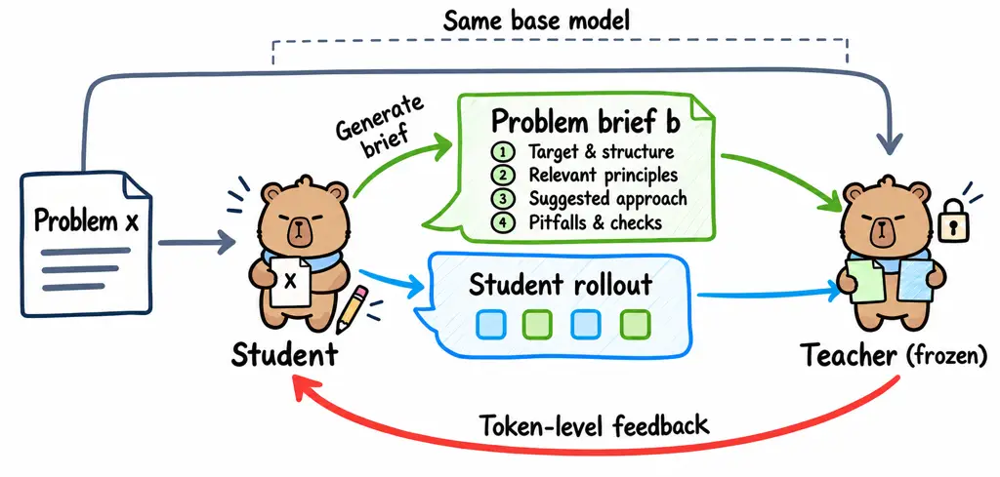

# B-OPSD: On-Policy Self-Distillation with Self-Generated Problem Briefs

Zhi Xu ^(†)^(†)thanks: Equal contribution.    Yinqi Wu¹¹footnotemark: 1
   Feng Zhang    Xiaotong Zhang    Hong Yu    Han Liu ^(†)^(†)thanks:
Corresponding author. Affiliation: Dalian University of Technology
Affiliation: Dalian, China Affiliation: xu.zhi.dut@gmail.com,
wuyinqi@mail.dlut.edu.cn Affiliation: fengzhangyvonne@gmail.com,
zxt.dut@hotmail.com Affiliation: hongyu@dlut.edu.cn,
liu.han.dut@gmail.com

###### Abstract

On-Policy Self-Distillation (OPSD) has recently attracted interest
because it provides dense teacher guidance without a separate, often
larger teacher model. However, OPSD conditions its teacher on
ground-truth solutions, which limits its use when such solutions are
unavailable. We propose On-Policy Self-Distillation with Self-Generated
Problem Briefs (B-OPSD). Using a prompt template, the initial model or a
saved student checkpoint generates a problem brief from the question
alone. The prompt asks for relevant principles, applicability
conditions, and likely pitfalls, but not a final answer or a complete
solution. A frozen teacher uses the brief as privileged context to guide
the current student’s on-policy rollouts through token-level
distribution matching. B-OPSD uses no ground-truth solutions during
training. Results on AIME 2024, AIME 2025, and HMMT 2025 show that both
B-OPSD variants achieve higher average accuracy than OPSD at each of
three Qwen3 model sizes. Code is available at
[https://github.com/ZevineXu/B-OPSD](https://github.com/ZevineXu/B-OPSD).

## 1 Introduction

Large language models have shown strong performance in language
understanding (Cao and Liu, 2026; Lee et al., 2026; Zhang et al.,
2026b), mathematical reasoning (Wei et al., 2022; Lewkowycz et al.,
2022; Chen et al., 2025), and code generation (OpenAI, 2023; Kang et
al., 2025; Dai et al., 2025). Their performance on specific tasks can be
improved through supervised fine-tuning (SFT), reinforcement learning
with verifiable rewards (RLVR), and on-policy distillation (OPD) (Ouyang
et al., 2022; Shao et al., 2024; Agarwal et al., 2024).

These methods provide different learning signals. SFT trains the model
on reference responses supplied in the training data. In mathematical
reasoning, RLVR can sample responses from the current model and score
their final answers, but an outcome reward does not identify which
reasoning steps caused an error. OPD also uses responses sampled from
the student. A teacher then evaluates each student prefix and provides
guidance through its next-token distribution (Agarwal et al., 2024; Lu
and Thinking Machines Lab, 2025).

OPD commonly uses a separate teacher model to provide this guidance.
On-Policy Self-Distillation (OPSD) instead gives the same base model two
roles with different input contexts (Zhao et al., 2026). Its student
sees the problem, while its teacher also sees a reference solution. Both
roles evaluate the student’s trajectory, and the teacher’s distribution
guides the student at each token. OPSD does not use a separate teacher
model during distillation, but it still needs a reference solution for
each training problem. Preparing reference solutions for a dataset of
questions alone may require an external model and validation. This
dependence raises a practical question: Can on-policy self-distillation
work when no correct reference solution is available?



Figure 1: Overview of B-OPSD. Student and teacher start from the same
base model; the teacher stays frozen while the student is updated. The
initial model generates static briefs, while a saved student checkpoint
generates refreshed briefs. The current student generates its solution
trajectory from the question alone. The frozen teacher receives the
question and brief, evaluates the same student prefixes, and provides
token-level feedback.

To answer this question, we propose On-Policy Self-Distillation with
Self-Generated Problem Briefs (B-OPSD). The model generates a _problem
brief_ from the question alone. The brief is intended to connect
relevant principles to the problem, state when they apply, and note
likely pitfalls and checks. The prompt instructs the model not to
provide a final answer or a complete solution. As Figure 1 shows, the
student samples a solution trajectory from the question, while the
teacher evaluates the same trajectory with the brief as additional
context. Their token-level distribution difference updates only the
student. We consider briefs generated once before training and briefs
refreshed from earlier student checkpoints. Neither version uses a
reference solution or an external model to prepare teacher context. On
AIME 2024, AIME 2025, and HMMT 2025, both versions achieve higher
average accuracy across the three benchmarks than OPSD at each of three
Qwen3 model sizes in the reported runs. These results suggest that
self-generated problem briefs can provide useful teacher context without
a verified solution.

## 2 Related Work

#### Supervised fine-tuning (SFT).

SFT trains on reference responses, predicting each token from the
preceding reference tokens (Ouyang et al., 2022; Yao et al., 2025; Fan
et al., 2025). Sequence-level KD uses teacher responses as targets (Kim
and Rush, 2016), while STaR and ReST^(EM) train on solutions selected
with answer feedback (Zelikman et al., 2022; Singh and others, 2024).
Training on reference prefixes but generating from the model’s own
prefixes at inference creates exposure bias.

#### Reinforcement learning with verifiable rewards (RLVR).

RLVR samples responses from the current policy and scores their final
answers.Schulman et al. (2017); Xi et al. (2026); Zhang et al. (2026a)
PPO uses clipped updates but typically trains a value model, which adds
memory cost (Schulman et al., 2017). GRPO avoids this model by
estimating advantages from groups of responses (Shao et al., 2024).
Building on GRPO, DAPO raises the upper clipping bound and filters
groups with uniform rewards (Yu and others, 2025). GSPO replaces GRPO’s
token-level importance ratios and clipping with sequence-level versions
(Zheng et al., 2025). Yet outcome rewards cannot locate a reasoning
error or provide a teacher distribution at each token.

#### On-policy distillation (OPD).

OPD addresses the limitation of RLVR by matching a teacher’s next-token
distributions on trajectories generated by the current student (Lu and
Thinking Machines Lab, 2025; Yuan et al., 2026; Wen et al., 2025). GKD
trains on student-generated sequences and allows different divergences
to match the teacher and student distributions (Agarwal et al., 2024).
Entropy-Aware OPD adds forward KL to the reverse KL loss when the
teacher distribution has high entropy (Jin et al., 2026). Many existing
OPD systems use a separate, stronger teacher model. The teacher is often
larger than the student, which increases training cost.

|        |                 |                       |                           |                  |
| ------ | --------------- | --------------------- | ------------------------- | ---------------- |
|        | Training signal |                       | Training requirements     |                  |
| Method | On-policy data  | Dense learning signal | No separate teacher model | No answer labels |
| SFT    | $`\times`$      | $`\checkmark`$        | $`\checkmark`$            | $`\times`$       |
| GRPO   | $`\checkmark`$  | $`\times`$            | $`\checkmark`$            | $`\times`$       |
| OPD    | $`\checkmark`$  | $`\checkmark`$        | $`\times`$                | $`\checkmark`$   |
| OPSD   | $`\checkmark`$  | $`\checkmark`$        | $`\checkmark`$            | $`\times`$       |
| B-OPSD | $`\checkmark`$  | $`\checkmark`$        | $`\checkmark`$            | $`\checkmark`$   |

Table 1: B-OPSD combines on-policy student rollouts and token-level
teacher feedback without a separate teacher model, reference solutions,
or verified answers during training. The SFT and GRPO rows use the
reference solutions and verified final answers, respectively, from the
compared training setups. The OPD row represents a common setup with a
separate teacher model and no answer labels during distillation.

#### On-policy self-distillation (OPSD).

OPSD gives student and teacher roles to the same base model, with a
reference answer or solution available only to the teacher (Zhao et al.,
2026). Context distillation also uses extra information during training,
and On-Policy Context Distillation conditions a teacher on historical
solutions or optimized prompts (Snell et al., 2022; Ye et al., 2026).
OPSD removes the separate teacher model but still needs a reference for
each training problem. B-OPSD replaces that reference with a
self-generated problem brief. The teacher uses the brief to guide
student rollouts through token distributions; no reference answer is
read during training. Table 1 compares the training setups.

## 3 Method

### 3.1 Generating Problem Briefs

We train B-OPSD on a set $`\mathcal{D}=\{x_{i}\}_{i=1}^{N}`$ of
mathematical problems without reading reference solutions or using an
outcome verifier. OPSD supplies its teacher with a reference solution
(Zhao et al., 2026). B-OPSD instead prepares teacher context from the
problem itself. Identifying relevant principles and checking their
conditions may be possible even when producing a complete correct
solution is difficult. We use a problem brief to make this information
available to the teacher. Figure 2 shows the complete generation prompt
$`\mathcal{P}_{B}`$.

The prompt has four parts. First, it asks the generator to identify the
target, givens, constraints, and main challenge. Second, it asks for
relevant principles, including their formulas, meaning, applicability
conditions, and connection to the problem. Third, it asks for a useful
setup and main subgoals. Local setup equations are allowed, but the
calculations and proof are left to the solver, and other valid
approaches remain possible. Fourth, it asks for problem-specific
pitfalls, conditions to verify, and ways to check the result. The prompt
also asks the generator to avoid unrelated theory and invented
assumptions, omit the final answer and complete solution, keep the brief
within 700 tokens, and output only the brief.

Let $`\theta_{0}`$ be the initial model parameters and $`\theta_{k}`$
the student parameters after $`k`$ updates. The brief generator has
parameters $`\phi_{k}`$ from the initial model or a saved student
checkpoint. Given a problem $`x`$, it samples a brief as

```math
b\sim p_{\phi_{k}}(\cdot\mid\mathcal{P}_{B},x). \tag{1}
```

We use one brief for each problem when it is processed and pass the
brief to the teacher as text. Static briefs are reused, while refreshed
briefs are generated using the selected checkpoint. Gradients do not
pass through brief generation. We do not verify or filter generated
briefs. Appendix B shows outputs from the generation records.

The teacher prompt presents the original problem followed by the brief
and asks the model to keep each reasoning step valid. The student
receives the problem without the brief. The brief is teacher context,
not a target response for the student to reproduce. It is not checked
against a reference solution and may contain mistakes. The method uses
it to change the teacher’s conditioning context, not as a verified
answer.

Figure 2: Complete problem brief generation prompt $`\mathcal{P}_{B}`$.
The same prompt is used for static and refreshed briefs. The generator
also receives the problem statement $`x`$.

### 3.2 On-Policy Self-Distillation with Problem Briefs

We retain a frozen teacher with parameters $`\bar{\theta}=\theta_{0}`$
and update only the student. At training step $`k`$, the student samples
a solution trajectory from its current policy:

```math
\hat{y}\sim p_{\theta_{k}}(\cdot\mid x). \tag{2}
```

Let $`T=|\hat{y}|`$ be its length and $`\hat{y}_{<t}`$ its prefix at
position $`t`$. The student and teacher evaluate the same prefix, with
the brief available only to the teacher:

```math
\displaystyle p_{S,t}^{\theta} \displaystyle=p_{\theta}(\cdot\mid x,\hat{y}_{<t}), \tag{3}
```

```math
\displaystyle p_{T,t} \displaystyle=p_{\bar{\theta}}(\cdot\mid x,b,\hat{y}_{<t}). \tag{4}
```

The role-specific prompts are omitted for clarity. To evaluate a
trajectory, we append the same sampled prefix to each role’s prompt and
compute next-token distributions. The teacher does not need to sample a
separate solution. Its forward pass supplies a distribution at every
position of the student’s trajectory. Thus, the loss can be computed for
a trajectory without first judging its final answer. The teacher’s
guidance still depends on the quality of the generated brief; it does
not certify that a step or answer is correct.

1: Problems $`\mathcal{D}`$, initial parameters $`\theta_{0}`$, brief
prompt $`\mathcal{P}_{B}`$, training steps $`K`$

2: Brief mode, checkpoint schedule $`\mathcal{C}`$, divergence $`D`$,
threshold $`\tau`$

3: Freeze teacher at $`\bar{\theta}\leftarrow\theta_{0}`$

4: if brief mode is static then

5:   for all $`x\in\mathcal{D}`$ do

6:    Generate and store
$`b_{0}(x)\sim p_{\theta_{0}}(\cdot\mid\mathcal{P}_{B},x)`$

7:   end for

8: end if

9: for $`k=0,1,\ldots,K-1`$ do

10:   Sample a batch $`\mathcal{B}_{k}`$ from $`\mathcal{D}`$

11:   if brief mode is refreshed then

12:    Select generator $`\phi_{k}\leftarrow\theta_{s(k)}`$ using Eq. 12

13:   end if

14:   for all $`x\in\mathcal{B}_{k}`$ do

15:    if brief mode is static then

16:      $`b_{k}(x)\leftarrow b_{0}(x)`$

17:    else

18:      $`b_{k}(x)\sim p_{\phi_{k}}(\cdot\mid\mathcal{P}_{B},x)`$

19:    end if

20:    Sample a student trajectory
$`\hat{y}_{x}\sim p_{\theta_{k}}(\cdot\mid x)`$

21:    Evaluate student and teacher distributions on $`\hat{y}_{x}`$
using Eqs. 3–4

22:   end for

23:
  $`\mathcal{L}_{k}(\theta)\leftarrow\dfrac{1}{|\mathcal{B}_{k}|}\sum_{x\in\mathcal{B}_{k}}\ell_{D}^{\tau}(\theta;x,b_{k}(x),\hat{y}_{x})`$

24:   Update only the student to obtain $`\theta_{k+1}`$ by minimizing
$`\mathcal{L}_{k}`$

25:   if $`k+1\in\mathcal{C}`$ then

26:    Save student checkpoint $`\theta_{k+1}`$

27:   end if

28: end for

29: return $`p_{\theta_{K}}`$

Algorithm 1 B-OPSD training with static or refreshed problem briefs

#### Distribution matching.

For a fixed brief and sampled trajectory, we average the divergence
between the two next-token distributions over the positions in the
trajectory:

```math
\ell_{D}(\theta;x,b,\hat{y})=\frac{1}{T}\sum_{t=1}^{T}D\!\left(p_{T,t}\,\|\,p_{S,t}^{\theta}\right). \tag{5}
```

The loss compares full distributions rather than only the probabilities
of the sampled tokens. We consider three choices for $`D`$ in Eq. 5.
Forward KL weights the log ratio by the teacher distribution, while
reverse KL weights it by the student distribution:

```math
\displaystyle D_{\mathrm{FKL}} \displaystyle=D_{\mathrm{KL}}(p_{T,t}\|p_{S,t}^{\theta}), \tag{6}
```

```math
\displaystyle D_{\mathrm{RKL}} \displaystyle=D_{\mathrm{KL}}(p_{S,t}^{\theta}\|p_{T,t}), \tag{7}
```

JSD compares each distribution with their mixture
$`m_{t}=\beta p_{T,t}+(1-\beta)p_{S,t}^{\theta}`$:

```math
\displaystyle D_{\mathrm{JSD}_{\beta}} \displaystyle=\beta D_{\mathrm{KL}}(p_{T,t}\|m_{t})+(1-\beta)D_{\mathrm{KL}}(p_{S,t}^{\theta}\|m_{t}), \tag{8}
```

Here $`D_{\mathrm{KL}}`$ denotes KL divergence and $`\beta\in[0,1]`$. We
use $`\beta=0.5`$ in the divergence comparison. The main experiments use
forward KL. In the divergence comparison, we train a separate model with
each loss under the same teacher conditioning.

#### Pointwise divergence clipping.

We retain the pointwise clipping procedure of OPSD (Zhao et al., 2026).
Let $`\mathcal{V}`$ be the model vocabulary and $`d_{t,v}^{D}`$ the
contribution of entry $`v`$ to the selected divergence at position
$`t`$, so that

```math
D\!\left(p_{T,t}\,\|\,p_{S,t}^{\theta}\right)=\sum_{v\in\mathcal{V}}d_{t,v}^{D}. \tag{9}
```

For a threshold $`\tau`$, the clipped loss is

```math
\ell_{D}^{\tau}(\theta;x,b,\hat{y})=\frac{1}{T}\sum_{t=1}^{T}\sum_{v\in\mathcal{V}}\min\!\left(d_{t,v}^{D},\tau\right). \tag{10}
```

For forward KL, $`d_{t,v}^{D}`$ is the teacher probability
$`p_{T,t}(v)`$ times the log ratio of teacher to student probabilities
at $`v`$. Reverse KL exchanges the teacher and student probabilities.
For JSD, $`d_{t,v}^{D}`$ is the sum of the two weighted KL contributions
in Eq. 8, evaluated at $`v`$. Clipping is applied to these vocabulary
contributions before they are summed over entries and positions. It does
not clip the completed sequence loss. The divergence choice and clipping
threshold are reported in the experimental settings.

For a batch $`\mathcal{B}_{k}`$, we average the clipped losses:

```math
\mathcal{L}_{k}(\theta)=\frac{1}{|\mathcal{B}_{k}|}\sum_{x\in\mathcal{B}_{k}}\ell_{D}^{\tau}\!\left(\theta;x,b_{k}(x),\hat{y}_{x}\right), \tag{11}
```

where $`b_{k}(x)`$ is the brief assigned to $`x`$ at step $`k`$ and
$`\hat{y}_{x}`$ is sampled according to Eq. 2. The optimizer updates
$`\theta_{k}`$ using this loss. Neither the teacher nor the brief
generator receives gradients from the update. The sampled trajectory and
teacher probabilities are held fixed during this update; gradients pass
only through the student probabilities. A new trajectory is sampled from
the updated student at later steps. Thus, the rollouts remain on-policy
while the teacher stays at $`\theta_{0}`$.

### 3.3 Static and Refreshed Briefs

We consider two ways to choose the brief generator. Both use the same
generation prompt, frozen teacher, and distillation procedure. They
differ in whether the generator remains at the initial model or follows
saved student checkpoints.

#### B-OPSD with static briefs.

Before training, the initial model generates one brief for every
training problem. We retain each generated brief without format
filtering and reuse it throughout training. Thus,
$`\phi_{k}=\theta_{0}`$ for all $`k`$, and $`b_{k}(x)=b_{0}(x)`$. This
variant keeps the teacher context fixed for each problem. Its teacher
distributions can still change across visits to that problem because the
student may generate different trajectory prefixes.

#### B-OPSD with refreshed briefs.

The generator uses the most recently saved student checkpoint. Let
$`\mathcal{C}`$ be the set of completed update counts at which
checkpoints are saved, including $`0`$. At step $`k`$, we select

```math
s(k)=\max\{s\in\mathcal{C}:s\leq k\},\qquad\phi_{k}=\theta_{s(k)}. \tag{12}
```

The initial model supplies briefs until a later checkpoint becomes
available. Subsequent briefs use the selected checkpoint. This allows
the brief content to reflect changes in the student during training
without updating the teacher parameters. The checkpoint interval and
generation settings are specified in the experiments.

Algorithm 1 summarizes the training procedure. In both variants, the
current student generates the trajectories used for distillation. The
source of the brief does not change this on-policy property. At
inference, we use the trained student with the problem alone; brief
generation and teacher evaluation are training operations.

## 4 Experiments

### 4.1 Experimental Setup

|            |           |           |           |         |
| ---------- | --------- | --------- | --------- | ------- |
| Method     | AIME 2024 | AIME 2025 | HMMT 2025 | Average |
| Qwen3-1.7B |           |           |           |         |
| Base       | 51.5      | 36.7      | 23.1      | 37.1    |
| SFT        | 48.4      | 36.3      | 22.7      | 35.8    |
| GRPO       | 51.1      | 38.3      | 23.7      | 37.7    |
| OPSD       | 54.7      | 43.1      | 25.0      | 40.9    |
| B-OPSD     | 56.4      | 42.2      | 27.2      | 41.9    |
| B-OPSD^(⋆) | 57.5      | 42.5      | 28.6      | 42.9    |
| Qwen3-4B   |           |           |           |         |
| Base       | 74.9      | 66.4      | 42.2      | 61.2    |
| SFT        | 70.2      | 62.3      | 43.4      | 58.6    |
| GRPO       | 75.6      | 68.1      | 44.4      | 62.7    |
| OPSD       | 75.6      | 67.5      | 45.8      | 63.0    |
| B-OPSD     | 76.4      | 68.3      | 46.1      | 63.6    |
| B-OPSD^(⋆) | 77.5      | 70.3      | 45.0      | 64.3    |
| Qwen3-8B   |           |           |           |         |
| Base       | 75.8      | 65.6      | 43.9      | 61.8    |
| SFT        | 72.3      | 64.2      | 42.9      | 59.8    |
| GRPO       | 76.4      | 68.9      | 46.7      | 64.0    |
| OPSD       | 77.8      | 71.9      | 46.7      | 65.5    |
| B-OPSD     | 79.7      | 71.1      | 47.5      | 66.1    |
| B-OPSD^(⋆) | 78.3      | 71.9      | 50.0      | 66.8    |

Table 2: Avg@12 accuracy (%) across three benchmarks. B-OPSD uses static
briefs; B-OPSD^(⋆) uses refreshed briefs. Average is computed from
unrounded scores. Shaded rows show the B-OPSD variants, and bold marks
the highest score for each model size and column.

Figure 3: Checkpoint Avg@12 accuracy (%) for Qwen3-1.7B. B-OPSD uses
static briefs; B-OPSD^(⋆) uses refreshed briefs. The Average panel
combines scores from the same checkpoint; Table 2 averages each
benchmark’s best score. The vertical axes start near the observed scores
and differ across panels.

#### Models and data.

Following OPSD (Zhao et al., 2026), we use the instruct-tuned
Qwen3-1.7B, Qwen3-4B, and Qwen3-8B models (Yang and others, 2025). We
sample up to 30,000 mathematical problems from the OpenThoughts
reasoning subset (Guha and others, 2026). B-OPSD reads only the problem
statements during training. We evaluate on AIME 2024, AIME 2025, and
HMMT 2025.

#### Baselines.

We compare B-OPSD with the initial model, SFT, GRPO, and OPSD. We take
the Base, SFT, and GRPO results from OPSD Zhao et al. (2026) and
reproduce OPSD ourselves. In the original study, SFT trains on the
reference solutions in OpenThoughts, while GRPO uses verified final
answers to provide outcome rewards. Our OPSD reproduction uses the
reference solutions as privileged teacher context.

#### Implementation details.

Our OPSD reproduction and B-OPSD runs use LoRA on NVIDIA A800 GPUs (Hu
et al., 2022). Following OPSD, we use a learning rate of
$`5\times 10^{-6}`$, an effective batch size of 32, LoRA rank 64, and
LoRA scaling factor 128. All three distillation runs train for 100
updates. We sample one student trajectory per problem at temperature
$`1.1`$, with a maximum length of 1,024 tokens. The teacher remains
fixed at the initial model while the student is updated. The main B-OPSD
runs use full-vocabulary forward KL with pointwise clipping at
$`\tau=0.05`$.

We generate problem briefs with temperature $`0.0`$. B-OPSD with static
briefs generates each brief before training. B-OPSD with refreshed
briefs uses the most recently saved student checkpoint and saves a new
checkpoint every 25 updates. Appendix A gives further implementation
details.

#### Evaluation.

Following OPSD, our evaluations report Avg@12 accuracy from 12 samples
per problem. We use thinking mode, sampling temperature $`1.0`$,
top-$`p`$ $`0.95`$, and a maximum generation length of 38,912 tokens
(Zhao et al., 2026). We evaluate our distillation checkpoints at steps
25, 50, 75, and 100 and report the highest score for each benchmark.

In the results, B-OPSD denotes the version with static briefs, and
B-OPSD^(⋆) denotes the version with refreshed briefs.

### 4.2 Main Results

Table 2 shows that both B-OPSD variants have higher average accuracy
than Base, SFT, GRPO, and OPSD at every model size tested. Compared with
OPSD, B-OPSD gains 1.0, 0.6, and 0.6 percentage points at 1.7B, 4B, and
8B. B-OPSD^(⋆) gains 2.0, 1.3, and 1.3 points, respectively, and has the
highest average at each size. These results show that problem briefs can
provide useful teacher context without reference solutions during
training in the reported settings.

Across the three benchmarks, B-OPSD^(⋆) achieves the highest average
accuracy at every model size. On AIME 2024, both B-OPSD variants exceed
OPSD at all three sizes. B-OPSD^(⋆) reaches 57.5 versus 54.7 for OPSD at
1.7B, and 77.5 versus 75.6 at 4B. On AIME 2025, B-OPSD^(⋆) reaches 70.3
versus 67.5 for OPSD at 4B. On HMMT 2025, B-OPSD exceeds OPSD at all
three sizes, and B-OPSD^(⋆) reaches 50.0 versus 46.7 for OPSD at 8B.

Refreshing briefs raises the reported average over static briefs by 1.0,
0.7, and 0.7 points at 1.7B, 4B, and 8B. At 8B, refreshed briefs also
achieve higher scores on AIME 2025 and HMMT 2025. Figure 3 shows the
Qwen3-1.7B results across checkpoints. In its Average panel, B-OPSD^(⋆)
exceeds both B-OPSD and OPSD at three of the four evaluated checkpoints.
Briefs from later student checkpoints may provide teacher context that
better reflects the student’s changing policy than briefs fixed before
training. These results show that problem briefs can improve
self-distillation without verified reference solutions in the reported
settings.

### 4.3 Problem Brief Generation Strategies

In this section, we examine whether problem briefs expected to be more
accurate improve B-OPSD. A larger model may generate more accurate
briefs, and access to a reference solution may also help the generator
identify relevant information. We therefore compare two variants for
distilling Qwen3-1.7B. In B-OPSD(8B), Qwen3-8B generates the briefs from
the training problems. In B-OPSD(ref), the briefs are generated using
the reference solutions supplied to OPSD. Both variants use the
resulting briefs as privileged teacher context to train Qwen3-1.7B.
B-OPSD(ref) uses reference solutions during brief preparation, while the
main B-OPSD variants do not. All runs use the same training and
evaluation settings for the 1.7B model. We report results on AIME 2024
and HMMT 2025 in Table 3.

|             |           |           |
| ----------- | --------- | --------- |
| Method      | AIME 2024 | HMMT 2025 |
| OPSD        | 54.7      | 25.0      |
| B-OPSD(8B)  | 56.4      | 27.8      |
| B-OPSD(ref) | 56.4      | 27.5      |
| B-OPSD      | 56.4      | 27.2      |
| B-OPSD^(⋆)  | 57.5      | 28.6      |

Table 3: Avg@12 accuracy (%) for Qwen3-1.7B with different brief
generation strategies. B-OPSD uses static briefs generated by the
initial 1.7B model, and B-OPSD^(⋆) uses refreshed briefs. B-OPSD(8B)
uses briefs generated by Qwen3-8B, while B-OPSD(ref) uses briefs
generated using the reference solutions supplied to OPSD. Shaded rows
show our main variants. Bold marks the best result in each column.

Both alternative brief sources improve on OPSD. B-OPSD(8B) and
B-OPSD(ref) each match B-OPSD at 56.4 on AIME 2024. On HMMT 2025, they
exceed B-OPSD by 0.6 and 0.3 points, respectively. B-OPSD^(⋆), which
refreshes briefs using a recent student checkpoint, achieves the highest
scores on both benchmarks. This pattern suggests that briefs adapted as
the student learns may be more useful than briefs from a larger model or
reference solutions.

### 4.4 Effect of Divergence Choice

Following OPSD (Zhao et al., 2026), we compare forward KL
$`D_{\mathrm{KL}}(p_{T}\|p_{S})`$, reverse KL
$`D_{\mathrm{KL}}(p_{S}\|p_{T})`$, and Jensen–Shannon divergence (JSD)
with $`\beta=0.5`$ for B-OPSD^(⋆), B-OPSD, and OPSD on Qwen3-1.7B. We
evaluate all three methods on AIME 2024 and HMMT 2025 and report Avg@12
accuracy, as in Table 2.

|                     |      |        |            |
| ------------------- | ---- | ------ | ---------- |
| Divergence          | OPSD | B-OPSD | B-OPSD^(⋆) |
| AIME 2024           |      |        |            |
| Forward KL          | 54.7 | 56.4   | 57.5       |
| Reverse KL          | 51.1 | 52.7   | 54.2       |
| JSD ($`\beta=0.5`$) | 50.0 | 50.0   | 52.9       |
| HMMT 2025           |      |        |            |
| Forward KL          | 25.0 | 27.2   | 28.6       |
| Reverse KL          | 24.7 | 25.0   | 26.4       |
| JSD ($`\beta=0.5`$) | 25.0 | 25.3   | 25.6       |

Table 4: Avg@12 accuracy (%) for Qwen3-1.7B with different divergences.
B-OPSD uses static briefs; B-OPSD^(⋆) uses refreshed briefs. Bold marks
the highest score in each row.

Forward KL achieves the highest score for both B-OPSD variants on AIME
2024 and HMMT 2025. For OPSD, forward KL scores highest on AIME 2024 and
ties JSD on HMMT 2025. Under each of the three divergences, B-OPSD^(⋆)
has the highest score among the three methods on both benchmarks and
exceeds OPSD. These results support the use of forward KL in our main
Qwen3-1.7B experiments. They also show that B-OPSD^(⋆) can outperform
OPSD across the tested divergences without using reference solutions
during training.

### 4.5 Problem Brief Component Ablation

We examine the four sections of the problem brief using Qwen3-1.7B. Each
ablation omits one section: targets, relevant principles, suggested
approach, or pitfalls and checks. We evaluate both B-OPSD with static
briefs and B-OPSD with refreshed briefs on AIME 2024 and HMMT 2025.
Table 5 compares each ablation with the corresponding full brief.

|                     | B-OPSD    |           | B-OPSD^(⋆) |           |
| ------------------- | --------- | --------- | ---------- | --------- |
| Omitted section     | AIME 2024 | HMMT 2025 | AIME 2024  | HMMT 2025 |
| None (full brief)   | 56.4      | 27.2      | 57.5       | 28.6      |
| Targets             | 57.2      | 28.6      | 56.1       | 27.8      |
| Relevant principles | 55.8      | 26.7      | 56.7       | 26.7      |
| Suggested approach  | 57.5      | 28.3      | 57.0       | 26.9      |
| Pitfalls and checks | 56.7      | 26.7      | 56.7       | 28.3      |

Table 5: Avg@12 accuracy (%) for Qwen3-1.7B when one problem brief
section is omitted. B-OPSD uses static briefs, and B-OPSD^(⋆) uses
refreshed briefs. The shaded row uses the full brief. Bold marks the
highest score within each variant and benchmark.

Relevant principles are the most consistent contributor in this
ablation. Removing them lowers accuracy on both benchmarks for both
brief variants. With refreshed briefs, AIME 2024 falls from 57.5 to 56.7
and HMMT 2025 falls from 28.6 to 26.7. The complete refreshed brief also
achieves the highest score on both benchmarks within its variant;
removing any of its four sections lowers accuracy. These results
identify relevant principles as useful teacher context and show the
value of retaining the complete brief when it is refreshed from student
checkpoints.

## 5 Conclusion

We introduced B-OPSD, which generates a problem brief from the question
and gives it to a frozen teacher as additional context. The current
student samples solution trajectories from the question alone. The
teacher evaluates the same trajectories and provides token-level
distributions that guide student updates. This process uses no reference
solutions during training and requires no separate teacher model. Across
three Qwen3 model sizes and three competition mathematics benchmarks,
both B-OPSD with static briefs and B-OPSD with refreshed briefs achieved
higher average accuracy than OPSD in the reported runs. Refreshed briefs
achieved the highest average at every model size. These results show
that problem briefs can match or exceed the performance of OPSD without
verified reference solutions during training. We will further examine
how problem briefs should be updated during training, including when to
refresh them. We will also test B-OPSD on reasoning tasks beyond
competition mathematics.

## References

- \[1\] R. Agarwal, N. Vieillard, Y. Zhou, P. Stanczyk, S. R. Garea, M.
  Geist, and O. Bachem (2024) On-policy distillation of language models:
  learning from self-generated mistakes. In International Conference on
  Learning Representations (ICLR), Cited by: §1, §1, §2.
- \[2\] L. Cao and H. Liu (2026) TableMaster: A recipe to advance table
  understanding with language models. In International Conference on
  Learning Representations (ICLR), Cited by: §1.
- \[3\] J. Chen, W. Chen, J. Du, et al. (2025) Seed-prover 1.5:
  mastering undergraduate-level theorem proving via learning from
  experience. arXiv abs/2512.17260. Cited by: §1.
- \[4\] B. Dai, L. R. Luo, Q. Tang, J. Wang, X. Lian, H. Xu, M. Qin, X.
  Xu, B. Dai, H. Wang, Z. Lyu, and J. Pang (2025) MeshCoder: llm-powered
  structured mesh code generation from point clouds. In Conference on
  Neural Information Processing Systems (NeurIPS), Cited by: §1.
- \[5\] Y. Fan, Y. Hong, Q. Wang, J. Bao, H. Jiang, and Y. Song (2025)
  Preference-oriented supervised fine-tuning: favoring target model over
  aligned large language models. In AAAI Conference on Artificial
  Intelligence (AAAI), pp. 23859–23867. Cited by: §2.
- \[6\] E. K. Guha et al. (2026) OpenThoughts: data recipes for
  reasoning models. In International Conference on Learning
  Representations (ICLR), Cited by: §4.1.
- \[7\] E. J. Hu, Y. Shen, P. Wallis, Z. Allen-Zhu, Y. Li, S. Wang, L.
  Wang, and W. Chen (2022) LoRA: low-rank adaptation of large language
  models. In International Conference on Learning Representations
  (ICLR), Cited by: §4.1.
- \[8\] W. Jin, T. Min, Y. Yang, S. R. Kadhe, Y. Zhou, D. Wei, N.
  Baracaldo, and K. Lee (2026) Entropy-aware on-policy distillation of
  language models. arXiv abs/2603.07079. Cited by: §2.
- \[9\] M. Kang, J. Jeong, S. Lee, J. Cho, and S. J. Hwang (2025)
  Distilling LLM agent into small models with retrieval and code tools.
  In Conference on Neural Information Processing Systems (NeurIPS),
  Cited by: §1.
- \[10\] Y. Kim and A. M. Rush (2016) Sequence-level knowledge
  distillation. In Conference on Empirical Methods in Natural Language
  Processing (EMNLP), J. Su, X. Carreras, and K. Duh (Eds.),
  pp. 1317–1327. Cited by: §2.
- \[11\] J. Lee, W. Shin, S. Yang, K. Song, D. Lim, J. Kim, T. Kim,
  and B. Kim (2026) ERGO: efficient high-resolution visual understanding
  for vision-language models. In International Conference on Learning
  Representations (ICLR), Cited by: §1.
- \[12\] A. Lewkowycz, A. Andreassen, D. Dohan, E. Dyer, H.
  Michalewski, V. V. Ramasesh, A. Slone, C. Anil, I. Schlag, T.
  Gutman-Solo, Y. Wu, B. Neyshabur, G. Gur-Ari, and V. Misra (2022)
  Solving quantitative reasoning problems with language models. In
  Conference on Neural Information Processing Systems (NeurIPS), Cited
  by: §1.
- \[13\] K. Lu and Thinking Machines Lab (2025) On-policy distillation.
  Thinking Machines Lab: Connectionism. External Links:
  [Document](https://dx.doi.org/10.64434/tml.20251026),
  [Link](https://thinkingmachines.ai/blog/on-policy-distillation/) Cited
  by: §1, §2.
- \[14\] OpenAI (2023) GPT-4 technical report. External Links:
  2303.08774 Cited by: §1.
- \[15\] L. Ouyang, J. Wu, X. Jiang, D. Almeida, C. L. Wainwright, P.
  Mishkin, C. Zhang, S. Agarwal, K. Slama, A. Ray, J. Schulman, J.
  Hilton, F. Kelton, L. Miller, M. Simens, A. Askell, P. Welinder, P. F.
  Christiano, J. Leike, and R. Lowe (2022) Training language models to
  follow instructions with human feedback. In Conference on Neural
  Information Processing Systems (NeurIPS), Cited by: §1, §2.
- \[16\] J. Schulman, F. Wolski, P. Dhariwal, A. Radford, and O.
  Klimov (2017) Proximal policy optimization algorithms. arXiv
  abs/1707.06347. External Links: 1707.06347 Cited by: §2.
- \[17\] Z. Shao, P. Wang, Q. Zhu, R. Xu, J. Song, M. Zhang, Y. K.
  Li, Y. Wu, and D. Guo (2024) DeepSeekMath: pushing the limits of
  mathematical reasoning in open language models. arXiv abs/2402.03300.
  Cited by: §1, §2.
- \[18\] A. Singh et al. (2024) Beyond human data: scaling self-training
  for problem-solving with language models. Trans. Mach. Learn. Res. 2024. Cited by: §2.
- \[19\] C. Snell, D. Klein, and R. Zhong (2022) Learning by distilling
  context. arXiv abs/2209.15189. Cited by: §2.
- \[20\] J. Wei, X. Wang, D. Schuurmans, M. Bosma, B. Ichter, F.
  Xia, E. H. Chi, Q. V. Le, and D. Zhou (2022) Chain-of-thought
  prompting elicits reasoning in large language models. In Conference on
  Neural Information Processing Systems (NeurIPS), Cited by: §1.
- \[21\] X. Wen, J. Lou, X. Lu, Y. Ji, X. Guan, Y. Lu, H. Lin, B. He, X.
  Han, D. Zhang, and L. Sun (2025) On-policy self-alignment with
  fine-grained knowledge feedback for hallucination mitigation. In
  Annual Meeting of the Association for Computational Linguistics
  (ACL), W. Che, J. Nabende, E. Shutova, and M. T. Pilehvar (Eds.),
  Findings of ACL, Vol. ACL 2025, pp. 5215–5231. Cited by: §2.
- \[22\] Z. Xi, X. Guo, Y. Nan, E. Zhou, J. Shen, W. Chen, J. Liu, J.
  Huang, X. Deng, Z. Zhang, H. Guo, Z. Lei, M. Zheng, G. Wang, P.
  Sun, R. Zheng, H. Yan, T. Gui, Q. Zhang, and X. Huang (2026) BAPO:
  stabilizing off-policy reinforcement learning for llms via balanced
  policy optimization with adaptive clipping. In International
  Conference on Learning Representations (ICLR), Cited by: §2.
- \[23\] A. Yang et al. (2025) Qwen3 technical report. External Links:
  2505.09388, [Link](https://arxiv.org/abs/2505.09388) Cited by: §4.1.
- \[24\] Y. Yao, J. Tan, K. Liang, F. Zhang, J. Hu, S. Wu, Y. Niu, R.
  Gong, D. Lin, and N. Xu (2025) Hierachical balance packing: towards
  efficient supervised fine-tuning for long-context LLM. In Conference
  on Neural Information Processing Systems (NeurIPS), D. Belgrave, C.
  Zhang, L. N. Montoya, H. Lin, R. Pascanu, P. Koniusz, M. Ghassemi, N.
  Chen, I. V. M. Ruíz, and A. Loaiza-Bonilla (Eds.), Cited by: §2.
- \[25\] T. Ye, L. Dong, X. Wu, S. Huang, and F. Wei (2026) On-policy
  context distillation for language models. arXiv abs/2602.12275. Cited
  by: §2.
- \[26\] Q. Yu et al. (2025) DAPO: an open-source LLM reinforcement
  learning system at scale. In Conference on Neural Information
  Processing Systems (NeurIPS), Cited by: §2.
- \[27\] Q. Yuan, J. Lou, X. Yu, H. Lin, L. Sun, X. Han, and Y.
  Lu (2026) Vision-opd: learning to see fine details for multimodal llms
  via on-policy self-distillation. arXiv abs/2605.18740. Cited by: §2.
- \[28\] E. Zelikman, Y. Wu, J. Mu, and N. D. Goodman (2022) STaR:
  bootstrapping reasoning with reasoning. In Conference on Neural
  Information Processing Systems (NeurIPS), Cited by: §2.
- \[29\] J. Zhang, Z. Fu, J. Shen, Y. Zhao, Y. Zhang, Z. Xi, L. Ma, C.
  An, Z. Zhang, S. Liu, D. Zhu, S. Dou, S. Liu, H. Li, W. Zhou, A.
  Adams, T. Gui, F. Huang, Q. Zhang, and X. Huang (2026) Entropy
  polarity in reinforcement fine-tuning: direction, asymmetry, and
  control. arXiv abs/2605.11775. Cited by: §2.
- \[30\] Z. Zhang, Q. Wang, S. Ye, J. Zhu, J. Yao, B. Han, and M.
  Sugiyama (2026) Towards understanding valuable preference data for
  large language model alignment. In International Conference on
  Learning Representations (ICLR), Cited by: §1.
- \[31\] S. Zhao, Z. Xie, M. Liu, J. Huang, G. Pang, F. Chen, and A.
  Grover (2026) Self-distilled reasoner: on-policy self-distillation for
  large language models. Vol. abs/2601.18734. External Links: 2601.18734
  Cited by: Appendix A, §1, §2, §3.1, §3.2, §4.1, §4.1, §4.1, §4.4.
- \[32\] C. Zheng, S. Liu, M. Li, X. Chen, B. Yu, C. Gao, K. Dang, Y.
  Liu, R. Men, A. Yang, J. Zhou, and J. Lin (2025) Group sequence policy
  optimization. arXiv abs/2507.18071. Cited by: §2.

## Appendix A Additional Implementation Details

Our LoRA adapters cover the query, key, value, and output projections in
attention and the gate, up, and down projections in the feed-forward
layers. We use AdamW and bfloat16 precision. In the original OPSD study,
SFT trains for 100 updates with a maximum sequence length of 16,000
tokens. GRPO trains for 500 updates and samples eight responses per
problem at temperature $`1.2`$, with a maximum length of 16,000 tokens
(Zhao et al., 2026).

The brief generation prompt asks for at most 700 tokens, but we set no
separate hard length limit for brief decoding. We retain generated
briefs without format filtering.

## Appendix B Generated Problem Brief Examples

We randomly sampled candidate problem briefs generated by Qwen3-1.7B and
selected three for illustration. Their formatting is adapted for LaTeX.


