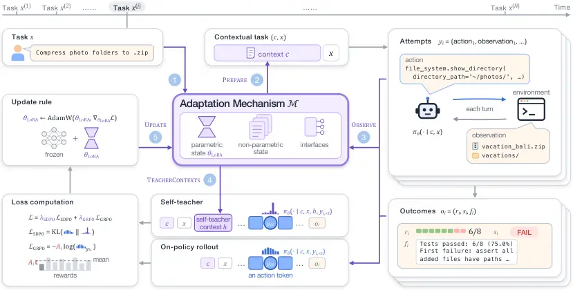
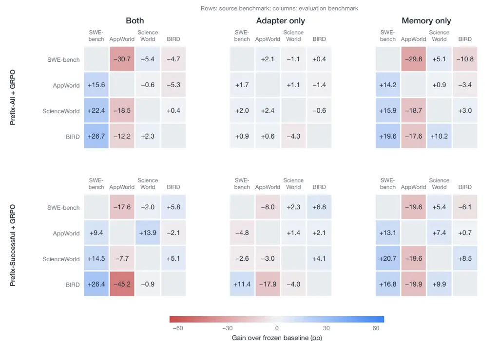

1\]UC San Diego 2\]Apple \contribution\[\*\]Work done at Apple.

# Where Should LLM Agents Adapt at Test Time? In Context, in Weights, or Both

Parsa Mirtaheri    Mohammadreza Armandpour    Keivan Alizadeh    Iman
Mirzadeh    Parshin Shojaee    Aryo Lotfi    David Harrison    Mehrdad
Farajtabar Affiliation: \[ Affiliation: \[

November 15, 2026

###### Abstract

LLM agents operating repeatedly in the same environment, such as a code
repository, a database, or an application suite, encounter tasks that
share latent structure. Experience can reveal this structure, allowing
agents to reuse environment knowledge and learn from environmental
feedback. Agents can adapt at test-time using this experience through
two channels: retaining it in context and updating their weights. These
channels are usually studied separately, leaving unclear what each
contributes and when they complement each other. We compare in-context
learning (ICL), reinforcement learning with verifiable rewards using
GRPO, and self-distillation using SDPO, alone and in combination,
through a shared online protocol and modular evaluation framework.
Agents encounter matched task streams, are evaluated on each task before
adapting to it, and learn only from their own attempts and environment
feedback. We evaluate 14 adaptation mechanisms and a stateless baseline
with Qwen3.5-9B on 109 tasks from four environments drawn from SWE-bench
Verified, AppWorld, ScienceWorld, and BIRD-Critic-SQLite, using five
task orders per environment. ICL provides the largest standalone gain:
its best policy raises mean success across environments from 28.8% to
49.4%. Adding GRPO to this policy achieves the highest mean success,
51.6%. While adding GRPO improves the overall mean under every ICL
policy, SDPO has mixed effects. Trace analyses show fewer lookups and
shorter attempts under ICL, consistent with reusing knowledge of the
shared structure. However, ICL also frequently skips inspection and
verification for the current task. Adding GRPO to ICL helps restore
these behaviors while preserving its reduced environment lookups. These
observations suggest that reinforcement learning with verifiable rewards
can refine how agents use retained experience, motivating the joint
study of context management and weight updates.

## 1 Introduction

Figure 1: On average across benchmarks, in-context learning (ICL) gives
the largest standalone gain, while ICL with GRPO gives the highest
overall gain. Points show five-seed mean success rates (%), using the
best mechanism within each adaptation family for each world. Curves
connect results without and with ICL for the same weight-update policy.
Standard errors are reported in Table 2.

Large language model (LLM) agents are increasingly deployed in
persistent roles: a coding agent working on one repository, an analyst
querying one database, or an assistant operating within one suite of
applications (Ouyang et al., 2026; Wei et al., 2026). Tasks within each
environment share latent structure specific to it: the idioms of its
codebase, the conventions of its schema, or the behavior of its
interfaces. By discovering this structure through interaction and
environmental feedback, an agent can reuse what it learns on later
tasks. For example, learning how a database is organized can let it
answer subsequent questions with far fewer queries (Asawa et al., 2026).
How should the agent carry this experience forward? For a fixed
architecture, the LLM’s behavior is governed by a policy
$`\pi_{\theta}(\cdot\mid c)`$, giving experience two routes to influence
future behavior: through the context $`c`$ or the weights $`\theta`$
(Allard et al., 2026; Ouyang et al., 2026; Fallah et al., 2026). This
paper asks where an agent should adapt at test time: in context, in
weights, or in both.

_Test-time adaptation_ lets an agent specialize to its own deployment
environment while the base model stays unchanged for other deployments
(Tandon et al., 2025; Hübotter et al., 2026b). It has three defining
properties. Every arriving task counts toward the agent’s performance
and also supplies experience for later tasks, so the agent is evaluated
while it learns. Accumulated state persists across the stream rather
than resetting between tasks (Akyürek et al., 2025; Tandon et al.,
2025). And the agent learns only from its own attempts and environmental
feedback, without demonstrations or a stronger teacher (Silver and
Sutton, 2025; Hübotter et al., 2026a).

Context and weights have complementary properties as adaptation channels
(Tiwari et al., 2026). Adding experience to the context requires no
training, so the agent can use it on the next task while its weights
stay intact. However, adaptation through context is bounded by the
context window, in which different experiences compete, and conditioning
the model through it comes with an extra computational cost (Hu et al.,
2026). Weights persist without occupying context, but they are costly to
update, and an update that helps one task can hurt others (Tiwari et
al., 2026; Luo et al., 2025b). Tandon et al. (2025) interpret weights
updated at test time as long-term memory and the context window as
short-term memory.

Methods for both channels are well developed. Memory-based agents keep
their weights frozen and retrieve reflections, workflows, cases, or
strategies from past attempts into their context (Shinn et al., 2023;
Wang et al., 2024; Zhou et al., 2025; Zhang et al., 2025; Ouyang et al.,
2026), whereas test-time training methods write experience into the
weights (Akyürek et al., 2025; Yuksekgonul et al., 2026; Hübotter et
al., 2026a). But the two lines of work have developed mostly apart
(Jiang et al., 2026; Hebbar et al., 2026), and differences in their
tasks and evaluation protocols make their reported gains difficult to
compare directly.

Existing systems that optimize a prompt or harness jointly with model
weights suggest that the two adaptation channels can complement each
other (Dorovatas et al., 2026; Tiwari et al., 2026; Hebbar et al., 2026;
Kim et al., 2026). However, these results leave unclear what each
channel contributes when agents learn from their own interactions across
tasks in a shared environment. We investigate this through a controlled
comparison addressing the following questions:


We conduct extensive experiments using our framework, in which tasks
from an agentic benchmark that share latent structure are arranged into
a stream, and every adaptation mechanism processes the stream and is
scored on each task as it arrives. The agent learns only from its own
attempts and the feedback the environment returns, and it may manage its
context, weights, or both from one task to the next. We build four
_worlds_, each a set of tasks that share one environment: issues for one
repository of SWE-bench Verified (Jimenez et al., 2024), tasks using one
application suite of AppWorld (Trivedi et al., 2024), the measurement
tasks of ScienceWorld (Wang et al., 2022), and tasks on one database of
BIRD-Critic-SQLite (Li et al., 2025).

We compare raw-trajectory ICL, reinforcement learning with verifiable
rewards using GRPO (Shao et al., 2024), and self-distillation using SDPO
(Hübotter et al., 2026a), alone and in combination. Raw-trajectory
replay lets us study context adaptation without introducing additional
summarization, retrieval, or judgment procedures, while keeping the
source of experience consistent across mechanisms. Prior findings also
support its strength as a baseline by showing that raw replay can
outperform dedicated memory architectures (Asawa et al., 2026). We
measure each mechanism’s gain over the same agent run without
adaptation.

Our contributions are threefold:

- •
  Controlled study of adaptation mechanisms. Under one protocol, which
  uses matched task streams, per-attempt limits, and a common source of
  environmental feedback (Section 3), we compare a stateless baseline
  and adaptation mechanisms that adapt the context, the weights, or
  both, with Qwen3.5-9B on 109 tasks from four benchmarks, each under
  five task orders (Section 4).
- •
  Analysis of when context and weights complement each other. We show
  that ICL provides the largest standalone gain; adding GRPO improves
  the overall mean under every ICL policy, while SDPO has mixed effects
  (Figure 1; Table 2). Our trace analyses show that ICL reduces
  environment lookups but frequently skips task-specific inspection and
  verification. Adding GRPO helps restore these behaviors while
  preserving reduced lookups, suggesting that reinforcement learning
  with verifiable rewards can refine how agents use retained experience
  (Sections 5–6).
- •
  Extensible framework for evaluating adaptation mechanisms. We provide
  a framework built on verl (Sheng et al., 2024), which registers
  benchmarks and adaptation mechanisms as modules, where one mechanism
  can combine in-context experience, reinforcement learning with
  verifiable rewards, and self-distillation.

## 2 Related Work

#### Adaptation through context.

Agents retain experience as interaction histories (Park et al., 2023),
reflections (Shinn et al., 2023; Zhao et al., 2024), reusable workflows
(Wang et al., 2023; Wang et al., 2024), or strategies and playbooks
(Ouyang et al., 2026; Zhang et al., 2025). Experience selection can
itself be learned (Zhou et al., 2025). These methods change the context
while keeping the model fixed. Raw history is already a strong baseline
in CL-Bench (Asawa et al., 2026), but bounded context makes old and new
experience compete (Hu et al., 2026). We study raw-trajectory ICL
policies to separate the contribution of in-context adaptation itself
from that of additional summarization and retrieval machinery.

#### Adaptation through weights.

Test-time training adapts a model using the test input (Sun et al.,
2020). For LLMs, proposed methods fine-tune on retrieved neighbors of an
input (Hardt and Sun, 2024), on a task’s few-shot examples (Akyürek et
al., 2025), or on synthetic variants of inputs an agent is uncertain
about (Acikgoz et al., 2025). They also reinforce solutions to a target
problem (Yuksekgonul et al., 2026), practice on related problems
selected for the target (Hübotter et al., 2025), or train on an
unlabeled test set with majority-vote rewards (Zuo et al., 2025). These
methods mainly train for one input or task, or for a fixed set known in
advance, and then reset. Online variants keep updating over a stream of
inputs from one distribution, with self-supervised losses (Krause et
al., 2018; Sun et al., 2020; Hu et al., 2025). Although reinforcement
learning (Shao et al., 2024) and self-distillation (Hübotter et al.,
2026a) are mainly applied before deployment, recent systems also apply
them during deployment, updating persistent weights over a stream of
scenarios (Fallah et al., 2026) or agent tasks (Lu and Gong, 2026).
Here, we adopt both for continual adaptation: the adapter and optimizer
state persist across a deployment. This post-deployment continual
adaptation setting differs from traditional continual learning, which is
centrally concerned with retaining general capability under a changing
task distribution (Shi et al., 2024; Luo et al., 2025b).

#### Combining context and weights.

A growing line of work adapts context and weights together, on the view
that the two channels are complementary (Dorovatas et al., 2026). One
family moves experience from context into weights: context distillation
transfers context-conditioned behavior into weights (Snell et al., 2022;
Ye et al., 2026b), online experiential learning alternates extracting
experience with consolidating it (Ye et al., 2026a), and LifeSkill
internalizes skills during test-time interaction by reinforcing
skill-conditioned trajectories (Mao et al., 2026). Another adapts the
two side by side, jointly adapting prompts and weights (Soylu et al.,
2024; Tiwari et al., 2026), choosing between harness and weight updates
(Hebbar et al., 2026), or using retained experience during reinforcement
learning (Wu et al., 2026; Liu et al., 2026). How much each channel
contributes, however, remains unclear, because comparisons point in
different directions. On fixed training data, prompt optimization can
outperform reinforcement learning (Agrawal et al., 2026), in-context
learning can generalize more flexibly than fine-tuning (Lampinen et al.,
2025), and WHALE, which alternates harness search with fine-tuning,
finds that the limiting channel depends on the domain (Kim et al.,
2026). In contrast, an online comparison on an adversarial
instruction-following task finds that weight updates outperform
in-context learning (Fallah et al., 2026). We compare context, weights,
and their combinations directly, online and in four agentic
environments, under controlled conditions (one protocol, the same model,
the same task streams, and the same source of feedback), to isolate each
channel’s contribution and test when combining them helps.

#### Evaluation and infrastructure.

Recent benchmarks evaluate agents over sequential experience (Wu et al.,
2024; Wei et al., 2026; He et al., 2026). CL-Bench measures improvement
over the same model without accumulated state (Asawa et al., 2026); we
adopt this comparison. Closest to our setting, Harrington et al. (2026)
compare prompt-based, supervised, and reinforcement-learning methods
under one protocol, but their methods update between stages on curated
data, and none combines explicit in-context experience with weight
updates. Our agents, by contrast, learn only from their own attempts and
environment feedback. On the systems side, Agent Lightning trains
arbitrary agents with reinforcement learning (Luo et al., 2025a),
EasyOPD unifies on-policy distillation methods on a shared backend (Sun
et al., 2026), and CLaaS updates a deployed agent’s weights from its
experience (Fallah et al., 2026). Our framework builds on verl (Sheng et
al., 2024) and runs context and weight adaptation in a single loop. More
complex adaptation methods can be added through its mechanism interface
and compared under the same protocol.

## 3 Setup



Figure 2: One round on a task. (1) The adaptation mechanism receives a
task. (2) Prepare returns a context $`c`$, with which the agent makes
$`k`$ attempts $`y_{i}`$ in fresh sessions of the environment. (3)
Observe receives the attempts and their outcomes $`o_{i}`$ and updates
the mechanism’s non-parametric state. (4) TeacherContexts adds hindsight
$`h`$ for SDPO’s self-teacher. (5) The mechanism updates its parametric
state using the weighted SDPO and GRPO losses.

### 3.1 Stream of related tasks

Agentic benchmarks typically score each task on its own, with a fresh
agent, yet many are built on a stateful environment, such as a code
repository, whose tasks share latent structure specific to it. Selecting
the tasks that share one environment and ordering them as a stream
recasts such a benchmark for test-time adaptation. We define a _world_
$`\mathcal{W}`$ as a set of tasks $`\mathcal{X}=\{x_{1},\dots,x_{N}\}`$
that share an environment. A seed fixes the _stream_
$`(x^{(1)},\dots,x^{(N)})`$, a random order in which each task appears
once. For each task, the agent makes $`m`$ rounds of $`k`$ parallel
_attempts_ (Figure 2). An attempt $`y`$ is a multi-turn interaction with
a fresh session of the environment that ends when the agent submits a
solution or reaches the goal state, or at a limit. The benchmark then
returns an _outcome_ $`o=(r,s,f)`$: a reward $`r\in[0,1]`$, a success
indicator $`s\in\{0,1\}`$, and textual feedback $`f`$, such as how many
tests passed. The $`k`$ attempts of a round share one context and one
set of weights, so together they estimate the agent’s success rate and
give the adaptation mechanism several outcomes to compare. The mechanism
adapts after every round, and each later round makes fresh attempts with
the adapted context and weights, adding experience from the same task.
Only the first round is scored, before any adaptation to the task
(Section 3.3). Table 1 summarizes the notation.

We derive four worlds from well-established benchmarks. In Xarray, the
agent resolves SWE-bench Verified issues of pydata/xarray with shell
commands, judged by each issue’s tests (22 tasks); in File System, it
writes Python that calls the APIs of AppWorld’s apps (21 tasks whose
primary app is the file system); in Measurement, it issues text commands
in ScienceWorld’s simulated laboratory to measure a temperature or a
melting point (22 tasks); and in Financial, it fixes faulty SQL for one
BIRD-Critic-SQLite database, which it can query before submitting (44
tasks). In each world, an existing grader scores every attempt, and the
stateless baseline leaves headroom (Table 2); gains over that baseline
then test whether earlier tasks inform later ones. Because our framework
reuses each benchmark’s tasks, environments, and graders, other
benchmarks whose tasks share an environment can be added the same way,
without building new tasks.

|                                                        |                                     |                                            |                                              |
| ------------------------------------------------------ | ----------------------------------- | ------------------------------------------ | -------------------------------------------- |
| Symbol                                                 | Meaning                             | Symbol                                     | Meaning                                      |
| $`\mathcal{W}`$; $`\mathcal{X}=\{x_{1},\dots,x_{N}\}`$ | world; its $`N`$ tasks              | $`\mathcal{M}`$                            | adaptation mechanism                         |
| $`x^{(j)}`$                                            | task at stream position $`j`$       | $`\theta`$                                 | current policy weights                       |
| $`m`$; $`k`$                                           | rounds per task; attempts per round | $`c`$; $`h`$                               | retained context; teacher hindsight          |
| $`y_{i}\sim\pi_{\theta}(\cdot\mid c,x^{(j)})`$         | multi-turn attempt $`i`$            | $`p_{j}=\frac{1}{k}\sum_{i=1}^{k}s_{j,i}`$ | first-round success rate on task $`x^{(j)}`$ |
| $`o_{i}=(r_{i},s_{i},f_{i})`$                          | reward, success indicator, feedback | $`S=\frac{1}{N}\sum_{j=1}^{N}p_{j}`$       | stream success rate                          |
| $`E=\{(c,x^{(j)},y_{i},o_{i})\}_{i=1}^{k}`$            | a round’s experience                | $`\Delta S=S-S_{\mathrm{base}}`$           | gain over the stateless baseline             |

Table 1: Notation for the online protocol. Indices $`j`$, $`\ell`$, and
$`i`$ denote task position, round, and attempt, respectively.

### 3.2 Adaptation mechanisms

We compare the stateless baseline with fourteen adaptation mechanisms,
built from four ICL policies and two weight-update rules. ICL replays
prior attempts as conversations, including environment observations and
outcome feedback. Under a bounded token allowance, two retention
policies determine how context is managed: _FIFO_ evicts the oldest
episodes to admit new ones, whereas _Prefix_ stops admitting episodes
after the first overflow. Two admission policies determine which
attempts are eligible: _All_ selects the highest-reward attempt from
every round, even if it failed; _Successful_ selects at most one
successful attempt per task, from the first round that produces one.

GRPO (Shao et al., 2024) updates a persistent LoRA adapter (Hu et al., 2022) from each round’s attempts: advantages are rewards relative to the
round’s mean, and the loss is PPO’s clipped surrogate (Schulman et al.,
2017), without a KL penalty or standard-deviation normalization. SDPO
(Hübotter et al., 2026a) trains a persistent LoRA adapter on the agent’s
own attempts by minimizing the reverse KL divergence to a self-teacher’s
next-token distributions, with no policy-gradient term. The self-teacher
receives the agent’s original context augmented with a successful
sibling attempt or, when none is available, the attempt’s feedback. Its
weights start as the student’s and then track them as an exponential
moving average. Each hybrid combines one ICL policy with one
weight-update rule. Each round’s attempts feed both channels: the update
trains the adapter on them, conditioned on the context they were
generated with, and the ICL policy chooses which of them to keep in the
context for later attempts. Appendix A gives the formal interfaces and
losses.

### 3.3 Scoring

The first round’s $`k`$ attempts at each task share the same context and
weights, and we score them _before_ their experience enters context or
updates the weights. Further rounds on that task supply adaptation
experience but do not enter the main score, so each task tests transfer
from earlier tasks. Every mechanism uses the same task order,
per-attempt limits, sampling temperature, and source of feedback, learns
only from its own attempts and the environment’s outcomes, and completes
its updates before the next round. Algorithm 1 gives the full loop. This
score-then-update protocol follows the test-then-train scheme of
prequential evaluation (Dawid, 1984; Gama et al., 2013): each task is
first a test and then training data.

#### Metrics.

For task $`j`$, let $`s_{j,i}`$ indicate success of first-round attempt
$`i`$, and let $`p_{j}=k^{-1}\sum_{i=1}^{k}s_{j,i}`$. Across the world’s
$`N`$ tasks, we report

```math
S=\frac{1}{N}\sum_{j=1}^{N}p_{j}. \tag{3.1}
```

$`S`$ denotes the success rate, averaged over tasks. We compare
mechanisms on the same stream, with $`\Delta S`$ denoting the difference
from the stateless baseline. Formal details are in Appendix A;
implementation specifics are in Section A.3.

1: tasks $`\mathcal{X}`$, seed, mechanism $`\mathcal{M}`$, weights
$`\theta`$, rounds per task $`m`$, attempts per round $`k`$

2:
$`(x^{(1)},\ldots,x^{(N)})\leftarrow\textsc{Stream}(\mathcal{X},\text{seed})`$

3: for $`j=1,\ldots,N`$ do $`\triangleright`$ each task once, in stream
order

4:   for $`\ell=1,\ldots,m`$ do $`\triangleright`$ rounds on the same
task

5:    $`c\leftarrow\mathcal{M}.\textsc{Prepare}(x^{(j)})`$
$`\triangleright`$ context from retained experience

6:    $`E\leftarrow\{(c,x^{(j)},y_{i},o_{i})\}_{i=1}^{k}`$ with
$`y_{i}\sim\pi_{\theta}(\cdot\mid c,x^{(j)})`$ $`\triangleright`$ $`k`$
multi-turn attempts

7:    if $`\ell=1`$ then $`\triangleright`$ score before adapting

8:      $`p_{j}\leftarrow\frac{1}{k}\sum_{i=1}^{k}s_{j,i}`$    

9:    $`\mathcal{M}.\textsc{Observe}(E)`$ $`\triangleright`$ update
non-parametric state

10:    $`h\leftarrow\mathcal{M}.\textsc{TeacherContexts}(E)`$
$`\triangleright`$ hindsight for SDPO’s self-teacher

11:    $`\theta\leftarrow\textsc{Update}(\theta,E,h)`$
$`\triangleright`$ GRPO or SDPO; unchanged for frozen weights   

12: return $`S=\frac{1}{N}\sum_{j}p_{j}`$

Algorithm 1 Test-time adaptation on one world.

## 4 Experiments

### 4.1 Setup

We evaluate Qwen3.5-9B on the four worlds of Section 3.1. We compare
fourteen adaptation mechanisms and a frozen baseline, crossing five
context settings (no ICL and the four ICL policies) with frozen weights,
SDPO, or GRPO. All are evaluated using five stream seeds (0–4), with the
same task order for a given world and seed. We sample $`k=16`$ parallel
attempts per round at temperature 1. Weight updates train a rank-32 LoRA
adapter with AdamW at learning rate $`10^{-5}`$. We allocate separate
token allowances to retained experience and each new attempt, so filling
the retained-context allowance does not consume the new attempt’s
allowance. Tables 4 and 5 in Appendix A.3 give the full settings.

Following Section 3.3, we score only the first round of each task,
before adapting to that task, and average success over tasks within each
world. The overall mean weights the four worlds equally within each
seed.

### 4.2 Results

Table 2 reports success rates for all mechanisms and the baseline, with
means and standard errors across the five seeds. Figure 3 complements
these averages with paired comparisons of mechanisms on the same ordered
tasks within each world and seed. Each arrow reports the mean gain and
the number of pairs with strictly higher success across the 20
world–seed pairs, showing both the size and consistency of the gains.
The figure compares adding GRPO or SDPO to Frozen and each ICL policy.
Complete comparisons, including gains from adding ICL, appear in
Appendix Figures 11 and 12.

|               |                     |                             |                        |                            |                                 |                   |
| ------------- | ------------------- | --------------------------- | ---------------------- | -------------------------- | ------------------------------- | ----------------- |
| Weight update | ICL policy          | SWE-bench Verified (Xarray) | AppWorld (File System) | ScienceWorld (Measurement) | BIRD-Critic- SQLite (Financial) | Mean              |
| Frozen        | No ICL              | 13.4^($`\pm`$1.0)           | 57.7^($`\pm`$0.8)      | 15.6^($`\pm`$0.7)          | 28.5^($`\pm`$0.7)               | 28.8^($`\pm`$0.4) |
| SDPO          | No ICL              | 16.8^($`\pm`$0.8)           | 44.8^($`\pm`$1.2)      | 19.2^($`\pm`$0.6)          | 27.8^($`\pm`$0.6)               | 27.1^($`\pm`$0.3) |
| GRPO          | No ICL              | 21.8^($`\pm`$1.3)           | 61.3^($`\pm`$1.3)      | 31.8^($`\pm`$1.6)          | 33.1^($`\pm`$1.1)               | 37.0^($`\pm`$0.7) |
| Frozen        | FIFO · All          | 39.4^($`\pm`$1.8)           | 66.9^($`\pm`$3.3)      | 50.3^($`\pm`$2.4)          | 28.5^($`\pm`$0.7)               | 46.3^($`\pm`$1.1) |
|               | FIFO · Successful   | 35.1^($`\pm`$0.9)           | 77.9^($`\pm`$3.0)      | 46.1^($`\pm`$5.9)          | 32.6^($`\pm`$0.9)               | 47.9^($`\pm`$2.1) |
|               | Prefix · All        | 35.6^($`\pm`$1.9)           | 62.6^($`\pm`$5.0)      | 48.0^($`\pm`$3.6)          | 27.9^($`\pm`$0.7)               | 43.5^($`\pm`$1.9) |
|               | Prefix · Successful | 33.4^($`\pm`$0.6)           | 78.2^($`\pm`$3.4)      | 53.2^($`\pm`$1.8)          | 32.7^($`\pm`$1.5)               | 49.4^($`\pm`$1.0) |
| SDPO          | FIFO · All          | 38.4^($`\pm`$1.1)           | 53.7^($`\pm`$4.3)      | 56.6^($`\pm`$1.8)          | 31.1^($`\pm`$1.2)               | 44.9^($`\pm`$0.8) |
|               | FIFO · Successful   | 36.2^($`\pm`$1.6)           | 75.2^($`\pm`$3.5)      | 52.8^($`\pm`$6.4)          | 31.8^($`\pm`$1.2)               | 49.0^($`\pm`$1.4) |
|               | Prefix · All        | 33.7^($`\pm`$4.0)           | 59.0^($`\pm`$3.7)      | 55.5^($`\pm`$5.1)          | 29.8^($`\pm`$1.2)               | 44.5^($`\pm`$1.0) |
|               | Prefix · Successful | 35.2^($`\pm`$1.4)           | 76.8^($`\pm`$1.5)      | 50.2^($`\pm`$4.3)          | 30.6^($`\pm`$0.8)               | 48.2^($`\pm`$1.6) |
| GRPO          | FIFO · All          | 38.9^($`\pm`$1.8)           | 66.1^($`\pm`$1.5)      | 50.1^($`\pm`$2.5)          | 34.4^($`\pm`$2.1)               | 47.4^($`\pm`$0.6) |
|               | FIFO · Successful   | 36.6^($`\pm`$1.8)           | 76.4^($`\pm`$1.2)      | 55.2^($`\pm`$2.4)          | 33.0^($`\pm`$0.4)               | 50.3^($`\pm`$0.6) |
|               | Prefix · All        | 39.9^($`\pm`$1.9)           | 69.4^($`\pm`$3.5)      | 55.9^($`\pm`$2.6)          | 34.0^($`\pm`$1.6)               | 49.8^($`\pm`$1.0) |
|               | Prefix · Successful | 37.6^($`\pm`$1.4)           | 74.5^($`\pm`$4.1)      | 58.1^($`\pm`$1.2)          | 36.3^($`\pm`$1.6)               | 51.6^($`\pm`$1.3) |

Table 2: Success rates for the adaptation mechanisms and baseline. Mean
success rates (%) across five stream seeds, with standard errors in
superscripts. Rows are grouped as no adaptation, weight-only, ICL-only,
and hybrid. ICL policies are shown as retention · admission. No ICL with
frozen weights is the baseline.

ICL provides the largest standalone gain. With frozen weights, the four
ICL policies raise success from the baseline’s 28.8% to 43.5–49.4%.
Prefix–Successful is the strongest ICL policy. Both Successful-admission
policies beat the baseline in all 20 stream pairs (Appendix Figure 11),
whereas All admission occasionally lowers success on AppWorld or BIRD.
GRPO alone improves on the baseline in 19 of 20 pairs, with a smaller
overall gain than any ICL policy, while SDPO alone has a lower mean. ICL
has the higher standalone mean in three worlds; on BIRD, which has
roughly twice as many tasks as the other worlds, GRPO has a slightly
higher mean over the full stream.

Adding GRPO improves the overall mean under every ICL policy; SDPO has
mixed effects. Adding GRPO to ICL raises the overall mean under all four
ICL policies, most for Prefix–All: a gain of 6.3 percentage points, with
improvements in all 20 stream pairs. Under the other three policies,
GRPO improves success in 13–14 of 20 pairs (Figure 3). Adding SDPO
instead raises the mean under two ICL policies and lowers it under the
other two (Figure 3), so using both channels does not by itself ensure
an improvement over ICL alone. Nevertheless, the three highest mean
success rates all come from ICL with GRPO, led by ICL(Prefix–Successful)
$`+`$ GRPO at 51.6%. Additional seed-4 experiments on two larger worlds,
scikit-learn and Toxicology, also place ICL$`+`$GRPO highest among the
six tested mechanisms (Appendix E).

Figure 3: Mean gains and wins from adding GRPO or SDPO. Boxes show mean
success rates. Yellow arrows indicate adding ICL with the policies
listed below; blue and red arrows add GRPO and SDPO, respectively.
Horizontal arrow labels show the mean success-rate gain in percentage
points (top) and wins out of 20 world–seed stream pairs (bottom),
weighting all streams equally.

## 5 Individual Contributions of Context and Weights

What does each adaptation channel contribute to test-time adaptation?
Beyond the success rates in Section 4, we examine how context and weight
updates separately change the agent’s outcomes, interaction length, and
behavior relative to the frozen baseline. For this analysis, we use the
ICL policy with the highest mean success rate in each benchmark (Table
2): FIFO–All on SWE-bench and Prefix–Successful elsewhere. Appendix
Figure 15 compares cumulative gains and retained context for all four
ICL policies.

### 5.1 Outcomes and Interaction Length

ICL improves both completion and success. The outcome distributions in
Figure 4 (top) show that ICL substantially reduces unfinished attempts
in every benchmark, nearly eliminating them on AppWorld. On SWE-bench
and BIRD, both successful and wrong submissions become more common.
AppWorld instead improves both completion and correctness, with fewer
wrong submissions. GRPO raises success on all four benchmarks, with
smaller completion changes. SDPO’s effects are mixed: it increases wrong
submissions on AppWorld and reduces unfinished attempts on BIRD without
improving success.

ICL shortens interaction more consistently than weight updates. Figure 4
(bottom) shows a substantial decline in ICL’s mean turns along every
stream, most pronounced on AppWorld and BIRD. Successful ICL attempts
are also shorter than successful baseline attempts in every benchmark
(Appendix Figure 13), so the lower overall mean is not solely due to
fewer unfinished attempts. SDPO also sharply shortens BIRD attempts
despite its lack of a success-rate gain.

Figure 4: How single-channel adaptation changes outcomes and attempt
length. Top: mean proportions of successful, wrong, and unfinished
attempts. An unfinished attempt ends without success or submission.
ScienceWorld ends on reaching the goal and has no separate submission
decision. Bottom: mean turns per attempt at each task position. Results
weight the five stream seeds equally, with 16 attempts per task and
stream.

### 5.2 Behavioral Changes

We next examine how the agent uses its turns, looking more closely at
which interactions change alongside the outcomes and attempt lengths.
Inspection of execution traces motivated the four behavioral measures in
Figure 5: code lookups, API lookups, environment lookups, and database
querying. These measures track how each adaptation channel changes the
agent’s information gathering along the stream. Figure 6 provides
concrete examples using the final task of seed 4 in each benchmark.

SWE-bench: ICL reduces code lookup. We count each turn that searches or
displays repository files, excluding test runs, diffs, and reads used
only for editing, and report the mean count per attempt. ICL uses fewer
turns to search for or read repository code, whereas the weight-only
mechanisms remain closer to the baseline (Figure 5a). The reduction
holds in every seed and is consistent with less repository exploration
within ICL’s shorter attempts. The unstacking example (Figure 6a) shows
the same reduction across attempts.

AppWorld: retained experience reduces repeated API lookup. We count
turns containing API-documentation lookups and report the mean per
attempt. Under ICL, these lookups rapidly decline toward zero, alongside
shorter attempts and higher success. GRPO and SDPO remain close to the
baseline (Figure 5b). This is consistent with ICL reusing API procedures
from retained experience instead of rediscovering them for each task. In
the vacation-photo example (Figure 6b), the displayed ICL attempt uses
only one documentation lookup and combines metadata reads and file moves
into a compact sequence.

ScienceWorld: ICL reduces environment lookups. We count explicit look
around actions per attempt, which reveal surrounding objects and exits.
ICL reduces these surveys substantially, while GRPO and SDPO remain
closer to Frozen (Figure 5c). In the displayed thermometer attempt
(Figure 6c), ICL surveys only the living room and kitchen before
measuring the substance and placing it in the correct box. Frozen
repeatedly surveys the living room; GRPO and SDPO each use four surveys,
compared with ICL’s two.

BIRD: shorter attempts can omit database checks. We measure the fraction
of attempts containing at least one executed exploratory SQL query. ICL
increasingly submits without an exploratory query, and SDPO also reduces
querying. GRPO maintains querying in a larger fraction of attempts than
ICL or SDPO (Figure 5d). Thus, unlike fewer documentation lookups on
AppWorld, shorter BIRD attempts also mean fewer opportunities to test
the proposed answer. The final-task example (Figure 6d) makes the
distinction explicit: ICL submits immediately in every attempt, while
Frozen and GRPO always query first.

Figure 5: How single-channel adaptation changes behavior along the
stream. SWE-bench: mean code-lookup turns per attempt. AppWorld: mean
turns containing API-documentation lookups. ScienceWorld: mean explicit
look around actions per attempt (environment lookups). BIRD: percentage
of all attempts with at least one executed exploratory SQL query. All
panels weight the five seeds equally at each position.

Figure 6: Final-task examples across all four benchmarks in seed 4. Each
column summarizes all 16 attempts: graded successes and mean code-lookup
turns (SWE-bench), mean API lookups (AppWorld), mean environment lookups
(ScienceWorld), or the percentage of all attempts with at least one
executed exploratory SQL query (BIRD). Below the divider, excerpts
summarize attempt 1; $`t`$ denotes the turn.

ICL can reuse environment knowledge to act more efficiently. Retained
experiences give ICL access to information about the environment’s
latent structure, reducing the need to rediscover it on each task. This
is consistent with its fewer code, API, and environment lookups (Figure
5a–c), shorter attempts and higher completion and success (Figure 4).
Even successful attempts become shorter (Appendix Figure 13). Weight
updates offer a useful contrast. Both methods learn from the agent’s own
attempts. GRPO’s loss uses the probabilities of sampled tokens, whereas
SDPO also matches self-teacher probabilities for non-sampled tokens.
GRPO reinforces higher-reward traces, which still include exploration,
consistent with its lookup and querying metrics remaining closer to
Frozen than ICL even as success improves (Figure 5). However, SDPO’s
self-teacher uses extra information in context and could pull the
student toward token choices that skip exploration, consistent with its
ICL-like reduction in querying on BIRD (Figure 5d).

Greater efficiency can come at the cost of verification. ICL can reuse
experience to avoid rediscovering the environment’s shared structure.
However, finding information relevant to the current task and checking a
proposed solution may still require new interactions. ICL risks
extending the shortcut of skipping familiar exploration to these
task-specific steps. BIRD illustrates this risk: ICL increasingly
submits SQL without first querying the database (Figures 5d and 6d),
skipping opportunities to inspect relevant data or test its proposed
answer. ICL improves success but also produces more wrong submissions
(Figure 4d, top). Effective adaptation should therefore reuse knowledge
of the environment while preserving the exploration and verification
needed for each new task.

## 6 When Context and Weight Updates Complement Each Other

When does combining context and weight adaptation help, and how do the
two channels complement each other? Building on the single-channel
analysis in Section 5, we examine how adding weight updates to ICL
changes outcomes and behavior across benchmarks. Adding GRPO improves
the overall mean under every ICL policy (Table 2; Figure 3). We focus on
Prefix–All, where this gain is largest and positive in all 20
benchmark–seed streams, and compare it with its GRPO and SDPO hybrids,
alongside the frozen, no-ICL baseline.

Weight updates change the outcome distribution differently across
benchmarks. On SWE-bench, adding either GRPO or SDPO reduces unfinished
attempts, but success increases only with GRPO; under SDPO, fewer
unfinished attempts accompany more wrong submissions and lower success
(Figure 7, top). On AppWorld, GRPO reduces wrong submissions, whereas
SDPO increases them. On ScienceWorld, both yield similar success gains.
On BIRD, GRPO substantially reduces wrong submissions, with both
successful and unfinished attempts increasing; SDPO produces a smaller
shift toward success. We next examine which interactions change
alongside these outcomes.

Figure 7: Hybrid outcomes and exploration: GRPO preserves reduced
lookups while restoring querying. Top: mean proportions of successful,
wrong, and unfinished attempts. An unfinished attempt ends without
success or submission. Bottom: mean code-lookup turns per attempt on
SWE-bench, mean turns containing API-documentation lookups on AppWorld,
mean explicit look around actions on ScienceWorld, and percentage of all
attempts with at least one executed exploratory SQL query on BIRD. All
panels weight the five seeds equally.

Adding GRPO preserves ICL’s reduced exploration. Revisiting the
behavioral metrics from Section 5, we find that adding GRPO retains
ICL’s reduced code, API, and environment lookups on SWE-bench, AppWorld,
and ScienceWorld (Figure 7a–c, bottom). Success therefore improves while
these lookup rates remain low, consistent with continued reuse of
environment knowledge from retained experience.

BIRD: adding GRPO restores querying. The clearest departure from ICL
appears in BIRD’s querying metric (Figure 7d, bottom). With
ICL$`+`$GRPO, querying initially declines as it does with ICL, but then
recovers toward the frozen baseline as the stream progresses. Higher
late-stream querying with GRPO also appears under all four ICL policies
(Figure 8). Unlike looking up familiar repository structure or API
documentation, executing a query can provide feedback about the current
task and proposed answer. In the displayed final-task attempt, ICL
submits immediately, whereas ICL$`+`$GRPO executes its query before
submission (Figure 10d). This distinction motivates examining whether
adding GRPO also increases task-specific inspection and verification in
the other benchmarks.

Figure 8: GRPO maintains higher late-stream querying across ICL policies
on BIRD. Each panel compares ICL with its GRPO and SDPO hybrids under
one ICL policy; Frozen is repeated for reference. Querying counts all
attempts with at least one executed exploratory SQL query. Rates average
16 attempts per task in a stream.

Figure 9: How weight updates change ICL’s task-specific inspection and
verification. (a) Rechecking after edits on SWE-bench; (b) final-state
inspection on AppWorld; (c) inspection during melting-point experiments
on ScienceWorld; (d) querying on BIRD. Bars show rates (%) averaged
equally over five seeds.

Figure 10: How weight updates change ICL behavior: final-task examples
across all four benchmarks in seed 0. Each column summarizes all 16
attempts: graded successes and same-check rates (SWE-bench), final-state
inspection (AppWorld), state inspection (ScienceWorld), or querying
(BIRD), using the metrics of Figure 9. Below the divider, excerpts
summarize attempt 1; $`t`$ denotes the turn.

SWE-bench: fewer code lookups, more rechecking after edits. Knowing
where to edit does not establish that a new patch works. We measure the
fraction of attempts that run the same Python probe or pytest selection
before and after an attempted source edit. Both weight updates increase
this rate relative to ICL, with a larger increase under GRPO (Figure
9a). Together with the reduced code lookups above, this distinguishes
revisiting repository information from rechecking behavior after
changing the code. The latter provides an opportunity to assess the
current patch.

AppWorld: fewer API lookups, more final-state inspection. An API
procedure’s effects depend on the current task and data. Among attempts
containing a state-changing API call, _final-state inspection_ is the
fraction that read task data after the last such call. Adding GRPO
increases this rate while preserving ICL’s reduced API lookups; SDPO
remains close to ICL (Figure 7b, bottom, and Figure 9b). In the
bill-splitting example, ICL submits immediately after requesting
payments, whereas ICL$`+`$GRPO reads back the requests before submitting
(Figure 10b).

ScienceWorld: fewer environment lookups, more inspection during
experiments. Among melting-point attempts, we measure the fraction with
successful look at or look in inspection after heating or cooling starts
and before the first box-directed action. Adding GRPO raises this rate
toward Frozen while preserving reduced look around use; SDPO shows no
comparable increase (Figure 7c, bottom, and Figure 9c). Across the final
task’s 16 attempts, ICL$`+`$GRPO shows state inspection, whereas ICL and
ICL$`+`$SDPO show none (Figure 10c).

## 7 Discussion and Limitations

How reinforcement learning and self-distillation interact with ICL.
Retained traces provide environment knowledge and examples of how to
act, but a useful procedure or shortcut on one task may be insufficient
on another. GRPO applies reinforcement learning with verifiable rewards
to the policy conditioned on retained experience, potentially correcting
behavior that the context encourages but the current task’s reward does
not favor. Our observations are consistent with this interpretation:
adding GRPO preserves reduced environment lookups while increasing
task-specific inspection and verification (Figures 7 and 9).
Self-distillation also uses environmental feedback, but its supervision
depends on how a self-teacher uses additional hindsight in context. This
reliance on in-context learning could make self-distillation susceptible
to some of the same limitations as ICL’s use of retained experience,
reinforcing similar shortcuts rather than correcting them. This remains
a hypothesis; studying when the self-teacher provides useful corrections
could clarify what limits self-distillation and how to make it more
effective alongside ICL.

How context management shapes the benefits of weight updates. Context
management determines both what experience the agent can reuse and the
context on which its weight updates are conditioned. An effective
retention policy for ICL alone may therefore differ from one that works
well with weight updates. Prefix keeps retained history fixed after the
first context-budget overflow, potentially allowing updates to refine
behavior under a stable context. FIFO continually introduces new
experience, but also changes the context under which previously learned
behavior is applied. If the benefits of weight updates survive eviction,
FIFO could extend the usefulness of experience beyond the context
window; if those benefits depend strongly on retained episodes, a stable
context may be more effective. GRPO adds more to Prefix than FIFO under
All admission, but the gains are similar under Successful admission
(Figure 3 and Appendix Figure 16), suggesting that admission and
retention should be studied jointly with weight updates. These
comparisons do not isolate the effect of context management because each
run develops its own trajectories and context. Evaluating the same
updated weights under retained, replaced, or removed experience could
clarify how to manage context so that the two channels work effectively
together.

Scope and limitations. We study one model on subsets of four benchmarks,
with five task orders, raw-trajectory context policies, and specific
update recipes. Our metrics need not capture all sources of improvement
or generalize to every ICL policy. These behavioral observations do not
establish what causes the success gains. Inspection and verification
provide opportunities for feedback, but our metrics do not establish
whether the agent uses that feedback correctly. Interventions that
selectively require or suppress these checks would help test their
contribution. Longer streams, stronger memory selection or compression,
and other models may change the balance between channels. Our main
evaluation measures online improvement within a deployment environment,
not retention of general capabilities. Appendix F separately examines
transfer and component ablations of final seed-4 agents.

## 8 Conclusion

We study how context and weight updates contribute to agent adaptation
after deployment, using a shared online protocol and an extensible
evaluation framework. Across four benchmarks, ICL provides the largest
standalone gain, while adding GRPO improves the overall mean under every
ICL policy and yields the strongest hybrid. Our behavioral analyses show
that retained experience reduces repeated exploration but can also
encourage skipping checks needed for the current task. In our detailed
hybrid comparison, adding GRPO preserves reduced lookups while
increasing task-specific inspection and verification; SDPO does not
consistently reproduce this combination. These findings suggest that
reinforcement learning with verifiable rewards can refine how agents use
retained experience, motivating the joint study of context management
and weight updates to make the two channels work effectively together.

## References

- Acikgoz et al. (2025) Emre Can Acikgoz, Cheng Qian, Heng Ji, Dilek
  Hakkani-Tür, and Gokhan Tur. Self-Improving LLM Agents at Test-Time,
  October 2025. URL
  [http://arxiv.org/abs/2510.07841](http://arxiv.org/abs/2510.07841).
  arXiv:2510.07841 \[cs\].
- Agrawal et al. (2026) Lakshya A. Agrawal, Shangyin Tan, Dilara Soylu,
  Noah Ziems, Rishi Khare, Krista Opsahl-Ong, Arnav Singhvi, Herumb
  Shandilya, Michael J. Ryan, Meng Jiang, Christopher Potts, Koushik
  Sen, Alexandros G. Dimakis, Ion Stoica, Dan Klein, Matei Zaharia, and
  Omar Khattab. GEPA: Reflective Prompt Evolution Can Outperform
  Reinforcement Learning. In _International Conference on Learning
  Representations_, 2026.
- Akyürek et al. (2025) Ekin Akyürek, Mehul Damani, Adam Zweiger, Linlu
  Qiu, Han Guo, Jyothish Pari, Yoon Kim, and Jacob Andreas. The
  Surprising Effectiveness of Test-Time Training for Few-Shot Learning,
  March 2025. URL
  [http://arxiv.org/abs/2411.07279](http://arxiv.org/abs/2411.07279).
  arXiv:2411.07279 \[cs\].
- Allard et al. (2026) Marc-Antoine Allard, Arnaud Teinturier, Victor
  Xing, and Gautier Viaud. Experiential Reflective Learning for
  Self-Improving LLM Agents, March 2026. URL
  [http://arxiv.org/abs/2603.24639](http://arxiv.org/abs/2603.24639).
  arXiv:2603.24639 \[cs\] version: 2.
- Asawa et al. (2026) Parth Asawa, Christopher M. Glaze, Gabriel
  Orlanski, Ramya Ramakrishnan, Benji Xu, Asim Biswal, Vincent Sunn
  Chen, Frederic Sala, Matei Zaharia, and Joseph E. Gonzalez. Continual
  Learning Bench: Evaluating Frontier AI Systems in Real-World Stateful
  Environments, June 2026. URL
  [http://arxiv.org/abs/2606.05661](http://arxiv.org/abs/2606.05661).
  arXiv:2606.05661 \[cs.AI\].
- Dawid (1984) A. P. Dawid. Present position and potential
  developments: Some personal views: Statistical theory: The prequential
  approach. _Journal of the Royal Statistical Society. Series A
  (General)_, 147(2):278–290, 1984.
  [10.2307/2981683](https://doi.org/10.2307/2981683).
- Dorovatas et al. (2026) Vaggelis Dorovatas, Malte Schwerin, Andrew D.
  Bagdanov, Lucas Caccia, Antonio Carta, Laurent Charlin, Barbara
  Hammer, Tyler L. Hayes, Timm Hess, Christopher Kanan, Dhireesha
  Kudithipudi, Xialei Liu, Vincenzo Lomonaco, Jorge Mendez-Mendez,
  Darshan Patil, Ameya Prabhu, Elisa Ricci, Tinne Tuytelaars, Gido M.
  van de Ven, Liyuan Wang, Joost van de Weijer, Jonghyun Choi, Martin
  Mundt, and Rahaf Aljundi. Modular Memory is the Key to Continual
  Learning Agents, March 2026. URL
  [http://arxiv.org/abs/2603.01761](http://arxiv.org/abs/2603.01761).
  arXiv:2603.01761 \[cs.LG\].
- Fallah et al. (2026) Kion Fallah, Silen Naihin, Barak Widawsky, and
  Qingqing Mao. CLaaS: Continual learning as a service for sample
  efficient online learning, June 2026. URL
  [http://arxiv.org/abs/2606.05559](http://arxiv.org/abs/2606.05559).
  arXiv:2606.05559 \[cs.LG\].
- Gama et al. (2013) João Gama, Raquel Sebastião, and Pedro Pereira
  Rodrigues. On evaluating stream learning algorithms. _Machine
  Learning_, 90(3):317–346, 2013.
  [10.1007/s10994-012-5320-9](https://doi.org/10.1007/s10994-012-5320-9).
- Hardt and Sun (2024) Moritz Hardt and Yu Sun. Test-time training on
  nearest neighbors for large language models. In _International
  Conference on Learning Representations_, 2024.
- Harrington et al. (2026) Anne Harrington, Nayan Saxena, Michael
  Murphy, Anastasia Borovykh, Zeyu Yun, Sridhar Kamath, Ara Eindra Kyi,
  Trevor Darrell, Jitendra Malik, and Yutong Bai. When Does Continual
  Learning Require Learning, July 2026. URL
  [http://arxiv.org/abs/2607.07847](http://arxiv.org/abs/2607.07847).
  arXiv:2607.07847 \[cs.LG\].
- He et al. (2026) Zexue He, Yu Wang, Churan Zhi, Yuanzhe Hu, Tzu-Ping
  Chen, Lang Yin, Ze Chen, Tong Arthur Wu, Siru Ouyang, Zihan Wang,
  Jiaxin Pei, Julian McAuley, Yejin Choi, and Alex Pentland.
  MemoryArena: Benchmarking Agent Memory in Interdependent Multi-Session
  Agentic Tasks, February 2026. URL
  [http://arxiv.org/abs/2602.16313](http://arxiv.org/abs/2602.16313).
  arXiv:2602.16313 \[cs\].
- Hebbar et al. (2026) Prannay Hebbar, Yogendra Manawat, Samuel
  Verboomen, Alesia Ivanova, Selvam Palanimalai, Kunal Bhatia, and
  Vignesh Baskaran. SIA: Self Improving AI with Harness & Weight
  Updates, May 2026. URL
  [http://arxiv.org/abs/2605.27276](http://arxiv.org/abs/2605.27276).
  arXiv:2605.27276 \[cs.AI\].
- Hu et al. (2022) Edward J. Hu, Yelong Shen, Phillip Wallis, Zeyuan
  Allen-Zhu, Yuanzhi Li, Shean Wang, Lu Wang, and Weizhu Chen. LoRA:
  Low-rank adaptation of large language models. In _International
  Conference on Learning Representations_, 2022.
- Hu et al. (2025) Jinwu Hu, Zhitian Zhang, Guohao Chen, Xutao Wen, Chao
  Shuai, Wei Luo, Bin Xiao, Yuanqing Li, and Mingkui Tan. Test-Time
  Learning for Large Language Models, May 2025. URL
  [http://arxiv.org/abs/2505.20633](http://arxiv.org/abs/2505.20633).
  arXiv:2505.20633 \[cs\].
- Hu et al. (2026) Qisheng Hu, Quanyu Long, and Wenya Wang. When
  Continual Learning Moves to Memory: A Study of Experience Reuse in LLM
  Agents, April 2026. URL
  [http://arxiv.org/abs/2604.27003](http://arxiv.org/abs/2604.27003).
  arXiv:2604.27003 \[cs.LG\].
- Hübotter et al. (2025) Jonas Hübotter, Leander Diaz-Bone, Ido Hakimi,
  Andreas Krause, and Moritz Hardt. Learning on the Job: Test-Time
  Curricula for Targeted Reinforcement Learning, October 2025. URL
  [http://arxiv.org/abs/2510.04786](http://arxiv.org/abs/2510.04786).
  arXiv:2510.04786 \[cs\].
- Hübotter et al. (2026a) Jonas Hübotter, Frederike Lübeck, Lejs Behric,
  Anton Baumann, Marco Bagatella, Daniel Marta, Ido Hakimi, Idan
  Shenfeld, Thomas Kleine Buening, Carlos Guestrin, and Andreas Krause.
  Reinforcement Learning via Self-Distillation, February 2026a. URL
  [http://arxiv.org/abs/2601.20802](http://arxiv.org/abs/2601.20802).
  arXiv:2601.20802 \[cs\].
- Hübotter et al. (2026b) Jonas Hübotter, Patrik Wolf, Alexander
  Shevchenko, Dennis Jüni, Andreas Krause, and Gil Kur. Specialization
  after Generalization: Towards Understanding Test-Time Training in
  Foundation Models, February 2026b. URL
  [http://arxiv.org/abs/2509.24510](http://arxiv.org/abs/2509.24510).
  arXiv:2509.24510 \[cs\].
- Jiang et al. (2026) Pengcheng Jiang, Jiacheng Lin, Zhiyi Shi, Zifeng
  Wang, Luxi He, Yichen Wu, Ming Zhong, Peiyang Song, Qizheng Zhang,
  Heng Wang, Xueqiang Xu, Hanwen Xu, Pengrui Han, Dylan Zhang, Jiashuo
  Sun, Chaoqi Yang, Kun Qian, Tian Wang, Changran Hu, Manling Li,
  Quanzheng Li, Hao Peng, Sheng Wang, Jingbo Shang, Chao Zhang, Jiaxuan
  You, Liyuan Liu, Pan Lu, Yu Zhang, Heng Ji, Yejin Choi, Dawn Song,
  Jimeng Sun, and Jiawei Han. Adaptation of Agentic AI: A Survey of
  Post-Training, Memory, and Skills, March 2026. URL
  [http://arxiv.org/abs/2512.16301](http://arxiv.org/abs/2512.16301).
  arXiv:2512.16301 \[cs\] version: 3.
- Jimenez et al. (2024) Carlos E. Jimenez, John Yang, Alexander Wettig,
  Shunyu Yao, Kexin Pei, Ofir Press, and Karthik Narasimhan. SWE-bench:
  Can Language Models Resolve Real-World GitHub Issues?, November 2024.
  URL
  [http://arxiv.org/abs/2310.06770](http://arxiv.org/abs/2310.06770).
  arXiv:2310.06770 \[cs\].
- Kim et al. (2026) Haechan Kim, Yoonho Lee, Gisang Lee, Chelsea Finn,
  and Kangwook Lee. WHALE: A Simple Recipe for Joint Harness-Weight
  Optimization, August 2026. URL
  [http://arxiv.org/abs/2609.00196](http://arxiv.org/abs/2609.00196).
  arXiv:2609.00196 \[cs\].
- Krause et al. (2018) Ben Krause, Emmanuel Kahembwe, Iain Murray, and
  Steve Renals. Dynamic evaluation of neural sequence models. In
  _Proceedings of the 35th International Conference on Machine
  Learning_, volume 80 of _Proceedings of Machine Learning
  Research_, 2018.
- Lampinen et al. (2025) Andrew K. Lampinen, Arslan Chaudhry,
  Stephanie C. Y. Chan, Cody Wild, Diane Wan, Alex Ku, Jörg Bornschein,
  Razvan Pascanu, Murray Shanahan, and James L. McClelland. On the
  generalization of language models from in-context learning and
  finetuning: a controlled study, November 2025. URL
  [http://arxiv.org/abs/2505.00661](http://arxiv.org/abs/2505.00661).
  arXiv:2505.00661 \[cs.CL\].
- Li et al. (2025) Jinyang Li, Xiaolong Li, Ge Qu, Per Jacobsson, Bowen
  Qin, Binyuan Hui, Shuzheng Si, Nan Huo, Xiaohan Xu, Yue Zhang, Ziwei
  Tang, Yuanshuai Li, Florensia Widjaja, Xintong Zhu, Feige Zhou,
  Yongfeng Huang, Yannis Papakonstantinou, Fatma Ozcan, Chenhao Ma, and
  Reynold Cheng. SWE-SQL: Illuminating LLM pathways to solve user SQL
  issues in real-world applications, June 2025. URL
  [https://arxiv.org/abs/2506.18951](https://arxiv.org/abs/2506.18951).
  arXiv:2506.18951 \[cs.DB\]; NeurIPS 2025.
- Liu et al. (2026) Zeyuan Liu, Jeonghye Kim, Xufang Luo, Dongsheng Li,
  and Yuqing Yang. Exploratory Memory-Augmented LLM Agent via Hybrid On-
  and Off-Policy Optimization, February 2026. URL
  [https://arxiv.org/abs/2602.23008v2](https://arxiv.org/abs/2602.23008v2).
- Lu and Gong (2026) Haodong Lu and Dong Gong. ASCENT: Online Test-Time
  Training of Long-Horizon Agents via Self-Distillation of Verified
  Experience, October 2026. URL
  [http://arxiv.org/abs/2610.05303](http://arxiv.org/abs/2610.05303).
  arXiv:2610.05303 \[cs\].
- Luo et al. (2025a) Xufang Luo, Yuge Zhang, Zhiyuan He, Zilong Wang,
  Siyun Zhao, Dongsheng Li, Luna K. Qiu, and Yuqing Yang. Agent
  Lightning: Train ANY AI agents with reinforcement learning, August
  2025a. URL
  [https://arxiv.org/abs/2508.03680](https://arxiv.org/abs/2508.03680).
  arXiv:2508.03680 \[cs.AI\].
- Luo et al. (2025b) Yun Luo, Zhen Yang, Fandong Meng, Yafu Li, Jie
  Zhou, and Yue Zhang. An Empirical Study of Catastrophic Forgetting in
  Large Language Models During Continual Fine-tuning, January 2025b. URL
  [http://arxiv.org/abs/2308.08747](http://arxiv.org/abs/2308.08747).
  arXiv:2308.08747 \[cs\].
- Ma et al. (2024) Chang Ma, Junlei Zhang, Zhihao Zhu, Cheng Yang, Yujiu
  Yang, Yaohui Jin, Zhenzhong Lan, Lingpeng Kong, and Junxian He.
  AgentBoard: An analytical evaluation board of multi-turn LLM agents.
  In _Advances in Neural Information Processing Systems_, volume
  37, 2024. URL
  [https://proceedings.neurips.cc/paper_files/paper/2024/hash/877b40688e330a0e2a3fc24084208dfa-Abstract-Datasets_and_Benchmarks_Track.html](https://proceedings.neurips.cc/paper_files/paper/2024/hash/877b40688e330a0e2a3fc24084208dfa-Abstract-Datasets_and_Benchmarks_Track.html).
- Mao et al. (2026) Bo Mao, Jie Zhou, Yutao Yang, Xin Li, Xian Wei, Qin
  Chen, Xingjiao Wu, and Liang He. Learning While Acting: A
  Skill-Enhanced Test-Time Co-Evolution Framework for Online Lifelong
  Learning Agents, June 2026. URL
  [http://arxiv.org/abs/2606.04815](http://arxiv.org/abs/2606.04815).
  arXiv:2606.04815 \[cs\].
- Ouyang et al. (2026) Siru Ouyang, Jun Yan, I.-Hung Hsu, Yanfei Chen,
  Ke Jiang, Zifeng Wang, Rujun Han, Long T. Le, Samira Daruki, Xiangru
  Tang, Vishy Tirumalashetty, George Lee, Mahsan Rofouei, Hangfei Lin,
  Jiawei Han, Chen-Yu Lee, and Tomas Pfister. ReasoningBank: Scaling
  Agent Self-Evolving with Reasoning Memory, March 2026. URL
  [http://arxiv.org/abs/2509.25140](http://arxiv.org/abs/2509.25140).
  arXiv:2509.25140 \[cs\].
- Park et al. (2023) Joon Sung Park, Joseph O’Brien, Carrie Jun Cai,
  Meredith Ringel Morris, Percy Liang, and Michael S. Bernstein.
  Generative Agents: Interactive Simulacra of Human Behavior. In
  _Proceedings of the 36th Annual ACM Symposium on User Interface
  Software and Technology_, UIST ’23, pages 1–22, New York, NY, USA,
  October 2023. Association for Computing Machinery. ISBN
  979-8-4007-0132-0.
  [10.1145/3586183.3606763](https://doi.org/10.1145/3586183.3606763).
  URL
  [https://dl.acm.org/doi/10.1145/3586183.3606763](https://dl.acm.org/doi/10.1145/3586183.3606763).
- Schulman et al. (2017) John Schulman, Filip Wolski, Prafulla Dhariwal,
  Alec Radford, and Oleg Klimov. Proximal policy optimization
  algorithms. _arXiv preprint arXiv:1707.06347_, 2017.
- Shao et al. (2024) Zhihong Shao, Peiyi Wang, Qihao Zhu, Runxin Xu,
  Junxiao Song, Xiao Bi, Haowei Zhang, Mingchuan Zhang, Y. K. Li, Y. Wu,
  and Daya Guo. DeepSeekMath: Pushing the limits of mathematical
  reasoning in open language models. _arXiv preprint
  arXiv:2402.03300_, 2024.
- Sheng et al. (2024) Guangming Sheng, Chi Zhang, Zilingfeng Ye, Xibin
  Wu, Wang Zhang, Ru Zhang, Yanghua Peng, Haibin Lin, and Chuan Wu.
  HybridFlow: A flexible and efficient RLHF framework. _arXiv preprint
  arXiv:2409.19256_, 2024.
  [10.48550/arXiv.2409.19256](https://doi.org/10.48550/arXiv.2409.19256).
  URL
  [https://arxiv.org/abs/2409.19256](https://arxiv.org/abs/2409.19256).
- Shi et al. (2024) Haizhou Shi, Zihao Xu, Hengyi Wang, Weiyi Qin,
  Wenyuan Wang, Yibin Wang, Zifeng Wang, Sayna Ebrahimi, and Hao Wang.
  Continual Learning of Large Language Models: A Comprehensive Survey,
  June 2024. URL
  [http://arxiv.org/abs/2404.16789](http://arxiv.org/abs/2404.16789).
  arXiv:2404.16789 \[cs\] version: 2.
- Shinn et al. (2023) Noah Shinn, Federico Cassano, Edward Berman,
  Ashwin Gopinath, Karthik Narasimhan, and Shunyu Yao. Reflexion:
  Language agents with verbal reinforcement learning, 2023. URL
  [https://arxiv.org/abs/2303.11366](https://arxiv.org/abs/2303.11366).
- Silver and Sutton (2025) David Silver and Richard S. Sutton. Welcome
  to the era of experience, 2025. Preprint of a chapter in _Designing an
  Intelligence_, MIT Press.
- Snell et al. (2022) Charlie Snell, Dan Klein, and Ruiqi Zhong.
  Learning by distilling context, September 2022. URL
  [https://arxiv.org/abs/2209.15189](https://arxiv.org/abs/2209.15189).
  arXiv:2209.15189 \[cs.CL\].
- Soylu et al. (2024) Dilara Soylu, Christopher Potts, and Omar Khattab.
  Fine-Tuning and Prompt Optimization: Two Great Steps that Work Better
  Together. In _Proceedings of the 2024 Conference on Empirical Methods
  in Natural Language Processing_, 2024.
- Sun et al. (2026) Jie Sun, Mao Zheng, Mingyang Song, Qiyong Zhong,
  Gengsheng Li, Zhepei Hong, Chang Wu, Pengfei Liu, Junfeng Fang, and
  Xiang Wang. EasyOPD: An Easy-to-use On-Policy Distillation Framework
  for Large Language Models, July 2026. URL
  [http://arxiv.org/abs/2607.11012](http://arxiv.org/abs/2607.11012).
  arXiv:2607.11012 \[cs.CL\].
- Sun et al. (2020) Yu Sun, Xiaolong Wang, Zhuang Liu, John Miller,
  Alexei A. Efros, and Moritz Hardt. Test-time training with
  self-supervision for generalization under distribution shifts. In
  _Proceedings of the 37th International Conference on Machine
  Learning_, volume 119 of _Proceedings of Machine Learning
  Research_, 2020.
- Tandon et al. (2025) Arnuv Tandon, Karan Dalal, Xinhao Li, Daniel
  Koceja, Marcel Rød, Sam Buchanan, Xiaolong Wang, Jure Leskovec, Sanmi
  Koyejo, Tatsunori Hashimoto, Carlos Guestrin, Jed McCaleb, Yejin Choi,
  and Yu Sun. End-to-End Test-Time Training for Long Context, 2025. URL
  [https://arxiv.org/abs/2512.23675](https://arxiv.org/abs/2512.23675).
- Tiwari et al. (2026) Rishabh Tiwari, Kusha Sareen, Lakshya A. Agrawal,
  Joseph E. Gonzalez, Matei Zaharia, Kurt Keutzer, Inderjit S. Dhillon,
  Rishabh Agarwal, and Devvrit Khatri. Learning, Fast and Slow: Towards
  LLMs That Adapt Continually, May 2026. URL
  [http://arxiv.org/abs/2605.12484](http://arxiv.org/abs/2605.12484).
  arXiv:2605.12484 \[cs.LG\].
- Trivedi et al. (2024) Harsh Trivedi, Tushar Khot, Mareike Hartmann,
  Ruskin Manku, Vinty Dong, Edward Li, Shashank Gupta, Ashish Sabharwal,
  and Niranjan Balasubramanian. AppWorld: A Controllable World of Apps
  and People for Benchmarking Interactive Coding Agents, July 2024. URL
  [http://arxiv.org/abs/2407.18901](http://arxiv.org/abs/2407.18901).
  arXiv:2407.18901 \[cs\].
- Wang et al. (2023) Guanzhi Wang, Yuqi Xie, Yunfan Jiang, Ajay
  Mandlekar, Chaowei Xiao, Yuke Zhu, Linxi Fan, and Anima Anandkumar.
  Voyager: An open-ended embodied agent with large language
  models, 2023. URL
  [https://arxiv.org/abs/2305.16291](https://arxiv.org/abs/2305.16291).
- Wang et al. (2022) Ruoyao Wang, Peter Jansen, Marc-Alexandre Côté, and
  Prithviraj Ammanabrolu. ScienceWorld: Is your agent smarter than a 5th
  grader? In _Proceedings of the 2022 Conference on Empirical Methods in
  Natural Language Processing_, 2022.
- Wang et al. (2024) Zora Zhiruo Wang, Jiayuan Mao, Daniel Fried, and
  Graham Neubig. Agent Workflow Memory, September 2024. URL
  [http://arxiv.org/abs/2409.07429](http://arxiv.org/abs/2409.07429).
  arXiv:2409.07429 \[cs\].
- Wei et al. (2026) Tianxin Wei, Noveen Sachdeva, Benjamin Coleman,
  Zhankui He, Yuanchen Bei, Xuying Ning, Mengting Ai, Yunzhe Li, Jingrui
  He, Ed H. Chi, Chi Wang, Shuo Chen, Fernando Pereira, Wang-Cheng Kang,
  and Derek Zhiyuan Cheng. Evo-Memory: Benchmarking LLM Agent Test-time
  Learning with Self-Evolving Memory, May 2026. URL
  [http://arxiv.org/abs/2511.20857](http://arxiv.org/abs/2511.20857).
  arXiv:2511.20857 \[cs.CL\].
- Wu et al. (2024) Cheng-Kuang Wu, Zhi Rui Tam, Chieh-Yen Lin, Yun-Nung
  Chen, and Hung-yi Lee. StreamBench: Towards Benchmarking Continuous
  Improvement of Language Agents, October 2024. URL
  [http://arxiv.org/abs/2406.08747](http://arxiv.org/abs/2406.08747).
  arXiv:2406.08747 \[cs\].
- Wu et al. (2026) Rong Wu, Xiaoman Wang, Jianbiao Mei, Pinlong Cai,
  Daocheng Fu, Cheng Yang, Licheng Wen, Xuemeng Yang, Yufan Shen, Yuxin
  Wang, and Botian Shi. EvolveR: Self-Evolving LLM Agents through an
  Experience-Driven Lifecycle. In _Proceedings of the 43rd International
  Conference on Machine Learning_, 2026.
- Ye et al. (2026a) Tianzhu Ye, Li Dong, Qingxiu Dong, Xun Wu, Shaohan
  Huang, and Furu Wei. Online Experiential Learning for Language Models,
  June 2026a. URL
  [http://arxiv.org/abs/2603.16856](http://arxiv.org/abs/2603.16856).
  arXiv:2603.16856 \[cs.CL\].
- Ye et al. (2026b) Tianzhu Ye, Li Dong, Xun Wu, Shaohan Huang, and Furu
  Wei. On-Policy Context Distillation for Language Models, March 2026b.
  URL
  [http://arxiv.org/abs/2602.12275](http://arxiv.org/abs/2602.12275).
  arXiv:2602.12275 \[cs.CL\].
- Yuksekgonul et al. (2026) Mert Yuksekgonul, Daniel Koceja, Xinhao Li,
  Federico Bianchi, Jed McCaleb, Xiaolong Wang, Jan Kautz, Yejin Choi,
  James Zou, Carlos Guestrin, and Yu Sun. Learning to Discover at Test
  Time, January 2026. URL
  [https://arxiv.org/abs/2601.16175v2](https://arxiv.org/abs/2601.16175v2).
- Zhang et al. (2025) Qizheng Zhang, Changran Hu, Shubhangi Upasani,
  Boyuan Ma, Fenglu Hong, Vamsidhar Kamanuru, Jay Rainton, Chen Wu,
  Mengmeng Ji, Hanchen Li, Urmish Thakker, James Zou, and Kunle
  Olukotun. Agentic Context Engineering: Evolving Contexts for
  Self-Improving Language Models, October 2025. URL
  [https://arxiv.org/abs/2510.04618v3](https://arxiv.org/abs/2510.04618v3).
- Zhao et al. (2024) Andrew Zhao, Daniel Huang, Quentin Xu, Matthieu
  Lin, Yong-Jin Liu, and Gao Huang. ExpeL: LLM agents are experiential
  learners, 2024. URL
  [https://arxiv.org/abs/2308.10144](https://arxiv.org/abs/2308.10144).
- Zhou et al. (2025) Huichi Zhou, Yihang Chen, Siyuan Guo, Xue Yan, Kin
  Hei Lee, Zihan Wang, Ka Yiu Lee, Guchun Zhang, Kun Shao, Linyi Yang,
  and Jun Wang. Memento: Fine-tuning LLM Agents without Fine-tuning
  LLMs, August 2025. URL
  [http://arxiv.org/abs/2508.16153](http://arxiv.org/abs/2508.16153).
  arXiv:2508.16153 \[cs\].
- Zuo et al. (2025) Yuxin Zuo, Kaiyan Zhang, Li Sheng, Shang Qu, Ganqu
  Cui, Xuekai Zhu, Haozhan Li, Yuchen Zhang, Xinwei Long, Ermo Hua,
  Biqing Qi, Youbang Sun, Zhiyuan Ma, Lifan Yuan, Ning Ding, and Bowen
  Zhou. TTRL: Test-time reinforcement learning. In _Advances in Neural
  Information Processing Systems_, 2025.

## Appendix A Experimental Setup and Implementation Details

This appendix specifies the adaptation mechanisms, benchmark settings,
and implementation choices for the main four-world online experiments.
The online protocol and scoring rule are given in Section 3 and
Algorithm 1. Additional environments and evaluations of final agents are
described separately in Appendices E and F.

### A.1 Framework interfaces and adaptation mechanisms

A benchmark registers four contracts: a _world_ defines the tasks and
shared interaction rules; a _stream_ orders those tasks; a _task_
supplies its prompt and grading specification; and a _session_ executes
one isolated attempt. A mechanism implements Prepare to return context
messages, Observe to receive completed attempts and outcomes and update
its non-parametric state, and, for self-distillation, TeacherContexts to
construct hindsight contexts. Save and restore hooks preserve its state
across checkpoints. The trainer supplies a budget check for context
preparation and teacher-context construction.

For a round on task $`x^{(j)}`$, the experience is
$`E=\{(c,x^{(j)},y_{i},o_{i})\}_{i=1}^{k}`$, where all $`k`$ attempts
share the context $`c`$ and policy weights used for generation. Weight
updates minimize

```math
\mathcal{L}(\theta;E)=\lambda_{\mathrm{SDPO}}\mathcal{L}_{\mathrm{SDPO}}\bigl(\theta;E,\textsc{TeacherContexts}(E)\bigr)+\lambda_{\mathrm{GRPO}}\mathcal{L}_{\mathrm{GRPO}}(\theta;E). \tag{A.1}
```

Both coefficients are zero for the stateless baseline and ICL-only
mechanisms. GRPO sets
$`(\lambda_{\mathrm{SDPO}},\lambda_{\mathrm{GRPO}})=(0,1)`$; SDPO sets
them to $`(1,0)`$. The LoRA adapter and optimizer state persist across
tasks. In hybrids, updates use attempts generated with retained
experience in context, and the updated policy generates later context
candidates. All learning uses the agent’s own attempts and outcomes.

#### ICL policies.

Episodes contain actions, environment observations, and final outcome
feedback, replayed oldest first between the system prompt and the
current task. All admission selects the highest-reward attempt from each
round, including failures. Successful admission selects at most one
successful attempt per task, from the first round containing a success.
It therefore changes both outcome filtering and the number of episodes a
task may contribute. FIFO removes oldest whole episodes until the
context fits; Prefix permanently stops admitting episodes at the first
overflow. Neither uses summarization, retrieval, or an external judge.
Reward ties, successful-attempt selection, and SDPO donor selection
follow the trainer’s attempt order, which verl rearranges to balance
sequence lengths.

#### GRPO.

The policy-gradient objective uses each attempt’s reward minus its
round’s mean reward as the advantage, without standard-deviation
normalization. The loss is averaged over generated tokens and uses
clipping without a KL penalty toward the base model. Table 5 gives
clipping and optimization settings.

#### SDPO.

The self-teacher starts as a copy of the student. After each step it is
updated as $`\bar{\theta}\leftarrow(1-\beta)\bar{\theta}+\beta\theta`$,
with $`\beta=0.01`$; the two LoRA factors are averaged separately and
the teacher is checkpointed. For each attempt, hindsight is a successful
sibling from the same round, excluding the attempt itself, or, if none
exists and the attempt failed, its own feedback. Attempts with neither
contribute zero loss. The teacher sees the student’s original prompt,
including retained context in hybrids, with hindsight added to the task
message. Hindsight is shortened with an explicit marker if necessary;
the original prompt is preserved.

The loss is reverse KL,
$`\mathrm{KL}(\pi_{\theta}\,\|\,\pi_{\bar{\theta}})`$, on the student’s
generated positions, evaluated over its top 20 tokens and one bucket for
the remaining probability mass. Each token’s divergence is multiplied by
two detached importance weights, each capped at 2: the
student-to-generating policy probability ratio and verl’s
inference-to-trainer probability correction. The loss averages over
generated tokens within an attempt and then over all $`k`$ attempts,
including zero contributions. Support and teacher scores are computed
once per round and are not refreshed after an update, so SDPO takes one
optimizer step per round. This implementation uses no policy-gradient
term.

### A.2 Benchmark environments, feedback, and task limits

Each world is shuffled once per seed, and each task appears once in the
stream. Multiple rounds on that task supply adaptation experience; only
the first round contributes to reported success rate.

|                               |                                                                                                   |                                                             |       |                                                                                                                |
| ----------------------------- | ------------------------------------------------------------------------------------------------- | ----------------------------------------------------------- | ----- | -------------------------------------------------------------------------------------------------------------- |
| World                         | Tasks                                                                                             | Action                                                      | Turns | Success, reward, feedback                                                                                      |
| SWE-bench Verified: Xarray    | 22 instances from pydata/xarray                                                                   | one block of shell commands per turn, then a submission     | 40    | issue resolved; binary reward; feedback reports how many of the required tests pass                            |
| AppWorld: File System         | 21 train and dev tasks whose first required app is the file system (7 templates, 3 variants each) | Python code calling app APIs in a persistent interpreter    | 40    | all task requirements pass; binary reward; feedback reports how many requirements passed and the first failure |
| ScienceWorld: Measurement     | 22 AgentBoard instances of the thermometer and melting-point tasks                                | one text command                                            | 30    | all annotated subgoals reached; reward is the fraction reached; feedback reports it                            |
| BIRD-Critic-SQLite: Financial | 44 tasks on the financial SQLite database                                                         | SQL queries, then a submitted fix of one or more statements | 5     | all test cases pass; reward is the fraction passed; feedback reports it and any error                          |

Table 3: Benchmark settings and feedback. Success is each benchmark’s
verdict (for ScienceWorld, AgentBoard’s subgoal annotations (Ma et al.,
2024)); reward is the learning signal of GRPO and the selection rule of
the All-admission ICL policies, whereas Successful admission selects by
success.

SWE-bench reference patches are never sent to rollout workers; BIRD
reference queries are available only to the grader; and ScienceWorld
reference action sequences are not generated during rollouts. The
SWE-bench turn limit is reduced from the configuration’s default of 250
to 40. Attempts also have time limits of 1,800 s in ScienceWorld and
7,200 s in SWE-bench; three consecutive malformed actions end a
SWE-bench attempt. One ScienceWorld task, use-thermometer_7, has an
annotated subgoal that cannot match the environment’s output, making
full success unattainable on that task.

### A.3 Adaptation settings and implementation

|                                   |                                                                                                                                                           |
| --------------------------------- | --------------------------------------------------------------------------------------------------------------------------------------------------------- |
| Setting                           | Value                                                                                                                                                     |
| Model                             | Qwen3.5-9B, non-thinking generation                                                                                                                       |
| Attempts per round $`k`$          | 16, sampled at temperature 1.0                                                                                                                            |
| Rounds of attempts per task $`m`$ | 2 (frozen baseline, ICL-only and GRPO families); 3 (SDPO family)                                                                                          |
| Token allowance                   | task prompt 4,096; retained context 75,776; each attempt, including its observations, 24,576; teacher prompt 106,496; model sequence limit 131,072        |
| Turn limits                       | AppWorld (File System) 40; ScienceWorld (Measurement) 30; BIRD-Critic-SQLite (Financial) 5; SWE-bench Verified (Xarray) 40                                |
| ICL context                       | replayed conversation with the agent’s actions, observations, and the outcome’s feedback; no limit on the number of episodes beyond the context allowance |

Table 4: Online evaluation and context settings.

|                                            |                           |                               |
| ------------------------------------------ | ------------------------- | ----------------------------- |
| Setting                                    | GRPO                      | SDPO                          |
| Adapter                                    | LoRA                      | LoRA                          |
| Rank                                       | 32                        | 32                            |
| LoRA $`\alpha`$                            | 32                        | 32                            |
| Target layers                              | Linear except output head | Linear except output head     |
| Optimizer                                  | AdamW                     | AdamW                         |
| Learning rate                              | $`10^{-5}`$               | $`10^{-5}`$                   |
| Learning-rate schedule                     | Constant                  | Constant                      |
| Weight decay                               | 0.01                      | 0.01                          |
| Gradient clipping                          | 1.0                       | 1.0                           |
| KL penalty toward base model               | None                      | None                          |
| Rounds per task                            | 2                         | 3                             |
| Epochs per round                           | 4                         | 1                             |
| Optimizer steps per round                  | 4                         | 1                             |
| Optimizer steps per task                   | 8                         | 3                             |
| Objective                                  | Clipped policy gradient   | Reverse KL                    |
| Loss aggregation                           | Token mean                | Token mean, then attempt mean |
| Advantage centering                        | Round mean                | —                             |
| Advantage standard-deviation normalization | None                      | —                             |
| Probability-ratio clip range               | $`[0.8,1.28]`$            | —                             |
| Dual clip (negative advantages)            | 3                         | —                             |
| Importance-weight cap (each)               | —                         | 2                             |
| Inference-to-trainer correction            | None                      | Applied                       |
| Self-teacher                               | —                         | Exponential moving average    |
| Teacher update rate                        | —                         | 0.01                          |
| KL support                                 | —                         | Student top 20 + remainder    |
| Hindsight                                  | —                         | Sibling or own feedback       |
| Hindsight donors per attempt               | —                         | At most 1                     |

Table 5: Weight-update settings. Settings apply both with and without
ICL.

Per task, GRPO receives 32 attempts and takes eight optimizer steps,
whereas SDPO receives 48 attempts and takes three steps. Our SDPO
implementation supports only one optimizer step per rollout batch, so we
allocate an additional round to provide more fresh on-policy experience
and adaptation opportunities. The stateless baseline and ICL-only
mechanisms use the same two-round schedule as GRPO. SDPO’s extra round
also changes context admission: All can contribute up to three episodes
per task, compared with two for ICL-only and ICL$`+`$GRPO. Although SDPO
receives more interaction experience, GRPO takes more optimizer steps.
Thus, these comparisons concern complete adaptation procedures, not
objectives at equal compute or identical experience budgets.

#### Execution and reproducibility.

Our framework extends verl v0.9.0 with a synchronous trainer and a
common agent loop. The stream is fixed before training, dataloader
shuffling is disabled, and every round is validated before any update or
context admission. All expected attempts must have matching identities,
finite rewards, and valid endings; otherwise the run stops. Failed tasks
are not replaced. Updated weights are synchronized before the next
round, and all attempts within a round share context and weights.

Final grading outcomes become available only after an attempt ends;
observations from actions remain available during the attempt. An
attempt terminated by a turn, token, or time limit cannot succeed and
receives zero reward, except in ScienceWorld, where it retains partial
subgoal reward. Tolerated infrastructure faults are recorded as ungraded
zero-reward outcomes; a run is refused when at least four have occurred
and they exceed 5% of attempts. A grading failure that leaves a
submission without a verdict stops the run. Oversized task prompts are
rejected rather than silently truncated.

The self-teacher is a separate inference-only model in the actor worker.
Long-context scoring projects only the generated positions needed by the
loss, in chunks, avoiding a full sequence-by-vocabulary tensor. The
chunked path was checked against full-logit computation, and the SDPO
objective and gradients were checked against the reference
implementation on CPU.

A run seed controls both stream order and generation seeds, although
execution is not bitwise reproducible. The recorded order is checked
against the loaded stream. Run configurations and input manifests record
the model, benchmark, source, and shared budget settings; the auditor
checks these and compares logged metrics with recorded outcomes. Best
mechanisms in the main four-world summaries are selected retrospectively
by their five-seed mean success rate. During a run, adaptation has
access only to experience already generated, and each arriving task is
scored before learning from its outcomes.

## Appendix B Success Rates and Paired Comparisons

The 300 runs cover four worlds, fourteen adaptation mechanisms plus a
stateless baseline, and five seeds (0–4). Table 2 reports success rate
using first-round outcomes, averaged over tasks within a run before
summarizing across seeds.

### B.1 Success rates by seed

Table 6 expands Table 2 into its five stream seeds. Rows are grouped by
seed to facilitate comparisons across mechanisms. For each mechanism and
seed, the mean weights the four worlds equally.

[TABLE]

Table 6: Success rates by seed for all adaptation mechanisms and the
baseline. Success rate (%), separately for seeds 0–4. Mean weights the
four worlds equally within each seed, before rounding. Rows are grouped
by seed; within each seed, mechanisms follow the grouping and order of
Table 2. Bold marks the highest value in each column within each seed,
including ties.

Table 6: Success rates by seed (continued).

### B.2 Complete success-rate gains and wins

Figures 11 and 12 expand the GRPO and SDPO comparisons in Figure 3,
using the same 20 world–seed pairs. They additionally show gains from
adding ICL to Frozen and to each weight-only mechanism.

Figure 11: Mean gains and wins from adding ICL and GRPO. Boxes show mean
success rates. Each arrow compares its destination with its source:
yellow adds ICL, blue adds GRPO. Arrow labels show the mean success-rate
gain in percentage points (top) and wins out of 20 world–seed stream
pairs (bottom), weighting all streams equally.

Figure 12: Mean gains and wins from adding ICL and SDPO. Boxes show mean
success rates. Each arrow compares its destination with its source:
yellow adds ICL, red adds SDPO. Arrow labels show the mean success-rate
gain in percentage points (top) and wins out of 20 world–seed stream
pairs (bottom), weighting all streams equally.

## Appendix C Interaction Length and Action Composition

These analyses complement Sections 5 and 6. We separate interaction
length from the number of operations written within an action.

### C.1 Interaction length by outcome

Figure 13 separates mean attempt length by outcome for the
single-channel mechanisms. ICL uses fewer turns than the frozen baseline
even among successful attempts in each benchmark, so its lower overall
mean is not solely due to a smaller share of unfinished attempts.

#### Measurement.

We average turns over eligible attempts within each stream seed, then
weight the five seeds equally. ICL uses FIFO–All on SWE-bench and
Prefix–Successful elsewhere, as in Figure 4; GRPO and SDPO use no ICL.
ScienceWorld has no separate wrong-submission outcome.

Figure 13: Successful attempts are also shorter with ICL. Mean turns
over all attempts (All), successful attempts (Success), and submitted
but unsuccessful attempts (Wrong), averaged equally over five seeds.
ScienceWorld has no separate Wrong category (N/A). These are full-stream
means, not temporal trends; policies and conditioning are defined above.

### C.2 Multiple operations per action

Figure 14 complements the turn counts by measuring how many operations
are written within one action in SWE-bench and AppWorld. These measures
describe written action structure, not executed operation counts, token
cost, or wall-clock cost.

#### Measurement.

In SWE-bench, we count separate shell invocations, including pipeline
components, but exclude setup-only commands and final submissions;
embedded Python counts as one invocation. In AppWorld, we count explicit
apis.\<app\>.\<endpoint\>(...) call sites, including documentation and
supervisor calls. Calls inside loops count once as written, not once per
execution. Refused and unparseable actions are excluded. We average
eligible actions within each attempt, attempts within each seed and task
position, then the five seeds equally. ICL and its hybrids use FIFO–All
on SWE-bench and Prefix–Successful on AppWorld.

Figure 14: Multiple operations can share one action. Top: shell commands
per action in SWE-bench and API call sites per action in AppWorld.
Bottom: percentage of eligible actions containing at least two such
operations. Curves show unsmoothed means over five seeds using
first-round attempts. Counts describe written operations; measurement
rules are given above.

## Appendix D Context Retention and Weight Adaptation

This appendix examines how admission and retention policies shape the
available context and the gains from weight updates. We first report
gains and context occupancy, then compare retention policies, and
finally distinguish reward variation from the admission of new
experience.

### D.1 Cumulative gains and tasks in context

#### Measurement.

Cumulative gain is the running sum of success-rate differences, in
percentage points, through each task position. Differences pair the same
task and seed, using 16 attempts per mechanism; we sum within each seed,
then average the five seeds equally. Context occupancy counts distinct
task IDs after budget fitting, before each task begins; different task
variants count separately. Counts also average the five seeds equally.
Colors distinguish FIFO and Prefix; solid lines denote All and dashed
lines Successful.

Figure 15 compares all four frozen-weight ICL policies over the stream.
It complements the representative policy used for each benchmark in
Section 5, showing both cumulative gains over the no-ICL baseline and
the tasks represented in retained context.

Figure 15: Cumulative ICL gains and retained context. Top: cumulative
success-rate gain over Frozen, in percentage points. Bottom: distinct
tasks in context before each task begins. All weights are frozen. Curves
show means over five seeds; pairing and context counts are defined
above.

Figures 16 and 17 extend the hybrid analysis in Section 6 to all four
ICL policies, showing cumulative gains from GRPO and SDPO over each
frozen-weight ICL policy alongside the tasks represented in the hybrid’s
context.

Figure 16: Adding GRPO to ICL: cumulative gains and retained context.
Top: cumulative success-rate gain over the matching frozen-weight ICL
policy, in percentage points. Bottom: distinct tasks in the hybrid’s
context before each task begins. Curves show means over five seeds,
using the pairing and context counts defined above.

Figure 17: Adding SDPO to ICL: cumulative gains and retained context.
Top: cumulative success-rate gain over the matching frozen-weight ICL
policy, in percentage points. Bottom: distinct tasks in the hybrid’s
context before each task begins. Curves show means over five seeds,
using the pairing and context counts defined above.

### D.2 Prefix versus FIFO retention

Table 7 summarizes explicit history under the 75,776-token allowance,
with weights fixed and All admission. FIFO evicts old episodes; Prefix
stops admission at overflow.

|                                |                    |               |                          |           |
| ------------------------------ | ------------------ | ------------- | ------------------------ | --------- |
| Benchmark                      | FIFO evictions (%) | Prefix freeze | Retained (FIFO / Prefix) | Available |
| AppWorld (File System)         | 31.0               | 7.8           | 12.8 / 6.8               | 20        |
| ScienceWorld (Measurement)     | 11.4               | 17.4          | 18.6 / 16.4              | 21        |
| BIRD-Critic-SQLite (Financial) | 46.4               | 16.4          | 18.8 / 15.4              | 43        |
| SWE-bench Verified (Xarray)    | 47.7               | 4.2           | 6.4 / 3.2                | 21        |

Table 7: Context capacity, weights fixed and All admission. Five-seed
means. Evictions: preparations evicting episodes. Freeze: first task
position where admission stops. Retained: distinct prior tasks before
the final task’s first round; Available: total prior tasks.

Reconstructed task histories are checked against telemetry. Under
Successful admission, which limits contributions to one episode per
task, ScienceWorld with fixed weights never evicts or freezes.

#### Performance after admission stops.

On SWE-bench with All admission, all Prefix runs with weights fixed or
GRPO freeze by position 5. Over positions 6–22, GRPO raises the Prefix
success rate from 39.2% to 43.5% ($`+4.3\pm 2.4`$ points); FIFO gains
$`-0.4\pm 8.0`$ points. The window is chosen from telemetry, not
performance. SDPO does not reproduce the Prefix success-rate gain.

#### Interpretation.

Runs develop different policies and retained contexts. These comparisons
do not establish preservation of excluded episodes or more stable
optimization. Post-freeze gains can reflect earlier updates; isolating
subsequent learning requires a control that freezes weights at the same
cutoff. Paired SDs measure seed variation, not temporal stability.

### D.3 Reward variation and context admission

Figures 18 and 19 separate reward variation within a training batch from
admission of an episode into context. These are distinct properties: a
batch can supply a GRPO reward contrast without contributing a new
demonstration. For SDPO, reward variation is descriptive rather than a
requirement for distillation supervision.

#### Measurement.

Each training batch contains 16 attempts. Rewards vary when their
maximum and minimum differ by more than $`10^{-7}`$. An episode is
counted as admitted when it appears in the next prepared context after
budget fitting, accounting for FIFO evictions. Percentages pool batches
with recorded admission outcomes across five seeds and are rounded for
display. A reward contrast without a new context episode measures an
available GRPO training signal, not its contribution to later success.
SDPO supervision can remain informative even when all attempts receive
the same reward; reward variation does not measure the presence or
absence of its learning signal.

Figure 18: Reward variation and context admission with GRPO. Each bar
partitions training batches by reward variation and admission of a new
context episode for one ICL policy. Percentages pool batches across five
seeds; category definitions are given above.

Figure 19: Reward variation and context admission with SDPO. Each bar
partitions training batches by reward variation and admission of a new
context episode for one ICL policy. Percentages pool batches across five
seeds; category definitions are given above.

## Appendix E Additional Environments

We additionally evaluate 32 scikit-learn tasks from SWE-bench Verified
and 64 Toxicology tasks from BIRD-CRITIC, using Qwen3.5-9B, seed 4, and
16 attempts per round. We compare the frozen baseline, ICL, GRPO, SDPO,
and the two hybrids. All ICL mechanisms use Prefix–Successful. As in the
main online evaluation, we score the first round of each task before
adapting to its outcomes. These runs use one seed and do not estimate
variability across task orders.

ICL$`+`$GRPO achieves the highest success rate among the six tested
mechanisms in both environments (Figure 20). Adding GRPO improves ICL by
6.4 percentage points on scikit-learn and 4.3 on Toxicology. SDPO’s
incremental effect remains environment-dependent: adding it to ICL
lowers success on scikit-learn but improves it on Toxicology (Figure
21). These results extend the comparison to two larger worlds and
support the main finding that GRPO can complement retained experience,
while the benefit of combining channels depends on the weight-update
mechanism.

Figure 20: Success rates in two additional environments. Results use
seed 4 and 16 attempts per task, with Prefix–Successful for all ICL
mechanisms. Bold labels mark the highest success rate in each
environment.

Figure 21: Gains from adding context and weight adaptation. Boxes show
success rates; arrows show the change in percentage points from source
to destination for the experiments in Figure 20.

## Appendix F Transfer and Component Ablations

We evaluate the final seed-4 agents obtained with Prefix–All$`+`$GRPO
and Prefix–Successful$`+`$GRPO on each of the four worlds. For each
source world, we evaluate three versions of the same hybrid agent:
_both_, retaining its adapted weights and memory; _adapter only_,
removing its retained memory; and _memory only_, using its retained
memory with the original model weights. Memory only therefore differs
from an independently adapted ICL-only agent: it uses the experience
collected by the hybrid. Evaluation keeps the transferred state fixed
and uses 16 attempts per task, with the same target-task order across
mechanisms. Success rates average over all tasks in the target world.

The two policies were evaluated in separate rounds, each with a fresh
frozen, no-ICL baseline in every target world. We compare each result
with its own round’s baseline; for example, the BIRD baselines are 30.8%
and 26.8%. These evaluations use one adapted agent per policy and source
world, so they do not measure variation across adaptation seeds.

### F.1 Component ablations on the same encountered tasks

Figure 22 evaluates each agent on its original world’s tasks. These
tasks were encountered during adaptation, so the results can reflect
task-specific memorization and do not establish held-out generalization.
They instead show how removing either component changes the final
agent’s performance on those tasks.

Figure 22: Component ablations on the same encountered tasks. Success
rates of final seed-4 hybrid agents on their original worlds. Both
retains the adapted weights and memory; the other two variants remove
one component. Frozen is the fresh baseline from the corresponding
round. Each bar averages 16 attempts per task. These are previously
encountered tasks, not held-out evaluations.

The full hybrid has a higher success rate than either component alone in
all eight policy–world comparisons. The adapter alone remains above the
baseline on SWE-bench, ScienceWorld, and BIRD under both policies, but
falls below it on AppWorld. The relative contributions differ across
worlds: for Prefix–All on SWE-bench, both components yield 43.8%
success, compared with 32.1% for the adapter alone and 23.6% for memory
alone; on AppWorld, memory alone retains most of the full agent’s
performance. These ablations show that some improvements persist without
the retained context, while others depend more strongly on its presence.

### F.2 Transfer across worlds

Figure 23 evaluates the same agents and their components on the other
worlds. The diagonal is masked because it revisits tasks used during
adaptation. Off-diagonal entries report gains over the fresh frozen
baseline for the target world in the corresponding round.



Figure 23: Transfer of hybrid agents and their components across worlds.
Within each matrix, rows identify the source benchmark and columns the
evaluation benchmark. Values are success-rate gains in percentage points
over the corresponding round’s frozen baseline. Diagonal cells are
masked because they evaluate previously encountered tasks. Both, adapter
only, and memory only use components of the same final seed-4 hybrid
agent.

Transfer depends strongly on the target world. Under both policies,
retained memory from each of the other three worlds improves SWE-bench
success but reduces AppWorld success. The full hybrids show the same
direction of transfer to these two targets. Adapter-only transfer is
mixed and does not reproduce the uniformly positive transfer to
SWE-bench seen with memory. Thus, retained experience can benefit tasks
outside its source environment, but can also hurt performance when moved
to another environment. These results do not identify which aspects of
the transferred behavior cause the changes in success.

^(†)^(†) Apple and the Apple logo are trademarks of Apple Inc.,
registered in the U.S. and other countries and regions.
