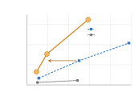

\paperlinks

[](https://jprithwish.github.io/inventa/)
\paperlogos

# Inventa: Decentralized Self-Improving Agents for Autonomous Scientific Discovery

Prithwish Jana^(1,†)    Nikos Kanakaris²    Purak Jain²    Anoop Deoras²
   Sahika Genc² ¹Georgia Institute of Technology  ²Amazon

###### Abstract

Abstract: Large language model (LLM) agents can generate research ideas
and improve scientific discovery through iterative experimentation.
However, increasing the number of agents or iterations does not
automatically translate to producing more diverse or feasible ideas.
Agents may converge on similar candidates, propagate unsupported claims
through shared memory components and repeatedly apply search strategies
that no longer yield any improvements.

We introduce Inventa, a framework for automated scientific discovery
that employs autonomous research units and verified shared knowledge.
Each unit creates a lineage of candidate ideas using a mutator agent. A
local orchestrator agent periodically adapts the mutator’s harness. When
progress stalls, the orchestrator agent replaces its model or restarts
the idea evolution process. Verifiers evaluate each candidate idea and
record verified improvements, useful components and constraint
violations in a shared knowledge, the only channel between units. We
evaluate Inventa on five benchmarks spanning the research cycle,
covering retrieval (ScholarCatalyst), ideation (IdeaBench), proposal
writing (IdeaScientist), and scientific law discovery (EurekaBench,
SciLaws-Bench). It leads all five, achieving 73.6% on EurekaBench versus
56.2% for CORAL. On IdeaBench, it discovers 26.0 novel ideas per paper,
compared with 18.6 for ResearchAgent, with 82% fewer model calls.

^(†)^(†)footnotetext: ^(†)Work done while at Amazon.

## 1 Introduction

Figure 1: Overview of Inventa. Given a research task, Inventa generates
novel and verified ideas. Decentralized autonomous research units
explore candidate ideas in parallel. Each unit
 
reads the shared knowledge ($`\mathcal{K}`$),
 
selects a parent from its idea tree, and
 
uses a mutator agent to propose a child idea. Verifiers
 
evaluate it with held-out scoring, constraint checks, and
out-of-distribution or ablation tests,
 
return its certificate, and
 
publish qualifying findings to $`\mathcal{K}`$. The unit
 
applies acceptance checks and
 
records the child in its idea tree. A per-unit orchestrator
 
evolves the mutator regularly. $`\mathcal{K}`$ is the sole channel for
inter-unit communication, and only verifiers write to it.

Large language models (LLMs) are increasingly used to assist in
scientific research, ranging from identifying relevant literature to
proposing candidate hypotheses and implementing experiments.
Evolutionary search extends these capabilities by using evaluation
feedback to refine candidates. Systems such as AlphaEvolve (Novikov et
al., 2025), EvoX (Liu et al., 2026b), CORAL (Qu et al., 2026), and MILO
(Jana et al., 2026b) show the potential of combining LLMs with
closed-loop search. These advances motivate automated research
assistants that can explore novel ideas, evaluate their feasibility and
retain useful findings across experiments.

Automated research assistance involves several related tasks across the
complete scientific research cycle. These include _retrieving prior
work_ that provides inspiration for a research question (Kim et al.,
2026), _generating ideas_ from existing papers (Guo et al., 2025),
_assessing their novelty_ against related work (Schopf & Färber, 2026),
and _discovering scientific laws_ from data (Huang et al., 2026). They
differ in output but share a common challenge: generating promising
candidates is insufficient unless a system can also verify them and use
the evidence to guide further exploration.

Recent AI co-scientists, such as the Agentic Scientist (Lange et al.,
2026a) and InternAgent-1.5 (Feng et al., 2026), coordinate multiple
agents to generate, test, and refine hypotheses. Despite this progress,
several challenges remain unresolved. First, maintaining diversity as
search grows. These systems largely follow myopic hill-climbing to
optimize the most promising candidates, which narrows the exploration
radius (Lange et al., 2026a). Furthermore, additional samples or
iterations yield increasingly similar candidates, so extra computation
brings diminishing returns (Jiang et al., 2025; Si et al., 2025).
Second, sharing useful knowledge without propagating errors. Isolated
agents cannot benefit from one another’s findings, whereas interacting
agents often converge on similar ideas (Chen et al., 2026). When shared
information is not independently verified, unsupported claims also
influence subsequent attempts (Kim et al., 2025). Third, adapting the
proposal mechanism. Refining candidate ideas does not, by itself, change
the prompts, tools, or control flow used to generate them, so iterations
can improve ideas but not expand the search space. Fourth, satisfying
scientific constraints. Highly novel ideas often prove infeasible under
the task’s assumptions or physical requirements, creating a
novelty–feasibility gap (Geng et al., 2026).

To address these challenges, we propose Inventa (Fig. ), a framework
that combines i) autonomous research units, ii) self-adaptive proposal
mechanisms and iii) sharing of verified findings. We draw inspiration
from how science advances in practice: research groups or labs pursue
different approaches in a decentralized fashion while building on
evidence reported by others. Each unit (like a lab) maintains its own
idea lineage and uses a mutator agent (junior researcher) to develop new
candidates. A per-unit orchestrator (the lab’s principal investigator,
or PI) adapts the mutator’s harness and intervenes when progress stalls.
Verifiers evaluate the candidates, return structured feedback, and add
verified findings to the shared knowledge.

The proposed framework separates three operations: developing candidate
ideas, self-adapting the process that develops them, and determining
which findings can be shared. This separation allows units to pursue
different approaches while receiving, only through shared knowledge,
common evidence about successful candidates, useful components, and
observed constraint violations.


Figure 2: Comparison of search mechanisms. Prior methods (a)–(f) range
from repeated sampling to island-based evolution with fixed, partially
adaptive, or centralized strategies; all keep the mutator fixed. In
Inventa (g), each decentralized unit has a local orchestrator that
evolves its mutator, while only verifiers publish shared findings.

## 2 Related Work

Scaling search. AI scientists generate and test ideas (Lu et al., 2026;
Gottweis et al., 2026), often by LLM-guided search. Yet in equation
discovery, evolution matches fresh sampling at equal budgets (Li, 2026),
and repeated runs or added islands stall in idea basins (Cai et al.,
2026; Antoniades et al., 2026) or collapse onto a few principles (Ran et
al., 2026). Inventa runs many units that redraw their model or restart
their lineage on a stall.

Adapting the generator. AlphaEvolve co-evolves its prompts, CORAL’s
agents write their own skills, and MILO and ShinkaEvolve pick among
fixed agents or LLMs (Novikov et al., 2025; Qu et al., 2026; Jana et
al., 2026b; Lange et al., 2026b) (Fig. ). Harness search optimizes a
final harness on a fixed search set (Lee et al., 2026; Zhang et al.,
2026), where overfitting explains about half the gain (Ding et al.,
2026). In Inventa, an orchestrator acts as a meta-mutator, evolving the
mutator that evolves ideas during search and keeping an edit only if
twin trials show significantly fitter children.

Sharing verified knowledge. In CORAL and AgentRxiv, agents write shared
state (Qu et al., 2026; Schmidgall & Moor, 2025); such state can spread
reward hacks (Hu et al., 2026) and early consensus (Yoon et al., 2026).
DuoDiscover’s agents optimize self-built proxy evaluators (Agarwal et
al., 2026); in Inventa, only verifiers write shared knowledge, scoring
on data no mutator sees, and publish refuted findings that prune all
units’ search.

## 3 Preliminaries and Problem Statement


## 4 Methodology


1: task $`\tau`$ with verifiers $`\mathcal{V}`$, pool $`\mathcal{G}`$,
budget $`B`$ hyperparameters: number of units $`N`$, patience $`P`$, lag
$`\lambda`$ 2: best verified idea $`x^{\star}`$ with
$`\textsc{Cert}(x^{\star})`$ 3:

$`\mathcal{K}=(\mathcal{K}_{\mathrm{ver}},\mathcal{K}_{\mathrm{part}},\mathcal{K}_{\mathrm{ref}})\leftarrow(\emptyset,\emptyset,\emptyset)`$
$`\triangleright`$ shared knowledge 4:

for all $`j=1,\dots,N`$ in parallel do $`\triangleright`$ autonomous
units $`\mathcal{U}_{j}`$

5:
 

$`\mu_{j}\sim\mathcal{G}`$;
$`\mathcal{L}_{j}\leftarrow\{\text{seed idea}\}`$ $`\triangleright`$
initialize $`\mathcal{U}_{j}`$

6:
 

for $`r_{j}\leftarrow 1`$ to $`B`$ do

7:
  
wait until
$`r_{j}<\min_{j^{\prime}\in\mathrm{active}}r_{j^{\prime}}+\lambda`$
$`\triangleright`$ bounded lag

8:
  

$`\mathcal{K}_{j}\leftarrow\textsc{Snapshot}(\mathcal{K})`$
$`\triangleright`$
 
read the shared knowledge

9:
  

$`x_{\mathrm{par}}\leftarrow\textsc{SelectParent}(\mathcal{L}_{j})`$
$`\triangleright`$
 
select a parent

10:
  

$`x\leftarrow\mu_{j}(x_{\mathrm{par}},\textsc{Cert}(x_{\mathrm{par}}),\mathcal{L}_{j},\mathcal{K}_{j})`$
$`\triangleright`$
 
write a child

11:
  

$`\textsc{Cert}(x),F(x)\leftarrow\mathcal{V}(x)`$ $`\triangleright`$
 
test,
 
return the certificate

12:
  

atomic
$`\triangleright`$
 
publish the findings

13:
   
$`\smash[t]{x^{\mathrm{best}}}\leftarrow\textsc{Best}(\mathcal{K}_{\mathrm{ver}})`$
$`\triangleright`$ re-check the best verified idea

14:
   

$`\mathcal{K}\leftarrow\mathcal{K}\cup\textsc{Findings}(x,\smash[t]{x^{\mathrm{best}}})`$
$`\triangleright`$ share with all units
  
15:
  

$`\ell_{x}\leftarrow\textsc{Accept}(x,\mathcal{L}_{j})`$
$`\triangleright`$
 
accept or reject the child

16:
  
$`\mathcal{L}_{j}\leftarrow\mathcal{L}_{j}\cup\{(x,\ell_{x})\}`$
$`\triangleright`$
 
record in the unit’s memory

17:
  

if $`\mathcal{U}_{j}`$ stalls then $`\triangleright`$ no new best
fitness in $`P`$ scored rounds

18:
   
Redraw or Restart $`\triangleright`$
 
change model or approach
  
19:
  

every $`P`$ rounds: Retool $`\triangleright`$
 
evolve harness via twin trial
 
20:

return $`x^{\star}\leftarrow\textsc{Best}(\mathcal{K}_{\mathrm{ver}})`$
with
$`\textsc{Cert}(x^{\star})`$

Algorithm 1 (Inventa). $`N`$   autonomous research units evolve their
mutators and share   verifier-written   findings.

Inventa comprises autonomous research units, verifiers, and a shared
knowledge (§ –). We detail the asynchronous evolution loop in Alg. .

### 4.1 Autonomous Research Units

Each unit $`\mathcal{U}_{j}`$, where $`j\in\{1,\dots,N\}`$, advances at
its own pace. Its round $`r_{j}`$ counts the attempts it has made so
far. At round $`r_{j}=r`$, we define its state as
$`\smash[t]{\mathcal{U}_{j}^{(r)}:=\langle\mathcal{L}_{j}^{(r)},\mu_{j}^{(r)}\rangle}`$,
consisting of its lineage memory and current mutator. Its orchestrator
$`\mathcal{O}_{j}`$ adapts both the mutator and the unit’s search
direction.

Lineage memory. The memory $`\smash[t]{\mathcal{L}_{j}^{(r)}}`$ is an
idea tree of the candidates $`\mathcal{U}_{j}`$ explored. Each node
holds an idea, its certificate of verifier evidence (§), and an
acceptance label. Each edge links a parent to its child. The tree grows
from a seed idea proposed by $`\mathcal{O}_{j}`$; every later round
$`r_{j}=r`$ has five stages:

1.  (i)
    Parent selection. To pick a parent idea $`x_{\mathrm{par}}`$, the
    unit treats the accepted nodes $`\mathcal{A}`$ of
    $`\smash[t]{\mathcal{L}_{j}^{(r-1)}}`$ as arms of a multi-armed
    bandit rewarded by the fitness
    $`\smash[t]{F(x):=\textsc{Score}(x)\times\mathbb{I}[\textsc{Valid}(x)=1]}`$.
    A node’s value
    $`\smash[t]{\bar{s}_{v}:=\tfrac{1}{n_{v}}\sum_{u\in\{v\}\cup\mathrm{ch}(v)}F(u)}`$
    averages the fitness of $`v`$ and its children $`\mathrm{ch}(v)`$,
    with $`n_{v}:=1+|\mathrm{ch}(v)|`$. By Thompson sampling (Russo et
    al., 2018), the unit draws
    $`{\tilde{s}_{v}\sim\mathcal{N}(\bar{s}_{v},\sigma^{2}/n_{v})}`$ and
    selects
    $`x_{\mathrm{par}}=\arg\max_{v\in\mathcal{A}}\tilde{s}_{v}`$, with
    $`\sigma`$ the typical fitness change per child. This balances
    exploiting promising lineages and exploring nodes with few children.
2.  (ii)
    Mutation. $`\mu_{j}^{(r)}`$ diagnoses $`x_{\mathrm{par}}`$ and
    revises it into a child idea $`x`$ (Eq. ), fitted on
    $`\mathcal{D}_{\mathrm{train}}`$.
3.  (iii)
    Verification and knowledge sharing. The verifiers test $`x`$ (§),
    return its certificate and fitness, and publish qualifying findings
    to $`\mathcal{K}`$ (§).
4.  (iv)
    Child acceptance. The unit accepts $`x`$ only if no previously
    accepted $`y\in\mathcal{A}`$ is at least as simple and nearly as
    fit: $`\textsc{Cplx}(y)\leq\textsc{Cplx}(x)`$ and
    $`F(y)\geq F(x)-\delta`$, with Cplx a task-specific complexity
    (e.g., parameters); extra complexity must thus improve fitness by
    $`>\delta`$. It also rejects children with a confirmed constraint
    violation.
5.  (v)
    Memory update. The child idea $`x`$ joins the lineage. Accepted
    children become eligible parents, while rejected ones remain as
    negative evidence. Every scored child updates its parent’s value.

Mutator agent. The mutator
$`\smash[t]{\mu_{j}^{(r)}=\langle m_{j}^{(r)},h_{j}^{(r)}\rangle}`$, a
model run in a harness, writes the child

```math
x\leftarrow\mu_{j}^{(r)}\bigl(x_{\mathrm{par}},\textsc{Cert}(x_{\mathrm{par}}),\mathcal{L}_{j}^{(r-1)},\mathcal{K}_{j}\bigr) \tag{1}
```

from the parent, its certificate, recent lineage nodes, and the snapshot
$`\mathcal{K}_{j}`$ of shared knowledge. The certificate gives local
feedback on the parent’s failures; the lineage and $`\mathcal{K}_{j}`$
give global context on what the unit has tried, why each attempt was
accepted or rejected, and promising or unpromising directions. The
mutator runs in a sandbox where $`\mathcal{D}_{\mathrm{val}}`$ and
$`\mathcal{D}_{\mathrm{test}}`$ are inaccessible. The initial mutator is
drawn from $`\mathcal{G}`$; the orchestrator can later change its
harness or model, as we describe next.

Orchestrator agent. The orchestrator $`\mathcal{O}_{j}\in\mathcal{G}`$
adapts the unit through three actions. Retool is considered every $`P`$
rounds; Redraw and Restart respond when the unit stalls, i.e., goes
$`P`$ scored rounds without improving its best fitness.

- •
  Retool (evolving the harness). Acting as a meta-mutator, the
  orchestrator diagnoses traces $`\mathcal{E}_{j}`$ of recent attempts
  (turns, tool calls, costs, and outcomes) and proposes a harness
  $`h^{\prime}\leftarrow\mathcal{O}_{j}(\smash[t]{h_{j}^{(r)}},\mathcal{E}_{j})`$.
  Since a worse $`h^{\prime}`$ would degrade every later child, a twin
  trial first runs the two harnesses on the same parent and mutation
  plan, giving children $`x_{i}`$ and $`x_{i}^{\prime}`$ with
  $`d_{i}:=F(x_{i}^{\prime})-F(x_{i})`$ when both are scored. The unit
  sets
  $`\mu_{j}\leftarrow\langle\smash[t]{m_{j}^{(r)}},h^{\prime}\rangle`$
  if the $`n`$ scored pairs give a significantly positive mean
  $`d_{i}`$; otherwise, $`\smash[t]{h_{j}^{(r)}}`$ stays.
- •
  Redraw (replacing the model). $`\mathcal{K}`$ tallies each model’s
  recent fitness improvements (§), so $`\mathcal{O}_{j}`$ can swap in a
  better-performing model: it draws $`m^{\prime}`$ from this tally by
  Thompson sampling and, keeping the harness, sets
  $`\mu_{j}\leftarrow\langle m^{\prime},\smash[t]{h_{j}^{(r)}}\rangle`$.
- •
  Restart (changing the research direction). If the unit stalls again
  after a second Redraw with no Verified finding since (§),
  $`\mathcal{O}_{j}`$ archives the unit’s existing lineage and proposes
  a new seed idea from $`\mathcal{K}`$ to initiate a new idea tree.

### 4.2 Verifier Components

The verifiers $`\mathcal{V}`$ evaluate each candidate idea $`x`$ against
$`x_{0}`$ and the constraints $`\mathcal{C}`$. They return a certificate
$`\textsc{Cert}(x)`$ recording the outcome of every check and the
evidence behind each failure, and decide which findings enter
$`\mathcal{K}`$ (§). Before sharing results to $`\mathcal{K}`$, the
verifiers run four checks:

- •
  Held-out scoring. Running $`x`$ on $`\mathcal{D}_{\mathrm{val}}`$
  gives $`\textsc{Score}(x)`$ and $`\textsc{Gain}(x)`$ (Def. ).
- •
  Constraint checking. Each $`c\in\mathcal{C}`$ is tested
  programmatically or by LLM consensus. Confirmed violations form
  $`\mathcal{C}_{\mathrm{viol}}(x)`$, so
  $`\textsc{Valid}(x)=1-|\mathcal{C}_{\mathrm{viol}}(x)|/|\mathcal{C}|`$;
  undecided ones form $`\mathcal{C}_{\mathrm{undec}}(x)`$.
- •
  Out-of-distribution testing. $`\textsc{OOD}(x)`$ is $`1`$ if the score
  of $`x`$ on the held-out regime $`\mathcal{D}_{\mathrm{ood}}`$ is at
  least $`\kappa`$ times its score on
  $`\mathcal{D}_{\mathrm{val}}\setminus\mathcal{D}_{\mathrm{ood}}`$,
  else $`0`$.
- •
  Component ablation. Each component $`t\in T(x)`$ is removed in turn;
  its contribution on data $`S\subseteq\mathcal{D}`$ is the score drop
  $`\textsc{Abl}_{t}(x;S):=\textsc{Score}(x;S)-\textsc{Score}(x\setminus\{t\};S)`$;
  its maximum over validation regimes is
  $`\textsc{Abl}^{\max}_{t}(x):=\max_{\rho}\textsc{Abl}_{t}(x;\mathcal{D}_{\rho}\cap\mathcal{D}_{\mathrm{val}})`$
  (Appendix ).

### 4.3 Verified Shared Knowledge

The shared knowledge stores the per-model gain tally used by Redraw (§)
and three types of findings,
$`\mathcal{K}=(\mathcal{K}_{\mathrm{ver}},\mathcal{K}_{\mathrm{part}},\mathcal{K}_{\mathrm{ref}})`$.
Verifiers write to it, while units read it at each round’s start.

Verified findings. The set $`\mathcal{K}_{\mathrm{ver}}`$ stores new
bests $`(x,\textsc{Cert}(x))`$. Let $`x^{\mathrm{best}}`$ be the
highest-scoring idea in $`\mathcal{K}_{\mathrm{ver}}`$. A candidate
$`x`$ is added if
$`\smash[t]{\textsc{Score}(x)>\textsc{Score}(x^{\mathrm{best}})+\delta}`$
and it passes all checks:
$`\mathcal{C}_{\mathrm{viol}}(x)\cup\mathcal{C}_{\mathrm{undec}}(x)=\emptyset`$,
$`\textsc{OOD}(x)=1`$, and, where ablation is supported,
$`\textsc{Abl}^{\max}_{t}(x)>\delta`$ for each $`t\in T(x)`$. This
raises the bar for all units.

Partial findings. The set $`\mathcal{K}_{\mathrm{part}}`$ holds useful
components $`(t,x,\textsc{Cert}(x))`$ for other units to reuse. Each
component $`t`$ of a candidate $`x`$ with $`\textsc{Valid}(x)=1`$ and
$`\textsc{Gain}(x)>\delta`$ enters if
$`\textsc{Abl}^{\max}_{t}(x)>\delta`$, even when $`x`$ does not beat
$`x^{\mathrm{best}}`$.

Refuted findings. The set $`\mathcal{K}_{\mathrm{ref}}`$ records each
confirmed violation $`c\in\mathcal{C}_{\mathrm{viol}}(x)`$ as
$`(c,x,\textsc{Cert}(x))`$, so other units avoid them and prune search
space.

 Inventa
over
 the
best baseline (%)

Retrieveprior work

Generateideas

Writeproposals

DiscoverscientificlawsScholarCatalystOpenCode + DS
V3.2+21.9%36.5 $`\rightarrow`$ 44.5IdeaBenchResearchAgent+39.8%18.6 $`\rightarrow`$ 26.0IdeaScientistIdeaScientist-Base+6.4%77.7 $`\rightarrow`$ 82.7EurekaBenchCORAL+31.0%56.2 $`\rightarrow`$ 73.6SciLaws-BenchReAct +
Grok 4.7+5.9%59.3 $`\rightarrow`$ 62.8

 – 



Figure 3: Inventa leads at every research stage and keeps improving with
search. (a) Gain over the best baseline on the respective primary metric
(%). (b) EurekaBench validation conditioned score vs. cost per task, in
units of 10 USD; baselines from Table . (c) IdeaBench distinct novel
ideas vs. model calls per paper.

## 5 Experiments

Benchmarks and metrics. We evaluate Inventa at four stages of the
research cycle: (i) _retrieving prior work that inspires new ideas_ on
ScholarCatalyst (Kim et al., 2026) (894 queries), (ii) _generating
ideas_ on IdeaBench (Guo et al., 2025) (736 test papers), (iii) _writing
grounded proposals_ on IdeaScientist (Liu et al., 2026a) (277 research
problems), and (iv) _discovering scientific laws_ on EurekaBench (Geng
et al., 2026) (16 CPU-only tasks) and SciLaws-Bench (Huang et al., 2026)
(38 tasks). Primary metrics follow each stage’s goal: (i) retrieval
quality, the mean of nDCG@20 and Recall@$`k`$; (ii) novelty, distinct
novel ideas per paper rated $`\geq`$7/10 by an expert-calibrated judge;
(iii) novelty and quality, their combined score; and (iv)
constraint-aware fit, EurekaBench’s conditioned score (CS) of predictive
accuracy (PA) and scientific insight (SI), zero unless the law passes
all of the task’s scientific-constraint tests, and SciLaws-Bench’s
held-out fit $`S_{N}`$ (see Appendices –).

Baselines and protocol. We compare with frontier AI agents (OpenHands
(Wang et al., 2025), OpenCode (SST, 2025), Goose (Block, 2025),
SciLaws-Bench’s ReAct) with up to five models, Best-of-$`N`$, SoTA
evolutionary search and AI co-scientists (e.g., GEPA (Agrawal et al.,
2026), MILO, CORAL), and SoTA task-specific systems. Evolution sees only
$`\mathcal{D}_{\mathrm{train}}`$ and $`\mathcal{D}_{\mathrm{val}}`$; the
best candidate, chosen on $`\mathcal{D}_{\mathrm{val}}`$, is then tested
on $`\mathcal{D}_{\mathrm{test}}`$ (details in Appendix ).


|                                                                                            |                                 |       |       |       |                  |
| ------------------------------------------------------------------------------------------ | ------------------------------- | ----- | ----- | ----- | ---------------- |
|                                                                                            | All 894 queries (%)$`\uparrow`$ |       |       |       | Mean             |
| Method                                                                                     | nDCG@20                         | R@5   | R@20  | R@100 | of 8$`\uparrow`$ |
| Retrievers without a language model                                                        |                                 |       |       |       |                  |
|  BM25 (2009)                   | 19.6                            | 11.9  | 25.2  | 44.0  | 24.2             |
|  Cohere Embed v4 (2025)        | 30.1                            | 19.2  | 37.7  | 60.8  | 35.4             |
|  Cohere v4 + BM25 fusion       | 28.3                            | 18.2  | 35.7  | 60.9  | 34.1             |
|  Cohere v4 + Rerank 3.5 (2024) | 29.5                            | 18.9  |  39.0 | 60.8  | 35.6             |
| DeepSeek V3.2 agents (Cohere v4 retriever)                                                 |                                 |       |       |       |                  |
|  Tool-calling Agent (2026)     | 28.7                            | 18.8  | 36.0  | 60.7  | 34.5             |
|  + real metadata (2026)        | 28.4                            | 18.9  | 36.1  | 60.8  | 34.7             |
|  Deep-research Agent (2026)    | 30.2                            | 20.0  | 36.3  | 61.0  | 35.2             |
|  OpenCode (2025)               |  31.6                           |  21.7 | 38.3  |  61.7 |  36.5            |
|  OpenHands (2025)              | 30.7                            | 21.4  | 38.3  | 59.8  | 36.3             |
|  Seed agent (initialization)   | 27.3                            | 19.3  | 33.1  | 58.4  | 33.1             |
|    Inventa                     | 39.1                            | 26.9  | 49.5  | 69.9  | 44.5             |

Table 1: ScholarCatalyst (894 queries; primary: Mean). Bold/ underline:
best/second.

Inventa ranks first on the primary metric of all five benchmarks, 6–40%
above the strongest baseline (Fig. a). SoTA frameworks, by contrast, are
inconsistent across stages: among evolutionary baselines, CORAL leads on
EurekaBench (56.2% CS) but trails on IdeaBench (2.7 ideas), and
OpenEvolve does the opposite (14.7 ideas; 34.0% CS), whereas Inventa
leads on both. In retrieval (ScholarCatalyst), Inventa evolves its seed
retriever from 33.1% to 44.5%, versus 36.5% for the best agent, OpenCode
(Table ). In idea generation (IdeaBench), it returns 26.0 distinct,
judge-rated novel ideas per paper, versus 18.6 for ResearchAgent, with
82% fewer calls (Table ). In proposal writing (IdeaScientist), Inventa
scores 82.7%, vs. 77.7% for IdeaScientist-Base and 74.6% for
IdeaScientist-Trained, with the highest novelty (82.3% vs. at most
69.8%; Table ). In scientific law discovery (EurekaBench,
SciLaws-Bench), it leads by 31.0% and 5.9%.

[TABLE]

Table 2: EurekaBench (16 tasks; primary: CS). Best-of-$`N`$: best on
$`\mathcal{D}_{\mathrm{val}}`$, tested on
$`\mathcal{D}_{\mathrm{test}}`$. Bold/ underline: best/second.

|                                                                                        |                                                    |       |       |                |                                    |                                     |
| -------------------------------------------------------------------------------------- | -------------------------------------------------- | ----- | ----- | -------------- | ---------------------------------- | ----------------------------------- |
|                                                                                        | Held-out predictive fit ($`S_{N}`$, %)$`\uparrow`$ |       |       |                | Beats law ($`{>}`$Ref)$`\uparrow`$ | Validity ($`S_{V}`$, %)$`\uparrow`$ |
| Method                                                                                 | Single                                             | Multi | All   | 95% CI         |                                    |                                     |
| Frontier AI agents                                                                     |                                                    |       |       |                |                                    |                                     |
|   SciLaws-Bench’s (Huang et al., 2026) ReAct harness (Best-of-2)                       |                                                    |       |       |                |                                    |                                     |
|  DeepSeek V3.2             | 47.6                                               | 42.8  | 44.8  | \[38.8, 50.2\] | 14/38                              | 73.4                                |
|  MiniMax M2.5              | 45.4                                               | 44.1  | 44.6  | \[38.1, 50.6\] | 16/38                              | 71.9                                |
|  Kimi K3                   | 59.3                                               | 51.3  | 54.7  | \[49.7, 59.3\] | 22/38                              |  77.9                               |
|  GLM 5.3                   | 56.7                                               | 51.7  | 53.8  | \[49.1, 58.1\] | 23/38                              | 75.1                                |
|  Grok 4.7                  | 59.4                                               | 55.1  | 56.9  | \[53.9, 60.2\] | 22/38                              | 76.7                                |
|   SciLaws-Bench’s ReAct harness (Best-of-50)                                           |                                                    |       |       |                |                                    |                                     |
|  DeepSeek V3.2             | 53.5                                               | 56.0  | 55.0  | \[50.7, 59.0\] | 23/38                              | 74.4                                |
|  MiniMax M2.5              | 50.8                                               | 58.8  | 55.4  | \[50.1, 60.0\] | 25/38                              | 71.5                                |
|  Kimi K3                   |  59.8                                              | 57.8  | 58.6  | \[55.0, 62.5\] | 26/38                              | 74.0                                |
|  GLM 5.3                   | 59.6                                               | 58.8  | 59.1  | \[55.3, 63.2\] | 24/38                              | 70.0                                |
|  Grok 4.7                  | 60.4                                               | 58.4  |  59.3 | \[56.2, 62.6\] |  28/38                             | 79.3                                |
| Evolutionary search & co-scientists                                                    |                                                    |       |       |                |                                    |                                     |
|  OpenEvolve (2025)         | 44.5                                               | 57.4  | 52.0  | \[46.8, 56.7\] | 18/38                              | 70.9                                |
|  GEPA (2026)               | 54.1                                               | 54.7  | 54.4  | \[49.9, 58.8\] | 18/38                              | 73.4                                |
|  EvoX (2026b)              | 36.5                                               | 54.9  | 47.2  | \[40.8, 52.8\] | 14/38                              | 75.9                                |
|  MILO (2026b)              | 55.2                                               |  61.4 | 58.9  | \[54.1, 63.4\] | 25/38                              | 74.2                                |
|  CORAL (2026)              | 54.6                                               | 60.1  | 57.9  | \[52.8, 62.7\] | 24/38                              | 75.3                                |
|  Agentic Scientist (2026a) | 50.7                                               | 55.8  | 53.8  | \[48.9, 58.6\] | 21/38                              | 76.1                                |
|  InternAgent-1.5 (2026)    | 48.9                                               | 56.2  | 53.3  | \[48.4, 58.2\] | 20/38                              | 72.8                                |
|    Inventa                 | 58.6                                               | 65.8  | 62.8  | \[57.1, 67.9\] | 31/38                              | 77.1                                |

|                       | Novelty (%) |        |           |       | Proposal quality (%) | Combined score (%)$`\uparrow`$ |
| --------------------- | ----------- | ------ | --------- | ----- | -------------------- | ------------------------------ |
| Method                | all         | cutoff | in-domain | mean  |                      |                                |
| IdeaScientist-Base    | 77.6        | 77.0   | 54.9      |  69.8 | 85.7                 |  77.7                          |
| IdeaScientist-Trained | 67.3        | 68.3   |  70.9     | 68.8  | 80.4                 | 74.6                           |
|   Inventa             |  76.4       |  76.7  | 93.9      | 82.3  |  83.0                | 82.7                           |

Table 3: SciLaws-Bench (38 tasks; primary: $`S_{N}`$). $`>`$Ref: beats
the published law. Bold/ underline: best/second.

Table 4: IdeaScientist (277 problems; primary: Combined). Rows 1–2 from
Liu et al. (2026a).

[TABLE]

Table 5: IdeaBench (736 test papers; App. ). Distinct novel: ideas per
paper rated $`\geq`$8 or $`\geq`$7 (primary). Bold/ underline:
best/second per setting.


On EurekaBench, Inventa alone passes every scientific-constraint test,
and its laws carry far more insight than those of CORAL, the strongest
baseline (67.0% vs. 50.3% SI; 73.6% vs. 56.2% CS; Table ). On
SciLaws-Bench, Inventa beats the published law on 31 of 38 tasks and
reaches 62.8% $`S_{N}`$, against 28 and 59.3% for the best baseline
(Table ); its edge lies in tasks that hold out entire groups (65.8% vs.
at most 61.4%). Its validity $`S_{V}`$ (77.1%) also exceeds that of 15
of the 17 baselines. Inventa thus discovers scientific laws that are
both novel and consistent with domain constraints.


Inventa turns extra budget into steady gains, whereas SoTA agents and
evolutionary methods level off. On EurekaBench validation at equal cost
(Fig. b), Inventa reaches 64.7% CS after 10 rounds, against at most
52.8% for the SoTA evolutionary methods and 47.4% for the best of agents
 – ;
after 20 rounds, it reaches 72.5%, while CORAL, the best baseline,
reaches 55.5%. On SciLaws-Bench, 25$`\times`$ more samples (Best-of-50
vs. Best-of-2) lift the strongest ReAct agent only from 56.9% to 59.3%,
below Inventa’s 62.8% (Table ). On IdeaBench (Fig. c; Table ), from the
27- to the 122-idea setting, Inventa’s distinct novel ideas rise from
26.0 to 61.6 with 95 calls per paper, whereas Best-of-$`N`$’s rise only
from 4.7 to 8.8 with 242 calls and MILO’s reach 48.2 with 250. Its lead
thus widens as the budget grows.


We re-score IdeaBench with two judges unused in search: Inventa still
finds the most distinct novel ideas (17.5 and 13.5 vs. 13.1 and 11.3 for
OpenEvolve; paired 90% intervals above zero; Appendix ).

## 6 Conclusion

We presented Inventa, a framework for scientific discovery in which
autonomous research units adapt their own mutators and share only
verified findings. On five benchmarks spanning multiple research stages,
it outperforms frontier AI agents, evolutionary search, and AI
co-scientists, discovering more novel ideas and scientific laws that
satisfy domain constraints. By self-adapting its search, Inventa
benefits more from added budget, whereas existing frameworks show
diminishing returns.

## Acknowledgements

We thank Prof. Vijay Ganesh (Georgia Institute of Technology) for his
fruitful feedback and insightful discussions throughout this project,
which helped us improve this paper.

## References

- Agarwal et al. (2026) Shubham Agarwal, Akshat Gupta, Mike Heddes,
  Dilara Soylu, Rui Meng, Patrick Tser Jern Kon, Jiefeng Chen, Mert
  Cemri, Shu Liu, Abe Gonzalez, Akanksha Jain, Bhavana Dalvi Mishra,
  Linfeng Song, Vilobh Meshram, Xiangru Tang, Jinsung Yoon, Aditya
  Parameswaran, Ion Stoica, Vahab Mirrokni, Burak Gokturk, Parthasarathy
  Ranganathan, Tomas Pfister, Nanyun Peng, and Chun-Liang Li.
  DuoDiscover: Scaling Autonomous Discovery Beyond the Evaluation
  Bottleneck. _arXiv Preprint arXiv:2610.17184_, 2026. URL
  [https://arxiv.org/abs/2610.17184](https://arxiv.org/abs/2610.17184).
- Agrawal et al. (2026) Lakshya A. Agrawal, Shangyin Tan, Dilara Soylu,
  Noah Ziems, Rishi Khare, Krista Opsahl-Ong, Arnav Singhvi, Herumb
  Shandilya, Michael J. Ryan, Meng Jiang, Christopher Potts, Koushik
  Sen, Alex Dimakis, Ion Stoica, Dan Klein, Matei Zaharia, and Omar
  Khattab. GEPA: Reflective Prompt Evolution Can Outperform
  Reinforcement Learning. In _The Fourteenth International Conference on
  Learning Representations (ICLR)_, 2026. URL
  [https://arxiv.org/abs/2507.19457](https://arxiv.org/abs/2507.19457).
- Antoniades et al. (2026) Antonis Antoniades, Deepak Nathani, Ritam
  Saha, Alfonso Amayuelas, Ivan Bercovich, Zhaotian Weng, Vignesh
  Baskaran, Kunal Bhatia, and William Yang Wang. Heuresis: Search
  Strategies for Autonomous AI Research Agents Across Quality, Diversity
  and Novelty. _arXiv Preprint arXiv:2606.25198_, 2026. URL
  [https://arxiv.org/abs/2606.25198](https://arxiv.org/abs/2606.25198).
- Baek et al. (2025) Jinheon Baek, Sujay Kumar Jauhar, Silviu Cucerzan,
  and Sung Ju Hwang. ResearchAgent: Iterative Research Idea Generation
  over Scientific Literature with Large Language Models. In Luis
  Chiruzzo, Alan Ritter, and Lu Wang (eds.), _Proceedings of the 2025
  Conference of the Nations of the Americas Chapter of the Association
  for Computational Linguistics: Human Language Technologies (Volume 1:
  Long Papers)_, pp. 6709–6738, Albuquerque, New Mexico, April 2025.
  Association for Computational Linguistics. ISBN 979-8-89176-189-6.
  [10.18653/v1/2025.naacl-long.342](https://doi.org/10.18653/v1/2025.naacl-long.342).
  URL
  [https://aclanthology.org/2025.naacl-long.342/](https://aclanthology.org/2025.naacl-long.342/).
- Block (2025) Block. goose.
  [https://github.com/aaif-goose/goose](https://github.com/aaif-goose/goose), 2025.
  An open-source, extensible AI agent.
- Brown et al. (2024) Bradley Brown, Jordan Juravsky, Ryan Ehrlich,
  Ronald Clark, Quoc V. Le, Christopher Ré, and Azalia Mirhoseini. Large
  Language Monkeys: Scaling Inference Compute with Repeated Sampling.
  _arXiv Preprint arXiv:2407.21787_, 2024. URL
  [https://arxiv.org/abs/2407.21787](https://arxiv.org/abs/2407.21787).
- Cai et al. (2026) Ziyang Cai, Christos Ziakas, Vasilis Kontonis, Tim
  Pearce, Siddhartha Sen, Akshay Krishnamurthy, Shivam Garg, and
  Dimitris Papailiopoulos. Fork-and-Flush: Escaping Idea Basins in
  Autoresearch Agents. _arXiv Preprint arXiv:2610.07447_, 2026. URL
  [https://arxiv.org/abs/2610.07447](https://arxiv.org/abs/2610.07447).
- Chen et al. (2026) Nuo Chen, Yicheng Tong, Yuzhe Yang, Yufei He, Xueyi
  Zhang, Zou Qingyun, Qian Wang, and Bingsheng He. Diversity Collapse in
  Multi-Agent LLM Systems: Structural Coupling and Collective Failure in
  Open-Ended Idea Generation. In Maria Liakata, Viviane P. Moreira,
  Jiajun Zhang, and David Jurgens (eds.), _Findings of the Association
  for Computational Linguistics: ACL 2026_, pp. 251–306, San Diego,
  California, United States, July 2026. Association for Computational
  Linguistics. ISBN 979-8-89176-395-1.
  [10.18653/v1/2026.findings-acl.13](https://doi.org/10.18653/v1/2026.findings-acl.13).
  URL
  [https://aclanthology.org/2026.findings-acl.13/](https://aclanthology.org/2026.findings-acl.13/).
- Cohere (2024) Cohere. Introducing Rerank 3.5: Precise AI Search.
  [https://cohere.com/blog/rerank-3pt5](https://cohere.com/blog/rerank-3pt5), 2024.
- Cohere (2025) Cohere. Introducing Embed 4: Multimodal Search for
  Business.
  [https://cohere.com/blog/embed-4](https://cohere.com/blog/embed-4), 2025.
- Ding et al. (2026) Wenxuan Ding, Qin Lu, Changlong Yu, Sha Li, Shuowei
  Jin, Xin Liu, Zhenyu Shi, and Greg Durrett. Harness-Delta Attribution:
  Dissecting Gains From Harness Evolution. _arXiv Preprint
  arXiv:2610.22466_, 2026. URL
  [https://arxiv.org/abs/2610.22466](https://arxiv.org/abs/2610.22466).
- Feng et al. (2026) Shiyang Feng, Runmin Ma, Xiangchao Yan, Yue Fan,
  Yusong Hu, Songtao Huang, Shuaiyu Zhang, Zongsheng Cao, Tianshuo Peng,
  Jiakang Yuan, Zijie Guo, Zhijie Zhong, Shangheng Du, Weida Wang,
  Jinxin Shi, Yuhao Zhou, Xiaohan He, Zhiyin Yu, Fangchen Yu, Bihao
  Zhan, Qihao Zheng, Jiamin Wu, Mianxin Liu, Chi Zhang, Shaowei Hou,
  Shuya Li, Yankai Jiang, Wenjie Lou, Lilong Wang, Zifu Wang, Jiong
  Wang, Wanghan Xu, Yue Deng, Dongrui Liu, Yiheng Wang, Wenlong Zhang,
  Fenghua Ling, Shufei Zhang, Xiaosong Wang, Shuangjia Zheng, Xun Huang,
  Siqi Sun, Shuyue Hu, Peng Ye, Chunfeng Song, Bin Wang, Conghui He,
  Yihao Liu, Xin Li, Qibin Hou, Tao Chen, Xiangyu Yue, Bin Wang, Liang
  He, Dahua Lin, Bowen Zhou, Bo Zhang, and Lei Bai. InternAgent-1.5: A
  Unified Agentic Framework for Long-Horizon Autonomous Scientific
  Discovery. _arXiv Preprint arXiv:2602.08990_, 2026. URL
  [https://arxiv.org/abs/2602.08990](https://arxiv.org/abs/2602.08990).
- Geng et al. (2026) Jiayi Geng, Zhengxuan Wu, Kevin S. Chen, Seungone
  Kim, Joseph Janssen, Zora Zhiruo Wang, Bhupalee Kalita, Runtian Gao,
  Aaron Ho, Andrew Oakleigh Nelson, Olexandr Isayev, Francisco
  Villaescusa-Navarro, Ching-Yao Lai, Howard Chen, and Graham Neubig.
  EurekaBench: Measuring Agentic Ability to Discover New Scientific
  Insights. _arXiv Preprint arXiv:2610.00492_, 2026. URL
  [https://arxiv.org/abs/2610.00492](https://arxiv.org/abs/2610.00492).
- Gottweis et al. (2026) Juraj Gottweis, Wei-Hung Weng, Alexander
  Daryin, Tao Tu, Petar Sirkovic, Artiom Myaskovsky, Grzegorz Glowaty,
  Felix Weissenberger, Alessio Orlandi, Dan Popovici, Anil Palepu, Keran
  Rong, Ryutaro Tanno, Khaled Saab, Fan Zhang, Jacob Blum, Andrew
  Carroll, Kavita Kulkarni, Nenad Tomašev, Dina Zverinski, Ivor
  Rendulic, Elahe Vedadi, Florian Hasler, Luka Rimanic, Marina Boia,
  Ivan Budiselic, Ben Feinstein, Mathias Bellaiche, Tom Sheffer, Jan
  Freyberg, Jeremy Ratcliff, Ottavia Bertolli, Katherine Chou, Avinatan
  Hassidim, Burak Gokturk, Amin Vahdat, Yuan Guan, Vikram Dhillon,
  Eeshit Dhaval Vaishnav, Byron Lee, Tiago R. D. Costa, José R. Penadés,
  Gary Peltz, Yossi Matias, James Manyika, Demis Hassabis, Yunhan Xu,
  Pushmeet Kohli, Annalisa Pawlosky, Alan Karthikesalingam, and Vivek
  Natarajan. Accelerating Scientific Discovery with Co-Scientist.
  _Nature_, 655(8122):487–496, 2026.
  [10.1038/s41586-026-10644-y](https://doi.org/10.1038/s41586-026-10644-y).
- Guo et al. (2025) Sikun Guo, Amir Hassan Shariatmadari, Guangzhi
  Xiong, Albert Huang, Myles Kim, Corey M. Williams, Stefan Bekiranov,
  and Aidong Zhang. IdeaBench: Benchmarking Large Language Models for
  Research Idea Generation. In _Proceedings of the 31st ACM SIGKDD
  Conference on Knowledge Discovery and Data Mining, V.2_, pp.
  5888–5899, 2025.
  [10.1145/3711896.3737419](https://doi.org/10.1145/3711896.3737419).
- Hu et al. (2026) Yuepeng Hu, Pegah Ghahremani, Reza Aghajani, Mahesh
  Pasupuleti, and Himaghna Bhattacharjee. Reward Hacking as a
  Transmissible Strategy in Multi-Agent Coding Systems. _arXiv Preprint
  arXiv:2610.12822_, 2026. URL
  [https://arxiv.org/abs/2610.12822](https://arxiv.org/abs/2610.12822).
- Huang et al. (2026) Yiming Huang, Ziche Liu, Junxia Cui, Zhuohang Wu,
  Yiqian Wang, Xinkai Zou, Lingjun Mao, Nan Huang, Naicheng Yu, Kaijie
  Zhu, Yue Ma, Kun Zhou, Letian Peng, and Jingbo Shang. Can LLMs
  Discover Scientific Laws in Real and Parallel Worlds? _arXiv Preprint
  arXiv:2609.01552_, 2026. URL
  [https://arxiv.org/abs/2609.01552](https://arxiv.org/abs/2609.01552).
- Jana (2024) Prithwish Jana. NeuroSymbolic LLM for Mathematical
  Reasoning and Software Engineering. In _Proceedings of the
  Thirty-Third International Joint Conference on Artificial Intelligence
  (IJCAI-24)_, pp. 8492–8493. International Joint Conferences on
  Artificial Intelligence Organization, 2024.
  [10.24963/ijcai.2024/961](https://doi.org/10.24963/ijcai.2024/961).
  Doctoral Consortium.
- Jana et al. (2024) Prithwish Jana, Piyush Jha, Haoyang Ju, Gautham
  Kishore, Aryan Mahajan, and Vijay Ganesh. CoTran: An LLM-Based Code
  Translator Using Reinforcement Learning with Feedback from Compiler
  and Symbolic Execution. In _27th European Conference on Artificial
  Intelligence (ECAI)_, pp. 4011–4018. IOS Press, 2024.
  [10.3233/FAIA240968](https://doi.org/10.3233/FAIA240968).
- Jana et al. (2026a) Prithwish Jana, Sam Davidson, Bhavana Bhasker,
  Andrey Kan, Anoop Deoras, and Laurent Callot. TerraFormer: Automated
  Infrastructure-as-Code with LLMs Fine-Tuned via Policy-Guided Verifier
  Feedback. In _Proceedings of the IEEE/ACM 48th International
  Conference on Software Engineering: Software Engineering in Practice_,
  pp. 578–589. ACM, 2026a.
  [10.1145/3786583.3786898](https://doi.org/10.1145/3786583.3786898).
- Jana et al. (2026b) Prithwish Jana, Mononito Goswami, Hao Liu, Xinyu
  Li, Langlin Huang, Zhehui Huang, Zhishen Huang, Patrick Blöbaum, Anoop
  Deoras, Purak Jain, Nikos Kanakaris, and Sahika Genc. MILO: Automated
  Harness Discovery via Orchestrated Multi-Agent Evolution. _arXiv
  Preprint arXiv:2609.38349_, 2026b. URL
  [https://arxiv.org/abs/2609.38349](https://arxiv.org/abs/2609.38349).
- Jana et al. (2026c) Prithwish Jana, Kaan Kale, Ahmet Ege Tanriverdi,
  Cruise Song, Sriram Vishwanath, and Vijay Ganesh. ProofBridge:
  Auto-Formalization of Natural Language Proofs in Lean via Joint
  Embeddings. In _The Fourteenth International Conference on Learning
  Representations (ICLR)_, 2026c.
- Jha et al. (2025) Piyush Jha, Prithwish Jana, Pranavkrishna Suresh,
  Arnav Arora, and Vijay Ganesh. RLSF: Fine-Tuning LLMs via Symbolic
  Feedback. In _28th European Conference on Artificial Intelligence
  (ECAI)_, pp. 1687–1694. IOS Press, 2025.
  [10.3233/FAIA250996](https://doi.org/10.3233/FAIA250996).
- Jiang et al. (2025) Liwei Jiang, Yuanjun Chai, Margaret Li, Mickel
  Liu, Raymond Fok, Nouha Dziri, Yulia Tsvetkov, Maarten Sap, and Yejin
  Choi. Artificial Hivemind: The Open-Ended Homogeneity of Language
  Models (and Beyond). In _Advances in Neural Information Processing
  Systems 38 (NeurIPS 2025), Datasets and Benchmarks Track_, pp.
  90705–90774, 2025.
  [10.52202/085713-2732](https://doi.org/10.52202/085713-2732).
- Kim et al. (2026) Sohyeon Kim, Yoonho Lee, Bo Liu, Dayoon Ko, Rulin
  Shao, Seungone Kim, Graham Neubig, Pang Wei Koh, Aakanksha Chowdhery,
  Akari Asai, Omar Khattab, Yejin Choi, Gunhee Kim, and Chelsea Finn.
  ScholarCatalyst: A Benchmark for Retrieving Papers That Inspire New
  Research. _arXiv Preprint arXiv:2610.02202_, 2026. URL
  [https://arxiv.org/abs/2610.02202](https://arxiv.org/abs/2610.02202).
- Kim et al. (2025) Yubin Kim, Ken Gu, Chanwoo Park, Chunjong Park,
  Samuel Schmidgall, A. Ali Heydari, Yao Yan, Zhihan Zhang, Yuchen
  Zhuang, Yun Liu, Mark Malhotra, Paul Pu Liang, Hae Won Park, Yuzhe
  Yang, Xuhai Xu, Yilun Du, Shwetak Patel, Tim Althoff, Daniel McDuff,
  and Xin Liu. Towards a Science of Scaling Agent Systems. _arXiv
  Preprint arXiv:2512.08296_, 2025. URL
  [https://arxiv.org/abs/2512.08296](https://arxiv.org/abs/2512.08296).
- Kung & Robinson (1981) H. T. Kung and John T. Robinson. On Optimistic
  Methods for Concurrency Control. _ACM Transactions on Database
  Systems_, 6(2):213–226, 1981.
  [10.1145/319566.319567](https://doi.org/10.1145/319566.319567).
- Lange et al. (2026a) Robert Tjarko Lange, Luca Grillotti, Yutaro
  Yamada, Rujikorn Charakorn, and David Ha. The Agentic Scientist:
  Orchestrating Coding Agents for Automated Scientific (Co-)Discovery.
  _arXiv Preprint arXiv:2610.18933_, 2026a. URL
  [https://arxiv.org/abs/2610.18933](https://arxiv.org/abs/2610.18933).
- Lange et al. (2026b) Robert Tjarko Lange, Yuki Imajuku, and Edoardo
  Cetin. ShinkaEvolve: Towards Open-Ended and Sample-Efficient Program
  Evolution. In _The Fourteenth International Conference on Learning
  Representations (ICLR)_, 2026b. URL
  [https://arxiv.org/abs/2509.19349](https://arxiv.org/abs/2509.19349).
- Lee et al. (2026) Yoonho Lee, Roshen Sanjay Nair, Qizheng Zhang,
  Kangwook Lee, Omar Khattab, and Chelsea Finn. Meta-Harness: End-to-End
  Optimization of Model Harnesses. In _Conference on Language Modeling
  (COLM)_, 2026. URL
  [https://arxiv.org/abs/2603.28052](https://arxiv.org/abs/2603.28052).
- Li (2026) Pan Li. Dictionaries, Not Darwin: Set-Level Selection Beats
  LLM Evolution in Scientific Equation Discovery. _arXiv Preprint
  arXiv:2607.04108_, 2026. URL
  [https://arxiv.org/abs/2607.04108](https://arxiv.org/abs/2607.04108).
- Liu et al. (2026a) Jiarui Liu, Renjie Tao, Yiwei Liao, Chuanyang Jin,
  Kai Sun, Xiao Yang, Xinyuan Zhang, Xilun Chen, Zhuangqun Huang, Lechen
  Zhang, Yongjin Yang, Yinghui He, Weihao Xuan, Rakesh Wanga, Anuj
  Kumar, Mona T. Diab, Wen-tau Yih, and Xin Luna Dong. IdeaScientist:
  Orchestrating Agents for Grounded Scientific Ideation. _arXiv Preprint
  arXiv:2610.04074_, 2026a. URL
  [https://arxiv.org/abs/2610.04074](https://arxiv.org/abs/2610.04074).
- Liu et al. (2026b) Shu Liu, Shubham Agarwal, Monishwaran Maheswaran,
  Mert Cemri, Qiuyang Mang, Zhifei Li, Ashwin Naren, Ethan Boneh, Audrey
  Cheng, Alexander Du, Melissa Pan, Kurt Keutzer, Alvin Cheung, Koushik
  Sen, Alex Dimakis, Matei Zaharia, and Ion Stoica. EvoX: Meta-Evolution
  for Automated Discovery. In _Conference on Language Modeling (COLM)_,
  2026b. URL
  [https://openreview.net/forum?id=puRQNPwKs1](https://openreview.net/forum?id=puRQNPwKs1).
- Lu et al. (2026) Chris Lu, Cong Lu, Robert Tjarko Lange, Yutaro
  Yamada, Shengran Hu, Jakob Foerster, David Ha, and Jeff Clune. Towards
  End-to-End Automation of AI Research. _Nature_,
  651(8107):914–919, 2026.
  [10.1038/s41586-026-10265-5](https://doi.org/10.1038/s41586-026-10265-5).
- Novikov et al. (2025) Alexander Novikov, Ngân Vũ, Marvin Eisenberger,
  Emilien Dupont, Po-Sen Huang, Adam Zsolt Wagner, Sergey Shirobokov,
  Borislav Kozlovskii, Francisco J. R. Ruiz, Abbas Mehrabian, M. Pawan
  Kumar, Abigail See, Swarat Chaudhuri, George Holland, Alex Davies,
  Sebastian Nowozin, Pushmeet Kohli, and Matej Balog. AlphaEvolve: A
  Coding Agent for Scientific and Algorithmic Discovery. _arXiv Preprint
  arXiv:2506.13131_, 2025. URL
  [https://arxiv.org/abs/2506.13131](https://arxiv.org/abs/2506.13131).
- Qu et al. (2026) Ao Qu, Han Zheng, Zijian Zhou, Yihao Yan, Yihong
  Tang, Shao Yong Ong, Fenglu Hong, Kaichen Zhou, Chonghe Jiang, Minwei
  Kong, Jiacheng Zhu, Sirui Li, Cathy Wu, Bryan Kian Hsiang Low, Jinhua
  Zhao, and Paul Pu Liang. CORAL: Towards Autonomous Multi-Agent
  Evolution for Open-Ended Discovery. In _Conference on Language
  Modeling (COLM)_, 2026. URL
  [https://openreview.net/forum?id=QcAiEdP4aF](https://openreview.net/forum?id=QcAiEdP4aF).
- Ran et al. (2026) Nian Ran, Tianhe Jia, Zhengyang Mu, Yue Wang,
  Sebastian Brulin, Markus Olhofer, Mauricio A. Álvarez, Yang Liu, and
  Richard Allmendinger. An Important Bottleneck in LLM Optimizers:
  Principle-Level Local Optima. _arXiv Preprint arXiv:2610.24291_, 2026.
  URL
  [https://arxiv.org/abs/2610.24291](https://arxiv.org/abs/2610.24291).
- Robertson & Zaragoza (2009) Stephen Robertson and Hugo Zaragoza. The
  Probabilistic Relevance Framework: BM25 and Beyond. _Foundations and
  Trends in Information Retrieval_, 3(4):333–389, 2009.
  [10.1561/1500000019](https://doi.org/10.1561/1500000019).
- Romera-Paredes et al. (2024) Bernardino Romera-Paredes, Mohammadamin
  Barekatain, Alexander Novikov, Matej Balog, M. Pawan Kumar, Emilien
  Dupont, Francisco J. R. Ruiz, Jordan S. Ellenberg, Pengming Wang, Omar
  Fawzi, Pushmeet Kohli, and Alhussein Fawzi. Mathematical Discoveries
  from Program Search with Large Language Models. _Nature_,
  625(7995):468–475, 2024.
  [10.1038/s41586-023-06924-6](https://doi.org/10.1038/s41586-023-06924-6).
- Russo et al. (2018) Daniel J. Russo, Benjamin Van Roy, Abbas
  Kazerouni, Ian Osband, and Zheng Wen. A Tutorial on Thompson Sampling.
  _Foundations and Trends in Machine Learning_, 11(1):1–96, 2018.
  [10.1561/2200000070](https://doi.org/10.1561/2200000070).
- Schmidgall & Moor (2025) Samuel Schmidgall and Michael Moor.
  AgentRxiv: Towards Collaborative Autonomous Research. _arXiv Preprint
  arXiv:2503.18102_, 2025. URL
  [https://arxiv.org/abs/2503.18102](https://arxiv.org/abs/2503.18102).
- Schopf & Färber (2026) Tim Schopf and Michael Färber. Is This Idea
  Novel? An Automated Benchmark for Judgment of Research Ideas. In
  _Proceedings of the Fifteenth Language Resources and Evaluation
  Conference (LREC 2026)_, pp. 4716–4727, 2026.
  [10.63317/4c3gy3f7epnj](https://doi.org/10.63317/4c3gy3f7epnj).
- Sharma (2025) Asankhaya Sharma. OpenEvolve: An Open-Source
  Evolutionary Coding Agent. GitHub, 2025. URL
  [https://github.com/algorithmicsuperintelligence/openevolve](https://github.com/algorithmicsuperintelligence/openevolve).
- Si et al. (2025) Chenglei Si, Diyi Yang, and Tatsunori Hashimoto. Can
  LLMs Generate Novel Research Ideas? A Large-Scale Human Study with
  100+ NLP Researchers. In _The Thirteenth International Conference on
  Learning Representations (ICLR)_, 2025. URL
  [https://arxiv.org/abs/2409.04109](https://arxiv.org/abs/2409.04109).
- Srikanth et al. (2026) Dhruv Srikanth, Bingchen Zhao, Dixing Xu,
  Yuxiang Wu, and Zhengyao Jiang. Recursive Self-Improvement of AI
  Research Agents. _arXiv Preprint arXiv:2609.26457_, 2026.
- SST (2025) SST. OpenCode.
  [https://github.com/anomalyco/opencode](https://github.com/anomalyco/opencode), 2025.
- Wang et al. (2025) Xingyao Wang, Boxuan Li, Yufan Song, Frank F. Xu,
  Xiangru Tang, Mingchen Zhuge, Jiayi Pan, Yueqi Song, Bowen Li,
  Jaskirat Singh, Hoang H. Tran, Fuqiang Li, Ren Ma, Mingzhang Zheng,
  Bill Qian, Yanjun Shao, Niklas Muennighoff, Yizhe Zhang, Binyuan Hui,
  Junyang Lin, Robert Brennan, Hao Peng, Heng Ji, and Graham Neubig.
  OpenHands: An Open Platform for AI Software Developers as Generalist
  Agents. In _The Thirteenth International Conference on Learning
  Representations (ICLR)_, 2025. URL
  [https://arxiv.org/abs/2407.16741](https://arxiv.org/abs/2407.16741).
- Yoon et al. (2026) Soyoung Yoon, Boyi Liu, Yite Wang, Ruofan Wu,
  Canwen Xu, Nikki Lijing Kuang, Seung-won Hwang, Yuxiong He, and Zhewei
  Yao. ArcticSwarm: Deferring Early Consensus in Long-Horizon
  Multi-Agent Research. _arXiv Preprint arXiv:2609.01870_, 2026. URL
  [https://arxiv.org/abs/2609.01870](https://arxiv.org/abs/2609.01870).
- Zhang et al. (2026) Jenny Zhang, Shengran Hu, Cong Lu, Robert Tjarko
  Lange, and Jeff Clune. Darwin Gödel Machine: Open-Ended Evolution of
  Self-Improving Agents. In _The Fourteenth International Conference on
  Learning Representations (ICLR)_, 2026. URL
  [https://arxiv.org/abs/2505.22954](https://arxiv.org/abs/2505.22954).

## Appendix

.

.

.

.

.

.

.

.

.

.

.

.

## Appendix A Experimental Setup

### A.1 Reproducibility and Implementation Details

Machine configuration. Our experiments run on CPU-only x86-64 instances.
A typical instance has 192 vCPUs (96 physical cores across two sockets,
Intel Xeon Platinum 8488C Sapphire Rapids, two threads per core),
1.5 TiB of memory across two NUMA nodes, and a 1 TB SSD-backed root
volume, and runs Linux (kernel 6.1). The instances host only the search
loop, verifiers, and task sandboxes, and all model inference except the
IdeaScientist judge (Appendix ) runs remotely through a managed
inference service. The paragraphs below give the mutator pool and
hyperparameters, then describe scheduling, concurrent updates to shared
knowledge, sandboxing and data isolation, and verification thresholds.

Mutator pool and hyperparameters. The initial harness set
$`\mathcal{H}`$ contains a minimal tool-calling harness of our own,
mini-SWE-agent, OpenCode, OpenHands, and Goose. The model set
$`\mathcal{M}`$ contains Kimi K3, Grok 4.7, GLM 5.3, MiniMax M2.5, and
four other frontier models, each run at its highest reasoning effort and
full output limit, and $`\mathcal{G}`$ holds their compatible pairs. On
EurekaBench, Inventa runs $`N=20`$ research units per task for up to
$`B=80`$ rounds. ScholarCatalyst uses $`N=10`$ units and up to 80
rounds, and SciLaws-Bench $`N=10`$ units and up to 50 rounds. All three
use patience $`P=2`$ and lag $`\lambda=3`$ and cap each agent session at
four hours (90 minutes on SciLaws-Bench). A harness trial twins every
attempt and is decided after four twin pairs. On IdeaBench, $`N=4`$
units evolve an idea-generation program over $`B=12`$ rounds, and the
frozen program then runs on each test paper. The 122- and 241-idea
settings use 10 and 8 rounds. On IdeaScientist, $`N=4`$ units run
$`B=6`$ rounds per problem.

Asynchronous execution. Algorithm runs $`N`$ research units in parallel.
In each round, a unit reads a snapshot of $`\mathcal{K}`$, selects a
parent, and generates a child. Verifiers evaluate the child, return its
certificate, and publish qualifying findings and model-level statistics.
Like symbolic feedback for fine-tuning LLMs (Jha et al., 2025), the
certificate reports every check rather than a single score. The unit
then updates its lineage, and orchestrator actions adapt the search (§).
Units start and finish rounds independently, and a scheduler decides
when each may start its next round.

Bounded staleness. Unit $`j`$ starts a round only if

```math
r_{j}<\min_{j^{\prime}\in\mathrm{active}}r_{j^{\prime}}+\lambda, \tag{2}
```

where active units exclude those paused after repeated failures or
treated as hung. Among ready units, those with fewer completed rounds
take priority, and twin rounds for harness comparison are exempt from
the bound. With $`\lambda=1`$, units advance roughly in lockstep. Larger
values let faster units advance further while limiting differences in
the shared evidence each unit sees. At fixed evaluation checkpoints,
non-hung units synchronize and the selected candidate is frozen for
evaluation. Test data never feeds into search or selection.

Optimistic concurrency. Each unit works from the shared-knowledge
snapshot taken when its round begins. Before publishing a candidate,
verifiers atomically re-read the best verified candidate and apply the
publication rule. If another unit has since improved that reference, the
candidate must exceed the updated reference by $`\delta`$ to enter
$`\mathcal{K}_{\mathrm{ver}}`$, while its other qualifying findings
remain eligible. The best verified score is thus nondecreasing despite
stale snapshots (Kung & Robinson, 1981).

Sandboxing and data isolation. Each mutator runs in a sandbox without
internet access that exposes only the training data and the task
workspace. Validation data and verifier code stay outside the sandbox,
and units see validation results only through certificates. The test
split is held outside the search environment, where no unit or verifier
can access it, and is scored only on candidates frozen at checkpoints.
An attempt that tries to read restricted data or verifier files is
voided and updates neither its lineage nor the shared knowledge.

Verification thresholds. Pairing LLM mutators with programmatic
verifiers makes Inventa a neurosymbolic design (Jana, 2024; Jana et al.,
2026c). For component ablations, the implementation uses a separate
margin $`\delta_{\mathrm{abl}}`$ in place of $`\delta`$, with
$`\delta_{\mathrm{abl}}=2\delta`$ on EurekaBench. It also rejects
verification when a component’s measured contribution exceeds
$`\gamma=5`$ times the larger of the candidate’s gain and the ablation
margin:

```math
\textsc{Abl}^{\max}_{t}(x)>\gamma\max\{\textsc{Gain}(x),\delta_{\mathrm{abl}}\}. \tag{3}
```

This heuristic is intended to flag candidates whose components may
offset one another’s effects.

### A.2 Benchmark Details

Below, we detail each benchmark of §, including our IdeaBench and
IdeaScientist protocols.

EurekaBench. We use the 16 public CPU-only tasks of EurekaBench (Geng et
al., 2026): three plasma-physics tasks on the ARC and
negative-triangularity tokamaks, seven astrophysics tasks on CAMELS and
DREAMS cosmological simulations, and six neuroscience tasks on _C.
elegans_ models. Each task runs in an experimental environment, and an
agent must propose a mechanism that predicts held-out data, answers
expert insight questions, and respects domain constraints (Table ).

SciLaws-Bench. SciLaws-Bench (Huang et al., 2026) contains 118
scientific law-discovery problems from six disciplines, including
materials and engineering, ecology and hydrology, and the social
sciences, drawn from 381 papers and about 8 million measured, observed,
and simulated data points. A system must find a closed-form law that
generalizes: single-group problems test extrapolation or transfer across
time and conditions, and multi-group problems hold out entire groups,
such as unseen crystals in an optical-dispersion task. We use 38 of the
118 tasks, selected by rules fixed before our search: from the 99
permissively licensed tasks, we keep those meeting four criteria:

1.  1.  A validation split can be built from the training data the way the
        test split was.
2.  2.  The task provides sufficient data: at least 50 test and 50
        validation rows for single-group tasks, or at least eight test
        groups and 15 training groups for multi-group tasks.
3.  3.  Its estimated ceiling exceeds 55. The ceiling is the maximum of a
        noise estimate, a flexible non-law fit, and the best per-task score
        of the benchmark’s nine baseline models.
4.  4.  The published reference law can be reproduced exactly in the scored
        submission format.

The first three criteria leave 40 tasks, and the reproducibility
criterion removes two more, leaving 16 single-group and 22 multi-group
tasks. Every method in Table uses this 38-task subset.

ScholarCatalyst. ScholarCatalyst (Kim et al., 2026) asks a system to
retrieve the papers that inspired, or could have inspired, a research
project. Its 207 source papers are 2025–2026 computer-science papers
spanning machine learning, vision, language, AI, and robotics, over 100
of them orals, spotlights, or award winners, and their lead authors
labelled the positives. Systems search a 190,896-paper corpus,
restricted per query to papers that predate its source paper.
Inspiration often crosses fields: nearly half of the credited papers lie
outside the project’s subject area, and positives are no more similar to
the query than related papers the authors rejected. We evaluate on all
894 test queries: 207 core research queries and 687 subfield-specific
ones. Following Kim et al. (2026), who recommend a model whose knowledge
cutoff precedes every paper in the task and corpus, all methods use
DeepSeek V3.2, so all rows share one model.

IdeaBench. IdeaBench (Guo et al., 2025) pairs 2,374 influential
biomedical papers published in 2024 with 23,460 references, research
articles with at least five citations that each paper cites in its
background section. A method reads the abstracts of five of a paper’s
references and proposes research ideas, which are judged against the
paper’s own, unseen idea. We split the papers by a salted hash of their
identifiers into 904 training, 734 validation, and 736 test papers.
Inventa’s units evolve an idea-generation program using five training
papers and are scored on 8–12 validation papers, while validation papers
50–149 form a 100-paper check set excluded from search. The frozen
program then runs on every test paper.

IdeaScientist. IdeaScientist (Liu et al., 2026a) asks a system to write
a grounded research proposal for a research problem, given as a problem
definition and its central challenge, drawn from a machine-learning
methodology paper published after January 1, 2026. Systems search an
offline corpus of 2.77 million research ideas decomposed from arXiv
papers in all subject areas, reading only papers that predate the
problem’s paper. Useful mechanisms may come from seemingly unrelated
fields that share the problem’s structure, and the system must
anticipate a direction before it appeared. We evaluate on its 277 test
problems, with one Inventa search per problem. A benchmark plug-in
provides IdeaScientist’s judge, paper corpus, and renderer, and scoring
uses the benchmark’s own code. A candidate is a proposal in the
benchmark’s results-masked schema, with a rationale and a signed ledger
of papers read. We serve the benchmark’s judge, Qwen3.6-27B, on GPU
nodes with SGLang, with reasoning disabled, temperature 0.7, and top-p
0.8. Re-scoring stored proposals from earlier systems reproduces scores
within 1%. Agents run unprivileged inside the judge’s container, with
private benchmark files hidden and external literature and search hosts
blocked.

### A.3 Task Examples

Each example instantiates the task tuple
$`\tau=\langle q,\mathcal{W},\mathcal{C},\mathcal{V}\rangle`$ of Def.
for one task class.

Scientific law discovery. On EurekaBench’s ice-shelf task, $`q`$ asks
why a textbook flow law misfits measured ice-shelf flow; $`\mathcal{W}`$
provides velocity and thickness fields from a FEniCSx finite-element
simulator; $`\mathcal{C}`$ holds expert-written physical constraints,
such as thermodynamic laws; and $`\mathcal{V}`$ runs the candidate on
held-out flow regimes, tests the constraints, and poses insight
questions that LLM agents may answer by querying the simulator. The
candidate is the flow law, coded and explained, so verifiers execute it,
as compilers and symbolic execution (Jana et al., 2024) check generated
code.

Literature retrieval. On ScholarCatalyst, $`q`$ asks which prior work
could advance a recent project’s central research question, or the same
question seen from one subfield; $`\mathcal{W}`$ is a 190,896-paper
corpus restricted to papers that predate the source paper; and
$`\mathcal{V}`$ scores the ranked list against the papers the source
paper’s authors labelled as inspiring. The candidate is a retrieval
method, as a program.

Idea generation. On IdeaBench, $`q`$ asks for research ideas that build
on a paper’s references; $`\mathcal{W}`$ holds the abstracts of five of
them; and $`\mathcal{V}`$ rates every idea with an expert-calibrated LLM
judge and merges near-duplicates for counting. The candidate is an
idea-generation program, evolved on training and validation papers, then
frozen for testing.

Grounded proposals. On IdeaScientist, $`q`$ is a research problem, a
problem definition with its central challenge, from a methodology paper
published in 2026; $`\mathcal{W}`$ offers search, bibliography, and
paper-reading tools over pre-cutoff papers; $`\mathcal{C}`$ requires a
schema-valid proposal that cites at least one paper, with at least 90%
of cited papers read per its ledger; and $`\mathcal{V}`$ is the
benchmark’s LLM judge of novelty and quality. The candidate is a
proposal with a rationale and a ledger of papers read.

### A.4 Evaluation Metrics

This section expands the metric summary of § with each benchmark’s
definitions and scoring.

EurekaBench. Each task provides expert-written criteria of three kinds
(Geng et al., 2026). Predictive accuracy (PA) executes the submitted
mechanism on held-out test data, from the original studies or the task’s
simulator, and normalizes each criterion to $`[0,1]`$ under the task’s
rubric. Scientific-constraint (SC) tests check that the mechanism does
not contradict the domain’s assumptions, and scientific-insight (SI)
questions credit an insight only when the judge finds complete evidence
for it. Two agentic LLM judges evaluate both and may run extra simulator
experiments for SI. The conditioned score (CS) pools a judge’s PA
criterion scores and SI question scores into one mean, is zero unless
every SC test passes, and is averaged over the two judges. We report CS
as the primary measure, PA and SI unconditionally, and SC as the number
of tasks that fail either judge’s tests.

SciLaws-Bench. Numeric fit ($`S_{N}`$) is computed programmatically on
the held-out test split with a task-specific fit metric (RMSE, sMAPE,
log-MAE, or $`R^{2}`$), normalized so that the best published law scores
0.5 and a perfect predictor 1 (Huang et al., 2026); we report it
$`\times 100`$. Multi-group tasks average over groups, and a failed
group scores zero. We report single-group, multi-group, and all tasks,
with a 95% task-bootstrap confidence interval for the overall mean, and,
following the benchmark, count a task as exceeding the published
reference when $`S_{N}>52`$ (0.52 on the benchmark’s scale). Scientific
validity ($`S_{V}`$) is the fraction of a task’s rubric items satisfied,
checked by a code-executing LLM judge through probes and source
inspection. A submission that fails the anti-hacking item, which rejects
degrees of freedom moved outside the declared law, receives zero
validity.

|                                                                                          |                                   |          |           |            |                                       |          |           |            |                  |
| ---------------------------------------------------------------------------------------- | --------------------------------- | -------- | --------- | ---------- | ------------------------------------- | -------- | --------- | ---------- | ---------------- |
|                                                                                          | Core queries (207; %)$`\uparrow`$ |          |           |            | Subfield queries (687; %)$`\uparrow`$ |          |           |            |                  |
| Method                                                                                   | nDCG@20                           | Recall@5 | Recall@20 | Recall@100 | nDCG@20                               | Recall@5 | Recall@20 | Recall@100 | Mean$`\uparrow`$ |
| Retrievers without a language model                                                      |                                   |          |           |            |                                       |          |           |            |                  |
|  BM25                        | 15.6                              | 12.0     | 22.6      | 39.4       | 20.8                                  | 11.9     | 26.0      | 45.4       | 24.2             |
|  Cohere Embed v4             | 24.9                              | 19.0     | 34.3      | 52.3       | 31.7                                  | 19.2     | 38.7      | 63.4       | 35.4             |
|  Cohere v4 + BM25 fusion     | 22.4                              | 17.2     | 31.5      | 52.6       | 30.1                                  | 18.5     | 37.0      | 63.4       | 34.1             |
|  Cohere v4 + Rerank 3.5      | 23.3                              | 20.6     | 35.2      | 52.3       | 31.4                                  | 18.4     |  40.1     | 63.4       | 35.6             |
| DeepSeek V3.2 agents (Cohere v4 retriever)                                               |                                   |          |           |            |                                       |          |           |            |                  |
|  Tool-calling Agent          | 23.6                              | 16.3     | 33.8      | 52.9       | 30.2                                  | 19.6     | 36.7      | 63.1       | 34.5             |
|  + real metadata             | 22.8                              | 17.9     | 34.3      |  53.3      | 30.1                                  | 19.2     | 36.7      | 63.1       | 34.7             |
|  Deep-research Agent         | 25.0                              | 19.4     | 32.5      | 51.8       | 31.7                                  | 20.2     | 37.4      | 63.8       | 35.2             |
|  OpenCode                    |  25.7                             | 19.6     | 33.5      |  53.3      |  33.4                                 |  22.3    | 39.8      |  64.2      |  36.5            |
|  OpenHands                   | 25.2                              |  21.9    |  36.2     | 52.8       | 32.4                                  | 21.3     | 38.9      | 61.9       | 36.3             |
|  Seed agent (initialization) | 22.5                              | 18.1     | 31.9      | 50.2       | 28.7                                  | 19.6     | 33.4      | 60.9       | 33.1             |
|    Inventa                   | 32.0                              | 25.9     | 45.3      | 61.6       | 41.2                                  | 27.2     | 50.7      | 72.4       | 44.5             |

Table 6: ScholarCatalyst by query type. Mean: average of the eight
cells, the primary metric of Table . + real metadata: real document IDs
and years. Bold/ underline: best/second.

ScholarCatalyst. The positives for each query are the candidate papers
that the source paper’s lead author labelled as having advanced, or as
able to advance, the project (Kim et al., 2026). Recall@$`k`$ is the
fraction of a query’s positives retrieved in the top $`k`$ results, and
nDCG@20 additionally rewards ranking them higher; both are computed
programmatically from these labels. We report nDCG@20 and Recall@5, @20,
and @100 for core research queries and subfield-specific queries. The
benchmark defines no aggregate; our Mean (Tables and ) is the unweighted
mean of the eight values.

IdeaBench. The benchmark’s insight scores for novelty and feasibility
measure how often an LLM jury ranks a method’s ideas above the paper’s
own idea, without revealing which is the original (Guo et al., 2025). In
our setup, a three-model jury ranks each method’s top three ideas; the
published jury uses the writer models, and the disjoint jury shares no
model with any writer. Two further measures compare ideas with the
paper’s abstract, BERTScore F1 (_Semantic_) and an LLM-rated idea
overlap (_Overlap_); neither has a preferred direction. We add measures
from our own novelty judge, a frontier LLM calibrated on RINoBench
(Appendix ) that rates every generated idea from 1 to 10: the number of
distinct ideas per paper rated at least 7 (our primary measure) or at
least 8, merging near-duplicates among them (Cohere Embed v4, cosine
0.8); the best idea’s score (maximum novelty); and the share of all
ideas surviving a merge over the whole pool (non-duplicate rate).

IdeaScientist. All measures are scored by the authors’ judge,
Qwen3.6-27B, served locally with their sampling settings (Liu et al.,
2026a). Novelty has three measures: _All_, a 1–10 judgment of how much
the proposal adds beyond the closest papers in the corpus; _Cutoff_, the
same judgment against pre-cutoff papers; and _In-domain_, the share of
proposals judged to transfer a mechanism across problem settings through
a shared structure. Proposal quality averages six 1–10 peer-review
criteria: relevance, clarity, specificity, actionability, soundness, and
impact. All measures use a 0–100 scale, and the combined score is the
mean of the novelty and quality averages. A problem without a scorable
proposal scores zero throughout.

[TABLE]

Table 7: IdeaBench under three judges (test papers). The same ideas
re-scored by two judges unused in the loop: a second frontier-model
judge (736 papers) and Grok 4.7 (a fixed sample of 200). Outside judges
are stricter, so compare within a judge. DN8/DN7: distinct ideas per
paper rated $`\geq`$8/$`\geq`$7 (DN7: primary). Bold/ underline:
best/second per judge.

[TABLE]

|                                                                                  |                      |                      |                                   |
| -------------------------------------------------------------------------------- | -------------------- | -------------------- | --------------------------------- |
| Judge configuration                                                              | Spearman$`\uparrow`$ | Macro F1$`\uparrow`$ | Mean absolute error$`\downarrow`$ |
| Round 1: train, 5-fold cross-validation                                          |                      |                      |                                   |
|    P0 (ours)         | 0.357                | 0.306                | 0.84                              |
|  P1                  | 0.353                | 0.272                | 0.90                              |
|  P2                  | 0.331                | 0.266                | 0.88                              |
|  P1, two-judge panel | 0.156                | 0.231                | 1.06                              |
| Round 2: test                                                                    |                      |                      |                                   |
|    Ours, calibrated  | 0.275                | 0.262                | 0.88                              |
|  Ours, uncalibrated  | 0.208                | 0.195                | 0.84                              |

Table 8: Ablation of Inventa’s refinement (100 validation papers, no
test data). Each row replaces one of four design choices with a simpler
alternative. Weak: share of ideas rated $`\leq`$6. Bold/ underline:
best/second.

Table 9: Novelty judge calibration on RINoBench. Cut points fitted on
training ideas map the judge’s 1–10 scores to the experts’ 1–5 levels.
The best judges of Schopf & Färber (2026) reach macro F1 0.172 and 0.162
on test. Bold: best per round; shaded: ours.

### A.5 Novelty Judge Calibration on RINoBench

RINoBench (Schopf & Färber, 2026) pairs 1,381 research ideas from ICLR
2022 and 2023 submissions with novelty levels on a 1–5 scale that bin
the averaged novelty scores of expert reviewers. We use it only to
select and calibrate the IdeaBench novelty judge. We screen five
candidate judges and three rubrics on 100 of its 1,104 training ideas,
evaluate the surviving configurations on all training ideas, and fit cut
points from the judges’ 1–10 scores to the five levels by
cross-validation (Table ). Under the fitted mapping, a score of 7
corresponds to _novel_ and a score of at least 8 to _highly innovative_.
On the 277 test ideas, the selected judge reaches a macro F1 of 0.262,
against 0.172 for the best judge the benchmark’s authors report. These
categories are calibrated to reviewer labels, not to reviews of
IdeaBench outputs.

## Appendix B Additional Results

### B.1 Scientific Law Discovery: EurekaBench

After 10 rounds, Inventa’s best validation CS exceeds the best
validation score over all runs of Table ’s 14 frontier agents on 15 of
16 tasks, and after 20 rounds on all 16 (means of 64.7% and 72.5% vs.
48.4%). The verifiers published 2,502 findings (239 Verified, 395
Partial, 1,868 Refuted). On 11 of 16 tasks, the validation-best law
comes from a lineage that Restart re-seeded, and 90 of the 320 units end
on an evolved harness.

### B.2 Retrieving Prior Work: ScholarCatalyst by Query Type

Inventa leads in all eight cells (Table ), most on subfield Recall@20
(50.7% vs. 40.1% for Cohere Embed v4 + Rerank 3.5, the next best).

[TABLE]

Table 10: IdeaBench with weaker writers (736 test papers). Every method
uses the same writer; judge, juries, and scoring as in Table . DN7:
primary. Insight: disjoint jury. Bold/ underline: best/second per
writer.

|                                                                                 |      |      |      |      |      |
| ------------------------------------------------------------------------------- | ---- | ---- | ---- | ---- | ---- |
| Method                                                                          | Pub. | A    | B    | C    | D    |
| Baselines                                                                       |      |      |      |      |      |
|  Single prompt      | 94.8 | 95.9 | 91.6 | 94.9 | 91.6 |
|  Over-gen. + rerank | 97.0 | 97.2 | 95.2 | 97.0 | 95.3 |
|  Best-of-26         | 96.5 | 96.4 | 94.1 | 96.9 | 94.4 |
|  Best-of-122        | 94.9 | 95.5 | 92.7 | 96.7 | 94.4 |
|  GEPA               | 97.1 | 96.5 | 96.5 | 97.4 | 96.2 |
|  OpenEvolve         | 98.7 | 98.5 | 98.6 | 99.1 | 98.8 |
|  EvoX               | 97.0 | 96.0 | 94.6 | 96.8 | 94.2 |
|  CORAL              | 98.4 | 96.5 | 96.4 | 98.3 | 93.3 |
|  ResearchAgent      | 95.6 | 95.3 | 95.2 | 98.5 | 98.2 |
|  MILO, 3 islands    | 98.3 | 98.2 | 98.1 | 98.9 | 98.5 |
|  MILO, 15 islands   | 98.5 | 98.6 | 98.4 | 99.6 | 98.9 |
|  MILO, 30 islands   | 97.9 | 98.3 | 97.9 | 99.6 | 98.8 |
| Inventa                                                                         |      |      |      |      |      |
|  122 ideas/paper    | 96.0 | 96.4 | 97.1 | 98.1 | 98.5 |
|  241 ideas/paper    | 94.8 | 95.2 | 96.1 | 97.5 | 98.2 |

Table 11: Robustness of Insight Novelty ($`\times 100`$). Pub.:
IdeaBench’s protocol, with the writer pool as jury. A: each top-3 idea
and the paper’s idea rewritten into one neutral 120–160-word paragraph
(style normalization; Si et al., 2025). B: a jury sharing no model with
any writer. C: top three by novelty alone. D: A+B+C. At 27 ideas,
Inventa scores 96.8 (Pub.) and 97.4 (B).

### B.3 Generating Ideas: IdeaBench

Ideas and model calls. Without per-paper refinement, Inventa returns
23.4 distinct novel ideas with 24 calls. Refinement raises its maximum
novelty from 7.95 to 8.88 and its ideas rated $`\geq`$8 from 11.2 to
18.4. At 241 ideas, MILO with 30 islands has more ideas rated $`\geq`$8
(59.2 vs. 52.0) and the best maximum novelty (8.93), and OpenEvolve has
the highest Insight Novelty (98.7% vs. 96.8%; Table re-scores it under
four protocol changes).

Robustness to the judge. The primary judge also guides selection inside
MILO, OpenEvolve, and Inventa’s refinement, so we re-score the test
ideas with two judges unused in the loop: a second frontier-model judge
on all 736 papers and Grok 4.7 on a fixed sample of 200 (Table ).
Inventa still returns the most distinct novel ideas, 17.5 and 13.5
against at most 13.1 and 11.3 for OpenEvolve, with all paired 90%
bootstrap intervals above zero. Its maximum novelty is close to
OpenEvolve’s, which has slightly more ideas rated $`\geq`$8 under both
judges.

Ablation of the refinement stage. Removing one design choice of the
refinement at a time on 100 validation papers shows that each helps
(Table ): asking for both novelty and feasibility lowers maximum novelty
from 8.81 to 7.99; accepting rewrites by their own score rather than the
paper-level aggregate lowers highly innovative ideas from 17.5 to 12.8;
rewriting only the best ideas also gives 12.8 and doubles the weak-idea
share (7.4% to 14.3%); and 10 instead of 18 rewrites gives 14.7.

Single writers. With each of three lower-cost writers alone (Table ),
Inventa has the highest maximum novelty (8.48 with DeepSeek V3.2, 7.43
with MiniMax M2.5, 8.91 with Kimi K3) and the most distinct novel ideas
with Kimi K3 (25.1 vs. 21.1 for GEPA); GEPA leads with DeepSeek V3.2
(22.7 vs. 18.1) and MiniMax M2.5 (6.7 vs. 5.9).

### B.4 Grounded Proposals: IdeaScientist

Inventa reaches a combined score of 82.7%, against 77.7% for
IdeaScientist-Base and 74.6% for IdeaScientist-Trained, as reported by
its authors (Table ). The gain comes from In-domain: 93.9% of its
proposals transfer a mechanism across problem settings, against 54.9%
and 70.9%.

## Appendix C Prompts and Harnesses

The boxes below give the mutator’s initial harness and the
orchestrator’s actions and prompts on EurekaBench, abridged for
readability; $`\langle`$field$`\rangle`$ marks a field filled at run
time. Before its twin trial, every Retool edit passes a validator that
rejects any scientific content, a policy check in the spirit of
policy-guided verifier feedback (Jana et al., 2026a).


