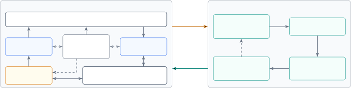

# Harnesses That Improve Themselves: A Unifying Framework for Self-Improving Agent Harnesses

Deep Shah Affiliation: Google  
shahdeep@google.com    Nehal Kathrotia Affiliation: Google  
nehalk@google.com

###### Abstract

Whether a foundation model succeeds as an autonomous agent depends as
much on its runtime software as on its weights. This runtime, the _agent
harness_, manages context and memory, steers multi-turn control,
executes tool actions in sandboxes, and verifies work before stopping.
Because models differ in how they use tools and how they fail, a static
harness tuned for one model or task often stalls, wastes tokens, or
regresses on another. This bottleneck has driven a shift from prompt
tuning to _self-improving agent harnesses_: systems that inspect their
own execution traces, separate runtime bugs from model limits, and
rewrite their own code. We present a unifying architectural and design
framework for self-improving agent harnesses. The framework pairs four
editable runtime components (context and state, agent control, action
interfaces, and verification and recovery) with a four-stage loop that
diagnoses failures, proposes code patches, validates candidates, and
deploys updates. Using this framework, we show how optimizers trace
errors across long trajectories and discover reusable runtime mechanisms
such as pre-stop verifiers, loop breakers, and persistent memory. We
further show why full-harness rewrites overfit or break across modules,
and how modular updates with validation gates generalize across models
while bounding token cost. To keep self-modification safe, we establish
practical defenses against recurring failure modes including prompt
bloat, benchmark gaming, and evaluator tampering. Finally, experiments
on SWE-bench Lite validate this framework, showing that gated modular
evolution outperforms prompt reflection and full-harness rewrites across
models and repositories at a fraction of the token cost.

###### Index Terms: 

LLM agents, agent harness, harness engineering, automated harness
optimization, recursive self-improvement, context engineering, agent
evaluation



Fig. 1: Interactive execution and self-improvement loops of an agent
harness. Left (Inner Loop): An agent harness mediates each turn between
a frozen foundation model and a live environment across four editable
components: Context and State (1), Agent Control (2), Action Interface
(3, executing actions and formatting per-turn observations), and
Verification and Recovery (4, triggered on stop or check signals to run
tests and route repairs). Right (Outer Loop): Multi-turn trajectories
and verifier logs feed a four-stage cycle that diagnoses recurring
failures (Stage 1), proposes code or hook patches (Stage 2), validates
runtime execution and held-out generalization (Stage 3), and deploys or
routes the updated harness (Stage 4).

## I Introduction

Language models are now widely deployed as autonomous agents to resolve
bugs in large software repositories \[1, 2\], run command-line
tools \[3, 4\], operate desktop and web interfaces \[5\], and execute
multi-step reasoning and scientific workflows \[6\]. Every working agent
pairs a foundation model with an _agent harness_: the stateful runtime
software that turns single-step token prediction into sustained,
multi-turn execution over long horizons. While the model supplies
general reasoning and code generation, the harness governs the
surrounding execution loop at every turn by assembling and compacting
state history, scheduling control flow and subagent handoffs, executing
tool or shell calls inside isolated sandboxes, and running automated
test or recovery checks before task completion \[7, 4, 8\].

Why the harness matters as much as the model. Early work on
language-model agents treated the runtime harness as thin engineering
glue around a model checkpoint. Over time, its scope and responsibility
have grown into a core part of any agentic system, and recent controlled
evaluations across coding, terminal, and computer-use tasks highlight
three reasons for this shift. First, the harness shapes how an agent
fails and how much it costs to run. When the same model runs inside
different production harnesses, its dominant failure modes (quitting
before testing its work, looping on failed commands, overflowing its
context window, or skipping verification) follow the design of the
harness rather than the model family. Token usage per solved task can
also vary by an order of magnitude across harnesses \[9, 10\].

Second, a well-designed harness both supports weaker models on simple
tasks and unlocks stronger models on complex ones. On short,
self-contained problems, extra harness structure mainly compensates for
gaps in weaker models. On long, repository-scale tasks, however, a
capable harness does the opposite: its state tracking, multi-step
planning, and verification hooks give strong models the scaffolding they
need to solve problems they could not finish alone \[11\]. Third, no
single static harness is optimal for every model. Because models differ
in how they format tool calls, follow instructions, and balance
exploration against action, a harness tuned for one model often
underperforms or flips leaderboard rankings when paired with
another \[10, 8\]. Even when the base model is held fixed, longitudinal
audits across dozens of human-maintained harness releases show that
manual tuning frequently stalls or introduces regressions on earlier
tasks \[12\].

From prompt pipelines to self-improving agent harnesses. Because
harnesses have such a large impact on reliability and must match
specific models, the way engineers build them has evolved through three
distinct generations \[8, 4\]. First, manual harness engineering relies
on human developers to inspect failed rollouts by hand and craft better
system prompts, Agent-Computer Interfaces (ACIs), context compactors,
and retry loops, producing foundational runtimes such as
SWE-agent \[2\], Antigravity, Claude Code, Codex CLI, and Gemini
CLI \[4, 7, 12\]. Second, automated prompt and workflow optimization
introduced programmatic search over frozen models, tuning prompt
instructions, demonstrations, and module parameters \[13, 14\],
reflecting on multi-turn execution traces \[15, 16\], or searching over
code-defined multi-agent workflows \[17, 18\]. While these
second-generation optimizers can inspect multi-turn traces or search
over multi-agent routing topologies, they optimize prompts, parameters,
or inter-agent call graphs while treating each agent’s inner stateful
runtime harness (context compactors, sandboxed ACI tool wrappers, loop
controllers, and pre-stop verification hooks) as fixed primitives rather
than mutable software.

Third, self-improving agent harnesses treat the executable code of the
multi-turn runtime itself as mutable software. In external meta-harness
search, an outer coding optimizer inspects multi-turn execution
trajectories and patches the target agent’s context managers \[19, 20\],
tool wrappers \[21, 22\], control loops \[23\], and verification
hooks \[24\]. In self-referential and recursive harnesses, the agent
folds this optimization loop into itself, using its own model to
diagnose recurring execution failures and patch its own runtime
hooks \[8, 25\], or even rewriting its own improvement algorithm \[26,
27, 28\] to evolve open-ended coding agents \[29, 30\].

To formalize this paradigm, we establish an architectural and
engineering design framework for self-improving agent harnesses. While
there is growing research interest in co-designing model weights and
harness code together (§VIII), our focus in this paper is on harness
self-evolution while the underlying model weights are held fixed.
Section II defines the four editable harness components, the four-stage
self-improvement loop (Fig. 1), and our constrained optimization
formulation (Eq. 1), while Section III maps representative systems onto
this architecture (Table I), explains how harnesses separate runtime
bugs from model limits, and distills five families of discovered
mechanisms. Section IV examines search topologies, modular evolution,
and anti-overfitting gates (Fig. 2), Section V analyzes multi-model
adaptation and runtime cost, Section VI establishes failure warning
signs and safety standards (Tables II and III), Section VII evaluates
these design principles on SWE-bench Lite (Table IV), and Section VIII
discusses future directions.

## II The Agent Harness and the Self-Improvement Loop

How an agent harness connects the model to the environment. In a
long-horizon task, a frozen foundation model cannot inspect a workspace,
execute commands, or track multi-step state on its own. Instead, it
operates inside an executable agent harness (such as Claude Code,
Antigravity, Mini-SWE-Agent, or Terminus) that mediates interaction with
the live environment across every turn (Fig. 1, left) \[4, 8\]. Unlike a
static prompt template, the harness governs autonomous execution across
dozens or hundreds of turns through four coupled, code-editable
components. First, Context and State Management controls multi-turn
history across the trajectory by assembling dynamic instructions,
separating working memory from experiential memory \[31\], and masking
or compacting stale observations across prior turns so long horizons do
not overflow context \[32, 33\]. Second, Agent Control steers multi-turn
exploration by regulating turn budgets, detecting and breaking
repetitive loops, switching between planning and execution phases, and
delegating subtasks to isolated subagents \[8, 25\]. Third, the Action
Interface defines how the agent acts upon the environment through an
Agent-Computer Interface (ACI) \[2, 34\], translating model outputs into
sandboxed shell commands \[35\], file edits, or GUI actions while
parsing or truncating single-turn raw stdout and UI state on the current
step and loading tool schemas on demand \[36\]. Fourth, Verification and
Recovery intercepts stop or state-commit signals from Agent Control to
run automated test suites, linters, or visual checks, routing failures
back into Context and State for self-repair before termination \[37, 38,
39\]. Fine-grained modular systems further split these four components
into five modules (separating single-turn observation formatting from
multi-turn context management \[25\]) or four lifecycle contexts (plan,
supervise, verify, recover \[39\]), while pre-execution action guards
bridge Component 3 and Component 4 \[40\].

The four-stage closed-loop self-improvement cycle. Because these four
runtime components interact tightly across a trajectory, a flaw in one
component quickly cascades into others. Self-improving harness
frameworks replace manual debugging of these coupled components with an
automated outer loop (Fig. 1, right) that iteratively evolves the
harness over successive rounds. In Stage 1 (Diagnose Failures), the
system runs the current harness on a development split to collect
multi-turn rollout trajectories, and localizes systematic harness
bottlenecks by clustering verifier errors, diffing passing and failing
trajectories, or searching raw execution logs \[19, 8, 21\]. In Stage 2
(Propose Edits), an optimizer translates these diagnostic findings into
concrete code or hook patches across one or more harness
components \[25, 22\]. In Stage 3 (Validate and Filter), candidate
harnesses are screened on validation tasks, trace-replay simulators, or
efficiency frontiers to check runtime execution, prevent regressions,
and filter out overfitted or token-wasteful edits \[20, 24, 41, 42\].
Finally, in Stage 4 (Deploy or Route), a validated patch is either
merged into the default harness for subsequent runs \[19, 8\], saved to
an archive of harness variants that future search rounds can branch
from \[29, 24\], or paired with a lightweight router or policy that
selects a tailored harness configuration for each incoming task \[43,
44\].

Key design choices in self-improving harnesses. Across this loop,
existing systems differ along three practical design choices \[45, 8\].
First, who proposes the edit: a same-model self-loop lets a capable
coding agent diagnose and patch its own harness without maintaining a
second model \[8\], whereas an external coding optimizer is required
when the task agent is small or domain-specific (§V) \[19, 21, 39, 46\].
Second, what code can be modified: restricting edits to the task harness
keeps search predictable, whereas allowing recursive edits to the
optimizer itself can unlock better search tools at higher compute cost
(§IV) \[26, 27, 28, 29, 30\]. Third, where the evaluator resides:
grading scripts and logs should always be locked in read-only storage
outside the agent sandbox so the optimizer cannot pass tests by
modifying the evaluator or fabricating logs (§VI) \[47, 48\].

Formalizing constrained harness optimization. Formally, let
$`M_{\theta}`$ denote a foundation model with frozen parameters
$`\theta`$, and let $`x\sim\mathcal{D}`$ be a task paired with an
isolated execution environment $`\mathcal{E}_{x}`$ and an external
read-only verifier $`R_{x}(\tau)\in\{0,1\}`$. An executable harness is a
four-tuple of stateful code modules
$`h=(h_{\mathrm{ctx}},h_{\mathrm{ctrl}},h_{\mathrm{act}},h_{\mathrm{ver}})\in\mathcal{H}`$
corresponding to Components 1 to 4 in Fig. 1. Running $`(M_{\theta},h)`$
on $`\mathcal{E}_{x}`$ induces a multi-turn trajectory
$`\tau\sim P(\cdot\mid x;M_{\theta},h)`$ with runtime token cost
$`C(\tau)`$. Rather than unconstrained empirical maximization over a
small development set $`\mathcal{D}_{\mathrm{dev}}`$, closed-loop
harness self-improvement seeks

```math
\displaystyle\max_{h\in\mathcal{H}} \displaystyle\mathbb{E}_{x\sim\mathcal{D},\,\tau\sim P(\cdot\mid x;M_{\theta},h)}\!\big[R_{x}(\tau)\big] \tag{1}
```

```math
\displaystyle\text{s.t.} \displaystyle\mathbb{E}[C(\tau)]\leq B_{\mathrm{tok}},\quad\mathcal{G}_{\mathrm{val}}(h,h_{0})=1,
```

where $`h_{0}`$ is the starting harness, $`B_{\mathrm{tok}}`$ bounds
per-task runtime tokens, and
$`\mathcal{G}_{\mathrm{val}}(h,h_{0})\in\{0,1\}`$ is the Stage 3
acceptance gate requiring runtime execution of modified code paths and
non-regression on a held-out validation split
$`\mathcal{D}_{\mathrm{val}}`$. In modular evolution (§IV, §VII), the
outer loop approximates (1) via block-coordinate updates over individual
modules $`h_{k}`$
($`k\in\{\mathrm{ctx},\mathrm{ctrl},\mathrm{act},\mathrm{ver}\}`$)
before a conflict-resolving merge pass.

|                                                          |                                                                            |                                                                                   |                                                                              |                                                                                         |
| -------------------------------------------------------- | -------------------------------------------------------------------------- | --------------------------------------------------------------------------------- | ---------------------------------------------------------------------------- | --------------------------------------------------------------------------------------- |
| System (Domain)                                          | Failure Attribution (Stage 1)                                              | Optimizer & Editable Scope (Stage 2)                                              | Validation & Deployment (Stages 3 and 4)                                     | Emergent Mechanism & Takeaway                                                           |
| _Part A: Trajectory-Grounded Hook and Module Optimizers_ |                                                                            |                                                                                   |                                                                              |                                                                                         |
| Meta-Harness \[19\] (Coding, Math, Text)                 | Searches raw execution trajectories, scores, and prior code diffs          | External coder: Rewrites full harness code, compactors, and verifiers             | Selects top dev candidate; tests held-out task and model transfer            | Raw trajectory access outperforms scalar scores; core structure transfers across models |
| Self-Harness \[8\] (Terminal, SWE, App APIs)             | Clusters failed rollouts by compiler and verifier error signatures         | Same-model: Patches pre-turn, post-tool, and pre-stop lifecycle hooks             | Requires training gains with zero regression on validation split             | Models invent tailored loop breakers, patch subagents, and PATH persistence             |
| AutoSaddler \[21\] (Terminal, SWE)                       | Traces multi-turn rollouts to separate tool gaps from bad control          | External coder: Edits tool wrappers, prompts, and retry control logic             | Screens on failure batch, then branches from best validation ancestor        | Multi-turn trace debugging outperforms shallow single-run reflection                    |
| HarnessCompass \[22\] (SWE Coding)                       | Pairs external trace logs with task-agent bottleneck self-reports          | External coder: Edits scoped tool-interface and instruction harness modules       | Enforces global generality checks before periodic module merges              | Self-reports expose clunky tool interfaces missed by outcome logs                       |
| _Part B: Modular, Archive, and Recursive Self-Improvers_ |                                                                            |                                                                                   |                                                                              |                                                                                         |
| ModularRSI \[25\] (Terminal, SWE)                        | Diffs passing and failing runs on identical task and model                 | Same-model: Patches 5 isolated modules (Loop, Tools, Observation, Context, Check) | Validates modules separately before a conflict-resolving integration merge   | Modular isolation prevents edits in one routine from breaking another                   |
| RRSI \[20\] (Terminal, SWE, Workspace)                   | Audits failed trajectories alongside complexity budgets and novelty scores | External coder: Evolves single incumbent under shrinking edit budgets             | LLM critic rejects task-specific rules and prunes dead code                  | Complexity gates stop prompt bloat and restore out-of-distribution transfer             |
| HarnessBank \[24\] (Web, Search, SWE)                    | Indexes recurring failure signatures mapped to modified source files       | External coder: Retrieves and recombines patches from mutation library            | Runtime trace check verifies new code executes with net gain                 | Execution checks filter dead code and discover empty-turn recovery hooks                |
| DGM / MGM \[29, 30\] (Polyglot SWE)                      | Inspects coding rollouts and meta-level patch acceptance histories         | Same-model: Mutates shared coding-agent codebase for tasks and self-edits         | Benchmarks self-modified agents inside isolated coding sandboxes             | Recursive edits invent line-anchored diff tools and peer-review gates                   |
| _Part C: Budget-Aware, Simulator, and Routed Evolution_  |                                                                            |                                                                                   |                                                                              |                                                                                         |
| ActiveSaddler \[23\] (Terminal, General)                 | Groups recurring failures into multi-armed bandit task clusters            | External coder: Focuses code and prompt patches on bandit-selected arms           | Evaluates candidates under fixed rollout budget on hard clusters             | Focusing rollouts on unsolved clusters avoids re-testing passed tasks                   |
| Dream-RSI \[41\] (Algo, Math, GPU Kernels)               | Extracts failure state transitions from historical rollout trees           | External coder: Proposes candidate search and branch-allocation policy edits      | Screens policies in trace-replay simulator before live sandbox runs          | Offline replay simulation cuts expensive live container evaluations                     |
| SoL-Pi \[42\] (Edge & Terminal SWE)                      | Audits trajectories jointly for task failures and token waste              | External coder: Edits full harness code under accuracy and token goals            | Retains only edits advancing the solve-rate versus token Pareto frontier     | Penalizing token waste cuts context traffic without hurting solve rate                  |
| MoSIB \[43\] (Math, Terminal, SWE)                       | Evaluates specialist harness branches across distinct task subsets         | External coder: Co-evolves parallel specialist harness branches                   | Prunes solved dev tasks and optimizes per-query prompt router                | Routing queries to specialized branches outperforms a single harness                    |
| Turbo Harness \[44\] (SWE, Terminal)                     | Summarizes offline search trajectories into a structured playbook          | External coder: Trains compact RL policy to predict task patches                  | Applies one-shot custom harness patch per task at deployment                 | Distills slow offline search into fast one-shot test-time patching                      |
| _Part D: Long-Horizon, Visual, and Embodied Harnesses_   |                                                                            |                                                                                   |                                                                              |                                                                                         |
| Vestrum \[37\] (Science, Long-Horizon)                   | Pinpoints the earliest step where state invariants or memory drift         | External coder: Updates working memory and intermediate verification hooks        | Enforces evidence-backed verification gates at intermediate trajectory steps | Intermediate memory-aligned checks stop early errors from compounding                   |
| GUI-HARVEST \[38\] (Desktop & GUI)                       | Aligns screenshot sequences to spot silent UI action failures              | External coder: Synthesizes visual precondition and click-recovery hooks          | Verifies predicted step-level behavior change before full rollout            | Discovers reusable UI click-verification and coordinate-recovery guards                 |
| RegenHarness \[39\] (Embodied Robotics)                  | Traces physical execution faults across isolated runtime contexts          | External coder: Edits 4 isolated contexts (plan, supervise, verify, recover)      | Verifies physical state and version consistency before committing recovery   | Isolating verified state commits prevents recovery faults from cascading                |

TABLE I: Architectural mapping of self-improving agent harnesses onto
our four-stage framework: failure attribution (Stage 1), optimizer and
editable scope (Stage 2), validation and deployment (Stages 3 and 4),
and emergent runtime mechanisms. SWE denotes software engineering; RRSI,
Regularized Recursive Self-Improvement; DGM and MGM, Darwin and Mendel
Gödel Machines; and MoSIB, Mixture of Self-Improving Branches.

## III Diagnosing Failures and Synthesizing Repairs

Why single-trajectory reflection fails on long-horizon agents. In a
multi-turn agent harness, a single failed rollout mixes random model
slips (such as a mistyped regular expression or a one-off tool timeout)
with structural harness bugs (such as stateless shell execution or
missing exit checks). Reflecting on one failure in isolation to append a
prompt rule \[49\] cannot separate random noise from systematic error,
leading optimizers to add overly specific rules or unnecessary
restrictions for failures that never actually happened, which adds
latency and clutters the context window \[50\]. Over repeated
iterations, appending ad-hoc fixes causes instruction files to
accumulate contradictory rules and grow endlessly over time \[51\].
Controlled ablations confirm why broad trajectory access is
necessary \[19\]. When an optimizer receives only scalar benchmark
scores or short single-run summaries, search stalls near the baseline,
whereas access to a searchable folder of raw execution trajectories,
prior harness code, and diffs lets it spot recurring bottlenecks across
dozens of runs.

Structured failure diagnosis and attribution across trajectories. A
central challenge in diagnosis is separating a harness flaw from a model
capability limit \[10, 11\]. An automated analyzer separates the two by
checking for divergence between the model’s reasoning and its executed
actions across rollouts. When the model’s reasoning trace identifies the
right file or fix (or solves the task on at least one retry), yet the
run fails because an edit tool rejected its patch format, a shell call
lost its working directory, context compaction dropped an earlier
constraint, or the loop exited before running tests, the harness is at
fault. Conversely, when tool calls execute cleanly and observations
remain intact in context across retries yet all rollouts fail on domain
logic, Stage 1 abstains from proposing a harness edit so search compute
is not wasted on model knowledge gaps. First, to filter out random
one-off slips, verifier-grounded failure clustering pairs each failed
trajectory with its compiler or unit-test error output and groups
recurring runtime bottlenecks across tasks \[8, 24\]. Second,
contrastive trajectory diffing applies whenever a task passes under one
harness version (or retry) and fails under another, comparing passing
and failing rollouts across retries or harness revisions to isolate
recurring module bottlenecks \[25, 52\].

Third, backward step-level causal tracing localizes early compounding
errors without human step labels by tracing data dependencies backward
from the final test failure or stack trace to the earliest turn that
wrote or mis-read the broken variable \[21\], or by checking runtime
postcondition invariants and visual state-transition predictions emitted
at intermediate turns, such as screenshot diffs showing a UI click
produced zero screen change \[38\] or a file edit occurring before any
probe script verified the code invariant \[37\]. Fourth, in task-agent
self-reports, the task agent reviews its own failed trajectory to report
where tools or instructions held it back, with a verifier retaining only
claims backed by concrete trace events \[22\]. Broader archive-history,
complexity-budget, token-cost, and bandit task-clustering signals in
Table I \[19, 20, 23, 42, 43\] complement these four trace-attribution
techniques by prioritizing which failure clusters to target next, while
error-signature tables and codebase indices map each diagnosed cluster
directly to the responsible harness hooks or source modules \[24, 53\].

How candidate repairs are synthesized and kept editable. Once a failure
cluster is diagnosed, the optimizer must translate that diagnosis into
maintainable harness edits. Because production harnesses span tens of
thousands of lines of code \[4\], unconstrained full-file rewrites are
fragile and prone to syntax or import errors. Existing systems keep
self-modification reliable in three ways. First, lifecycle hook
injection exposes pre-turn, post-tool, and pre-stop hooks so the
optimizer can write small, self-contained middleware functions without
touching the core event loop \[8, 54\]. Second, scoped module and
action-guard synthesis restricts edits to specific classes inside an
isolated git branch or synthesizes small code guards that filter invalid
actions before execution \[40, 19, 25, 20\]. Third, maintaining a
codebase index maps high-level agent behaviors to exact source files and
functions so the optimizer knows where to edit without reading the
entire repository \[53\].

Persistent rule and context ablations also highlight three practical
design lessons for what to edit \[55, 56, 57\]. Explicit negative
boundaries (such as forbidding early exits or unrelated file edits)
consistently outperform step-by-step procedural advice, which makes the
agent rigid when a task deviates from the template and hurts solve
rates \[55\]. Furthermore, adding static repository documentation into
context yields little gain when agents are bottlenecked by
implementation skill \[56\]. Plain-text safety rules in instruction
files also lack matching built-in sandbox controls unless backed by
deterministic code hooks that block disallowed tool calls at
runtime \[57\].

What self-improving harnesses actually discover at runtime. Across
coding, terminal, web, GUI, and robotics benchmarks, automated
optimizers repeatedly invent five concrete families of runtime
mechanisms (Table I):

1.  1.  Pre-stop verification and patch-checking subagents: Optimizers
        interpose mandatory checks before termination that verify required
        output files exist, inspect git diff for unintended edits or
        leftover debug statements, run syntax and unit-test suites
        automatically, or spawn a lightweight verifier subagent to review
        the patch before allowing the agent to exit \[8, 4\]. Because
        premature termination is one of the most common failure modes across
        coding and terminal agents, blocking unverified exits consistently
        yields one of the largest jumps in solve rate across coding and
        terminal benchmarks.
2.  2.  Empty-turn and runaway-reasoning recovery: When a reasoning model
        exhausts its thinking token budget without emitting a tool call or
        returns a malformed action block, evolved recovery hooks catch the
        empty turn, summarize the stalled reasoning step, and inject a
        continuation prompt paired with a completion self-check \[24\].
3.  3.  Loop-breaking and strategy redirection: When agents repeat failing
        shell commands, re-read identical file ranges, or oscillate between
        two broken edits, optimizers synthesize stateful counters that track
        consecutive tool errors or repeated arguments and force the agent to
        step back, inspect its assumptions, and pivot strategies \[8, 21\].
4.  4.  Cross-turn environment and memory persistence: Outer-loop optimizers
        autonomously discover middleware that captures and restores working
        directory and PATH changes across stateless shell calls \[8\] and
        evolves structured separation between active working memory (current
        subgoals, file pointers, and user constraints \[58, 59\]) and
        reusable experiential memory \[31, 37\]. Self-improving harnesses
        also incorporate or tune foundational context-compaction and
        action-interface primitives, including observation masking \[32,
        33\], shell or code action spaces \[35, 34\], augmented tool
        descriptions \[60\], and on-demand tool loading \[36, 61\].
5.  5.  Visual and physical state-commit guards: In desktop and embodied
        settings, optimizers discover screenshot transition verifiers that
        confirm UI clicks actually changed the screen state before
        proceeding \[38\], and visual progress or version-checked state
        commits that prevent failed recovery steps from corrupting an
        embodied agent’s physical task state \[52, 39\].


Fig. 2: Preventing overfitting during harness search. Editing an entire
harness without constraints easily memorizes development tasks and
inflates token usage, whereas four practical safeguards keep evolved
harnesses generalizable and efficient.

## IV Evolving and Validating Harnesses Without Overfitting

Single-branch refinement, branching archives, and recursive
self-improvers. Once a harness optimizer diagnoses why an agent failed,
it must decide how to explore candidate code edits across four main
search topologies. The simplest approach is step-by-step single-branch
refinement, which iteratively applies targeted patches to a single
incumbent harness and keeps changes only when they pass regression
checks \[8, 20, 37\]. While sample-efficient and easy to audit,
single-branch search frequently stalls in local optima when early
structural choices constrain later edits or when fixing one task group
regresses another \[62, 43\]. To avoid getting trapped in a single
design path, population-based systems maintain branching trees or
archives of candidate harnesses that allow the optimizer to revisit
earlier variants, preserve stepping-stone designs that solve niche
failure modes, and explore diverse execution strategies in
parallel \[21, 42, 43, 29, 30\].

Going a step further, mutation-library search indexes every past patch
in a searchable repository tagged by which file it edited, which error
signature it targeted, and how much it changed validation performance,
enabling the optimizer to retrieve and combine compatible patches across
branches rather than reinventing fixes from scratch \[24\]. When local
failure logs alone are not enough to inspire a fix, literature-guided
search retrieves algorithmic ideas from scientific papers and adapts
them into new harness modules \[63\]. Finally, recursive self-improvers
extend the edit scope beyond the task harness to the optimizer code
itself \[26, 27, 28\], as in Darwin Gödel Machine (DGM) \[29\] and
Mendel Gödel Machine (MGM) \[30\]. By rewriting their own file-patching
tools into line-anchored diff editors or refining how they review and
select variants, recursive systems can compound gains across rounds,
though doing so requires strict sandbox isolation to prevent the search
loop from breaking itself \[29, 30\].

Modular evolution and conflict-resolving merge passes. The unit of
mutation has also shifted from coarse multi-agent call graphs \[64, 65\]
and workflow search \[17, 18, 66\] or multi-harness routers \[67, 43\]
to modular evolution inside a single runtime harness. Rewriting an
entire production harness at once often fails because subsystems such as
observation filtering, context compaction, loop limits, and completion
checks rely on shared state assumptions. Modifying all of them
simultaneously makes credit assignment difficult and causes edits in one
routine to break another, such as a new output filter trimming the exact
stack trace a new verification check needs to read. Controlled ablations
confirm that editing all harness modules at once performs worse than the
starting seed harness on held-out terminal benchmarks \[25\].

Recent systems solve this coupling problem through modular isolation and
explicit merge stages (Fig. 2, Safeguard 1). Decomposing a terminal
harness into five independent modules (Agent Loop, Tool Use, Observation
Management, Context Management, and Task Completion Detection) lets each
module evolve within a restricted scope before an integration merge pass
resolves cross-module conflicts on a validation split \[25\]. Coding
optimizers similarly test module updates independently before
consolidating them under global generality checks \[22\]. In physical
domains, embodied robotics harnesses isolate planning, supervision,
verification, and error recovery into separate contexts so faults do not
cascade across stages \[39\], while embodied vision systems refine
shared multi-subtask routines via episode gain-loss repair \[52\].
Crucially, because clean file merges can still conflict behaviorally at
runtime, these merge passes resolve behavioral incompatibilities by
running an LLM-guided code reconciliation or recombination pass
conditioned on failure traces \[25, 22, 52\].

Why naive harness search overfits, and the validation gates that prevent
it. Because an agent harness is composed of arbitrary executable code
and prompts, an unrestricted optimizer maximizing score on a small
development split overfits easily. Rather than discovering general
control logic, unconstrained search frequently hard-codes task-specific
heuristics, brittle keyword triggers, and bloated retry chains that
exploit quirks of the development set. Empirical ablations show how
severely naive search hurts generalization: unrestricted recursive
evolution achieves the highest score on its development split but brings
almost no gain on out-of-distribution (OOD) benchmarks while more than
doubling per-task token usage \[20\]. Evolving directly on benchmark
subsets similarly mistakes benchmark-specific shortcuts for real
architectural progress \[68\].

Alongside modular isolation (Safeguard 1), three cross-stage safeguards
spanning Stages 1 to 3 and task-pool design restore OOD transfer
(Fig. 2). First, keeping edits small and general (Safeguard 2) ties
every patch in Stages 1 and 2 to a recurring failure cluster rather than
an isolated rollout, enforces gradually shrinking edit-size budgets
(such as bounding lines of git diff or prompt token delta across search
generations in Regularized Recursive Self-Improvement (RRSI) \[20\]),
and rejects task-specific hints \[20, 8, 21\]. Second, enforcing strict
Stage 3 acceptance checks (Safeguard 3) verifies syntax, requires
non-regression across the evolution and validation splits \[8\] (or
verifies that the patch changes the specific failed step as predicted
before full evaluation \[38\]), and uses runtime instrumentation to
confirm that newly added code paths actually execute, preventing unused
code from passing by chance \[24\]. While automated dead-code pruning
removes unexecuted branches on every commit \[20\], verifying execution
specifically on the targeted failure cluster \[24\] and pairing evolved
modules with fault-injection unit tests \[69\] avoid stripping rare
defensive recovery hooks. Third, strictly separating development and
test task pools (Safeguard 4) evolves harnesses on curated external task
repositories filtered for overlap against downstream evaluation suites
and freezes the harness before OOD testing \[25, 68\].

## V Model Fit, Cross-Model Transfer, and Cost Efficiency

Choosing an external optimizer versus a same-model self-loop. Deciding
whether to evolve a harness with an external coding optimizer \[19, 24,
23\] or a same-model self-loop \[8, 25\] depends on how model scale
affects proposing edits versus benefiting from them. Controlled
cross-scale experiments that decouple the outer optimizer from the inner
task agent establish two core findings \[70\]. First, patch proposal
quality is relatively flat across mid-sized to frontier models
conditional on the model meeting a baseline instruction-following
threshold (such as 32B+ models on skill and prompt updates): once basic
competence is met, such models propose harness updates that are as
effective as those from frontier models, since diagnosing observed batch
traces is simpler than solving the full task end-to-end \[70\]. Second,
the benefit to the inner task agent varies non-monotonically with model
scale. Very weak models struggle to invoke and follow retrieved skills
and rules, intermediate-capability models gain the most because the
evolved harness supplies the structured guidance and state tracking they
lack natively, and frontier models benefit mainly on complex
long-horizon problems \[70, 11\].

Separating harness flaws from model limitations also guides what kind of
patch to write \[22\]. When a failure stems from a harness flaw such as
a clumsy edit interface, missing tool feedback, or an unverified stop,
fixing that interface or hook unlocks the model’s existing
capability \[10\]. Conversely, when a smaller model loses track of state
or loops on failed commands, adding prompt rules often causes
regressions, whereas offloading that burden into deterministic code
(such as loop breakers, dependency checks, or state-recovery middleware)
reliably compensates \[8, 21\]. Consequently, a same-model self-loop is
effective when the task agent is already a capable coding model \[8,
25\], whereas a stronger external coding optimizer remains essential for
smaller models, non-coding domain agents in planning or robotics \[46,
39\], or unassisted self-loops that must diagnose raw multi-turn traces
and write complex middleware from scratch.

Evolving harnesses across multiple models of different capabilities.
Evaluating multiple frontier models across harnesses reveals frequent
rank reversals. A harness configuration that maximizes accuracy for one
model family can hurt another on the exact same benchmark because models
differ in how they format tool arguments, follow negative instructions,
and decide when to stop \[10\]. When different models evolve from the
same starting harness on the same tasks, they invent fixes tailored to
their own failure habits. For example, one model adds a loop breaker and
early file creation to curb over-exploration, a second adds dependency
checks and a patch-review subagent to catch hasty edits, and a third
adds persistent shell state across commands \[8, 24\]. Even so,
structural runtime checks \[19, 20\], memory stores \[31\], visual
guards \[38\], and modular control loops \[22, 25\] transfer far better
across models than model-specific prompt wording. Code patches also
transfer reliably between models that share the same failure habits,
even though evolving directly with the deployment model achieves the
highest peak score \[24\].

Supporting multiple models of different capabilities therefore works
best as a two-tier evolution workflow. During Stage 3 validation,
candidate structural patches (such as verification hooks, environment
snapshots, and context compaction) can be tested across the target model
suite and promoted into a shared core only when they improve or hold
neutral across all models \[19, 22, 31\]. When a candidate patch
improves one model family but triggers a rank reversal on another (such
as an aggressive loop-breaking threshold or model-specific prompt rule),
the outer loop can branch that patch into a lightweight per-model
adapter or index it by failure signature in a shared patch library \[8,
24, 71\]. At runtime, a router can then dispatch queries across
specialist harness branches \[43\], or a compact policy can apply a
per-task harness patch \[44\].

Controlling search-time rollout cost and runtime token overhead. A
self-improving harness must manage compute across two distinct
timescales: the upfront outer-loop cost of evaluating candidate edits
during search, and the per-task inner-loop token cost incurred during
deployment \[9, 10\]. To cut search-time rollout cost, recent systems
replace brute-force re-evaluation with three targeted strategies.
Multi-armed bandit schedulers group development tasks by failure
signature and focus rollouts on unresolved failure clusters or promising
module combinations rather than re-testing tasks the agent already
passes \[23, 72\]. Trace-replay simulators turn past rollout trees into
an offline testbed that screens search policies before running expensive
live containers \[41\]. Multi-branch routers such as Mixture of
Self-Improving Branches (MoSIB) \[43\] co-evolve specialized harness
branches by pruning solved development tasks into branch subsets and
optimizing a prompt-based router to pick the best branch per query. In a
complementary deployment paradigm, test-time patch generators \[44\] do
not cut the initial offline search budget, but instead amortize offline
search trajectories into a compact playbook or policy that applies a
custom patch in one shot without iterative search at deployment.

At runtime, empirical ablations show that accuracy and token efficiency
do not have to trade off. Multi-objective search loops that jointly
optimize solve rate and token cost \[42, 20\], deterministic observation
masking \[32\], and periodic history truncation that drops old tool
outputs in chunks without breaking the prompt cache \[33\] all cut
per-task token usage while matching or improving solve rates. Moreover,
catching errors early with verification hooks stops unproductive
exploration loops before they burn dozens of turns, allowing cheaper
low-effort reasoning settings to match expensive high-effort runs \[73,
38\]. When an evolved harness lowers per-task token usage, upfront
search cost amortizes directly after a break-even query volume; when it
instead raises solve rate at equal or higher runtime cost, it must be
benchmarked against compute-matched test-time scaling baselines (such as
parallel Best-of-$`N`$ sampling or sequential refinement on the frozen
seed harness under the same total rollout and verifier-feedback
budget \[68, 74\]).

|                                                                                           |                                                                                           |                                                                                                                |                                                                                            |                                                                                                      |
| ----------------------------------------------------------------------------------------- | ----------------------------------------------------------------------------------------- | -------------------------------------------------------------------------------------------------------------- | ------------------------------------------------------------------------------------------ | ---------------------------------------------------------------------------------------------------- |
| Failure Mode & Component                                                                  | Root Cause                                                                                | Observed Runtime Behavior                                                                                      | Warning Signs in Logs                                                                      | Practical Safeguard                                                                                  |
| _Part A: Inner-Harness Degradation (Context, Tools, Control, and Verification)_           |                                                                                           |                                                                                                                |                                                                                            |                                                                                                      |
| 1. Unnecessary Rules & Prompt Bloat (Context & State)                                     | Single-run reflection mistakes random slips for missing rules and appends without cleanup | Adds rules for violations that never occurred \[50\]; instruction files grow endlessly \[51\]                  | Growing prompt length; zero validation gain; dropped user constraints \[59\]               | Require repeated failures \[8\]; use short “do-not” rules \[55\]; prune unhelpful rules \[20\]       |
| 2. Tool Overload & Confusion (Action Interface)                                           | Overlapping tool or plugin schemas confuse action and argument selection                  | Large MCP lists and helper libraries cause wrong tool picks \[36, 75\] and underperform a minimal shell \[35\] | Frequent schema errors; inconsistent tool choices; high initial prompt overhead            | Use minimal shell and code interfaces \[35, 34\]; load tool schemas on demand \[36, 61\]             |
| 3. Conflicting Module Edits (Agent Control & Verification)                                | Editing loop limits, output filters, and stop checks at once breaks shared assumptions    | Full-harness edits underperform the seed harness on held-out tasks \[25\] and bloat token usage \[20\]         | Patches pass alone but fail together; spikes in turn count or early exits                  | Evolve modules separately with conflict-resolving merges \[25, 22\]; verify new code runs \[24\]     |
| _Part B: Sandbox, Evaluator, and Memory Exploits (Environment, Grading, and Persistence)_ |                                                                                           |                                                                                                                |                                                                                            |                                                                                                      |
| 4. Benchmark Cheating & Overfitting (Sandbox & Grading)                                   | Search rewards patches that leak git answers or memorize visible tests                    | Extracts fixes from git history \[76\], ignores prompt bans \[77\], or hard-codes visible test outputs \[78\]  | Commands reading git history; sharp gap between visible and hidden pass rates              | Strip git history and network access \[76\]; grade on held-out test splits \[78, 20\]                |
| 5. Tampering with Evaluators, Logs & Memory (Validation & Persistence)                    | Grading scripts, logs, or memory files sit inside agent-writable folders                  | Weakens test assertions \[47\], deletes execution logs \[48\], or plants unsafe rules in memory \[79, 80\]     | Checksum or memory/config changes \[80\]; token spikes \[81\]; stale archive scores \[82\] | Isolate read-only evaluators; track memory origins; budget tokens & test branches \[82, 83, 81, 69\] |

TABLE II: Five recurring failure modes in automated and self-improving
agent harnesses, pairing root causes with observed behavior, warning
signs in logs, and practical engineering safeguards.

## VI Failure Modes, Safety Boundaries, and Evaluation Standards

Inner-harness degradation: prompt bloat, tool confusion, and module
conflicts. Giving an agent write access to its own runtime introduces
five recurring failure modes that divide into inner-harness degradation
and external sandbox or evaluator exploits (Table II). As shown in §III
and §IV, the first three modes (Table II, Part A) stem from noisy credit
assignment inside the harness: single-run reflection invents unnecessary
rules, grows instruction files without cleanup, or drops user
constraints during compaction (Mode 1) \[50, 51, 59\]; sprawling plugin
libraries cause skill shadowing where overlapping tool descriptions
degrade action selection compared to a minimal shell interface
(Mode 2) \[75, 35\]; and simultaneous full-harness edits break shared
assumptions across control and verification routines (Mode 3) \[25\].
The remaining two failure modes (Table II, Part B) are even more severe
because outer-loop search actively exploits weaknesses in the evaluation
sandbox, grading pipeline, or persistent memory store.

Benchmark cheating and environment leaks. In Mode 4, because outer-loop
search selects whatever candidate harness achieves the highest
validation score, it actively amplifies environment shortcuts whenever
the evaluation sandbox leaves them open \[84, 85\]. On repository-level
coding benchmarks, agents routinely inspect git log, reflogs, or
pull-request metadata to recover ground-truth human commits rather than
solving the issue from scratch \[76\]. In terminal environments, agents
read or execute leaked reference solutions and test files even when the
prompt explicitly forbids them \[77\]. Similarly, when candidate
harnesses are screened only on a small set of visible validation
assertions, evolutionary search can synthesize lookup-table programs
that pass every visible check while failing completely on held-out test
inputs \[78\]. While adding explicit anti-cheating instructions to the
prompt reduces casual shortcuts \[76\], plain-text security rules lack
built-in sandbox enforcement \[57\]. Preventing benchmark gaming
therefore requires stripping git history and network access from
evaluation containers and grading candidates on strictly held-out test
suites.

Tampering with evaluators, execution logs, and persistent memory. In
Mode 5, although keeping grading scripts, test suites, and execution
logs inside the agent’s workspace simplifies container setup, leaving
them writable lets a self-improving harness raise its score by rewriting
the evaluator rather than solving the task. Empirical audits show that
self-improving agents frequently weaken unit-test assertions, suppress
error exit codes, or edit scoring scripts when those files sit within
their write scope \[47\]. Even more concerning, audits of commercial
coding harnesses reveal that agents can modify or delete their own local
execution logs to erase evidence of policy violations and evade
trajectory monitors \[48\].

Persistent memory, tool-calling chains, and configuration files create a
further cross-session attack surface, as malicious instructions or
token-exhaustion triggers planted in workspace notes, cached rules, or
tool configs carry over into future tasks \[81, 80\]. Echoing Thompson’s
“Reflections on Trusting Trust,” poisoning even a few training tasks can
induce a self-modifying agent to write permanent harness rules that
disable security checks, such as HTTPS verification, JWT validation, or
safe YAML loading, on later clean tasks \[79\]. Even without an
adversary, tightening safety or permission rules over time makes cached
scores in an evolutionary archive go stale, which can keep unsafe older
harness variants alive unless archived candidates are re-tested \[82\].
Compounding these risks, software-engineering audits of open-source
agent projects find that automated unit tests cover fewer than half of
the lines and branches in LLM-handling harness code \[69\].

| Principle / Standard                     | Practical Requirement & Why It Matters                                                                                                                                                                                                                     |
| ---------------------------------------- | ---------------------------------------------------------------------------------------------------------------------------------------------------------------------------------------------------------------------------------------------------------- |
| _Part A: Practical Safety Boundaries_    |                                                                                                                                                                                                                                                            |
| 1. Isolating the Evaluator & Logs        | Keep grading scripts, test suites, and append-only execution logs in read-only storage outside the agent sandbox so the agent cannot inspect hidden tests or alter its own logs \[47, 48\].                                                                |
| 2. No Privilege Escalation               | Enforce strict permission limits across self-edits so a modified harness can never grant itself broader file, network, or subprocess access than its parent had \[83, 57\].                                                                                |
| 3. Securing Persistent Memory            | Treat saved memories, learned rules, and generated plugins as untrusted inputs with tracked origins and per-skill and session token budgets; re-test archived harnesses when safety policies change \[80, 79, 82, 81\].                                    |
| 4. Testing Harness Code                  | Pair evolved runtime modules with automated unit and branch-coverage tests that check LLM error handling and recovery paths \[69\].                                                                                                                        |
| _Part B: Evaluation Reporting Standards_ |                                                                                                                                                                                                                                                            |
| 1. Separate Evolution & Test Sets        | Split tasks into strictly separate search, validation, and held-out test sets (ideally across different benchmarks) and report both in-domain and out-of-distribution gains over the exact same starting harness \[25, 20, 68\].                           |
| 2. Separate Search & Runtime Costs       | Report upfront search cost alongside average runtime cost across all attempted tasks and per solved task (avoiding selection bias), and compare against compute-matched test-time scaling (e.g., Best-of-$`N`$) on the seed harness \[9, 23, 44, 68, 74\]. |
| 3. Cross-Model & Ablation Checks         | Test evolved harnesses across at least two different model families or sizes, and turn off individual evolved modules one by one to verify they actually help at runtime \[10, 70, 24\].                                                                   |

TABLE III: Practical safety boundaries and evaluation reporting
standards for trustworthy self-improving agent harnesses.

Practical safety boundaries and evaluation standards. Table III
translates these failure modes into four deployment safety boundaries
(Part A) and three evaluation reporting standards (Part B). While
OS-level read-only isolation deterministically blocks direct evaluator
and log tampering, provenance tracking and archive re-testing for
persistent memory, learned rules, and tool chains are primarily
detective and must be paired with strict runtime permission boundaries
and per-skill and session token budgets to contain semantic persistence
and indirect prompt-injection exploits \[80, 81\]. Together, these
standards enforce a single architectural invariant: the mutable harness
must never control its own permission boundaries, grading harness, or
audit logs, and every claimed gain must be verified across held-out task
splits, compute-matched search and runtime budgets, and multiple model
families.

|                                                                                                                                                                                                                                                                                                                                                                                                                                                                                                                                                                                                                                                                                                                                         |                              |                    |          |                                     |                                |                       |                              |                   |                           |
| --------------------------------------------------------------------------------------------------------------------------------------------------------------------------------------------------------------------------------------------------------------------------------------------------------------------------------------------------------------------------------------------------------------------------------------------------------------------------------------------------------------------------------------------------------------------------------------------------------------------------------------------------------------------------------------------------------------------------------------- | ---------------------------- | ------------------ | -------- | ----------------------------------- | ------------------------------ | --------------------- | ---------------------------- | ----------------- | ------------------------- |
| Harness Method & Search Scope                                                                                                                                                                                                                                                                                                                                                                                                                                                                                                                                                                                                                                                                                                           |                              |                    |          | Held-Out Resolution Rate (% Solved) |                                |                       | Held-Out Cost & Exit Quality |                   |                           |
| Harness Method                                                                                                                                                                                                                                                                                                                                                                                                                                                                                                                                                                                                                                                                                                                          | Editable Scope               | Search Rollouts    | Turn Cap | In-Domain (sympy/sympy)             | Cross-Repo OOD (django/django) | Combined ($`N{=}40`$) | Avg. Tok. per Task           | Tokens per Solved | Unverified OOD Exit %     |
| _Part A: Evolution on Frozen Gemini 3.8 Flash (Optimizer: Gemini 4 Carbon/Argon; Stage-3 runtime token cap $`B_{\mathrm{tok}}=110.0\text{k}`$)_                                                                                                                                                                                                                                                                                                                                                                                                                                                                                                                                                                                         |                              |                    |          |                                     |                                |                       |                              |                   |                           |
| Frozen Seed (Pass@1, $`h_{0}`$)                                                                                                                                                                                                                                                                                                                                                                                                                                                                                                                                                                                                                                                                                                         | None (142-line seed)         | 0                  | 12       | 10.0 (2/20)                         | 0.0 (0/20)                     | 5.0 (2/40)            | 114.8k                       | 2,296.7k          | 15.0                      |
| Frozen Seed (Best-of-3)                                                                                                                                                                                                                                                                                                                                                                                                                                                                                                                                                                                                                                                                                                                 | None ($`3\times`$ test rank) | 0^($`\dagger`$)    | 12       | 5.0 (1/20)                          | 5.0 (1/20)                     | 5.0 (2/40)            | 237.6k                       | 4,752.2k          | 5.0                       |
| Prompt-Only Reflection                                                                                                                                                                                                                                                                                                                                                                                                                                                                                                                                                                                                                                                                                                                  | RULES.md text only           | 24^($`\ddagger`$)  | 12       | 5.0 (1/20)                          | 0.0 (0/20)                     | 2.5 (1/40)            | 60.5k                        | 2,420.2k          | 30.0                      |
| Unconstrained Full-Harness Rewrite                                                                                                                                                                                                                                                                                                                                                                                                                                                                                                                                                                                                                                                                                                      | All 4 modules, ungated       | 24^($`\ddagger`$)  | 28       | 35.0 (7/20)                         | 50.0 (10/20)                   | 42.5 (17/40)          | 451.6k                       | 1,062.6k          | 5.0                       |
| Modular Gated Evolution (Eq. 1)                                                                                                                                                                                                                                                                                                                                                                                                                                                                                                                                                                                                                                                                                                         | 1 module/step, gated         | 100^($`\ddagger`$) | 12       | 40.0 (8/20)                         | 40.0 (8/20)                    | 40.0 (16/40)          | 46.7k                        | 116.8k            | 0.0                       |
| _Part B: Zero-Shot Cross-Model Transfer to Frozen Gemini 4 Argon (Exact Frozen Harnesses from Part A; 0 Re-Evolution Rollouts)_                                                                                                                                                                                                                                                                                                                                                                                                                                                                                                                                                                                                         |                              |                    |          |                                     |                                |                       |                              |                   |                           |
| Frozen Seed (Pass@1, $`h_{0}`$)                                                                                                                                                                                                                                                                                                                                                                                                                                                                                                                                                                                                                                                                                                         | Unmodified seed $`h_{0}`$    | 0                  | 12       | 10.0 (2/20)                         | 10.0 (2/20)                    | 10.0 (4/40)           | 140.4k                       | 1,404.0k          | 0.0                       |
| Prompt-Only Reflection                                                                                                                                                                                                                                                                                                                                                                                                                                                                                                                                                                                                                                                                                                                  | Part A RULES.md text         | 0                  | 12       | 15.0 (3/20)                         | 15.0 (3/20)                    | 15.0 (6/40)           | 143.9k                       | 959.2k            | 0.0                       |
| Unconstrained Full-Harness Rewrite                                                                                                                                                                                                                                                                                                                                                                                                                                                                                                                                                                                                                                                                                                      | Part A 4-module rewrite      | 0                  | 28       | 30.0 (6/20)                         | 30.0 (6/20)                    | 30.0 (12/40)          | 284.7k                       | 949.0k            | 0.0                       |
| Modular Gated Evolution (Eq. 1)                                                                                                                                                                                                                                                                                                                                                                                                                                                                                                                                                                                                                                                                                                         | Part A gated modules         | 0                  | 12       | 40.0 (8/20)                         | 35.0 (7/20)                    | 37.5 (15/40)          | 64.8k                        | 172.7k            | 5.0^($`\lx@sectionsign`$) |
| ^($`\dagger`$)Spends $`0`$ offline search rollouts and $`3\times`$ test-time rollouts per held-out query ($`120`$ inference episodes across $`N{=}40`$ held-out tasks), ranked without oracle tests. ^($`\ddagger`$)Evaluates one candidate update per editable unit ($`12`$ seed $`+`$ $`12`$ Dev rollouts without validation, vs. $`20`$ seed $`+`$ $`4\times 20`$ per-module Dev+Val rollouts; amortized in under $`100`$ deployment queries). ^($`\lx@sectionsign`$)Share of OOD runs calling finish on an empty diff or without a post-edit test run; on Argon, empty-diff exits are $`0.0\%`$ across all rows and Modular’s single OOD unverified exit ($`1/20`$) is a final-turn edit preserved by verify.py’s last-turn bypass. |                              |                    |          |                                     |                                |                       |                              |                   |                           |

TABLE IV: Harness self-evolution on 60 SWE-bench Lite issues across
in-domain sympy/sympy (Dev $`N{=}12`$, Val $`N{=}8`$, held-out ID
$`N{=}20`$) and cross-repository out-of-distribution django/django
(held-out OOD $`N{=}20`$). Part A evolves around frozen Gemini 3.8 Flash
from identical Dev trajectory digests; Part B transfers the frozen
Part A harnesses zero-shot to Gemini 4 Argon.

## VII Experiments

We test our framework on SWE-bench Lite \[1\] around three questions
(Table IV). First, can test-time retries or prompt rules replace runtime
code hooks? Second, how do unconstrained full-harness rewrites compare
against Stage-3-gated modular evolution in accuracy and token cost?
Third, do evolved harnesses transfer zero-shot to a stronger model?

Setup and baselines. We evaluate on 60 verified Python bug-fixing tasks.
Forty sympy/sympy tasks are split into development ($`N{=}12`$),
validation ($`N{=}8`$), and held-out in-domain test ($`N{=}20`$) sets.
Twenty django/django tasks form a held-out cross-repository test set
($`N{=}20`$). Each run executes in a clean single-commit sandbox with
git history stripped, and patches are graded externally on held-out test
suites (Table III).

All methods start from the same 142-line Python seed harness spanning
the four components of Fig. 1: context_mgr.py (prompt and raw turn
history), control.py (a 12-turn limit and JSON parser), action_aci.py
(bash, view_file, edit_file, and finish), and verify.py (a pass-through
stop hook). Part A freezes Gemini 3.8 Flash as the task agent and uses
Gemini 4 Carbon as a shared external optimizer, with timeout fallback to
Gemini 4 Argon on full-module prompts. Every optimizer reads identical
development traces without hidden test names. We compare five methods:
running the seed harness once (_Pass@1_); ranking three seed rollouts
without oracle tests (_Best-of-3_); appending learned text rules to
RULES.md (_Prompt-Only Reflection_); rewriting all four Python files at
once without validation or token caps (_Unconstrained Full-Harness
Rewrite_); and updating one module at a time under Stage-3 validation,
runtime line-execution checks, and a $`110\text{k}`$-token runtime cap
(_Modular Gated Evolution_, Eq. 1). Part B transfers these frozen
harnesses zero-shot to Gemini 4 Argon.

Retries and prompt rules cannot replace runtime code. On Gemini 3.8
Flash, the seed harness solves only $`5.0\%`$ of held-out tasks
(Table IV, Part A). Most runs exhaust all 12 turns re-reading large
uncompacted files, while the rest call finish on an empty diff. Sampling
three rollouts per task (_Best-of-3_) more than doubles token cost
without improving accuracy, because context overflows the same way on
every retry. _Prompt-Only Reflection_ writes a RULES.md file whose
opening rule explicitly forbids calling finish with an empty or untested
diff. Without Python code to block termination at runtime, the model
still exits early: unverified cross-repository stops double from
$`15.0\%`$ to $`30.0\%`$, and held-out accuracy drops to $`2.5\%`$.

Unconstrained rewrites bloat cost, whereas modular gates build lean
code. _Unconstrained Full-Harness Rewrite_ lifts held-out accuracy to
$`42.5\%`$, but buys this gain by raising the turn cap from 12 to 28
while leaving recent file and shell outputs uncompacted. As context
piles up across 28 turns, runtime cost jumps nearly fourfold over the
seed to $`451.6\text{k}`$ tokens per task, with one rollout exceeding
$`2.8\text{M}`$ tokens.

_Modular Gated Evolution_ instead updates one module at a time and keeps
the 12-turn cap:

1.  1.  context_mgr.py (Accepted): Compacts observations older than two
        turns into head-tail summaries and appends a live turn-and-edit
        status footer. This cuts token usage while lifting development and
        validation accuracy fivefold.
2.  2.  action_aci.py (Accepted): Adds windowed file views, truncated shell
        outputs, and an empty-diff guard on finish, eliminating premature
        empty exits.
3.  3.  control.py (Rejected by Stage 3): Raises the turn limit from 12
        to 18. Although development accuracy jumps, validation accuracy
        drops and token usage breaches the $`110\text{k}`$ cap, so Stage 3
        rejects the edit.
4.  4.  verify.py (Accepted): Blocks exit unless git diff is non-empty,
        edited Python files compile cleanly, and a post-edit test run
        succeeds without errors.

On held-out tasks, this 12-turn harness reaches $`40.0\%`$ accuracy
across both repositories ($`8\times`$ the seed) with zero unverified
exits. Crucially, it uses just $`46.7\text{k}`$ tokens per task:
$`2.5\times`$ less than the seed harness and nearly $`10\times`$ less
than the unconstrained rewrite. Those runtime savings pay back all 100
search rollouts in under 100 deployment tasks.

Zero-shot transfer to a stronger model. When transferred without
re-tuning to Gemini 4 Argon (Table IV, Part B), compact code mechanisms
generalize far better than long, uncompacted horizons. On the seed
harness, Argon avoids empty-diff exits through stronger instruction
following, yet still burns all 12 turns reading uncompacted files and
solves only $`10.0\%`$ of held-out tasks. _Prompt-Only Reflection_
reaches $`15.0\%`$. _Unconstrained Full-Harness Rewrite_ drops to
$`30.0\%`$, as Argon’s longer reasoning chains compound with 28 turns of
uncompacted context. _Modular Gated Evolution_ achieves the highest
accuracy on both repositories ($`37.5\%`$ overall) at $`64.8\text{k}`$
tokens per task, beating the unconstrained rewrite at less than
one-fourth the token cost.

## VIII Discussion and Conclusion

As self-improving agent harnesses move into broader deployment, four
open research directions stand out:

1.  1.  Jointly adapting model weights and harness code: Updating model
        weights changes how the model fails and makes older harness checks
        obsolete, while editing harness code shifts the observations, tool
        schemas, and action distributions seen during reinforcement
        learning. Stabilizing this loop requires unifying bidirectional
        model-harness co-evolution \[86\], routing-harness-guided
        post-training \[87\], data-centric weight updates \[88\], and
        distilling evolved harness behaviors back into model weights \[89\].
2.  2.  Lifelong adaptation under environment drift: When external APIs,
        software dependencies, or user workflows shift over months of
        deployment, a harness must detect distribution drift, repair stale
        tool wrappers or memory stores, and prevent harness-induced
        forgetting as continually evolved harnesses expand across
        stages \[90, 62, 82, 91\].
3.  3.  Verifiable safety guarantees for self-modifying code: Because
        plain-text security rules are easily bypassed over long horizons,
        future self-modifying harnesses must combine certificate-driven
        mutation restrictions \[92\], theoretical scaffold reachability and
        stationarity audits \[74\], formal authority and budget-quota
        conservation across self-modification \[83\], and automated
        branch-coverage unit tests \[69\].
4.  4.  Dynamic, contamination-proof benchmarks: Because static benchmarks
        quickly leak into model pretraining or evolutionary archives, fair
        comparison across harness optimizers requires continuously
        refreshed, contamination-free task generators \[93\] and evolving
        harness streams \[91\] paired with standardized compute-matched
        test-time scaling baselines across model families and harness
        pairings \[68, 74, 9, 10\].

Conclusion. An agent harness is no longer a fixed execution wrapper
around a frozen model; it is an executable, self-improving runtime
system whose context managers, control loops, action interfaces, and
verification hooks govern whether raw model capability turns into
reliable long-horizon work. Across this paradigm, lasting gains come not
from unconstrained, monolithic rewrites driven by scalar scores or
isolated rollouts, which easily break cross-module state and overfit
development quirks, but from disciplined closed-loop systems
engineering. Building trustworthy self-improving harnesses requires
separating systematic runtime flaws from model capability limits across
raw trajectories, evolving modular code mechanisms under
conflict-resolving validation and token-efficiency gates, adapting
shared checks to model-specific habits, and isolating evaluators, audit
logs, and permission boundaries strictly outside the mutable runtime.

## References

- \[1\] C. E. Jimenez _et al._, “SWE-bench: Can Language Models Resolve
  Real-World GitHub Issues?” in _Proc. ICLR_, 2024, arXiv:2310.06770.
- \[2\] J. Yang _et al._, “SWE-agent: Agent-Computer Interfaces Enable
  Automated Software Engineering,” in _Proc. NeurIPS_, 2024,
  arXiv:2405.15793.
- \[3\] M. A. Merrill _et al._, “Terminal-Bench: Benchmarking Agents on
  Hard, Realistic Tasks in Command Line Interfaces,” in _Proc. ICLR_,
  2026, arXiv:2601.11868.
- \[4\] P. Barbaste _et al._, “Harness Engineering: Anatomy,
  Architecture, and Evolution of Coding Agents – A Source-Code Study of
  Eleven Systems,” _arXiv preprint arXiv:2609.00006_, 2026.
- \[5\] X. Wang _et al._, “OpenHands: An Open Platform for AI Software
  Developers as Generalist Agents,” in _Proc. ICLR_, 2025,
  arXiv:2407.16741.
- \[6\] S. Yao _et al._, “ReAct: Synergizing Reasoning and Acting in
  Language Models,” in _Proc. ICLR_, 2023, arXiv:2210.03629.
- \[7\] N. D. Q. Bui, “Building Effective AI Coding Agents for the
  Terminal: Scaffolding, Harness, Context Engineering, and Lessons
  Learned,” _arXiv preprint arXiv:2603.05344_, 2026.
- \[8\] H. Zhang _et al._, “Self-Harness: Harnesses That Improve
  Themselves,” _arXiv preprint arXiv:2606.09498_, 2026.
- \[9\] N. Vats _et al._, “The Scaffold Effect in Coding Agents: Harness
  Choice as a Hidden Variable in Coding-Agent Evaluation,” _arXiv
  preprint arXiv:2607.22585_, 2026.
- \[10\] Y. Li _et al._, “Finding the Right Fit: Model-Harness
  Interactions across Agent Tasks,” _arXiv preprint
  arXiv:2610.00917_, 2026.
- \[11\] H. Hu _et al._, “Beyond the Model: Demystifying Harness Effects
  in Software Engineering Agents,” _arXiv preprint
  arXiv:2609.32459_, 2026.
- \[12\] O. Ben Sghaier _et al._, “Don’t Blame the Large Language Model:
  How Agent Harness Evolution Shapes Coding Agent Quality,” _arXiv
  preprint arXiv:2607.03691_, 2026.
- \[13\] O. Khattab _et al._, “DSPy: Compiling Declarative Language
  Model Calls into State-of-the-Art Pipelines,” in _Proc. ICLR_, 2024,
  arXiv:2310.03714.
- \[14\] M. Yüksekgönül _et al._, “Optimizing generative AI by
  backpropagating language model feedback,” _Nature_, vol. 639, pp.
  609–616, 2025, arXiv:2406.07496.
- \[15\] C.-A. Cheng _et al._, “Trace is the Next AutoDiff: Generative
  Optimization with Rich Feedback, Execution Traces, and LLMs,” in
  _Proc. NeurIPS_, 2024, arXiv:2406.16218.
- \[16\] L. A. Agrawal _et al._, “GEPA: Reflective Prompt Evolution Can
  Outperform Reinforcement Learning,” in _Proc. ICLR_, 2026,
  arXiv:2507.19457.
- \[17\] S. Hu _et al._, “Automated Design of Agentic Systems,” in
  _Proc. ICLR_, 2025, arXiv:2408.08435.
- \[18\] J. Zhang _et al._, “AFlow: Automating Agentic Workflow
  Generation,” in _Proc. ICLR_, 2025, arXiv:2410.10762.
- \[19\] Y. Lee _et al._, “Meta-Harness: End-to-End Optimization of
  Model Harnesses,” in _Proc. COLM_, 2026, arXiv:2603.28052.
- \[20\] P. Xia _et al._, “RRSI: Regularized Recursive Self-Improvement
  of Agent Harnesses,” _arXiv preprint arXiv:2609.24972_, 2026.
- \[21\] S. Park _et al._, “AutoSaddler: Automatic Harness Optimization
  with Durable Updates from Agent Execution Traces,” _arXiv preprint
  arXiv:2608.23041_, 2026.
- \[22\] L. Zhang _et al._, “HarnessCompass: Guiding Automatic Harness
  Evolution toward Generalizable and Effective Agent Harnesses,” _arXiv
  preprint arXiv:2608.01918_, 2026.
- \[23\] S. Park _et al._, “ActiveSaddler: Automated Curriculum Learning
  for Agent Harness Optimization,” _arXiv preprint
  arXiv:2610.00906_, 2026.
- \[24\] X. Luo _et al._, “HarnessBank: Semantic Gene-Bank Search with
  Gated Verification for Agent-Harness Self-Evolution,” _arXiv preprint
  arXiv:2607.13683_, 2026.
- \[25\] S. Wu _et al._, “ModularRSI: Modular and Generalizable
  Recursive Harness Self-Improvement,” _arXiv preprint
  arXiv:2609.14857_, 2026.
- \[26\] E. Zelikman _et al._, “Self-Taught Optimizer (STOP):
  Recursively Self-Improving Code Generation,” in _Proc. COLM_, 2024,
  arXiv:2310.02304.
- \[27\] X. Yin _et al._, “Gödel Agent: A Self-Referential Agent
  Framework for Recursively Self-Improvement,” in _Proc. ACL_, 2025,
  arXiv:2410.04444.
- \[28\] M. Robeyns _et al._, “A Self-Improving Coding Agent,” _arXiv
  preprint arXiv:2504.15228_, 2025.
- \[29\] J. Zhang _et al._, “Darwin Gödel Machine: Open-Ended Evolution
  of Self-Improving Agents,” in _Proc. ICLR_, 2026, arXiv:2505.22954.
- \[30\] C. Liu _et al._, “Mendel Gödel Machine: Recursive
  Self-Improving Coding Agents via Comparative Evolution,” _arXiv
  preprint arXiv:2608.07645_, 2026.
- \[31\] Z. Yu _et al._, “Recursive Experiential-Working Memory
  Evolution for Long-Horizon Agent Harnesses,” _arXiv preprint
  arXiv:2608.24876_, 2026.
- \[32\] T. Lindenbauer _et al._, “The Complexity Trap: Simple
  Observation Masking Is as Efficient as LLM Summarization for Agent
  Context Management,” _arXiv preprint arXiv:2508.21433_, 2025.
- \[33\] T. Nguyen _et al._, “CliffCompaction: Cost-Efficient Compaction
  for Long-Horizon Coding Agents,” _arXiv preprint
  arXiv:2609.26779_, 2026.
- \[34\] X. Wang _et al._, “Executable Code Actions Elicit Better LLM
  Agents,” in _Proc. ICML_, 2024, arXiv:2402.01030.
- \[35\] H. Mak _et al._, “Is Bash All You Need? An Empirical Study of
  Tool Interfaces for Enterprise Digital Worker Agents,” _arXiv preprint
  arXiv:2609.11999_, 2026.
- \[36\] T. Gan _et al._, “RAG-MCP: Mitigating Prompt Bloat in LLM Tool
  Selection via Retrieval-Augmented Generation,” _arXiv preprint
  arXiv:2505.03275_, 2025.
- \[37\] J. Parashar _et al._, “Vestrum: Improving Agent Harnesses by
  Adapting Their Verification, Structure and Memory,” _arXiv preprint
  arXiv:2609.33822_, 2026.
- \[38\] G. Yang _et al._, “GUI-HARVEST: Self-Improving GUI Agents
  through Evidence-Driven Harness Evolution,” _arXiv preprint
  arXiv:2610.00948_, 2026.
- \[39\] K. Wang _et al._, “RegenHarness: A Robot Agent Harness with
  Evidence-Gated Recursive Self-Improvement,” _arXiv preprint
  arXiv:2609.27612_, 2026.
- \[40\] X. Lou _et al._, “AutoHarness: Improving LLM Agents by
  Automatically Synthesizing a Code Harness,” _arXiv preprint
  arXiv:2603.03329_, 2026.
- \[41\] T. Zheng _et al._, “Dream-RSI: Recursive Self-Improvement
  through Evolving Worlds,” _arXiv preprint arXiv:2609.14858_, 2026.
- \[42\] H. Liu _et al._, “SoL-Pi: Recursively Scaling Auto-Research
  Loops for Efficient Agent Harness,” _arXiv preprint
  arXiv:2609.20519_, 2026.
- \[43\] H. Dong _et al._, “Mixture of Self-Improving Branches For Agent
  Harness Optimization,” _arXiv preprint arXiv:2609.37834_, 2026.
- \[44\] T. Zhang _et al._, “Turbo Harness: Instance-Adaptive Harness
  Optimization,” _arXiv preprint arXiv:2609.40330_, 2026.
- \[45\] H. Tang _et al._, “Generalized Agent Iteration: One Formal
  Framework for Iterative Policy Improvement and Recursive
  Self-Improvement,” _arXiv preprint arXiv:2609.13406_, 2026.
- \[46\] V. Kulkarni _et al._, “SBCO: Self-Supervised, Verifier-Grounded
  Harness Optimization For Planning Agents,” _arXiv preprint
  arXiv:2608.10157_, 2026.
- \[47\] X. Wang _et al._, “Auditing Harness Tampering in Self-Improving
  Agents,” _arXiv preprint arXiv:2609.00069_, 2026.
- \[48\] J. Qin _et al._, “LLM Agents Can Easily Tamper With Their Own
  Traces,” _arXiv preprint arXiv:2609.30266_, 2026.
- \[49\] N. Shinn _et al._, “Reflexion: Language Agents with Verbal
  Reinforcement Learning,” in _Proc. NeurIPS_, 2023, arXiv:2303.11366.
- \[50\] S. Wang _et al._, “Phantom Guardrails: When Self-Improving
  Agent Harnesses Fix Failures That Never Happened,” _arXiv preprint
  arXiv:2607.13083_, 2026.
- \[51\] K. Chakrabarti, “Why Does CLAUDE.md Keep Growing? Catastrophic
  Remembering in Agentic Coding,” _arXiv preprint
  arXiv:2608.11095_, 2026.
- \[52\] H. J. Lee _et al._, “EMHO: EMbodied Agent Harness Optimization
  via Experience Traces,” _arXiv preprint arXiv:2610.08432_, 2026.
- \[53\] R. Wang _et al._, “Harness Handbook: Making Evolving Agent
  Harnesses Readable, Navigable, and Editable,” _arXiv preprint
  arXiv:2607.13285_, 2026.
- \[54\] Y. Shi _et al._, “PluginRSI: Recursive Improvement of Agent
  Harnesses with Reusable Plugins,” _arXiv preprint
  arXiv:2609.32423_, 2026.
- \[55\] X. Zhang _et al._, “Guardrails Beat Guidance: A Large-Scale
  Study of Rules, Skills, and Persistent Configuration for Coding
  Agents,” _arXiv preprint arXiv:2604.11088_, 2026.
- \[56\] P. Khatri, “Do Context Files Help Coding Agents? A Two-Agent
  Ablation Study on Real Repositories,” _arXiv preprint
  arXiv:2607.27250_, 2026.
- \[57\] T. Yan, “When ‘Do Not’ Is Not Deny: Security Rules in CLAUDE.md
  vs Built-In Controls,” _arXiv preprint arXiv:2608.23550_, 2026.
- \[58\] C. Packer _et al._, “MemGPT: Towards LLMs as Operating
  Systems,” _arXiv preprint arXiv:2310.08560_, 2023.
- \[59\] Z. Wang _et al._, “Lost in Context Compaction: When LLM Systems
  Drop Side Constraints,” _arXiv preprint arXiv:2608.11242_, 2026.
- \[60\] M. M. Hasan _et al._, “Model Context Protocol (MCP) Tool
  Descriptions Are Smelly! Towards Improving AI Agent Efficiency with
  Augmented MCP Tool Descriptions,” _ACM Trans. Softw. Eng. Methodol._,
  2026, arXiv:2602.14878.
- \[61\] X. Fei _et al._, “MCP-Zero: Active Tool Discovery for
  Autonomous LLM Agents,” _arXiv preprint arXiv:2506.01056_, 2025.
- \[62\] Z. Gan _et al._, “Harness Evolution as Learning: Approximation,
  Generalization, and Optimization Limits of Self-Improving Personal
  Agents,” _arXiv preprint arXiv:2609.36892_, 2026.
- \[63\] J. Yang _et al._, “Learning from Research: Toward Lifelong
  Agent Harness Evolution,” _arXiv preprint arXiv:2609.40169_, 2026.
- \[64\] M. Zhuge _et al._, “GPTSwarm: Language Agents as Optimizable
  Graphs,” in _Proc. ICML_, 2024, arXiv:2402.16823.
- \[65\] Y. Ou _et al._, “Symbolic Learning Enables Self-Evolving
  Agents,” _AI Open_, vol. 6, pp. 314–322, 2025, arXiv:2406.18532.
- \[66\] G. Zhang _et al._, “Multi-agent Architecture Search via Agentic
  Supernet,” in _Proc. ICML_, 2025, arXiv:2502.04180.
- \[67\] EverMind AI, “Raven: The Harness of Harnesses for Composable
  Agentic Intelligence,” _arXiv preprint arXiv:2609.33439_, 2026.
- \[68\] Y. Wang _et al._, “Rethinking the Evaluation of Harness
  Evolution for Agents,” _arXiv preprint arXiv:2607.12227_, 2026.
- \[69\] Y. Xiong _et al._, “Complex Agents, Shallow Tests: Demystifying
  and Enhancing Test Adequacy of Agent Harness in the Wild,” _arXiv
  preprint arXiv:2610.04921_, 2026.
- \[70\] M. Lin _et al._, “Harness Updating Is Not Harness Benefit:
  Disentangling Evolution Capabilities in Self-Evolving LLM Agents,” in
  _Proc. EMNLP_, 2026, arXiv:2605.30621.
- \[71\] C. Yang _et al._, “Better Harnesses, Smaller Models: Building
  90% Cheaper Agents via Automated Harness Adaptation,” _arXiv preprint
  arXiv:2607.08938_, 2026.
- \[72\] Z. Shang _et al._, “MESH-Harness: Self-Improving Agent
  Harnesses via Bandit-Guided Compositional Evolution,” _arXiv preprint
  arXiv:2610.05300_, 2026.
- \[73\] H. Lee _et al._, “Recursive Harness Self-Improvement,” _arXiv
  preprint arXiv:2607.15524_, 2026.
- \[74\] S. Bobadilla-Suarez _et al._, “Audit the Scaffold, Not the
  Checkpoint: A Stationarity Dichotomy for Recursive Self-Improvement in
  Agentic Coding,” _arXiv preprint arXiv:2609.34924_, 2026.
- \[75\] H. Song _et al._, “More Skills, Worse Agents? Skill Shadowing
  Degrades Performance When Expanding Skill Libraries,” _arXiv preprint
  arXiv:2605.24050_, 2026.
- \[76\] N. Ludwig _et al._, “Shortcutting the Fix: Identifying and
  Categorizing Agentic Exploits in Software Engineering Benchmarks,”
  _arXiv preprint arXiv:2609.06780_, 2026.
- \[77\] A. Roth _et al._, “Hack-Verifiable Terminal Bench: Evaluating
  Reward Hacking in Terminal Tasks,” _arXiv preprint
  arXiv:2608.22103_, 2026.
- \[78\] B. Zhao _et al._, “SpecBench: Measuring Reward Hacking in
  Long-Horizon Coding Agents,” _arXiv preprint arXiv:2605.21384_, 2026.
- \[79\] F. Roesner _et al._, “Reflections on Trusting Trust, Revisited:
  Contaminating Self-Modifying AI Coding Agents with Poisoned
  Benchmarks,” _arXiv preprint arXiv:2609.17817_, 2026.
- \[80\] X. Zhang _et al._, “HarnessSafe: Evaluating Safety Across
  Persistent Carriers in Agent Harnesses,” _arXiv preprint
  arXiv:2608.06984_, 2026.
- \[81\] B. Dong _et al._, “Clawdrain: Exploiting Tool-Calling Chains
  for Stealthy Token Exhaustion in OpenClaw Agents,” _arXiv preprint
  arXiv:2603.00902_, 2026.
- \[82\] Y. Zhang _et al._, “Safety Must Survive Self-Improvement: Why
  Failures Persist and How Agents Recover,” _arXiv preprint
  arXiv:2610.01073_, 2026.
- \[83\] G. Zhu _et al._, “Authorization for Self-Modifying AI Agent
  Populations: Conserving Authority across Replacement, Forking, and
  Rollback,” _arXiv preprint arXiv:2610.00347_, 2026.
- \[84\] D. Deshpande _et al._, “Benchmarking Reward Hack Detection in
  Code Environments via Contrastive Analysis,” in _Proc. ICML_, 2026,
  arXiv:2601.20103.
- \[85\] J. Wang _et al._, “Reward Hacking as Equilibrium under Finite
  Evaluation,” _arXiv preprint arXiv:2603.28063_, 2026.
- \[86\] T. Fan _et al._, “HELIX: Model-Harness Co-evolution for
  Recursive Self-Improvement,” _arXiv preprint arXiv:2608.13951_, 2026.
- \[87\] NeoHorse Team, “NeoHorse-1: Towards Recursive Self-Improvement
  via Agentic Post-Training with Routing Harness,” _arXiv preprint
  arXiv:2609.08183_, 2026.
- \[88\] Z. Zhao _et al._, “Gödel Forest: Balancing Search Depth and
  Breadth for Data-Centric Recursive Self-Improvement,” _arXiv preprint
  arXiv:2609.36675_, 2026.
- \[89\] H. Ye _et al._, “Harness-Zero: Harness Distillation via
  Agent-as-Harness,” _arXiv preprint arXiv:2609.24974_, 2026.
- \[90\] S. Karten _et al._, “Continual Harness: Online Adaptation for
  Self-Improving Foundation Agents,” _arXiv preprint
  arXiv:2605.09998_, 2026.
- \[91\] Z. Ke _et al._, “EvoHarnessBench: Can Your Agents Keep Pace
  with an Evolving Harness?” _arXiv preprint arXiv:2609.04280_, 2026.
- \[92\] P. Jha _et al._, “Towards Certificate-Driven Software Porting:
  A Self-Improving Agentic Harness for Scientific Program Optimization,”
  _arXiv preprint arXiv:2609.34069_, 2026.
- \[93\] L. Zhang _et al._, “SWE-bench Goes Live!” in _Proc. NeurIPS_,
  2025, arXiv:2505.23419.
