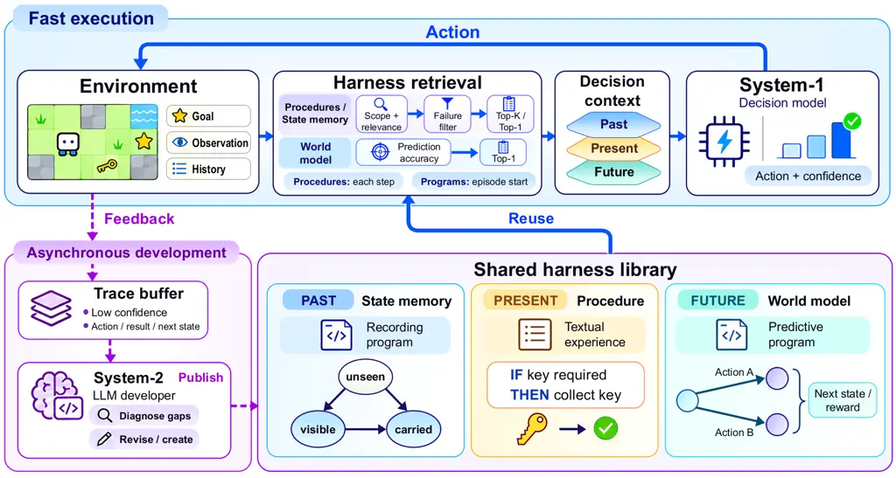
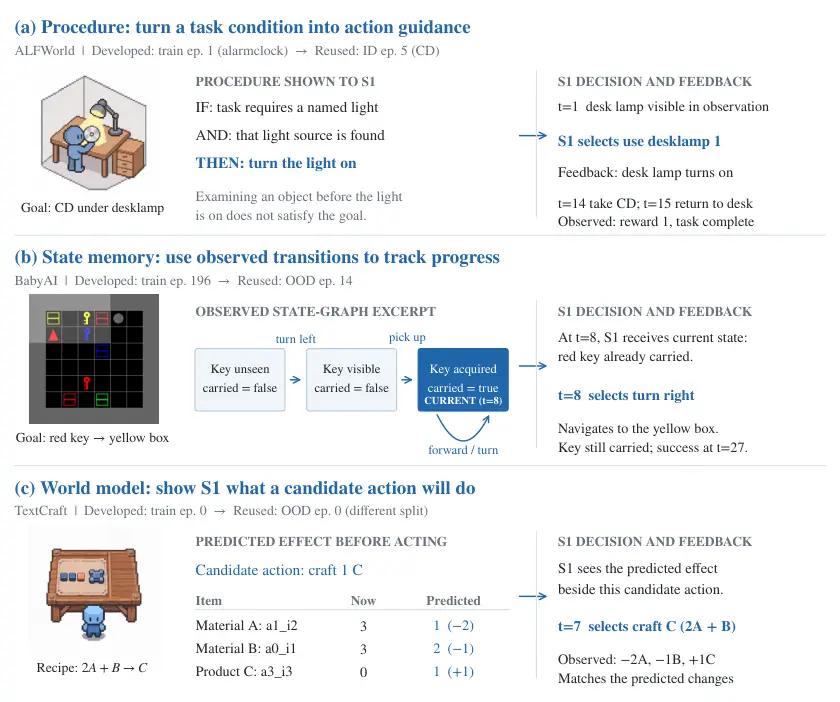

# Think Once, Act Fast: Cost-Effective Recursive Self-Improvement for Decision Model Harness

Siqi Lai Affiliation: AI Thrust, Hong Kong University of Science and
Technology (Guangzhou) Correspondence to:
<slai125@connect.hkust-gz.edu.cn>    Haitao Li Affiliation: LIGHTSPEED
Correspondence to: <loganli@lightspeed-studios.com>    Hao Liu
Affiliation: AI Thrust, Hong Kong University of Science and Technology
(Guangzhou) Correspondence to: <liuh@ust.hk>

###### Abstract

Fast System-1 models enable responsive actions but struggle with complex
or unfamiliar tasks. Large language model (LLM)-based System-2 provides
strong reasoning capabilities, yet repeated invocation incurs
substantial latency and computational costs. To bridge this gap, we
propose JevRSI, a System-1/System-2 collaboration framework that
transforms LLM reasoning into transferable decision support through
recursive harness improvement. A Jev-style System-1 model enables
low-latency action selection, while an asynchronous System-2 LLM
develops a modular harness. The harness integrates procedures, state
memory, and world models to provide decision contexts spanning the past,
present, and future. Utility-driven retrieval selects modules based on
both contextual relevance and its utility on previous tasks.
Environmental feedback guides targeted revisions and enables recursive
self-improvement. Experiments across three datasets show that JevRSI
consistently improves decision quality, matching or surpassing LLM
agents in several settings. It preserves low-latency execution with
favorable performance–cost trade-offs. Moreover, System-2 development
interventions decrease as the harness evolves, amortizing System-2 costs
through continuous improvement. Our project is available at
[https://github.com/usail-hkust/JevRSI](https://github.com/usail-hkust/JevRSI).

###### Keywords: 

Machine Learning, ICML

^(†)^(†)affiliationnotice: ^(\*)This work was done during an internship
at LIGHTSPEED. ^($`\dagger`$)Corresponding authors.

## 1 Introduction

Developing agents that act efficiently and accurately across diverse
environments remains a fundamental challenge in artificial intelligence.
Large language models (LLMs) offer broad knowledge and powerful
reasoning capabilities, but their computational overhead and latency
hinder time-sensitive applications and tasks (e.g.embodied agents,
traffic signal control (Lai et al., 2025)). Existing approaches follow
three paradigms. System-1 agents employ lightweight models, including
rule-based systems, small LLMs, and vision-language-action (VLA)
models (Kim et al., 2024). They successfully enable fast decision-making
but often struggle with complex or unfamiliar tasks. System-2 agents
leverage larger LLMs for deliberate reasoning, offering great
flexibility with extensive inference cost (Yao et al., 2022; Prasad
et al., 2023). System-1/System-2 cooperative methods combine these
strengths by selectively invoking sophisticated reasoning while
delegating routine decisions to fast executors, aiming to balance
decision quality and execution efficiency (Lin et al., 2023; NVIDIA
et al., 2025).

However, existing System-1/System-2 collaboration methods primarily
focus on allocating computation by selecting when to invoke System-1 or
System-2 (Lin et al., 2023). Each System-2 invocation still incurs
substantially greater latency. This motivates distilling LLM reasoning
into reusable support for System-1 while preserving its responsiveness.
Jev-style (Almeida, 2026) decision models offer a promising paradigm for
this goal. Its structured probabilistic decision interface supports
fast, high-quality decision-making and strong generalization, making it
well suited to System-1 execution. To equip decision models with LLM
reasoning capabilities, we propose recursively improving its harness,
constructing informative decision context and guide action selection.
LLM-based System-2 leverages interaction feedback to revise the harness,
allowing recursive self-improvement to support subsequent decisions.
Through this cycle, we aim to continually improve decision quality while
preserving the responsiveness of System-1 execution.

Achieving this goal requires addressing two coupled challenges. First,
the agent need to accurately identify System-1 failures and determine
when to invoke LLM reasoning for harness revision. Delayed intervention
may compromise decision quality, while excessive intervention introduces
substantial computational overhead. Second, the agent need to leverage
real-time environmental feedback to drive continual harness improvement.
This requires to accurately identify the underlying harness deficiencies
and making targeted improvements to address them. As the harness
evolves, the agent continuously diagnoses emerging limitations and
refine its decision context accordingly. Together, timely intervention
and feedback-driven improvement enable the harness to progressively
improve decision quality while preserving the responsiveness of System-1
execution.

To address these challenges, we propose JevRSI, a System-1/System-2
collaboration framework that enables fast execution with recursive
harness improvement. During execution, a Jev-style decision model serves
as System-1, supporting low-latency decisions across tasks and
environments. Utility-driven retrieval selects most suitable harness
modules to provide informative decision context. Meanwhile, System-2
develops three complementary harness modules that provide System-1 with
decision contexts spanning the past, present, and future. (1) State
memory retains exploration history and observed transitions. It is
constructed by a task-specific memory-building program for different
objectives. (2) Procedure encodes experience to guide the current action
under applicable environmental conditions and task goals. (3) World
model is a predictive model to anticipate future environmental states
and action outcomes, enabling counterfactual evaluation of candidate
actions. System-2 uses feedback from ongoing execution to diagnose gaps
in these modules and make targeted revisions. Through this recursive
development process, JevRSI progressively enhances decision quality and
reduces dependence on System-2 with the responsiveness of System-1
execution.

Our contributions are threefold: (1) We propose JevRSI, the first
framework that enables recursive self-improvement of decision-model
harnesses during execution, supporting efficient and generalizable
decision-making across diverse tasks and environments. (2) We design a
modular harness that integrates exploration history, action guidance,
and counterfactual predictions to provide System-1 with informative
past, present, and future decision contexts. Feedback-driven harness
development further enables continual self-improvement and transfer
across execution episodes. (3) Extensive experiments demonstrate that
JevRSI consistently improves decision quality and reduces reliance on
System-2 reasoning while preserving real-time responsiveness of System-1
execution. Notably, stronger standalone LLM reasoning capabilities do
not necessarily translate into more effective harness development. This
finding suggests a promising direction for improving harness development
and collaboration mechanisms between LLMs and decision models.

## 2 Preliminaries

###### Problem 1 (Decision-Model Recursive Self-Improvement).

We formulate Decision-Model Recursive Self-Improvement as the continual
evolution of an external harness through agent–environment interaction.
Let $`p_{\theta}`$ be a decision model and $`p_{\psi}`$ an harness
developer. After $`k`$ interaction episodes, $`H_{k}`$ denotes the
current harness.

During episode $`k`$, the agent executes task $`\tau_{k}`$. At step
$`t`$, the harness $`M_{k}`$ builds context from the available
interaction history $`h_{k,t}`$, and the decision model selects an
action:

```math
a_{k,t}\sim p_{\theta}\!\left(\cdot\mid F_{M_{k}}(h_{k,t}),\mathcal{A}\right), \tag{1}
```

where $`F_{M_{k}}`$ constructs context from the available interaction
history $`h_{k,t}`$ and $`\mathcal{A}`$ is the action space. Execution
produces evidence $`e_{k}`$ (e.g., trajectory, environmental feedback,
task outcome). The developer uses this evidence to identify deficiencies
and revise the harness:

```math
M_{k+1}=p_{\psi}(M_{k},\tau_{k},e_{k}). \tag{2}
```

The updated harness guides subsequent actions, whose outcomes inform the
next revision. Over a horizon of $`B`$ episodes, our objective is to
recursively refine the harness to maximize the final task success rate
while progressively reducing the effort required for harness
development:

```math
R_{\mathrm{task}}(M_{B})=\frac{1}{N}\sum_{i=1}^{N}b_{i}(M_{B})-\sum_{k=0}^{B-1}c_{k}. \tag{3}
```

Here, $`b_{i}(\cdot)\in{0,1}`$ indicates success on task $`i`$, $`N`$
denotes the number of evaluation tasks, and $`c_{k}`$ represents the
harness development cost of episode $`k`$.



Figure 1: The overview of JevRSI framework.

## 3 Method

### 3.1 Dual System Collaboration

#### 3.1.1 Real-time Decision Making

At step $`t`$, a query $`q_{t}`$ summarizes the task and environmental
conditions, including the task goal $`g`$, observation $`o_{t}`$, and
candidate actions $`\mathcal{A}_{t}`$. Let $`\mathcal{M}^{t}`$ denote
the latest library of harness modules. We retrieve a set of harness
$`M_{t}`$ and use them to construct the decision context. System-1
selects the action with the highest confidence score based on received
context $`x_{t}`$, and the runtime executes it in the environment:

```math
\displaystyle M_{t} \displaystyle=\operatorname{Retrieve}\!\left(q_{t},\mathcal{M}^{t}\right), \tag{4}
```

```math
\displaystyle x_{t} \displaystyle=F_{M_{t}}\!\left(q_{t},\cdot\right), \tag{5}
```

```math
\displaystyle a_{t} \displaystyle=\arg\max_{a\in\mathcal{A}_{t}}c_{\theta}(a\mid x_{t},\mathcal{A}_{t}), \tag{6}
```

where $`c_{\theta}(a\mid x_{t},\mathcal{A}_{t})`$ denotes the confidence
score produced by the decision model. After execution, the runtime
records the observation, selected modules, action, environmental
feedback, and harness. These records provide System-2 with the context
to interpret execution outcomes.

#### 3.1.2 Asynchronous Harness Development

System-2 develops harness asynchronously while System-1 continues to
interact with the environment. We maintain an evidence buffer
$`\mathcal{B}_{t}`$ to collect interactions associated with
low-confidence decisions. After receiving environmental feedback, the
runtime updates the buffer according to:

```math
\mathcal{B}_{t+1}=\begin{cases}\mathcal{B}_{t}\cup\{e_{t}\},&c_{t}<\eta,\\
\mathcal{B}_{t},&c_{t}\geq\eta,\end{cases} \tag{7}
```

where $`c_{t}`$ denotes the confidence score produced by the decision
model, $`e_{t}`$ contains the decision context, selected action,
observed outcome, and a bounded recent execution trace.

System-2 examines buffered traces with recurring difficulties
(e.g.repeated failures or stalled task progress). A LLM-based judge
reviews the evidence and diagnoses the uncertain decisions. When the
potential weakness of current harness modules is identified, System-2
selectively develops or improves a harness module. The newly developed
module is published to the shared library $`\mathcal{M}^{t+1}`$. This
design keeps harness development off the real-time decision-making while
recursively improving System-1’s performance.

### 3.2 Decision Model Recursive Self-Improvement

#### 3.2.1 Decision Model Harness

The harness provides three complementary forms of decision support.
Procedures supply guidance for the current action. State memory
identifies situations that the framework records in exploration graphs.
World model predicts future outcomes under alternative actions.
Together, they construct past, present, and future context for System-1.

At step $`t`$, the shared library $`\mathcal{M}^{t}`$ contains a finite
set of harness modules. Each module is represented by a triple

```math
m=(\kappa_{m},\mu_{m},b_{m}),\qquad m\in\mathcal{M}^{t}, \tag{8}
```

where $`\kappa_{m}\in\{\textsc{proc},\textsc{state},\textsc{wm}\}`$
identifies its type (i.e.procedure, state memory, or world model),
$`\mu_{m}`$ contains metadata, and $`b_{m}`$ is its body. The metadata
records a name, applicable conditions, keywords, and goals. These
descriptions form the applicability tag used for retrieval. The metadata
also maintains the usage and success counts $`n_{t}(m)`$ and
$`n_{t}^{*}(m)`$ used to estimate execution utility in Equation 19. The
body contains the module’s content, such as the textual guidance and
excecutable code, to construct the decision context for System-1.

The retrieval mechanism selects applicable modules
$`M_{t}\subseteq\mathcal{M}^{t}`$. Their outputs are assembled into the
decision context:

```math
x_{t}=F_{M_{t}}\!\left(q_{t},c_{t}^{\mathrm{past}},c_{t}^{\mathrm{now}},c_{t}^{\mathrm{future}}\right), \tag{9}
```

where the three contextual terms summarize exploration history,
current-action guidance, and counterfactual future predictions,
respectively.

##### Procedure

A procedure encodes textual experience distilled by System-2 from
earlier interactions. It provides an action recommendation as guidance
for the current decision. For a module $`m`$ with
$`\kappa_{m}=\textsc{proc}`$, its body is:

```math
b_{m}=\langle s_{m}\rightarrow\hat{a}_{m}\rangle, \tag{10}
```

where $`s_{m}`$ describes the relevant environmental states and task
prerequisites, and $`\hat{a}_{m}`$ is an action recommendation.

##### State memory

For state memory, the body $`b_{m}`$ contains a state-memory update
program $`\sigma_{m}`$ written by System-2. The program specifies a
task-dependent state representation and how observed transitions update
memory. The framework stores state-action transitions as a directed
graph $`G_{t}`$:

```math
G_{t}=(N_{t},E_{t}),\qquad E_{t}\subseteq N_{t}\times\mathcal{A}\times N_{t}, \tag{11}
```

Each node is a state representation and edge is a state-action
transition. After executing $`a_{t}`$, the runtime compacts the
resulting observation into a new state representation $`v_{t+1}`$. It
then updates the state-action transition graph:

```math
\displaystyle N_{t+1} \displaystyle=N_{t}\cup\{v_{t+1}\}, \tag{12}
```

```math
\displaystyle E_{t+1} \displaystyle=E_{t}\cup\{(v_{t},a_{t},v_{t+1})\},
```

```math
\displaystyle G_{t+1} \displaystyle=(N_{t+1},E_{t+1}).
```

The framework tracks the visit count and most recent visit step for each
node, as well as the traversal count for each edge. During System-1
decision making, the runtime extracts a compact summary from the graph.
Summaries from retrieved state-memory modules form
$`c_{t}^{\mathrm{past}}`$, providing System-1 with relevant exploration
history and observed state transitions. This context helps System-1
recognize previously visited states and avoid redundant exploration.

##### World model

For world model, the body $`b_{m}`$ contains a one-step action-state
prediction program $`\omega_{m}`$ written by System-2. The program
predicts the possible next states after taking different actions:

```math
\displaystyle\widehat{Y}_{t+1} \displaystyle=\omega_{m}(s_{t},G_{t},\mathcal{A}_{t}), \tag{13}
```

```math
\displaystyle\widehat{Y}_{t+1} \displaystyle={(s_{t+1}^{a},R(s_{t}|a),\textsc{DONE}^{(s_{t}|a)}_{t+1})_{a\in\mathcal{A}_{t}}}, \tag{14}
```

where $`s_{t+1}^{a}`$ is the predicted next state after taking action
$`a`$, $`R(s_{t}|a)`$ is the predicted reward after taking action $`a`$,
and $`\textsc{DONE}^{(s_{t}|a)}_{t+1}`$ is a boolean indicating whether
the task is done after taking action $`a`$. This context enables
System-1 to compare anticipated action effects before acting.

#### 3.2.2 Utility-Driven Harness Retrieval

Our retrieval mechanism combines contextual relevance with utility
constraints derived from execution feedback. It retrieves three types of
harness modules with distinct strategies. State-memory programs are
selected at the beginning of each episode to maintain exploration
history. Procedures are retrieved at each decision step to guide current
actions. World models are selected based on their predictive accuracy of
action consequences. Together, these modules provide System-1 with past,
present, and future decision contexts.

For procedures and state memory modules, retrieval considers both
contextual relevance and execution history. The query $`q_{t}`$ includes
the task goal, current observation and interaction context. Each module
is indexed by its description and applicability metadata. Let
$`\widehat{M}_{t}\subseteq\mathcal{M}^{t}`$ denote the modules whose
declared scope matches the current context. We compute relevance scores
and select candidates as:

```math
\displaystyle s_{t}(m)=\operatorname{Rel}(q_{t},\operatorname{tag}(m)), \tag{15}
```

```math
\displaystyle\mathcal{C}_{t}={m\in\widehat{M}_{t}:s_{t}(m)>0,\ f_{t}(m)<L}, \tag{16}
```

where $`\operatorname{Rel}`$ measures textual relevance, $`f_{t}(m)`$
counts consecutive failed episodes associated with the module $`m`$, and
$`L`$ is the failure limit. Modules exceeding this limit remain excluded
until revised by System-2.

We retrieve $`K`$ most relevant procedures at each step:

```math
M_{t}^{\mathrm{proc}}=\operatorname{TopK}_{m\in\mathcal{C}_{t}^{\mathrm{proc}}}s_{t}(m), \tag{17}
```

where $`\mathcal{C}_{t}^{\mathrm{proc}}`$ denotes the eligible procedure
subset. For state memory, the runtime selects the most relevant program
at the beginning of each episode. World models follow a separate
selection criterion based on prediction accuracy. The selected modules
collectively form $`M_{t}`$, providing System-1 with compact decision
support.

#### 3.2.3 Recursive Harness Improvement

Recursive harness improvement is driven by feedback from environmental
interactions. After System-1 executes $`a_{t}`$, the environment
transitions to $`s_{t+1}`$. These reveal action outcomes and observed
state changes. The runtime records:

```math
e_{t}^{\mathrm{env}}=(M_{t},U_{t},a_{t},R(s_{t}|a_{t}),s_{t+1}), \tag{18}
```

where $`U_{t}=\{u_{t}(m)\}_{m\in M_{t}}`$ is the utility of the harness
modules used during execution. The runtime attributes each episode’s
outcome to the modules used during execution. Their utility score is
defined as:

```math
u_{t}(m)=\begin{cases}n_{t}^{*}(m)/n_{t}(m),&n_{t}(m)>0,\\
0,&n_{t}(m)=0,\end{cases} \tag{19}
```

where $`n_{t}(m)`$ and $`n_{t}^{*}(m)`$ denote the numbers of executed
episodes and successful episodes, respectively. This utility informs
subsequent System-2 development and revisions.

The runtime combines interaction feedback with decision context to
construct evidence records $`e_{t}`$. Low-confidence decisions are added
to the development buffer $`\mathcal{B}_{t}`$, triggering reviews of
procedures and state-memory modules. Separately, world-model development
is triggered after an episode when an executed future state contradicts
a model prediction. Based on the collected feedback, System-2 diagnoses
incorrect guidance, inaccurate predictions, and missing module coverage.
It then proposes targeted updates:

```math
(M^{\text{new}}_{t},M^{\text{rev}}_{t})=p_{\psi}(\mathcal{M}^{t},\mathcal{B}_{t}), \tag{20}
```

where $`M_{t}^{\mathrm{new}}`$ and $`M_{t}^{\mathrm{rev}}`$ is newly
proposed and revised modules, respectively. Revisions address observed
deficiencies, while new modules extend coverage to previously
unsupported environmental conditions or task requirements. The resulting
modules are incorporated into the shared library $`\mathcal{M}^{t+1}`$
and become available for retrieval in subsequent decisions. This process
establishes a recursive improvement loop that continuously guides
harness development.

## 4 Experiments

### 4.1 Experiment Settings

##### Benchmarks and splits.

We evaluate JevRSI on ALFWorld (Shridhar et al., 2020),
BabyAI (Chevalier-Boisvert et al., 2018), and TextCraft (Prasad et al.,
2023). Each benchmark is divided into three disjoint splits: training,
in-distribution evaluation (ID), and out-of-distribution evaluation
(OOD). The training split supplies interaction trajectories for initial
harness development. ID tasks assess performance on unseen instances
from the training distribution. OOD tasks assess generalization under
distribution shifts. The statistics of the datasets are shown in
Table 1.

|                 |   ALFWorld |   BabyAI |   TextCraft |
| --------------- | ---------- | -------- | ----------- |
|   Training size |   200      |   200    |   200       |
|   ID size       |   140      |   150    |   150       |
|   OOD size      |   134      |   150    |   150       |

Table 1: Statistics of the datasets.

##### Comparison methods.

We compare JevRSI against three groups: vanilla decision models,
system-1/2 cooperative agents, and LLM agents. For vanilla decision
models, we directly use the decision models with environment interaction
histories for evaluation. For system-1/2 cooperative agents, we use
JevHarness (Chen, 2026) and JevAgentHarness (Zhu et al., 2026) as the
baselines. JevHarness employs an LLM agent to develop the harness before
deployment, which remains fixed throughout evaluation. JevAgentHarness
cooperates a decision model with an LLM agent in a cost-effective way,
invoking the LLM to take over decision-making when the decision model’s
confidence falls below 0.8. For LLM agents, we adopt the same framework
as JevRSI but replace the System-1 with the evaluated LLM.

##### Backbone models.

The evaluated LLMs are GPT-6.1 Sol (OpenAI, 2026),
DeepSeek-V4.1-Flash (DeepSeek-AI, 2026), and Qwen3.8-27B (Qwen Team,
2026). The decision models are Jev-1.14 (TypeSafe AI, 2026) and StartLux
(9B and 27B) (Zhuang et al., 2026). We uniformly set JevHarness and
JevAgentHarness to use DeepSeek-V4.1-Flash and StartLux-27B as the LLM
and decision model, respectively. Task observation, action access, and
interaction limits are held consistent within each dataset.

[TABLE]

Table 2: Overall comparison results. We use Success Rate@1 (SR@1) to
measure the performance of agents. Parentheses indicate relative
improvement over the vanilla decision model.

### 4.2 Overall Comparison

Table 2 presents the overall results across three datasets. Vanilla
decision models often achieve success rates below 50%, and larger models
generally perform better. LLM agents achieve higher success rates, with
GPT-6.1 Sol exceeding 90% in most settings. These results highlight the
benefits of LLM reasoning for long-horizon interactions. However,
existing System-1/System-2 cooperative frameworks show inconsistent
improvements. JevHarness improves ALFWorld but underperforms vanilla
models on BabyAI and TextCraft, suggesting limitations of static harness
without recursive improvement in dynamic environments and unseen tasks.
JevAgentHarness achieves 81.34% and 50.00% OOD success on ALFWorld and
BabyAI, respectively, but only 4.00% on TextCraft. This suggests that
confidence-based LLM intervention may fail to prevent harmful decisions
made by System-1 in challenging tasks.

In contrast, JevRSI consistently improves decision-model performance,
matching or surpassing LLM agents in several settings. With Qwen as
System-2, StartLux-9B improves from 44.77% to 76.11% on ALFWorld OOD,
matching the Qwen LLM agent. On TextCraft OOD, StartLux-27B achieves
70.66%, outperforming both its vanilla counterpart (62.66%) and the Qwen
agent (55.33%). Notably, strong LLM-agent performance does not
necessarily translate into effective harness development. Although
GPT-6.1 Sol achieves the highest standalone performance, it provides
weaker harness support in some settings. On BabyAI with StartLux-27B,
GPT initiates only 10 development steps and achieves lower success
rates. Compared with Qwen and DeepSeek, they initiate 67 and 49 steps,
respectively. These findings highlight that effective System-2
development requires both strong reasoning and accurate identification
of opportunities for harness improvement.

Figure 2: Cost-effectiveness comparison results. All decision-model
calls are uniformly priced using the TypeSafe Jev API.

### 4.3 Cost-Effectiveness Comparison

We evaluate cost-effectiveness along three dimensions: token-based
expenditure, decision-model inference time, and System-2 development
frequency. The Figures 2, 3 and 4 show that JevRSI achieves strong task
performance with lower inference costs and requires fewer development
interventions as the harness modules are gradually improved.

Figure 2 shows the success rate and token-based expenditure of JevRSI
and LLM agents during two evaluation splits. It demonstrates a favorable
trade-off between task success and token-based expenditure. For example,
JevRSI with DeepSeek achieves the same 100% success rate as the GPT
agent at approximately \$0.36 versus \$5.38, reducing evaluation cost by
about 93% on TextCraft ID. This result shows that reusable harness
modules preserve task performance while reducing expenditure on LLM
reasoning.

Figure 3 illustrates the inference time of vanilla decision models,
JevRSI and LLM agents during two evaluation splits. It shows that JevRSI
preserves the low inference regime as vanilla decision models. Its mean
System-1 inference time ranges from 0.08 to 0.58 seconds across the
three benchmarks. LLM agents require 2.14–15.58 seconds on average.
Thus, harness-supported action selection retains fast model responses
while improving decision quality. Asynchronous development allows
System-1 to implement the harness modules without waiting for System-2
development. These results demonstrate that JevRSI achieves real-time
decision-making while maintaining high task performance.

Figure 4 shows the number of System-2 harness development steps in the
training split. It shows that System-2 development becomes less frequent
as the harness modules are gradually improved. Between the first and
second halves of training, System-2 triggers fall from 22 to 3 on
ALFWorld and from 126 to 75 on BabyAI. TextCraft requires six triggers
in the first half and none in the second. Although activity fluctuates
locally, later episodes require fewer development interventions overall.
This trend suggests that reusable modules reduce recurring development
needs and create opportunities to amortize System-2 costs over continued
interaction after recursive harness improvement.

Figure 3: Inference time comparison results.

Figure 4: Harness development step distribution in training split.

Figure 5: Ablation study results over four JevRSI variants.

### 4.4 Ablation Studies

Figure 5 evaluates the contributions of each harness module and
utility-driven retrieval using StartLux-27B and Qwen. Removing any
module reduces success across all six settings, but their impact varies
by task. State memory contributes most on ALFWorld, where its removal
reduces ID and OOD success by 15.7 and 17.9 percentage points,
respectively. This highlights the importance of preserving exploration
history and task progress during long-horizon interactions. Procedures
provide reusable action guidance, particularly on BabyAI, where their
removal reduces ID success by 17.3 points. Their impact is smaller on
TextCraft, where ID performance is near saturation, but remains evident
on OOD tasks. World models contribute most on BabyAI, where their
removal reduces ID success from 64.0% to 37.3%. This suggests that
anticipating action consequences is particularly valuable for sequential
navigation and long-term planning. Finally, utility-driven retrieval
improves BabyAI and TextCraft performance by filtering unreliable
modules, but slightly reduces ALFWorld OOD success. Overall, these
results demonstrate complementary benefits from the three modules, while
highlighting the environment-dependent effectiveness in different tasks.



Figure 6: Three cases of harness module support in task success.

### 4.5 Case Studies

Figure 6 illustrates how the three harness modules support System-1
during task execution.

##### Procedure: Supplying Current-Action Prerequisites.

In the first ALFWorld training episode, System-1 attempts to examine an
alarm clock without first satisfying the required lighting condition. To
address this failure, System-2 develops the look-object-under-light
procedure, which explicitly encodes the lighting prerequisite. In ID
episode 5, System-1 encounters a similar task requiring it to examine a
CD under a desk lamp. The retrieved procedure provides the necessary
guidance, prompting System-1 to select use desklamp 1. After confirming
that the lamp is on, System-1 retrieves the CD and returns to the
illuminated desk, completing the task in 15 steps. This case
demonstrates how previously developed procedure modules transfer
experience across different objects and provide actionable guidance for
subsequent decisions.

##### State Memory: Preserving Completed Subgoals.

In BabyAI, repeated search cycles motivate System-2 to develop a state
memory that tracks task progress. In OOD episode 14, System-1 needs to
collect a red key before approaching a yellow box. The resulting state
graph tracks the key’s status as unseen, visible, or carried. After
System-1 picks up the key at step 7, the goalCarried flag becomes true
and remains available throughout subsequent navigation. The graph
summary preserves this completed subgoal in System-1’s context, allowing
it to proceed toward the box without repeatedly inferring its progress
from local observations. System-1 completes the task at step 27. This
case demonstrates how persistent state memory preserves completed
subgoals and supports robust decision-making across successive local
observation changes.

##### World Model: Anticipating Action Effects.

In TextCraft, the world model textcraft-synth-crafting, developed in
training episode 0, is reused in OOD episode 0. At step 7, the inventory
contains three units each of $`A`$ and $`B`$, but no $`C`$. During
historical interaction, the early developed world model has learned that
crafting one unit of $`C`$ consumes two units of $`A`$ and one unit of
$`B`$, leaving $`A=1`$, $`B=2`$, and $`C=1`$. These predicted outcomes
are incorporated into System-1’s context, providing it with resource
requirements and expected action outcomes before execution. System-1
selects the crafting action, and the resulting inventory confirms the
prediction. The crafted product then supports a subsequent step toward
the target. This case demonstrates how counterfactual predictions
provide System-1 with resource requirements and expected action outcomes
before execution.

## 5 Related Work

##### Decision Models:

Decision models enable efficient action selection through learned
policies and structured prediction interfaces. Decision Transformer
formulates reinforcement learning as return-conditioned sequence
modeling (Chen et al., 2021), while Gato employs a shared sequence model
across tasks and modalities (Reed et al., 2022). OpenVLA extends this
paradigm to robotic control by predicting actions from visual
observations and language instructions (Kim et al., 2024). More
recently, Jev introduces a probabilistic decision framework with
confidence estimates (Almeida, 2026). System1-Arena evaluates when fast
decision models can replace generative reasoning across static and
interactive tasks (Chen et al., 2026). Despite their efficiency, these
models struggle with complex or unfamiliar tasks that require additional
adequate reasoning.

##### LLM Agents:

LLM agents leverage reasoning and environmental feedback to solve
complex tasks. ReAct interleaves reasoning with actions (Yao et al.,
2022), while Reflexion and Voyager reuse experience through reflections
and executable skills (Shinn et al., 2023; Wang et al., 2023).
TrafficClaw extends memory-driven self-improvement to urban traffic
control (Lai et al., 2027). USTBench evaluates LLMs’ spatiotemporal
reasoning in urban physical environments (Lai et al., 2026). AutoHarness
synthesizes executable harnesses through environment-guided
refinement (Lou et al., 2026). Adaptive Auto-Harness separates
persistent development workspaces from deployable harnesses (Liu et al.,
2026). Self-evolving harness methods revise agent programs using
execution feedback, supporting adaptation in long-horizon
interactions (Xu, 2026).

##### System-1/2 Cooperative Agents:

System-1/System-2 agents combine fast execution with deliberate
reasoning. SwiftSage coordinates a behavior-cloned action model and an
LLM planner through a heuristic controller (Lin et al., 2023). GR00T N1
integrates vision-language reasoning with diffusion-based action
generation (NVIDIA et al., 2025). Recent Jev-based approaches explore
harness development and selective delegation. JevHarness employs an LLM
to develop executable harnesses, which remain frozen during
evaluation (Chen, 2026). JevAgentHarness delegates low-confidence
decisions to an LLM and trains decision models on agent-visited
states (Zhu et al., 2026).

## 6 Conclusion

We present JevRSI, a new System-1/System-2 collaboration framework that
enables low-latency decision-making with asynchronous, LLM-driven
harness recursive self-improvement. A Jev-style decision model executes
System-1 fast actions, while a LLM-based System-2 develops a modular
harness that integrates state memory, procedures, and world models to
provide decision contexts spanning the past, present, and future.
Environmental feedback recursively guides targeted harness module
improvements. Experiments across three agent task datasets demonstrate
favorable performance–cost trade-offs and low-latency System-1
execution. Declining development activity further suggests that
continually improved harness modules reduce repeated System-2 harness
development.

Our findings suggest that stronger LLM reasoning does not necessarily
translate into more effective harness development. Future work will
further investigate improved harness development strategies and
System-1/System-2 collaboration mechanisms to simulate LLM reasoning
capabilities for System-1 improvement. Moreover, the robustness of
JevRSI remains untested in real-world settings (e.g.embodied and
autonomous driving tasks). Extending JevRSI to these environments
requires richer harness representations to handle noisy observations,
continuous interactions, and uncertain dynamics, while ensuring reliable
decision-making.

## References

- Almeida (2026) Almeida, D. Introducing System One Models & Jev.
  TypeSafe AI Blog, September 2026.
- Chen et al. (2021) Chen, L., Lu, K., Rajeswaran, A., Lee, K., Grover,
  A., Laskin, M., Abbeel, P., Srinivas, A., and Mordatch, I. Decision
  Transformer: Reinforcement learning via sequence modeling. _arXiv
  preprint arXiv:2106.01345_, 2021.
- Chen (2026) Chen, T. JevHarness. GitHub repository, 2026.
- Chen et al. (2026) Chen, T., Liu, X., An, R., Wang, Z., and Zhou, M.
  System1-Arena: Which decisions can be left to System 1? _arXiv
  preprint arXiv:2610.21244_, 2026.
- Chevalier-Boisvert et al. (2018) Chevalier-Boisvert, M., Bahdanau, D.,
  Lahlou, S., Willems, L., Saharia, C., Nguyen, T. H., and Bengio, Y.
  BabyAI: A platform to study the sample efficiency of grounded language
  learning. _arXiv preprint arXiv:1810.08272_, 2018.
- Chevalier-Boisvert et al. (2023) Chevalier-Boisvert, M., Dai, B.,
  Towers, M., de Lazcano, R., Willems, L., Lahlou, S., Pal, S., Castro,
  P. S., and Terry, J. Minigrid & Miniworld: Modular & customizable
  reinforcement learning environments for goal-oriented tasks. _arXiv
  preprint arXiv:2306.13831_, 2023.
- DeepSeek-AI (2026) DeepSeek-AI. DeepSeek-V4.1-Flash: Pushing the
  limits of KV cache compression. Model card, 2026.
- Gandhi (2026) Gandhi, A. TextCraft-Synth. Hugging Face dataset, 2026.
- Gandhi et al. (2026) Gandhi, A., Chakraborty, S., Wang, X., Kumar, A.,
  and Neubig, G. Recursive agent optimization. _arXiv preprint
  arXiv:2605.06639_, 2026.
- Kim et al. (2024) Kim, M. J., Pertsch, K., Karamcheti, S., Xiao, T.,
  Balakrishna, A., Nair, S., Rafailov, R., Foster, E., Lam, G., Sanketi,
  P., Vuong, Q., Kollar, T., Burchfiel, B., Tedrake, R., Sadigh, D.,
  Levine, S., Liang, P., and Finn, C. OpenVLA: An open-source
  vision-language-action model. _arXiv preprint arXiv:2406.09246_, 2024.
- Lai et al. (2025) Lai, S., Xu, Z., Zhang, W., Liu, H., and Xiong, H.
  LLMLight: Large language models as traffic signal control agents. In
  _Proceedings of the 31st ACM SIGKDD Conference on Knowledge Discovery
  and Data Mining_, 2025. doi: 10.1145/3690624.3709379.
- Lai et al. (2026) Lai, S., Ning, Y., Yuan, Z., Chen, Z., and Liu, H.
  USTBench: Benchmarking and dissecting spatiotemporal reasoning
  capabilities of LLMs as urban agents. In _International Conference on
  Learning Representations_, 2026.
- Lai et al. (2027) Lai, S., Zhang, P., Zhou, Y., Han, J., Ning, Y., and
  Liu, H. TrafficClaw: Generalizable urban traffic control via unified
  physical environment modeling. In _Proceedings of the 33rd ACM SIGKDD
  Conference on Knowledge Discovery and Data Mining_, 2027.
- Lin et al. (2023) Lin, B. Y., Fu, Y., Yang, K., Brahman, F., Huang,
  S., Bhagavatula, C., Ammanabrolu, P., Choi, Y., and Ren, X. SwiftSage:
  A generative agent with fast and slow thinking for complex interactive
  tasks. _arXiv preprint arXiv:2305.17390_, 2023.
- Liu et al. (2026) Liu, Z., Shi, Z., Sang, Y., He, B., Lin, M., Wei,
  T., Wang, D., Dumoulin, B., Jin, W., and Lu, H. Adaptive Auto-Harness:
  Sustained self-improvement for agentic system deployment on open-ended
  task streams. _arXiv preprint arXiv:2606.01770_, 2026.
- Lou et al. (2026) Lou, X., Lázaro-Gredilla, M., Dedieu, A., Wendelken,
  C., Lehrach, W., and Murphy, K. P. AutoHarness: improving LLM agents
  by automatically synthesizing a code harness. _arXiv preprint
  arXiv:2603.03329_, 2026.
- NVIDIA et al. (2025) NVIDIA, Bjorck, J., Castañeda, F., Cherniadev,
  N., Da, X., Ding, R., Fan, L. J., Fang, Y., Fox, D., Hu, F., Huang,
  S., Jang, J., Jiang, Z., Kautz, J., Kundalia, K., Lao, L., Li, Z.,
  Lin, Z., Lin, K., Liu, G., Llontop, E., Magne, L., Mandlekar, A.,
  Narayan, A., Nasiriany, S., Reed, S., Tan, Y. L., Wang, G., Wang, Z.,
  Wang, J., Wang, Q., Xiang, J., Xie, Y., Xu, Y., Xu, Z., Ye, S., Yu,
  Z., Zhang, A., Zhang, H., Zhao, Y., Zheng, R., and Zhu, Y. GR00T N1:
  An open foundation model for generalist humanoid robots. _arXiv
  preprint arXiv:2503.14734_, 2025.
- OpenAI (2026) OpenAI. GPT-6.1 Sol. Model documentation, 2026.
- Prasad et al. (2023) Prasad, A., Koller, A., Hartmann, M., Clark, P.,
  Sabharwal, A., Bansal, M., and Khot, T. ADaPT: As-needed decomposition
  and planning with language models. _arXiv preprint
  arXiv:2311.05772_, 2023.
- Qwen Team (2026) Qwen Team. Qwen3.8-27B. Model card, 2026.
- Reed et al. (2022) Reed, S., Żołna, K., Parisotto, E.,
  Gómez Colmenarejo, S., Novikov, A., Barth-Maron, G., Giménez, M.,
  Sulsky, Y., Kay, J., Springenberg, J. T., Eccles, T., Bruce, J.,
  Razavi, A., Edwards, A., Heess, N., Chen, Y., Hadsell, R., Vinyals,
  O., Bordbar, M., and de Freitas, N. A generalist agent. _arXiv
  preprint arXiv:2205.06175_, 2022.
- Shinn et al. (2023) Shinn, N., Cassano, F., Berman, E., Gopinath, A.,
  Narasimhan, K., and Yao, S. Reflexion: Language agents with verbal
  reinforcement learning. _arXiv preprint arXiv:2303.11366_, 2023.
- Shridhar et al. (2020) Shridhar, M., Yuan, X., Côté, M.-A., Bisk, Y.,
  Trischler, A., and Hausknecht, M. ALFWorld: Aligning text and embodied
  environments for interactive learning. _arXiv preprint
  arXiv:2010.03768_, 2020.
- TypeSafe AI (2026) TypeSafe AI. Jev: For the builders AND dreamers.
  TypeSafe AI Blog, October 2026.
- Wang et al. (2023) Wang, G., Xie, Y., Jiang, Y., Mandlekar, A., Xiao,
  C., Zhu, Y., Fan, L., and Anandkumar, A. Voyager: An open-ended
  embodied agent with large language models. _arXiv preprint
  arXiv:2305.16291_, 2023.
- Xu (2026) Xu, Q. Self-evolving harness on multiple tasks with the
  agent as its own optimizer. _arXiv preprint arXiv:2609.38372_, 2026.
- Yao et al. (2022) Yao, S., Zhao, J., Yu, D., Du, N., Shafran, I.,
  Narasimhan, K., and Cao, Y. ReAct: Synergizing reasoning and acting in
  language models. _arXiv preprint arXiv:2210.03629_, 2022.
- Zhu et al. (2026) Zhu, K., Feng, T., Han, X., Wang, H., Yang, L.,
  Tang, X., You, J., and Ji, H. JevAgentHarness: Benchmarking, deploying
  and training decision models that share control with LLMs. _arXiv
  preprint arXiv:2610.21412_, 2026.
- Zhuang et al. (2026) Zhuang, X., Su, Z., Pan, J., Wong, N., Chen, G.,
  and Kuo, C.-W. StartLux-Decision: AutoThink decision models with
  reinforcement learning for calibrated deliberative decisions. _arXiv
  preprint arXiv:2610.17309_, 2026.

## Appendix A Dataset Details

We evaluate three text-based interaction benchmarks. Training episodes
support harness development. In-distribution (ID) evaluation measures
performance on new instances from familiar task distributions.
Out-of-distribution (OOD) evaluation tests transfer to unfamiliar
environments or task compositions. All splits are disjoint and fixed
across runs.

### A.1 ALFWorld

ALFWorld provides text-based household tasks aligned with embodied
environments (Shridhar et al., 2020). Agents follow natural-language
goals to navigate rooms, locate objects, and perform ordered
interactions. Its six task types involve placing, examining, cleaning,
heating, cooling, or collecting objects. Following the official
partition boundaries, we select 200 solvable training episodes with
approximately balanced coverage across task types. ID evaluation
contains 140 episodes in familiar scenes with different object
configurations. OOD evaluation contains 134 episodes in unseen rooms and
layouts. This split tests whether agents can reuse learned interaction
strategies across changing environments. Episodes are capped at 30
steps, and success requires completing the task goal.

### A.2 MiniGrid

We use BabyAI instruction-following tasks in MiniGrid, accessed through
a textual interface (Chevalier-Boisvert et al., 2018; Chevalier-Boisvert
et al., 2023). Agents navigate partially observed gridworlds, identify
colored objects, and execute instructions involving object manipulation
and ordered subgoals. We construct a custom split of 200 training, 150
ID, and 150 OOD episodes. Each split balances five task kinds, with 40
training episodes and 30 evaluation episodes per kind. ID introduces new
maps while preserving the training task mixture. OOD introduces held-out
color–object combinations and instruction sequences absent from training
and ID. Duplicate map and agent configurations are excluded across
splits. Episodes are capped at 150 steps. We call this benchmark BabyAI
in the main results.

### A.3 TextCraft

We use TextCraft with synthetic crafting recipes (Prasad et al., 2023;
Gandhi et al., 2026; Gandhi, 2026). Agents inspect recipes, manage
inventory, and craft intermediate products to obtain specified target
items. These tasks require planning over dependencies and tracking
resource consumption. We construct a custom split from the published
task pool. Training contains 200 tasks with recipe depths of 2–4. ID
contains 150 distinct tasks from the same depth range. OOD contains 150
tasks with depths of 5–6, requiring longer prerequisite chains and
unfamiliar goals. All splits share the same items and crafting rules,
isolating generalization to deeper task dependencies.

## Appendix B Compared Models and Methods

### B.1 Decision Models

- •
  Jev. Jev-1.14 is TypeSafe AI’s decision model (TypeSafe AI, 2026). It
  evaluates predefined choices and returns structured answers with
  confidence scores. In our experiments, it receives environment
  observations and interaction histories, then selects the candidate
  action with the highest confidence.
- •
  StartLux. StartLux-Decision is an open-weight model family that
  assigns probabilities to predefined choices (Zhuang et al., 2026). We
  evaluate its 9B and 27B variants as standalone decision models and
  System-1 backbones of JevRSI. Comparing these sizes reveals how model
  capacity affects task success and the benefits of harness improvement.

### B.2 Large Language Models

Each LLM serves as an agent backbone and as a System-2 harness developer
in JevRSI. For LLM-agent baselines, we use the same agent framework and
replace the System-1 decision model with the corresponding LLM.

- •
  GPT-6.1 Sol. OpenAI’s general-purpose model supports reasoning,
  coding, and tool use (OpenAI, 2026). We access it through an API. It
  generates environment actions in the LLM-agent baseline and develops
  harness modules from interaction evidence when serving as System-2.
- •
  DeepSeek-V4.1-Flash. DeepSeek’s open-weight mixture-of-experts model
  supports long-context reasoning and tool use (DeepSeek-AI, 2026). We
  evaluate its ability to solve interactive tasks directly and to
  translate execution feedback into reusable harness modules for
  decision models.
- •
  Qwen3.8-27B. Qwen’s open-weight, 27-billion-parameter dense model
  supports reasoning, coding, and agentic tasks (Qwen Team, 2026). It
  provides a smaller LLM backbone for evaluating both direct action
  selection and harness development. Our experiments use textual
  observations and feedback.

### B.3 System-1/2 Cooperative Methods

Both baselines use DeepSeek-V4.1-Flash as the LLM and StartLux-27B as
the decision model in our implementation.

- •
  JevHarness. An LLM develops a task-specific harness that constructs
  decision inputs and combines model outputs into actions (Chen, 2026).
  Development can incorporate rewards and execution trajectories. In our
  evaluation, the selected harness remains fixed, and the decision model
  handles action selection without further LLM authoring.
- •
  JevAgentHarness. This method shares control between a decision model
  and an LLM through confidence-based delegation (Zhu et al., 2026). The
  decision model handles confident choices, while the LLM takes over
  uncertain decisions. Our implementation invokes the LLM whenever
  decision confidence falls below $`0.8`$.

## Appendix C Experimental Settings

### C.1 Asynchronous Harness Development

We set the confidence threshold to $`\eta=0.5`$ in Equation 7. Each
review collects three subsequent interaction steps, with remaining
evidence released upon episode completion. Four asynchronous workers
process a queue of up to 64 reviews, discarding the oldest when full.
Each review considers up to eight relevant modules per type, alongside
executed and blocked modules. System-1 continues execution during
development. All LLM requests use temperature $`0`$, with output limits
of 8,192 tokens for diagnosis and 16,384 for module development. A
reasoning budget of 1,024 tokens is enabled when supported. Failed
admission checks permit one repair attempt for procedures and
state-memory modules, and two for world models.

### C.2 Retrieval and Decision Context

Retrieval selects applicable modules based on contextual relevance and
execution history. At each decision step, we retrieve up to $`K=3`$
procedures with positive relevance. At the beginning of each episode, we
select the most relevant state memory program when available. Procedures
and state memory modules are excluded from retrieval after $`L=3`$
consecutive failed episodes until revised by System-2. System-1 receives
the actions and resulting observations from the eight most recent
interaction steps. Meanwhile, the LLM agent baseline uses the same
retrieval mechanism and decision context structure.

### C.3 State Memory

The generated program for maintaining state memory $`\sigma_{m}`$ is
limited to 6,000 characters, with execution budgets of 50 milliseconds
and 20,000 Python lines per call. Admission requires successful
compilation and error-free replay of the recorded episode. The graph
summary $`c_{t}^{\mathrm{past}}`$ is capped at 1,200 characters and
includes up to 12 recently visited states and 12 outgoing transitions
from the current state. These constraints limit runtime overhead and
decision-context length without restricting the underlying stored graph.

### C.4 World Model

The generated program for predicting one-step outcomes in world models
$`\omega_{m}`$ is limited to 20,000 characters, 300 milliseconds, and
500,000 executed Python lines per call. Action-effect descriptions are
capped at 160 characters. Each task stores up to 400 training
transitions, while prediction memory retains 200 recent transitions.
Admission evaluates approximately 150 historical transitions, with at
least five per task when available, plus all current-episode
transitions. Initial models require at least 50% checkable predictions
and 60% accuracy. Revisions may reduce accuracy by at most two
percentage points on identical replay data. Execution errors cause
rejection. System-2 receives up to eight prediction errors for revision.
Selection uses accuracy smoothed with one prior success and failure,
without episode-level blocking.

### C.5 Model Deployment

We access GPT-6.1 Sol through OpenAI APIs and Jev-1.14 through TypeSafe
API. DeepSeek-V4.1-Flash, Qwen3.8-27B, StartLux-9B, and StartLux-27B are
deployed using vLLM. The LLM servers provide OpenAI-compatible
interfaces, while StartLux returns structured action choices and
confidence scores. Both local servers support contexts of up to 128K
tokens. Separate inference services allow System-1 to select actions
while System-2 develops harness modules asynchronously. All model
weights remain fixed throughout the experiments.

## Appendix D Prompt Templates

We provide the prompts used for action selection and harness
development. Braced placeholders denote content inserted from the
current interaction, module library, or admission feedback. Braces
inside Python examples retain their usual meaning. The templates below
follow the default configuration with world modeling enabled.
Development and repair messages preserve the preceding conversation,
including earlier proposals and feedback.

### D.1 System-1 Action Selection

System-1 receives a serialized state and a typed choice question. The
following layout summarizes their fields. Empty optional fields are
omitted. Each neutral identifier, such as c0, maps to a legal action.
Its description includes the predicted effect when a world-model
prediction is available. The decision model returns the selected choice
and its confidence.


The choice question uses the following instruction. Environment-specific
notes and an optional hint are appended when present.


### D.2 System-2 Diagnosis

The judge determines whether an uncertain interaction warrants a new
procedure or state-memory program, a revision, or no development.


The user message supplies the task, trajectory, state memory, and
relevant module records. The trajectory marks uncertain steps with \>\>.
The status field reports whether execution is ongoing or has ended in
success or failure. Module records include usage, empirical utility, and
failure history. The blocked block is included only when blocked modules
exist.


### D.3 Procedure Development

When the judge selects a procedure, the following user message continues
the diagnosis conversation. The target block contains the current module
for revision and is omitted for a new module. The observation and
inventory are clipped to 1,200 and 300 characters, respectively. The
legal-action field lists up to 40 candidates and reports how many were
omitted.


### D.4 State-Memory Development

State-memory development uses the same conversation and situation
fields. The generated function names the current situation using
observable inputs. The framework maintains the transition graph, keeping
persistent memory separate from the generated program.


### D.5 World-Model Development

World-model development starts a separate conversation without a judge
turn. The framework requests development when the environment lacks a
model or observed outcomes contradict its predictions. The system
message defines the model’s role in constructing counterfactual action
context.


The user message includes the current model or a notice that none
exists, observed prediction errors, available graph memory, and up to 40
recent execution steps. The prediction-error block contains up to eight
examples. The graph block summarizes up to 30 observed transitions. The
complete template specifies the program interface, checkable prediction
fields, and a generic example supplied to System-2.


### D.6 Admission Feedback and Repair

When a proposal fails an admission check, System-2 receives the
following message in the same conversation. The problem placeholder
contains the actual validation error, such as an execution failure or
insufficient prediction accuracy. System-2 must return the complete
replacement module. Repair attempts follow the limits in Appendix C.


### D.7 LLM-Agent Action Selection

The LLM-agent baseline replaces the decision model with an LLM while
retaining the harness context. Its system message requires one legal
action and a confidence score. The user-message layout below follows the
runtime field order. Optional notes, state memory, hints, and history
are included only when available. If no procedure is retrieved, the
learned-skills field states (none).


