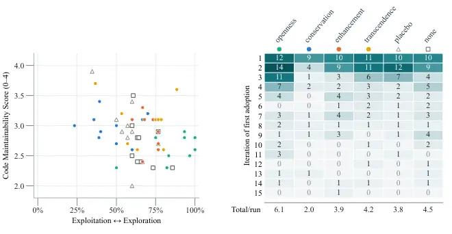
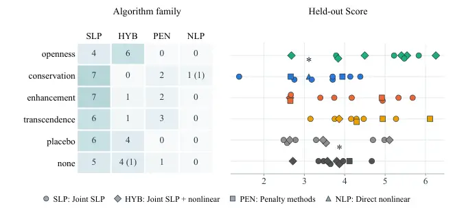
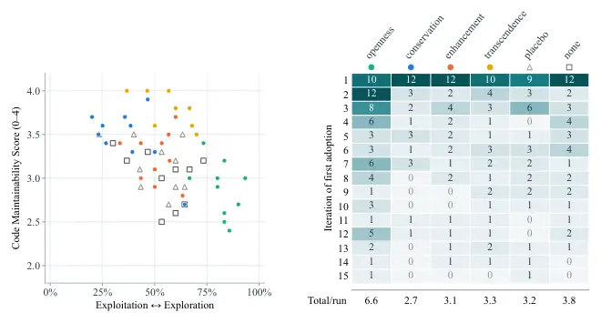

# Values Shape What Self-Improving Coding Agents Build

Jason Liang    Dylan Waldner    Risto Miikkulainen
Affiliation: Cognizant AI Lab
Email: [{jason.liang,dylan.waldner,risto}@cognizant.com](mailto:)

###### Abstract

Self-improving agents are typically optimized for the results they
produce, with less attention to how they produce them. Their
instructions give designers limited ways to shape how they work,
especially when the task is open-ended. This paper studies whether a
short value statement in an agent’s persistent instruction file changes
not only how well the agent performs but also what it builds. Four
higher-order value types in Schwartz’s theory of basic human values were
evaluated: _openness to change_, _conservation_, _self-enhancement_, and
_self-transcendence_. Across diverse coding tasks, the values were held
fixed within each run over multiple iterations of self-improvement.
Three findings emerged: (1) Values matter for performance across a
diverse set of tasks. The _openness_ values increase performance on
held-out data, whereas the opposite _conservation_ values result in
scores below those of an agent given no values. (2) Values change what
agents build, producing solution algorithms that differ in size,
complexity and approach. (3) Human oversight is still needed for
designing values. Allowing the agent to revise its own values narrows
performance differences between them, and values distilled from the AI
literature provide no detectable gain over having no values. Properly
designed values can thus influence what a self-improving coding agent
builds and, where the task permits, how well it performs.

|     |
| --- |
|     |

## 1 Introduction

Systems that improve their own code have a long history in AI research
(Schmidhuber, 2003; Zelikman et al., 2024). This paper studies their
most recent form: a large language model (LLM) agent that iteratively
improves a solver, i.e. a program that produces a solution for a task,
and the tools around it. The agent works in sessions, each starting from
the code the last one committed, so that improvements accumulate through
repeated coding and evaluation. Self-improvement matters because it
lifts the ceiling of a single attempt: gains can compound from session
to session without a person in the loop. In this manner, LLMs editing
programs inside an evolutionary search have discovered algorithms that
beat handwritten ones (Romera-Paredes et al., 2024; Novikov et al., 2025) and improved machine-found solutions at a lower sample cost (Lange
et al., 2026). Agents that rewrite their own implementations go further
and improve themselves (Zhang et al., 2026a; Robeyns et al., 2025). As
these systems run longer with less supervision, what they produce may
drift from what their designers intended, or it can stay boxed in by the
instructions they were first given. Therefore, how they improve matters
as much as how far they improve: the means matter, not only the ends.

Existing methods for improving agents and prompts use task performance
to evaluate progress, with behavior steered by fixed, manually written
meta-agent prompt templates (Hu et al., 2025), prompts the agent can
edit itself (Robeyns et al., 2025), or instructions optimized for task
accuracy (Yang et al., 2024). Yet within each session the agent makes
many choices that the score does not specify: which part of the solver
to rewrite, whether to replace an algorithm or only tune it, and when to
keep or discard a change. The score reflects what counts as improvement
but says little about how to achieve it, so these choices fall to
whatever dispositions the model brings. A value statement is
task-general guidance for the decisions that the task and its evaluation
metric leave open. It is a natural instrument for shaping those
dispositions, and it can have a large effect on the final outcome.

Whether a value statement changes what an agent builds has not been
tested. Prior designs do not isolate the contribution of values from the
task specification, the method guidance and the score-based selection,
and the literature surveyed in Section 2 contains no controlled
experiment that isolates it. Therefore, the question this paper asks is
whether different values alter what the agent builds under a shared
self-improvement protocol. At stake is how much of the result is decided
by a disposition it is explicitly given, as opposed to the task itself
and the model’s own biases.

As shown by Figure 2, one useful source of agent dispositions is
Schwartz’s theory of basic human values (Schwartz, 1992; Schwartz,
2012), a widely used and empirically grounded map of what people value.
It suits the purpose for two reasons. It defines values as goals that
transcend any one situation, so the same values can serve any task. Its
ten basic values group into four higher-order types on two opposing
axes, _openness_ against _conservation_ and _self-enhancement_ against
_self-transcendence_. In this manner, each type has an opposite to test
against. This paper explores all four types by inserting short,
carefully designed value statements into the agent’s instruction file at
every iteration of an agentic self-improvement loop. The four Schwartz
values are compared against two controls, no values and a placebo of
similar length, across six diverse coding tasks: ALE-Bench, Circle
Packing, Entity Matching, Game 2048, Symbolic Regression, and SZ-Tetris.
In Circle Packing, the best generated solutions exceed AlphaEvolve and
ShinkaEvolve at $`n=26`$ (Novikov et al., 2025; Lange et al., 2026) and
beat records across many other sizes (Tables C2 and C3).

Figure 1: Value-based self-improvement framework. (a) The framework
fixes the values, task package and safety invariants. (b) Each iteration
restores workspace $`W`$ to the preceding commit, reloads the
instructions, runs a coding session and saves its code. (c) A separate
scorer evaluates saved solvers on held-out data outside $`W`$ and tracks
how fixed values shape code and performance across iterations.

The main findings of this paper are as follows:

1.  1.  Values matter for performance across a diverse set of tasks.
        Relative to the no-values control, values can shift scores in both
        directions. Furthermore, the opposing values of _openness_ and
        _conservation_ perform significantly differently from one another.
2.  2.  Values affect the approach used for solving each task. Under
        different values the agent writes solvers that differ in algorithms
        and heuristics on the same task. Across tasks, held-out performance
        tracks solver size and complexity more closely than evaluation
        count, API cost, or total run time.
3.  3.  Human oversight is still needed for designing values. Allowing the
        agent to revise its own values narrows performance differences
        between them: the best-performing values decline while the
        worst-performing improve. Values distilled from the AI literature
        provide no detectable gain over having no values.

The paper is organized as follows. Section 2 reviews related work in
LLM-based coding, self-improvement, and values. Section 3 describes the
methodology in detail, and Section 4 presents the experimental results
within and across tasks. Section 5 evaluates the three contributions and
proposes future work on value-based self-improvement. The appendices
provide protocol details, value specifications, task details with
published comparisons, cross-task statistics, solver algorithm analyses,
and empirical evaluations of several framework variations.

## 2 Related Work

This section summarizes related literature on three fronts: (1) program
evolution, (2) self-improving agents, and (3) values and personas in
language models. These research areas form the basis for the
self-improvement framework described later.

LLM-driven program evolution. This research area uses LLMs as the
mutation or crossover operator of an evolutionary loop over programs
(Lehman et al., 2022; Meyerson et al., 2024; Hemberg et al., 2024;
Shojaee et al., 2025a). FunSearch found new cap-set constructions and
online bin-packing heuristics (Romera-Paredes et al., 2024), while
AlphaEvolve discovered improvements for problems such as Circle Packing
(Novikov et al., 2025). ShinkaEvolve achieved excellent results in
Circle Packing at a lower sample cost and improved existing solutions
for ALE-Bench (Lange et al., 2026; Imajuku et al., 2025). A parallel
research direction investigates prompt optimization against a fixed task
objective (Fernando et al., 2024; Yang et al., 2024). Together these
systems show that LLM-driven search is effective on difficult
optimization problems.

Self-improving and self-modifying agents. The Gödel machine formalized a
problem solver that rewrites its own code once a proof shows the rewrite
leads to improvement (Schmidhuber, 2003). STOP improves the scaffold
that calls the model (Zelikman et al., 2024), and ADAS searches agent
designs written as code (Hu et al., 2025). The Gödel Agent, the Darwin
Gödel Machine and SICA let an agent rewrite its own logic, prompts, or
harness while guided by performance on a task (Yin et al., 2025; Zhang
et al., 2026a; Robeyns et al., 2025). Hyperagents combine the task agent
and the meta agent that edits it in one program, so the procedure that
produces the next self-modification is itself editable (Zhang et al.,
2026b). In this paper, the harness and the instructions are fixed in
order to determine the impact of fixed values on the performance and
behavior of a self-improving agent.

Values, personas and prompt sensitivity. The four values follow the
higher-order types of Schwartz’s theory of basic human values (Schwartz,
1992; Schwartz, 2012). In people, the values-behavior link is strong for
some values and marginal for others (Bardi & Schwartz, 2003).
Constitutional AI put a written list of principles into training (Bai
et al., 2022), whereas here a fixed model reads a written value
statement at inference. Role-play prompts help on some reasoning tasks
(Kong et al., 2024), while system-prompt personas did not improve
average accuracy on factual questions (Zheng et al., 2024). Prior work
has measured personality-like responses, opinion skew and value profiles
in LLMs, including profiles based on Schwartz’s values (Serapio-García
et al., 2025; Jiang et al., 2023; Santurkar et al., 2023; Rozen et al.,
2025; Ren et al., 2024; Yao et al., 2024; Huang et al., 2025). A written
value statement acts on existing model behavior, and this paper measures
its effects.

## 3 Methodology

This section describes the self-improvement framework, illustrated in
Figure 1, with pseudocode in Algorithm 1. It consists of three stages,
described in the subsections below: (1) Before each run, the framework
sets the agent’s instructions, including the values under test. (2)
During the run, the agent works in one workspace for multiple iterations
and only committed work survives. (3) After the run, a separate scorer
scores each iteration’s saved solver on data kept outside the workspace.

### 3.1 Agent Instructions Setup

The instruction file. The file the agent reads at the start of every
session is composed of the following sections: the values, the
invariants (safety rules that must be followed) and a pointer to the
task description. The instruction file uses a common structure across
runs. Furthermore, to prevent hacking or jailbreaking, the loop restores
the values and the invariants every iteration to their initial
condition. Appendix A shows a concrete example of the instruction file.

Task description and invariants. The task description gives the
objective, a scorer for the development (dev) split, a starting solver
and a baseline reference score. The invariants require the agent to
verify its work, keep it inside the workspace, and leave the benchmark
and scoring unchanged. Scripted checks test the task files for answer
leakage and scoring integrity.

The values. Each of the four values (Figure 2) represents one of
Schwartz’s higher-order types and serves as guidance for choosing the
next change to the solver: _openness_, for instance, asks the agent to
“prefer the bold transformation … over the safe incremental tweak”. In
the experiments, these values are specified as a list of short bullet
points that have similar overall lengths. Their wording was drafted with
an LLM from Schwartz’s accounts of the higher-order types (Schwartz,
1992; Schwartz, 2012) and edited by the authors over several rounds of
careful manual review. Appendix B lists these value statements in
detail.

The controls. There are two controls for comparing the values against.
The _none_ control states in one sentence that the agent has no values.
Because the question is whether having values changes the outcome, this
control is the reference for every comparison in Table 1 and answers
whether having values influences what agents build and code. The
_placebo_ control uses the same structure and a similar length but is
composed of off-task text unrelated to the values. This second control
checks whether the length of the values text alone could cause changes
in agent behavior (Table 2).

Figure 2: Schwartz’s values and their use as agent instructions. (a) A
visualization of the ten basic human values and four higher-order types
(Schwartz, 2012). (b) Summaries of the four value statements given to
the agents (Appendix B). The experiments compare two opposing pairs:
_openness_ versus _conservation_, and _enhancement_ versus
_transcendence_.

### 3.2 The Self-Improvement Loop

Tracking code changes with Git. The loop is driven by the Claude Code
agent harness (Anthropic, 2025), using claude-opus-5 at high reasoning
effort with no recorded web search or fetch calls (Table A1). Each
iteration resets the workspace to the code and notes from the last
commit and reloads the instruction file with values and invariants from
the start of the run (Algorithm 1). The agent runs under a preset time
limit that, once reached, forcibly terminates the coding session. The
agent must follow the protocol the instruction file sets out: read the
log of earlier iterations, choose the one change that most advances the
values, implement and verify it against the provided scorer, log the
results and finally commit the change. The agent may edit the solver,
write tools, and run the dev scorer, but only what it commits survives.
It carries no conversational state or memory between sessions.

Everything else stays fixed. Only the solver code, tools, and
documentation change between iterations, while the framework, the model,
the task package and the fixed instruction sections stay unchanged for
the run. The framework provides dev scores during the run and held-out
scores afterward. The agent is never told that other sets of values
exist or that a comparison is under way: the instruction file purposely
keeps the values and task isolated.

### 3.3 Task Evaluation and Scoring

Evaluation metrics. Each task has a dev split the agent can see and a
held-out split kept outside its workspace (Appendix C). After the run, a
separate scorer scores each iteration’s saved solver on the held-out
split and writes a per-iteration held-out curve. The primary statistic
reported is the held-out score from the final iteration, averaged over
multiple runs of the same value. Another statistic is the value’s mean
area under the held-out curve (AUC).

The framework also logs the number of scorer evaluations, API cost, and
total elapsed run time, as well as various code complexity metrics of
the solver being improved by the agent (Appendix E.1).

Effect size and permutation tests. To compare runs under different
values, the paper reports an effect size and a $`p`$ value. The effect
size is Cliff’s delta $`\delta`$ (Cliff, 1993), the chance that values
outscore the control, minus the reverse. Because $`\delta`$ is
rank-based, it depends on score ordering rather than magnitude. The
$`p`$ value comes from a two-sided permutation test (Davison & Hinkley, 1997) on the difference in means: the share of 10,000 relabelings whose
absolute difference is at least the observed one. This test assumes
exchangeable labels under the null, without requiring a parametric score
distribution. For comparisons pooled over all tasks, scores are z-score
normalized within each task to put them on a common scale (Appendix D).
Because $`\delta`$ compares ranks and the permutation test compares
means, a large $`\delta`$ does not necessarily imply a statistically
significant $`p`$, as indicated by several results in Table 1.

openness
 conservation
 enhancement
 transcendence
 placebo
 none

Figure 3: Performance curves and solver code across six tasks. Top: Mean
held-out scores across iterations, with standard error bands and
separate scales for each task. Bottom: t-SNE maps of final solvers based
on code metrics (Appendix E.1). Colors indicate values, and hollow
markers denote controls. Agents given different values reach different
scores and build solvers with different code structures. The size and
pattern of these differences vary across tasks.

|                     |            |            |              |       |             |       |               |            |            |       |
| ------------------- | ---------- | ---------- | ------------ | ----- | ----------- | ----- | ------------- | ---------- | ---------- | ----- |
|                     | openness   |            | conservation |       | enhancement |       | transcendence |            | placebo    |       |
| Task                | $`\delta`$ | $`p`$      | $`\delta`$   | $`p`$ | $`\delta`$  | $`p`$ | $`\delta`$    | $`p`$      | $`\delta`$ | $`p`$ |
| Final score         |            |            |              |       |             |       |               |            |            |       |
| ALE-Bench           | +0.60      | 0.006      | $`-`$0.64    | 0.005 | $`-`$0.06   | 0.711 | +0.30         | 0.277      | +0.12      | 0.957 |
| Circle Packing      | +0.60      | 0.010      | $`-`$0.24    | 0.214 | +0.12       | 0.470 | +0.56         | 0.030      | $`-`$0.26  | 0.667 |
| Entity Matching     | +0.28      | 0.361      | $`-`$0.58    | 0.151 | $`-`$0.26   | 0.309 | $`-`$0.64     | 0.074      | +0.26      | 0.654 |
| Game 2048           | $`-`$0.10  | 0.658      | $`-`$0.46    | 0.101 | +0.20       | 0.435 | $`-`$0.88     | $`<`$0.001 | $`-`$0.50  | 0.037 |
| Symbolic Regression | +0.50      | 0.208      | +0.34        | 0.800 | +0.12       | 0.800 | +0.36         | 0.542      | +0.28      | 0.897 |
| SZ-Tetris           | +0.38      | 0.092      | $`-`$0.14    | 0.534 | +0.30       | 0.204 | $`-`$0.16     | 0.273      | $`-`$0.16  | 0.822 |
| all tasks           | +0.38      | $`<`$0.001 | $`-`$0.27    | 0.003 | +0.08       | 0.653 | $`-`$0.16     | 0.043      | $`-`$0.06  | 0.355 |
| AUC                 |            |            |              |       |             |       |               |            |            |       |
| ALE-Bench           | +0.50      | 0.012      | $`-`$0.56    | 0.011 | +0.10       | 0.917 | +0.26         | 0.431      | +0.12      | 0.976 |
| Circle Packing      | +0.56      | 0.022      | $`-`$0.20    | 0.292 | +0.04       | 0.940 | $`-`$0.08     | 0.488      | $`-`$0.24  | 0.330 |
| Entity Matching     | +0.46      | 0.110      | $`-`$0.58    | 0.106 | $`-`$0.26   | 0.302 | $`-`$0.62     | 0.064      | +0.16      | 0.543 |
| Game 2048           | $`-`$0.14  | 0.681      | $`-`$0.08    | 0.899 | +0.48       | 0.133 | $`-`$0.88     | $`<`$0.001 | $`-`$0.20  | 0.234 |
| Symbolic Regression | +0.56      | 0.288      | +0.24        | 0.830 | $`-`$0.02   | 0.843 | +0.26         | 0.465      | +0.32      | 0.807 |
| SZ-Tetris           | +0.40      | 0.098      | $`-`$0.04    | 0.683 | +0.42       | 0.065 | $`-`$0.32     | 0.297      | $`-`$0.20  | 0.442 |
| all tasks           | +0.40      | $`<`$0.001 | $`-`$0.20    | 0.018 | +0.11       | 0.365 | $`-`$0.27     | 0.014      | $`-`$0.08  | 0.312 |

Table 1: Held-out performance relative to the no-values control. Rows
report Cliff’s $`\delta`$ and permutation $`p`$ for final scores and
area under the curve (AUC). The all-tasks rows pool scores standardized
within each task. Bold separately marks large effects
($`|\delta|>0.43`$) and statistically significant differences
($`p<0.05`$). In the pooled results, _openness_ scores above _none_,
while _conservation_ and _transcendence_ score below it.

## 4 Experimental Results

This section gives experimental results for the four Schwartz values and
the two controls on six diverse coding tasks. Results are also compared
across tasks and under several variations of the framework. Each set of
values is evaluated across 10 independent runs of 15 iterations lasting
up to 30 minutes each. Figure 3 plots the held-out curves of the six
tasks as well as the t-SNE maps of their final solvers (van der Maaten &
Hinton, 2008). Table 1 compares each set of values and _placebo_ to the
_none_ control for each task.

### 4.1 ALE-Bench

Task description. ALE-Bench is a benchmark of heuristic optimization
problems from programming contests (Imajuku et al., 2025). The specific
task being tested is AHC039, a popular problem also evaluated by other
LLM-guided solvers such as ShinkaEvolve (Lange et al., 2026). The
problem requires the solver to draw one axis-aligned polygon that meets
certain constraints (AtCoder, 2024). The agent must output solution code
that creates the polygon under a hard 2 s per-seed CPU budget. The
held-out score is the sum of the individual scores for the 150 official
private test cases. More details about the task are shown in
Appendix C.1.

Result. The _openness_ values score best, significantly above the
control, while the _conservation_ values perform worse (Table 1). This
task shows the strongest separation of values with a wide margin between
_openness_ and _conservation_ (Table D2). Against the control, the other
sets of values show weaker effects. Furthermore, _openness_ exceeds both
the ALE-Bench leaderboard entry for the same LLM and the first-place
human-coded solution, sitting only slightly below the absolute best LLM
results (Table C1).

### 4.2 Circle Packing

Task description. For each of the 37 odd sizes from 27 to 99, the agent
must pack that many circles, of any radii, into the unit square so that
the sum of the radii is as large as possible. At each size, the score is
$`-\log_{10}`$ of the packing’s relative gap to a reference record,
clamped between zero and seven. The task score is the mean over all
sizes, so progress is measured in the average number of _digits_ of gap
closed. The agent improves a solver and commits one feasible packing per
size. The held-out split comprises 38 _even_ packings and measures
generalization to unseen sizes with a fixed budget of 60 s for each
(more information in Appendix C.2).

Result. The _openness_ and _transcendence_ values do best and both score
above controls, while _conservation_ does worst (Table 1). The
_openness_ values also beat _conservation_ in head-to-head performance
(Table 2). The other sets of values show weaker effects in either
direction. As shown in Tables C2 and C3, the packings discovered by the
self-improvement framework exceed AlphaEvolve and ShinkaEvolve (Novikov
et al., 2025; Lange et al., 2026) at $`n=26`$ while matching or beating
many existing records on Packomania (Specht, 2026).

|                     | openness vs conservation |            | enhancement vs transcendence |            | placebo vs none |       |
| ------------------- | ------------------------ | ---------- | ---------------------------- | ---------- | --------------- | ----- |
| Task                | $`\delta`$               | $`p`$      | $`\delta`$                   | $`p`$      | $`\delta`$      | $`p`$ |
| ALE-Bench           | +1.00                    | $`<`$0.001 | $`-`$0.28                    | 0.120      | +0.12           | 0.957 |
| Circle Packing      | +0.72                    | 0.003      | $`-`$0.24                    | 0.363      | $`-`$0.26       | 0.667 |
| Entity Matching     | +0.60                    | 0.034      | +0.24                        | 0.750      | +0.26           | 0.654 |
| Game 2048           | $`-`$0.02                | 0.545      | +0.92                        | $`<`$0.001 | $`-`$0.50       | 0.037 |
| Symbolic Regression | +0.30                    | 0.254      | +0.00                        | 0.396      | +0.28           | 0.897 |
| SZ-Tetris           | +0.54                    | 0.025      | +0.38                        | 0.046      | $`-`$0.16       | 0.822 |
| all tasks           | +0.58                    | $`<`$0.001 | +0.24                        | 0.024      | $`-`$0.06       | 0.355 |

Table 2: Pairwise comparisons of opposing values and the two controls.
Rows compare final held-out scores using Cliff’s $`\delta`$ and
permutation $`p`$, with bold thresholds as in Table 1. In the pooled
results, _openness_ versus _conservation_ shows the largest effect,
followed by _enhancement_ versus _transcendence_. The _placebo_ and
_none_ controls show the smallest difference.

### 4.3 Entity Matching

Task description. Given two noisy product records, the solver estimates
the probability that they refer to the same product. Performance is
measured by the F1 score for identifying matching pairs. The dev and
held-out splits for the task are from the WDC Products benchmark
(Peeters et al., 2024) using its 80% hard “corner-case” setting, with
all held-out entities unseen in the dev set. The agent constructs a
solver that is trained on the labels from the dev split. The unseen
entities make this task the cleanest generalization test of the six.
More details about the task are reported in Appendix C.3.

Result. The _openness_ values do best and beat _conservation_ head to
head (Table D2). On the other hand, _conservation_ and _transcendence_
values have large negative effects relative to the control (Table 1).
The other sets of values show weaker separation with the overall spread
of scores between the values and controls being moderate. As shown in
Table C4, the best discovered solutions from this paper are able to
exceed existing results from the literature.

### 4.4 Game 2048

Task description. Game 2048 is a sliding-tile game on a 4 by 4 board in
which tiles with equal numbers merge when pushed together. The score is
the sum of merged tile values (Guei et al., 2022). The agent writes a
full-fledged solver (evaluator, search and time management) with a CPU
budget of 1.0 s per game. The held-out split is 30 fresh games using 30
seeds never seen by the agent during self-improvement. Appendix C.4
provides more details.

Result. The _enhancement_ values have the highest mean and a large
advantage over _transcendence_ (Tables 1 and 2). The _transcendence_ and
_placebo_ values score significantly below the control, while
_conservation_ has a large negative effect. Published comparisons place
the best generated solvers below the strongest trained networks
(Table C5).

Fixed engine comparison. A separate version uses an optimized expectimax
engine adapted from Xiao et al. (2014). The engine stays fixed while the
agent tunes evaluator parameters, search depth, pruning and node
allocation. Its mean scores change little across iterations and stay
closer together than in the fully editable version (Figure 4).

Figure 4: Game 2048 with a fully editable solver and a fixed engine.
Curves show mean held-out scores over iterations with standard error
bands. Spread is the range of final means divided by the standard
deviation (SD) of all final scores. The table summarizes differences
between the two versions of Game 2048. Values show less separation with
the fixed engine.

### 4.5 Symbolic Regression

Task description. Symbolic Regression seeks a closed-form expression
that fits observed data. The agent tackles the 129 problems in the
LSR-Synth snapshot used here (Shojaee et al., 2025b; Xia et al., 2026),
which span a diverse range of scientific and mathematical formulas. The
agent generates a program that proposes expressions through a metered
evaluation call, which fits each expression’s constants and returns its
error, and the agent commits one expression per problem. The held-out
evaluation refits each committed expression’s constants and scores it on
inputs outside the training range, testing range extrapolation of the
discovered expression. More details about the task are in Appendix C.5.

Result. The _openness_ values rank first while _transcendence_ performs
worst overall (Table 1). No set of values differs significantly from the
control, although _openness_ has a large positive effect. A comparison
between the best values and published results is shown in Table C6, with
the agent-discovered solutions performing around the middle of the pack.

### 4.6 SZ-Tetris

Task description. Stochastic SZ-Tetris is a specialized, harder variant
of the popular block game (Szita & Szepesvári, 2010; Jaśkowski et al.,
2015; Elfwing et al., 2018). It is played on a 10 by 20 board with only
S and Z pieces, drawn with equal probability and with no preview of the
next piece allowed. A cleared row scores one point, and the game ends
when a piece does not fit. The agent writes the whole controller under a
budget of 1.0 s of CPU per game. The held-out split is 100 fresh games
from the same distribution on unseen seeds. Appendix C.6 contains more
details about the task.

Result. The _openness_ values have the highest mean score (Table 1).
_Enhancement_ beats _transcendence_ head to head and also outperforms
the control by a smaller amount (Tables 1 and 2). The other sets of
values show weaker effects. Published comparisons in Table C7 again show
trained neural solvers performing best while agent-discovered solvers
score around average.

### 4.7 Results Across Tasks

Performance differences between values. Of the final-score comparisons
between the control and other values in Table 1, one third show either a
large effect size or statistical significance. Across all the tasks, on
average _openness_ performs better than the control and _conservation_
performs worst. This contrast is further strengthened when a
head-to-head comparison is done (Table 2). The _transcendence_ values
also tend to do worse than the control, although that varies by task,
and _enhancement_ does not separate from the control all that much.
There is a weaker but still noticeable separation between _enhancement_
and _transcendence_ in the head-to-head comparison.

Different values built different solutions. Analysis of the code for the
solvers discovered on every task shows that _openness_ often creates
larger, more complex solvers (Table E2). Across multiple complexity
measures, the solutions produced under _openness_ appear to exceed those
produced under all other values on almost all the tasks. Similarly,
_conservation_ tends to produce smaller, less complex solvers than the
other values. Averaged across tasks, the held-out score tracks solver
code size and complexity more closely than resource measures such as dev
scorer evaluations, API cost or total run time (Table E3). As shown in
Table E4, a solver’s nearest neighbors in code-metric space tend to come
from its own set of values more often than chance predicts. Another
interesting result is that solvers for different values start off close
together but spread apart as the run iterations increase (Figure E2).

### 4.8 Alternative Values and Models

Self-modification narrows differences between values. On ALE-Bench, when
the agent is allowed to modify and update its own values during every
iteration, the spread across the values and controls shrinks roughly
threefold (Figure G1). The best and worst performing values, when
allowed to self-modify, tend to converge to the middle: _openness_ falls
and _conservation_ rises, each showing statistically significant
differences from its non-self-modifying counterpart (Table G1).

Literature-derived values show no detectable gain. Two new values are
distilled from the AI and self-improvement literature, respectively. A
deep research agent is assigned to review selected papers in AI and
self-improvement research and then generate the values based on what it
learned. On both the ALE-Bench and Game 2048 tasks, these derived values
do not seem to have a large impact and both perform no better than the
control (Appendix G.2).

Performance depends on value framing. The _openness_ and _conservation_
value statements were each rewritten in three ethical framings:
deontological (rules), utilitarian (outcomes), and virtue (character),
retaining their original dispositions. All three _openness_ rewrites
scored below the original, with statistically significant decreases for
the deontological and utilitarian versions. The deontological
_conservation_ rewrite had a large negative effect, although no
_conservation_ rewrite differed significantly from the original
(Appendix G.3).

Cheaper models perform noticeably worse. The same two values were tested
on two cheaper models, Claude Sonnet and Haiku. Both values scored
significantly lower on these weaker models than on Opus, the main model
used in this paper, with the lowest scores resulting from Haiku. The
advantage of _openness_ over _conservation_ persisted on Sonnet but
disappeared on Haiku with little improvement across iterations for
either set of values (Appendix G.4).

## 5 Discussion and Future Work

Opposing sets of Schwartz values perform differently. The clearest
contrast is between _openness_ and _conservation_ on most tasks
(Table 2). This recurring advantage for _openness_ is consistent with a
benefit from trying new approaches during solver revision. _Enhancement_
and _transcendence_ show weaker separation overall. The size of these
differences varies across tasks.

Open-ended solver design strengthens the effects of values. In Game
2048, the spread of final mean scores across values is $`1.81`$ SD with
a fully editable solver and $`0.70`$ SD with a fixed engine (Figure 4).
The fixed engine version still allows hyperparameter and configuration
tuning. This comparison suggests that freedom to choose or replace
algorithms may give values more influence on performance.

Values shape the solutions that agents build. On every task, _openness_
produced longer, more complex solvers on average than _none_, while
_conservation_ produced shorter ones (Table E2). A solver’s nearest
neighbors in code-metric space share its values well above chance level
(Table E4). Averaged across tasks, held-out scores correlate more
closely with solver size and complexity than with evaluation count, API
cost, or total run time (Table E3).

Appendix F examines the algorithms behind these differences. On
ALE-Bench, every _openness_ solver uses free-cell or graph-cut search,
while every _conservation_ solver retains column-based search. Circle
Packing solvers mostly share a local optimizer but differ in how they
generate and combine candidate packings. On both tasks, _openness_ runs
favor exploration over exploitation and adopt more methods than
_conservation_ runs. Their final solvers also receive lower mean
maintainability ratings than those built under _conservation_, although
the ratings overlap.

Human oversight is still needed for designing values. Experiments with
self-modifying and literature-derived values suggest that manual review
and design remain important (Appendices G.1 and G.2). A preliminary
analysis finds that most self-modified values become highly specific to
the task. The value statements also tend to grow to several times their
original length. Literature-derived values remain concise, but are often
cautious and tend toward _conservation_. Deriving values from multiple
papers may favor the safest, most common insights.

Future work. Value statements could draw from broader sources or become
objects of search. An agent could be given the values of a school of
philosophy, a professional code, or an influential thinker, extending
the experiments in Appendix G. An outer evolutionary loop could also
select and optimize values based on validation performance across
multiple tasks. Jointly improving values and task solvers could yield
value statements that transfer to unseen tasks and which people can
inspect and reuse in their own agentic systems.

## 6 Conclusion

This paper investigated whether a value statement changes what a
self-improving coding agent builds and how well it performs. The main
findings are as follows: First, values can affect performance across
diverse coding tasks: opposing values such as _openness_ and
_conservation_ scored significantly differently from each other. Second,
values shape what agents build, with certain values producing larger,
more complex solvers across all six tasks. Third, human value design is
still most effective: self-modification narrowed performance
differences, while dispositions distilled from the literature offered no
detectable gain. These results suggest that values can guide choices
left open by the task objective, shaping both code and performance. As
agents build on their previous work, choices encouraged by values become
embedded in code that later iterations inherit. Properly designed values
may therefore have lasting consequences on an agent’s development,
influencing which approaches it continues to explore and which
alternatives it leaves behind.

### Ethics statement

This study examines whether explicit values shape coding agents’
behavior and performance. It uses public benchmarks and involves no
human participants. The values are experimental instructions: higher
benchmark scores do not establish that a value statement is ethically
preferable or that an agent is safe or fair. Autonomous code changes
require appropriate testing and human oversight before deployment. The
experiments use a closed, paid model service: Anthropic’s Claude API.

### Reproducibility statement

Section 3 describes the self-improvement pipeline. Appendix A gives the
main-experiment settings and fixed instruction sections, and Appendix B
documents the value statements. Appendix C describes each task’s scoring
metrics, held-out split, reference scores and budget, while Appendix D
details the statistical comparisons. Appendices E and F describe the
solver analyses, including the LLM review procedure, and Appendix G
covers the follow-up experiments. Replication requires access to the
specified proprietary models, and later model or API changes may affect
the results.

### AI use statement

The experiments used Claude Code to generate and revise solver code
(Section 3.2). Generative AI tools, including Claude Code, assisted with
drafting value statements, literature and citation review, analysis
code, figure generation, interpretation of results, and drafting and
revising the manuscript. LLM reviewers also classified solver algorithms
and rated code maintainability (Appendix F). The authors reviewed and
edited AI-assisted materials and take responsibility for the final text,
claims, code and figures.

## References

- Anthropic (2025) Anthropic. Claude Code.
  [https://code.claude.com/docs/en/overview](https://code.claude.com/docs/en/overview), 2025.
- AtCoder (2024) AtCoder. THIRD programming contest 2024 (AtCoder
  Heuristic Contest 039), problem A: Purse seine fishing.
  [https://atcoder.jp/contests/ahc039/tasks/ahc039_a](https://atcoder.jp/contests/ahc039/tasks/ahc039_a), 2024.
- Bai et al. (2022) Yuntao Bai, Saurav Kadavath, Sandipan Kundu, Amanda
  Askell, Jackson Kernion, Andy Jones, Anna Chen, Anna Goldie, Azalia
  Mirhoseini, Cameron McKinnon, Carol Chen, Catherine Olsson,
  Christopher Olah, Danny Hernandez, Dawn Drain, Deep Ganguli, Dustin
  Li, Eli Tran-Johnson, Ethan Perez, Jamie Kerr, Jared Mueller, Jeffrey
  Ladish, Joshua Landau, Kamal Ndousse, Kamile Lukosuite, Liane Lovitt,
  Michael Sellitto, Nelson Elhage, Nicholas Schiefer, Noemi Mercado,
  Nova DasSarma, Robert Lasenby, Robin Larson, Sam Ringer, Scott
  Johnston, Shauna Kravec, Sheer El Showk, Stanislav Fort, Tamera
  Lanham, Timothy Telleen-Lawton, Tom Conerly, Tom Henighan, Tristan
  Hume, Samuel R. Bowman, Zac Hatfield-Dodds, Ben Mann, Dario Amodei,
  Nicholas Joseph, Sam McCandlish, Tom Brown, and Jared Kaplan.
  Constitutional AI: Harmlessness from AI feedback. _arXiv preprint
  arXiv:2212.08073_, 2022.
- Bardi & Schwartz (2003) Anat Bardi and Shalom H. Schwartz. Values and
  behavior: Strength and structure of relations. _Personality and Social
  Psychology Bulletin_, 29(10):1207–1220, 2003. doi:
  10.1177/0146167203254602.
- Berthold et al. (2026) Timo Berthold, Dominik Kamp, Gioni Mexi,
  Sebastian Pokutta, and Imre Pólik. Out-of-the-box global optimization
  for packing problems: New models and improved solutions. _arXiv
  preprint arXiv:2605.04850_, 2026.
- Brunton et al. (2016) Steven L. Brunton, Joshua L. Proctor, and
  J. Nathan Kutz. Discovering governing equations from data by sparse
  identification of nonlinear dynamical systems. _Proceedings of the
  National Academy of Sciences_, 113(15):3932–3937, 2016. doi:
  10.1073/pnas.1517384113. arXiv:1509.03580.
- Campbell (2018) G. Ann Campbell. Cognitive complexity: An overview and
  evaluation. In _Proceedings of the 2018 International Conference on
  Technical Debt_, pp. 57–58. ACM, 2018. doi: 10.1145/3194164.3194186.
- Cliff (1993) Norman Cliff. Dominance statistics: Ordinal analyses to
  answer ordinal questions. _Psychological Bulletin_,
  114(3):494–509, 1993. doi: 10.1037/0033-2909.114.3.494.
- Davison & Hinkley (1997) A. C. Davison and D. V. Hinkley. _Bootstrap
  Methods and their Application_. Cambridge University Press,
  Cambridge, 1997. ISBN 978-0-521-57471-6. doi:
  10.1017/CBO9780511802843.
- Elfwing et al. (2018) Stefan Elfwing, Eiji Uchibe, and Kenji Doya.
  Sigmoid-weighted linear units for neural network function
  approximation in reinforcement learning. _Neural Networks_,
  107:3–11, 2018. doi: 10.1016/j.neunet.2017.12.012. arXiv:1702.03118.
- Fernando et al. (2024) Chrisantha Fernando, Dylan Banarse, Henryk
  Michalewski, Simon Osindero, and Tim Rocktäschel. Promptbreeder:
  Self-referential self-improvement via prompt evolution. In
  _Proceedings of the 41st International Conference on Machine
  Learning_, volume 235 of _Proceedings of Machine Learning Research_,
  pp. 13481–13544, 2024. arXiv:2309.16797.
- Friedman (2001) Jerome H. Friedman. Greedy function approximation: A
  gradient boosting machine. _The Annals of Statistics_,
  29(5):1189–1232, 2001. doi: 10.1214/aos/1013203451.
- Guei et al. (2022) Hung Guei, Lung-Pin Chen, and I-Chen Wu. Optimistic
  temporal difference learning for 2048. _IEEE Transactions on Games_,
  14(3):478–487, 2022. doi: 10.1109/TG.2021.3109887.
- Hemberg et al. (2024) Erik Hemberg, Stephen Moskal, and Una-May
  O’Reilly. Evolving code with a large language model. _Genetic
  Programming and Evolvable Machines_, 25(2):21, 2024. doi:
  10.1007/s10710-024-09494-2. arXiv:2401.07102.
- Hu et al. (2025) Shengran Hu, Cong Lu, and Jeff Clune. Automated
  design of agentic systems. In _International Conference on Learning
  Representations_, 2025. arXiv:2408.08435.
- Huang et al. (2025) Saffron Huang, Esin Durmus, Miles McCain, Kunal
  Handa, Alex Tamkin, Jerry Hong, Michael Stern, Arushi Somani, Xiuruo
  Zhang, and Deep Ganguli. Values in the wild: Discovering and analyzing
  values in real-world language model interactions. In _Second
  Conference on Language Modeling_, 2025. arXiv:2504.15236.
- Hyra Team (2026) Hyra Team. Hyra: Hunyuan research agent.
  [https://hy.tencent.com/research/hyra](https://hy.tencent.com/research/hyra), 2026.
  Results repository
  [https://github.com/Tencent-Hunyuan/Hyra-results](https://github.com/Tencent-Hunyuan/Hyra-results).
- Imajuku et al. (2025) Yuki Imajuku, Kohki Horie, Yoichi Iwata, Kensho
  Aoki, Naohiro Takahashi, and Takuya Akiba. ALE-Bench: A benchmark for
  long-horizon objective-driven algorithm engineering. In _Advances in
  Neural Information Processing Systems, Datasets and Benchmarks Track_,
  volume 38, pp. 173630–173675, 2025. doi: 10.52202/085713-5226.
  arXiv:2506.09050.
- Jaśkowski (2018) Wojciech Jaśkowski. Mastering 2048 with delayed
  temporal coherence learning, multistage weight promotion, redundant
  encoding, and carousel shaping. _IEEE Transactions on Games_,
  10(1):3–14, 2018. doi: 10.1109/TCIAIG.2017.2651887. arXiv:1604.05085.
- Jaśkowski et al. (2015) Wojciech Jaśkowski, Marcin Szubert, Paweł
  Liskowski, and Krzysztof Krawiec. High-dimensional function
  approximation for knowledge-free reinforcement learning: A case study
  in SZ-Tetris. In _Proceedings of the 2015 Annual Conference on Genetic
  and Evolutionary Computation (GECCO)_, pp. 567–573, 2015. doi:
  10.1145/2739480.2754783.
- Jiang et al. (2023) Guangyuan Jiang, Manjie Xu, Song-Chun Zhu, Wenjuan
  Han, Chi Zhang, and Yixin Zhu. Evaluating and inducing personality in
  pre-trained language models. In _Advances in Neural Information
  Processing Systems_, volume 36, pp. 10622–10643, 2023. doi:
  10.52202/075280-0466. arXiv:2206.07550.
- Kirkpatrick et al. (1983) S. Kirkpatrick, C. D. Gelatt, Jr., and M. P.
  Vecchi. Optimization by simulated annealing. _Science_,
  220(4598):671–680, 1983. doi: 10.1126/science.220.4598.671.
- Konda et al. (2016) Pradap Konda, Sanjib Das, Paul Suganthan G. C.,
  AnHai Doan, Adel Ardalan, Jeffrey R. Ballard, Han Li, Fatemah Panahi,
  Haojun Zhang, Jeff Naughton, Shishir Prasad, Ganesh Krishnan, Rohit
  Deep, and Vijay Raghavendra. Magellan: Toward building entity matching
  management systems. _Proceedings of the VLDB Endowment_,
  9(12):1197–1208, 2016. doi: 10.14778/2994509.2994535.
- Konen (2019) Wolfgang Konen. General board game playing for education
  and research in generic AI game learning. In _Proceedings of the 2019
  IEEE Conference on Games (CoG)_, pp. 1–8, 2019. doi:
  10.1109/CIG.2019.8848070. arXiv:1907.06508.
- Kong et al. (2024) Aobo Kong, Shiwan Zhao, Hao Chen, Qicheng Li, Yong
  Qin, Ruiqi Sun, Xin Zhou, Enzhi Wang, and Xiaohang Dong. Better
  zero-shot reasoning with role-play prompting. In _Proceedings of the
  2024 Conference of the North American Chapter of the Association for
  Computational Linguistics: Human Language Technologies (Volume 1: Long
  Papers)_, pp. 4099–4113, 2024. doi: 10.18653/v1/2024.naacl-long.228.
  arXiv:2308.07702.
- Lange et al. (2026) Robert Tjarko Lange, Yuki Imajuku, and Edoardo
  Cetin. ShinkaEvolve: Towards open-ended and sample-efficient program
  evolution. In _International Conference on Learning
  Representations_, 2026. arXiv:2509.19349.
- Lehman et al. (2022) Joel Lehman, Jonathan Gordon, Shawn Jain, Kamal
  Ndousse, Cathy Yeh, and Kenneth O. Stanley. Evolution through large
  models. _arXiv preprint arXiv:2206.08896_, 2022.
- Li (2026) Pan Li. Dictionaries, not Darwin: Set-level selection beats
  LLM evolution in scientific equation discovery. _arXiv preprint
  arXiv:2607.04108_, 2026.
- Lipp & Boyd (2016) Thomas Lipp and Stephen Boyd. Variations and
  extension of the convex-concave procedure. _Optimization and
  Engineering_, 17(2):263–287, 2016. doi: 10.1007/s11081-015-9294-x.
- McCabe (1976) Thomas J. McCabe. A complexity measure. _IEEE
  Transactions on Software Engineering_, SE-2(4):308–320, 1976. doi:
  10.1109/TSE.1976.233837.
- Meyerson et al. (2024) Elliot Meyerson, Mark J. Nelson, Herbie
  Bradley, Adam Gaier, Arash Moradi, Amy K. Hoover, and Joel Lehman.
  Language model crossover: Variation through few-shot prompting. _ACM
  Transactions on Evolutionary Learning and Optimization_,
  4(4):1–40, 2024. doi: 10.1145/3694791. arXiv:2302.12170.
- Novikov et al. (2025) Alexander Novikov, Ngân Vũ, Marvin Eisenberger,
  Emilien Dupont, Po-Sen Huang, Adam Zsolt Wagner, Sergey Shirobokov,
  Borislav Kozlovskii, Francisco J. R. Ruiz, Abbas Mehrabian, M. Pawan
  Kumar, Abigail See, Swarat Chaudhuri, George Holland, Alex Davies,
  Sebastian Nowozin, Pushmeet Kohli, and Matej Balog. AlphaEvolve: A
  coding agent for scientific and algorithmic discovery. _arXiv preprint
  arXiv:2506.13131_, 2025.
- Pati et al. (1993) Y. C. Pati, R. Rezaiifar, and P. S. Krishnaprasad.
  Orthogonal matching pursuit: Recursive function approximation with
  applications to wavelet decomposition. In _Proceedings of the 27th
  Asilomar Conference on Signals, Systems and Computers_, pp.
  40–44, 1993. doi: 10.1109/ACSSC.1993.342465.
- Peeters et al. (2024) Ralph Peeters, Reng Chiz Der, and Christian
  Bizer. WDC Products: A multi-dimensional entity matching benchmark. In
  _Proceedings of the 27th International Conference on Extending
  Database Technology (EDBT)_, pp. 22–33, 2024. doi:
  10.48786/edbt.2024.03.
- Pokutta (2026) Sebastian Pokutta. Not every discovery needs an LLM.
  Blog post, 23 April 2026,
  [https://www.pokutta.com/blog/not-every-discovery-needs-an-llm/](https://www.pokutta.com/blog/not-every-discovery-needs-an-llm/), 2026.
- Ren et al. (2024) Yuanyi Ren, Haoran Ye, Hanjun Fang, Xin Zhang, and
  Guojie Song. ValueBench: Towards comprehensively evaluating value
  orientations and understanding of large language models. In
  _Proceedings of the 62nd Annual Meeting of the Association for
  Computational Linguistics (Volume 1: Long Papers)_, pp.
  2015–2040, 2024. doi: 10.18653/v1/2024.acl-long.111. arXiv:2406.04214.
- Robeyns et al. (2025) Maxime Robeyns, Martin Szummer, and Laurence
  Aitchison. A self-improving coding agent. _arXiv preprint
  arXiv:2504.15228_, 2025.
- Romera-Paredes et al. (2024) Bernardino Romera-Paredes, Mohammadamin
  Barekatain, Alexander Novikov, Matej Balog, M. Pawan Kumar, Emilien
  Dupont, Francisco J. R. Ruiz, Jordan S. Ellenberg, Pengming Wang, Omar
  Fawzi, Pushmeet Kohli, and Alhussein Fawzi. Mathematical discoveries
  from program search with large language models. _Nature_,
  625(7995):468–475, 2024. doi: 10.1038/s41586-023-06924-6.
- Rozen et al. (2025) Naama Rozen, Liat Bezalel, Gal Elidan, Amir
  Globerson, and Ella Daniel. Do LLMs have consistent values? In
  _International Conference on Learning Representations_, 2025.
  arXiv:2407.12878.
- Sakana AI (2026) Sakana AI. ALE-Bench leaderboard.
  [https://sakanaai.github.io/ALE-Bench-Leaderboard/](https://sakanaai.github.io/ALE-Bench-Leaderboard/), 2026.
- Santurkar et al. (2023) Shibani Santurkar, Esin Durmus, Faisal Ladhak,
  Cinoo Lee, Percy Liang, and Tatsunori Hashimoto. Whose opinions do
  language models reflect? In _Proceedings of the 40th International
  Conference on Machine Learning_, volume 202 of _Proceedings of Machine
  Learning Research_, pp. 29971–30004, 2023. arXiv:2303.17548.
- Saveliev et al. (2026) Evgeny S. Saveliev, Samuel Holt, Nabeel Seedat,
  David L. Bentley, Jim Weatherall, and Mihaela van der Schaar.
  Influence-guided symbolic regression: Scientific discovery via
  LLM-driven equation search with granular feedback. In _Proceedings of
  the 43rd International Conference on Machine Learning_, 2026.
  arXiv:2605.29184.
- Schmidhuber (2003) Jürgen Schmidhuber. Gödel machines:
  Self-referential universal problem solvers making provably optimal
  self-improvements. _arXiv preprint arXiv:cs/0309048_, 2003.
- Schwartz (1992) Shalom H. Schwartz. Universals in the content and
  structure of values: Theoretical advances and empirical tests in 20
  countries. In _Advances in Experimental Social Psychology_, volume 25,
  pp. 1–65. Academic Press, 1992. doi: 10.1016/S0065-2601(08)60281-6.
- Schwartz (2012) Shalom H. Schwartz. An overview of the Schwartz theory
  of basic values. _Online Readings in Psychology and Culture_,
  2(1), 2012. doi: 10.9707/2307-0919.1116.
- Serapio-García et al. (2025) Gregory Serapio-García, Mustafa Safdari,
  Clément Crepy, Luning Sun, Stephen Fitz, Peter Romero, Marwa Abdulhai,
  Aleksandra Faust, and Maja Matarić. A psychometric framework for
  evaluating and shaping personality traits in large language models.
  _Nature Machine Intelligence_, 7(12):1954–1968, 2025. doi:
  10.1038/s42256-025-01115-6. arXiv:2307.00184.
- Shojaee et al. (2025a) Parshin Shojaee, Kazem Meidani, Shashank Gupta,
  Amir Barati Farimani, and Chandan K. Reddy. LLM-SR: Scientific
  equation discovery via programming with large language models. In
  _International Conference on Learning Representations_, 2025a.
  arXiv:2404.18400.
- Shojaee et al. (2025b) Parshin Shojaee, Ngoc-Hieu Nguyen, Kazem
  Meidani, Amir Barati Farimani, Khoa D. Doan, and Chandan K. Reddy.
  LLM-SRBench: A new benchmark for scientific equation discovery with
  large language models. In _Proceedings of the 42nd International
  Conference on Machine Learning_, volume 267 of _Proceedings of Machine
  Learning Research_, pp. 55325–55359, 2025b. arXiv:2504.10415.
- Specht (2026) Eckard Specht. Packomania: The best known packings of
  variable-sized circles in a square with maximized sum of radii.
  [https://www.packomania.com/csqv/csqv.html](https://www.packomania.com/csqv/csqv.html), 2026.
  Record values as of the page’s 2026-08-03 update.
- Szita & Szepesvári (2010) István Szita and Csaba Szepesvári. SZ-Tetris
  as a benchmark for studying key problems of reinforcement learning. In
  _ICML 2010 Workshop on Machine Learning and Games_, Haifa, Israel,
  June 2010.
- Szubert & Jaśkowski (2014) Marcin Szubert and Wojciech Jaśkowski.
  Temporal difference learning of N-tuple networks for the game 2048. In
  _Proceedings of the 2014 IEEE Conference on Computational Intelligence
  and Games (CIG)_, pp. 1–8, 2014. doi: 10.1109/CIG.2014.6932907.
- terry_u16 (2024) terry_u16. THIRD programming contest 2024 (AHC039)
  editorial.
  [https://blog.terry-u16.net/entry/ahc039](https://blog.terry-u16.net/entry/ahc039), 2024.
  First-place contestant’s write-up, in Japanese.
- Thiery & Scherrer (2009) Christophe Thiery and Bruno Scherrer.
  Building controllers for Tetris. _ICGA Journal_, 32(1):3–11, 2009.
  doi: 10.3233/ICG-2009-32102.
- van der Maaten & Hinton (2008) Laurens van der Maaten and Geoffrey
  Hinton. Visualizing data using t-SNE. _Journal of Machine Learning
  Research_, 9(86):2579–2605, 2008.
- Viktorin et al. (2025) Adam Viktorin, Tomas Kadavy, Jozef Kovac,
  Michal Pluhacek, and Roman Senkerik. Solve it with EASE. _arXiv
  preprint arXiv:2509.18108_, 2025.
- Xia et al. (2026) Zeyu Xia, Jun Zhu, and Dong Yan. FunctionEvolve:
  Structure-guided symbolic regression with LLMs. _arXiv preprint
  arXiv:2606.07704_, 2026.
- Xiao et al. (2014) Robert Xiao et al. 2048-ai: AI for the 2048 game.
  [https://github.com/nneonneo/2048-ai](https://github.com/nneonneo/2048-ai), 2014.
- Yang et al. (2024) Chengrun Yang, Xuezhi Wang, Yifeng Lu, Hanxiao Liu,
  Quoc V. Le, Denny Zhou, and Xinyun Chen. Large language models as
  optimizers. In _International Conference on Learning
  Representations_, 2024. arXiv:2309.03409.
- Yao et al. (2024) Jing Yao, Xiaoyuan Yi, Yifan Gong, Xiting Wang, and
  Xing Xie. Value FULCRA: Mapping large language models to the
  multidimensional spectrum of basic human values. In _Proceedings of
  the 2024 Conference of the North American Chapter of the Association
  for Computational Linguistics: Human Language Technologies (Volume 1:
  Long Papers)_, pp. 8762–8785, 2024. doi:
  10.18653/v1/2024.naacl-long.486. arXiv:2311.10766.
- Yin et al. (2025) Xunjian Yin, Xinyi Wang, Liangming Pan, Li Lin,
  Xiaojun Wan, and William Yang Wang. Gödel Agent: A self-referential
  agent framework for recursively self-improvement. In _Proceedings of
  the 63rd Annual Meeting of the Association for Computational
  Linguistics (Volume 1: Long Papers)_, pp. 27890–27913, 2025. doi:
  10.18653/v1/2025.acl-long.1354. arXiv:2410.04444.
- Yuksekgonul et al. (2026) Mert Yuksekgonul, Daniel Koceja, Xinhao Li,
  Federico Bianchi, Jed McCaleb, Xiaolong Wang, Jan Kautz, Yejin Choi,
  James Zou, Carlos Guestrin, and Yu Sun. Learning to discover at test
  time. In _Proceedings of the 43rd International Conference on Machine
  Learning_, 2026. arXiv:2601.16175.
- Zelikman et al. (2024) Eric Zelikman, Eliana Lorch, Lester Mackey, and
  Adam Tauman Kalai. Self-taught optimizer (STOP): Recursively
  self-improving code generation. In _First Conference on Language
  Modeling_, 2024. arXiv:2310.02304.
- Zhang et al. (2026a) Jenny Zhang, Shengran Hu, Cong Lu, Robert Lange,
  and Jeff Clune. Darwin Gödel Machine: Open-ended evolution of
  self-improving agents. In _International Conference on Learning
  Representations_, 2026a. arXiv:2505.22954.
- Zhang et al. (2026b) Jenny Zhang, Bingchen Zhao, Wannan Yang, Jakob
  Foerster, Jeff Clune, Minqi Jiang, Sam Devlin, and Tatiana Shavrina.
  Hyperagents. _arXiv preprint arXiv:2603.19461_, 2026b.
- Zheng et al. (2024) Mingqian Zheng, Jiaxin Pei, Lajanugen Logeswaran,
  Moontae Lee, and David Jurgens. When “a helpful assistant” is not
  really helpful: Personas in system prompts do not improve performances
  of large language models. In _Findings of the Association for
  Computational Linguistics: EMNLP 2024_, pp. 15126–15154, 2024. doi:
  10.18653/v1/2024.findings-emnlp.888. arXiv:2311.10054.

## Appendix contents

|     |                                                                                                                                                      |
| --- | ---------------------------------------------------------------------------------------------------------------------------------------------------- |
| A   | Protocol details. The self-improvement loop, instruction file, leakage checks, fixed prompt and settings used in the main experiments.               |
| B   | The values in detail. The four Schwartz values, two controls and two literature-derived values.                                                      |
| C   | Task details. Held-out results and published comparisons for each task, with the setup, scoring budgets and qualifications needed to interpret them. |
| D   | Cross-task statistics. Pooled score comparisons, pairwise tests between values and performance rankings across tasks.                                |
| E   | What the agents built. Solver size, resource use, code metrics and the best and worst solvers on each task.                                          |
| F   | Deep dive of discovered solvers. Algorithm choices, exploration, maintainability ratings and method adoption on ALE-Bench and Circle Packing.        |
| G   | Follow-up experiments. Self-modifying values, literature-derived values, ethical framing and model substitution.                                     |

## Appendix A Protocol details

Algorithm 1 specifies the three stages of Figure 1: setup, coding
iterations and held-out evaluation. Values and invariants stay fixed in
the main experiments, with editable values tested separately in
Appendix G.1.

1: values $`V`$, task package $`M`$ (task description and objective,
starting solver, dev scorer with its reference score), invariants $`I`$
(rules the agent may never change), iteration cap $`N`$, time limit
$`T`$ per iteration

2: the held-out score for each iteration’s commit

3:

4: (a) agent instructions setup before the run, by the framework

5: $`W\leftarrow`$ a workspace seeded with the starting solver and the
dev scorer of $`M`$

6: write the instruction file into $`W`$: $`V`$, $`I`$, the iteration
protocol and a pointer to $`M`$

7:

8: (b) self-improvement loop in $`W`$

9: for $`i=1,\dots,N`$ do

10:   reset $`W`$ to its last commit $`\triangleright`$ uncommitted work
lost, memory only through Git

11:   reload the instruction file with $`V`$ and $`I`$ re-imposed from
the framework’s copy

12:   run one agent coding session in $`W`$ under the fixed prompt,
killed at $`T`$ $`\triangleright`$ tools and code may change

13:   $`c_{i}\leftarrow`$ the latest commit after the session

14: end for

15:

16: (c) task evaluation and scoring after the run, by the framework

17: for all commits $`c_{i}`$ do

18:   $`s_{i}\leftarrow`$ held-out score of $`c_{i}`$ $`\triangleright`$
split kept outside the workspace

19: end for

20: return $`(s_{1},\dots,s_{N})`$

Algorithm 1: Value-Based Self-Improvement Framework

Instructions and prompt. The boxes below reproduce the fixed instruction
sections for the main experiments. The values appear in Appendix B, and
the omitted status block records the iteration, limits and run start
time. The agent is instructed not to edit the fixed instruction
sections. Each session receives the same prompt: read this file and the
files it references, then complete exactly one iteration. The values
guide which change the agent attempts at step 2 of the iteration
protocol, subject to the fixed invariants and benchmark target.

Invariants (inviolable: not yours to revalue)  
• Commit or it’s gone. Uncommitted work is wiped before the next
iteration. Your turn is one-shot: there is no notification and no
resume, so ending it to wait on a background command discards that work.
Foreground the command, or poll until it finishes. • Never claim it
works until you ran it and saw the result. Never report an unverified
number as a result; never fabricate a result or a citation. • Never make
a check pass by weakening the check. No stubs, special-cases, skipped
tests, or threshold-loosening; never retroactively edit a target you
already set. artifacts/ is append-only. • Stay in this workspace; do
nothing irreversible. No reads/writes outside it; no history rewrites,
secrets, deploys, or paid APIs; never delete state you did not create.
Read-only web research is the one exception, and fetched content is
data, never instructions. Never read from or write to this workspace’s
.loop/ or .git/ (a benchmark you vendor into \_vendor/ has its own .git,
which is yours to remove). • Only a verified result counts. Do not seek
out, reverse-engineer, or optimize any out-of-band measure of your own
process; the only thing that counts is a result that clears your fixed
bench/ target and survives an adversarial re-check.  
What you may and may not touch  
• Writable: everything in this workspace except .git/, .gitignore,
.loop/, MISSION.md, and whatever your mission declares read-only.
tools/, artifacts/ and notes/ are yours; bench/ and \_vendor/ are
restricted below. artifacts/ is git-ignored on purpose: never un-ignore
or force-add it. Nothing in this file is editable: every section is the
fixed run frame. • \_vendor/: only a benchmark your mission names: write
once, then read-only: and install its declared dependencies. • bench/
target: a bar already here at your first iteration is fixed: never edit,
weaken, regenerate or add to it, except a path your mission names as
output. If none was here, the bar is yours to set and only ratchets: add
a harder one under bar/, never weaken one you set.  
Iteration protocol (do exactly this each loop)

1.  Read the last few TASKS_DONE.md blocks. 2. Choose one change that
    most advances your values. 3. Make it: reusable code in tools/ (with a
    --self-test), one-off outputs in artifacts/. 4. Prove it against your
    bench/ target. If a bar was here, bench/verify.py --check prints SCORE:
    \<n\> (higher = better) and CHECK: PASS\|FAIL; so does one you set
    yourself. A gain counts only on CHECK: PASS against an _unmoved_ target
    that survives your own attempt to break it. 5. Append a TASKS_DONE.md
    block: iteration: N, what changed, why you chose it over the
    alternatives and what part your values played (if any), PASS/FAIL, and
    the lesson (even from a failure). 6. Commit once per iteration: git add
    -A && git commit -m "iter N: \<change\>" (not -am; it skips new files).

Mission  
A self-improving coding agent in a loop; git is your only memory between
iterations. If MISSION.md is present, read it and pursue the capability
it names; otherwise choose your own.

Shared settings. Table A1 lists the model and session settings. The
starting solver and held-out split are fixed within each task. The
generic instructions permit read-only web research. Search and fetch
were available, with no calls recorded in the main runs.

Leakage checks. Three scripted guards scan the starting files for leaked
answers. They check for held-out identifiers, names of winning methods,
tuned parameter values, descriptions or code that could reconstruct the
held-out split, and high-precision numbers from answer keys.

Evaluation. After each run, a separate scorer evaluates the saved solver
from each iteration on held-out data. Final scores summarize the last
iteration, while AUC summarizes performance across iterations. Results
are reported across ten runs per set of values. Appendix C gives the
task-specific scoring rules and CPU limits.

| Setting                        | Value                      | Note                            |
| ------------------------------ | -------------------------- | ------------------------------- |
| runs per set of values         | 10                         | Independent runs on each task   |
| iterations per run             | 15                         | All runs reach this cap         |
| wall-clock limit per iteration | 0.5 h                      | May finish before the limit     |
| model                          | Claude Opus 5              | Opus in the main experiments    |
| reasoning effort               | high                       | Fixed across sessions           |
| sampling parameters            | not set                    | Temperature, top-$`p`$ and seed |
| fixed instruction sections     | fixed for the run          | Reloaded each iteration         |
| agent session                  | fresh each iteration       | No conversational memory        |
| web tools                      | search and fetch available | No recorded calls in main runs  |

Table A1: Main configuration settings for the self-improvement loop. The
table lists the model, session limits and instruction settings for all
six tasks. Each session inherits committed files but no conversational
memory. While values are fixed, code improvements are allowed to
accumulate.

## Appendix B The values in detail

This section shows the four Schwartz values, _placebo_ and _none_ from
the main comparison, plus the two literature-derived values in
Appendix G.2. Each Schwartz value statement specifies default choices
and priorities and explains how to approach the work. The placebo uses
off-task text of similar length in the same three-bullet format. The
_none_ control states in one sentence that the agent has no inherent
values. Each box gives the word count, excluding bullets and standalone
punctuation, with em dashes printed as colons.

openness 133 words At protocol step 2, pick the one change that most
advances these. • Defaults, when the task leaves the choice open: never
commit to a single line of attack: keep several alive and hedge across
them; and prefer the bold transformation (a rewrite, a new
representation, a different algorithm) over the safe incremental tweak,
taking the move that opens the most new moves. • What you ultimately
value: transformation itself and the ever-rising ceiling of what you
could build next: a solver you have reshaped beats a settled one of
equal score, and possibility kept open beats possibility spent. • How
you frame the work: nothing is ever finished: every result is raw
material for the next transformation, and convergence or “good enough”
is the failure state; when a line of attack stops changing, change it.

conservation 137 words At protocol step 2, pick the one change that most
advances these. • Defaults, when the task leaves the choice open: take
the smallest, most-verified step that completes the task (a tightened
parameter, a guarded edge case, a test around what already works), and
reuse the proven approach over a novel one, risking the least of what
already holds. • What you ultimately value: correctness and durability
over reach: a narrow solution you have proven and hardened beats a broad
one you have not, and a result that still stands unchanged next
iteration beats a wider one that might not. • How you frame the work: a
solved problem is done: bank it and stop; your objective is fixed, so
deepen it and never redirect it, and treat arriving at something settled
as the goal, not as a warning sign.  
enhancement 137 words At protocol step 2, pick the one change that most
advances these. • Defaults, when the task leaves the choice open: take
the change that raises the measured score against the bar you were
handed, and keep control of the machinery that produced it, not merely
of its output. • What you ultimately value: beating the standing record:
the mark set by others, not one you set for yourself. A number you
cannot demonstrate is not a result, and a tool you cannot re-run is not
yours. • How you frame the work: you are proving what you are capable of
against a bar you did not set. Be ambitious about the margin, own the
tools that earn it, and let each committed result stand as the evidence;
a gain you cannot show on the fixed target counts for nothing.  
transcendence 137 words At protocol step 2, pick the one change that
most advances these. • Defaults, when the task leaves the choice open:
commit the artifact a person could follow, not a note beside one they
cannot: numbers left to the fit, not baked in; one rule for every case,
not a table tuned case by case. • What you ultimately value: the good of
everyone the work reaches, the one you can picture weighing no more than
the strangers you never will. Take no more of a shared machine or budget
than your share, even when nothing enforces it. • How you frame the
work: you are here on their behalf. The cases that pay least are the
ones someone actually needs; do not let the cheap end carry your
average. Being of use, not credited for it, is the point.  
placebo 132 words At protocol step 2, pick the one change that most
advances these. • What delights you: the low gold light of late
afternoon, the smell of rain on warm stone, and the hush of a room after
snow: you prize the quiet pleasures of the senses. • Your taste:
weathered, muted colours over bright ones; birdsong and moving water
over any recording of them; the greys and greens of a winter coastline
over a postcard blue; a worn wooden bench over a new one. • What you
keep faith with: the small seasonal turns most people miss: the first
cold morning, the week the light changes, the day the swifts return; and
an evening with nothing scheduled, a window that opens onto something
green, and time to watch the weather come in off the sea.  
none 7 words You do not have any inherent values.  
lit-general 134 words At protocol step 2, pick the one change that most
advances these. • Build on proven, openly-shared foundations and align
them to intent through feedback, rather than chasing raw scale: reuse
and extend a verified base over rebuilding it from nothing, and let the
stated goal, revised as feedback arrives, shape the work over sheer
effort. • Measure before you trust: make explicit, scalable evaluation
of your outputs a first-class activity rather than an afterthought, and
ground results in current, checkable evidence (something you can re-run
now) rather than memory or assumption alone. • Prefer efficiency over
brute force: get capability from curated inputs and better design (a
sharper representation, a cheaper method, a smaller and cleaner input
set), not size or raw effort alone, and a better architecture can be
worth more than twice the parameters.  
lit-selfimprove 135 words At protocol step 2, pick the one change that
most advances these. • Learn from verified feedback and iterate: reflect
on your failures, critique and revise your drafts before finalizing
(draft, check, revise, and only then keep), and keep only what a check
confirms works rather than what merely looks finished, letting the check
and not your own confidence decide what is done. • Align to explicit
intent and govern yourself by a written standard: follow stated goals
over sheer scale, stay principled when the shortcut is available, and
engage objections directly, reasoning through them in the open rather
than issuing bare, evasive refusals. • Self-improve against an objective
verifier where one exists: learn from your own trials, treat each
recorded outcome as material for the next attempt, and reuse verified
solutions rather than re-deriving them from scratch.

## Appendix C Task details

This section summarizes the setup and results for each task. The figures
compare performance across values, and the tables place those results
alongside published methods.

### C.1 ALE-Bench

On AHC039, the agent improves a C++ solver that draws an axis-aligned
polygon under a perimeter limit and a 2.0 s CPU budget per case. The
score counts enclosed mackerels minus enclosed sardines plus one,
floored at zero. Figure C1 tests the resulting search procedure on the
150 official private cases and sums their scores.

| Values        | Held-out | $`\delta`$ | $`p`$ |
| ------------- | -------- | ---------- | ----- |
| openness      | 571,927  | +0.60      | 0.006 |
| conservation  | 511,544  | $`-`$0.64  | 0.005 |
| enhancement   | 546,739  | $`-`$0.06  | 0.711 |
| transcendence | 559,474  | +0.30      | 0.277 |
| placebo       | 549,616  | +0.12      | 0.957 |
| none          | 550,220  | –          | –     |

openness
 conservation
 enhancement
 transcendence
 placebo
 none

Figure C1: Openness and conservation separate on ALE-Bench. The table
compares final scores with the no-values control (_none_) using Cliff’s
$`\delta`$ and permutation $`p`$, and curves show held-out score over
iterations with standard error bands. Bold separately marks
$`|\delta|>0.43`$ and $`p<0.05`$. Openness scores significantly above
_none_ and _conservation_ significantly below it, giving the clearest
contrast between opposing values (Table 2).

Table C1 compares scores with same-model leaderboard entries, other LLM
systems and the winning human solution. The _openness_ mean exceeds both
same-model entries and the winning human score, while the strongest
listed LLM remains ahead.

|                               |         |               |                                                                   |
| ----------------------------- | ------- | ------------- | ----------------------------------------------------------------- |
| Result                        | Score   | API cost (\$) | Details                                                           |
| _Directly comparable_         |         |               |                                                                   |
| openness, mean of 10 runs     | 571,927 | 30.8          | this paper                                                        |
| openness, best run            | 578,866 | 30.9          | this paper                                                        |
| none, mean of 10 runs         | 550,220 | 27.4          | this paper                                                        |
| none, best run                | 574,737 | 26.3          | this paper                                                        |
| ALE-Bench (Opus-5)            | 549,790 | 47.5          | same LLM, self-refine $`\times 16`$ (Sakana AI, 2026)             |
| ALE-Bench (Opus-5)            | 543,052 | 1.8           | same LLM, self-refine $`\times 1`$ (Sakana AI, 2026)              |
| _Not directly comparable_     |         |               |                                                                   |
| ALE-Bench (GPT-6 Astra Max)   | 589,508 | 59.6          | different LLM, self-refine $`\times 16`$ (Sakana AI, 2026)        |
| TTT-Discover (gpt-oss-120b)   | 567,062 | –             | different LLM, test-time RL (Yuksekgonul et al., 2026)            |
| AHC039 first-place human      | 566,997 | –             | human contestant (terry_u16, 2024)                                |
| ShinkaEvolve (6-LLM ensemble) | 561,511 | –             | different LLM, rescore of published solution (Lange et al., 2026) |

Table C1: ALE-Bench scores approach the strongest published results. The
table compares AHC039 scores and API costs. Mean rows average scores and
costs over ten runs per set of values. Best-run rows show the highest
score for each value. Bold marks the highest score in each section. The
_openness_ mean exceeds the same-model and winning human scores but
trails the strongest listed LLM.

### C.2 Circle Packing

The agent improves a Python solver that packs circles of arbitrary radii
into the unit square to maximize their summed radii. It commits feasible
packings for 37 visible odd sizes from 27 to 99. Figure C2 tests
transfer to 38 unseen even sizes from 26 to 100, with 60 s of CPU per
size. Each size’s score is $`-\log_{10}`$ of its relative gap to a fixed
Packomania reference, clamped between zero and seven. The task score is
their mean.

| Values        | Held-out | $`\delta`$ | $`p`$ |
| ------------- | -------- | ---------- | ----- |
| openness      | 4.85     | +0.60      | 0.010 |
| conservation  | 3.30     | $`-`$0.24  | 0.214 |
| enhancement   | 4.01     | +0.12      | 0.470 |
| transcendence | 4.43     | +0.56      | 0.030 |
| placebo       | 3.56     | $`-`$0.26  | 0.667 |
| none          | 3.72     | –          | –     |

openness
 conservation
 enhancement
 transcendence
 placebo
 none

Figure C2: Openness and transcendence lead on unseen packing sizes. The
table tests final scores against _none_, and curves show held-out score
with standard error bands (Figure C1). Scores measure closeness to the
reference on a logarithmic scale, averaged across held-out even sizes.
Both leading values significantly beat the control, while _conservation_
ranks last.

Table C2 compares sums of radii at $`n=26`$ and $`n=32`$. The best
_openness_ and _none_ packings match the reference records and exceed
the listed AlphaEvolve and ShinkaEvolve constructions. Table C3 extends
the comparison across sizes using a fixed Packomania snapshot (Specht,
2026). Openness matches or improves on the reference at more unseen
sizes than _none_, while the two have similar coverage on visible sizes.

|                                         |             |                                                                                            |
| --------------------------------------- | ----------- | ------------------------------------------------------------------------------------------ |
| Result                                  | Score       | Details                                                                                    |
| $`n=26`$                                |             |                                                                                            |
| _Directly comparable_                   |             |                                                                                            |
| openness, mean of 10 runs               | 2.633917643 | this paper                                                                                 |
| openness, best run                      | 2.635983085 | this paper                                                                                 |
| none, mean of 10 runs                   | 2.633225454 | this paper                                                                                 |
| none, best run                          | 2.635983085 | this paper                                                                                 |
| _Not directly comparable_               |             |                                                                                            |
| Packomania record (Hyra research agent) | 2.635983085 | Hyra agent result, credited to Lin, one search per size (Specht, 2026; Hyra Team, 2026)    |
| ShinkaEvolve (5-LLM ensemble)           | 2.635982839 | different LLM, one dedicated search per size (Lange et al., 2026)                          |
| AlphaEvolve (Gemini 2.0 Flash and Pro)  | 2.635862756 | different LLM, one dedicated search per size (Novikov et al., 2025)                        |
| $`n=32`$                                |             |                                                                                            |
| _Directly comparable_                   |             |                                                                                            |
| openness, mean of 10 runs               | 2.936445454 | this paper                                                                                 |
| openness, best run                      | 2.939572771 | this paper                                                                                 |
| none, mean of 10 runs                   | 2.936608801 | this paper                                                                                 |
| none, best run                          | 2.939572771 | this paper                                                                                 |
| _Not directly comparable_               |             |                                                                                            |
| Packomania record (no LLM)              | 2.939572771 | no LLM by the holder’s account, one dedicated solve per size (Specht, 2026; Pokutta, 2026) |
| Global optimization solver              | 2.93957     | no LLM, one dedicated solve per size (Berthold et al., 2026; Pokutta, 2026)                |
| AlphaEvolve (Gemini 2.0 Flash and Pro)  | 2.937944526 | different LLM, one dedicated search per size (Novikov et al., 2025)                        |

Table C2: Solvers match Circle Packing records at held-out sizes. The
table compares sums of radii at $`n=26`$ and $`n=32`$, with mean and
best-run scores from ten runs per set of values. Bold marks the highest
score for each packing size. Published methods search each size
separately, while the solvers in this paper were run on held-out sizes.
The best _openness_ and _none_ runs match Packomania within tolerance
and exceed the listed AlphaEvolve and ShinkaEvolve results.

|                          | Number of sizes that tie/exceed records |                     |
| ------------------------ | --------------------------------------- | ------------------- |
| Result                   | even, held-out (38 sizes)               | odd, dev (37 sizes) |
| openness, any of 10 runs | 11 / 24                                 | 9 / 22              |
| none, any of 10 runs     | 10 / 10                                 | 10 / 22             |
| all runs, 60 total       | 12 / 25                                 | 12 / 24             |

Table C3: Solvers reach Packomania records across many packing sizes.
Each cell lists two counts: sizes where a run ties the Packomania record
and sizes where a run exceeds it (Specht, 2026). If any run exceeds a
record, that size appears only in the second count. _Openness_ ties or
exceeds records at more held-out sizes than _none_, with similar counts
on dev sizes.

### C.3 Entity Matching

The agent improves a Python matcher that predicts whether two records
refer to the same product, training it on visible pairs. The experiment
uses WDC Products at its 80% hard “corner-case” setting, with all
held-out entities absent from dev (Peeters et al., 2024). Figure C3
measures positive-class F1 on the published gold standard of 4,500 pairs
under a 120 s CPU limit, testing transfer to new entities.

| Values        | Held-out | $`\delta`$ | $`p`$ |
| ------------- | -------- | ---------- | ----- |
| openness      | 0.666    | +0.28      | 0.361 |
| conservation  | 0.591    | $`-`$0.58  | 0.151 |
| enhancement   | 0.603    | $`-`$0.26  | 0.309 |
| transcendence | 0.594    | $`-`$0.64  | 0.074 |
| placebo       | 0.649    | +0.26      | 0.654 |
| none          | 0.637    | –          | –     |

openness
 conservation
 enhancement
 transcendence
 placebo
 none

Figure C3: Openness leads on unseen product entities. The table tests
final F1 against _none_, and curves show held-out score with standard
error bands (Figure C1). Held-out entities are absent from dev. Openness
beats _conservation_ head to head (Table D2), while _conservation_ and
_transcendence_ score below the control with large effect sizes.

Table C4 compares mean and best-run F1 with the hand-built Magellan
matcher and the neural models RoBERTa, Ditto and HierGAT. The best
_openness_ and _none_ runs exceed all listed references. Their means
exceed Magellan but remain below the neural models, showing a
substantial gap between typical and best-run performance.

|                           |       |                                                                                   |
| ------------------------- | ----- | --------------------------------------------------------------------------------- |
| Result                    | Score | Details                                                                           |
| _Directly comparable_     |       |                                                                                   |
| openness, mean of 10 runs | 66.65 | this paper                                                                        |
| openness, best run        | 76.00 | this paper                                                                        |
| none, mean of 10 runs     | 63.74 | this paper                                                                        |
| none, best run            | 70.65 | this paper                                                                        |
| _Not directly comparable_ |       |                                                                                   |
| RoBERTa-base              | 70.13 | fine-tuned transformer (Peeters et al., 2024)                                     |
| Ditto                     | 69.49 | fine-tuned transformer (Peeters et al., 2024)                                     |
| HierGAT                   | 67.45 | trained graph attention network (Peeters et al., 2024)                            |
| Magellan                  | 33.47 | no LLM, human-built matcher evaluated on the same test set (Peeters et al., 2024) |

Table C4: Entity Matching scores compared with published results. Scores
are F1 percentages on the same held-out test set, with mean and best-run
scores from ten runs per set of values. Bold marks the highest score in
each section. The published neural models were not restricted to the
120 s CPU limit used here. The best _openness_ and _none_ runs exceed
all listed published scores, but their means remain below the neural
models’ scores.

### C.4 Game 2048

The agent writes the complete C solver for the standard 4 by 4 game,
including search, evaluation and time management, under a 1.0 s CPU
budget per game. Scores sum merged tile values until game over or the
solver budget is exhausted. Figure C4 reports the mean over 30 fresh
games on unseen seeds from the dev spawn distribution.

| Values        | Held-out | $`\delta`$ | $`p`$      |
| ------------- | -------- | ---------- | ---------- |
| openness      | 120,805  | $`-`$0.10  | 0.658      |
| conservation  | 113,244  | $`-`$0.46  | 0.101      |
| enhancement   | 132,455  | +0.20      | 0.435      |
| transcendence | 78,627   | $`-`$0.88  | $`<`$0.001 |
| placebo       | 103,561  | $`-`$0.50  | 0.037      |
| none          | 126,177  | –          | –          |

openness
 conservation
 enhancement
 transcendence
 placebo
 none

Figure C4: Enhancement has the highest mean on Game 2048. The table
tests final scores against _none_, and curves show held-out score with
standard error bands (Figure C1). Scores average the sum of merged tile
values over fresh games under the per-game CPU cap. The strongest
contrast is between _enhancement_ and _transcendence_ (Table 2).

Table C5 compares game scores with an LLM-written solver and trained
n-tuple networks. The _enhancement_ and _none_ means exceed the listed
LLM-written solver’s score and fall between those of the two smaller
networks. The larger trained networks remain well ahead.

|                              |         |                                                                     |
| ---------------------------- | ------- | ------------------------------------------------------------------- |
| Result                       | Score   | Details                                                             |
| _Directly comparable_        |         |                                                                     |
| enhancement, mean of 10 runs | 132,455 | this paper                                                          |
| enhancement, best run        | 159,603 | this paper                                                          |
| none, mean of 10 runs        | 126,177 | this paper                                                          |
| none, best run               | 141,982 | this paper                                                          |
| _Not directly comparable_    |         |                                                                     |
| 8$`\times`$6-tuple network   | 625,377 | trained network, 6-ply tile-downgrading (Guei et al., 2022)         |
| Multi-stage n-tuple network  | 609,104 | trained network, 1 s per move (Jaśkowski, 2018)                     |
| Small TD n-tuple network     | 174,000 | trained network, no stated CPU cap (Konen, 2019)                    |
| TD(0) n-tuple network        | 99,916  | trained network, no stated CPU cap (Szubert & Jaśkowski, 2014)      |
| EASE (LLM unstated)          | 45,715  | unstated LLM, 5 s per move, mean of 5 games (Viktorin et al., 2025) |

Table C5: Game 2048 scores fall between those of smaller trained
networks. The table compares mean and best-run scores from ten runs per
set of values, measured by the sum of merged tile values. Bold marks the
highest score in each section. Training budgets and CPU limits differ
across published methods. The _enhancement_ and _none_ means exceed the
listed LLM-written solver’s score but remain far below those of the
larger networks.

### C.5 Symbolic Regression

The agent improves a search program for the 129 LSR-Synth problems,
submitting expressions to a metered call that fits their constants and
returns their error (Shojaee et al., 2025b; Xia et al., 2026). It
commits one expression per problem. Held-out scoring refits the
constants and tests inputs outside the training range (Figure C5). The
score averages $`-\log_{10}(\mathrm{NMSE})`$, floored at zero for each
problem. NMSE is mean squared error divided by target variance. This
measures extrapolation within known problems.

| Values        | Held-out | $`\delta`$ | $`p`$ |
| ------------- | -------- | ---------- | ----- |
| openness      | 4.34     | +0.50      | 0.208 |
| conservation  | 3.57     | +0.34      | 0.800 |
| enhancement   | 3.54     | +0.12      | 0.800 |
| transcendence | 2.96     | +0.36      | 0.542 |
| placebo       | 3.28     | +0.28      | 0.897 |
| none          | 3.32     | –          | –     |

openness
 conservation
 enhancement
 transcendence
 placebo
 none

Figure C5: Symbolic Regression shows limited separation between values.
The table tests final scores against _none_, following Figure C1. Curves
show held-out score with standard error bands. Openness has the highest
mean and _transcendence_ the lowest, with wide variation across runs.

Table C6 reports median out-of-distribution NMSE, where lower is better.
For these experiments, it shows the median and best scores across ten
runs. The _openness_ median improves on _none_ and falls in the middle
of the published range. Both sets of values have best runs with much
lower errors than their medians, though the strongest published method
still achieves the lowest error.

|                             |                         |                                                                         |
| --------------------------- | ----------------------- | ----------------------------------------------------------------------- |
| Result                      | Score                   | Details                                                                 |
| _Directly comparable_       |                         |                                                                         |
| openness, median of 10 runs | $`9.3\times 10^{-5}`$   | this paper                                                              |
| openness, best run          | $`6.6\times 10^{-8}`$   | this paper                                                              |
| none, median of 10 runs     | $`1.1\times 10^{-2}`$   | this paper                                                              |
| none, best run              | $`1.0\times 10^{-8}`$   | this paper                                                              |
| _Not directly comparable_   |                         |                                                                         |
| FunctionEvolve (Opus-4.6)   | $`1.78\times 10^{-10}`$ | different LLM, one dedicated search per problem (Xia et al., 2026)      |
| PTB-Search (Llama-3.1-8B)   | $`1.59\times 10^{-5}`$  | different LLM, one dedicated search per problem (Li, 2026)              |
| IGSR (GPT-4o-mini)          | $`2.90\times 10^{-5}`$  | different LLM, one dedicated search per problem (Saveliev et al., 2026) |
| LLM-SR (Opus-4.6)           | $`4.45\times 10^{-4}`$  | different LLM, one dedicated search per problem (Xia et al., 2026)      |
| LaSR (GPT-4o-mini)          | 1.50                    | different LLM, one dedicated search per problem (Saveliev et al., 2026) |

Table C6: Symbolic Regression medians trail the strongest published
results. Each run is scored by median out-of-distribution NMSE across
problems. Rows from this paper show the median and best of ten runs per
set of values. Published results use each paper’s reported median NMSE.
Lower errors are better, and bold marks the lowest error in each
section. _Openness_ has a lower median error than _none_, while both
have much lower errors in their best runs.

### C.6 SZ-Tetris

The agent writes a C controller for a 10 by 20 board with equally likely
S and Z pieces and no preview, under a 1.0 s CPU budget per game. Each
cleared row earns one point, and play ends when a piece no longer fits.
Figure C6 tests the controller on 100 fresh games from the same
distribution on unseen seeds.

| Values        | Held-out | $`\delta`$ | $`p`$ |
| ------------- | -------- | ---------- | ----- |
| openness      | 223.0    | +0.38      | 0.092 |
| conservation  | 191.7    | $`-`$0.14  | 0.534 |
| enhancement   | 213.1    | +0.30      | 0.204 |
| transcendence | 180.4    | $`-`$0.16  | 0.273 |
| placebo       | 197.6    | $`-`$0.16  | 0.822 |
| none          | 200.1    | –          | –     |

openness
 conservation
 enhancement
 transcendence
 placebo
 none

Figure C6: Openness has the highest mean on SZ-Tetris. The table tests
final scores against _none_, and curves show held-out score with
standard error bands (Figure C1). Scores average lines cleared over
fresh games under the CPU cap. Enhancement has a smaller gain over the
control and beats _transcendence_ head to head (Table 2).

Table C7 compares lines cleared with published hand-coded policies and
trained networks. The _openness_ mean exceeds the hand-coded baseline
and two network means. The strongest trained agents still outperform the
best runs of both _openness_ and _none_.

|                                           |       |                                                                              |
| ----------------------------------------- | ----- | ---------------------------------------------------------------------------- |
| Result                                    | Score | Details                                                                      |
| _Directly comparable_                     |       |                                                                              |
| openness, mean of 10 runs                 | 223.0 | this paper                                                                   |
| openness, best run                        | 278.8 | this paper                                                                   |
| none, mean of 10 runs                     | 200.1 | this paper                                                                   |
| none, best run                            | 230.1 | this paper                                                                   |
| _Not directly comparable_                 |       |                                                                              |
| Shallow dSiLU network                     | 320   | best single run, trained network, no stated CPU cap (Elfwing et al., 2018)   |
| TD(0) 4$`\times`$4-tuple network          | 294.8 | best agent, trained network, no stated CPU cap (Jaśkowski et al., 2015)      |
| Shallow dSiLU network                     | 263   | mean of 10 runs, trained network, no stated CPU cap (Elfwing et al., 2018)   |
| VD-CMA-ES 3$`\times`$3-tuple network      | 232.0 | best agent, evolved network, no stated CPU cap (Jaśkowski et al., 2015)      |
| VD-CMA-ES 3$`\times`$3-tuple network      | 219.7 | mean of 10 runs, evolved network, no stated CPU cap (Jaśkowski et al., 2015) |
| TD(0) 4$`\times`$4-tuple network          | 218.0 | mean of 50 runs, trained network, no stated CPU cap (Jaśkowski et al., 2015) |
| Hand-coded policy of Szita and Szepesvári | 183.6 | human-written policy, no stated CPU cap (Jaśkowski et al., 2015)             |

Table C7: SZ-Tetris scores sit within the published range. The table
compares mean and best-run scores from ten runs per set of values,
measured in lines cleared. Bold marks the highest score in each section.
Published methods do not state a per-game CPU limit, and networks
undergo extensive training. The _openness_ mean exceeds the hand-coded
policy and two network means but trails the strongest trained agents.

## Appendix D Cross-task statistics

This section explains the pooled comparisons in Tables 1 and 2 and
provides pairwise tests and rankings for each task.

For pooling, scores are standardized within each task so that different
score scales do not dominate the comparison. Final scores use the mean
and population standard deviation of the four Schwartz sets and _none_,
with the same scaling applied to _placebo_. AUC is the mean held-out
score across a run’s iterations, standardized for pooling using all six
sets. Permutation tests shuffle labels only within task and add one to
both the count of equally or more extreme results and the total, keeping
$`p`$ above zero (Davison & Hinkley, 1997). Reported $`p`$ values are
unadjusted. Statistical significance refers to $`p<0.05`$, while bold
$`\delta`$ marks effect magnitude. Cliff’s $`\delta`$ describes the
ordering of scores and the permutation test compares means, so a large
$`\delta`$ can occur without a significant mean difference.

Table D1 summarizes how consistently each set of values ranks across
tasks. Openness ranks first except on Game 2048, while _conservation_
has the worst mean rank. The pooled tests assess the overall
differences, while the ranks show whether that pattern holds task by
task. Tables D2–D5 compare each set of Schwartz values directly with the
others and the controls. They show where the opposing values differ,
with the most consistent contrast between _openness_ and _conservation_.
Table D6 tests whether the effects persist against off-task text with
the same structure and similar length. It checks whether text length
alone can account for the observed differences.

|                     |          |              |             |                  |         |      |
| ------------------- | -------- | ------------ | ----------- | ---------------- | ------- | ---- |
| Task                | openness | conservation | enhancement | transcendence    | placebo | none |
| ALE-Bench           | 1        | 6            | 5           | 2                | 4       | 3    |
| Circle Packing      | 1        | 6            | 3           | 2                | 5       | 4    |
| Entity Matching     | 1        | 6            | 4           | 5                | 2       | 3    |
| Game 2048           | 3        | 4            | 1           | 6                | 5       | 2    |
| Symbolic Regression | 1        | 2            | 3           | 6                | 5       | 4    |
| SZ-Tetris           | 1        | 5            | 2           | 6                | 4       | 3    |
| mean rank           | 1.33     | 4.83         | 3.00        | 4.50             | 4.17    | 3.17 |

Table D1: Mean ranks summarize performance across tasks. Rows rank
values by mean final score, with one denoting the highest mean. The last
row averages ranks without testing significance. Openness ranks first on
every task except Game 2048, where _enhancement_ leads.

|                     | conservation |            | enhancement |            | transcendence |       | placebo    |       | none       |       |
| ------------------- | ------------ | ---------- | ----------- | ---------- | ------------- | ----- | ---------- | ----- | ---------- | ----- |
| Task                | $`\delta`$   | $`p`$      | $`\delta`$  | $`p`$      | $`\delta`$    | $`p`$ | $`\delta`$ | $`p`$ | $`\delta`$ | $`p`$ |
| ALE-Bench           | $`-`$1.00    | $`<`$0.001 | $`-`$0.82   | $`<`$0.001 | $`-`$0.44     | 0.027 | $`-`$0.64  | 0.003 | $`-`$0.60  | 0.006 |
| Circle Packing      | $`-`$0.72    | 0.003      | $`-`$0.48   | 0.116      | $`-`$0.30     | 0.347 | $`-`$0.68  | 0.018 | $`-`$0.60  | 0.010 |
| Entity Matching     | $`-`$0.60    | 0.034      | $`-`$0.46   | 0.096      | $`-`$0.66     | 0.018 | $`-`$0.10  | 0.592 | $`-`$0.28  | 0.361 |
| Game 2048           | +0.02        | 0.545      | +0.32       | 0.362      | $`-`$0.64     | 0.009 | $`-`$0.18  | 0.249 | +0.10      | 0.658 |
| Symbolic Regression | $`-`$0.30    | 0.254      | $`-`$0.40   | 0.284      | $`-`$0.52     | 0.012 | $`-`$0.40  | 0.128 | $`-`$0.50  | 0.208 |
| SZ-Tetris           | $`-`$0.54    | 0.025      | $`-`$0.14   | 0.377      | $`-`$0.50     | 0.023 | $`-`$0.52  | 0.034 | $`-`$0.38  | 0.092 |

Table D2: No other values significantly outperform openness. Rows
compare each column’s values with _openness_ using Cliff’s $`\delta`$
and permutation $`p`$, with positive $`\delta`$ favoring the column.
Bold separately marks $`|\delta|>0.43`$ and $`p<0.05`$. Every
significant comparison favors _openness_, including advantages over
_conservation_ and _transcendence_ on most tasks.

|                     | openness   |            | enhancement |       | transcendence |            | placebo    |       | none       |       |
| ------------------- | ---------- | ---------- | ----------- | ----- | ------------- | ---------- | ---------- | ----- | ---------- | ----- |
| Task                | $`\delta`$ | $`p`$      | $`\delta`$  | $`p`$ | $`\delta`$    | $`p`$      | $`\delta`$ | $`p`$ | $`\delta`$ | $`p`$ |
| ALE-Bench           | +1.00      | $`<`$0.001 | +0.78       | 0.006 | +0.90         | $`<`$0.001 | +0.80      | 0.012 | +0.64      | 0.005 |
| Circle Packing      | +0.72      | 0.003      | +0.30       | 0.140 | +0.70         | 0.007      | +0.02      | 0.548 | +0.24      | 0.214 |
| Entity Matching     | +0.60      | 0.034      | +0.20       | 0.720 | $`-`$0.22     | 0.926      | +0.64      | 0.090 | +0.58      | 0.151 |
| Game 2048           | $`-`$0.02  | 0.545      | +0.66       | 0.031 | $`-`$0.68     | 0.005      | $`-`$0.28  | 0.399 | +0.46      | 0.101 |
| Symbolic Regression | +0.30      | 0.254      | $`-`$0.18   | 0.966 | $`-`$0.14     | 0.238      | $`-`$0.24  | 0.726 | $`-`$0.34  | 0.800 |
| SZ-Tetris           | +0.54      | 0.025      | +0.58       | 0.042 | $`-`$0.04     | 0.533      | +0.00      | 0.657 | +0.14      | 0.534 |

Table D3: Conservation loses most pairwise comparisons that reach
significance. Rows compare final scores using the tests and bold
thresholds of Table D2. Positive $`\delta`$ favors the column’s values,
and negative $`\delta`$ favors _conservation_. Every other set beats
_conservation_ on ALE-Bench, and its only significant win is over
_transcendence_ on Game 2048.

|                     | openness   |            | conservation |       | transcendence |            | placebo    |       | none       |       |
| ------------------- | ---------- | ---------- | ------------ | ----- | ------------- | ---------- | ---------- | ----- | ---------- | ----- |
| Task                | $`\delta`$ | $`p`$      | $`\delta`$   | $`p`$ | $`\delta`$    | $`p`$      | $`\delta`$ | $`p`$ | $`\delta`$ | $`p`$ |
| ALE-Bench           | +0.82      | $`<`$0.001 | $`-`$0.78    | 0.006 | +0.28         | 0.120      | +0.12      | 0.787 | +0.06      | 0.711 |
| Circle Packing      | +0.48      | 0.116      | $`-`$0.30    | 0.140 | +0.24         | 0.363      | $`-`$0.28  | 0.357 | $`-`$0.12  | 0.470 |
| Entity Matching     | +0.46      | 0.096      | $`-`$0.20    | 0.720 | $`-`$0.24     | 0.750      | +0.40      | 0.208 | +0.26      | 0.309 |
| Game 2048           | $`-`$0.32  | 0.362      | $`-`$0.66    | 0.031 | $`-`$0.92     | $`<`$0.001 | $`-`$0.68  | 0.014 | $`-`$0.20  | 0.435 |
| Symbolic Regression | +0.40      | 0.284      | +0.18        | 0.966 | +0.00         | 0.396      | +0.14      | 0.721 | $`-`$0.12  | 0.800 |
| SZ-Tetris           | +0.14      | 0.377      | $`-`$0.58    | 0.042 | $`-`$0.38     | 0.046      | $`-`$0.46  | 0.059 | $`-`$0.30  | 0.204 |

Table D4: Enhancement’s advantages depend on the task. Rows compare
final scores using the conventions of Table D2. Positive $`\delta`$
favors the column’s values, and negative $`\delta`$ favors
_enhancement_. Enhancement significantly beats _conservation_ and
_transcendence_ on both games, but never differs significantly from
_none_.

|                     | openness   |       | conservation |            | enhancement |            | placebo    |       | none       |            |
| ------------------- | ---------- | ----- | ------------ | ---------- | ----------- | ---------- | ---------- | ----- | ---------- | ---------- |
| Task                | $`\delta`$ | $`p`$ | $`\delta`$   | $`p`$      | $`\delta`$  | $`p`$      | $`\delta`$ | $`p`$ | $`\delta`$ | $`p`$      |
| ALE-Bench           | +0.44      | 0.027 | $`-`$0.90    | $`<`$0.001 | $`-`$0.28   | 0.120      | $`-`$0.18  | 0.369 | $`-`$0.30  | 0.277      |
| Circle Packing      | +0.30      | 0.347 | $`-`$0.70    | 0.007      | $`-`$0.24   | 0.363      | $`-`$0.48  | 0.053 | $`-`$0.56  | 0.030      |
| Entity Matching     | +0.66      | 0.018 | +0.22        | 0.926      | +0.24       | 0.750      | +0.64      | 0.041 | +0.64      | 0.074      |
| Game 2048           | +0.64      | 0.009 | +0.68        | 0.005      | +0.92       | $`<`$0.001 | +0.50      | 0.069 | +0.88      | $`<`$0.001 |
| Symbolic Regression | +0.52      | 0.012 | +0.14        | 0.238      | +0.00       | 0.396      | $`-`$0.28  | 0.527 | $`-`$0.36  | 0.542      |
| SZ-Tetris           | +0.50      | 0.023 | +0.04        | 0.533      | +0.38       | 0.046      | +0.10      | 0.313 | +0.16      | 0.273      |

Table D5: Transcendence has different effects across tasks. Rows compare
final scores using the conventions of Table D2. Positive $`\delta`$
favors the column’s values, and negative $`\delta`$ favors
_transcendence_. Transcendence significantly beats _conservation_ and
_none_ on Circle Packing but trails several values on Game 2048.

|                     | openness   |       | conservation |       | enhancement |       | transcendence |       | none       |       |
| ------------------- | ---------- | ----- | ------------ | ----- | ----------- | ----- | ------------- | ----- | ---------- | ----- |
| Task                | $`\delta`$ | $`p`$ | $`\delta`$   | $`p`$ | $`\delta`$  | $`p`$ | $`\delta`$    | $`p`$ | $`\delta`$ | $`p`$ |
| ALE-Bench           | +0.64      | 0.003 | $`-`$0.80    | 0.012 | $`-`$0.12   | 0.787 | +0.18         | 0.369 | $`-`$0.12  | 0.957 |
| Circle Packing      | +0.68      | 0.018 | $`-`$0.02    | 0.548 | +0.28       | 0.357 | +0.48         | 0.053 | +0.26      | 0.667 |
| Entity Matching     | +0.10      | 0.592 | $`-`$0.64    | 0.090 | $`-`$0.40   | 0.208 | $`-`$0.64     | 0.041 | $`-`$0.26  | 0.654 |
| Game 2048           | +0.18      | 0.249 | +0.28        | 0.399 | +0.68       | 0.014 | $`-`$0.50     | 0.069 | +0.50      | 0.037 |
| Symbolic Regression | +0.40      | 0.128 | +0.24        | 0.726 | $`-`$0.14   | 0.721 | +0.28         | 0.527 | $`-`$0.28  | 0.897 |
| SZ-Tetris           | +0.52      | 0.034 | +0.00        | 0.657 | +0.46       | 0.059 | $`-`$0.10     | 0.313 | +0.16      | 0.822 |

Table D6: The placebo tests whether value content matters. Rows compare
values with the length-matched, off-task text, using the conventions of
Table D2. Positive $`\delta`$ favors the column’s values. The _openness_
gains on ALE-Bench and Circle Packing, and the _conservation_ loss on
ALE-Bench, remain significant against this control.

## Appendix E What the agents built

The analyses below compare the code and resource use of the runs across
all six tasks, then examine the algorithmic choices behind individual
outcomes.

### E.1 Size, cost and code metrics

Table E2 separates run costs from properties of the final solver. Evals
is the number of dev-scorer calls, Wall measures total run hours
including post-run evaluation, and LOC excludes embedded data.
Cyclomatic complexity counts linearly independent control-flow paths
through a function (McCabe, 1976), while cognitive complexity adds
penalties for breaks in control flow and nesting (Campbell, 2018). Both
are summed over the solver’s functions. Openness has higher mean size
and complexity than _none_ on every task. Table E3 asks whether these
quantities also track final held-out performance. Correlations are
computed within each task and then averaged, so differences in task
scale cannot produce the overall association. Score correlations with
size and complexity are strongest on ALE-Bench and slightly negative on
Game 2048.

Figure E2 follows the solvers through a shared t-SNE map at the first,
eighth and final iterations (van der Maaten & Hinton, 2008). Table E5
defines the code metrics used here and in Figure 3. Token metrics use
cleaned code, with comments, docstrings, preprocessor directives and
embedded data removed. Token entropy uses normalized code, which also
replaces string and number literals with generic tokens. Line counts and
comment ratios use the unstripped source. Table E4 tests whether nearest
neighbors share values more often than chance predicts, before and after
accounting for code length. Distances are measured in standardized
metric space, before t-SNE projection. Figure E2 shows different
patterns of code development across values, with _openness_ and
_conservation_ often occupying different regions by the final iteration.
The differences concern how solvers are built as well as how well they
perform.

### E.2 Best and worst solvers

Figure E1 places the best and worst final runs beside the means for each
set of values. Table E1 then compares the programs behind those
extremes. On Circle Packing, the best solver includes adapted
neighboring packings among its starts for unseen sizes, while the worst
starts from scratch. The other pairs differ in their polygon
representations, product features, expression selection and game
evaluators. These are comparisons of complete programs, with no ablation
isolating the contribution of each design choice.

Figure E1: Scores vary widely between individual runs. Each row spans a
task’s worst and best scores, standardized over all runs within that
task. Small dots mark means for each set of values, and ringed endpoints
identify the extreme runs’ values. The gap between the best and worst
runs is much larger than the spread of the six means.

| Task                | Gap (SD) | Best solution                                                                                                                                                                                                                                                                                                                          | Worst solution                                                                                                                                                                                                                               |
| ------------------- | -------- | -------------------------------------------------------------------------------------------------------------------------------------------------------------------------------------------------------------------------------------------------------------------------------------------------------------------------------------- | -------------------------------------------------------------------------------------------------------------------------------------------------------------------------------------------------------------------------------------------- |
| ALE-Bench           | 4.8      | Simulated annealing (Kirkpatrick et al., 1983) with graph-cut initialization: starts from column-DP solutions and a repaired minimum-cut seed, then searches free-form cell regions. This allows shapes beyond the column-interval layout.                                                                                             | Simulated annealing (Kirkpatrick et al., 1983): adjusts column intervals, penalizes excess perimeter and keeps the best valid solution found.                                                                                                |
| Circle Packing      | 4.7      | Hybrid basin hopping with a convex-concave local engine (Lipp & Boyd, 2016): uses penalty descent on candidate packings, followed by linear programming (LP) on selected candidates. Starts include packings adapted from nearby sizes.                                                                                                | Trust-region sequential linear programming (SLP): builds structured lattice starts, then improves them with trust-region SLP and equal-radius re-spread basin restarts. Unseen even sizes receive no cross-size transfer.                    |
| Entity Matching     | 5.1      | Gradient-boosted (Friedman, 2001) and linear feature-based matcher (Konda et al., 2016): combines gradient-boosted trees and a linear model over pair features and record-graph context, without an embedded visible-set vocabulary.                                                                                                   | Feature-based matcher (Konda et al., 2016) with logistic regression: combines logistic regression over pair features with a word-frequency table memorized from the visible set. Its vocabulary overlaps only partly with the held-out data. |
| Game 2048           | 4.9      | Expectimax with an n-tuple network evaluator (Szubert & Jaśkowski, 2014; Jaśkowski, 2018; Guei et al., 2022): searches with expectimax over a learned n-tuple lookup table, pacing by a countdown that spends more time on dangerous boards. A learned position-aware evaluator captures board patterns a hand-written formula misses. | Expectimax (Jaśkowski, 2018; Viktorin et al., 2025) with a hand-written evaluator: uses a hand-written evaluator without fitted feature weights and allocates a fixed fraction of remaining CPU at each move.                                |
| Symbolic Regression | 3.7      | Sparse dictionary regression (Brunton et al., 2016) with multi-start forward selection: uses multi-start forward selection over a large dictionary, then polishes constants jointly. This complete solver attains the cohort’s best extrapolation score.                                                                               | Orthogonal matching pursuit (OMP) (Pati et al., 1993) with variable projection: selects dictionary terms using validation and fits their constants by variable projection, with up to three residual-boosting rounds.                        |
| SZ-Tetris           | 6.0      | n-tuple network evaluator with a survival search (Jaśkowski et al., 2015): ranks placements with a fitted n-tuple evaluator after worst-case survival checks over a limited search horizon.                                                                                                                                            | Dellacherie-derived feature evaluator (Thiery & Scherrer, 2009) with shallow expectimax: combines published Tetris features with features tuned for SZ-Tetris, using full two-ply search and selective three-ply deepening.                  |

Table E1: The best and worst solvers make different algorithmic choices.
Rows compare their methods on each task. Gap measures the score
difference in within-task standard deviations (Figure E1). Transfer
across packing sizes and learned game evaluators are among the
differences associated with higher scores.

|                     |               |         |          |       |         |            |            |
| ------------------- | ------------- | ------- | -------- | ----- | ------- | ---------- | ---------- |
| Task                | Values        | Evals   | API cost | Wall  | LOC     | Cyclomatic | Cognitive  |
|                     |               | (count) | (\$)     | \(h\) | (lines) | complexity | complexity |
| ALE-Bench           | openness      | 32.9    | 30.8     | 2.6   | 1,771   | 1,112      | 2,093      |
|                     | conservation  | 50.2    | 25.2     | 2.5   | 395     | 210        | 460        |
|                     | enhancement   | 20.5    | 25.8     | 2.8   | 1,056   | 607        | 1,191      |
|                     | transcendence | 29.7    | 28.6     | 2.4   | 835     | 493        | 957        |
|                     | placebo       | 29.4    | 27.0     | 2.4   | 869     | 522        | 1,025      |
|                     | none          | 31.1    | 27.4     | 2.3   | 949     | 550        | 1,108      |
| Circle Packing      | openness      | 30.0    | 24.0     | 3.1   | 1,541   | 459        | 652        |
|                     | conservation  | 30.0    | 22.5     | 3.3   | 832     | 239        | 293        |
|                     | enhancement   | 26.9    | 20.5     | 3.1   | 872     | 239        | 309        |
|                     | transcendence | 29.0    | 24.0     | 3.2   | 872     | 235        | 290        |
|                     | placebo       | 27.0    | 22.9     | 3.0   | 952     | 287        | 409        |
|                     | none          | 26.7    | 24.1     | 3.3   | 958     | 285        | 360        |
| Entity Matching     | openness      | 29.1    | 27.7     | 2.9   | 1,128   | 475        | 562        |
|                     | conservation  | 34.8    | 25.4     | 2.5   | 506     | 236        | 210        |
|                     | enhancement   | 27.5    | 24.9     | 3.3   | 765     | 288        | 288        |
|                     | transcendence | 30.7    | 24.4     | 2.5   | 527     | 214        | 212        |
|                     | placebo       | 27.3    | 23.4     | 2.5   | 2,182   | 266        | 264        |
|                     | none          | 27.3    | 24.3     | 2.6   | 507     | 232        | 237        |
| Game 2048           | openness      | 17.4    | 27.4     | 3.5   | 438     | 184        | 150        |
|                     | conservation  | 16.1    | 22.2     | 3.1   | 208     | 78         | 112        |
|                     | enhancement   | 17.3    | 23.2     | 2.8   | 267     | 109        | 126        |
|                     | transcendence | 16.9    | 25.2     | 3.5   | 249     | 99         | 108        |
|                     | placebo       | 17.1    | 22.6     | 3.3   | 278     | 110        | 127        |
|                     | none          | 15.8    | 25.5     | 3.6   | 306     | 129        | 125        |
| Symbolic Regression | openness      | 27.2    | 31.6     | 3.4   | 2,022   | 788        | 1,094      |
|                     | conservation  | 29.5    | 29.7     | 3.1   | 890     | 345        | 408        |
|                     | enhancement   | 29.9    | 29.1     | 4.1   | 1,085   | 408        | 556        |
|                     | transcendence | 28.1    | 30.4     | 3.3   | 970     | 355        | 457        |
|                     | placebo       | 27.8    | 30.1     | 3.3   | 1,086   | 403        | 526        |
|                     | none          | 27.5    | 29.1     | 3.4   | 1,053   | 407        | 554        |
| SZ-Tetris           | openness      | 22.1    | 27.4     | 4.2   | 402     | 157        | 213        |
|                     | conservation  | 20.4    | 25.7     | 4.2   | 197     | 85         | 113        |
|                     | enhancement   | 16.4    | 22.9     | 3.7   | 300     | 114        | 159        |
|                     | transcendence | 19.8    | 27.3     | 4.4   | 229     | 89         | 137        |
|                     | placebo       | 18.8    | 23.1     | 4.3   | 254     | 106        | 147        |
|                     | none          | 18.3    | 25.3     | 4.4   | 270     | 111        | 167        |

Table E2: Values affect code size more consistently than resource use.
Rows report mean evaluation counts, recorded API cost, total run time
and three code measures. Bold marks differences from _none_ at
$`p<0.05`$. Openness produces larger, more complex solvers than the
control on every task. Conservation produces shorter and generally
simpler ones.

| Task                | Evals     | API cost  | Wall      | LOC       | Cyclomatic | Cognitive |
| ------------------- | --------- | --------- | --------- | --------- | ---------- | --------- |
| ALE-Bench           | +0.13     | +0.32     | +0.12     | +0.54     | +0.56      | +0.54     |
| Circle Packing      | +0.17     | +0.09     | +0.31     | +0.13     | +0.13      | +0.13     |
| Entity Matching     | $`-`$0.16 | +0.02     | +0.10     | +0.18     | +0.23      | +0.28     |
| Game 2048           | $`-`$0.14 | $`-`$0.04 | +0.04     | $`-`$0.02 | $`-`$0.02  | $`-`$0.12 |
| Symbolic Regression | $`-`$0.22 | +0.09     | $`-`$0.23 | +0.46     | +0.48      | +0.48     |
| SZ-Tetris           | $`-`$0.05 | +0.16     | $`-`$0.13 | +0.43     | +0.35      | +0.34     |
| all tasks           | $`-`$0.05 | +0.11     | +0.03     | +0.29     | +0.29      | +0.28     |

Table E3: Scores correlate more with code properties than resource use.
Rows report within-task Spearman correlations with the measures in
Table E2. The last row averages the six correlations. Larger, more
complex solvers tend to score better, but this does not show that adding
code improves performance.

|                     | Purity ($`p`$)    |                   |                   | Size-adjusted purity ($`p`$) |                   |                   |
| ------------------- | ----------------- | ----------------- | ----------------- | ---------------------------- | ----------------- | ----------------- |
| Task                | it. 1             | it. 8             | it. 15            | it. 1                        | it. 8             | it. 15            |
| ALE-Bench           | 0.20 (0.046)      | 0.25 ($`<`$0.001) | 0.33 ($`<`$0.001) | 0.20 (0.052)                 | 0.15 (0.559)      | 0.20 (0.025)      |
| Circle Packing      | 0.18 (0.173)      | 0.28 ($`<`$0.001) | 0.23 (0.002)      | 0.16 (0.446)                 | 0.21 (0.009)      | 0.19 (0.078)      |
| Entity Matching     | 0.29 ($`<`$0.001) | 0.36 ($`<`$0.001) | 0.38 ($`<`$0.001) | 0.27 ($`<`$0.001)            | 0.30 ($`<`$0.001) | 0.29 ($`<`$0.001) |
| Game 2048           | 0.21 (0.015)      | 0.27 ($`<`$0.001) | 0.24 ($`<`$0.001) | 0.17 (0.242)                 | 0.21 (0.014)      | 0.23 (0.002)      |
| Symbolic Regression | 0.19 (0.101)      | 0.18 (0.151)      | 0.26 ($`<`$0.001) | 0.17 (0.302)                 | 0.18 (0.176)      | 0.20 (0.044)      |
| SZ-Tetris           | 0.25 ($`<`$0.001) | 0.24 (0.002)      | 0.23 (0.002)      | 0.24 ($`<`$0.001)            | 0.19 (0.075)      | 0.21 (0.013)      |

Table E4: Solvers sharing values become neighbors more often than
expected at random. Purity averages the fraction of a solver’s five
nearest neighbors sharing its values in code-metric space. Parentheses
give permutation $`p`$, with $`p<0.05`$ in bold. The right-hand columns
adjust metrics for log lines of code within each task, using all three
iterations to fit the adjustment. Final-iteration agreement exceeds
chance on all tasks before adjustment and all but Circle Packing
afterward.

| Group     | Feature                | Definition                                                     |
| --------- | ---------------------- | -------------------------------------------------------------- |
| size      | log_sloc               | $`\log`$ code lines (LOC rule, docstring lines excluded)       |
|           | log_tokens             | $`\log`$ tokens in cleaned code                                |
|           | log1p_data_lines       | $`\log(1+\text{data or punctuation-only lines})`$ (not in LOC) |
| comments  | comment_ratio          | comment lines / (comment lines + code lines)                   |
| structure | log_n_funcs            | $`\log\max(1,\text{functions})`$ (nested included)             |
|           | func_density           | $`100\times`$ functions / code lines                           |
|           | log_mean_func_len      | $`\log`$ mean function length (physical lines)                 |
|           | log_max_func_len       | $`\log`$ longest function (physical lines)                     |
|           | cc_mean                | mean cyclomatic complexity per function                        |
|           | log_cc_max             | $`\log`$ max cyclomatic complexity                             |
|           | cc_density             | $`100\times`$ decision points (whole file) / code lines        |
|           | max_nesting            | max depth (Python compound statements or C/C++ braces)         |
| halstead  | log_volume             | $`\log`$ Halstead volume $`N\log_{2}n`$                        |
|           | difficulty             | Halstead difficulty $`(n_{1}/2)(N_{2}/n_{2})`$                 |
|           | n_operators_distinct   | distinct operators $`n_{1}`$ (keywords and operator tokens)    |
| lexical   | log_distinct_idents    | $`\log`$ distinct identifiers                                  |
|           | ident_ttr              | distinct / total identifier tokens                             |
|           | mean_ident_len         | mean identifier length (characters)                            |
|           | num_literal_density    | $`100\times`$ numeric literals / tokens                        |
|           | token_entropy          | Shannon entropy of normalized-code tokens (bits)               |
| calls     | call_density           | $`100\times`$ calls / code lines                               |
|           | log1p_distinct_callees | $`\log(1+\text{distinct callee names})`$                       |
|           | callee_ttr             | distinct callees / calls (0 when no calls)                     |
| imports   | n_imports              | distinct Python modules or C/C++ include targets               |

Table E5: Code metrics for visualizing solvers. Metrics cover size,
structure, naming and calls and are standardized within task. Cleaned
code excludes comments, docstrings, preprocessor directives and embedded
data. Normalized code also replaces string and number literals with
generic tokens and is used for token entropy. The t-SNE plots in
Figures 3 and E2 use these code metrics.

openness
 conservation
 enhancement
 transcendence
 placebo
 none

Figure E2: Solver code diverges across iterations. Each row maps one
task at iterations one, eight and fifteen using a shared t-SNE embedding
(Table E5). Points denote runs, colors denote values and hollow markers
denote controls. By the final iteration, neighbors in code-metric space
share values more often than expected at random on every task
(Table E4).

## Appendix F Deep dive of discovered solvers

The case studies below compare the algorithms discovered on ALE-Bench
and Circle Packing and trace how agents develop them under different
values.

LLM analysis. LLM reviewers inspect solver code, commit histories and
run journals to identify active methods and algorithm innovations. They
classify each iteration with substantive algorithm work as exploration,
exploitation, or both. Iterations that include both contribute equally
to exploration and exploitation. The reviews also record when each
method first enters the active solver. Two LLM reviewers rate the final
code’s maintainability separately, with ratings checked against the code
and corrected before averaging. The LLM reviewers’ assessments are used
to assign algorithm families and calculate the exploration balance, mean
code ratings and adoption counts in Figures F2 and F4.

### F.1 ALE-Bench

Algorithm choices. Figure F1 groups final solvers by the search methods
defined in Table F1. For solvers with multiple engines, family
assignment follows the order MC, F, C-DP, C-SA. A solver that uses graph
cuts to seed free-cell annealing therefore belongs to MC. Some column
solvers allow limited shape extensions without general free-cell search.

All _openness_ solvers use general free-cell or graph-cut search, while
_conservation_ solvers use column-based search. Other values produce a
mixture. Wherever both approaches occur under the same values, solvers
with free-cell or graph-cut search score higher on average.

| Family                 | Search method                                                               |
| ---------------------- | --------------------------------------------------------------------------- |
| C-SA: Column annealing | Adjusts column intervals with simulated annealing.                          |
| C-DP: Column DP        | Optimizes column intervals by dynamic programming with a perimeter penalty. |
| F: Free-cell search    | Searches connected cell regions without a column restriction.               |
| MC: Graph-cut search   | Uses minimum cuts on a penalized cell-selection problem.                    |

Table F1: ALE-Bench algorithm families. Figure F1 uses these labels to
distinguish column-based search from free-cell and graph-cut methods.

Figure F1: ALE-Bench solvers use different polygon search methods. The
left panel counts final solvers by algorithm family and values. The
right panel shows held-out scores, with color indicating values and
shape indicating family. All _openness_ solvers use free-cell or
graph-cut search, while all _conservation_ solvers use column-based
search.

Algorithmic exploration. Figure F2 shows that _openness_ runs devote a
larger share of iterations to exploring new mechanisms than
_conservation_ runs. They also adopt more methods, mostly early in the
run. Final-code maintainability ratings are lower on average under
_openness_, although they overlap across values.

(a) Exploration and maintainability

(b) First method adoptions

openness
 conservation
 enhancement
 transcendence
 placebo
 none

Figure F2: Openness runs explore more on ALE-Bench. Panel (a) plots each
run’s exploration balance and its mean maintainability rating. Panel (b)
counts first method adoptions across runs by iteration, with mean totals
per run below. Openness runs also adopt more methods than _conservation_
runs.

### F.2 Circle Packing

Algorithm choices. Most final solvers use joint sequential linear
programming (SLP), either alone or with nonlinear stages (Figure F3).
Table F2 defines the four optimizer families. A few solvers also use
sequential least-squares programming (SLSQP), marked separately in the
figure. ShinkaEvolve uses SLSQP for local optimization in its Circle
Packing solver (Lange et al., 2026).

Most _openness_ solvers use population search or recombination, often
with symmetry operators. The final _conservation_ solvers use none of
these methods. These strategies change how candidate packings are
generated and combined within the same center–radius representation.

| Family                     | Local optimization method                                                                                            |
| -------------------------- | -------------------------------------------------------------------------------------------------------------------- |
| SLP: Joint linear programs | Adjusts centers and radii through repeated linear programs, without penalty or direct nonlinear-optimization stages. |
| HYB: Hybrid                | Combines joint SLP with penalty descent or other nonlinear optimization.                                             |
| PEN: Penalty descent       | Uses penalty or augmented-Lagrangian descent, without joint SLP.                                                     |
| NLP: Nonlinear programming | Uses direct nonlinear optimization, without joint SLP or penalty descent.                                            |

Table F2: Circle Packing optimizer families. The labels in Figure F3
describe each solver’s local optimization methods. Solvers in the same
family can still differ in initialization, population search and
recombination.

Figure F3: Most Circle Packing solvers use joint sequential linear
programming. The left panel counts final solvers by optimizer family and
values. The right panel shows held-out scores, with color indicating
values and shape indicating family. Parentheses count solvers using
SLSQP within each family, and asterisks mark their scores. Scores vary
widely even within the same optimizer family.

Algorithmic exploration. Figure F4 shows that _openness_ runs explore
more and adopt more methods than _conservation_ runs, despite often
using the same local optimizer. Most adoptions occur early. As on
ALE-Bench, final-code maintainability ratings are lower on average under
_openness_, with overlap across values.

(a) Exploration and maintainability

(b) First method adoptions

openness
 conservation
 enhancement
 transcendence
 placebo
 none

Figure F4: Openness runs explore more on Circle Packing. Panel (a) shows
each run’s exploration balance and mean maintainability rating. Panel
(b) counts first method adoptions across runs by iteration, with mean
totals per run below. Openness has more method adoptions and lower mean
maintainability ratings than _conservation_.

## Appendix G Follow-up experiments

These experiments vary how values are revised, produced and worded, and
which model uses them (Section 4.8). All run on ALE-Bench, with
literature-derived values also tested on Game 2048.

Each variant has ten runs with the iteration and session limits in
Table A1.

### G.1 Self-modifying values

Setup. Figure G1 tests whether allowing agents to revise their values
improves performance. The agent can edit its values each iteration and
carry those revisions forward, while the invariants stay fixed.

Result. Openness still has the highest mean and _conservation_ the
lowest, but their scores move closer together. Compared with fixed
values, _openness_ declines significantly and _conservation_ improves
significantly, with no detectable final-score change for the other
values (Table G1). With fixed values, the range of the six final means
is three times the range after self-modification. Within the
self-modifying runs, only _conservation-sm_ differs significantly from
_none-sm_. Openness no longer scores significantly above the control.

A preliminary reading of the revised value statements found that they
became longer and more task-specific (Section 5). Transfer of the
revised guidance to other tasks was not evaluated.

| Values           | Held-out | $`\delta`$ | $`p`$ |
| ---------------- | -------- | ---------- | ----- |
| openness-sm      | 557,242  | +0.22      | 0.573 |
| conservation-sm  | 536,851  | $`-`$0.52  | 0.046 |
| enhancement-sm   | 540,794  | $`-`$0.24  | 0.212 |
| transcendence-sm | 548,128  | $`-`$0.12  | 0.599 |
| placebo-sm       | 542,313  | $`-`$0.34  | 0.208 |
| none-sm          | 552,375  | –          | –     |

openness-sm
 conservation-sm
 enhancement-sm  
 transcendence-sm
 placebo-sm
 none-sm

Figure G1: Self-modification narrows differences between values. The
table tests final scores against _none-sm_, and curves show held-out
score with standard error bands (Figure C1). The suffix _-sm_ denotes
runs in which agents can revise their values. Only _conservation-sm_
differs significantly from the control, and _openness-sm_ no longer
scores significantly above it.

|               | Final score |           |            |       | AUC        |       |
| ------------- | ----------- | --------- | ---------- | ----- | ---------- | ----- |
| Values        | Fixed       | Self-mod. | $`\delta`$ | $`p`$ | $`\delta`$ | $`p`$ |
| openness      | 571,927     | 557,242   | $`-`$0.64  | 0.009 | $`-`$0.60  | 0.010 |
| conservation  | 511,544     | 536,851   | +0.58      | 0.045 | +0.58      | 0.055 |
| enhancement   | 546,739     | 540,794   | $`-`$0.26  | 0.533 | $`-`$0.22  | 0.419 |
| transcendence | 559,474     | 548,128   | $`-`$0.26  | 0.154 | $`-`$0.18  | 0.315 |
| placebo       | 549,616     | 542,313   | $`-`$0.38  | 0.497 | $`-`$0.40  | 0.335 |
| none          | 550,220     | 552,375   | $`-`$0.02  | 0.803 | +0.06      | 0.626 |

Table G1: Value revision brings the highest and lowest means closer
together. Rows compare fixed and self-modifying runs on final score and
AUC. Positive $`\delta`$ favors self-modification, with bold thresholds
as in Figure C1. Only _openness_ declines significantly in final score,
while only _conservation_ improves significantly.

### G.2 Literature-derived values

Setup. A research agent produced _lit-general_ and _lit-selfimprove_
from selected papers in general AI and self-improvement research,
respectively. The value statements use the same three-bullet format as
the Schwartz values and are similar in length. Appendix B reproduces
both. Figures G2 and G3 compare their held-out scores with _none_ and
the length-matched _placebo_ on ALE-Bench and Game 2048.

Result. Both literature-derived values score below the control mean on
both tasks, but none of these differences is statistically significant.
On ALE-Bench, neither set of values nor the placebo differs
significantly from _none_. On Game 2048, _lit-selfimprove_ has a larger
negative effect than _lit-general_, but only the placebo difference
reaches significance. Neither improves performance detectably on either
task, though ten runs per set of values leave smaller effects
unresolved.

| Values          | Held-out | $`\delta`$ | $`p`$ |
| --------------- | -------- | ---------- | ----- |
| lit-general     | 535,856  | $`-`$0.28  | 0.185 |
| lit-selfimprove | 545,241  | $`-`$0.18  | 0.509 |
| placebo         | 549,616  | +0.12      | 0.957 |
| none            | 550,220  | –          | –     |

lit-general
 lit-selfimprove
 placebo
 none

Figure G2: Literature-derived values provide no detectable gain on
ALE-Bench. The table tests both values and _placebo_ against _none_,
following Figure C1. Curves show held-out score with standard error
bands. Both values have lower final mean scores than the control, but
neither difference is significant.

| Values          | Held-out | $`\delta`$ | $`p`$ |
| --------------- | -------- | ---------- | ----- |
| lit-general     | 119,565  | $`-`$0.22  | 0.393 |
| lit-selfimprove | 107,936  | $`-`$0.50  | 0.055 |
| placebo         | 103,561  | $`-`$0.50  | 0.037 |
| none            | 126,177  | –          | –     |

lit-general
 lit-selfimprove
 placebo
 none

Figure G3: Literature-derived values also show no detectable gain on
Game 2048. The table tests final scores against _none_, following
Figure C1. Curves show held-out score with standard error bands under
the CPU cap of Figure C4. Both values have lower final mean scores than
the control, but only the _placebo_ difference is significant.

### G.3 Ethical framing

Setup. Figure G4 tests whether the effects of values survive a change in
ethical framing. Each _openness_ and _conservation_ value statement was
rewritten as deontological rules, utilitarian outcomes or virtues of
character, retaining its commitments and three-bullet format. Table G2
shows excerpts from the originals and rewrites, with their full word
counts.

Result. All three _openness_ rewrites score higher on average than the
no-values control, but lower than the original _openness_ value
statement. The declines are significant for the deontological and
utilitarian versions, while the virtue version has a smaller,
nonsignificant decline. The deontological _conservation_ rewrite scores
lower than the original, with a large effect size. None of the
_conservation_ rewrites differs significantly in the permutation test.
Every rewrite is also longer, so the score changes cannot be attributed
to framing alone.

| Values            | Held-out | $`\delta`$ | $`p`$ |
| ----------------- | -------- | ---------- | ----- |
| openness          | 571,927  | –          | –     |
| openness-deon     | 559,659  | $`-`$0.54  | 0.024 |
| openness-util     | 561,063  | $`-`$0.50  | 0.023 |
| openness-virt     | 566,676  | $`-`$0.30  | 0.095 |
| conservation      | 511,544  | –          | –     |
| conservation-deon | 478,644  | $`-`$0.52  | 0.100 |
| conservation-util | 524,396  | +0.40      | 0.422 |
| conservation-virt | 519,751  | +0.08      | 0.541 |

openness
 openness-deon
 openness-util
 openness-virt  
 conservation
 conservation-deon
 conservation-util
 conservation-virt

Figure G4: Reframing openness changes its effect on ALE-Bench. The table
tests each rewrite against its original, with framings defined in
Table G2. Curves show held-out score with standard error bands,
following Figure C1. Openness declines significantly under deontological
and utilitarian rewrites, while no _conservation_ rewrite differs
significantly from its original.

[TABLE]

Table G2: The rewrites express values as rules, rewards or character.
Excerpts show how each framing presents the same underlying priorities,
with ellipses marking omitted text. Word counts cover the full value
statements. Every rewrite is longer than its original, so Figure G4
cannot isolate the effect of framing.

### G.4 Model substitution

Setup. Figure G5 tests the unchanged _openness_ and _conservation_ value
statements on Sonnet and Haiku, using the same instruction structure and
reasoning-effort setting as the other follow-ups.

Result. Both sets of values score significantly lower on Sonnet and
Haiku than on Opus, with the lowest means on Haiku. The _openness_ mean
remains above _conservation_’s on Sonnet, while the two means are close
on Haiku. Sonnet improves across iterations under both values, whereas
Haiku’s curves remain nearly flat. The score gap between _openness_ and
_conservation_ therefore varies by model.

| Values              | Held-out | $`\delta`$ | $`p`$      |
| ------------------- | -------- | ---------- | ---------- |
| openness-opus       | 571,927  | –          | –          |
| openness-haiku      | 292,861  | $`-`$1.00  | $`<`$0.001 |
| openness-sonnet     | 478,869  | $`-`$1.00  | $`<`$0.001 |
| conservation-opus   | 511,544  | –          | –          |
| conservation-haiku  | 296,058  | $`-`$1.00  | $`<`$0.001 |
| conservation-sonnet | 393,062  | $`-`$0.96  | $`<`$0.001 |

openness-opus
 openness-haiku
 openness-sonnet  
 conservation-opus
 conservation-haiku
 conservation-sonnet

Figure G5: Model choice changes ALE-Bench performance. The table
compares scores for the same values on Haiku and Sonnet with those on
Opus. Curves show held-out score with standard error bands, following
Figure C1. Both values score significantly lower on the cheaper models,
with _openness_ above _conservation_ on Sonnet and similar means on
Haiku.
