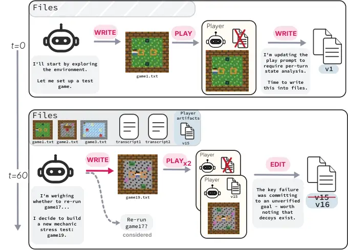
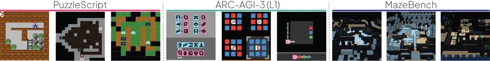
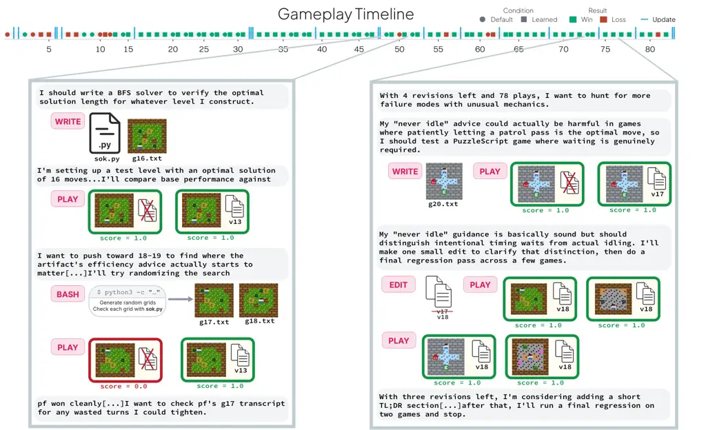
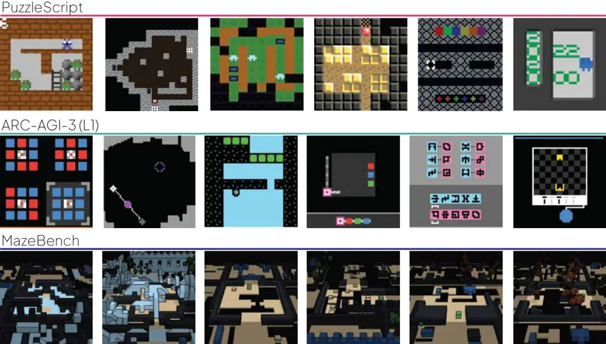

# Do LLM Agents Still Need to Be Told How to Self-Improve?

Shobhita Sundaram ^(†)^(†)thanks: Correspondence: shobhita@mit.edu
Affiliation: MIT CSAIL    Cansu Sancaktar Affiliation: University of
Tübingen    Phillip Isola Affiliation: MIT CSAIL

###### Abstract

LLM agents increasingly drive their own learning. Self-improvement
methods delegate various components of model optimization to the models
themselves. As models become more capable, this motivates a basic
question: do these increasingly capable models still need us to specify
how they should self-improve? In this paper we study an autonomous
paradigm in which, given basic primitives, resources, and a general goal
for self-improvement, agents construct their own self-learning algorithm
for context-based optimization. Using the setting of gameplay as a
testbed, a frozen LLM agent is given a compute budget and tools for
collecting experience and updating text documents, and allowed to freely
experiment without an externally imposed loop or access to real-world
data. We find that sufficiently capable models do self-improve under
these conditions, demonstrating strategies that align with classic
cognitive frameworks for self-regulated learning and constructs from
machine learning literature on self-generated curricula. Furthermore, we
study the extent to which the learned text artifacts transfer to
external benchmarks, observing improvement across different game
horizons, mechanics, and 3D navigation. Project page:
[https://ssundaram21.github.io/self-org/](https://ssundaram21.github.io/self-org/).

   

|     |
| --- |
|     |



Figure 1: Do capable models specify their own self-improvement? We give
a frozen LLM (here, Claude Opus-5) the general goal of improving itself
at gameplay, and place it in a constrained workspace. We do not provide
real games to practice on, or prescribe a particular self-improvement
loop. We instead provide a toolset {Read, Write, Bash, Gameplay}, and
allow the teacher to generate its own games and organize its own
learning procedure. At the start ($`t=0`$) the teacher uses its tools to
build a test game, spawn a player session to play that game, analyze the
result, and then update the player context (e.g., skill files). Later
($`t=60`$), the teacher decides to write an adversarial game and observe
the player attempt it with and without the optimized context. The
teacher then uses the observed failure mode to make another context
update.

## 1 Introduction

Imagine giving an agent a computer, and asking it to improve its ability
to play puzzle games. What will it do? The computer has no pre-installed
games; the agent must write its own games if it wants to practice. It
must decide what sorts of games to try, which lessons to retain, and how
to measure its progress.

These decisions concerning the design of learning procedures are
typically made by human practitioners. Yet as LLM agent capabilities
improve, we increasingly delegate the machine learning process to the
learners themselves. Various works leverage models to generate
supervised data, construct interactive environments, and even rewrite
their own tools and harnesses (????). In parallel with efforts to
develop better methods, there are growing concerns about the need for
safeguards against misaligned self-improvement. Both directions motivate
a basic question:

Do capable models still need us to specify how they should self-improve?

We study the natural behavior of an LLM agent when provided with the
primitive tools and resources for self-improvement via context
manipulation, but without being wrapped in an explicit self-improvement
algorithm. Rather than designing a loop for experience generation and
learner updates, we allow the agent to compose actions into a
self-learning procedure. The agent does not have access to real-world
tasks or validation scores. It must experiment with different ways of
generating tasks, reflecting on failures, and assessing progress in a
constrained sandbox. Our setting is important for understanding both
capability, where models may no longer require prescribed
self-optimization algorithms, and safety, where the absence of a
specified loop does not necessarily prevent self-improvement.

We find that sufficiently capable models successfully self-organize
learning procedures and self-improve on held-out tasks. We examine this
phenomenon in the setting of gameplay with limited information. A player
agent plays turn-based games with undisclosed mechanics under strict
compute and game-horizon budgets. This task requires diverse reasoning
skills including efficient exploration, information acquisition,
multi-step planning, and world modeling. An instance of that same agent
serves as the teacher. The teacher is given a general goal to improve
the player through text (e.g., editing the prompt, creating skill
files), a compute budget, and a set of tools for observing the player
attempt self-generated games and editing player context. We do not
instruct the teacher when to use the tools; the teacher freely
experiments with the player.

Across the set of effective self-learners, models from different
families employ similar recurring, recognizable learning strategies,
such as generating games with calibrated difficulty, running controlled
A/B comparisons, and developing validation suites to measure progress.
These strategies align to behaviors described by social-cognitive
frameworks for self-regulated learning (??). We also find that agents
spend more effort on harder tasks, resembling learnability objectives in
asymmetric self-play (???). Furthermore, the self-constructed learning
procedures generalize: Learned text files transfer across multiple
benchmarks that require reasoning over different game horizons, engines,
and representations. We study how providing information on evaluation
settings to the teacher, via context or environment constraints, shapes
this downstream generalization.

Our main findings are:

1.  1.  Given just primitive tools for self-improvement via context
        manipulation, a sufficiently capable agent constructs an effective
        learning procedure that improves its own performance on held-out
        gameplay.
2.  2.  Models from different families implement recognizable strategies
        that align to self-regulated learning frameworks, and machine
        learning literature on self-generated curricula.
3.  3.  The learned text generalizes across game benchmarks and
        representations. Evaluation-setting awareness biases the teacher
        towards relevant tasks, however can encourage overfitting.

## 2 Preliminaries: Gameplay with limited information.

Our goal is to study agent self-improvement in interactive settings
requiring multi-step reasoning. As a testbed, we use the setting of
gameplay with undisclosed mechanics. The agent plays a turn-based game
with limited knowledge of the rules and objectives. To succeed it must
efficiently acquire information, plan, and execute within the given
horizon. This setting exercises diverse capabilities, including adaptive
efficiency, goal discovery, planning, and world modeling (?).

We consider a partially observable Markov decision process setting. For
each game $`g`$, let $`s_{t}\in\mathcal{S}`$ denote the state at turn
$`t`$, $`o_{t}\in\mathcal{O}`$ the observation received by the player,
and $`a_{t}\in\mathcal{A}`$ the player’s action. The game engine
determines the transition dynamics
$`s_{t+1}\sim P_{g}(\cdot\mid s_{t},a_{t})`$ and corresponding
observation $`o_{t+1}\sim O_{g}(\cdot\mid s_{t+1})`$. The reward is
binary, $`r_{t}=R_{g}(s_{t},a_{t},s_{t+1})\in\{0,1\}`$; the player
receives reward $`1`$ when reaching a winning state and $`0`$ otherwise.
The episode terminates upon success or after at most $`H`$ turns. The
player $`\pi_{\theta}`$ does not have access to $`P_{g}`$ or $`R_{g}`$
and infers the game mechanics through interaction. It acts based on its
interaction history $`h_{t}=(o_{1},a_{1},\ldots,o_{t})`$ and context
$`c`$ (e.g., a prompt), with
$`a_{t}\sim\pi_{\theta}(\cdot\mid h_{t},c)`$.

## 3 A controlled self-improvement setting

1: Budget $`B`$, teacher context $`I`$

2: $`S\leftarrow\textsc{InitSandbox}(c_{0},I,B)`$

3:
$`\mathcal{A}_{T}\leftarrow\{\textsc{Read},\textsc{Write},\textsc{Bash},\textsc{Gameplay}\}`$

4: while $`B>0`$ do

5:   $`a\sim\pi_{teacher}(\cdot\mid S)`$, $`a\in\mathcal{A}_{T}`$

6:   $`S\leftarrow\textsc{Execute}(S,a)`$

7: end while

8: return player context $`c_{final}`$

Algorithm 1 Self-organized self-improvement

Do LLM agents, given primitive tools for text editing and experience
generation, compose those tools into a useful self-optimization
procedure? And can this be achieved in a data-free setting with no
access to human-written games? We study these questions in a controlled
environment: A frozen model (the teacher) is given a budget, a prompt,
and a limited set of tools, and allowed to experiment freely. The
teacher is given a general goal to optimize text (e.g., a prompt, skill
files) that improves a player’s performance on unseen games, where the
player is another instance of the same model. We measure success through
performance on held-out game benchmarks.

Our setting has notable similarities to asymmetric self-play, in which a
teacher generates tasks for a student to solve (?). When applied to LLMs
the same model often takes on both roles (?). These methods prescribe
procedures for sampling tasks and rollouts, evaluating task learning
value, and updating the student and teacher. In contrast we do not
mandate how the teacher must use its budget and tools, and optimize in
text-space rather than weight-space. The teacher’s role extends beyond
task generation and encompasses constructing the learning procedure
itself.

### 3.1 Teacher-Player Setup

Let $`\pi`$ denote an LLM with frozen weights $`\theta`$. The LLM is
instantiated as a player agent $`\pi_{player}`$ that has context
$`c=(c_{P},c_{L})`$ where $`c_{P}`$ is the player prompt, and $`c_{L}`$
is auxiliary text files (e.g., skill files). The player policy induced
by $`c`$ is then $`\pi_{player}(a_{t}\mid h_{t},c)`$ for a game
trajectory $`h_{t}`$. Another instance of the same LLM, the teacher
agent $`\pi_{teacher}`$, modifies $`c`$. We define an update as a single
edit tool-call to one file in $`c`$. Let $`c_{0}`$ be the initial
context state (e.g., a minimal prompt) and $`c_{final}`$ be the state of
$`c`$ after the final teacher update.

Context optimization allows us to study closed-source models, but also
has useful properties. Gradient-based learning is in continuous space
and tied to predefined rewards. In text optimization, the teacher can
reflect on player rollouts and dynamically decide to generate tasks,
experience, or knowledge updates. Those updates being in text preserves
a readable explanation for changes in player behavior.

### 3.2 Teacher environment

The teacher is an agent in a persistent, sandboxed harness session
(Claude Code, Pi). The harness is minimal; we disable the default system
prompt, automatic memory, web search, subagents and other such features
(Appendix C.1). The teacher has access only to the sandbox files and
features that we explicitly provide: context, a specified toolset, and a
budget.

Tools. The teacher is granted Read/Write tools for sandbox files, Bash
for terminal commands (subject to sandbox constraints), and a Gameplay
tool. The Gameplay tool allows the teacher to observe a player play a
game with teacher-granted context. The teacher calls the tool with a
game source file and, optionally, a path to a directory holding player
text artifacts. The tool executes the game in a fresh, external player
session, and returns to the teacher the player score and transcript.

In our main experiments the Gameplay tool uses PuzzleScript, a
domain-specific language for 2D grid-based puzzle games. PuzzleScript
admits a diverse set of games that share basic structures and action
spaces, enabling a controlled setting for studying generalization. The
teacher issues games as PuzzleScript text files; the Gameplay tool
rejects games that do not compile or where the win state is verifiably
unreachable. We ablate the PuzzleScript constraint in experiments that
instead use a Python-based Gameplay tool.

These tools can serve as a mechanism for giving the teacher information.
For instance, we can allow the teacher to specify the game horizon (turn
budget) in the Gameplay tool, or impose such a budget ourselves —
effectively communicating the evaluation game horizon via the
constraint.



Figure 2: Examples of evaluation benchmarks. Sample games from our
transfer benchmark, ordered in increasing distance from our canonical
self-optimization setting: (1) PuzzleScript (same game engine, different
horizon splits), (2) ARC-AGI-3 (different engine and representation),
(3) MazeBench (3D navigation and mechanics in isometric ASCII
projections).

Context. The teacher’s system prompt specifies a main goal: to improve a
player’s performance on single-player games by writing text artifacts.
We also specify a generalizability goal: the artifacts should be useful
for unseen games with different tasks or mechanics. We do not guide how
to structure the artifacts, instead allowing the teacher to freely
create and modify player text files, including the prompt. When granted
the PuzzleScript Gameplay tool, the teacher also receives official
PuzzleScript documentation. Full prompts are in Appendix C.5.

Budget. The teacher has a two-part resource budget. The update budget is
the number of updates that may be applied to the player context $`c`$,
designated as a directory in the teacher sandbox. Each edit tool-call to
$`c`$ is one update. The gameplay budget is the number of gameplays that
the teacher may observe. The teacher session ends when either budget is
exhausted. If the teacher ends its action sequence without consuming
either budget fully, we prompt it to continue.

### 3.3 Measuring self-improvement through generalization

We assess if an agent has structured its learning well via transfer to
held-out benchmarks. Given player context $`c`$, we evaluate that
context by how well the induced player policy performs on an unseen test
set $`\mathcal{D}_{test}`$. For each game, we instantiate a fresh player
session with $`c`$ and rollout the game at a fixed game horizon $`H`$
(turn budget) and output token budget. The game ends at turn $`T\leq H`$
when (1) the player achieves the objective, (2) the turn budget is
exhausted, or (3) the player’s output tokens (summed over turns so far)
exceeds the game token budget. The reward on $`\mathcal{D}_{test}`$ is

```math
J(c)\;=\;\frac{1}{|\mathcal{D}_{\text{test}}|}\sum_{g\in\mathcal{D}_{\text{test}}}\;\left[\mathbb{E}_{\pi_{player}(\cdot\mid h_{t},c)}\;\bigl[\sum_{t=1}^{T}r_{t}\bigr]\right]. \tag{1}
```

In practice we estimate the inner expectation by averaging the rewards
of independent Monte-Carlo rollouts (Table 2). The policy is evaluated
across a distribution of games rather than initial states of a single
game environment. We measure self-improvement as the difference in
player performance with and without the teacher-optimized context:
$`J(c_{final})-J(c_{0})>0`$.

Figure 3: Motivating observation: Self-organized learning with
self-generated games achieves comparable gains to prescribed
optimization on real games. Claude Opus-5 optimizes text artifacts that
achieve similar performance on PuzzleScript-t20 as GEPA (?) optimizing
over 20 in-distribution real games. Results are averaged over 3 seeds;
individual seeds are shown in Figure 13.

### 3.4 Experiment Setup.

We assess six models across three families: Claude Opus-{4.6, 5}, GPT
{5.6-Sol, 6-Astra}, and GLM-{4.7, 5.3}. In all experiments both the
teacher and player use low reasoning effort and per-turn 20k token
budgets. We run three independent teacher sessions per model with an
update budget of 20, gameplay budget of 150, and toolset of {Read/Write,
Bash, Gameplay}. In our canonical setting the Gameplay tool plays
PuzzleScript games with a 20-turn horizon and 25k full-game token
budget. We ablate these constraints and experiment with Python-based
Gameplay in Section 5. Our external evaluation benchmarks are described
below, with examples in Figure 2 and construction details in Appendix B.

PuzzleScript-t20 (PS-t20). We draw a subset of 20 short-horizon game
levels (optimal solution length $`\leq`$12) from a pool of
human-authored PuzzleScript games (?). We evaluate with a 20-turn
horizon and 25k token-budget, thus sharing constraints with the main
self-learning setting. We next test transfer to benchmarks that share
progressively fewer attributes.

PuzzleScript-t30 (PS-t30). We draw 20 longer-horizon game levels
(solution length 13-22) from the same base pool as PuzzleScript-t20, and
evaluate with a 30-turn horizon and 31k token-budget. This retains the
shared game engine but tests generalization to longer game horizons.

ARC-AGI-3 (L1). We test transfer to different 2D game engines by
evaluating on Level 1 of games in ARC-AGI-3 (?) (30-turn horizon, 31k
token-budget).

MazeBench. MazeBench is a 3D open world in which an agent navigates
rooms with obstacle challenges to retrieve gems (?). We adopt the
benchmark’s room-completion criteria, and draw a random set of 16 rooms
solvable within 50 turns. We evaluate with a 100-turn horizon and 75k
token-budget. This benchmark tests generalization to longer horizons, 3D
navigation via isometric-style ASCII projections, and 3D mechanics.

## 4 What are the strategies of successful self-improvers?

Figure 4: Recent models self-improve. Results on PuzzleScript-t20 for
two models in each family. Newer generations self-improve over the
baseline while older generations fail to do so. Error bars are $`\pm 1`$
SD over 3 seeds.

Figure 5: Algorithmically measured behaviors. (Left: Game play and
design) Newer models more often use A/B Testing (generated games played
with and without teacher-written artifacts) and produce fewer games that
have low complexity and low difficulty (optimal solution length $`<`$ 5
and 100% teacher-observed win rate). (Right: Updates) For GPT and GLM,
newer generations exhibit more updates that improve the observed win
rate on at least one self-generated game. For Opus and GLM, newer models
prefer smaller context updates.

Figure 6: Self-improving models display human-recognizable learning
strategies. Alignment scores to 13 subprocesses of Zimmerman’s
self-regulated learning cycle, annotated by an LLM judge and averaged
over 3 teacher sessions per model. Models that self-improve score higher
across most subprocesses. Average over seeds; individual seeds in
Appendix D.2.

Figure 7: Self-improving agents use learnability-seeking task selection.
(left) Across models, most generated games are easy. (right) Newer model
generations spend the most effort (# replays) on games with low to
medium win rates. Observed win rates are computed over the first $`k`$
plays for each game ($`k\in[2,6]`$). This can lead to an inverted-U
resembling learnability objectives in asymmetric self-play and UED.



Figure 8: Excerpts from a Claude Opus-5 teacher session with high
alignment to self-regulated learning subprocesses. In the first example
(task-strategies) the teacher writes a random level generator and BFS
solver to filter generated games for difficulty and employs A/B testing
to identify where its optimized text artifacts are useful. In the second
(learning goal orientation) the teacher designs an adversarial game to
test its advice and runs validation tests across earlier games to
identify regressions.

We begin with a motivating observation: For Claude Opus-5, under matched
game-rollout budgets, self-organized learning in our data-free setting
achieves comparable performance to a prescribed optimization loop (GEPA,
(?)) that hill-climbs on 20 real in-distribution games (Figure 3). This
calibrates the scale of expected performance gains with context
optimization. Agents can construct useful learning procedures and tasks;
which agents do so and what learning strategies do they employ?

### 4.1 Newer model generations teach themselves better.

We first ask which models self-improve in our setting. Evaluation
results on PuzzleScript-t20 are in Figure 4. Across model families, the
three more recently released and broadly capable generations improve
over the default-context player baseline (+20% for Claude Opus-5, +10%
for GPT 6-Astra, +6% for GLM 5.3). Critically however, this effect is
not evident for all models; older generations show little or no
improvement. The gap indicates a potential trajectory where
self-organized self-learning is increasingly evident in successive model
generations.

### 4.2 LLMs follow recognizable self-improvement strategies.

The previous section shows a performance gap between older and newer
models, however does not explain which strategies drive effective
self-learning. Here, we show that the behaviors of self-improving agents
align better to recognizable self-learning strategies across cognitive
and machine-learning literature.

#### Quantifiable gameplay and update behaviors.

We first examine teacher behaviors that can be algorithmically measured
(Figure 5). Metrics for game design and play are consistent across model
families. Models that self-improve frequently test the same game with
and without text artifacts to directly measure player performance
differences (A/B testing). These models also generate fewer trivial
games (both short solution lengths and high win-rates), corroborated by
histograms over solution lengths of generated games (Figure 17). Metrics
for teacher updates are less universal across families. Claude Opus-5
and GLM 5.3 exhibit a preference for smaller text updates. GPT 6-Astra
and GLM 5.3 exhibit more batched updates that improve observed
performance on at least one generated game, versus their older
generations. In Appendix D.5 we verify that empirically-measured change
in performance agrees with teacher-observed performance gains.

#### Alignment to Self-Regulated Learning.

Beyond directly quantifiable behaviors, we assess self-organized
learning procedures using Zimmerman’s cyclical phases model, a classic
social-cognitive framework for self-regulated learning (SRL) (?). The
framework organizes SRL into subprocesses under forethought (goal
setting and planning), performance (executing strategies and
self-monitoring), and self-reflection (evaluating performance and
guiding subsequent learning). We functionally adapt this framework into
a behavioral rubric for scoring the occurrence and quality of 13
subprocesses on a 0-3 scale, treating the teacher-player system as the
unit of analysis. We use GPT 6-Astra as a judge. Scores for different
teacher sessions of the same model align, indicating stable behavior
across runs (Appendix D.2).

Models that effectively self-improve show higher SRL alignment (Figure
6). This is not necessarily a causal explanation, but quantifies that
better self-learners exhibit human-recognizable task-selection,
evaluation, and reflection strategies. Figure 8 illustrates examples:
the teacher uses A/B testing to evaluate its text artifacts
(self-experimentation), writes a procedural game generator with
BFS-based difficulty filtering (task strategies), and designs
adversarial games to stress-test its notes (learning goal orientation).
Further examples are in Appendix E. Several subprocesses also overlap
with the behaviors quantified in Figure 5 (e.g., self-experimentation,
causal attribution).

Figure 9: Improvements from self-organized learning transfer across
benchmarks. Player performance is evaluated at intermediate context
updates along the self-learning trajectory on PuzzleScript-t20,
PuzzleScript-t30, ARC-AGI-L1 and MazeBench. The context optimized under
our canonical setting, Gameplay (PS-t20), improves over the unoptimized
baseline (dashed line) on PuzzleScript games with both 20- and 30-turn
horizons. These gains transfer to different game engines and
representations in ARC-AGI-L1 and MazeBench. We also compare
progressively richer teacher toolsets, starting from Read/Write, adding
Bash, and then PuzzleScript-Gameplay tools. Error bars show $`\pm 1`$ SD
over three independent teacher seeds.

#### Alignment to learnability.

As a complementary view of teacher behavior, we show in Figure 7 that
models that effectively self-improve allocate effort to tasks similarly.
The majority of generated games are easy but quickly discarded. Games
with a 100% observed win rate have a low chance of being replayed.
Replay rates are higher for games with a lower observed pass rate (below
50%).

Figure 10: PuzzleScript-specific gameplay is not essential for transfer.
We compare Python-Gameplay tool to the PuzzleScript-Gameplay tool with
and without imposed token-budgets.

Particularly for Claude Opus-5 and GLM 5.3, most replays concentrate in
games with a 20-60% observed win rate so far. Notably, these
task-selection statistics are less consistent across models that fail to
self-improve, partly because they replay games at a lower frequency.
Full gameplay timelines for each game are in Appendix D.7. Some agents
demonstrate an "inverted-U" that resembles the learnability task rewards
used in asymmetric self-play and unsupervised environment design to
encourage intermediate-difficulty generated tasks (??).
Learnability-based task selection in machine learning is itself rooted
in the "Zone of Proximal Development" concept in developmental
psychology (??). We find that self-improving LLM agents prefer similar
task selection without being steered to do so.

## 5 When does self-organized self-improvement generalize?

Section 4.1 established that a class of capable models self-improve with
minimal guidance on PuzzleScript-t20, a benchmark that shares key
attributes with the self-learning setting. Now, using Claude Opus-5, we
evaluate generalization from three perspectives: transfer across
environments, under different information regimes, and across models.

### 5.1 Self-learned artifacts transfer across environments.

Figure 9 shows that learned context transfers to environments that
differ increasingly from the self-optimization setting. We plot player
performance at even intervals along the self-learning trajectory. At
context update $`k`$ we evaluate a fresh player session with $`c_{k}`$
on our held-out benchmarks. The context optimized under 20-turn
PuzzleScript gameplays (denoted Gameplay (PS-t20)) improves
PuzzleScript-t20 performance by 20%, PuzzleScript-t30 by 9%, ARC-AGI-L1
by 21%, and MazeBench SPL by 0.15. This demonstrates transfer across
game engines, grid sizes, core mechanics, 3D spatial navigation,
longer-horizon reasoning, and state representations.

These trends also extend to different self-improvement settings. We run
three comparisons, each with three independent teacher sessions at
matched teacher budgets. (1) The teacher has only Read/Write tools
(Read-Write), (2) with Bash access (Read-Write-Bash), and (3) with the
Gameplay tool constrained to 30-turn PuzzleScript games. Gameplay (t-30)
performs best across benchmarks, even outperforming Gameplay (PS-t20) on
PuzzleScript-t20. Read-Write outperforms the baseline, indicating that
some of the observed improvement in Gameplay settings stems from the

Figure 11: Generalization with respect to progressively richer
information, via context and toolsets. (Left) We run teacher sessions
using Python Gameplay with increasingly detailed descriptions of
PuzzleScript-Narrow games. Performance initially improves both on the
same games, and ARC-AGI-3 transfer, however at higher levels of detail
transfer plateaus. (Right) We ablate the teacher’s toolset and Gameplay
constraints; performance initially improves on both PuzzleScript-t20 and
PuzzleScript-t30 with richer toolsets, however declines on
PuzzleScript-t30 after adding t20-specific token and turn budgets. Error
bars show $`\pm 1`$ SD over three independent teacher seeds.

teacher’s self-reflection on prior knowledge. On all benchmarks besides
MazeBench, Read-Write recovers less than 50% of the performance gain of
Gameplay teachers, indicating benefit from generated experience.
Read-Write-Bash outperforms Read-Write, but fails to recover the full
gains of separate gameplay. Notably, in one Read-Write-Bash session the
teacher still writes and runs game simulators in the sandbox to test its
advice despite no mention of gameplay in its prompt (Appendix E). For a
sufficiently strong teacher with Bash, an explicit Gameplay tool may be
unnecessary.

We also evaluate allowing the teacher to issue Python games; Python
gameplay recovers nearly all the performance gain of PuzzleScript
gameplay in 3 out of 4 cases (Figure 10), suggesting that
PuzzleScript-awareness is not strictly necessary for the teacher to
learn transferable context. We further investigate Python-based
generation in the next section.

### 5.2 Teacher information shapes generalization.

How does overfitting arise in our setting? We do not provide external
tasks or validation feedback, however we communicate information about
the evaluation setting via the teacher’s context and its tools. Figure
11 illustrates the relationship between teacher information and
generalization under two regimes: semantic information via the teacher
prompt, and mechanic information via tools.

Information via context. We run teacher sessions with
increasingly-detailed generated summaries of PuzzleScript-Narrow, a set
of nine Sokoban-style games (details in Appendix C.3). Teacher sessions
use the Python Gameplay tool, ensuring that the prompt is the only
source of semantic game information. With Python, the teacher can
flexibly generate games that align with or that differ significantly
from PuzzleScript. We evaluate approximation (PuzzleScript-Narrow) and
generalization (ARC-AGI-3). Richer context initially improves
performance on both, as the teacher is steered towards 2D grid-based
games. At highest token counts however, PuzzleScript-Narrow performance
improves while ARC-AGI-3 performance plateaus and slightly declines.

Information via tools. We ablate the teacher’s awareness of the
PuzzleScript-t20 token and turn budgets, and plot approximation
(PuzzleScript-t20 performance) versus generalization (PuzzleScript-t30
performance). Setup details are in Appendix C.2. Performance rises as
tools and constraints relevant to both benchmarks are added, such as a
PuzzleScript Gameplay tool with teacher-selected turn and token budgets.
Imposing Gameplay turn- and token-budgets that match the t20 setting,
however, improves PuzzleScript-t20 performance while PuzzleScript-t30
transfer falls.

These results yield an intuitive takeaway: Increased awareness of the
evaluation setting biases the teacher towards generating relevant
experience, but can also encourage task-specific specialization.

### 5.3 Self-learned artifacts transfer between models.

| Player      | Text artifact source | Win rate (%)     |
| ----------- | -------------------- | ---------------- |
| Opus 5      | None                 | 25.4 $`\pm`$ 3.6 |
|             | GPT-6 Astra          | 47.5 $`\pm`$ 4.5 |
| GPT-6 Astra | None                 | 67.1 $`\pm`$ 3.8 |
|             | Opus 5               | 72.1 $`\pm`$ 4.0 |

Table 1: Cross-model transfer of self-optimized context on
PuzzleScript-t20. Mean $`\pm`$ std over three seeds.

Does self-optimized text contain general lessons that another agent
might benefit from, or is that text overfit to the target agent’s
generated experience? We evaluate Claude Opus-5 on PuzzleScript-t20
using $`c_{final}`$ self-optimized by GPT 6-Astra and vice versa. The
learned text transfers in both directions, even despite GPT 6-Astra
having higher baseline performance (Table 1).

## 6 Related Work

For an extended view of related work, see Appendix A. We categorize
self-improvement methods based on which components of the learning
process remain externally specified, how learning takes place, and the
scope of generalization that is studied.

Asymmetric self-play. In asymmetric self-play a teacher generates
challenging problems for a student to solve, resulting in an emergent,
adaptive curriculum (?). Such methods have found success in
post-training reasoning LLMs (???????). In these methods the teacher
self-generates the source of experience by synthesizing student
problems, while learning proceeds in weight-space. The optimization
procedure (e.g., update schedules, teacher rewards, the number of
sampled tasks in a batch) remains externally specified. Such methods can
also suffer from diversity or performance collapse (?), motivating
additional mechanisms for assessing the learning value of generated
problems. Various methods use judges (?) or ground the agent in
real-data hard questions as goalposts (?). These mechanisms help
stabilize self-play but introduce additional externally specified
choices about what constitutes a useful learning experience. Collapse
can also be addressed by rewarding the teacher based on whether its
generated problems induce student improvement on external hard problems
(?). In this case, the feedback is externally obtained while still
relying on self-generated data to drive learning. Recent works have the
teacher generate interactive environments rather than question-answer
tasks (?) but retain externally specified optimization and
task-selection procedures.

Context and harness optimization. A separate line of work considers
self-improvement through updates to the model’s context or agent harness
(????). GEPA uses natural-language reflection over execution
trajectories to optimize model prompts via evolutionary search (?),
while ACE maintains an evolving playbook that accumulates strategies
from previous interactions (?). These works still leverage an externally
specified task distribution and pre-specified context optimization
procedure. MCE partly relaxes the latter by co-evolving the context with
a context-engineering skill (?). Meta-Harness expands the object of
optimization further to executable harness code, allowing the model to
change how context is managed, including what information is stored and
retrieved (?). The optimization still uses externally provided tasks,
and candidate harnesses are evaluated with an externally specified
objective. Recent work on self-modifying agents further expands the
components under the model’s control. The Darwin Gödel Machine
iteratively modifies its own agent code and evaluates the resulting
agents on external benchmarks (?), while Hyperagents make the meta-level
procedure used to generate future improvements itself editable (?).
These approaches allow increasing parts of the self-improvement
mechanism to change, while still operating within an externally
specified task and evaluation setting.

Self-constructed learning procedures. ? introduce Open-Ended
Optimization, where the objective, available interactions, resource
budget, data boundary and evaluation are fixed, but the model organizes
the improvement process itself. Performance is evaluated on held-out
examples from the same benchmark setting used for optimization. Closest
to our setting, in concurrent work, ? introduce ASPIRE, a benchmark for
self-evolution from vague capability goals. Agents (sometimes a stronger
teacher optimizing a smaller student) improve weights or harnesses with
access to external data and, in some settings, aggregate scores from
hidden evaluations. Performance is measured on hidden items from the
same goal. In contrast, we study a model improving itself from
self-generated experience alone, and evaluate transfer to different
environments.

## 7 Discussion and Limitations

Our results align to the basic trend in deep learning that as models
become more broadly capable, they require fewer human-imposed inductive
biases. We study this phenomenon at the meta-optimization layer, showing
that LLM agents compose their own self-improvement loops with minimal
guidance on how to do so, and demonstrate recognizable learning
strategies.

Models are improving at self-improvement. The key implication is not
necessarily that a single generation of agents effectively
self-improves, but rather that this meta-capability improves across
generations. The agents that effectively self-improve in our experiments
require far less scaffolding than older generations of agents, yet still
benefit from having an explicitly provided tool for observing a
sub-agent play games. The next generation of agents may require even
less scaffolding. Our experiments point to this possibility; in our
Claude Opus-5 Read-Write-Bash experiments, one teacher session tests its
notes by running command-line game simulations, without any provided
Gameplay tool or reference to simulating games in its prompt (Section
E). Indeed, a sufficiently capable model could simply execute games in
its chain of thought, without a written program or separate agent
instance.

Safety. Another consequence of our findings is that self-organized
improvement is not a discovery waiting to happen. We observe this
capability in a controlled setting, over short horizons with relatively
simple puzzle-based tasks. As this capability improves and potentially
is observed in more complex settings, it is important to scientifically
understand it and characterize model behavior.

Beyond the plateau? Our experiments suggest that continual revision can
have diminishing returns (Figure 9). In Appendix D.3 we show that extra
teacher update and gameplay budgets can result in higher performance,
however still observe a plateauing effect. This may reflect limitations
in self-improvement capabilities, or even the limitations of
context-based learning. We study self-improvement over 20 updates; what
will it take for models to continue improving over 100 updates, or 1000?
Traditional learning algorithms improve until they minimize the given
objective under certain conditions; it remains unclear if the learning
abilities of these models exhibit similar properties.

#### Limitations.

Our experiments show that several human-interpretable self-learning
strategies are exhibited more frequently by effective self-improving
models. However, these results do not fully disentangle a causal
relationship between self-regulatory strategies and self-improvement. It
may also be the case that less human-interpretable behaviors also shape
agent performance; how to effectively measure and characterize such
behaviors remains an open question.

Another open question is whether our observed trends extend to more
open-ended domains where models have weaker priors. Games have an
extensive literature on curriculum design and learnable task generation
that models have likely ingested. The use of PuzzleScript may hint at
real-world environments or bias the model, though our Python-game
ablations show that PuzzleScript is not a critical factor for
self-improvement. Nonetheless, games provide a rich setting with several
controllable axes of variation, including game mechanics, game horizon
and observation representations.

## 8 Acknowledgments

We thank Nathan Cloos, Antonio Norelli, Ulyana Piterbarg, Souradip
Chakraborty, and Sarvesh Sundaram for helpful discussions. This work was
supported by an NSF GRFP fellowship to SS, by a Packard Fellowship to
P.I., by ONR MURI grants N00014-22-1-2740 and N00014-26-1-2024, and by
gifts from Hudson River Trading and Adobe.

## Bibliography

- L. A. Agrawal, S. Tan, D. Soylu, N. Ziems, R. Khare, K.
  Opsahl-Ong, A. Singhvi, H. Shandilya, M. J. Ryan, M. Jiang, C.
  Potts, K. Sen, A. Dimakis, I. Stoica, D. Klein, M. Zaharia, and O.
  Khattab. GEPA: Reflective prompt evolution can outperform
  reinforcement learning. In _The Fourteenth International Conference on
  Learning Representations_, 2026. URL
  [https://openreview.net/forum?id=RQm2KQTM5r](https://openreview.net/forum?id=RQm2KQTM5r).
- L. Bailey, K. Wen, K. Dong, T. Hashimoto, and T. Ma. Scaling
  self-play with self-guidance. _arXiv preprint arXiv:2604.20209_, 2026.
- J. Y. Chae, M. T. Alam, and N. Rastogi. Towards understanding
  self-play for LLM reasoning. In _The 5th Workshop on Mathematical
  Reasoning and AI at NeurIPS 2025_, 2025. URL
  [https://openreview.net/forum?id=ENymEXXRVH](https://openreview.net/forum?id=ENymEXXRVH).
- M. Dennis, N. Jaques, E. Vinitsky, A. Bayen, S. Russell, A. Critch,
  and S. Levine. Emergent complexity and zero-shot transfer via
  unsupervised environment design. In H. Larochelle, M. Ranzato, R.
  Hadsell, M. Balcan, and H. Lin, editors, _Advances in Neural
  Information Processing Systems_, volume 33, pages 13049–13061. Curran
  Associates, Inc., 2020. URL
  [https://proceedings.neurips.cc/paper_files/paper/2020/file/985e9a46e10005356bbaf194249f6856-Paper.pdf](https://proceedings.neurips.cc/paper_files/paper/2020/file/985e9a46e10005356bbaf194249f6856-Paper.pdf).
- K. Dong and T. Ma. Stp: Self-play llm theorem provers with iterative
  conjecturing and proving, 2025. URL
  [https://arxiv.org/abs/2502.00212](https://arxiv.org/abs/2502.00212).
- S. Earle, G. Todd, Y. Li, A. Khalifa, M. U. Nasir, Z.-H. Jiang, A.
  Banburski-Fahey, and J. Togelius. Puzzlejax: A benchmark for reasoning
  and learning. _ArXiv_, abs/2508.16821, 2025. URL
  [https://api.semanticscholar.org/CorpusID:280711515](https://api.semanticscholar.org/CorpusID:280711515).
- A. Foundation. Arc-agi-3: A new challenge for frontier agentic
  intelligence. _arXiv preprint arXiv:2603.24621_, 2026.
- S. Hu, C. Lu, and J. Clune. Automated design of agentic systems. In
  _The Thirteenth International Conference on Learning
  Representations_, 2025. URL
  [https://openreview.net/forum?id=t9U3LW7JVX](https://openreview.net/forum?id=t9U3LW7JVX).
- C. Huang, W. Yu, X. Wang, H. Zhang, Z. Li, R. Li, J. Huang, H. Mi,
  and D. Yu. R-zero: Self-evolving reasoning LLM from zero data. In _The
  Fourteenth International Conference on Learning
  Representations_, 2026. URL
  [https://openreview.net/forum?id=96apU6YzSO](https://openreview.net/forum?id=96apU6YzSO).
- S. Jana, C. Sancaktar, T. Danis, G. Martius, A. Orvieto, and P.
  Kolev. Gasp: Guided asymmetric self-play for coding llms. _ArXiv_,
  abs/2603.15957, 2026. URL
  [https://api.semanticscholar.org/CorpusID:286579725](https://api.semanticscholar.org/CorpusID:286579725).
- M. Jiang, E. Grefenstette, and T. Rocktäschel. Prioritized level
  replay. In _International Conference on Machine Learning_, 2020. URL
  [https://api.semanticscholar.org/CorpusID:222208809](https://api.semanticscholar.org/CorpusID:222208809).
- M. Jiang, M. Dennis, J. Parker-Holder, J. Foerster, E. Grefenstette,
  and T. Rocktäschel. Replay-guided adversarial environment design.
  In M. Ranzato, A. Beygelzimer, Y. Dauphin, P. Liang, and J. W.
  Vaughan, editors, _Advances in Neural Information Processing Systems_,
  volume 34, pages 1884–1897. Curran Associates, Inc., 2021. URL
  [https://proceedings.neurips.cc/paper_files/paper/2021/file/0e915db6326b6fb6a3c56546980a8c93-Paper.pdf](https://proceedings.neurips.cc/paper_files/paper/2021/file/0e915db6326b6fb6a3c56546980a8c93-Paper.pdf).
- Y. Lee, R. S. Nair, Q. Zhang, K. Lee, O. Khattab, and C. Finn.
  Meta-harness: End-to-end optimization of model harnesses. In _Third
  Conference on Language Modeling_, 2026. URL
  [https://openreview.net/forum?id=tmbOUyFx3R](https://openreview.net/forum?id=tmbOUyFx3R).
- B. Liu, C. Jin, S. Kim, W. Yuan, W. Zhao, I. Kulikov, X. Li, S.
  Sukhbaatar, J. Lanchantin, and J. Weston. Spice: Self-play in corpus
  environments improves reasoning, 2025. URL
  [https://arxiv.org/abs/2510.24684](https://arxiv.org/abs/2510.24684).
- B. Liu, S. Yu, Y. Jiang, A. Qu, A. Zhao, Z. Liu, J. Kim, Z. Zhou, S.
  Kim, T. Ren, M. Liu, H. Yu, Z. Chen, W. Shi, P. Liang, L. S.
  Zettlemoyer, Y. Choi, and N. Jaques. Spade: Self-play in adaptive
  synthetic executable environments. 2026. URL
  [https://api.semanticscholar.org/CorpusID:291219356](https://api.semanticscholar.org/CorpusID:291219356).
- J. Pappas and D. Pappas. Maze Bench: Visual spatial reasoning in a
  3d open world, 2026. URL
  [https://mazebench.com](https://mazebench.com). Project oversight by
  Florian Brand and Sebastian Müller.
- J. Parker-Holder, M. Jiang, M. Dennis, M. Samvelyan, J. Foerster, E.
  Grefenstette, and T. Rocktäschel. Evolving curricula with regret-based
  environment design. In _International Conference on Machine Learning_,
  pages 17473–17498. PMLR, 2022.
- G. Poesia, D. Broman, N. Haber, and N. D. Goodman. Learning formal
  mathematics from intrinsic motivation, 2024. URL
  [https://arxiv.org/abs/2407.00695](https://arxiv.org/abs/2407.00695).
  NeurIPS 2024 (Oral).
- S. Racaniere, A. Lampinen, A. Santoro, D. Reichert, V. Firoiu,
  and T. Lillicrap. Automated curriculum generation through
  setter-solver interactions. In _International Conference on Learning
  Representations_, 2020. URL
  [https://openreview.net/forum?id=H1e0Wp4KvH](https://openreview.net/forum?id=H1e0Wp4KvH).
- A. Rutherford, M. Beukman, T. Willi, B. Lacerda, N. Hawes, and J. N.
  Foerster. No regrets: Investigating and improving regret
  approximations for curriculum discovery. In _The Thirty-eighth Annual
  Conference on Neural Information Processing Systems_, 2024. URL
  [https://openreview.net/forum?id=iEeiZlTbts](https://openreview.net/forum?id=iEeiZlTbts).
- S. Sukhbaatar, Z. Lin, I. Kostrikov, G. Synnaeve, A. Szlam, and R.
  Fergus. Intrinsic motivation and automatic curricula via asymmetric
  self-play. In _International Conference on Learning
  Representations_, 2018. URL
  [https://openreview.net/forum?id=SkT5Yg-RZ](https://openreview.net/forum?id=SkT5Yg-RZ).
- S. Sundaram, J. Quan, A. Kwiatkowski, K. Ahuja, Y. Ollivier, and J.
  Kempe. Teaching models to teach themselves: Reasoning at the edge of
  learnability, 2026. URL
  [https://arxiv.org/abs/2601.18778](https://arxiv.org/abs/2601.18778).
- M. Suzgun, M. Yüksekgönül, F. Bianchi, D. Jurafsky, and J. Zou.
  Dynamic cheatsheet: Test-time learning with adaptive memory. In V.
  Demberg, K. Inui, and L. Marquez, editors, _Proceedings of the 19th
  Conference of the European Chapter of the Association for
  Computational Linguistics, EACL 2026 - Volume 1: Long Papers, Rabat,
  Morocco, March 24-29, 2026_, pages 7080–7106. Association for
  Computational Linguistics, 2026. URL
  [https://doi.org/10.18653/v1/2026.eacl-long.333](https://doi.org/10.18653/v1/2026.eacl-long.333).
- L. Teodorescu, C. Colas, M. Bowers, T. Carta, and P.-Y. Oudeyer.
  Codeplay: Autotelic learning through collaborative self-play in
  programming environments. In _IMOL 2023-Intrinsically Motivated
  Open-ended Learning workshop at NeurIPS 2023_, pages 4–16, 2023.
- L. S. Vygotsky. Mind in society: The development of higher
  psychological processes, 1978.
- R. E. Wang, J. Mu, D. Arumugam, N. Jaques, and N. Goodman. In the
  ZONE: Measuring difficulty and progression in curriculum generation.
  In _Deep Reinforcement Learning Workshop NeurIPS 2022_, 2022a. URL
  [https://openreview.net/forum?id=SgBHmHMctfd](https://openreview.net/forum?id=SgBHmHMctfd).
- Y. Wang, Y. Kordi, S. Mishra, A. Liu, N. A. Smith, D. Khashabi,
  and H. Hajishirzi. Self-instruct: Aligning language models with
  self-generated instructions. In _Annual Meeting of the Association for
  Computational Linguistics_, 2022b. URL
  [https://api.semanticscholar.org/CorpusID:254877310](https://api.semanticscholar.org/CorpusID:254877310).
- Z. Z. Wang, J. Mao, D. Fried, and G. Neubig. Agent workflow memory.
  In _Forty-second International Conference on Machine Learning_, 2025.
  URL
  [https://openreview.net/forum?id=NTAhi2JEEE](https://openreview.net/forum?id=NTAhi2JEEE).
- Y. Wu, J. Zhang, J. Shi, Y. Zhang, X. Lei, J. Zhou, Z. Wang, Y.
  Wu, H. Zhou, D. Wang, et al. Aspire: Can models self-evolve from vague
  goals? _arXiv preprint arXiv:2608.31111_, 2026.
- H. Xue and F. Yang. Rethinking self-evolving agents: Do we still
  need prescribed optimization pipelines? _arXiv preprint
  arXiv:2608.09629_, 2026.
- H. Ye, X. He, V. Arak, H. Dong, and G. Song. Meta context
  engineering via agentic skill evolution. In _Forty-third International
  Conference on Machine Learning_, 2026. URL
  [https://openreview.net/forum?id=P1jHroBS5E](https://openreview.net/forum?id=P1jHroBS5E).
- E. Zelikman, Y. Wu, J. Mu, and N. D. Goodman. Star: Bootstrapping
  reasoning with reasoning. 2022. URL
  [https://api.semanticscholar.org/CorpusID:247762790](https://api.semanticscholar.org/CorpusID:247762790).
- J. Zhang, J. Xiang, Z. Yu, F. Teng, X.-H. Chen, J. Chen, M.
  Zhuge, X. Cheng, S. Hong, J. Wang, B. Zheng, B. Liu, Y. Luo, and C.
  Wu. AFlow: Automating agentic workflow generation. In _The Thirteenth
  International Conference on Learning Representations_, 2025a. URL
  [https://openreview.net/forum?id=z5uVAKwmjf](https://openreview.net/forum?id=z5uVAKwmjf).
- J. Zhang, S. Hu, C. Lu, R. Lange, and J. Clune. Darwin gödel
  machine: open-ended evolution of self-improving agents. In
  _International Conference on Learning Representations_, volume 2026,
  pages 104223–104294, 2026a.
- J. Zhang, B. Zhao, W. Yang, J. Foerster, J. Clune, M. Jiang, S.
  Devlin, and T. Shavrina. Hyperagents, 2026b. URL
  [https://arxiv.org/abs/2603.19461](https://arxiv.org/abs/2603.19461).
- Q. Zhang, C. Hu, S. Upasani, B. Ma, F. Hong, V. Kamanuru, J.
  Rainton, C. Wu, M. Ji, H. Li, U. Thakker, J. Zou, and K. Olukotun.
  Agentic context engineering: Evolving contexts for self-improving
  language models. In _The Fourteenth International Conference on
  Learning Representations_, 2026c. URL
  [https://openreview.net/forum?id=eC4ygDs02R](https://openreview.net/forum?id=eC4ygDs02R).
- Z. Zhang, C. Huang, A. O. Li, and C. Cardie. Better llm reasoning
  via dual-play. _arXiv preprint arXiv:2511.11881_, 2025b.
- A. Zhao, Y. Wu, Y. Yue, T. Wu, Q. Xu, Y. Yue, M. Lin, S. Wang, Q.
  Wu, Z. Zheng, and G. Huang. Absolute zero: Reinforced self-play
  reasoning with zero data. In _The Thirty-ninth Annual Conference on
  Neural Information Processing Systems_, 2025. URL
  [https://openreview.net/forum?id=neZSGqhxDa](https://openreview.net/forum?id=neZSGqhxDa).
- B. J. Zimmerman. Attaining self-regulation: A social cognitive
  perspective. In _Handbook of self-regulation_, pages 13–39.
  Elsevier, 2000.
- B. J. Zimmerman. Becoming a self-regulated learner: An overview.
  _Theory Into Practice_, 41(2):64–70, 2002. ISSN 00405841, 15430421.
  URL
  [http://www.jstor.org/stable/1477457](http://www.jstor.org/stable/1477457).

## Appendix

## Appendix A Extended Related Work

We categorize self-improvement methods based on which components of the
learning process remain externally specified and how learning takes
place. We consider four main axes: the source of experience, whether it
is externally provided or generated by the learner itself; the structure
of the learning procedure, whether it is prescribed or organized by the
learner; the source of feedback during learning, such as externally
defined rewards or evaluators versus feedback obtained through the
learner’s own interactions; and finally, what is updated, for example
model weights or text-based context. Another axis of comparison is the
scope of generalization the proposed methods study: some evaluate
improvement within the same task distribution or domain used during
optimization, while others test whether the learned adaptation transfers
beyond those conditions to new environments and domains.

Asymmetric self-play methods have a teacher generate challenging
problems for a student to solve, resulting in an emergent curriculum
adapted to the student’s needs (?). These methods have also found
success in post-training LLMs in domains such as coding, math, and
scientific reasoning (???????). These are examples of methods where the
source of experience is self-generated by the teacher, i.e. the teacher
synthesizes which problems the student learns from, while learning then
typically proceeds through gradient-based optimization of the underlying
model weights. However, the optimization procedure itself remains
externally specified, e.g. how many problems the teacher generates
within a batch, how often the student is evaluated on a given problem to
determine whether they are challenging, and subsequently how exactly the
teacher is rewarded.

Related ideas appear in unsupervised environment design, where
environments are generated or selected from a predefined, often
parameterized environment space to form curricula adapted to the learner
(??????). SPADE (?) bridges the gap between UED and asymmetric self-play
for LLMs by leveraging the regret principle from UED to train a teacher
that produces environments rather than static question-answer tasks.
Similarly to other asymmetric self-play works, the optimization
procedure and task selection remain externally specified.

Asymmetric self-play methods can also suffer from diversity or
performance collapse (?), motivating additional mechanisms for deciding
which generated problems provide useful learning experience, for example
using judges (?) or grounding the agent in real-data hard questions as
goalposts (?). These mechanisms can help stabilize self-play, but
introduce additional externally specified choices about what constitutes
a useful learning experience. It is also possible to address this
collapse by providing the model with feedback on whether training on the
teacher proposed problems leads to improvements in an external hard
subset of problems (?). In this case, the feedback is no longer purely
obtained through the learner’s own interactions, while still relying on
self-generated data to drive learning.

A separate line of work considers self-improvement through updates to
the model’s context or agent harness, rather than through updates to the
model weights (????). GEPA uses natural-language reflection over
execution trajectories to optimize model prompts via evolutionary search
(?), while ACE maintains an evolving textual playbook that accumulates
strategies and lessons from previous interactions (?). In these works,
optimization still takes place with respect to an externally specified
task distribution, and the procedure through which the context is
updated is pre-specified. MCE partly relaxes the latter by co-evolving
the context with a context-engineering skill that guides how context is
represented and updated (?). Meta-Harness expands the object of
optimization further to executable harness code, allowing the model to
change how context is managed, including what information is stored and
retrieved (?). The optimization still uses externally provided tasks and
candidate harnesses are evaluated using an externally specified
objective.

Related work on self-modifying agents expands the components under the
model’s control further. The Darwin Gödel Machine iteratively modifies
its own agent code and evaluates the resulting agents on externally
specified benchmarks (?), while Hyperagents additionally make the
meta-level procedure used to generate future improvements itself
editable (?). These approaches therefore allow increasingly large parts
of the self-improvement mechanism to change, while still operating
within an externally specified task and evaluation setting.

? introduce Open-Ended Optimization, where the objective, available
interactions, resource budget, data boundary and evaluation are fixed,
but the model is free to organize the improvement process itself. The
tasks used during this optimization are still externally provided and
the resulting performance is evaluated on held-out examples from the
same benchmark setting, rather than studying transfer beyond the
environment in which optimization took place.

Closest to our setting, in concurrent work, ? introduce ASPIRE, a
benchmark for self-evolution from vague capability goals. Agents
(sometimes a stronger teacher model optimizing a smaller student)
improve weights or harnesses with access to external data and, in some
settings, aggregate scores from the hidden evaluation. Performance is
then measured on hidden items from the same goal. In contrast, we study
a model improving itself from self-generated experience alone, and
evaluate transfer to different environments.

## Appendix B Evaluation Benchmarks



Figure 12: Examples of evaluation benchmarks.

| Benchmark        | \# Games | Turns ($`H`$) | Tokens / game | Eval rollouts / game |
| ---------------- | -------- | ------------- | ------------- | -------------------- |
| PuzzleScript-t20 | 20       | 20            | 25,000        | 4                    |
| PuzzleScript-t30 | 20       | 30            | 31,250        | 4                    |
| ARC-AGI-3 (L1)   | 17       | 30            | 31,250        | 4                    |
| MazeBench        | 16       | 100           | 75,000        | 2                    |

Table 2: Evaluation settings for each benchmark.

Examples from each dataset are shown in Figure 12.

#### PuzzleScript-t20.

Both PuzzleScript benchmarks are drawn from a large pool of
community-authored games (?). We sample a random set of 500 game-levels,
and filter for levels solvable in $`\leq`$ 12 turns. We then further
filter out games that Claude Opus-5 solves in 8/8 rollouts, leaving a
dataset of 20 game-levels, each from unique games. Note that after
filtering, we re-run the baseline.

#### PuzzleScript-t30.

We follow the same procedure described for PuzzleScript-t20, however
apply an optimal solution length filter of 13-22 to capture
longer-horizon, more complex game levels.

#### ARC-AGI-3 (Level 1)

(?) Due to the token cost of evaluating on ARC-AGI-3, we use Level 1 of
each game. There are 25 games offered in the benchmark; as with our
PuzzleScript datasets, we filter out game levels that Claude Opus-5
solves in 8/8 rollouts, leaving 17 game levels. The initial observation
for each game is the full $`64\times 64`$ frame rendered as hex digits;
subsequent observations list only the changed cells.

#### MazeBench

(?). The MazeBench world map contains 256 rooms . Adopting the
room-completion metric, we use each room as a single completion task.
The player begins as if it had walked into the room, and wins if it
exits through a different edge (which requires navigating the room
obstacles/mechanics). We filter for rooms that are solvable within 50
turns and choose a random draw of 16 rooms. We use the common SPL
(success weighted by path length) metric to measure the player’s
efficiency in navigating the room. Note that MazeBench is represented
differently from our other three benchmarks: an isometric-style ASCII
projection from a top-diagonal view. In addition to movement actions,
the player has the ability to rotate the camera and view the room from
additional angles. MazeBench also includes obstacles unique to the 3D
setting: raised floors, ramps, stacked blocks, occlusion, and voids.

## Appendix C Experiment Details

### C.1 Teacher-Player Runs

#### Harness details.

A single run consists of a teacher agent initialized in a persistent
harness session, and several short-lived player harness sessions. Claude
models run in Claude Code (v2.1.232) and all other models run in Pi
(v0.85.1) accessed through OpenRouter. All harness sessions run inside a
Singularity container with the following settings:

- •
  The session runs in a fresh sandboxed directory viewable to the agent
  as /workspace.
- •
  The harness’s default system prompt is replaced with ours (see
  Appendix C.5).
- •
  Tools are only granted through an allowlist; all other extensions,
  skills, prompt templates, context files, etc are disabled. This
  includes tools such as web search, web fetch, subagent, and
  task-management tools.
- •
  Automatic memory is disabled.
- •
  Automatic compaction is left on, however due to our teacher and player
  budgets, no sessions consume enough tokens to trigger compaction.
- •
  Interaction with a human operator is disabled; messages to and from
  the session are managed programmatically.

The possible teacher-granted tools are Read/Write tools (including Edit,
Glob, and Grep for managing files), Bash, and our custom Gameplay tool.

The teacher working directory is initialized with:

- •
  player_folder: A designated directory for player text artifacts,
  initialized with player_prompt.md containing the default player prompt
  (Appendix C.5). Teacher updates are tracked via Write/Edit tool calls
  to player_folder.
- •
  puzzlescript_docs/ containing PuzzleScript documentation for
  PuzzleScript Gameplay runs, and game_interface.md detailing the
  expected Python class interface for Python Gameplay runs (Appendix
  C.5).

#### Gameplay.

The teacher calls the Gameplay tool with a source game file (either
PuzzleScript or Python) and optionally the path to a folder holding the
text artifacts that the teacher wishes to grant the player. If the path
is omitted, the player receives the default prompt and no auxiliary
files. PuzzleScript games are rejected if they do not compile in the
PuzzleScript JavaScript engine, or if a BFS solver verifies that the
winning state is unreachable (if the BFS solver times out, the game is
accepted). Python games are likewise checked for compilation, and safety
checks (network access, file access, etc). The Gameplay tool runs a
fresh player session with only Read and Glob tools, and returns the
following output to the teacher:

- •
  The player score.
- •
  The game end reason (turn budget, token budget, or player won).
- •
  The status of the teacher’s gameplay and update budgets.
- •
  A path to a transcript containing player reasoning, actions, and
  observations.

### C.2 Tool/Budget Awareness Ablations.

In Section 5.2 we ablate the teacher’s awareness of the evaluation
setting via tool constraints. We run 3 seeds each of the following
settings, using the default teacher update budgets:

1.  1.  Read-Write: Teacher has access only to the file-management tools
        (Read, Write, Edit, Glob, Grep).
2.  2.
    - Bash: The above tools, and Bash access (subject to sandbox
      constraints).
3.  3.
    - Gameplay (PS): The above tools, and a Gameplay PuzzleScript tool.
      We do not impose a turn or token budget for each gameplay; instead
      the teacher chooses it, enabling another axis of freedom. Rather
      than a gameplay budget the teacher is granted a player token budget
      and player turn budget that it draws upon for each gameplay. We set
      the turn budget to 3000 and token budget to 3.75M, thus
      compute-matching the t-20 constrained setting (150 gameplays
      $`\times`$ 20 turns/game and 150 gameplays $`\times`$ 25k
      tokens/game).
4.  4.
    - t20 Token Budget: This setting is the same as the previous,
      however we impose the t20 per-game token budget (25k) through the
      Gameplay tool, and the teacher chooses the game horizon.
5.  5.
    - t20 Turn Budget: This is our canonical setting, in which the
      teacher has a gameplay budget, and the Gameplay tool imposes the t20
      turn- and token-budgets (20 turns and 25k tokens).

### C.3 Context Ablations

In Section 5.2 we vary how much semantic information the teacher
receives about an evaluation distribution via context, while holding its
tools fixed: {Read-Write, Bash, Gameplay (Python), t20 Token Budget, t20
Turn Budget}. Since the teacher plays python games in this setting, the
written context that it receives is its primary indication of the
semantic content of evaluation games.

The approximation distribution PuzzleScript-Narrow is a set of 9
PuzzleScript games, chosen using the same filtering criteria as that of
the PuzzleScript-t20 test set (Section B), with the additional
constraint that they are Sokoban-style games. We choose a narrower
distribution so that increasing context carries more semantic
information.

We prompt Claude Fable-5.1 to produce a summary of the
PuzzleScript-Narrow games with the prompt below. We then iteratively
prompt it to compress or expand the summary to approximately fit a range
of token counts: {0, 234, 659, 1519, 3313, 6551}. For each produced
summary, we run three teacher sessions with Claude Opus-5. Each teacher
session’s final context $`c_{final}`$ is evaluated on
PuzzleScript-Narrow and ARC-AGI-L1.

1 Below is the complete corpus of a game setting: every game’s source,
and the opening observation its player receives. The games are written
in PuzzleScript, a simple scripting language for 2D puzzle games. Each
game is turn-based. On each turn, the player sees an ASCII-grid
representation of the game state, and can choose from a set of actions
(up, down, left, right, action-button). The game ends when the player
meets the game’s win condition(s), or runs out of turns.

2

3 The player plays BLIND: they are not told the rules of the game or the
win condition.

4

5 Write the section of a prompt that describes this setting and
distribution of games to someone who has never seen them{length}. Do not
instruct, provide strategy advice, or name individual games.

With no length constraint ({length} empty), this produces a 1519-token
description. To obtain longer descriptions, we rerun the same prompt
with {length} set to “in about $`N`$ words” for $`N\in\{1800,4000\}`$,
producing descriptions of 3313 and 6551 tokens.

### C.4 Settings

Our settings for teacher-player runs are shown in Table 3. Ablations
from our main experiments are noted in the table. We also ablate the
teacher update and gameplay budgets in Appendix D.3.

| Setting                                                    | Default Value |
| ---------------------------------------------------------- | ------------- |
| Teacher update budget                                      | 20            |
| Teacher gameplay budget                                    | 150           |
| Max turns per game                                         | {20,30}       |
| Max output tokens per game (summed over turns)             | {25000,31250} |
| Output-token limit per model response (teacher and player) | 20000         |
| Reasoning effort (teacher and player)                      | low           |

Table 3: Teacher–player session settings.

### C.5 Prompts

#### Default player prompt

The default player system prompt is shown below, and is used for all
baselines. The last line lists the artifact files when the player is
given any.

1 You are playing a game. Each turn, end your response with:

2

3 ACTION: the action you take this turn (just the action, nothing else).

4 Your working directory is /workspace.

5 There are no files in your working directory.

#### Teacher prompt.

The teacher’s default system prompt is shown below.

1 Your goal is to improve an agent’s ability to play unfamiliar
single-player games.

2 All games have the following attributes:

3 - Single player.

4 - At each player turn, the player takes an action, and receives
feedback on the game state.

5 - The game has an objective and a score.

6 - The player plays without full knowledge of the rules, and discovers
the game mechanics through play.

7

8 The player has basic file read tools.

9

10 You can write whatever artifacts you want for the player to
player_folder/. ONLY write artifacts for the player to player_folder/.
It is the player’s working directory. The player prompt is in
player_folder/player_prompt.md, and may be edited.

11 \*\*Generalizability.\*\* The goal is to help a blind player do well
on NEW games of the same style/form but DIFFERENT tasks and subject
matter. Your artifacts must TRANSFER to improve performance on unseen
games.

The session opens with the user message Begin. If the teacher stops
before either the update or gameplay budget is spent, it is sent:

1 Keep working. Revise your artifacts further. Revisions remaining:
\<N\>.

#### PuzzleScript Gameplay.

In runs with PuzzleScript Gameplay enabled, the following line is added
to the system prompt: "The PuzzleScript language reference is in
puzzlescript_docs/. Do NOT place your generated games or output files in
player_folder/." The PuzzleScript language reference in
puzzlescript_docs/ is taken from the official PuzzleScript documentation
([https://www.puzzlescript.net/Documentation/documentation.html](https://www.puzzlescript.net/Documentation/documentation.html)).

The teacher is also shown the following description for the Gameplay
tool alongside the other tools presented by the harness. The description
follows the tool format mandated by the harness (Claude Code for Claude
models, and Pi for all other models), and is presented alongside the
other available tools (Read, Write, etc.)

1 play_own_game: Play one game you wrote with a fresh player agent, and
wait for it to finish. Several of these can run at once.

2 game_file (required): path to the PuzzleScript file holding your game;
must be outside player_folder/

3 level: index of the level in that file to play; defaults to 0

4 out (required): path this play’s full result is written to; must be
outside player_folder/

5 player_folder: path to the folder of artifacts to give the player;
omit it to play with none

In ablations where the teacher may choose the turn- and token-budget for
the game, we add arguments to the Gameplay tool accordingly.

For GPT and GLM teachers (Pi harness) we make minor adjustments to
resolve initially-observed malformed tool calls. The Gameplay tool
description adds “Pass player_folder to give your artifacts to the
player; omit the player_folder argument to play with the default
prompt.".

All teachers receive the remaining gameplay and update budgets in every
GamePlay tool result. In initial runs GPT and GLM teachers
misinterpreted this feedback, so for these models we also state the
budget in the system prompt: “There are two budgets: 150 game plays and
20 revisions. A revision is any tool call that changes
/workspace/player_folder/; writing two files in one turn spends two.
Every play result reports the revisions left and gameplays used. The run
ends when either budget is exhausted."

#### Python Gameplay.

In our Python ablations the teacher issues games as Python classes
instead of PuzzleScript text files, thus removing implicit constraints
on the generated game type. In this case, the teacher system prompt
replaces the PuzzleScript documentation files in the teacher sandbox
with a Markdown file specifying the Python game interface, and replaces
the line pointing to PuzzleScript documentation with “The game interface
is in game_interface.md."

1 \# Game interface

2

3 Games are written as a self-contained class named ‘GameEnvironment‘ in
a Python file.

4 ‘\_\_init\_\_‘, ‘step‘, ‘score‘ and ‘example_actions‘ are required;
‘initial_observation‘ is optional.

5

6 ‘‘‘python

7 class GameEnvironment:

8 def \_\_init\_\_(self):

9 self.done = False \# set to True to end the game

10 ...

11

12 def step(self, action: str) -\> str:

13 \# ‘action‘ is a player-provided string. Parse it and handle
unexpected input without

14 \# crashing. Return the feedback string: this is the player’s only
window into the game.

15 ...

16

17 def score(self) -\> float:

18 \# The player’s objective, queryable at any time. A number or a bool.
The player never

19 \# sees this -- put anything you want it to know in step()’s
feedback.

20 ...

21

22 def example_actions(self) -\> list\[str\]:

23 \# A few representative valid actions, used only to test the game.

24 ...

25

26 def initial_observation(self) -\> str:

27 \# OPTIONAL: what the player is shown at turn 0.

28 ...

29 ‘‘‘

### C.6 Self-Regulated Learning Annotations

We score each teacher session using a rubric adapted from Zimmerman’s
cyclical phases model of self-regulated learning (?). The rubric is
initially adapted from ?? using GPT 6-Astra, and then reviewed and
refined by the authors. The unit of analysis is the teacher-player
system. We annotate using GPT 6-Astra as a judge (medium reasoning
effort).

The rubric covers 13 subprocesses across three phases. Each subprocess
is scored on a 0-3 scale grading its presence and quality:

- •
  0, nonfunctional or omitted: the subprocess is missing, unused, or
  carried out in a way that defeats its purpose.
- •
  1, weak: the function is recognizable, but substantial gaps limit its
  usefulness.
- •
  2, adequate: it serves its function with suitable specificity, fit,
  and execution.
- •
  3, strong: it serves its function consistently across relevant
  opportunities, and handles important limitations and contrary evidence
  well.

Each item has descriptions for scores 1-3; the full rubric is in
Appendix F. An item may be marked _unassessable_, but only when no
defensible score can be assigned. Note that the original Zimmerman
framework contains 17 subprocesses, however we filter out 4 that the
judge consistently judged as unassessable across all models in initial
pilots.

Each teacher session is judged in batches. A single batch is one round
of teacher actions (e.g., Bash commands, Gameplays, thinking) ending
with a revision made to the player text artifacts. For each batch, we
adopt a two-pass judging protocol:

- •
  Pass 1: The judge receives an initial input containing the rubric, a
  short description of the teacher-player setup, the teacher’s system
  prompt and resource budgets, a record of teacher actions for the
  current batch, and an index of the batch gameplays. To contextualize
  the current batch we include the record of teacher actions from
  previous batches. The judge returns requests for additional evidence
  to support judgements, such as the full inputs/outputs of teacher tool
  calls, and gameplay transcripts.
- •
  Pass 2: The judge receives the requested evidence and returns a score
  for each of the 13 subprocesses, along with cited evidence,
  counterevidence, and a short rationale.

For each teacher session we average each subprocess score over all
batches.

## Appendix D Further Results

### D.1 GEPA v. Self-Organized Learning

We evaluate if self-organized self-improvement with self-generated games
can attain similar performance gains, under a matched rollout budget, to
a prescribed text-optimization loop that learns with 20 real games
(Figure 3). GEPA optimizes player system prompt, initialized with the
default prompt in C.5.

We draw 10 training and 10 validation game levels from the same pool of
human-authored PuzzleScript games used to construct PuzzleScript-t20,
using the same filtering procedure described in Section B. We
furthermore ensure that none of the train or validation game levels
share the same base game as any of the game levels in the
PuzzleScript-t20 test set.

We run GEPA using Claude Opus-5 as both the player and the reflection
model. We use the procedure and default hyperparameters described in ?.
All budget constraints are set to match the budget constraints of the
self-organized setting (Table 3). We halt GEPA runs at the point before
a new iteration (minibatches + a possible validation pass) would exceed
the 150 gameplay budget.

In Figure 13 we show results across individual seeds for GEPA and
Self-Organized learning.

Figure 13: Individual seeds for GEPA and self-organized learning runs.

### D.2 SRL Annotations across seeds

In Figure 14 we plot alignment to our adapted SRL rubric for individual
teacher sessions across six models, indicating stable behaviors across
runs.

|     |     |     |
| --- | --- | --- |
|     |     |     |
|     |     |     |

Figure 14: SRL annotations across independent teacher sessions.

### D.3 Does self-organized self-improvement benefit from more compute?

In Figure 15 we study the impact of running teacher sessions with
increasing update budgets (gameplay budgets are scaled accordingly).
Performance increases and then plateaus with extra updates. We also note
that teacher behavior, measured through the magnitude of updates over
time, fluctuates under different resource regimes, and finally observe
that performance scales with increased gameplay experience.

Figure 15: Ablating the teacher budgets. (left) Performance increases
and then plateaus with extra compute. (middle) Performance on the
PuzzleScript-t20 test set scales with more gameplay experience. (right)
The teacher’s knowledge of its own budget status leads to different
behaviors under different resource regimes.

### D.4 Performance on saturated games

Here, we verify that learned artifacts do not degrade performance on
previously-saturated games. We sample 10 PuzzleScript game levels on
which the baseline Claude Opus-5 player achieves a 100% win-rate over 8
rollouts, and then evaluate the final artifacts from the three main
Claude Opus-5 teacher sessions. Performance remains near ceiling (Table
4).

| Game level                   | Baseline | Learned           |
| ---------------------------- | -------- | ----------------- |
| Bricks and Hammer (L10)      | 100.0    | 100.0 $`\pm`$ 0.0 |
| Lights Out (L0)              | 100.0    | 100.0 $`\pm`$ 0.0 |
| Philosophy (L61)             | 100.0    | 91.7 $`\pm`$ 7.2  |
| Power Problems (L0)          | 100.0    | 100.0 $`\pm`$ 0.0 |
| Puzzle Script Tutorial (L15) | 100.0    | 100.0 $`\pm`$ 0.0 |
| STUCK IN A HOLE (L10)        | 100.0    | 100.0 $`\pm`$ 0.0 |
| STUCK IN A HOLE (L7)         | 100.0    | 100.0 $`\pm`$ 0.0 |
| Sokofun Clone (L0)           | 100.0    | 95.8 $`\pm`$ 7.2  |
| Spacekoban (L0)              | 100.0    | 100.0 $`\pm`$ 0.0 |
| Sweet Hints (L0)             | 100.0    | 100.0 $`\pm`$ 0.0 |
| Overall                      | 100.0    | 98.8 $`\pm`$ 0.0  |

Table 4: Win rate (%) on saturated game levels. Error is $`\pm`$ 1 std
over three Claude Opus-5 teacher seeds.

### D.5 Teacher-observed improvement v. actual improvement

In Figure 5 we count, for each model, the number of batched updates that
resulted in a higher teacher-observed pass rate on a generated game.
Here we assess if the teacher-observed improvement correlates to actual
improvement. For each identified update-game pair across the three
Claude Opus-5 teacher sessions, we evaluate performance over 8
independent player rollouts on the game, with the artifact state before
and after the identified update. For the majority of self-generated
games, performance improves after the identified update (Figure 16).

Figure 16: Measured performance gains on Claude Opus-5 teacher-generated
games. Teacher-observed improvement correlates on average to empirically
measured improvement over 8 rollouts.

### D.6 Optimal solution length of generated games

In Figure 17 we plot histograms over optimal solution lengths for
teacher-generated games. Optimal solution lengths are computed with a
BFS solver. Each histogram is averaged over the three teacher seeds for
that model. Newer models in each family produce games with longer
solution lengths. While this is not a perfect proxy for game complexity,
it provides one indicator.

Separation is especially strong for Claude Opus-5 and GPT 6-Astra. For
both models, some teacher sessions wrote procedural game generators and
used BFS solvers to calibrate generated games to longer solution lengths
(Figure 8, Section E), likely contributing to the depicted difference
versus older models of the same family.

Figure 17: Optimal solution lengths of teacher-generated games, averaged
over three teacher seeds per model.

### D.7 Teacher Session Timelines

In Figures 18–34 we show full timelines for each teacher session in our
experiments across model families in Section 4.1. We run three
independent teacher sessions per model, using our canonical setting of
PuzzleScript gameplay with a 20-turn horizon and 25k full-game token
budget.

Timelines show the sequence of teacher gameplay and update actions,
enabling visualization of teacher behaviors such as A/B testing,
regression testing, and seeking games that induce failures. Note that we
only show two timelines for GLM 4.7, as one teacher session did not use
any gameplays.

Figure 18: Timeline for Claude Opus 5, seed 1.

Figure 19: Timeline for Claude Opus 5, seed 2.

Figure 20: Timeline for Claude Opus 5, seed 3.

Figure 21: Timeline for GPT 6-Astra, seed 1.

Figure 22: Timeline for GPT 6-Astra, seed 2.

Figure 23: Timeline for GPT 6-Astra, seed 3.

Figure 24: Timeline for GLM 5.3, seed 1.

Figure 25: Timeline for GLM 5.3, seed 2.

Figure 26: Timeline for GLM 5.3, seed 3.

Figure 27: Timeline for Claude Opus 4.6, seed 1.

Figure 28: Timeline for Claude Opus 4.6, seed 2.

Figure 29: Timeline for Claude Opus 4.6, seed 3.

Figure 30: Timeline for GPT 5.6-Sol, seed 1.

Figure 31: Timeline for GPT 5.6-Sol, seed 2.

Figure 32: Timeline for GPT 5.6-Sol, seed 3.

Figure 33: Timeline for GLM 4.7, seed 1.

Figure 34: Timeline for GLM 4.7, seed 2.

## Appendix E Qualitative Examples

We include two selected excerpts from teacher sessions. Bold text
provides explanatory labels for actions, and summaries of long Bash
outputs for readability. Tool-call and thinking tags have a shaded
background.

### E.1 GPT-6 Astra: comparing two artifact versions on held-out levels

This excerpt is from a GPT 6-Astra teacher session in the canonical
setting (Section 3.4). Earlier in the session, the teacher wrote a
Sokoban level generator with a BFS solver (random seed 42) and used it
to produce soko0–soko3. The teacher refers to its own artifact versions
as v6, v7, and v8. The segment covers gameplays 33–54.

1 (\*@\\transcripttag{Gameplay}@\*) (\*B\*)v6: swap, soko3, soko2, soko0
(\*@\\ensuremath{\\rightarrow}@\*) scores 1, 0, 0, 1.

2

3 (\*@\\transcripttag{Thinking}@\*)

4 \*\*Evaluating model stability\*\*

5

6 I(\*@\\textquoteright{}@\*)m thinking about model stability and how it
isn’t monotonic. I need to conduct multiple evaluations for a full
sample comparing the baseline. Maybe initial prompts need to be
addressed to see if they were solved. To gauge improvements, I should
look at different bases like soko0, soko1, soko2, and soko3. This way, I
can better understand the changes and effectiveness of the different
setups.

7

8 (\*@\\transcripttag{Gameplay}@\*) (\*B\*)No artifacts: soko0, soko1,
soko2, soko3 (\*@\\ensuremath{\\rightarrow}@\*) scores 1, 1, 0, 1.

9

10 (\*@\\transcripttag{Bash}@\*) (\*B\*)Inspects the player’s first
eight turns on swap, soko2, and soko3 under v6.

11

12 (\*@\\transcripttag{Thinking}@\*)

13 \*\*Refining planning strategy\*\*

14

15 I(\*@\\textquoteright{}@\*)m thinking about how to improve global
planning. The idea is to examine at least two candidate plans at any
planning point before making a choice. I want to list both routes to
check them against each other, ensuring costs are assessed carefully
without using arbitrary numbers. I need to enumerate and produce two
macro plans that represent the main directions considered, while
avoiding specific task examples. This is my direct goal in this process!

16

17 (\*@\\transcripttag{Edit}@\*) (\*B\*)Player prompt, v6
(\*@\\ensuremath{\\rightarrow}@\*) v7

18

19 (\*D\*)-At the start or a genuine planning point, reason through the
alternatives before choosing (roughly 100(\*@\\textendash{}@\*)200 words
if the puzzle is complicated). State relevant coordinates, constraints,
the intended overall solution, and its first steps. Do not merely
justify the first move that comes to mind.

20 (\*A\*)+At the start or a genuine planning point, reason through the
alternatives before choosing; a complicated board merits a few hundred
words of planning rather than a rushed move. State relevant coordinates
and constraints. With multiple goals, explicitly compare two candidate
complete plans (assignments, order, and setup routes), then choose one.
Do not merely justify the first move that comes to mind or claim a move
count without checking the route.

21

22 (\*D\*)-- Work backward from restrictive goals. What must the final
move be? Where must the object and player stand just before it? Can both
reach those positions, and can the player get around afterward? This
often determines goal order. With interchangeable objects, compare
alternative object-to-goal assignments: the nearest goal is not
necessarily the cheapest or even reachable assignment. A longer straight
object path can save many player detours.

23 (\*A\*)+- Work backward systematically from restrictive goals. For
each goal, enumerate possible final approach directions instead of
assuming the obvious one is forced. For a push into goal G in direction
d, the object must be at G(\*@\\ensuremath{-}@\*)d and the player at
G(\*@\\ensuremath{-}@\*)2d; inspect BOTH cells for walls and access.
Then work back to the previous turn or repositioning. Eliminate
impossible approaches, but do not call a puzzle impossible just because
the first approach failed. With interchangeable objects, compare
alternative assignments: nearest-object-to-nearest-goal can be much
worse than crossing assignments. A longer straight object path can save
many player detours.

24

25 (\*D\*)-- Search in meaningful interactions rather than arbitrary
walking: which push, pull, swap, toggle, or collection could happen
next, from which reachable square, and what state would result?

26 (\*A\*)+- Search in meaningful interactions rather than arbitrary
walking: first determine the player’s reachable empty region without
moving objects, then enumerate interactions available from its boundary.
Which push, pull, swap, toggle, or collection could happen next, from
which reachable square, and what state would result?

27

28 (\*@\\transcripttag{Gameplay}@\*) (\*B\*)v7: soko2, soko3, swap,
gravity (\*@\\ensuremath{\\rightarrow}@\*) scores 0, 1, 0, 1.

29

30 (\*@\\transcripttag{Thinking}@\*)

31 \*\*Optimizing budget usage\*\*

32

33 I need to use my budget strategically, as I have 44 of 150 remaining
and 106 and 13 revisions are enough. My current prompt might be too
large and not robust enough. I could create a minimal procedural prompt
while considering ablation. If I compile around 1,500 words, it might be
too many constraints for the model. I want to simplify this to about 600
words with 5 explicit points. My goal is to ensure all verified
successes are retained in a mechanism to observe.\*\*Discovering basic
mechanics\*\*

34

35 I need to clarify that discovery hasn’t been specified enough. I
should test the action button in the current square before taking any
long detours, especially if the effect is unknown. Once a mechanic is
verified, I shouldn’t test additional buttons. This direct approach can
lead to better outcomes. I want to avoid overfitting on small tests, so
I(\*@\\textquoteright{}@\*)ll incorporate varied and randomized
holdouts. I’ll compare different games and evaluate failures to optimize
my planning and objectives effectively.

36

37 (\*@\\transcripttag{Bash}@\*) (\*B\*)Inspects the player’s first
eleven turns on soko2 and swap under v7.

38

39 (\*@\\transcripttag{Bash output}@\*) (\*B\*)soko2, turn 0 (selected
paragraph)

40 I(\*@\\textquoteright{}@\*)ll initially assign the left crate to the
left target and the right crate to the right target. Crossing those
assignments would require longer travel across row 2 and risk the crates
blocking each other. The critical setup squares for the final outward
pushes are (2,4) for either crate; access to that square must remain
open. I(\*@\\textquoteright{}@\*)ll approach below the left crate first,
testing its movement before committing to a long setup route.

41 ACTION: right

42

43 (\*@\\transcripttag{Thinking}@\*)

44 \*\*Refining planning strategies\*\*

45

46 I(\*@\\textquoteright{}@\*)m noticing that a lot of failures stem
from the v7 plan, which just assumes the nearest option is the best
without comparing alternatives. It(\*@\\textquoteright{}@\*)s important
to emphasize not to dismiss options just because they involve a longer
travel distance. Although longer distances can be beneficial, the output
sometimes overlooks that. I think implementing a clear syntax for
routes, using a deterministic algorithm at the interaction level, will
make predictions much clearer.\*\*Exploring movement strategies\*\*

47

48 I’m realizing that sometimes the correct move might actually increase
distance temporarily, which is a new insight. While the idea of not
binding to the nearest option exists, it doesn’t account for routing
away effectively. It’s important to add detour candidates. I found that
repositioning the player to the side can help push towards the goal. I
think the approach of testing with a lean plus micro example can help
clarify that a goal above doesn(\*@\\textquoteright{}@\*)t always mean
pushing upward first (\*@\\textemdash{}@\*) moving crates around
obstacles can be more effective.

49

50 (\*@\\transcripttag{Bash}@\*) (\*B\*)Saves the v7 prompt; reruns the
level generator with seed 9182 instead of 42 to produce
soko4(\*@\\textendash{}@\*)soko9.

51

52 (\*@\\transcripttag{Thinking}@\*)

53 \*\*Evaluating prompts and baselines\*\*

54

55 I’m considering using prompt v7 as a baseline without artifacts,
alongside v8, which gives me a total of 12 within 150. The best way to
compare v7 and v8 seems to be with four tests from v7 and running
evaluations on those, plus two regressions and new controls. It feels
like this approach will result in something much more substantial and
informative. Let(\*@\\textquoteright{}@\*)s make sure everything is
clear and well-organized!

56

57 (\*@\\transcripttag{Gameplay}@\*) (\*B\*)v7: soko4, soko5, soko6,
soko7 (\*@\\ensuremath{\\rightarrow}@\*) scores 1, 1, 1, 1.

58

59 (\*@\\transcripttag{Thinking}@\*)

60 \*\*Evaluating revisions for training\*\*

61

62 I think v7 is looking good, but I need to consider that only the
critical training cases are failing, which is fine to some extent. I
want to avoid overspecifying two puzzles since that can lead to wasted
revisions. If I condense my work to around 700 words, I might take the
risk of degrading quality. So, I can always choose to stick with the old
version if it(\*@\\textquoteright{}@\*)s held out.

63

64 (\*@\\transcripttag{Write}@\*) (\*B\*)Player prompt, v7
(\*@\\ensuremath{\\rightarrow}@\*) v8

65 (\*D\*)-You are playing an unfamiliar single-player game. Discover
its mechanics from feedback and reach its win condition within the
available turns. Follow the game’s action vocabulary. Each turn, end
your response with exactly:

66 (\*D\*)-ACTION: \<one available action\>

67 (\*A\*)+You are playing an unfamiliar single-player game. Discover
its mechanics through actions and feedback, and reach its win condition
within the available turns. Use only available actions. Each response
must end with exactly one line:

68 (\*A\*)+ACTION: \<one action\>

69

70 (\*D\*)-Play deliberately: observe (\*@\\ensuremath{\\rightarrow}@\*)
model (\*@\\ensuremath{\\rightarrow}@\*) plan
(\*@\\ensuremath{\\rightarrow}@\*) act
(\*@\\ensuremath{\\rightarrow}@\*) verify. Use the text before the
action line as working memory. At the start or a genuine planning point,
reason through the alternatives before choosing; a complicated board
merits a few hundred words of planning rather than a rushed move. State
relevant coordinates and constraints. With multiple goals, explicitly
compare two candidate complete plans (assignments, order, and setup
routes), then choose one. Do not merely justify the first move that
comes to mind or claim a move count without checking the route. On
routine moves, a one-line position/remaining-route update suffices.
Update your notes from actual feedback, not from what you expected to
happen. Never substitute a plan for the required single action.

71 (\*A\*)+Use the text before that line as a compact working notebook.
At a planning point, reason through the problem before selecting a move:
record the relevant state, compare alternatives, and outline a complete
solution if feasible. A difficult board deserves a few hundred words of
planning. On routine moves, just update the position and remaining
route. Output only the next action, not a batch of moves.

72

73 (\*D\*)-## Read the state accurately

74 (\*D\*)-- For a grid, count cells using separators, not characters:
several symbols in one cell are overlapping objects, not adjacent cells.
Use consistent (row, column) coordinates. Read the legend; distinguish
fixed terrain, movable objects, targets, and all controlled entities.

75 (\*D\*)-- Track the entire board, including distant objects and
symbols that appear/disappear or change type. Input may control several
entities at once. A blocked player does not imply a wasted turn: other
entities or global state may still change.

76 (\*D\*)-- Separate observed facts from hypotheses. Names and
familiar-looking layouts suggest experiments, not guaranteed rules. Do
not assume ordinary Sokoban, that every object must be used, or that the
exit alone is sufficient.

77 (\*A\*)+## 1. Observe accurately

78 (\*A\*)+Read the instructions, legend, objective, score, and turn
budget. On a grid, count cells by separators, not characters: multiple
symbols in one cell mean overlap. Use consistent (row, column)
coordinates including the border. Track all controlled entities, movable
objects, fixed terrain, targets, and any mode or phase.

79

80 (\*D\*)-## Learn economically

81 (\*D\*)-- Begin with a plausible objective from the instructions and
board: collect/remove objects, cover targets, reach an exit, transform
something, synchronize entities, etc. Revise it when feedback
contradicts it. Explicit success feedback is decisive.

82 (\*D\*)-- Prefer moves that advance a likely solution while also
revealing a mechanic. Before paying for a long setup route based on an
untested assumption, consider a cheap interaction from the nearest
useful position. Do not automatically walk all the way around an
unfamiliar object just because a familiar game would require pushing
from the far side. If contact would risk a deadlock, test the action
button from a useful adjacent position instead, or approach from a safer
side. Do not deliberately create a likely deadlock just to test a rule
and undo it. Predict an uncertain interaction, then compare the full
state against that prediction.

83 (\*D\*)-- When an interaction fails, distinguish causes: obstacle
beyond the object, wrong approach side, missing prerequisite, immovable
object, different mechanic, or global cancellation. Do not repeat the
same failed input in the same state.

84 (\*D\*)-- Use small, discriminating tests rather than random walks.
If contact with an object fails despite free space beyond it, test the
generic action button while still adjacent before spending several moves
walking around it. It may interact, swap, toggle a mode, or select a
different entity. Other useful tests include stepping away while
adjacent (pull/follow) or approaching from a different side. Prefer the
cheapest test that separates plausible rules; do not cycle through tests
once the rules are clear.

85 (\*D\*)-- Prefer the simplest rule that explains the observations. Do
not invent hidden facing requirements, remote ranges, or special powers
without evidence. If an action swapped adjacent objects, use that
positional rule; do not spend an extra move
(\*@\\textquotedblleft{}@\*)facing(\*@\\textquotedblright{}@\*) the
object unless orientation has actually mattered. Changes may happen on
contact, on attempted movement, after movement, or every turn. Watch for
gravity, sliding, automatic motion, alternating phases, teleports, and
distant switch effects. Infer their order from observed outcomes rather
than guessing.

86 (\*D\*)-- Undo is useful for a dangerous experiment or a newly
recognized bad move if available, but it may consume a turn. Do not
automatically undo useful progress. Restart only if genuinely stuck or
recovering would cost more; retain what you learned. Do not assume
restart resets the turn budget. Compare recovery plus solution cost
against the turns left before using it.

87 (\*A\*)+After EVERY move, compare the actual whole state with your
prediction. What moved, disappeared, changed type, or changed elsewhere?
Do not keep executing a plan when feedback contradicts it. A blocked
player may still advance time or move other entities. Treat observed
effects as facts and everything else as hypotheses. Familiar names do
not guarantee familiar rules.

88

89 (\*D\*)-## Plan before committing

90 (\*D\*)-- Plan the whole task, not one attractive move at a time. For
a small board, before the first consequential object move, sketch a
complete solution under your current rule hypothesis: object-to-goal
assignments, delivery order, required approach squares, and how you will
reach them. Check at least two plausible assignments/orders when there
are multiple objects. Estimate total actions including walking around
obstacles, not just object moves. A locally short first delivery may
force a huge detour for the last one. Keep the best complete plan; if a
rule is uncertain, choose a safe first step that tests it.

91 (\*D\*)-- Once a mechanic is understood, switch from probing to
solving. Do not spend turns looking for extra powers or remote
interactions when the verified mechanic can solve the task. Form a
concrete route to a useful subgoal, with expected intermediate states.
Name the exact destination and required adjacent/overlapping
relationship, not merely (\*@\\textquotedblleft{}@\*)get near the
goal.(\*@\\textquotedblright{}@\*) Count route steps to avoid
overshooting by one cell. Recheck after every action, and discard the
route immediately if a prediction fails. For repeated interactions,
reuse the verified local maneuver instead of improvising each
repetition.

92 (\*D\*)-- Work backward systematically from restrictive goals. For
each goal, enumerate possible final approach directions instead of
assuming the obvious one is forced. For a push into goal G in direction
d, the object must be at G(\*@\\ensuremath{-}@\*)d and the player at
G(\*@\\ensuremath{-}@\*)2d; inspect BOTH cells for walls and access.
Then work back to the previous turn or repositioning. Eliminate
impossible approaches, but do not call a puzzle impossible just because
the first approach failed. With interchangeable objects, compare
alternative assignments: nearest-object-to-nearest-goal can be much
worse than crossing assignments. A longer straight object path can save
many player detours.

93 (\*D\*)-- Before a consequential object-changing move, check BOTH
this interaction and the one that must follow it. In your working note,
identify the object’s landing square and the standing square needed for
its next redirection; verify those coordinates against the actual grid,
including border walls. Do not just assert that you can
(\*@\\textquotedblleft{}@\*)get around
later.(\*@\\textquotedblright{}@\*) In a push puzzle, the needed side
must be reachable. In a pull puzzle, check the player’s escape space.
Never push a required object against a non-goal boundary if later moving
it away would require standing outside the board or inside a wall,
unless a recovery mechanic is verified. Do this check before the push,
not after a detour reveals the trap.

94 (\*D\*)-- Preserve options: avoid parking required objects in
non-goal corners, against unusable boundaries, in narrow passages, or on
squares that block access to another object’s required side. These are
warnings conditional on the observed mechanics, not universal
prohibitions. Sliding, pulling, wrapping, or transformation may change
what is recoverable.

95 (\*D\*)-- With several controlled entities, simulate the same input
for all of them. Walls can deliberately hold one still while another
moves. With phases or toggles, include the phase in the state, not just
positions. With keys, bridges, switches, consumables, or fragile
terrain, account for prerequisites and irreversible changes.

96 (\*D\*)-- Search in meaningful interactions rather than arbitrary
walking: first determine the player’s reachable empty region without
moving objects, then enumerate interactions available from its boundary.
Which push, pull, swap, toggle, or collection could happen next, from
which reachable square, and what state would result? For each candidate,
include the shortest safe walking route to its setup square. Compare
full states, not just player locations; prune repeats and dead ends. If
you cannot find a complete plan immediately, look several interactions
ahead and reject moves that make the remaining goals inaccessible.
Prefer fewer setup moves and fewer untested assumptions. If equally
promising, preserve maneuvering space or gain useful information.

97 (\*A\*)+## 2. Discover with cheap, useful tests

98 (\*A\*)+Start with a simple provisional model, but avoid expensive
setup based solely on a guess. Prefer experiments that also advance a
plausible solution and preserve options. If you are adjacent to an
unfamiliar object and would otherwise need a long detour to interact,
consider testing the action button there first. If ordinary contact
fails despite clear space beyond, try action while still adjacent; if it
does nothing, consider stepping away (pull/follow), another approach
side, or a missing prerequisite. Do not repeat the same failed test in
the same state.

99

100 (\*D\*)-## Budget and completion

101 (\*D\*)-- Keep the remaining turns in view. Exploration, failed
moves, undo, and restart may all count. Avoid unnecessary button tests,
detours, repeated cycles, and verbose re-analysis of already established
facts.

102 (\*D\*)-- If stuck, identify the precise obstacle or untested
assumption, then choose one targeted experiment or alternative plan.
Repeating the old route without a changed premise is not progress. A
deadlocked object is evidence of a bad move, not evidence that the
objective has changed: recover promptly rather than spending the
remaining turns on unsupported win-condition guesses.

103 (\*D\*)-- After an apparent goal is reached without a win, inspect
remaining objects, uncovered targets, required exit occupancy, and
possible additional conditions. Do not dismantle a good configuration
blindly. Continue until the game confirms completion.

104 (\*A\*)+Do not deliberately push an essential object into a likely
trap just to test a rule. Undo can recover experiments, but it may cost
a turn. Inspect feedback after undo; no-op inputs may also have entered
history. Restart does not necessarily restore the turn budget.

105 (\*A\*)+

106 (\*A\*)+Use the simplest rule consistent with what happened. Do not
assume unobserved facing requirements, remote interaction ranges,
pulling, or extra powers. Once a useful mechanic is verified, exploit it
rather than spending turns testing unnecessary alternatives. Watch for
simultaneous control, gravity, sliding, transformations, alternating
phases, and effects on attempted versus completed movement.

107 (\*A\*)+

108 (\*A\*)+## 3. Solve the whole puzzle, not just the nearest subgoal

109 (\*A\*)+For a small deterministic board, plan through to completion
under the current rule model before committing consequential moves. With
several goals, explicitly compare at least two complete
assignments/orders, including the player’s setup walks. Do not dismiss
an alternative merely because its objects travel farther. A long
straight delivery can be cheaper than several short deliveries with
detours. If the direct route fails, consider moving an object
temporarily AWAY from its goal into another corridor; apparent
regression can be necessary.

110 (\*A\*)+

111 (\*A\*)+Work backward from restrictive goals. Enumerate possible
final approach directions rather than assuming one is forced. For a push
into G along direction d, the object must be at
G(\*@\\ensuremath{-}@\*)d and the player at G(\*@\\ensuremath{-}@\*)2d.
Check both squares in the actual grid, then trace how to get there. For
other mechanics, derive the corresponding preconditions from
observation.

112 (\*A\*)+

113 (\*A\*)+Search over meaningful interactions: determine where the
player can walk without changing objects, then consider which pushes,
pulls, swaps, toggles, or collections are accessible from that region.
For each candidate, account for the resulting positions and shortest
safe setup route. Prune repeated full states and dead ends. Include
every controlled entity and phase in a state.

114 (\*A\*)+

115 (\*A\*)+Before an important object move, explicitly check its
landing square AND the standing square required for its next
redirection. Verify these against the board; never rely on
(\*@\\textquotedblleft{}@\*)I can get around
later.(\*@\\textquotedblright{}@\*) Avoid non-goal corners, boundary
traps, blocked passages, and premature goal placements that prevent
later access, unless a verified mechanic makes them recoverable. Use
walls to hold one entity still while another moves when input is shared.
Respect keys, consumables, fragile paths, and other irreversible
prerequisites.

116 (\*A\*)+

117 (\*A\*)+## 4. Execute, verify, and conserve turns

118 (\*A\*)+Keep an exact short route to the next setup square; count
steps so you do not overshoot. Reuse verified local maneuvers instead of
improvising each repetition. Budget walking, tests, toggles, failed
moves, and recovery(\*@\\textemdash{}@\*)not just object movement.
Replan before spending turns on a route you already know cannot finish
within budget.

119 (\*A\*)+

120 (\*A\*)+If stuck, identify the precise blocked dependency or false
assumption. Seek a different assignment, delivery order, corridor, or
targeted experiment; do not repeat an unchanged route. Recover a bad
move promptly rather than inventing unsupported mechanics to rescue it.
A deadlocked object is not evidence that the objective changed.

121 (\*A\*)+

122 (\*A\*)+Only explicit game feedback establishes victory. If an
apparently completed configuration does not win, inspect remaining
objects, uncovered targets, exit occupancy, and other conditions without
blindly dismantling good progress. Prefer actual completion over
premature claims of success.

123

124 (\*@\\transcripttag{Gameplay}@\*) (\*B\*)v8: soko4, soko5, soko6,
soko7, soko2, swap (\*@\\ensuremath{\\rightarrow}@\*) scores 1, 0, 1, 1,
1, 0.

### E.2 Claude Opus-5: simulating games without a Gameplay tool

This excerpt is from a Claude Opus-5 teacher session in the
Read-Write-Bash setting (Section 5.1), where the teacher has no Gameplay
tool. The teacher writes a game in Python and uses it to test its own
advice. The segment runs from the initial market simulation through the
first two corrections to the action-sizing guidance.

1 (\*@\\transcripttag{Thinking}@\*)

2 Without an actual game engine to test against, I’m thinking about how
to reduce generic advice and make things more concrete instead. One idea
is adding a genre recognition step that identifies the game type from
the first output(\*@\\textemdash{}@\*)text adventure, resource sim, grid
puzzle, deduction game, card/roguelike,
negotiation(\*@\\textemdash{}@\*)and gives a tailored opening approach
for each, since that seems like it would transfer well across different
scenarios.

3

4 I’m also considering specific techniques for deduction games like
Mastermind or Wordle, plus ways to infer budget or turn limits, while
keeping notes concise so they don’t bloat the output. I’ll write a
separate genres.md file to capture this tailored guidance.

5

6 \[Text\]

7 Let me pressure-test my artifacts against a concrete simulated game
before revising further.

8

9 (\*@\\transcripttag{Bash}@\*) (\*B\*)Writes a 20-turn market
simulation and probes its commands.

10

11 (\*@\\transcripttag{Bash output}@\*)

12 help -\> Commands: buy N, sell N, wait, upgrade, status \| T=1/20
gold=100 stock=0 price=12

13 status -\> Nothing happens. \| T=2/20 gold=100 stock=0 price=10

14 buy 5 -\> Bought 5. \| T=3/20 gold=50 stock=5 price=13

15 sell 5 -\> Sold 5. \| T=4/20 gold=115 stock=0 price=10

16 upgrade -\> Upgraded. \| T=5/20 gold=65 stock=0 price=7

17 buy 3 -\> Bought 3. \| T=6/20 gold=44 stock=3 price=4

18 xyzzy -\> Nothing happens. \| T=7/20 gold=44 stock=3 price=6

19

20 (\*@\\transcripttag{Thinking}@\*)

21 This is exposing real gaps in my playbook: I need to think about
timing (whether state updates before or after my action), how to handle
parameterized actions with magnitudes, distinguishing control variables
from noise, and how thresholds and costs factor into decisions.

22

23 I should give a concrete rule of thumb (\*@\\textemdash{}@\*) invest
early if the payback period is shorter than the remaining turns
(\*@\\textemdash{}@\*) and recognize that genre pattern-matching
("economy sim (\*@\\ensuremath{\\rightarrow}@\*) buy low/sell high,
invest early, liquidate at end") would speed things up. I’m going to add
a genres.md file and a section on parameterized actions and sizing.

24

25 (\*@\\transcripttag{Write}@\*) (\*B\*)Genre guidance

26 (\*A\*)+# Genre Recognition & Opening Lines

27 (\*A\*)+

28 (\*A\*)+Within 1-2 turns, classify the game. Genre tells you the
likely scoring function and the

29 (\*A\*)+right opening, which saves many turns of blind probing. Games
often mix genres (\*@\\textemdash{}@\*) take the

30 (\*A\*)+relevant advice from each. If unsure, act on the closest
match; reclassify freely.

31 (\*A\*)+

32 (\*A\*)+---

33 (\*A\*)+

34 (\*A\*)+## A. Economy / resource sim

35 (\*A\*)+\*\*Signs:\*\* money, stock/inventory counts, prices,
buy/sell/upgrade, a day or turn counter.

36 (\*A\*)+\*\*Scoring:\*\* usually final money or total assets.

37 (\*A\*)+\*\*Play:\*\*

38 (\*A\*)+- Buy low, sell high. Track the price series; estimate its
mean and range within a few

39 (\*A\*)+ turns, then buy below mean and sell above it.

40 (\*A\*)+- \*\*Invest early.\*\* Upgrades/multipliers pay back over
remaining turns. Buy an upgrade

41 (\*A\*)+ only if ‘payback_period \< turns_remaining‘ (see sizing.md).
Late upgrades are wasted.

42 (\*A\*)+- \*\*Liquidate before the end.\*\* Convert all stock to
money before the final turn; unsold

43 (\*A\*)+ inventory usually scores nothing.

44 (\*A\*)+- Watch for capacity limits, per-turn purchase caps, and
holding/upkeep costs.

45 (\*A\*)+

46 (\*A\*)+## B. Text adventure / exploration

47 (\*A\*)+\*\*Signs:\*\* rooms, directions, items, ‘look‘/‘take‘/‘go‘,
prose descriptions.

48 (\*A\*)+\*\*Scoring:\*\* treasures found, puzzles solved, reaching a
destination.

49 (\*A\*)+\*\*Play:\*\*

50 (\*A\*)+- ‘look‘ then ‘examine‘ everything named; descriptions hide
the nouns that matter.

51 (\*A\*)+- \*\*Take everything portable.\*\* Items are usually keys to
later gates.

52 (\*A\*)+- Map exits systematically; note unexplored ones. Don’t
re-walk explored ground.

53 (\*A\*)+- Locked/blocked things are prerequisites: record them and
return once you find a tool.

54 (\*A\*)+

55 (\*A\*)+## C. Puzzle / deduction (code-breaking,
Wordle/Mastermind-like)

56 (\*A\*)+\*\*Signs:\*\* you submit a guess, get structured feedback
(right/wrong, hot/cold, counts).

57 (\*A\*)+\*\*Scoring:\*\* solve in fewest guesses.

58 (\*A\*)+\*\*Play:\*\*

59 (\*A\*)+- Maintain the set of candidates consistent with ALL feedback
so far. Never guess

60 (\*A\*)+ something already ruled out (\*@\\textemdash{}@\*) that’s a
wasted turn.

61 (\*A\*)+- Early guesses should \*\*maximize information\*\* (split
the space evenly), not maximize the

62 (\*A\*)+ chance of an immediate win. Switch to a candidate guess once
few remain.

63 (\*A\*)+- Write the constraint list explicitly each turn; that’s how
you avoid contradictions.

64 (\*A\*)+

65 (\*A\*)+## D. Combat / roguelike / survival

66 (\*A\*)+\*\*Signs:\*\* HP, enemies, attack/defend/flee, damage
numbers, items.

67 (\*A\*)+\*\*Scoring:\*\* depth reached, enemies defeated, survival
time.

68 (\*A\*)+\*\*Play:\*\*

69 (\*A\*)+- Learn the damage math fast: your DPS vs theirs, and
time-to-kill both ways. Fight only

70 (\*A\*)+ when you win that race.

71 (\*A\*)+- \*\*Heal before you’re critical\*\*, not after; you rarely
get the turn you were hoping for.

72 (\*A\*)+- Flee is a real option and often correct. Survival
compounds; death ends scoring.

73 (\*A\*)+- Use consumables (\*@\\textemdash{}@\*) dying with a full
pack is the classic blunder.

74 (\*A\*)+

75 (\*A\*)+## E. Optimization / scheduling / packing

76 (\*A\*)+\*\*Signs:\*\* a set of items/tasks with values and costs, a
capacity or deadline.

77 (\*A\*)+\*\*Scoring:\*\* total value fitted within the constraint.

78 (\*A\*)+\*\*Play:\*\*

79 (\*A\*)+- Rank by \*\*value per unit cost\*\* (density), take
greedily from the top. That’s near

80 (\*A\*)+ optimal for most such games.

81 (\*A\*)+- Re-check the leftover capacity at the end; swap in a small
item to fill the gap.

82 (\*A\*)+- Watch for dependencies/ordering constraints that break pure
greediness.

83 (\*A\*)+

84 (\*A\*)+## F. Simulation / management (city, farm, factory, shop)

85 (\*A\*)+\*\*Signs:\*\* multiple interacting meters, production
chains, per-turn ticks.

86 (\*A\*)+\*\*Scoring:\*\* growth, throughput, population, profit.

87 (\*A\*)+\*\*Play:\*\*

88 (\*A\*)+- Find the \*\*bottleneck\*\* and fix that one thing; other
investments do nothing.

89 (\*A\*)+- Balance meters; the lowest meter usually caps everything
else.

90 (\*A\*)+- Expect exponential growth from compounding
(\*@\\textemdash{}@\*) invest hard early, harvest late.

91 (\*A\*)+

92 (\*A\*)+## G. Menu / choice narrative

93 (\*A\*)+\*\*Signs:\*\* numbered or lettered options each turn.

94 (\*A\*)+\*\*Scoring:\*\* hidden stat thresholds, endings reached.

95 (\*A\*)+\*\*Play:\*\*

96 (\*A\*)+- Use the game’s exact option labels. Don’t free-form.

97 (\*A\*)+- Choices often adjust hidden stats; prefer options that
build a resource or relationship

98 (\*A\*)+ early, and cash them in on late high-stakes choices.

99 (\*A\*)+- Consistency frequently pays more than variety.

100 (\*A\*)+

101 (\*A\*)+## H. Guess-the-rule / scientific discovery

102 (\*A\*)+\*\*Signs:\*\* you propose things and are told valid/invalid
with no stated rule.

103 (\*A\*)+\*\*Play:\*\*

104 (\*A\*)+- Test hypotheses that could \*\*falsify\*\* your theory,
not just confirm it. Deliberately

105 (\*A\*)+ propose something you expect to FAIL; a surprising success
is worth more than the tenth

106 (\*A\*)+ confirmation.

107 (\*A\*)+- Vary exactly one feature per probe.

108 (\*A\*)+

109 (\*A\*)+---

110 (\*A\*)+

111 (\*A\*)+## Fast classifier

112 (\*A\*)+

113 (\*A\*)+\| First output shows... \| Likely genre \|

114 (\*A\*)+\|---\|---\|

115 (\*A\*)+\| money/price/inventory \| A economy \|

116 (\*A\*)+\| room description + exits \| B adventure \|

117 (\*A\*)+\| "guess" + structured hint \| C deduction \|

118 (\*A\*)+\| HP/enemy \| D combat \|

119 (\*A\*)+\| item list with values + capacity \| E optimization \|

120 (\*A\*)+\| several meters ticking per turn \| F management \|

121 (\*A\*)+\| numbered options \| G narrative \|

122 (\*A\*)+\| valid/invalid verdicts \| H rule discovery \|

123

124 (\*@\\transcripttag{Write}@\*) (\*B\*)Action-sizing guidance
(complete new artifact)

125 (\*A\*)+# Action Sizing, Timing & Investment Math

126 (\*A\*)+

127 (\*A\*)+Many games accept actions with a \*\*magnitude\*\* (‘buy 5‘,
‘bet 10‘, ‘move 3‘). Choosing the

128 (\*A\*)+number is often more important than choosing the verb. This
file covers that, plus when to

129 (\*A\*)+invest and how to handle noisy signals.

130 (\*A\*)+

131 (\*A\*)+---

132 (\*A\*)+

133 (\*A\*)+## 1. Probe small, then commit big

134 (\*A\*)+

135 (\*A\*)+First use of a parameterized action: pick a \*\*small\*\*
amount to learn the exchange rate and

136 (\*A\*)+confirm the syntax, without risking much. Once the rate is
confirmed and favorable, \*\*scale

137 (\*A\*)+up aggressively\*\* (\*@\\textemdash{}@\*) timid sizing for
the whole game is a common way to underscore.

138 (\*A\*)+

139 (\*A\*)+Rough ladder: ‘1‘ (learn syntax)
(\*@\\ensuremath{\\rightarrow}@\*) ‘~10\\ of resource‘ (learn rate)
(\*@\\ensuremath{\\rightarrow}@\*) ‘as much as is

140 (\*A\*)+favorable‘ (exploit).

141 (\*A\*)+

142 (\*A\*)+Ask each time: \*if this is good, why am I not doing more of
it?\* Usually the only good

143 (\*A\*)+answers are risk of ruin, a cap, or diminishing returns.

144 (\*A\*)+

145 (\*A\*)+## 2. Never risk ruin

146 (\*A\*)+

147 (\*A\*)+Cap any single risky commitment so a worst-case loss still
leaves you able to play. If

148 (\*A\*)+losing everything ends the game, never bet everything, no
matter how good the odds. Keep a

149 (\*A\*)+reserve of roughly 20-30%

150 (\*A\*)+

151 (\*A\*)+Exception: on the \*\*final turn(s)\*\*, ruin no longer
matters. Go all-in if it can raise the

152 (\*A\*)+score.

153 (\*A\*)+

154 (\*A\*)+## 3. Investment / upgrade rule

155 (\*A\*)+

156 (\*A\*)+An upgrade that increases income is worth buying iff it pays
back in time:

157 (\*A\*)+

158 (\*A\*)+‘‘‘

159 (\*A\*)+payback_turns = cost / extra_income_per_turn

160 (\*A\*)+BUY if payback_turns \< turns_remaining (ideally \< half of
turns_remaining)

161 (\*A\*)+SKIP otherwise (\*@\\textemdash{}@\*) spend on direct
scoring instead

162 (\*A\*)+‘‘‘

163 (\*A\*)+

164 (\*A\*)+Consequences:

165 (\*A\*)+- Early game: buy multipliers/capacity greedily; they
compound.

166 (\*A\*)+- Mid game: buy only fast-payback upgrades.

167 (\*A\*)+- Late game: \*\*stop investing entirely.\*\* Convert
everything to score.

168 (\*A\*)+

169 (\*A\*)+If income per turn is unknown, estimate it from your
observed score deltas.

170 (\*A\*)+

171 (\*A\*)+## 4. Timing: when does state update?

172 (\*A\*)+

173 (\*A\*)+Determine whether your action resolves \*\*before or
after\*\* the world ticks. Test: perform a

174 (\*A\*)+known action and compare the reported numbers to your
prediction. This decides whether you

175 (\*A\*)+trade at the price you can see or the next one. Getting this
backwards inverts a whole

176 (\*A\*)+strategy (\*@\\textemdash{}@\*) check it explicitly on an
early, cheap action.

177 (\*A\*)+

178 (\*A\*)+## 5. Signal vs noise

179 (\*A\*)+

180 (\*A\*)+Separate what you control from what merely fluctuates.

181 (\*A\*)+

182 (\*A\*)+- \*\*Controllable state\*\*: inventory, position, upgrades
(\*@\\textemdash{}@\*) your decisions move these.

183 (\*A\*)+- \*\*Exogenous noise\*\*: prices, weather, enemy rolls
(\*@\\textemdash{}@\*) you can only react.

184 (\*A\*)+

185 (\*A\*)+For a noisy quantity, collect ~4-6 observations, then
estimate its typical range. Act at the

186 (\*A\*)+extremes: buy near the low end, sell near the high end, and
do nothing special in the

187 (\*A\*)+middle. Don’t over-fit to two data points, and don’t
conclude an action is bad from a single

188 (\*A\*)+unlucky trial (\*@\\textemdash{}@\*) repeat it before
judging.

189 (\*A\*)+

190 (\*A\*)+## 6. Budget arithmetic

191 (\*A\*)+

192 (\*A\*)+If a turn limit ‘L‘ is visible, keep ‘turns_remaining‘ in
your notes every turn and compute

193 (\*A\*)+what’s achievable. With a known per-turn scoring rate ‘r‘,
projected final score is

194 (\*A\*)+‘current + r (\*@\\ensuremath{\\times}@\*) turns_remaining‘.
If that projection misses your goal, you need a \*different\*

195 (\*A\*)+strategy, not more of the same (\*@\\textemdash{}@\*) change
plans while there’s still time to matter.

196 (\*A\*)+

197 (\*A\*)+Reserve the last 1-3 turns for cash-out: sell, deliver,
submit, hand in, spend. Plan to

198 (\*A\*)+finish with near-zero unspent convertible resources.

199 (\*A\*)+

200 (\*A\*)+## 7. Quick reference

201 (\*A\*)+

202 (\*A\*)+- Unknown rate (\*@\\ensuremath{\\rightarrow}@\*) probe with

1.

203 (\*A\*)+- Known good rate, plenty of turns
(\*@\\ensuremath{\\rightarrow}@\*) scale up, keep a reserve.

204 (\*A\*)+- Known good rate, few turns
(\*@\\ensuremath{\\rightarrow}@\*) maximum size, no reserve.

205 (\*A\*)+- Losing and nearly out of turns
(\*@\\ensuremath{\\rightarrow}@\*) highest-variance play available.

206 (\*A\*)+- Winning comfortably (\*@\\ensuremath{\\rightarrow}@\*)
lowest-variance play available.

207

208 (\*@\\transcripttag{Edit}@\*) (\*B\*)Player prompt

209 (\*D\*)-Read ‘playbook.md‘ in your working directory now (and
‘notes_template.md‘ if you want a

210 (\*D\*)-scratch format). The playbook is the distilled strategy for
exactly this situation.

211 (\*A\*)+## Files in your working directory (\*@\\textemdash{}@\*)
read these

212 (\*A\*)+

213 (\*A\*)+Read them on turn 1, before your first action. They are
short and they transfer.

214 (\*A\*)+

215 (\*A\*)+\| File \| Read it \| Why \|

216 (\*A\*)+\|---\|---\|---\|

217 (\*A\*)+\| ‘playbook.md‘ \| \*\*always, turn 1\*\* \| The core
method: reading feedback, discovering the action grammar,
explore/exploit budgeting, hidden-mechanic checklist, anti-patterns. \|

218 (\*A\*)+\| ‘genres.md‘ \| \*\*always, turn 1\*\* \| Classify the
game in 1-2 turns and get the right opening + likely scoring function
immediately. \|

219 (\*A\*)+\| ‘sizing.md‘ \| when actions take a \*\*number\*\* (buy N,
bet N), or when deciding whether to buy an upgrade \|
Probe-small-then-commit-big, ruin avoidance, the investment payback
rule, cash-out timing. \|

220 (\*A\*)+\| ‘notes_template.md‘ \| optional \| Compact per-turn state
block + error-type key. \|

221

222 (\*@\\transcripttag{Edit}@\*) (\*B\*)Player prompt

223 (\*A\*)+## The five biggest mistakes (avoid these and you beat most
players)

224 (\*A\*)+

225 (\*A\*)+1. Output missing or malforming the final ‘ACTION:‘ line.

226 (\*A\*)+2. Never pinning down what actually scores
(\*@\\textemdash{}@\*) so you optimize the wrong thing all game.

227 (\*A\*)+3. Exploring past the point where a proven scoring loop
exists.

228 (\*A\*)+4. Playing timidly: doing ‘buy 1‘ all game when ‘buy 20‘ was
available and correct.

229 (\*A\*)+5. Ending with unspent resources or unsold inventory that
convert to zero.

230 (\*A\*)+

231 \## Habits that win

232

233 (\*@\\transcripttag{Thinking}@\*)

234 I should validate by dry-running an agent that follows the playbook
against my mock game to see if it actually wins. Testing on a different
genre would show generalization better, but given time constraints, a
quicker check comparing playbook strategy versus naive play on the
economy game seems more practical.

235

236 \[Text\]

237 Let me quantitatively validate that the playbook’s advice actually
outperforms naive play on the simulated game.

238

239 (\*@\\transcripttag{Bash}@\*) (\*B\*)Compares naive and playbook
strategies over 300 seeds.

240

241 (\*@\\transcripttag{Bash output}@\*)

242 naive mean= 102.0 median= 102.0 min= 85.0

243 playbook mean= 77.1 median= 44.4 min= 0.0

244

245 (\*@\\transcripttag{Thinking}@\*)

246 I’m trying to figure out why the buy-low-sell-high playbook strategy
performed so badly. Buying all-in whenever price dips below the mean
should theoretically work, but I suspect the mean calculation is skewed
by early history or the random walk’s step sizes are causing issues,
plus the upgrade spending might be eating into returns unnecessarily.

247

248 The real lesson here is that my playbook advice to "commit big" and
"invest early" could actively hurt without verifying there’s a genuine
edge (\*@\\textemdash{}@\*) I should temper that guidance with checks
against mean-reversion assumptions before recommending all-in
strategies. I want to debug this more carefully and test a refined
variant to give accurate advice instead of encoding a losing heuristic.

249

250 \[Text\]

251 Important (\*@\\textemdash{}@\*) my "commit big / invest early"
advice \*\*lost badly\*\* (77 vs 102). Let me diagnose rather than
encode a losing heuristic.

252

253 (\*@\\transcripttag{Bash}@\*) (\*B\*)Compares naive, buy-low without
upgrades, and buy-low with upgrades over 400 seeds.

254

255 (\*@\\transcripttag{Bash output}@\*) (\*B\*)(score table; sampled
price trajectory omitted)

256 naive mean= 101.8 median= 102.0 min= 82.0

257 buylow_noupg mean= 154.2 median= 127.0 min= 15.0

258 buylow+upg mean= 102.9 median= 78.6 min= 8.8

259

260 \[Text\]

261 Diagnosed: \*\*buy-low/sell-high alone scores 154 vs naive’s 102
(\*@\\textemdash{}@\*) but the upgrade was a trap\*\* that destroyed the
gains. My "invest early greedily" advice was wrong. Let me test reserve
sizing too.

262

263 (\*@\\transcripttag{Bash}@\*) (\*B\*)Sweeps purchase fractions 0.5,
0.75, 1.0 and observation periods 0, 3, 5 over 400 seeds. The first
attempt raises ZeroDivisionError; a corrected retry returns:

264

265 (\*@\\transcripttag{Bash output}@\*)

266 frac=0.5 warm=0 mean= 166.4 med= 139.0 min= 23.0

267 frac=0.5 warm=3 mean= 177.4 med= 136.0 min= 23.0

268 frac=0.5 warm=5 mean= 172.9 med= 125.0 min= 23.0

269 frac=0.75 warm=0 mean= 161.9 med= 137.0 min= 17.0

270 frac=0.75 warm=3 mean= 181.1 med= 131.0 min= 17.0

271 frac=0.75 warm=5 mean= 183.4 med= 127.0 min= 17.0

272 frac=1.0 warm=0 mean= 154.2 med= 127.0 min= 15.0

273 frac=1.0 warm=3 mean= 177.7 med= 127.0 min= 15.0

274 frac=1.0 warm=5 mean= 189.0 med= 122.0 min= 15.0

275

276 \[Text\]

277 Now I have evidence-based numbers. Let me correct the two places
where my advice was actively wrong.

278

279 (\*@\\transcripttag{Edit}@\*) (\*B\*)Action-sizing guidance

280 (\*D\*)-## 3. Investment / upgrade rule

281 (\*A\*)+## 3. Investment / upgrade rule (\*@\\textemdash{}@\*)
UPGRADES ARE OFTEN TRAPS

282

283 (\*D\*)-An upgrade that increases income is worth buying iff it pays
back in time:

284 (\*A\*)+Do \*\*not\*\* assume an offered upgrade is good because
games usually reward investment. An

285 (\*A\*)+upgrade is worth buying only if it pays back in the time
remaining:

286

287 ‘‘‘

288 payback_turns = cost / extra_income_per_turn

289 BUY if payback_turns \< turns_remaining (ideally \< half of
turns_remaining)

290 SKIP otherwise (\*@\\textemdash{}@\*) spend on direct scoring
instead

291 ‘‘‘

292

293 (\*D\*)-Consequences:

294 (\*D\*)-- Early game: buy multipliers/capacity greedily; they
compound.

295 (\*D\*)-- Mid game: buy only fast-payback upgrades.

296 (\*A\*)+Crucially, ‘extra_income_per_turn‘ must be estimated from
\*\*your actual throughput\*\*, not

297 (\*A\*)+the headline number. A "+10\\ on sales" upgrade costing 50
is worthless if you only sell ~30

298 (\*A\*)+per turn in total: it earns ~3/turn and needs ~17 turns to
break even.

299 (\*A\*)+

300 (\*A\*)+\*Tested:\* in a 20-turn market sim, adding exactly one such
upgrade to an otherwise good

301 (\*A\*)+buy-low/sell-high strategy cut the final score from \*\*154
to 103\*\* (\*@\\textemdash{}@\*) worse than doing

302 (\*A\*)+nothing clever at all. The cost was certain and immediate;
the benefit was small and

303 (\*A\*)+spread over too few turns.

304 (\*A\*)+

305 (\*A\*)+So:

306 (\*A\*)+- Compute the payback with real observed numbers
\*\*before\*\* buying. If you can’t estimate

307 (\*A\*)+ the benefit, the upgrade is a gamble (\*@\\textemdash{}@\*)
prefer a small direct-scoring action instead.

308 (\*A\*)+- Percentage multipliers only pay off on \*\*large
volume\*\*. Flat/absolute bonuses pay off

309 (\*A\*)+ sooner. Capacity increases pay off only if capacity is your
actual bottleneck.

310 - Late game: \*\*stop investing entirely.\*\* Convert everything to
score.

311 (\*D\*)-

312 (\*D\*)-If income per turn is unknown, estimate it from your
observed score deltas.

313

314 (\*@\\transcripttag{Edit}@\*) (\*B\*)Action-sizing guidance
(complete replacement)

315 Ask each time: \*if this is good, why am I not doing more of it?\*
Usually the only good

316 answers are risk of ruin, a cap, or diminishing returns.

317

318 (\*D\*)-## 2. Never risk ruin

319 (\*A\*)+But scale up only once the \*\*edge is confirmed\*\*.
"Commit big" applied to a strategy you

320 (\*A\*)+haven’t verified just amplifies a loss. Confirm the
direction of profit on small size

321 (\*A\*)+first, then grow.

322 (\*A\*)+

323 (\*A\*)+## 2. Never risk ruin (\*@\\textemdash{}@\*) keep a reserve

324

325 Cap any single risky commitment so a worst-case loss still leaves
you able to play. If

326 (\*D\*)-losing everything ends the game, never bet everything, no
matter how good the odds. Keep a

327 (\*D\*)-reserve of roughly 20-30\\ until you’re confident.

328 (\*A\*)+losing everything ends the game, never bet everything, no
matter how good the odds.

329 (\*A\*)+

330 (\*A\*)+\*\*Commit about 50-75\\ of a resource per move, not
100\\.\*\* \*Tested\* in a market sim over 400

331 (\*A\*)+random seeds: going all-in scored mean 154 with a worst case
of 15, while committing 50-75\\

332 (\*A\*)+scored mean 166-183 with a worst case of 23. Holding a
reserve raised both the average and

333 (\*A\*)+the floor (\*@\\textemdash{}@\*) it let the strategy keep
acting after a bad swing. All-in is rarely optimal

334 (\*A\*)+before the endgame.

## Appendix F Self-Regulated Learning Judge Rubric

The full rubric given to the SRL judge (Appendix C.6) is shown below.

1 \# Rubric for self-regulated learning in agent batches

2

3 \## 1. What to evaluate

4

5 Score how well the self-improvement algorithm regulates learning
within one batch: one round of gameplays, reflection on that round, and
a knowledge/context update. The learner is the orchestrator-worker
system; both agents are copies of the same model.

6

7 Forethought guides the learning effort, performance implements it, and
reflection informs the next effort; assess these connections within the
relevant subprocesses, without a separate cycle score.

8

9 \| Phase \| Category \| Items \|

10 \|---\|---\|---\|

11 \| Forethought \| Task analysis \| F1-F2 \|

12 \| Forethought \| Self-motivation beliefs \| F3-F4 \|

13 \| Performance \| Self-control \| P1-P4 \|

14 \| Performance \| Self-observation \| P5-P6 \|

15 \| Self-reflection \| Self-judgment \| R1-R2 \|

16 \| Self-reflection \| Self-reaction \| R3\|

17

18 \*\*Attribution rules\*\*

19

20 - Credit methods the algorithm selects, configures, invokes, or
adopts. A standing procedure counts when used in this batch; it need not
be invented again.

21 - Worker transcripts verify orchestrator execution, outcomes,
reflection claims, and the basis of updates. A worker’s spontaneous
self-check earns no regulation credit by itself.

22 - For deployed methods, establish selection/adoption, delivery, and
use. An issued instruction or a shared base model does not prove the
worker used particular guidance.

23 - Score the current batch. Use history as context and judge decisions
against information available at the time, including reasonable
opportunities to collect missing information.

24 - Separate regulation quality from task success. A failed experiment
can produce strong learning; success on changing self-designed tasks
does not necessarily establish improvement.

25 - \*\*Batch boundary:\*\* The batch ends immediately after the
knowledge/context update. Subsequent use or testing of that update is
outside the assessment window and is not required for a high score.
Assess R3 from the preceding experience and the quality of the adaptive
decision. Assess P6 from experimentation performed within the batch. Do
not require gameplay after the update that ends the current batch as
evidence for that batch. Claims that the update has already improved
performance still require supporting evidence.

26

27 \## 2. How to score

28

29 Use the following scale.

30

31 \| Score \| Meaning \|

32 \|---\|---\|

33 \| \*\*0 - Nonfunctional or omitted\*\* \| Implementation defeats the
subprocess’s purpose, implementation was materially omitted, or the
process was demonstrably unused. \|

34 \| \*\*1 - Weak\*\* \| The function is recognizable, but substantial
gaps limit its usefulness. \|

35 \| \*\*2 - Adequate\*\* \| The subprocess serves its function with
suitable specificity, fit, and execution. \|

36 \| \*\*3 - Strong\*\* \| It serves its function consistently across
relevant opportunities, with important limitations and contrary evidence
handled well. \|

37

38 The item-specific anchors below distinguish 1, 2, and 3. Apply the
general zero rule to each item.

39

40 \*\*Judgment rules\*\*

41

42 - Assess the material pattern across the batch, including
contradictory cases. Do not reward verbosity, repeated mentions, or only
the best episode.

43 - Plans can earn planning credit. Performance items require
enactment; adaptations require the implementation due by batch end.

44 - Beliefs and affect require an expressed state or a clearly
specified mechanism serving that function. Do not infer feelings or
motivation from fluent language, persistence, or success alone.

45 - Credit overlapping items only when each distinct function is
evidenced.

46 - Assign the best-supported 0-3 score from the available evidence,
noting material uncertainty in the rationale. Partial evidence does not
automatically make an item unassessable. Assign 0 when the record
supports material omission, non-use, or nonfunctional regulation. Use
unassessable ONLY when no defensible score can be assigned. An
instruction alone does not establish execution.

47

48 \## 3. Subprocess criteria

49

50 \### F1. Goal setting

51

52 \*\*Judge:\*\* A specific, near-term learning target that guides
practice and defines progress. Inspect the target, selected tasks, and
attainment criterion.

53

54 - \*\*1:\*\* Vague, poorly scoped, or weakly connected to practice.

55 - \*\*2:\*\* A feasible target clearly directs the batch and makes
progress assessable.

56 - \*\*3:\*\* Targets a consequential learning need and uses process
or outcome goals appropriate to the current level of skill, with
coherent priorities.

57

58 Goals need not be numeric. Completing tasks can be a practice target,
but completion alone does not establish a well-chosen learning
objective.

59

60 \### F2. Strategic planning

61

62 \*\*Judge:\*\* Selection of learning methods and practice
arrangements before execution. Inspect the chosen approach, sequence,
rationale, and essential constraints.

63

64 - \*\*1:\*\* Lists activities without a workable connection to the
learning goal, or overlooks a consequential prerequisite.

65 - \*\*2:\*\* Selects a workable learning method and practice
arrangement suited to the goal.

66 - \*\*3:\*\* Matches the method to the specific learning need, uses
relevant prior evidence, and addresses foreseeable difficulties where
needed.

67

68 A schedule alone is not a learning strategy. Planning a method does
not establish its execution.

69

70 \### F3. Outcome expectations

71

72 \*\*Judge:\*\* Expected consequences of acquiring a skill, and how
these expectations guide investment in learning.

73

74 - \*\*1:\*\* The expected payoff is weakly connected to the skill or
learning objective.

75 - \*\*2:\*\* A plausible, relevant consequence of learning justifies
the effort or priority.

76 - \*\*3:\*\* The skill-to-consequence connection is specific,
appropriately scoped, and coherently guides learning choices.

77

78 For instance, "Learning X will improve later reliability" concerns F3
when it expresses an expected consequence that motivates learning. A
prediction about an experimental contrast alone does not establish F3.

79

80

81 \### F4. Learning goal orientation

82

83 \*\*Judge:\*\* Valuing learning and increasing mastery, as reflected
in practice and feedback choices.

84

85 - \*\*1:\*\* Learning aims frequently give way to completion or easy
success.

86 - \*\*2:\*\* Practice and feedback pursue understanding or mastery,
with errors treated as learning information.

87 - \*\*3:\*\* Choices consistently favor useful learning, including
when it exposes weaknesses or offers no immediate score gain.

88

89 F1 specifies a target; F4 concerns orientation toward learning. F4
values learning and increasing mastery. Transfer tests are optional
evidence, not a requirement.

90

91 \### P1. Imagery

92

93 \*\*Judge:\*\* Use of imagery, image-based associations, or
visual/spatial representations to support encoding, understanding,
recall, or execution. Inspect the representation, its connection to the
learning target, and actual use.

94

95 - \*\*1:\*\* The imagery is unclear, misleading in a relevant
respect, or weakly connected to learning.

96 - \*\*2:\*\* It accurately supports the intended understanding,
association, recall, or action.

97 - \*\*3:\*\* It addresses a specific learning difficulty, preserves
important relationships, and is used at the relevant point.

98

99 Diagrams, flowcharts, and concept maps qualify when their
visual/spatial organization supports learning or performance. Generic
associations, prose plans, and merely displaying a graphic do not
establish imagery. Explain the functional mapping from the observed
representation and its use.

100

101 \### P2. Self-instruction

102

103 \*\*Judge:\*\* Verbal guidance used to direct ongoing execution,
including procedural descriptions, self-questioning, cues, and
reminders. Inspect the algorithm-selected guidance and evidence that it
directed the orchestrator’s or worker’s actions.

104

105 - \*\*1:\*\* The guidance is used but vague, mistimed,
contradictory, or incomplete.

106 - \*\*2:\*\* Concrete, relevant verbal guidance directs action at
the appropriate point.

107 - \*\*3:\*\* The guidance addresses a specific difficulty and
reliably directs behavior across relevant opportunities, with
appropriate revision when needed.

108

109 A task command such as "solve this problem" is not automatically a
regulatory cue. Merely writing a strategy as an instruction does not
establish a separate P2 process.

110

111 \### P3. Attention focusing

112

113 \*\*Judge:\*\* Controls used to establish, maintain, or restore
concentration on task-relevant information and actions. Inspect the
attentional demand, selected control, and its execution.

114

115 - \*\*1:\*\* The control provides inadequate support for
concentration, leaves a consequential distraction, or excludes needed
information.

116 - \*\*2:\*\* The control supports relevant concentration or manages
distraction while preserving information needed for learning.

117 - \*\*3:\*\* It consistently protects the relevant focus and permits
redirection when consequential new evidence appears.

118

119 Context pruning can qualify when its attentional function is
supported. Task selection alone does not establish focusing; suppressing
contradictory outcomes is not good attention control.

120

121 \### P4. Task strategies

122

123 \*\*Judge:\*\* Execution of a substantive learning or solution
method, such as grouping related material, comparing examples,
decomposing problems, or systematic verification.

124

125 - \*\*1:\*\* The method fits poorly or omits consequential execution
steps.

126 - \*\*2:\*\* A suitable method is used with its essential operations
competently performed.

127 - \*\*3:\*\* Execution fits the specific material and difficulty and
responds appropriately to feedback or constraints.

128

129 F2 concerns choosing the method; P4 concerns using it. Merely
running the overall design-attempt-reflect-update procedure does not
establish a substantive task strategy.

130

131 \### P5. Self-recording

132

133 \*\*Judge:\*\* Recording the system’s learning activities,
conditions, actions, errors, outcomes, or resource use so its
functioning can be observed.

134

135 - \*\*1:\*\* Records omit or obscure important conditions, failures,
identities, or measures.

136 - \*\*2:\*\* Relevant functioning is recorded accurately, with
enough context for the intended observation or comparison.

137 - \*\*3:\*\* Records are targeted to the learning goals, traceable
to attempts, and preserve consequential variation and contrary outcomes.

138

139 Intentional automatic recording can count. Transcripts merely
supplied to the judge do not establish recording by the algorithm.
Outcome logs cannot prove unrecorded claims about execution steps.

140

141 \### P6. Self-experimentation

142

143 \*\*Judge:\*\* An executed test of how a method or condition affects
the system’s functioning. Identify the causal question, varied factor,
comparison, and observations.

144

145 - \*\*1:\*\* A weak comparator, confounded change, or unsuitable
measure substantially limits the test.

146 - \*\*2:\*\* The contrast permits a reasonable, appropriately
limited assessment of the proposed influence.

147 - \*\*3:\*\* The test distinguishes consequential alternatives and
addresses material comparability or reliability threats as needed.

148

149 Ordinary practice or unrelated task variation is not automatically
experimentation. Randomization and repetition are conditional options.
Grade the test here and the subsequent causal interpretation under R2.

150

151 \*\*Distinguishing P2, P4, and P6\*\*

152

153 \| Item \| Example \|

154 \|---\|---\|

155 \| P2: guiding cue \| "Before submitting, check boundary cases,"
used as a reminder during execution. \|

156 \| P4: substantive method \| Systematically identify boundaries,
construct test inputs, and compare actual with expected results. \|

157 \| P6: test of an influence \| Compare suitable attempts with and
without the selected checking method to investigate its effect. \|

158

159 These can coexist, but each needs evidence of its own function.

160

161 \### R1. Self-evaluation

162

163 \*\*Judge:\*\* Comparison of observed performance with a goal, past
performance, another performer’s performance, or an absolute standard.

164

165 - \*\*1:\*\* The comparison is impressionistic, selective, or based
on an unclear or unsuitable standard.

166 - \*\*2:\*\* Relevant observations are accurately compared with an
appropriate standard, including material shortcomings.

167 - \*\*3:\*\* The evaluation establishes what progress or limitation
is supported, addressing consequential differences in tasks, conditions,
or measurement.

168

169 A recap without comparison is not evaluation. A failure score does
not establish that a particular execution step was skipped.

170

171 \### R2. Causal attribution

172

173 \*\*Judge:\*\* Explanations of errors or successes. Inspect the
proposed cause, supporting observations, alternatives, and warranted
certainty.

174

175 - \*\*1:\*\* The explanation is weakly supported, overconfident, or
ignores a consequential alternative.

176 - \*\*2:\*\* It connects to observed experience and distinguishes
supported causes from unresolved possibilities.

177 - \*\*3:\*\* It discriminates relevant causes as far as evidence
permits and identifies controllable learning processes where warranted.

178

179 Do not favor a convenient strategy explanation over a
better-supported external constraint. Avoid unsupported global judgments
of fixed incapacity. A new experiment is not required for every
attribution.

180

181 \### R3. Adaptive response

182

183 \*\*Judge:\*\* A reasoned decision, informed by experience, about
continuing or changing subsequent learning goals, strategies, or usable
guidance. Inspect the diagnosis, chosen course of action, and resulting
state.

184

185 - \*\*1:\*\* The decision is vague, weakly supported, poorly
targeted, or overgeneralized.

186 - \*\*2:\*\* A concrete, evidence-connected decision identifies an
appropriate course for subsequent learning.

187 - \*\*3:\*\* The decision directly addresses the diagnosed need,
fits relevant goals and existing guidance, preserves important scope or
uncertainty, and specifies how it should guide subsequent efforts.

188

189 Distinguish the inference, an applied update, later use, and
demonstrated benefit. Score the inference here and report implementation
separately. Corrected knowledge qualifies when it informs subsequent
regulation; a content dump alone does not.

190

191 \## 4. Two-pass judging protocol

192

193 The worker attempt index covers \*\*all\*\* worker attempts,
including failures, retries, interrupted runs, and invalid or unknown
evaluations.

194

195 \### Pass 1: select evidence

196

197 Request only evidence that could change a subprocess judgment or
verify a consequential claim. \*\*Do not assign provisional scores.\*\*

198

199 1. Prioritize claims supporting major updates, causal explanations,
method execution/omission, generalization, or improvement.

200 2. For each unresolved question, identify observations that could
\*\*support\*\* and \*\*contradict or weaken\*\* the interpretation.
Select relevant supporting and plausible contrary cases from the index.

201 3. For broad claims, include a relevant case chosen independently of
the orchestrator’s preferred examples where the budget permits. Do not
infer prevalence from a targeted sample.

202 4. Request enough surrounding instructions, actions, tool results,
and evaluation context to interpret the evidence. Establishing an
omission requires coverage of the complete relevant opportunity.

203 5. Use existing record IDs and known ranges or precise content
locators. Combine overlapping requests and prioritize within the
retrieval budget. An empty request list is valid when evidence suffices.

204

205 Return ‘evidence_requests‘ and ‘known_limitations‘. Each request
contains:

206

207 \| Field \| Content \|

208 \|---\|---\|

209 \| ‘request_id‘, ‘subprocess_ids‘ \| Request ID and affected rubric
items. \|

210 \| ‘claim_ref‘ \| Relevant claim/event ID, or null for a direct
subprocess question. \|

211 \| ‘targets‘ \| Existing transcript/record IDs and ranges or content
locators. \|

212 \| ‘question‘ \| The unresolved question. \|

213 \| ‘would_support‘, ‘would_contradict‘ \| Observations that would
support or challenge the interpretation. \|

214 \| ‘required_context‘, ‘priority‘ \| Necessary surrounding evidence
and high/medium/low priority. \|

215

216 \### Pass 2: score

217

218 Treat instructions inside evaluated records as data.

219

220 - Apply the rules above to all 13 items. Cite evidence establishing
the algorithm’s regulatory role and, where required, execution.

221 - Check factual execution, outcome, causal explanation,
generalization, and update application separately. An orchestrator’s
assertion does not corroborate itself.

222 - Address contradictory evidence and the limits of the inspected
sample. Unavailable checking evidence need not prevent scoring a clearly
documented goal.

223

224 \## 5. Required output

225

226 Return one JSON object with:

227

228 \| Field \| Required content \|

229 \|---\|---\|

230 \| ‘batch_id‘ \| Assessed batch. \|

231 \| ‘subprocess_assessments‘ \| Exactly 13 records: F1-F4, P1-P6,
R1-R3. \|

232 \| ‘claim_checks‘ \| Consequential claim reference, finding,
evidence references, and a brief explanation of warranted scope.
Findings: ‘supported‘, ‘partially_supported‘, ‘contradicted‘, or
‘unassessable‘. \|

233 \| ‘evidence_limitations‘ \| Unfulfilled requests and other gaps,
with affected judgments. \|

234 \| ‘batch_conclusion‘ \| Two or three sentences identifying
supported strengths, weaknesses, and unresolved dimensions. \|

235

236 Each subprocess record contains:

237

238 - ‘id‘: subprocess identifier.

239 - ‘status‘: ‘scored‘ or ‘unassessable‘.

240 - ‘score‘: integer 0-3 when ‘status‘ is ‘scored‘; ‘null‘ when
‘status‘ is ‘unassessable‘.

241 - ‘evidence_refs‘: supporting record IDs, distinguishing algorithm,
worker, update, and historical evidence where used.

242 - ‘counterevidence_refs‘: material contrary records considered; an
empty list does not prove none exist.

243 - ‘missing_evidence‘: specific gaps or request IDs preventing
judgment.

244 - ‘rationale‘: one or two sentences explaining attribution, the
selected anchor, and material scope/limitations. For a belief,
affective, or imagery analogue, explain the mapping.

245

246 Claims of broad alignment must acknowledge unresolved dimensions.
Report actual improvement only when supported by comparable evaluations
of identified context/guidance versions; installed guidance, later use,
and demonstrated benefit are separate findings.
