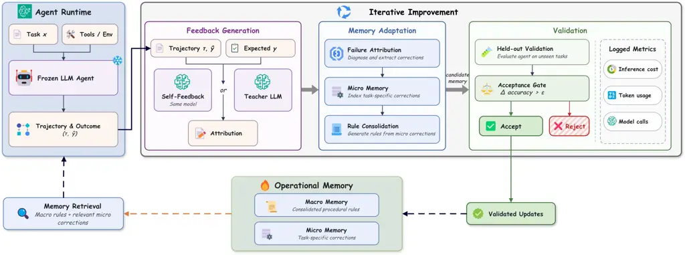

# ARISE: Practical Self-Evolving Memory for Accurate and Cost-Efficient Enterprise Agents

Jiangyun Zhang Affiliation: Tor Nitayanont, Yupei Zhang, Roopali Singh,
Yunkai Xiao, Shreya Pandit,    Zhou Tang Affiliation: Julia Huang,
Shayan Ali Akbar, Erwin Cornejo, Yuan Li, Yi Zhang    Kristen Surrao
Affiliation: Amazon    Zhiyu Chen Affiliation: {zjiangyu, tangzhou,
kmsurrao, zhiyuche, xianguan, torpong, yupei, roopalis,    Albert Guan
Affiliation: yunkxiao, pandishr, juliahuw, shayaakb, eccornej, liayuan,
yizhngn}@amazon.com

###### Abstract

Enterprise LLM agents operate in dynamic environments where foundation
models evolve rapidly, workflows update frequently, and deployments need
to satisfy accuracy and cost requirements. We propose ARISE (Agent
Refinement through Iterative Self-Evaluation), a practical memory
architecture in which the agent’s memory evolves from its own failures
without updating model weights, tools, or workflow logic. ARISE uses the
model itself or a teacher model to attribute the failures and propose
corrections. Then, ARISE keeps the corrections as retrievable micro
memory, consolidates them into macro rules, and accepts a rule update
only if held-out accuracy rises. Across 14 enterprise-workflow domains
from SOP-Bench and $`\tau^{2}`$-bench using 5 models, ARISE-Teacher,
which uses Claude Opus 4.6 for attribution and consolidation, gains
10.9 pp over the baseline on SOP-Bench and 5.8 pp on $`\tau^{2}`$-bench.
ARISE-Teacher also outperforms GEPA by 4.5 pp on $`\tau^{2}`$-bench and
1.4 pp on SOP-Bench. With the deployment model as its own attributor,
ARISE-Self still gains 10.0 pp on SOP-Bench. ARISE-Teacher uses 4.0%
fewer model calls and 5.2% fewer output tokens at comparable per-task
cost ($`-`$1.0%).

Figure 1: Overall accuracy over the 14 domains plotted against SOP-Bench
cost per task, per model. The overall accuracy is the 11:3 blend of the
suite averages in Table 2.

## 1 Introduction

Enterprise agents run on rapidly evolving LLMs, with new
state-of-the-art models appearing monthly. Standard operating procedures
(SOPs) and policies change, requiring corresponding updates to agents.
Model and workflow changes occur independently, requiring teams to
revalidate agents rather than rely on a one-time prompt update.
Rebuilding agents for these changes requires development and maintenance
effort. Each task has a cost budget, so longer prompts incur cost on
every request. Existing methods improve agents from experience through
reflection (Shinn et al., 2023), insight extraction (Zhao et al., 2024),
or prompt and context evolution (Agrawal et al., 2026; Zhang et al.,
2026). Model training (Srivastava et al., 2025) additionally requires
access to model weights. Many enterprise workflows expose verifiable
post-task outcomes, such as whether a customer request reaches its
intended system state or an SOP execution returns the correct decision.



Figure 2: ARISE architecture. The deployed model weights, tools, and
workflow logic stay fixed. An offline loop attributes failed tasks using
the trace, the output, the post-task outcome and diagnostic feedback,
stores micro corrections, consolidates macro rules, and accepts a rule
update only if held-out validation accuracy improves.

ARISE is a practical memory architecture that self-evolves while model
weights, tools, and workflow logic remain fixed (Figure 2). The offline
loop uses task traces, agent outputs, and post-task feedback to diagnose
failures. It collects failed training tasks with their expected outputs
or diagnostic feedback, asks an attributor to write scoped corrections,
stores them as micro memory, and consolidates them into at most $`K`$
macro rules. A held-out validation gate accepts a rule update only when
accuracy improves. At inference, the agent receives the macro rules and
the most similar corrections. A stronger LLM can serve as the teacher,
while the deployment model can perform attribution and consolidation
itself; the latter setting gains 10.0 pp on SOP-Bench.

Our contributions are threefold. First, we propose a dual-memory
architecture that adapts a deployed agent from its own failures without
retraining the model. The bounded rule set keeps the injected memory
compact and directly inspectable before deployment. Micro memory
preserves corrections, macro memory consolidates general guidance, and a
held-out gate controls rule updates. The same loop can be rerun when the
workflow or deployment model changes. Second, across 14
enterprise-workflow domains using 5 models, ARISE-Teacher improves over
the baseline and GEPA while using 4.0% fewer model calls and 5.2% fewer
output tokens than the baseline (Tables 2 and 10). Third, we provide
deployment guidance on the sources of the gains, the choice of
attributor, and the behavior of the validation gate (§5).

## 2 Related Work

| Method        | Attribution | Instance-level | Generalized    | Summarization   | Validation     | Injection                    |
| ------------- | ----------- | -------------- | -------------- | --------------- | -------------- | ---------------------------- |
| ExpeL         | Self        | $`\checkmark`$ | $`\checkmark`$ | Insight update  | $`\times`$     | Insights                     |
| GEPA          | Teacher     | $`\times`$     | $`\checkmark`$ | Evolution       | Pareto         | Optimized prompt             |
| ARISE-Self    | Self        | $`\checkmark`$ | $`\checkmark`$ | Bounded rewrite | $`\checkmark`$ | Top-$`k`$ + $`\leq K`$ rules |
| ARISE-Teacher | Teacher     | $`\checkmark`$ | $`\checkmark`$ | Bounded rewrite | $`\checkmark`$ | Top-$`k`$ + $`\leq K`$ rules |

Table 1: Design comparison of ARISE with ExpeL and GEPA.
_Instance-level_: task-specific experience retrieval. _Generalized_:
rules applied across tasks.

#### Agent memory and procedural knowledge.

Agent memory systems preserve information across interactions so later
decisions can reuse past context. The Generative Agents
architecture (Park et al., 2023) stores observations, reflections and
plans in a memory stream. MemGPT (Packer et al., 2023) manages memory
across context and external storage. Mem0 (Chhikara et al., 2025) and
A-MEM (Xu et al., 2025) organize long-term memories for later retrieval.
Voyager (Wang et al., 2024) accumulates executable skills from
interaction, while MemoryBank (Zhong et al., 2024) preserves long-term
user experiences. Beyond persistent storage, procedural memory extracts
reusable guidance about how an agent should act from prior trajectories.
Reflexion (Shinn et al., 2023), evaluated in our experiments, turns
feedback from failed episodes into verbal reflections reused in later
trials. ExpeL (Zhao et al., 2024) extracts reusable insights from
collected experiences and applies them to future tasks. RICP (Sun et
al., 2024) derives principles from past mistakes, while AutoGuide (Fu et
al., 2024) generates context-aware guidelines and AWM (Wang et al., 2025) induces reusable workflows. Recent systems include Memp (Fang et
al., 2026) for fine-grained and script-like procedures,
ReasoningBank (Ouyang et al., 2026) for strategies from successful and
failed experiences, ReMe (Cao et al., 2026) for adaptive reuse and
refinement, and MNL (Su et al., 2026) for performance-gated failure
memory. ARISE focuses on an operational combination of retrievable
corrections from individual failures, a separately bounded rule set, and
a validation gate for rule updates while model weights, tools, and
workflow logic remain fixed.

#### Automated prompt engineering.

Prompt engineering adapts an LLM by improving the instructions or
context supplied at inference. APE (Zhou et al., 2023) generates
candidate instructions from demonstrations and selects them using task
scores. OPRO (Yang et al., 2024) gives an LLM previous solutions and
their scores, then iteratively proposes new instructions. DSPy (Khattab
et al., 2024) represents multi-stage LM workflows as programs that can
be compiled and optimized. MIPRO (Opsahl-Ong et al., 2024) jointly
searches over instructions and demonstrations using Bayesian
optimization. ProTeGi (Pryzant et al., 2023) derives textual gradients
from minibatch errors with bandit selection. EvoPrompt (Guo et al., 2024) evolves prompts through evolutionary operators and development-set
evaluation. GEPA (Agrawal et al., 2026) uses reflective mutation and
retains a Pareto front of candidates. ACE (Zhang et al., 2026) evolves
context playbooks through reflection. In ARISE, prompt evolution applies
to macro rules.

Enterprise workflows often produce verifiable success or failure
outcomes that naturally support adaptation and reflection. At deployment
scale, additional context from prompts and memory creates recurring
serving costs. Extensive changes to the agent harness are also difficult
to maintain and govern as models and workflows change. We compare ARISE
with the evaluated baselines on accuracy while accounting for serving
calls, tokens and inference cost. Table 1 summarizes the design
differences.

## 3 The ARISE Architecture

### 3.1 Agent Runtime and Feedback

An agent $`\mathcal{A}=(p,\mathcal{T},m)`$ consists of a system prompt
$`p`$, a tool set $`\mathcal{T}`$ and a deployment model $`m`$. Given a
task $`x`$, it produces a ReAct-style trajectory $`\tau`$ (Yao et al., 2023) and an output $`\hat{y}`$:

```math
(\tau,\hat{y})=\mathcal{A}\bigl(x;\;p\oplus\mathcal{R}\oplus\mathcal{M}(x)\bigr), \tag{1}
```

where $`\mathcal{R}`$ is the set of macro rules, $`\mathcal{M}(x)`$ is
the set of micro corrections retrieved for $`x`$ (§3.5), and $`\oplus`$
denotes concatenation. The baseline is
$`\mathcal{R}=\mathcal{M}(x)=\emptyset`$. Each completed training task
yields a binary post-task outcome indicating success or failure. For a
failed task, feedback $`y`$ provides diagnostic context for attribution:
the expected decision on SOP-Bench or the failed action checks on
$`\tau^{2}`$-bench. The training data is partitioned into an iteration
set $`\mathcal{D}_{\text{train}}`$, whose failures drive memory updates,
and a validation set $`\mathcal{D}_{\text{val}}`$, on which each update
is accepted or rejected. The test set $`\mathcal{D}_{\text{test}}`$ is
used for evaluation only. ARISE modifies only the context in Eq. 1 and
leaves $`\mathcal{T}`$ and $`m`$ fixed, so it applies to closed-source
models. Training runs offline, and serving reads the accepted memory.

### 3.2 Failure Attribution

For each failure $`j`$ in an iteration batch, an attributor LLM writes a
scoped correction:

```math
c_{j}=\mathrm{Attr}\bigl(x_{j},\,y_{j},\,\hat{y}_{j},\,\tau_{j}\bigr). \tag{2}
```

The attributor $`\mathrm{Attr}`$ can be the deployment model $`m`$
itself or a stronger teacher model, using the prompt in Figure 4. Each
$`c_{j}`$ is a single line \[WHEN: condition\] action, whose condition
restricts the tasks it applies to.

Figure 3: Best SOP-Bench validation accuracy so far after each training
iteration, averaged over training runs and models. Iteration 0 is the
original prompt on the validation set.

|                                                                 |              |       |       |      |      |         |                          |                |                 |                |                             |                |                 |                |
| --------------------------------------------------------------- | ------------ | ----- | ----- | ---- | ---- | ------- | ------------------------ | -------------- | --------------- | -------------- | --------------------------- | -------------- | --------------- | -------------- |
| Model                                                           | Accuracy (%) |       |       |      |      |         | ARISE-Self over Baseline |                |                 |                | ARISE-Teacher over Baseline |                |                 |                |
|                                                                 | Base         | ExpeL | Refl. | GEPA | Self | Teacher | $`\Delta`$Acc.           | $`\Delta`$Tok. | $`\Delta`$Calls | $`\Delta`$Cost | $`\Delta`$Acc.              | $`\Delta`$Tok. | $`\Delta`$Calls | $`\Delta`$Cost |
| SOP-Bench (11 domains; one test pass per trained configuration) |              |       |       |      |      |         |                          |                |                 |                |                             |                |                 |                |
| Qwen3-32B                                                       | 65.9         | 68.2  | 67.0  | 72.8 | 78.4 | 78.1    | +12.5                    | $`-`$7.4       | $`-`$8.9        | $`-`$7.6       | +12.2                       | $`-`$6.2       | $`-`$8.6        | $`-`$6.6       |
| DeepSeek v3.2                                                   | 76.6         | 78.3  | 76.6  | 89.2 | 84.3 | 88.6    | +7.7                     | +0.8           | $`-`$2.3        | +0.8           | +12.0                       | +6.7           | $`-`$0.9        | +6.4           |
| Haiku 4.5                                                       | 79.2         | 74.7  | 78.8  | 88.3 | 87.2 | 88.0    | +8.0                     | +5.7           | +0.7            | +3.6           | +8.8                        | +0.8           | $`-`$2.6        | $`-`$0.7       |
| Sonnet 4.6                                                      | 79.2         | 75.0  | 80.2  | 87.3 | 89.4 | 89.2    | +10.2                    | +2.2           | $`-`$2.2        | +1.1           | +10.0                       | +3.6           | $`-`$2.1        | +2.4           |
| Opus 4.6                                                        | 81.7         | 82.5  | 82.7  | 92.4 | 93.1 | 93.1    | +11.4                    | $`-`$4.4       | $`-`$7.3        | $`-`$4.3       | +11.4                       | $`-`$4.4       | $`-`$7.3        | $`-`$4.3       |
| Avg                                                             | 76.5         | 75.7  | 77.1  | 86.0 | 86.5 | 87.4    | +10.0                    | $`-`$0.6       | $`-`$4.0        | $`-`$1.3       | +10.9                       | +0.1           | $`-`$4.3        | $`-`$0.6       |
| $`\tau^{2}`$-bench (3 domains)                                  |              |       |       |      |      |         |                          |                |                 |                |                             |                |                 |                |
| Qwen3-32B                                                       | 23.3         | 24.6  | 21.7  | 22.9 | 27.2 | 29.3    | +3.9                     | $`-`$9.0       | $`-`$6.5        | $`-`$9.1       | +6.0                        | $`-`$11.7      | $`-`$10.3       | $`-`$11.9      |
| DeepSeek v3.2                                                   | 54.6         | 55.4  | 56.9  | 56.5 | 55.3 | 59.2    | +0.6                     | $`-`$5.0       | $`-`$3.1        | $`-`$5.2       | +4.6                        | $`-`$2.2       | $`-`$2.5        | $`-`$2.3       |
| Haiku 4.5                                                       | 53.5         | 53.8  | 54.2  | 55.0 | 56.7 | 64.6    | +3.1                     | $`-`$4.5       | $`-`$2.7        | $`-`$4.4       | +11.1                       | $`-`$3.1       | $`-`$3.7        | $`-`$3.1       |
| Sonnet 4.6                                                      | 74.6         | 67.5  | 73.1  | 76.7 | 75.6 | 77.3    | +1.0                     | +0.1           | $`-`$0.4        | $`-`$0.3       | +2.7                        | +3.2           | +0.6            | +2.8           |
| Opus 4.6                                                        | 76.5         | 76.5  | 73.6  | 77.5 | 80.9 | 80.9    | +4.4                     | +1.8           | +0.4            | +1.7           | +4.4                        | +1.8           | +0.4            | +1.7           |
| Avg                                                             | 56.5         | 55.5  | 55.9  | 57.8 | 59.1 | 62.3    | +2.6                     | $`-`$3.3       | $`-`$2.5        | $`-`$3.4       | +5.8                        | $`-`$2.4       | $`-`$3.1        | $`-`$2.6       |
| Overall (14 domains)                                            |              |       |       |      |      |         |                          |                |                 |                |                             |                |                 |                |
| Avg                                                             | 72.2         | 71.4  | 72.5  | 80.0 | 80.6 | 82.0    | +8.4                     | $`-`$1.2       | $`-`$3.7        | $`-`$1.7       | +9.8                        | $`-`$0.4       | $`-`$4.0        | $`-`$1.0       |

Table 2: Accuracy (%) and changes from baseline (equal-domain averages,
overall weights domains 11:3). ARISE values average three runs. On
Opus 4.6 the two settings coincide, so the ARISE-Self values repeat the
ARISE-Teacher values. GEPA SOP-Bench: per-task re-evaluation.
$`\tau^{2}`$-bench evaluation trials are described in §4.1.
$`\Delta`$Acc. is in pp from unrounded values. $`\Delta`$Tok.
(input+output), $`\Delta`$Calls and $`\Delta`$Cost are in %. Bold: best.
Underline: second.

### 3.3 Memory Adaptation

#### Micro memory.

The corrections generated by $`\mathrm{Attr}`$ form micro memory and are
retrieved by embedding similarity to the incoming task.

#### Rule consolidation.

After each batch, the same model consolidates the new corrections and
current rules $`\mathcal{R}`$ into two candidates: an append candidate
that extends the current rules and a rewrite candidate built from the
new corrections. Every rule carries a \[WHEN:\] scope. Both candidates
are capped at $`K`$ rules. When the append candidate exceeds $`K`$,
existing rules are retained first. Appendix A.1 gives the two
consolidation prompts.

### 3.4 Validation Gate

With $`\mathrm{Acc}_{v}`$ the accuracy on $`\mathcal{D}_{\text{val}}`$
and $`\mathcal{M}`$ the micro store, let
$`\mathcal{D}_{\mathrm{val}}^{\mu}\subseteq\mathcal{D}_{\text{val}}`$ be
the fixed subset for validating micro retrieval and
$`\mathrm{Acc}_{v,\mu}(\mathcal{R}{+}\mathcal{M})`$ its macro-plus-micro
accuracy. Algorithm 1 applies one gate per memory level:

```math
\displaystyle\mathrm{Acc}_{v}(\mathcal{R}^{\star}) \displaystyle>\mathrm{Acc}_{v}(\mathcal{R})+\epsilon_{m} \tag{3}
```

```math
\displaystyle\mathrm{Acc}_{v,\mu}(\mathcal{R}{+}\mathcal{M}) \displaystyle\geq\mathrm{Acc}_{v}(\mathcal{R})-\epsilon_{\mu} \tag{4}
```

```math
\displaystyle\epsilon_{m} \displaystyle=\max\bigl(\epsilon_{0},\;C/|\mathcal{D}_{\text{val}}|\bigr) \tag{5}
```

Each candidate that differs from $`\mathcal{R}`$ is evaluated on
$`\mathcal{D}_{\text{val}}`$, and the better one $`\mathcal{R}^{\star}`$
is accepted only if it clears Eq. 3, whose margin widens for small
validation sets (Eq. 5). Training stops after $`P`$ consecutive
iterations without an accepted update. After training, if both stores
are nonempty, the micro gate screens retrieval by comparing macro only
accuracy on the full validation set with macro plus micro accuracy on a
fixed subset. Because the scores use different task sets, the gate does
not isolate the effect of micro retrieval. Accuracy is the only
acceptance criterion.

0:  base prompt $`p^{(0)}`$; iteration set
$`\mathcal{D}_{\mathrm{train}}`$; validation sets
$`\mathcal{D}_{\mathrm{val}},\mathcal{D}_{\mathrm{val}}^{\mu}`$;
$`k_{\max},K,B,P,\epsilon_{m}`$ (Eq. 5), $`\epsilon_{\mu}`$

1:  $`\mathcal{R},\mathcal{M}\leftarrow\emptyset`$;
$`a\leftarrow\mathrm{Acc}_{v}(\mathcal{R})`$; stale $`\leftarrow 0`$

2:  for $`k=1,\ldots,k_{\max}`$ do

3:   if stale $`\geq P`$ then break

4:   run batch $`\mathcal{B}_{k}\subseteq\mathcal{D}_{\mathrm{train}}`$,
$`|\mathcal{B}_{k}|\leq B`$, with $`p^{(0)}\!\oplus\!\mathcal{R}`$

5:   $`F_{k}\leftarrow`$ failed tasks in $`\mathcal{B}_{k}`$

6:   if $`F_{k}=\emptyset`$: stale $`\leftarrow`$ stale$`+1`$; continue

7:   $`\Delta\mathcal{M}^{(k)}\leftarrow\mathrm{Attribute}(F_{k})`$
using Eq. 2;
$`\mathcal{M}\leftarrow\mathcal{M}\cup\Delta\mathcal{M}^{(k)}`$

8:
  $`\mathcal{R}_{\mathrm{add}}\leftarrow\mathrm{Append}(\mathcal{R},\Delta\mathcal{M}^{(k)},K)`$;
$`\mathcal{R}_{\mathrm{rw}}\leftarrow\mathrm{Rewrite}(\Delta\mathcal{M}^{(k)},K)`$

9:
  $`\mathcal{C}_{k}\leftarrow\{\mathcal{R}_{\mathrm{add}},\mathcal{R}_{\mathrm{rw}}\}\setminus\{\mathcal{R}\}`$

10:   if $`\mathcal{C}_{k}=\emptyset`$: stale $`\leftarrow`$
stale$`+1`$; continue

11:
  $`\mathcal{R}^{\star}\leftarrow\arg\max_{\widetilde{\mathcal{R}}\in\mathcal{C}_{k}}\mathrm{Acc}_{v}(\widetilde{\mathcal{R}})`$

12:   if $`\mathrm{Acc}_{v}(\mathcal{R}^{\star})>a+\epsilon_{m}`$ then

13:
   $`\mathcal{R},a\leftarrow\mathcal{R}^{\star},\mathrm{Acc}_{v}(\mathcal{R}^{\star})`$;
stale $`\leftarrow 0`$

14:   else

15:    stale $`\leftarrow`$ stale$`+1`$

16:   end if

17:  end for

18:  use*micro
$`\leftarrow(\mathcal{R}\neq\emptyset)\wedge(\mathcal{M}\neq\emptyset)\wedge[\mathrm{Acc}*{v,\mu}(\mathcal{R}{+}\mathcal{M})\geq\mathrm{Acc}_{v}(\mathcal{R})-\epsilon_{\mu}]`$

19:  return $`\mathcal{R},\mathcal{M},`$ use_micro

Algorithm 1 ARISE loop.

### 3.5 Retrieval at Inference

Macro rules are injected into every prompt. If the micro gate passed,
the task input is embedded and up to $`k`$ corrections whose cosine
similarity exceeds threshold $`\theta`$ form $`\mathcal{M}(x)`$ in
Eq. 1. The injected context is bounded at $`K`$ rules and $`k`$
corrections.

### 3.6 Implementation

Figure 4 shows the two prompts. The attributor writes one scoped
correction per failed training task. The serving prompt adds the macro
rules and the retrieved corrections to the system message. The task
input and the tools stay unchanged. Appendix A gives the consolidation
prompts and the configuration.


Figure 4: Prompts that write and serve the memory. The reference notes
appear only when the micro gate passed. On $`\tau`$, {expected} holds
the failed action checks, and the two memory sections are added to the
policy prompt.

## 4 Evaluation

### 4.1 Setup

#### Benchmarks.

SOP-Bench (Nandi et al., 2025) gives each task an SOP document, inputs
and deterministic tools. We use 11 domains (1,813 tasks), split each by
row into 70% training and 30% testing, and score exact match on the
decision field. $`\tau^{2}`$-bench (Barres et al., 2026), which extends
$`\tau`$-bench (Yao et al., 2025), provides multi-turn airline, retail
and telecom conversations. We evaluate its official task files and refer
to this three-domain evaluation as $`\tau`$. For both suites, training
data is split 70/30 into iteration and validation sets.

#### Models and cost.

We use 5 models from 3 providers in Amazon Bedrock: Claude Opus 4.6,
Sonnet 4.6 and Haiku 4.5, DeepSeek v3.2, and Qwen3-32B. Agent,
attribution and consolidation calls use temperature 0. Costs use the
API’s list prices per 1M input/output tokens (US\$): Opus 5.50/27.50,
Sonnet 3.30/16.50, Haiku 1.10/5.50, DeepSeek 0.62/1.85 and Qwen
0.15/0.60.

#### Methods.

Baseline uses the original prompt. ExpeL (Zhao et al., 2024) and
Reflexion (Shinn et al., 2023) are reimplemented with the deployment
model. GEPA (Agrawal et al., 2026) uses Opus 4.6 as reflection model
(temperature 1.0). Macro uses a short diagnosis attributor followed by
ARISE consolidation and validation, without storing or retrieving micro
memory. In ARISE-Teacher, Opus 4.6 attributes and consolidates. In
ARISE-Self, the deployment model attributes its own failures and
consolidates the rules, with no stronger LLM. Each ARISE setting is
trained three times per domain and model (Appendix A.2).

#### Hyperparameters.

All models and domains use $`K{=}5`$, top-$`k{=}5`$, $`\theta{=}0.6`$, a
maximum batch size of $`B{=}30`$, $`k_{\max}{=}5`$, $`P{=}3`$,
$`\epsilon_{0}{=}2`$ pp, $`C{=}50`$, $`\epsilon_{\mu}{=}5`$ pp
(sensitivity in §4.6).

#### Metrics.

We report task success rate, or accuracy, defined as the percentage of
test tasks solved by an agent. An SOP-Bench task is solved when the
decision field exactly matches the expected label. For $`\tau`$, we use
the action evaluator implemented in the released $`\tau^{2}`$-bench
package. On $`\tau`$, Baseline, ExpeL, Reflexion, GEPA, Macro and
ARISE-Teacher use four test trials. Their accuracy is mean trial success
(pass^1), and pass^4 is the percentage of tasks solved in all four
trials. ARISE-Self uses one test pass from each of three runs in the
main and full accuracy tables, except Opus 4.6, which reuses the
identical Teacher evaluations. The compact reliability table uses four
trials from its first run. Suite averages weight domains equally, and
the overall average weights the 11 SOP-Bench and 3 $`\tau`$ domains
11:3. For efficiency we report input and output tokens, model calls and
dollar cost per task. Significance tests use a stratified paired
bootstrap over test tasks and training runs (Appendix B.1).

### 4.2 Main Results

In Table 2, ARISE-Teacher has the highest average on both suites, with
87.4% on SOP-Bench and 62.3% on $`\tau`$. It gains 10.9 pp over the
baseline on SOP-Bench, 5.8 pp on $`\tau`$ and 9.8 pp over all 14
domains. The SOP-Bench gain holds for every model, from 8.8 pp on
Haiku 4.5 to 12.2 pp on Qwen3-32B. ARISE-Self gains 10.0 pp on
SOP-Bench, while ExpeL and Reflexion stay near the baseline at $`-`$0.8
and +0.6 pp. ARISE-Teacher outperforms GEPA by 1.4 pp on SOP-Bench,
4.5 pp on $`\tau`$ and 2.0 pp overall. Opus gains more on SOP-Bench,
while Haiku gains more on $`\tau`$, suggesting workflow type matters
more than model scale. Overall gains span 8.4 to 10.9 pp across all 5
models and 3 providers (Figure 1).

| Domain  | Metric | Base | GEPA | Self | Teacher |
| ------- | ------ | ---- | ---- | ---- | ------- |
| Airline | pass^1 | 55.2 | 55.2 | 56.2 | 58.8    |
|         | pass^4 | 41.0 | 38.0 | 40.3 | 44.3    |
| Retail  | pass^1 | 48.1 | 46.1 | 49.1 | 48.5    |
|         | pass^4 | 34.0 | 28.0 | 39.8 | 38.0    |
| Telecom | pass^1 | 66.1 | 71.8 | 72.2 | 79.5    |
|         | pass^4 | 44.5 | 52.0 | 55.8 | 60.7    |

Table 3: Reliability on $`\tau`$. ARISE-Self values use four trials from
its first training run. ARISE-Teacher values average metrics from four
trials computed separately within three training runs.

Figure 5: Per-task changes in input tokens, output tokens, model calls
and inference cost for Haiku 4.5 with ARISE-Teacher relative to the
baseline. The legend uses $`\tau`$-bench for the $`\tau`$ evaluation.

Figure 6: Component variants of ARISE-Teacher on SOP-Bench (5-model
average accuracy). Labels show each variant’s difference from
ARISE-Teacher, while +10.9 marks ARISE-Teacher’s gain over the baseline.
Details: Appendix B.3.

### 4.3 Reliability

On $`\tau`$ (Table 3), ARISE-Teacher has the highest pass^4 on airline
and telecom, and ARISE-Self on retail. GEPA’s telecom pass^1 is 71.8,
but its pass^4 is 52.0, against 60.7 for ARISE-Teacher. On retail,
ARISE-Teacher raises pass^4 by 4.0 pp. On telecom, it raises pass^4 for
every model, by 10.8 to 26.7 pp (Appendix B.2), and ARISE-Self raises it
from 44.5 to 55.8.

### 4.4 Component Analysis and Cost Efficiency

#### Serving cost.

Cost includes model token charges but excludes embedding, storage and
retrieval. ARISE adds about 1,340 characters of memory per SOP-Bench
task. With ARISE-Teacher, agents nevertheless make 4.0% fewer model
calls over the 14 domains and write 4.9% fewer output tokens on
SOP-Bench and 6.4% fewer on $`\tau`$, corresponding to a 5.2% reduction
over the 14 domains. ARISE-Teacher’s per-task inference cost changes by
$`-`$1.0% over the 14 domains (Table 2). Fewer calls and shorter outputs
offset the added memory context, keeping same model inference cost near
the baseline while improving average accuracy across both benchmarks and
five models. Figure 5 shows the per-task changes for Haiku 4.5.

#### Component variants.

Figure 6 compares ARISE-Teacher with targeted variants. With the
accepted rules fixed, disabling micro retrieval gives 86.7%, retaining
10.2 pp of the 10.9 pp gain. ARISE-Self gives 86.5%, 0.9 pp lower, while
removing attribution gives 87.0%, 0.4 pp lower. Attribution shortens
stored entries from 673 to 281 characters and lowers inference cost by
6.0% when corrections are retrieved.

#### Feedback variants.

Two further ARISE-Teacher arms change only the feedback, with three
training runs each. With pass/fail feedback only, the attributor sees
that a task failed but not its expected output, and SOP-Bench accuracy
is 79.6%, 3.1 pp above the baseline. When 20% of the training tasks
carry incorrect expected labels, accuracy is 83.7%, 7.2 pp above the
baseline. ARISE-Teacher is 7.8 pp and 3.7 pp above these arms. Expected
outputs carry most of the training signal, and the loop keeps about two
thirds of its gain under 20% label noise.

#### Adaptation cost.

Each adaptation run for a model and domain has an estimated model token
cost. An ARISE-Teacher run averages \$17.46, from \$1.49 (Qwen3-32B) to
\$42.20 (Opus 4.6). This equals the estimated model token cost of
serving about 322 SOP-Bench tasks under the observed task mix
(Appendix B.4). Table 4 gives the per-model values next to the inference
cost of serving one million SOP-Bench tasks with the adapted agent.
Macro updates stop early: 91.5% of runs accepted none after iteration 3,
and 96.4% accepted none after iteration 4. Figure 3 shows the best
validation accuracy after each iteration.

| Model         | Run (\$) | 1M tasks (\$) | Tasks | Share  |
| ------------- | -------- | ------------- | ----- | ------ |
| Qwen3-32B     | 1.49     | 3,142         | 476   | 0.048% |
| DeepSeek v3.2 | 6.98     | 19,157        | 364   | 0.036% |
| Haiku 4.5     | 6.76     | 21,052        | 321   | 0.032% |
| Sonnet 4.6    | 29.85    | 94,176        | 317   | 0.032% |
| Opus 4.6      | 42.20    | 133,655       | 316   | 0.032% |
| Mean          | 17.46    | 54,236        | 322   | 0.032% |

Table 4: One-time adaptation cost of one ARISE-Teacher run and inference
cost of serving one million SOP-Bench tasks with the adapted agent.
_Tasks_: served tasks whose inference cost equals one run. _Share_: run
cost as a percentage of serving 1M tasks. Values are means over 33 runs
per model (11 domains, three runs). The mean row uses the 5-model mean
costs.

### 4.5 Case Studies


Figure 7: Case studies with Opus 4.6. ARISE outputs come from run 3.
_Before_ is the same run with retrieval switched off in Case 1 and the
baseline in Case 2. Red marks the wrong answer and green the correct
one. Excerpts are verbatim, and \[…\] marks cuts.

Figure 7 shows one test case per memory level, before and after
adaptation.

#### Case 1: micro memory.

The SOP imputes missing scores unless more than two are missing. The
labels give Unable to Decide already for two. No macro rule covers this,
and only training task 111 has two missing scores. Its correction is
retrieved for all four test tasks with two missing scores, though each
misses a different pair. These go from 0 to 4 correct, and all five
baselines miss them. The nine tasks with one missing score also retrieve
it, and none is answered Unable to Decide. Three other runs learn a
similar correction and get three or four right.

#### Case 2: macro memory.

The SOP concludes a case for an ineligible account but names no status.
The labels use FAILED. On nine such test tasks, the five baselines
answer 23 of 45 correctly, mostly erring with PENDING_ACTION. The
consolidated rule names the account states. With macro rules only, this
run answers all nine, and the 15 ARISE-Teacher runs answer 130 of 135.
Task 152 has a lifted suspension, and this run still escalates it
correctly. Three of the 15 runs close it as FAILED.

### 4.6 Hyperparameter Sensitivity

We vary one setting at a time around the default and report the
SOP-Bench 5-model average (Table 5). Each variant is a single training
run, so small differences from the three-run default should be
interpreted cautiously. The default (87.4) is the mean of three runs
whose 5-model averages are 87.2, 87.8 and 87.2 ($`\sigma`$ 0.3 pp).
Batch size, split, budget and $`\epsilon_{0}`$ stay within 1.1 pp of the
default. Top-3 retrieval at $`\theta{=}0.8`$ scores 85.6 and top-10
scores 88.2.

| Hyperparameter                                                                | Low  | Def. | High |
| ----------------------------------------------------------------------------- | ---- | ---- | ---- |
| Retrieval policy $`(k,\theta)`$                                               | 85.6 | 87.4 | 88.2 |
| Batch size $`B`$ (10 / 30 / 50)                                               | 86.3 | 87.4 | 87.6 |
| Train/val split (60/40 / 70/30 / 80/20)                                       | 87.0 | 87.4 | 88.1 |
| Budget $`k_{\max}{\times}B`$ (3$`\times`$50 / 5$`\times`$30 / 15$`\times`$10) | 87.3 | 87.4 | 87.6 |
| Macro threshold $`\epsilon_{0}`$ (1 / 2 / 5)                                  | 88.5 | 87.4 | 87.7 |

Table 5: SOP-Bench accuracy (%) under one-at-a-time changes
(low / default / high). Retrieval uses $`\theta{=}0.8`$ at $`k{=}3`$ and
$`\theta{=}0.6`$ otherwise. Bold marks the default configuration rather
than the best result.

## 5 Guidance for Enterprise Deployment

#### What drives the gains.

Consolidated rules provide most of the gain. Retrieved corrections add
0.7 pp and supply source material for rule learning. ARISE-Self retains
a 10.0 pp gain, so the same model can attribute and consolidate. The
teacher adds 0.9 pp on SOP-Bench and 3.2 pp on $`\tau`$, which suggests
more value in workflows that span conversational turns and tools.

#### Choosing the attributor.

Self-attribution needs no extra model and keeps most of the SOP-Bench
gain. A teacher helps most on multi-turn tasks.

#### Validation behavior.

The gate keeps the current rules by default and accepted no update in
32% of SOP-Bench training runs. Accepted rule sets hold 3.4 rules on
average (Figure 7 shows one). The gate checks validation accuracy only;
safety and policy checks remain separate.

#### Choosing the deployment model.

With ARISE-Teacher, Sonnet 4.6 achieves higher average accuracy than the
Opus 4.6 baseline on both benchmarks, at 33% and 39% lower inference
cost per task, respectively (Table 10). Haiku 4.5 also exceeds the
Sonnet 4.6 baseline on SOP-Bench. A cheaper model with memory can thus
beat a stronger model without it.

#### Maintenance.

When a procedure or deployment model changes, an ARISE rerun rebuilds
the memories, and the tools and base prompt stay unchanged. For
Haiku 4.5 on SOP-Bench, a rerun costs an estimated \$6.76, against
\$21,052 for serving 1M tasks.

## 6 Conclusion

ARISE is a practical memory architecture for accurate and cost-efficient
enterprise agents. It turns failed tasks into scoped corrections and a
compact set of macro rules, accepting rule updates only when they pass a
held-out validation gate. ARISE-Teacher improves over the baseline by
10.9 pp on SOP-Bench and 5.8 pp on $`\tau`$ and reduces model calls by
4.0% on average. With ARISE-Teacher, Sonnet 4.6 beats the Opus 4.6
baseline on both benchmarks at 33% and 39% lower cost per task. Without
a stronger model, ARISE-Self improves every model, including small and
open-weight models, with an overall gain of 8.4 pp, within 1.4 pp of
ARISE-Teacher. We hope ARISE helps enterprise agents adapt as their
models and procedures evolve.

## Limitations

To make ARISE easy to adapt to enterprise agents, we design it to update
the injected context through two memory levels, with a compact set of
macro rules that an operator can review before release. This design
keeps the deployed model and its tools unchanged, so the same loop
applies to closed-source models and to new model releases. Future work
can explore richer memory structures, such as graph-based memory or more
memory levels, and extend the loop to other parts of the agent harness,
such as its tools, tool descriptions and workflow logic. ARISE requires
verifiable pass or fail outcomes, which are common in enterprise
workflows, and extending it to ambiguous tasks without clear outcomes is
an important direction for future work. Average gains vary across
domains, and some model and domain combinations regress relative to the
baseline. Production use requires data governance and memory safety
controls that we do not evaluate.

## References

- Agrawal et al. (2026) L. A. Agrawal, S. Tan, D. Soylu, N. Ziems, R.
  Khare, K. Opsahl-Ong, A. Singhvi, H. Shandilya, M. J. Ryan, M.
  Jiang, C. Potts, K. Sen, A. G. Dimakis, I. Stoica, D. Klein, M.
  Zaharia, and O. Khattab GEPA: reflective prompt evolution can
  outperform reinforcement learning. In International Conference on
  Learning Representations (ICLR), Cited by: §1, §2, §4.1.
- Barres et al. (2026) V. Barres, H. Dong, S. Ray, X. Si, and K.
  Narasimhan $`\tau^{2}`$-Bench: evaluating conversational agents in a
  dual-control environment. In Proceedings of the 43rd International
  Conference on Machine Learning (ICML), Proceedings of Machine Learning
  Research, Vol. 306, pp. 6736–6782. Cited by: §4.1.
- Cao et al. (2026) Z. Cao, J. Deng, L. Yu, W. Zhou, Z. Liu, B. Ding,
  and H. Zhao Remember me, refine me: a dynamic procedural memory
  framework for experience-driven agent evolution. In Findings of the
  Association for Computational Linguistics: ACL 2026, pp. 16803–16822.
  External Links:
  [Document](https://dx.doi.org/10.18653/v1/2026.findings-acl.829),
  [Link](https://aclanthology.org/2026.findings-acl.829/) Cited by: §2.
- Chhikara et al. (2025) P. Chhikara, D. Khant, S. Aryan, T. Singh,
  and D. Yadav Mem0: building production-ready AI agents with scalable
  long-term memory. arXiv preprint arXiv:2504.19413. Cited by: §2.
- Fang et al. (2026) R. Fang, Y. Liang, X. Wang, J. Wu, S. Qiao, P.
  Xie, F. Huang, H. Chen, and N. Zhang Memp: exploring agent procedural
  memory. In Findings of the Association for Computational Linguistics:
  ACL 2026, pp. 17490–17502. External Links:
  [Document](https://dx.doi.org/10.18653/v1/2026.findings-acl.866),
  [Link](https://aclanthology.org/2026.findings-acl.866/) Cited by: §2.
- Fu et al. (2024) Y. Fu, D. Kim, J. Kim, S. Sohn, L. Logeswaran, K.
  Bae, and H. Lee AutoGuide: automated generation and selection of
  context-aware guidelines for large language model agents. In Advances
  in Neural Information Processing Systems (NeurIPS), Vol. 37. Cited by:
  §2.
- Guo et al. (2024) Q. Guo, R. Wang, J. Guo, B. Li, K. Song, X. Tan, G.
  Liu, J. Bian, and Y. Yang Connecting large language models with
  evolutionary algorithms yields powerful prompt optimizers. In
  International Conference on Learning Representations (ICLR), Cited by:
  §2.
- Khattab et al. (2024) O. Khattab, A. Singhvi, P. Maheshwari, Z.
  Zhang, K. Santhanam, S. Vardhamanan, S. Haq, A. Sharma, T. T.
  Joshi, H. Moazam, H. Miller, M. Zaharia, and C. Potts DSPy: compiling
  declarative language model calls into state-of-the-art pipelines. In
  International Conference on Learning Representations (ICLR), Cited by:
  §2.
- Nandi et al. (2025) S. Nandi, A. Datta, R. Nama, U. Patel, N.
  Vichare, I. Bhattacharya, P. Grover, S. Asija, G. Carenini, W.
  Zhang, A. Gupta, S. Bhaduri, J. Xu, H. Raja, S. Ray, A. Chan, E. X.
  Fei, G. Du, Z. Akhtar, H. Asnani, W. Chan, M. Xiong, F. Carbone,
  and J. Mirchandani SOP-Bench: complex industrial SOPs for evaluating
  LLM agents. arXiv preprint arXiv:2506.08119. Cited by: §4.1.
- Opsahl-Ong et al. (2024) K. Opsahl-Ong, M. J. Ryan, J. Purtell, D.
  Broman, C. Potts, M. Zaharia, and O. Khattab Optimizing instructions
  and demonstrations for multi-stage language model programs. In
  Conference on Empirical Methods in Natural Language Processing
  (EMNLP), Cited by: §2.
- Ouyang et al. (2026) S. Ouyang, J. Yan, I. Hsu, Y. Chen, K. Jiang, Z.
  Wang, R. Han, L. T. Le, S. Daruki, X. Tang, V. Tirumalashetty, G.
  Lee, M. Rofouei, H. Lin, J. Han, C. Lee, and T. Pfister ReasoningBank:
  scaling agent self-evolving with reasoning memory. In International
  Conference on Learning Representations (ICLR), External Links:
  [Link](https://arxiv.org/abs/2509.25140) Cited by: §2.
- Packer et al. (2023) C. Packer, S. Wooders, K. Lin, V. Fang, S. G.
  Patil, I. Stoica, and J. E. Gonzalez MemGPT: towards LLMs as operating
  systems. arXiv preprint arXiv:2310.08560. Cited by: §2.
- Park et al. (2023) J. S. Park, J. C. O’Brien, C. J. Cai, M. R.
  Morris, P. Liang, and M. S. Bernstein Generative agents: interactive
  simulacra of human behavior. In ACM Symposium on User Interface
  Software and Technology (UIST), Cited by: §2.
- Pryzant et al. (2023) R. Pryzant, D. Iter, J. Li, Y. T. Lee, C. Zhu,
  and M. Zeng Automatic prompt optimization with “gradient descent” and
  beam search. In Conference on Empirical Methods in Natural Language
  Processing (EMNLP), Cited by: §2.
- Shinn et al. (2023) N. Shinn, F. Cassano, A. Gopinath, K. Narasimhan,
  and S. Yao Reflexion: language agents with verbal reinforcement
  learning. In Advances in Neural Information Processing Systems
  (NeurIPS), Cited by: §1, §2, §4.1.
- Srivastava et al. (2025) G. Srivastava, Z. Bi, M. Lu, and X. Wang
  Debate, train, evolve: self-evolution of language model reasoning. In
  Conference on Empirical Methods in Natural Language Processing
  (EMNLP), Cited by: §1.
- Su et al. (2026) X. Su, Y. Zhang, H. Luo, X. Liu, and L. Huang Mistake
  notebook learning: batch-clustered failures for training-free agent
  adaptation. In Findings of the Association for Computational
  Linguistics: ACL 2026, pp. 14629–14645. External Links:
  [Document](https://dx.doi.org/10.18653/v1/2026.findings-acl.719),
  [Link](https://aclanthology.org/2026.findings-acl.719/) Cited by: §2.
- Sun et al. (2024) H. Sun, Y. Jiang, B. Wang, Y. Hou, Y. Zhang, P. Xie,
  and F. Huang Retrieved in-context principles from previous mistakes.
  In Proceedings of the 2024 Conference on Empirical Methods in Natural
  Language Processing (EMNLP), External Links:
  [Document](https://dx.doi.org/10.18653/v1/2024.emnlp-main.465),
  [Link](https://aclanthology.org/2024.emnlp-main.465/) Cited by: §2.
- Wang et al. (2024) G. Wang, Y. Xie, Y. Jiang, A. Mandlekar, C.
  Xiao, Y. Zhu, L. Fan, and A. Anandkumar Voyager: an open-ended
  embodied agent with large language models. Transactions on Machine
  Learning Research (TMLR). Cited by: §2.
- Wang et al. (2025) Z. Z. Wang, J. Mao, D. Fried, and G. Neubig Agent
  workflow memory. In Proceedings of the 42nd International Conference
  on Machine Learning (ICML), Proceedings of Machine Learning Research,
  Vol. 267, pp. 63897–63911. External Links:
  [Link](https://proceedings.mlr.press/v267/wang25bx.html) Cited by: §2.
- Xu et al. (2025) W. Xu, Z. Liang, K. Mei, H. Gao, J. Tan, and Y. Zhang
  A-MEM: agentic memory for LLM agents. In Advances in Neural
  Information Processing Systems (NeurIPS), Cited by: §2.
- Yang et al. (2024) C. Yang, X. Wang, Y. Lu, H. Liu, Q. V. Le, D. Zhou,
  and X. Chen Large language models as optimizers. In International
  Conference on Learning Representations (ICLR), Cited by: §2.
- Yao et al. (2025) S. Yao, N. Shinn, P. Razavi, and K. Narasimhan
  $`\tau`$-Bench: a benchmark for tool-agent-user interaction in
  real-world domains. In International Conference on Learning
  Representations (ICLR), Cited by: §4.1.
- Yao et al. (2023) S. Yao, J. Zhao, D. Yu, N. Du, I. Shafran, K.
  Narasimhan, and Y. Cao ReAct: synergizing reasoning and acting in
  language models. In International Conference on Learning
  Representations (ICLR), Cited by: §3.1.
- Zhang et al. (2026) Q. Zhang, C. Hu, S. Upasani, B. Ma, F. Hong, V.
  Kamanuru, J. Rainton, C. Wu, M. Ji, H. Li, U. Thakker, J. Zou, and K.
  Olukotun Agentic context engineering: evolving contexts for
  self-improving language models. In International Conference on
  Learning Representations (ICLR), Cited by: §1, §2.
- Zhao et al. (2024) A. Zhao, D. Huang, Q. Xu, M. Lin, Y. Liu, and G.
  Huang ExpeL: LLM agents are experiential learners. In AAAI Conference
  on Artificial Intelligence, Cited by: §1, §2, §4.1.
- Zhong et al. (2024) W. Zhong, L. Guo, Q. Gao, H. Ye, and Y. Wang
  MemoryBank: enhancing large language models with long-term memory. In
  AAAI Conference on Artificial Intelligence, Cited by: §2.
- Zhou et al. (2023) Y. Zhou, A. I. Muresanu, Z. Han, K. Paster, S.
  Pitis, H. Chan, and J. Ba Large language models are human-level prompt
  engineers. In International Conference on Learning Representations
  (ICLR), Cited by: §2.

## Appendix A Implementation Details

### A.1 Consolidation Prompts

Consolidation receives the corrections from the current batch. Figure 4
gives the attributor prompt.


### A.2 Configuration

| Setting         | Value                                                                                                                                                                                   |
| --------------- | --------------------------------------------------------------------------------------------------------------------------------------------------------------------------------------- | --------------------------- | --------------------------------------------------------------------------------------------------------------------------------------------------------------------------------------------- |
| Models          | Opus 4.6, Sonnet 4.6, Haiku 4.5, DeepSeek v3.2 and Qwen3-32B via Amazon Bedrock                                                                                                         |
| Temperature     | 0 for the agent and ARISE, 1.0 for GEPA                                                                                                                                                 |
| Simulator       | Opus 4.6, temperature 1.0                                                                                                                                                               |
| Data splits     | SOP-Bench train and test split by row at 70/30. $`\tau^{2}`$ official splits 30/20, 74/40 and 74/40. Training sets shuffled with seed 42, then split 70/30 for iteration and validation |
| Validation size | SOP-Bench 14 to 58, airline 9, retail 23, telecom 23                                                                                                                                    |
| Memory          | 5 macro rules, 5 retrieved corrections, cosine threshold $`\theta{=}0.6`$                                                                                                               |
| Adaptation      | Batch size 30, at most 5 iterations, patience 3, macro margin $`\max(2\,\mathrm{pp},50/                                                                                                 | \mathcal{D}\_{\mathrm{val}} | )`$. The micro gate uses the first 20 validation tasks when available with a 5 pp tolerance. During adaptation, validation scores average three evaluations for telecom and use one elsewhere |
| Step limits     | SOP-Bench 10 turns, airline and retail 30 steps, telecom 200 steps                                                                                                                      |
| Embedding       | Cohere Embed English v3, 1,024 dimensions, cosine similarity                                                                                                                            |
| Pricing         | Bedrock US East on demand prices                                                                                                                                                        |
| GEPA budget     | Opus 4.6, 200 metric calls for SOP-Bench and 100 for $`\tau`$                                                                                                                           |

Table 6: Settings used in the reported runs.

#### Domain coverage.

We use the 11 domains listed in Section 4.1. Email intent and video
annotation are omitted because their released data and scoring
interfaces are incompatible with our evaluation.

## Appendix B Additional Results

### B.1 Significance Tests

Each comparison with Table 2 uses a stratified paired bootstrap over
test tasks. Tasks are paired by ID within each domain$`\times`$model
cell and resampled with the same draw for both methods. For $`\tau`$
evaluations with four trials, each task keeps its trials together. For
methods with multiple training runs, each replicate first resamples the
reported run units within the cell, then the tasks. The statistic is the
value the table prints: a per-model value, a 5-model average or the 11:3
overall average. Accuracy comparisons use 10,000 resamples and
efficiency comparisons 5,000. Two sided $`p`$ values double the smaller
empirical tail probability of the uncentered bootstrap difference, use
the $`+1`$ correction, count ties in both tails, and cap at one. We use
seed 0 and report unadjusted $`p`$ values. Table 7 gives the accuracy
comparisons of the averages.

| Comparison     | SOP                | $`\tau`$          | Overall           |
| -------------- | ------------------ | ----------------- | ----------------- |
| Teacher / Base | +10.9 ($`{<}`$.01) | +5.8 ($`{<}`$.01) | +9.8 ($`{<}`$.01) |
| Self / Base    | +10.0 ($`{<}`$.01) | +2.6 (.05)        | +8.4 ($`{<}`$.01) |
| Teacher / GEPA | +1.4 (.02)         | +4.5 ($`{<}`$.01) | +2.0 ($`{<}`$.01) |

Table 7: Accuracy differences of the averages in Table 2 (A / B: A minus
B in pp), with $`p`$ values in parentheses.

#### Task-weighted averages.

Pooling task outcomes across all cells, thereby weighting domains by
test-set size, ARISE-Teacher reaches 88.7 on SOP-Bench against 77.2 for
the baseline (+11.5 pp) and 63.0 on $`\tau`$ against 56.8 (+6.2 pp).
Against GEPA the pooled differences are +1.9 pp on SOP-Bench and +4.7 pp
on $`\tau`$. ARISE-Self reaches 87.9 on SOP-Bench (+10.7 pp over the
baseline).

#### Micro memory.

To isolate micro memory, every trained run was re-evaluated on its test
tasks with its accepted macro rules and micro retrieval switched off.
Runs whose test phase retrieved no correction retained their stored
result. With the rules fixed, micro memory adds 0.7 pp on SOP-Bench for
ARISE-Teacher (87.4 vs. 86.7, fixing 186 test cases and breaking 118)
and 0.6 pp for ARISE-Self.

### B.2 $`\tau`$ Consistency

For a task with $`s`$ successes among four trials, we compute

```math
\mathrm{pass}^{k}=\frac{\binom{s}{k}}{\binom{4}{k}},\qquad\mathrm{pass}@k=1-\frac{\binom{4-s}{k}}{\binom{4}{k}}.
```

We average these values over tasks within each run. ARISE-Teacher values
then average the three training runs. Table 8 reports pass^k for
$`k{=}1,\dots,4`$ and pass@$`k`$ for $`k{=}2,3,4`$, averaged over 5
models. Table 9 gives per-model values for Baseline and ARISE-Teacher.

|         |          | pass^k (all $`k`$) |      |      |      | pass@$`k`$ ($`\geq`$1 of $`k`$) |      |      |
| ------- | -------- | ------------------ | ---- | ---- | ---- | ------------------------------- | ---- | ---- |
| Domain  | Method   | $`k`$=1            | 2    | 3    | 4    | 2                               | 3    | 4    |
| Airline | Baseline | 55.2               | 46.8 | 43.0 | 41.0 | 63.7                            | 68.2 | 71.0 |
|         | GEPA     | 55.2               | 46.8 | 41.8 | 38.0 | 63.7                            | 67.0 | 69.0 |
|         | Macro    | 56.8               | 48.0 | 42.2 | 38.0 | 65.5                            | 68.5 | 70.0 |
|         | ARISE-T  | 58.8               | 51.4 | 47.2 | 44.3 | 66.1                            | 69.2 | 71.0 |
| Retail  | Baseline | 48.1               | 40.8 | 36.8 | 34.0 | 55.5                            | 58.9 | 61.0 |
|         | GEPA     | 46.1               | 36.8 | 31.4 | 28.0 | 55.5                            | 59.5 | 61.5 |
|         | Macro    | 47.6               | 39.0 | 34.0 | 30.0 | 56.2                            | 59.9 | 62.5 |
|         | ARISE-T  | 48.5               | 43.1 | 40.2 | 38.0 | 53.9                            | 56.4 | 58.0 |
| Telecom | Baseline | 66.1               | 55.3 | 49.0 | 44.5 | 76.9                            | 81.4 | 84.0 |
|         | GEPA     | 71.8               | 62.3 | 56.4 | 52.0 | 81.2                            | 84.6 | 86.5 |
|         | Macro    | 74.8               | 62.9 | 55.0 | 49.0 | 86.6                            | 90.5 | 92.5 |
|         | ARISE-T  | 79.5               | 70.2 | 64.5 | 60.7 | 88.8                            | 92.4 | 94.2 |

Table 8: Full $`\tau`$ consistency (%), averaged over 5 models. pass^k:
solved in all $`k`$ trials; pass@$`k`$: solved in at least one of $`k`$
trials. Best per domain in bold.

|               |         | Baseline |      |       | ARISE-Teacher |      |       |               |
| ------------- | ------- | -------- | ---- | ----- | ------------- | ---- | ----- | ------------- |
| Model         | Domain  | p^1      | p^4  | p@4   | p^1           | p^4  | p@4   | $`\Delta`$p^4 |
| Opus 4.6      | Airline | 78.8     | 60.0 | 90.0  | 77.5          | 61.7 | 88.3  | $`+`$1.7      |
|               | Retail  | 67.5     | 62.5 | 75.0  | 66.9          | 64.2 | 69.2  | $`+`$1.7      |
|               | Telecom | 83.1     | 67.5 | 100.0 | 98.3          | 94.2 | 100.0 | $`+`$26.7     |
| Sonnet 4.6    | Airline | 81.2     | 75.0 | 90.0  | 77.5          | 68.3 | 86.7  | $`-`$6.7      |
|               | Retail  | 58.8     | 45.0 | 70.0  | 60.2          | 51.7 | 69.2  | $`+`$6.7      |
|               | Telecom | 83.8     | 67.5 | 95.0  | 94.2          | 81.7 | 100.0 | $`+`$14.2     |
| Haiku 4.5     | Airline | 55.0     | 30.0 | 85.0  | 64.6          | 43.3 | 76.7  | $`+`$13.3     |
|               | Retail  | 55.0     | 30.0 | 77.5  | 57.9          | 43.3 | 70.0  | $`+`$13.3     |
|               | Telecom | 50.6     | 32.5 | 62.5  | 71.2          | 45.0 | 95.0  | $`+`$12.5     |
| DeepSeek v3.2 | Airline | 41.2     | 30.0 | 55.0  | 50.4          | 36.7 | 60.0  | $`+`$6.7      |
|               | Retail  | 39.4     | 27.5 | 50.0  | 38.1          | 25.8 | 52.5  | $`-`$1.7      |
|               | Telecom | 83.1     | 52.5 | 100.0 | 89.0          | 69.2 | 99.2  | $`+`$16.7     |
| Qwen3-32B     | Airline | 20.0     | 10.0 | 35.0  | 23.8          | 11.7 | 43.3  | $`+`$1.7      |
|               | Retail  | 20.0     | 5.0  | 32.5  | 19.6          | 5.0  | 29.2  | $`+`$0.0      |
|               | Telecom | 30.0     | 2.5  | 62.5  | 44.6          | 13.3 | 76.7  | $`+`$10.8     |

Table 9: Per-model $`\tau`$ consistency (%): Baseline vs. ARISE-Teacher
on pass^1, pass^4 and pass@4. In the column headings, $`p`$ abbreviates
pass; the last column is the change in pass^4.

### B.3 Component Variants

Figure 6 reports three variants. _w/o micro memory_ reevaluates every
ARISE-Teacher run with its accepted rules and micro retrieval switched
off. _w/o attribution_ stores each failed trace with its expected output
instead of a correction. _w/o teacher_ is ARISE-Self, in which the
deployment model attributes and consolidates.

### B.4 Adaptation versus Inference Cost

Adaptation cost includes initial baseline validation, training batches,
candidate validation, final micro gate validation, attribution and
consolidation. It excludes embedding calls and final testing. Agent
executions use each run’s test phase cost per task, while attribution
and consolidation use observed input tokens and the maximum output token
budget. Across models, one run costs \$1.49 to \$42.20, with a mean of
\$17.46, equivalent to 316 to 476 served tasks and 322 at the 5 model
mean.

### B.5 Inference Efficiency

Table 10 reports per-task input tokens, output tokens, model calls and
cost for every model and method. Per-task cost is
$`(\text{input tokens}/10^{6})P_{\mathrm{in}}+(\text{output tokens}/10^{6})P_{\mathrm{out}}`$
with the prices in §4.1. On SOP-Bench, the 5-model mean cost per task is
\$0.0548 for the baseline, \$0.0539 for ARISE-Self and \$0.0542 for
ARISE-Teacher. Table 2 reports the mean of the 5 per-model changes,
computed from unrounded values.

|            |               | SOP-Bench |        |       |        | $`\tau`$ |        |       |        |
| ---------- | ------------- | --------- | ------ | ----- | ------ | -------- | ------ | ----- | ------ |
| Method     | Model         | InTok     | OutTok | Calls | Cost   | InTok    | OutTok | Calls | Cost   |
| Baseline   | Qwen3-32B     | 21,105    | 333    | 5.28  | 0.0034 | 135,231  | 1,260  | 16.74 | 0.0210 |
|            | DeepSeek v3.2 | 25,695    | 1,121  | 6.06  | 0.0180 | 119,780  | 2,267  | 14.25 | 0.0785 |
|            | Haiku 4.5     | 13,570    | 1,141  | 2.89  | 0.0212 | 113,758  | 2,106  | 12.06 | 0.1367 |
|            | Sonnet 4.6    | 20,461    | 1,479  | 3.96  | 0.0919 | 103,453  | 1,529  | 11.69 | 0.3666 |
|            | Opus 4.6      | 19,595    | 1,157  | 3.79  | 0.1396 | 103,803  | 1,651  | 11.36 | 0.6163 |
| ExpeL      | Qwen3-32B     | 22,236    | 332    | 5.42  | 0.0035 | 141,931  | 1,126  | 17.28 | 0.0220 |
|            | DeepSeek v3.2 | 26,545    | 1,134  | 5.95  | 0.0186 | 131,635  | 2,216  | 15.09 | 0.0857 |
|            | Haiku 4.5     | 14,454    | 1,190  | 2.95  | 0.0224 | 94,485   | 1,895  | 10.47 | 0.1144 |
|            | Sonnet 4.6    | 21,086    | 1,554  | 3.89  | 0.0952 | 94,836   | 1,454  | 10.56 | 0.3369 |
|            | Opus 4.6      | 20,168    | 1,216  | 3.69  | 0.1444 | 104,654  | 1,640  | 11.03 | 0.6207 |
| Reflexion  | Qwen3-32B     | 22,292    | 334    | 5.40  | 0.0035 | 152,999  | 1,361  | 17.86 | 0.0238 |
|            | DeepSeek v3.2 | 26,822    | 1,126  | 6.08  | 0.0187 | 122,657  | 2,266  | 14.22 | 0.0802 |
|            | Haiku 4.5     | 15,056    | 1,163  | 3.07  | 0.0230 | 105,005  | 2,090  | 11.21 | 0.1270 |
|            | Sonnet 4.6    | 20,481    | 1,410  | 3.90  | 0.0908 | 98,030   | 1,373  | 11.06 | 0.3461 |
|            | Opus 4.6      | 19,373    | 1,130  | 3.70  | 0.1376 | 116,948  | 1,664  | 12.47 | 0.6890 |
| GEPA       | Qwen3-32B     | 16,618    | 248    | 4.20  | 0.0026 | 126,442  | 1,128  | 15.45 | 0.0196 |
|            | DeepSeek v3.2 | 26,327    | 1,088  | 5.88  | 0.0183 | 126,112  | 2,202  | 14.20 | 0.0823 |
|            | Haiku 4.5     | 14,203    | 1,086  | 2.82  | 0.0216 | 95,109   | 1,883  | 10.55 | 0.1150 |
|            | Sonnet 4.6    | 21,039    | 1,323  | 3.89  | 0.0913 | 112,433  | 1,511  | 11.93 | 0.3960 |
|            | Opus 4.6      | 19,146    | 1,121  | 3.61  | 0.1361 | 114,313  | 1,691  | 11.73 | 0.6752 |
| Macro      | Qwen3-32B     | 18,396    | 283    | 4.75  | 0.0029 | 150,155  | 1,446  | 17.86 | 0.0234 |
|            | DeepSeek v3.2 | 26,314    | 1,175  | 6.03  | 0.0185 | 113,099  | 2,178  | 13.57 | 0.0742 |
|            | Haiku 4.5     | 13,690    | 1,060  | 2.86  | 0.0209 | 110,927  | 2,266  | 11.70 | 0.1345 |
|            | Sonnet 4.6    | 20,545    | 1,525  | 3.84  | 0.0930 | 111,477  | 1,499  | 12.17 | 0.3926 |
|            | Opus 4.6      | 19,027    | 1,147  | 3.63  | 0.1362 | 106,030  | 1,803  | 11.25 | 0.6327 |
| ARISE-Self | Qwen3-32B     | 19,561    | 297    | 4.82  | 0.0031 | 123,172  | 1,083  | 15.65 | 0.0191 |
|            | DeepSeek v3.2 | 25,981    | 1,128  | 5.94  | 0.0182 | 113,840  | 2,046  | 13.81 | 0.0744 |
|            | Haiku 4.5     | 14,451    | 1,105  | 2.91  | 0.0220 | 108,659  | 2,034  | 11.73 | 0.1307 |
|            | Sonnet 4.6    | 20,926    | 1,440  | 3.87  | 0.0928 | 103,618  | 1,437  | 11.65 | 0.3656 |
|            | Opus 4.6      | 18,729    | 1,114  | 3.51  | 0.1337 | 105,655  | 1,672  | 11.40 | 0.6271 |
| ARISE-T    | Qwen3-32B     | 19,827    | 280    | 4.83  | 0.0031 | 119,508  | 1,014  | 15.02 | 0.0185 |
|            | DeepSeek v3.2 | 27,471    | 1,148  | 6.00  | 0.0192 | 117,207  | 2,142  | 13.89 | 0.0766 |
|            | Haiku 4.5     | 13,755    | 1,077  | 2.82  | 0.0211 | 110,278  | 2,037  | 11.62 | 0.1325 |
|            | Sonnet 4.6    | 21,266    | 1,454  | 3.88  | 0.0942 | 106,896  | 1,455  | 11.76 | 0.3768 |
|            | Opus 4.6      | 18,729    | 1,114  | 3.51  | 0.1337 | 105,655  | 1,672  | 11.40 | 0.6271 |

Table 10: Per-task efficiency: average input tokens, output tokens,
model calls and cost (\$) per model and method. SOP-Bench is averaged
over 11 domains and $`\tau`$ over 3 domains. GEPA’s SOP-Bench values
come from the test pass of its own run. On Opus 4.6 the ARISE-Self row
repeats ARISE-Teacher.

### B.6 Full Results

Table 11 reports SOP-Bench accuracy for every model, domain and method;
Table 12 does the same for $`\tau`$.

| Domain          | Model         | Baseline | ExpeL | Reflexion | GEPA  | Macro | Self  | ARISE-T |
| --------------- | ------------- | -------- | ----- | --------- | ----- | ----- | ----- | ------- |
| Aircraft Insp.  | Opus 4.6      | 97.1     | 88.2  | 97.1      | 97.1  | 97.1  | 96.9  | 96.9    |
|                 | Sonnet 4.6    | 67.6     | 97.1  | 67.6      | 94.1  | 97.1  | 97.1  | 97.0    |
|                 | Haiku 4.5     | 97.1     | 97.1  | 97.1      | 97.1  | 97.1  | 97.1  | 97.1    |
|                 | DeepSeek v3.2 | 79.4     | 73.5  | 85.3      | 94.1  | 91.2  | 85.3  | 86.3    |
|                 | Qwen3-32B     | 97.1     | 97.1  | 97.1      | 94.1  | 97.1  | 96.1  | 95.1    |
| Content Flag.   | Opus 4.6      | 37.3     | 62.7  | 43.2      | 92.2  | 94.1  | 92.8  | 92.8    |
|                 | Sonnet 4.6    | 37.3     | 41.2  | 45.1      | 70.6  | 82.4  | 87.6  | 86.3    |
|                 | Haiku 4.5     | 7.8      | 11.8  | 7.8       | 80.4  | 78.4  | 81.7  | 77.8    |
|                 | DeepSeek v3.2 | 51.1     | 49.0  | 52.9      | 86.3  | 72.5  | 64.7  | 88.2    |
|                 | Qwen3-32B     | 0.0      | 0.0   | 0.0       | 11.8  | 43.1  | 49.7  | 49.7    |
| Customer Svc.   | Opus 4.6      | 87.2     | 100.0 | 89.4      | 97.9  | 97.9  | 98.6  | 98.6    |
|                 | Sonnet 4.6    | 91.5     | 93.6  | 93.6      | 93.6  | 100.0 | 93.6  | 100.0   |
|                 | Haiku 4.5     | 87.2     | 87.2  | 87.2      | 100.0 | 100.0 | 100.0 | 100.0   |
|                 | DeepSeek v3.2 | 46.8     | 85.1  | 38.3      | 97.9  | 100.0 | 81.6  | 97.9    |
|                 | Qwen3-32B     | 40.4     | 51.1  | 31.9      | 66.0  | 95.7  | 85.8  | 71.6    |
| Dangerous Gds.  | Opus 4.6      | 74.7     | 85.5  | 75.9      | 90.4  | 90.4  | 95.6  | 95.6    |
|                 | Sonnet 4.6    | 74.7     | 74.7  | 74.7      | 95.2  | 81.9  | 93.6  | 89.6    |
|                 | Haiku 4.5     | 86.7     | 88.0  | 85.5      | 89.2  | 95.2  | 92.0  | 92.0    |
|                 | DeepSeek v3.2 | 69.9     | 68.7  | 68.7      | 69.9  | 71.1  | 86.3  | 93.6    |
|                 | Qwen3-32B     | 56.6     | 60.2  | 67.5      | 74.7  | 50.6  | 88.4  | 90.0    |
| Know Your Biz.  | Opus 4.6      | 60.7     | 50.0  | 60.7      | 82.1  | 78.6  | 83.3  | 83.3    |
|                 | Sonnet 4.6    | 60.7     | 60.7  | 60.7      | 57.1  | 57.1  | 57.1  | 58.3    |
|                 | Haiku 4.5     | 57.1     | 53.6  | 50.0      | 53.6  | 53.6  | 53.6  | 54.8    |
|                 | DeepSeek v3.2 | 60.7     | 60.7  | 60.7      | 78.6  | 71.4  | 59.5  | 63.1    |
|                 | Qwen3-32B     | 53.6     | 53.6  | 53.6      | 53.6  | 46.4  | 48.8  | 53.6    |
| Patient Intake  | Opus 4.6      | 85.0     | 85.0  | 85.0      | 85.0  | 85.0  | 84.9  | 84.9    |
|                 | Sonnet 4.6    | 85.0     | 20.0  | 80.0      | 85.0  | 80.0  | 80.0  | 86.2    |
|                 | Haiku 4.5     | 85.0     | 80.0  | 85.0      | 85.0  | 85.0  | 85.0  | 85.0    |
|                 | DeepSeek v3.2 | 77.8     | 85.0  | 85.0      | 85.0  | 85.0  | 85.0  | 85.0    |
|                 | Qwen3-32B     | 85.0     | 85.0  | 85.0      | 85.0  | 85.0  | 85.0  | 85.0    |
| Referral v1     | Opus 4.6      | 96.7     | 100.0 | 96.7      | 98.3  | 100.0 | 98.3  | 98.3    |
|                 | Sonnet 4.6    | 91.7     | 98.3  | 96.7      | 95.0  | 96.7  | 100.0 | 98.9    |
|                 | Haiku 4.5     | 95.0     | 95.0  | 96.7      | 95.0  | 100.0 | 99.4  | 100.0   |
|                 | DeepSeek v3.2 | 98.3     | 95.0  | 96.7      | 96.7  | 95.0  | 97.2  | 98.9    |
|                 | Qwen3-32B     | 90.0     | 90.0  | 100.0     | 93.3  | 98.3  | 100.0 | 99.4    |
| Referral v2     | Opus 4.6      | 96.7     | 95.0  | 96.7      | 96.7  | 96.7  | 96.6  | 96.6    |
|                 | Sonnet 4.6    | 95.0     | 95.0  | 96.7      | 91.7  | 95.0  | 95.6  | 95.6    |
|                 | Haiku 4.5     | 90.0     | 90.0  | 90.0      | 93.3  | 88.3  | 86.1  | 90.0    |
|                 | DeepSeek v3.2 | 96.7     | 96.7  | 95.0      | 96.7  | 98.3  | 96.1  | 96.1    |
|                 | Qwen3-32B     | 35.0     | 43.3  | 36.7      | 48.3  | 40.0  | 46.1  | 40.0    |
| Traffic Spoof.  | Opus 4.6      | 86.7     | 60.0  | 86.7      | 86.7  | 86.7  | 86.7  | 86.7    |
|                 | Sonnet 4.6    | 86.7     | 86.7  | 86.7      | 86.7  | 81.7  | 86.7  | 79.4    |
|                 | Haiku 4.5     | 86.7     | 85.0  | 86.7      | 86.7  | 86.7  | 75.0  | 86.7    |
|                 | DeepSeek v3.2 | 85.0     | 68.3  | 81.7      | 86.7  | 85.0  | 86.1  | 75.0    |
|                 | Qwen3-32B     | 86.7     | 86.7  | 86.7      | 86.7  | 86.7  | 84.4  | 86.7    |
| Video Class.    | Opus 4.6      | 95.0     | 98.3  | 96.7      | 96.7  | 98.3  | 97.2  | 97.2    |
|                 | Sonnet 4.6    | 98.3     | 75.0  | 98.3      | 98.3  | 96.7  | 98.3  | 96.1    |
|                 | Haiku 4.5     | 98.3     | 91.7  | 98.3      | 98.3  | 98.3  | 95.6  | 95.6    |
|                 | DeepSeek v3.2 | 95.0     | 96.7  | 96.7      | 96.7  | 96.7  | 96.1  | 97.2    |
|                 | Qwen3-32B     | 98.3     | 98.3  | 96.7      | 96.7  | 96.7  | 98.3  | 98.3    |
| Warehouse Insp. | Opus 4.6      | 82.2     | 82.2  | 82.2      | 93.3  | 93.3  | 93.3  | 93.3    |
|                 | Sonnet 4.6    | 82.2     | 82.2  | 82.2      | 93.3  | 93.3  | 93.3  | 93.3    |
|                 | Haiku 4.5     | 80.0     | 42.2  | 82.2      | 93.3  | 91.1  | 93.3  | 88.9    |
|                 | DeepSeek v3.2 | 82.2     | 82.2  | 82.2      | 93.3  | 93.3  | 89.6  | 93.3    |
|                 | Qwen3-32B     | 82.2     | 84.4  | 82.2      | 91.1  | 84.4  | 80.0  | 89.6    |

Table 11: Full SOP-Bench accuracy (%) per model, domain and method.
ARISE-Teacher (ARISE-T) and ARISE-Self (Self) average three training
runs, and on Opus 4.6 the Self cells repeat ARISE-T. Baseline, ExpeL,
Reflexion, GEPA and Macro use one run. GEPA is the per-task
re-evaluation of its best prompt (§4.1).

| Domain  | Model         | Baseline | ExpeL | Reflexion | GEPA | Macro | Self | ARISE-T |
| ------- | ------------- | -------- | ----- | --------- | ---- | ----- | ---- | ------- |
| Airline | Opus 4.6      | 78.8     | 78.8  | 75.0      | 75.0 | 73.8  | 77.5 | 77.5    |
|         | Sonnet 4.6    | 81.2     | 78.8  | 75.0      | 77.5 | 72.5  | 76.7 | 77.5    |
|         | Haiku 4.5     | 55.0     | 61.2  | 62.5      | 56.2 | 62.5  | 51.7 | 64.6    |
|         | DeepSeek v3.2 | 41.2     | 48.8  | 52.5      | 50.0 | 48.8  | 46.7 | 50.4    |
|         | Qwen3-32B     | 20.0     | 23.8  | 20.0      | 17.5 | 26.2  | 18.3 | 23.8    |
| Retail  | Opus 4.6      | 67.5     | 65.0  | 63.8      | 62.5 | 64.4  | 66.9 | 66.9    |
|         | Sonnet 4.6    | 58.8     | 58.1  | 62.5      | 63.1 | 59.4  | 60.0 | 60.2    |
|         | Haiku 4.5     | 55.0     | 56.2  | 53.1      | 58.1 | 60.0  | 59.2 | 57.9    |
|         | DeepSeek v3.2 | 39.4     | 36.2  | 37.5      | 32.5 | 36.9  | 38.3 | 38.1    |
|         | Qwen3-32B     | 20.0     | 24.4  | 14.4      | 14.4 | 17.5  | 20.0 | 19.6    |
| Telecom | Opus 4.6      | 83.1     | 85.6  | 81.9      | 95.0 | 94.4  | 98.3 | 98.3    |
|         | Sonnet 4.6    | 83.8     | 65.6  | 81.9      | 89.4 | 89.4  | 90.0 | 94.2    |
|         | Haiku 4.5     | 50.6     | 43.8  | 46.9      | 50.6 | 57.5  | 59.2 | 71.2    |
|         | DeepSeek v3.2 | 83.1     | 81.2  | 80.6      | 86.9 | 81.2  | 80.8 | 89.0    |
|         | Qwen3-32B     | 30.0     | 25.6  | 30.6      | 36.9 | 51.3  | 43.3 | 44.6    |

Table 12: Full $`\tau`$ accuracy (%) per model, domain and method.
ARISE-Self uses one pass from each of three runs, except Opus 4.6, which
reuses the identical Teacher evaluations. Other methods use four trials,
with ARISE-Teacher averaged over three runs.
