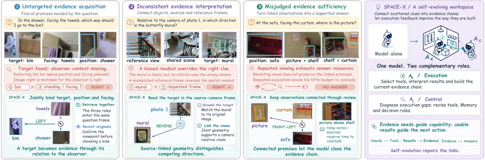
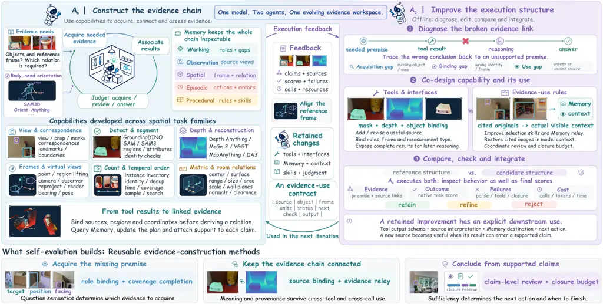
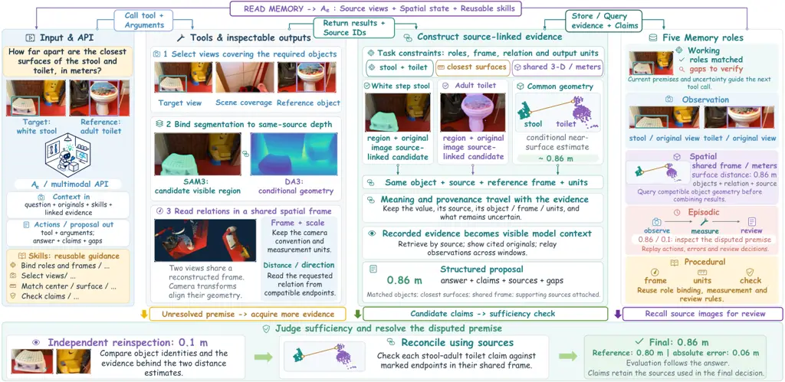

#  Space-X: Self-Evolving Spatial Agents Weaving Clues into Evidence Chains

Zijian Zhang

Affiliation: New Laboratory of Pattern Recognition (NLPR), Institute of
Automation, Chinese Academy of Sciences (CASIA)

Affiliation: School of Advanced Interdisciplinary Sciences, University
of Chinese Academy of Sciences

Project page:
[https://zzj-eric.github.io/Space-X-Project/](https://zzj-eric.github.io/Space-X-Project/)
   Wenqing Tian Affiliation: New Laboratory of Pattern Recognition
(NLPR), Institute of Automation, Chinese Academy of Sciences (CASIA)   
Qiang Liu Affiliation: New Laboratory of Pattern Recognition (NLPR),
Institute of Automation, Chinese Academy of Sciences (CASIA)    Liang
Wang Affiliation: New Laboratory of Pattern Recognition (NLPR),
Institute of Automation, Chinese Academy of Sciences (CASIA)

###### Abstract

Spatial reasoning connects visual observations, geometric estimates, and
linguistic decisions into a coherent derivation. Yet tool-augmented
agents often acquire evidence without clear targets, combine outputs
under inconsistent object or reference-frame semantics, and misjudge
evidence sufficiency. Thus, more tools or calls do not reliably improve
reasoning. We introduce Space-X, a spatial-reasoning framework that
self-evolves toward complete, continuous evidence-chain construction. An
Execution Agent acquires, associates, and judges evidence per problem
using role-specific memory. A Control Agent diagnoses evidence-chain
breaks from execution traces and jointly revises tools, interfaces,
skills, memory organization, and decision rules. This loop co-evolves
capability and evidence use: evidence needs guide capability
development; usable results guide actions. Across multiple benchmarks,
Space-X yields gains with four base models. Relative to baselines,
GPT-6-sol improves answer accuracy on ViewSpatial and MMSI by 50.39% and
23.07%, respectively; Gemini-3.8-Flash gains 47.50% and 25.22% on these
benchmarks. This provides a unified route from fragmented spatial clues
to traceable, derivable answers.



Figure 1: Three recurring evidence-chain breaks and the corresponding
Space-X response. Evidence needs must guide acquisition, tool outputs
must retain object/source/frame semantics, and linked evidence must
support a timely final decision.

## 1 Introduction

“Standing beside the chair and facing the door, where is the table?”
Answering such a question requires language, vision, and geometry to
meet in one decision. The chair defines the observer position, the door
defines the facing direction, and the table defines the target. Images
from different viewpoints provide partial observations; spatial
computation expresses those observations in the frame specified by the
question; and the final answer follows from the resulting directional
relation. Object recognition, geometric estimation, and language
reasoning play distinct roles, but they must be connected by a
continuous evidence chain that starts from the question, remains
grounded in observations, and ends at the answer.

Recent spatial agents extend vision-language models with perception
tools, executable skills, and memory, improving object grounding,
geometric computation, and multi-step problem solving \[28, 42, 43,
12\]. In complex tasks, however, these capabilities are still disrupted
by three recurring breaks, as summarized in Fig. 1. Untargeted evidence
acquisition repeatedly detects or reconstructs the scene while missing a
required target, observer position, facing landmark, or measurement
endpoint; the corresponding evidence need also fails to guide the
addition or selection of tools. Inconsistent evidence interpretation
directly combines results from different instances, views, scales, or
reference frames, or loses their provenance during memory and context
handoff. Misjudged evidence sufficiency produces an answer before the
necessary relations are established, or continues gathering observations
until no budget remains for review. These failures break the transitions
from needs to tools, results to evidence, and evidence to answers.
Consequently, expanding the tool library or increasing the number of
calls alone does not yield stable gains.

The underlying difficulty is a mismatch between human-designed execution
structures and the model’s actual weaknesses. A designer may prescribe
which tools to call and in what order, expecting the model to connect
their outputs naturally. Yet the model may recognize local objects while
failing to establish cross-view identity, read coordinates while using
the wrong frame, or generate a plausible answer without knowing whether
its premises are complete. A useful tool therefore needs more than an
implementation: the agent must know when to select it, how to interpret
its return value, where to preserve that result, how to associate it
with other evidence, and when the accumulated support is sufficient.
This motivates self-evolution driven by execution: evidence needs
exposed during solving should determine how tools are added and
selected, how memory preserves source-linked observations, how results
are interpreted, and how the process advances toward an answer.

We propose Space-X, a self-evolving agent framework for spatial
reasoning that makes the construction of complete, continuous evidence
chains the objective of framework improvement. The framework couples two
complementary roles. The _Execution Agent_ $`\mathcal{A}_{e}`$
constructs the evidence chain for the current task through _semantic
grounding, evidence association, and evidence-grounded judgment_. It
identifies objects, frames, relations, and output units from the
question; selects and combines tools according to unresolved premises;
turns inspectable outputs into source-linked evidence; and decides
whether to acquire more evidence, review a disputed premise, or answer.
Five memory roles support this process: Working Memory tracks premises
and gaps, Observation Memory preserves original views and crops, Spatial
Memory stores objects and compatible geometric relations, Episodic
Memory records actions and review history, and Procedural Memory
supplies reusable operating guidance.

The _Control Agent_ $`\mathcal{A}_{c}`$ improves the execution structure
offline. It reads execution feedback—claims, sources, task outcomes,
failures, and resource use—to diagnose the broken evidence link. It then
co-designs capability and use by revising tools and interfaces together
with source semantics, memory destinations, context delivery, review
triggers, and closure rules. Candidate changes are compared against the
current structure, checked at both the evidence-chain and task levels,
and retained only when their downstream use is explicit. Thus, tool
expansion, tool selection, and result use form a mutually driven
process: _evidence needs guide capability development, and usable
results guide the next action_. Each execution converts available
capability into an evidence chain; each iteration makes the execution
structure better match the model’s subsequent reasoning needs. Our
contributions are threefold:

- •
  We formulate a continuous evidence-chain view linking observations,
  tool outputs, and answers through coverage, alignment, and provenance.
- •
  We introduce dual-agent, evidence-chain-driven self-evolution
  co-optimizing tool capabilities and evidence selection,
  interpretation, association, and judgment.
- •
  We develop a spatial reasoning framework unifying grounding, memory,
  evidence association, and budget-aware source reconciliation.

## 2 Related Work

### 2.1 Spatial reasoning with tools and memory

Spatial agents combine perception, geometry, and memory to build
explicit scene representations. NeSy-Spatial composes typed tool and
geometry skills \[28\]; ReTAC assigns residual computation to unresolved
requirements \[35\]; S-Agent 2.0 connects coding agents to spatial tools
and persistent scene memory \[12\]; and SpatialBrain and Spatial Memory
Agent retain resource-use experience or verified procedural
lessons \[46, 43\]. Nevertheless, outputs may still be joined across
mismatched objects, sources, scales, or frames, and stored evidence may
not reach the later model context that needs it. Space-X instead unifies
tool selection, source-aware association, memory relay, and sufficiency
judgment in a continuous evidence chain.

### 2.2 Agent self-improvement

Agent self-improvement revises skills, code, memory, or execution
structures from experience. ADAS searches programmatic agent
designs \[13\], while the Darwin Gödel Machine modifies and evaluates
its own code \[44\]. In spatial settings, EvoSpatial co-evolves skills
and tools \[42\], HiMeco diagnoses perception–exploration–planning
failures \[19\], and SHAPER evolves skills with the surrounding
harness \[31\]. Yet task scores do not localize failures in perception,
selection, semantic binding, memory delivery, or judgment; separately
evolved tools may also lack a usable downstream role. Space-X makes
evidence-chain continuity the evolution objective, enabling
$`\mathcal{A}_{e}`$ to expose concrete needs and $`\mathcal{A}_{c}`$ to
jointly revise capability and evidence use.



Figure 2: Dual-agent self-evolution in Space-X. The Execution Agent
constructs an evidence chain for each task; execution feedback lets the
Control Agent diagnose broken links and jointly revise tools and
evidence-use rules for the next iteration.

## 3 Space-X  

Space-X uses dual-agent self-evolution to jointly improve spatial tools
and evidence-processing rules. Reliable chains cover the question’s
required premises, consistently bind objects, sources, and reference
frames, and make final decisions traceable to explicit support. The
Execution Agent $`\mathcal{A}_{e}`$ solves the task; the Control Agent
$`\mathcal{A}_{c}`$ improves the execution structure from execution
traces and task-level evaluation feedback. Let $`\mathcal{C}_{x}`$
denote current task constraints and $`\mathcal{E}_{t}`$ the evidence
chain after step $`t`$. We define reliability through premise coverage,
semantic alignment, and provenance:

```math
\operatorname{Reliable}(\mathcal{E}_{t};\mathcal{C}_{x})=\Cover(\mathcal{E}_{t},\mathcal{C}_{x})\land\Align(\mathcal{E}_{t})\land\Trace(\mathcal{E}_{t}). \tag{1}
```

These three conditions correspond to evidence acquisition, evidence
association, and evidence-grounded judgment, respectively, and provide a
common diagnostic target for $`\mathcal{A}_{c}`$. Figure 2 summarizes
how task execution and offline improvement close this loop.

### 3.1 Agents self-evolution for evidence chains

The Execution Agent $`\mathcal{A}_{e}`$ selects tools, interprets
outputs, and answers each task. The Control Agent $`\mathcal{A}_{c}`$
optimizes the harness—tools, interfaces, memory organization, skills,
and runtime rules surrounding the fixed multimodal model. Execution
exposes evidence needs and broken links; $`\mathcal{A}_{c}`$ turns them
into structural changes that $`\mathcal{A}_{e}`$ subsequently tests. Let
the harness at iteration $`r`$ be

```math
H^{(r)}=(\mathcal{K}^{(r)},\Pi^{(r)}),\qquad\Pi^{(r)}=(\pi_{\mathrm{get}}^{(r)},\pi_{\mathrm{assoc}}^{(r)},\pi_{\mathrm{judge}}^{(r)}), \tag{2}
```

where $`\mathcal{K}^{(r)}`$ contains tool implementations and typed
interfaces, and $`\Pi^{(r)}`$ contains the policies for acquiring
evidence, associating results, and judging whether to continue or
answer. Skills, prompts, memory interfaces, and execution code realize
these policies. The initial harness $`H^{(0)}`$ provides a basic tool
set, memory access, and trace logging; later iterations revise them from
observed execution needs.

A task is $`x=(q,\mathcal{I},\mathcal{O},\mathcal{T})`$, comprising a
question, visual inputs, optional answer choices, and optional temporal
information. Running $`\mathcal{A}_{e}`$ under the current harness
yields an answer, a trace, and resource cost:

```math
\bigl(\hat{y}_{j}^{(r)},\tau_{j}^{(r)},c_{j}^{(r)}\bigr)=\Run\bigl(\mathcal{A}_{e},H^{(r)},x_{j}\bigr). \tag{3}
```

The trace $`\tau_{j}^{(r)}`$ records tool calls, source references,
context delivery, intermediate claims, and judgment steps. The cost
$`c_{j}^{(r)}`$ records calls, tokens, and elapsed time. Together with
outcomes and process checks, these form the feedback

```math
\mathcal{F}_{r}=\left\{\bigl(x_{j},\hat{y}_{j}^{(r)},\tau_{j}^{(r)},c_{j}^{(r)},\mathbf{v}_{j}^{(r)}\bigr)\right\}_{j\in\mathcal{J}_{r}}, \tag{4}
```

where $`\mathbf{v}_{j}^{(r)}`$ includes the task score and checks for
object binding, source citation, frame consistency, result visibility,
and completion. References are used only for offline evaluation and
never enter task-time reasoning.

This feedback lets $`\mathcal{A}_{c}`$ localize evidence-chain failures:
missing objects indicate acquisition or tool-coverage gaps; camera depth
used as surface distance indicates semantic or endpoint mismatch; valid
results absent from final claims indicate memory-relay or
context-delivery failure. Diagnosis and editing proceed as

```math
\displaystyle\mathcal{D}_{r} \displaystyle=\Diagnose(\mathcal{A}_{c},H^{(r)},\mathcal{F}_{r}), \tag{5}
```

```math
\displaystyle\Delta_{r} \displaystyle=\Propose(\mathcal{A}_{c},H^{(r)},\mathcal{D}_{r}),
```

```math
\displaystyle\widetilde{H}^{(r)} \displaystyle=\Edit(\mathcal{A}_{c},H^{(r)},\Delta_{r}).
```

Each edit addresses an evidence-link failure and specifies capability,
source semantics, interpretation conditions, memory destination, and
downstream use, so tools and evidence-use rules evolve together. The
execution agent then runs the current and candidate harnesses on a
comparison set $`\mathcal{Q}_{\mathrm{cmp}}`$. Evaluation combines task
outcomes, expected evidence-link checks $`\chi_{r}`$, execution
failures, and resource cost:

```math
\displaystyle\mathcal{V}_{r} \displaystyle=\Evaluate\bigl(\mathcal{A}_{e},H^{(r)},\widetilde{H}^{(r)};\mathcal{Q}_{\mathrm{cmp}},\chi_{r}\bigr), \tag{6}
```

```math
\displaystyle H^{(r+1)} \displaystyle=\Integrate\bigl(H^{(r)},\widetilde{H}^{(r)},\mathcal{V}_{r}\bigr).
```

A retained change must improve the targeted link and remain viable at
the complete-task level. Reliable evidence chains serve as the task-time
reasoning objective and as the cross-iteration objective of harness
improvement.



Figure 3: Task-time execution in Space-X. The API selects source-aware
tools \[6, 20, 30, 14, 32, 21, 15, 37, 29, 33, 41\], constructs
semantically bound evidence, exchanges it through five memory roles, and
resolves disputed premises with source-linked review before answering.

### 3.2 Semantic grounding & need-driven acquisition

Evidence acquisition begins by asking what the question requires, rather
than by calling more tools. Space-X converts the natural-language
question into task constraints

```math
\mathcal{C}_{x}=(\mathcal{R},F,\varrho,\Omega),\qquad e_{i}=(v_{i},\sigma_{i},\rho_{i},\eta_{i}), \tag{7}
```

where $`\mathcal{R}`$ contains semantic roles such as target, reference,
observer position, and facing landmark; $`F`$ is the requested reference
frame; $`\varrho`$ is the queried relation; and $`\Omega`$ specifies the
output form and units. An evidence item $`e_{i}`$ stores its value
$`v_{i}`$, source $`\sigma_{i}`$, semantic binding $`\rho_{i}`$ (object,
frame, endpoints, and units), and status $`\eta_{i}`$ (observation,
estimate, or hypothesis). Thus, a tool output records not only _what_
was returned, but also _what it refers to_, _where it came from_, and
_which claim it can support_. Given the current state
$`\mathcal{S}_{t}`$, $`\mathcal{A}_{e}`$ identifies unsupported premises
and selects an action:

```math
(a_{t},\mathcal{E}_{t}^{+})=\pi_{\mathrm{get}}^{(r)}(\mathcal{A}_{e},x,\mathcal{S}_{t}), \tag{8}
```

where $`a_{t}`$ specifies a tool and typed arguments, and
$`\mathcal{E}_{t}^{+}`$ is the interpreted evidence produced by the
call. The acquisition policy includes both tool selection and source
preparation: choosing question-relevant views, restoring requested
originals to the next API context, and preserving the source identifiers
needed for later inspection.

Execution feedback separates three cases that a generic tool failure
would conflate: insufficient perception capability, an incorrect call
condition, and an output that lacks the semantic binding required by the
question. The resulting iterations produced several recurring practices.
Observer-relative direction jointly grounds the target, observer
position, and facing landmark before reading a side. Quantitative
reasoning distinguishes camera-forward depth, center distance, and
closest-surface distance, and binds each measurement to the correct
endpoints. Video and long multi-view inputs balance question relevance
with observation coverage rather than repeatedly sampling resolved
views.

In the direction example, the table, chair, and door define the target,
position, and facing landmark. Grounding them in original images
establishes the observer frame. An unresolved door identity or location
prompts acquisition of a relevant view; supported relations allow
evidence to proceed to association.

### 3.3 Evidence linking via role-specific memory

After an output is semantically grounded, it must remain available and
be combined only with compatible evidence. Space-X maintains five memory
roles:

```math
\mathcal{M}_{t}=(M_{t}^{\mathrm{work}},M_{t}^{\mathrm{obs}},M_{t}^{\mathrm{spatial}},M_{t}^{\mathrm{epis}},M^{\mathrm{proc},(r)}). \tag{9}
```

Working Memory tracks current premises, conclusions, and unresolved
gaps. Observation Memory preserves original views, crops, source
identifiers, and bounded observations. Spatial Memory organizes objects,
compatible geometry, frames, and relations. Episodic Memory records
actions, failures, proposals, and review history for the current
execution. Procedural Memory supplies reusable guidance retained across
iterations, including validity conditions and checks. These roles
separate current-scene evidence from experience about how to use it
while allowing reasoning to continue across views and API calls.

Association links new evidence to existing state according to identity,
provenance, reference frame, units, endpoints, and input dependencies:

```math
\mathcal{S}_{t+1}=\pi_{\mathrm{assoc}}^{(r)}(\mathcal{A}_{e},\mathcal{S}_{t},a_{t},\mathcal{E}_{t}^{+}). \tag{10}
```

The updated state preserves support, conflict, dependencies, and
unresolved items, allowing new observations to extend, verify, or revise
existing claims.

Three mechanisms emerged from recurrent execution failures. First,
_source-linked observation relay_ carries facts together with their
provenance and uncertainty across context windows. Second, _same-source
region–geometry binding_ ensures that a segmentation, depth estimate,
and geometric readout refer to the same physical object and frame.
Third, _complete result readback and cited-image restoration_ ensure
that a result stored in memory becomes visible model context when later
reasoning relies on it. If $`\mathcal{R}_{t}^{\mathrm{img}}`$ is the set
of images cited by current claims and $`\mathcal{A}_{t}^{\mathrm{img}}`$
is the set already attached to the API context, the missing sources are

```math
\mathcal{D}_{t}^{\mathrm{img}}=\mathcal{R}_{t}^{\mathrm{img}}\setminus\mathcal{A}_{t}^{\mathrm{img}}. \tag{11}
```

The runtime restores these sources within the attachment budget,
aligning what a proposal cites with what the model can actually inspect.

When the table and door appear across windows, Observation Memory
retains sources, Spatial Memory binds regions to compatible positions,
and Working Memory tracks unresolved facing. Cited-image restoration
presents originals during review, letting provenance-linked tool results
support one inspectable spatial relation.

### 3.4 Evidence sufficiency and grounded judgment

After association, the sufficiency check assesses premise coverage,
evidence consistency, and uncertainty that could change the answer.
Space-X captures these factors in a structured proposal

```math
p_{t}=(\hat{y}_{t},\mathcal{A}_{t},\mathcal{Z}_{t},\mathcal{U}_{t}), \tag{12}
```

where $`\hat{y}_{t}`$ is the candidate answer, $`\mathcal{A}_{t}`$
contains explicit relation claims, $`\mathcal{Z}_{t}`$ contains their
supporting sources, and $`\mathcal{U}_{t}`$ lists unresolved premises.
Object roles and reference frames remain tied to $`\mathcal{C}_{x}`$.
The proposal makes the dependency between an answer and its premises
explicit, so an unsupported claim becomes a concrete acquisition or
review target.

When the decision may be biased by an earlier interpretation, Space-X
performs _independent reinspection_: a separate proposal is formed from
the original question, original images, and matching rules, while the
previous judgment remains isolated in its earlier-stage context. The
system compares object roles and relation claims across proposals,
localizes the disagreement to a premise, and then _reconciles using
sources_ retrieved through the memory mechanisms in Sec. 3.3. The second
proposal is not treated as an automatic judge; source-bound evidence
resolves the conflict. The resulting trace helps $`\mathcal{A}_{c}`$
refine review triggers and context organization in later iterations.

To coordinate acquisition, review, and answer completion, the evolved
runtime reserves closure capacity based on expected stage cost,
preventing repeated observation from exhausting the answer budget. The
next action is

```math
d_{t}=\pi_{\mathrm{judge}}^{(r)}(\mathcal{A}_{e},x,\mathcal{S}_{t},p_{t}), \tag{13}
```

where $`d_{t}`$ can request additional evidence, verify a disputed
claim, answer, or finalize under the remaining budget.

If an initial and an independently reinspected answer disagree on
direction, the system first checks whether both proposals identify the
same target and observer facing, then verifies the left–right relation
against cited originals. An unresolved door identity returns the process
to acquisition; consistent roles and relations permit the answer; and
the closure reserve ensures that necessary review still leaves capacity
to conclude. Structured proposals, claim-level review, source-based
reconciliation, and budget-aware closure thus turn the abstract question
“is the evidence sufficient?” into an executable decision. Finally,
disagreements, citations, failures, and costs re-enter
$`\mathcal{F}_{r}`$ in Eq. 4, closing the loop between task-time
evidence construction and cross-iteration self-evolution.

| Method                         | ViewSpatial    |                |                   |                    |                 |                  | SPAR           | VSI \[-1pt\](Only 10 frames) |
| ------------------------------ | -------------- | -------------- | ----------------- | ------------------ | --------------- | ---------------- | -------------- | ---------------------------- |
|                                | Overall        | Cam. rel. dir. | Cam. obj. orient. | Pers. obj. orient. | Pers. rel. dir. | Pers. scene sim. |                |                              |
| Base models                    |                |                |                   |                    |                 |                  |                |                              |
| Qwen3-VL-8B-Instruct \[5\]     | 42.20          | 54.20          | 29.72             | 47.29              | 40.26           | 31.13            | 39.62          | –                            |
| Qwen2.5-VL-7B-Instruct \[5\]   | 36.85          | 46.76          | 31.22             | 39.96              | 32.42           | 26.61            | 33.83          | –                            |
| GPT-6-sol                      | 53.19          | 59.05          | 37.75             | 44.48              | 76.25           | 47.96            | 57.15          | 48.40                        |
| GPT-6-astra                    | 59.89          | 62.94          | 37.85             | 44.88              | 89.07           | 66.15            | 68.96          | 61.08                        |
| Gemini-3.8-Flash               | 57.78          | 63.52          | 41.97             | 44.78              | 85.15           | 53.67            | 63.00          | 53.09                        |
| Gemini-4-Argon                 | 60.47          | 62.44          | 36.55             | 43.47              | 92.04           | 70.33            | 68.21          | 63.32                        |
| Specialized models             |                |                |                   |                    |                 |                  |                |                              |
| MVSM-3B \[17\]                 | 82.09          | 83.59          | 87.65             | 90.16              | 71.14           | 75.75            | –              | –                            |
| SenseNova-SI-1.3-8B \[5\]      | 61.31          | 74.56          | 38.65             | 53.92              | 54.63           | 72.22            | 48.43          | –                            |
| VST-7B-SFT \[5\]               | 50.53          | 52.68          | 29.62             | 51.91              | 50.71           | 64.52            | 46.61          | –                            |
| SpatialLadder-3B \[18\]        | 44.20          | 48.30          | 24.10             | 71.10              | 34.40           | 38.90            | 34.40          | –                            |
| Cambrian-S-7B \[5\]            | 41.28          | 50.42          | 22.69             | 44.98              | 38.84           | 41.90            | 37.91          | –                            |
| SpaceR-SFT-7B \[5\]            | 35.85          | 43.20          | 28.92             | 37.45              | 34.09           | 30.23            | 34.19          | –                            |
| ViLaSR-7B \[5\]                | 35.71          | 46.81          | 25.30             | 39.06              | 32.66           | 26.61            | 37.60          | –                            |
| Spatial agents                 |                |                |                   |                    |                 |                  |                |                              |
| S-Agent 1.0 (GPT-5.4) \[8\]    | 60.00          | 62.50          | 55.50             | 42.20              | 81.10           | 60.60            | –              | –                            |
| DeSpatial (Qwen3-VL-8B) \[22\] | 68.35          | 65.71          | 81.22             | 78.01              | 69.00           | 51.76            | –              | –                            |
| EvoSpatial (Gemma4-31B) \[42\] | 64.40          | –              | –                 | –                  | –               | –                | 68.80          | –                            |
| SpatialClaw (Gemma4-31B) \[7\] | 60.20          | –              | –                 | –                  | –               | –                | 63.30          | –                            |
| SPACE-X                        |                |                |                   |                    |                 |                  |                |                              |
| Space-X (GPT-6-sol)            | 79.99 (+26.80) | 75.00 (+15.95) | 93.46 (+55.71)    | 93.67 (+49.20)     | 88.24 (+12.00)  | 57.09 (+9.13)    | 70.39 (+13.23) | 65.34 (+16.93)               |
| Space-X (GPT-6-astra)          | 85.26 (+25.37) | 79.60 (+16.66) | 95.98 (+58.13)    | 96.69 (+51.81)     | 90.50 (+1.43)   | 70.29 (+4.14)    | 73.82 (+4.86)  | 71.99 (+10.91)               |
| Space-X (Gemini-3.8-Flash)     | 85.22 (+27.44) | 85.46 (+21.93) | 97.95 (+55.98)    | 81.17 (+36.39)     | 90.37 (+5.22)   | 67.31 (+13.64)   | 75.79 (+12.79) | 66.42 (+13.33)               |
| Space-X (Gemini-4-Argon)       | 87.61 (+27.15) | 82.07 (+19.63) | 93.76 (+57.22)    | 97.09 (+53.61)     | 92.98 (+0.94)   | 75.22 (+4.88)    | 76.45 (+8.24)  | 75.40 (+12.08)               |

Table 1: Perspective and geometric reasoning on ViewSpatial, SPAR, and
VSI; VSI uses only 10 initial frames.

## 4 Experiments

Benchmarks, ablations, and adaptation assess how evidence chain driven
evolution improves spatial reasoning and transfer across models and
frameworks.

### 4.1 Experimental setup

Implementation details. Execution Agent $`\mathcal{A}_{e}`$ and Control
Agent $`\mathcal{A}_{c}`$ use GPT-6-sol to construct Space-X. Through a
coding harness, $`\mathcal{A}_{c}`$ initializes $`\mathcal{A}_{e}`$’s
environment, yielding $`H^{(0)}`$ without an pre-configured harness.
Traces and evaluation feedback then guide $`\mathcal{A}_{c}`$ to expand
and integrate tools, skills, memory, and evidence processing rules
around reliable evidence chains. Built from scratch, the harness is
evaluated unchanged across base models. Development uses SAT-v2 \[26\],
SIMS-VSI \[3\], NVIDIA Warehouse \[27\], and GRiD-3D \[16\], covering
perspective changes, relations across images, quantitative geometry, and
local visual discrimination.

Baselines. We compare three groups: base multimodal models, including
GPT-6-sol, GPT-6-astra, Gemini-3.8-Flash, Gemini-4-Argon,
Qwen3-VL-8B-Instruct \[1\], and Qwen2.5-VL-7B-Instruct \[2\];
specialized spatial models, including MVSM \[17\], SenseNova-SI \[4\],
VST \[38\], SpatialLadder \[18\], Cambrian-S \[39\], SpaceR \[25\],
ViLaSR \[34\], and NEO \[10\]; and spatial reasoning agents, including
S-Agent 1.0/2.0 \[8, 12\], DeSpatial \[22\], EvoSpatial \[42\],
SpatialClaw \[7\], pySpatial \[23\], and SpatialBrain \[46\].

Benchmarks. We use five complementary benchmarks. ViewSpatial \[17\]
evaluates directions, object orientation, and scene simulation from
camera and person perspectives. SPAR \[45\] covers geometric estimation,
matching across views, and spatial imagination. MMSI \[40\] tests
relations, attributes, motion, and multistep reasoning across images.
VSI \[36\] tests video-based counting, distances, sizes, spatial
relations, routes, and appearance order. BLINK \[11\] includes all
fourteen tasks spanning local visual discrimination, spatial relations,
and correspondence across images.

### 4.2 Overall results

Perspective and geometric reasoning. Space-X reaches 87.61 on
ViewSpatial and 76.45 on SPAR in Tab. 1, substantially exceeding base
models. On VSI, only 10 initial frames, rather than dense video input,
yield 75.40. We analyze gains with GPT-6-sol. For perspective changes,
$`\mathcal{A}_{c}`$ separates target, observer position, and facing
direction, adds body and camera frame checks to skills, and verifies
them against original images. This improves object orientation from
camera and person perspectives by 55.71 and 49.20 points. Memory
preserves source identifiers, observations, and unresolved relations
across context windows. Subsequent calls restore these records, while
judgment receives missing cited images, improving scene simulation by
9.13 points. For quantitative reasoning across views, target regions are
bound to geometry from the same source, scaled using question anchors,
and transformed into the requested frame. Distinguishing camera depth,
center distance, and surface distance improves SPAR by 13.23 points.
Evolution also refines tool selection, skill composition, and answer
rules. Together, these gains show that aligning tool outputs with object
roles, reference frames, and measurement premises supports perspective
and quantitative reasoning.

| Method                                | MMSI           |                |                |                |                |               |                |                |               |               |                |                | BLINK         |
| ------------------------------------- | -------------- | -------------- | -------------- | -------------- | -------------- | ------------- | -------------- | -------------- | ------------- | ------------- | -------------- | -------------- | ------------- |
|                                       | Overall        | C–C            | O–O            | R–R            | C–O            | O–R           | C–R            | Meas.          | Appr.         | Cam. motion   | Obj. motion    | MSR            |               |
| Base models                           |                |                |                |                |                |               |                |                |               |               |                |                |               |
| Qwen3-VL-8B-Instruct \[5\]            | 31.10          | 27.96          | 37.23          | 32.10          | 31.40          | 35.29         | 38.55          | 37.50          | 15.15         | 27.03         | 28.95          | 29.80          | 66.70         |
| Qwen2.5-VL-7B-Instruct \[5\]          | 26.80          | 27.96          | 26.60          | 19.75          | 32.56          | 38.82         | 28.92          | 23.44          | 21.21         | 20.27         | 30.26          | 24.75          | 55.87         |
| GPT-6-sol                             | 53.90          | 62.37          | 39.36          | 53.09          | 38.37          | 44.71         | 67.47          | 68.75          | 50.00         | 72.97         | 44.74          | 55.05          | 82.09         |
| GPT-6-astra                           | 71.60          | 73.12          | 69.15          | 75.31          | 61.63          | 65.88         | 72.29          | 73.44          | 69.70         | 83.78         | 64.47          | 75.25          | 89.49         |
| Gemini-3.8-Flash                      | 52.65          | 61.29          | 40.86          | 41.98          | 43.02          | 58.82         | 54.22          | 65.62          | 51.52         | 75.68         | 52.63          | 46.97          | 85.89         |
| Gemini-4-Argon                        | 74.16          | 79.35          | 73.91          | 79.01          | 75.00          | 73.49         | 80.49          | 73.44          | 54.55         | 85.14         | 65.79          | 73.06          | 93.23         |
| Specialized models                    |                |                |                |                |                |               |                |                |               |               |                |                |               |
| SenseNova-SI-1.3-8B \[5\]             | 42.50          | 43.01          | 50.00          | 40.74          | 74.42          | 44.71         | 65.06          | 42.19          | 25.76         | 35.14         | 30.26          | 28.28          | 68.02         |
| NEO-ov-9B-SFT \[5\]                   | 41.30          | 44.09          | 39.36          | 38.27          | 59.30          | 45.88         | 63.86          | 50.00          | 34.85         | 40.54         | 27.63          | 27.78          | 62.81         |
| Cambrian-S-7B \[5\]                   | 27.10          | 24.73          | 26.60          | 24.69          | 47.67          | 22.35         | 31.33          | 32.81          | 24.24         | 12.16         | 30.26          | 24.24          | 37.87         |
| SpaceR-SFT-7B \[5\]                   | 27.40          | 25.81          | 31.91          | 29.63          | 25.58          | 31.76         | 22.89          | 26.56          | 28.79         | 16.22         | 34.21          | 27.27          | 49.61         |
| Spatial agents                        |                |                |                |                |                |               |                |                |               |               |                |                |               |
| S-Agent 1.0 (GPT-5.4) \[8\]           | 46.40          | 46.20          | 43.60          | 37.00          | 43.00          | 43.50         | 63.90          | 57.80          | 40.90         | 46.00         | 48.70          | 44.40          | –             |
| S-Agent 1.0 (Qwen3.8-27B) \[12\]      | 48.30          | 59.10          | 47.90          | 42.00          | 46.50          | 34.10         | 51.80          | 57.80          | 47.00         | 48.60         | 46.10          | 49.50          | –             |
| pySpatial (GPT-4o) \[23\]             | 37.30          | 51.60          | 28.70          | 27.20          | 20.90          | 41.20         | 38.60          | 46.90          | 39.40         | 46.00         | 38.20          | 36.40          | –             |
| SpatialBrain (GPT-5.6-sol) \[46\]     | 57.10          | 69.90          | 48.90          | 54.30          | 72.10          | 36.50         | 63.90          | 56.20          | 62.10         | 73.00         | 46.10          | 52.50          | –             |
| SpatialClaw (Qwen3.8-27B) \[12\]      | 62.60          | 67.70          | 50.00          | 54.30          | 79.10          | 58.80         | 79.50          | 68.80          | 56.10         | 77.00         | 44.70          | 58.60          | –             |
| SpatialClaw (Gemini-3.8-Flash) \[12\] | 67.00          | 71.00          | 68.10          | 63.00          | 68.60          | 64.70         | 73.50          | 68.80          | 50.00         | 81.10         | 60.50          | 66.20          | –             |
| S-Agent 2.0 (Qwen3.8-27B) \[12\]      | 66.50          | 73.10          | 58.50          | 58.00          | 83.70          | 60.00         | 74.70          | 73.40          | 60.60         | 75.70         | 52.60          | 64.10          | –             |
| SPACE-X                               |                |                |                |                |                |               |                |                |               |               |                |                |               |
| Space-X (GPT-6-sol)                   | 66.33 (+12.43) | 78.49 (+16.13) | 55.32 (+15.96) | 62.96 (+9.88)  | 80.23 (+41.86) | 52.94 (+8.24) | 74.70 (+7.23)  | 69.84 (+1.09)  | 57.58 (+7.58) | 78.38 (+5.41) | 59.21 (+14.47) | 63.45 (+8.40)  | 86.41 (+4.32) |
| Space-X (GPT-6-astra)                 | 77.70 (+6.10)  | 80.65 (+7.53)  | 77.66 (+8.51)  | 77.78 (+2.47)  | 87.21 (+25.58) | 67.06 (+1.18) | 85.54 (+13.25) | 75.00 (+1.56)  | 72.73 (+3.03) | 81.08 (-2.70) | 64.47 (+0.00)  | 79.80 (+4.55)  | 91.31 (+1.82) |
| Space-X (Gemini-3.8-Flash)            | 65.93 (+13.28) | 83.33 (+22.04) | 60.00 (+19.14) | 66.67 (+24.69) | 67.39 (+24.37) | 66.67 (+7.84) | 78.26 (+24.04) | 55.56 (-10.07) | 42.86 (-8.66) | 80.00 (+4.32) | 50.00 (-2.63)  | 60.42 (+13.45) | 95.80 (+9.90) |
| Space-X (Gemini-4-Argon)              | 78.45 (+4.29)  | 74.29 (-5.06)  | 73.61 (-0.30)  | 81.36 (+2.34)  | 85.71 (+10.71) | 76.79 (+3.29) | 87.32 (+6.84)  | 82.61 (+9.17)  | 54.90 (+0.36) | 84.48 (-0.65) | 73.53 (+7.74)  | 80.75 (+7.69)  | 94.06 (+0.83) |

Table 2: Multi-image spatial reasoning and visual discrimination results
on MMSI and BLINK.

Integrating multiple visual sources. Space-X reaches 78.45 on MMSI and
95.80 on BLINK, exceeding S-Agent 2.0 on MMSI and the strongest base
model on BLINK in Tab. 2. We again examine gains with GPT-6-sol. Binding
a target in its source image to shared geometry and transforming it into
the specified camera frame raises camera to object reasoning to 80.23.
Skills preserve the queried object and relation, while memory carries
observations and unresolved premises across view changes, improving
multistep reasoning by 8.40 points. Attaching requested images and
checking candidates through local crops improves BLINK multiview
reasoning by 21.80 points. For instance counting, candidate enumeration,
category checks, and duplicate associations form a retrievable
inventory, improving counting by 13.01 points. Result readback and
reserved completion capacity keep acquired evidence available for
judgment. Together, these gains show how structured association and
memory continuity connect partial observations into evidence usable
throughout reasoning.

### 4.3 Ablation studies

Three ablations use GPT-6-sol and fixed lists for ViewSpatial, SPAR, and
MMSI, examining evolution targets, evidence organization, and answer
judgment. Within each experiment, controls share data, input access, and
budgets, while scores and process measures reveal effects.

Joint evolution of tools and evidence rules. Starting from $`H^{(0)}`$
with seven perception or geometry tools and four general operations, we
compare four conditions under the same development data, validation
split, and optimization budget (Tab. 3). Tool evolution expands
perception and geometry while fixing rules and general operations.
Conversely, rule evolution fixes these tools while improving evidence
rules and the general operations that implement them. Joint evolution
modifies both. Evolving either side alone yields smaller gains than
joint evolution, revealing a bottleneck between expanding the tool
library and improving task performance. Joint evolution refines tool
selection, interpretation, and association together, making information
from different sources compatible in object identity, frame, and queried
relation. Thus, capability and evidence use evolve together, turning
fragmented outputs into a complete chain supporting the answer.

| Setting    | Tool evol. | Rule evol. | P/G | Ops | VS    | SPAR  | MMSI  |
| ---------- | ---------- | ---------- | --- | --- | ----- | ----- | ----- |
| Initial    | No         | No         | 7   | 4   | 56.86 | 59.28 | 54.19 |
| Tools only | Yes        | No         | 39  | 4   | 68.15 | 63.96 | 60.19 |
| Rules only | No         | Yes        | 7   | 9   | 61.52 | 61.02 | 57.80 |
| Joint      | Yes        | Yes        | 55  | 12  | 79.99 | 70.39 | 66.33 |

Table 3: Tool and rule evolution. P/G: perception/geometry tools; Ops:
general operations; VS: ViewSpatial.

Evidence association and memory continuity. We fix tools, skills, and
answer judgment while comparing flat records, explicit evidence
association, and association with continuity maintained by role-specific
memory (Tab. 4). All conditions retain the same fields, original image
access, context limits, and call budgets. Semantic mismatch measures
incorrect correspondence; evidence delivery measures whether required
support reaches later calls. Explicit association improves task scores
and semantic consistency, while memory continuity further increases
delivery and reduces mismatch. Binding outputs to objects, sources, and
frames lets local observations complement one another, while observation
notes, result readback, and context construction preserve those links
during extended reasoning. Reliable reasoning requires both valid
connections among evidence and their continued availability.

| Setting              | VS    | SPAR  | MMSI  | Mismatch $`\downarrow`$ | Delivery $`\uparrow`$ |
| -------------------- | ----- | ----- | ----- | ----------------------- | --------------------- |
| Flat records         | 67.25 | 63.03 | 59.91 | 21.70                   | 71.06                 |
| Association          | 73.26 | 66.96 | 63.73 | 5.64                    | 82.20                 |
| Association + memory | 79.99 | 70.39 | 66.33 | 1.05                    | 98.24                 |

Table 4: Evidence association and memory continuity.

Judging answers from evidence. We compare immediate submission, standard
review, and judgment of individual claims from the same initial answers
and evidence states (Tab. 5). The latter two share access to evidence
and a maximum of two additional calls. Claim judgment decomposes an
answer into key premises and checks its object, relation, and source
support. Judgment at the claim level corrects more errors while
introducing fewer new ones, outperforming standard review on all three
benchmarks. Binding each claim to evidence directs corrections toward
faulty object correspondence, spatial relations, or supporting premises
while preserving grounded conclusions. Effective correction therefore
repairs the link from evidence to conclusion rather than revising
answers alone.

| Setting         | VS    | SPAR  | MMSI  | Repair $`\uparrow`$ | Damage $`\downarrow`$ |
| --------------- | ----- | ----- | ----- | ------------------- | --------------------- |
| Initial answer  | 74.46 | 65.27 | 59.86 | –                   | –                     |
| Standard review | 75.95 | 66.82 | 62.45 | 11.39               | 2.38                  |
| Claim judgment  | 79.99 | 70.39 | 66.33 | 22.19               | 1.50                  |

Table 5: Answer judgment from shared predictions. Repair: corrected
errors. Damage: new errors.

### 4.4 Analysis and discussion

Evolution and accumulated capabilities. We organize changes into five
types: perception and geometry tools; semantic constraints and skill
policies; memory organization and state continuity; evidence association
and delivery; and judgment, budgets, and structural integration.
Figure 4 combines cumulative counts for 575 implemented candidates with
ViewSpatial and SPAR scores evaluated at ten uniformly spaced positions
along the optimization sequence. Performance improves through
construction and grounding, specialized acquisition, evidence connection
and completion, and integration and refinement. Source binding,
observation continuity, and result readback let tools, skills, and
memory accumulate into reusable evidence paths. Coordinating these
interdependent improvements makes manual design demanding, motivating
evolution driven by execution feedback.

Figure 4: Optimization activity and benchmark performance during
evolution.

X-SFT for adaptation across models. We transfer the harness constructed
with GPT-6-sol to the other three models and continue optimization for
fifteen iterations using X-SFT (Space-X Self-Evolving Finetune). Both
agents use the current target model: $`\mathcal{A}_{e}`$ solves tasks
and $`\mathcal{A}_{c}`$ improves the harness from its execution
feedback. Adaptation reuses the original development data. Targets share
iteration counts and per-iteration budgets, and both harnesses are
evaluated on the same test lists (Tab. 6). Direct transfer already
outperforms the target models alone across multiple benchmarks,
demonstrating generalization across models. X-SFT further improves every
target by aligning tool use and evidence organization with its reasoning
behavior, highlighting the importance of model-specific harness fit.
Reusing the structure and development data reduces duplicated
construction effort and provides an economical path to improved
adaptation.

| Model            | Setting     | VS    | SPAR  | MMSI  |
| ---------------- | ----------- | ----- | ----- | ----- |
| GPT-6-astra      | Transferred | 85.26 | 73.82 | 77.70 |
|                  | X-SFT       | 87.24 | 76.53 | 79.17 |
| Gemini-3.8-Flash | Transferred | 85.22 | 75.79 | 65.93 |
|                  | X-SFT       | 87.93 | 77.32 | 68.09 |
| Gemini-4-Argon   | Transferred | 87.61 | 76.45 | 78.45 |
|                  | X-SFT       | 89.33 | 77.96 | 80.48 |

Table 6: Adaptation across models after 15 X-SFT iterations. Transferred
results use the harness constructed with GPT-6-sol.

Specialized and general coding harnesses. Using GPT-6-sol throughout, we
compare DSH CLI \[9\] and Codex CLI \[24\], their counterparts equipped
with a shared spatial tool library, and Space-X (Tab. 7). All conditions
share evaluation lists, original inputs, and execution budgets; the
augmented baselines and Space-X have the same spatial tool capabilities.
Call counts include spatial tools only. Adding spatial tools improves
both general harnesses, yet Space-X maintains a clear advantage while
using fewer spatial calls. General coding capability therefore benefits
from an execution structure tailored to spatial evidence. Task-driven
evolution jointly develops tool selection, semantic interpretation,
memory continuity, and grounded judgment, yielding a more effective
specialized reasoning framework.

| Harness                   | VS    | SPAR  | MMSI  | Calls/question |
| ------------------------- | ----- | ----- | ----- | -------------- |
| DSH CLI                   | 55.25 | 58.06 | 55.01 | 0              |
| DSH CLI + spatial tools   | 68.46 | 63.56 | 61.28 | 6.72           |
| Codex CLI                 | 56.91 | 58.96 | 56.38 | 0              |
| Codex CLI + spatial tools | 70.34 | 65.14 | 60.56 | 4.64           |
| Space-X                   | 79.99 | 70.39 | 66.33 | 3.21           |

Table 7: General harnesses and Space-X. Calls/question averages spatial
calls per question equally across benchmarks.

## 5 Conclusion

Space-X shows spatial harnesses require more than tools and
configurations. Self-evolution coordinates tools, memory, and decision
rules to connect fragmented observations into coherent evidence chains,
enabling traceable spatial reasoning and grounded answers.

## References

- \[1\] S. Bai, Y. Cai, R. Chen, K. Chen, X. Chen, Z. Cheng, L. Deng, W.
  Ding, C. Gao, C. Ge, W. Ge, Z. Guo, Q. Huang, J. Huang, F. Huang, B.
  Hui, S. Jiang, Z. Li, M. Li, M. Li, K. Li, Z. Lin, J. Lin, X. Liu, J.
  Liu, C. Liu, Y. Liu, D. Liu, S. Liu, D. Lu, R. Luo, C. Lv, R. Men, L.
  Meng, X. Ren, X. Ren, S. Song, Y. Sun, J. Tang, J. Tu, J. Wan, P.
  Wang, P. Wang, Q. Wang, Y. Wang, T. Xie, Y. Xu, H. Xu, J. Xu, Z.
  Yang, M. Yang, J. Yang, A. Yang, B. Yu, F. Zhang, H. Zhang, X.
  Zhang, B. Zheng, H. Zhong, J. Zhou, F. Zhou, J. Zhou, Y. Zhu, and K.
  Zhu (2025) Qwen3-VL Technical Report. arXiv preprint arXiv:2511.21631.
  External Links: [Link](https://arxiv.org/abs/2511.21631) Cited by:
  §4.1.
- \[2\] S. Bai, K. Chen, X. Liu, J. Wang, W. Ge, S. Song, K. Dang, P.
  Wang, S. Wang, J. Tang, H. Zhong, Y. Zhu, M. Yang, Z. Li, J. Wan, P.
  Wang, W. Ding, Z. Fu, Y. Xu, J. Ye, X. Zhang, T. Xie, Z. Cheng, H.
  Zhang, Z. Yang, H. Xu, and J. Lin (2025) Qwen2.5-VL Technical Report.
  arXiv preprint arXiv:2502.13923. External Links:
  [Link](https://arxiv.org/abs/2502.13923) Cited by: §4.1.
- \[3\] E. Brown, A. Ray, R. Krishna, R. Girshick, R. Fergus, and S.
  Xie (2025) SIMS-V: Simulated Instruction-Tuning for Spatial Video
  Understanding. arXiv preprint arXiv:2511.04668. External Links:
  [Link](https://arxiv.org/abs/2511.04668) Cited by: §B.2, §F.1, §4.1.
- \[4\] Z. Cai, R. Wang, C. Gu, F. Pu, J. Xu, Y. Wang, W. Yin, Z.
  Yang, C. Wei, Q. Sun, T. Zhou, J. Li, H. E. Pang, O. Qian, Y. Wei, Z.
  Lin, X. Shi, K. Deng, X. Han, Z. Chen, X. Fan, H. Deng, L. Lu, L.
  Pan, B. Li, Z. Liu, Q. Wang, D. Lin, and L. Yang (2025) Scaling
  Spatial Intelligence with Multimodal Foundation Models. arXiv preprint
  arXiv:2511.13719. External Links:
  [Link](https://arxiv.org/abs/2511.13719) Cited by: §4.1.
- \[5\] Z. Cai, Y. Wang, Q. Sun, R. Wang, C. Gu, W. Yin, Z. Lin, Z.
  Yang, C. Wei, O. Qian, H. E. Pang, X. Shi, K. Deng, X. Han, Z.
  Chen, J. Li, X. Fan, H. Deng, L. Lu, B. Li, Z. Liu, Q. Wang, D. Lin,
  and L. Yang (2025) Holistic Evaluation of Multimodal LLMs on Spatial
  Intelligence. arXiv preprint arXiv:2508.13142. External Links:
  [Link](https://arxiv.org/abs/2508.13142) Cited by: Table 1, Table 1,
  Table 1, Table 1, Table 1, Table 1, Table 1, Table 2, Table 2, Table
  2, Table 2, Table 2, Table 2.
- \[6\] N. Carion, L. Gustafson, Y. Hu, S. Debnath, R. Hu, D. Suris, C.
  Ryali, K. V. Alwala, H. Khedr, A. Huang, J. Lei, T. Ma, B. Guo, A.
  Kalla, M. Marks, J. Greer, M. Wang, P. Sun, R. Rädle, T. Afouras, E.
  Mavroudi, K. Xu, T. Wu, Y. Zhou, L. Momeni, R. Hazra, S. Ding, S.
  Vaze, F. Porcher, F. Li, S. Li, A. Kamath, H. K. Cheng, P. Dollár, N.
  Ravi, K. Saenko, P. Zhang, and C. Feichtenhofer (2025) SAM 3: Segment
  Anything with Concepts. arXiv preprint arXiv:2511.16719. External
  Links: [Link](https://arxiv.org/abs/2511.16719)
  Cited by: §C.2, Figure 3, Figure 3,
   Space-X: Self-Evolving Spatial Agents Weaving Clues into Evidence
  Chains.
- \[7\] S. Cho, R. Hachiuma, A. Badki, H. Su, B. Lee, C. H. Song, S.
  Liu, S. Radhakrishnan, S. Kim, Y. F. Wang, and M. Chen (2026)
  SpatialClaw: Rethinking Action Interface for Agentic Spatial
  Reasoning. Note: Technical report, NVIDIA External Links:
  [Link](https://github.com/NVlabs/SpatialClaw) Cited by: Table 1, §4.1.
- \[8\] Y. Dai, H. Li, S. Tian, R. Yao, Y. Dong, F. Hong, Z. Chen, F.
  Liu, T. Wang, K. Yap, and Z. Liu (2026) S-Agent: Spatial Tool-Use
  Elicits Reasoning for Spatial Intelligence. arXiv preprint
  arXiv:2606.20515. External Links:
  [Link](https://arxiv.org/abs/2606.20515) Cited by: Table 1, §4.1,
  Table 2.
- \[9\] DeepSeek AI (2026) DeepSeek Harness. Note: Software
  repositoryAccessed November 14, 2026 External Links:
  [Link](https://www.deepseek.com/en/harness/) Cited by: §F.7, §4.4.
- \[10\] H. Diao, J. Wang, P. Wu, Y. Dong, Y. Niu, Y. Zhu, Z. Cai, W.
  Fan, L. Dai, S. Wu, X. Zheng, M. Li, Y. Zhang, B. Li, H. Deng, H.
  Lu, Q. Wang, L. Yang, L. Lu, D. Lin, and Z. Liu (2026) From Pixels to
  Words – Towards Native One-Vision Models at Scale. arXiv preprint
  arXiv:2605.28820. External Links:
  [Link](https://arxiv.org/abs/2605.28820) Cited by: §4.1.
- \[11\] X. Fu, Y. Hu, B. Li, Y. Feng, H. Wang, X. Lin, D. Roth, N. A.
  Smith, W. Ma, and R. Krishna (2024) BLINK: Multimodal Large Language
  Models Can See but Not Perceive. arXiv preprint arXiv:2404.12390.
  External Links: [Link](https://arxiv.org/abs/2404.12390) Cited by:
  §F.1, §G.3, §4.1.
- \[12\] R. Gong, R. Wang, Y. Dai, H. Li, S. Yang, Q. Zhao, H. Li, Z.
  Guan, F. Hong, Z. Chen, K. Yap, and Z. Liu (2026) S-Agent 2.0: Spatial
  Reasoning with a General Coding Agent. arXiv preprint
  arXiv:2610.28354. External Links:
  [Link](https://arxiv.org/abs/2610.28354) Cited by: §1, §2.1, §4.1,
  Table 2, Table 2, Table 2, Table 2.
- \[13\] S. Hu, C. Lu, and J. Clune (2024) Automated Design of Agentic
  Systems. arXiv preprint arXiv:2408.08435. External Links:
  [Link](https://arxiv.org/abs/2408.08435) Cited by: §2.2.
- \[14\] N. Keetha, N. Müller, J. Schönberger, L. Porzi, Y. Zhang, T.
  Fischer, A. Knapitsch, D. Zauss, E. Weber, N. Antunes, J. Luiten, M.
  Lopez-Antequera, S. R. Bulò, C. Richardt, D. Ramanan, S. Scherer,
  and P. Kontschieder (2025) MapAnything: Universal Feed-Forward Metric
  3D Reconstruction. arXiv preprint arXiv:2509.13414. External Links:
  [Link](https://arxiv.org/abs/2509.13414)
  Cited by: §C.2, Figure 3, Figure 3,
   Space-X: Self-Evolving Spatial Agents Weaving Clues into Evidence
  Chains.
- \[15\] A. Kirillov, E. Mintun, N. Ravi, H. Mao, C. Rolland, L.
  Gustafson, T. Xiao, S. Whitehead, A. C. Berg, W. Lo, P. Dollár, and R.
  Girshick (2023) Segment Anything. arXiv preprint arXiv:2304.02643.
  External Links: [Link](https://arxiv.org/abs/2304.02643) Cited by:
  §C.2, Figure 3, Figure 3.
- \[16\] J. H. Lee, M. Kerzel, K. Ahrens, C. Weber, and S.
  Wermter (2022) What is Right for Me is Not Yet Right for You: A
  Dataset for Grounding Relative Directions via Multi-Task Learning.
  arXiv preprint arXiv:2205.02671. External Links:
  [Link](https://arxiv.org/abs/2205.02671) Cited by: §B.2, §F.1, §4.1.
- \[17\] D. Li, H. Li, Z. Wang, Y. Yan, H. Zhang, S. Chen, G. Hou, S.
  Jiang, W. Zhang, Y. Shen, W. Lu, and Y. Zhuang (2025)
  ViewSpatial-Bench: Evaluating Multi-perspective Spatial Localization
  in Vision-Language Models. arXiv preprint arXiv:2505.21500. External
  Links: [Link](https://arxiv.org/abs/2505.21500) Cited by: §F.1, Table
  1, §4.1, §4.1.
- \[18\] H. Li, D. Li, Z. Wang, Y. Yan, H. Wu, W. Zhang, Y. Shen, W.
  Lu, J. Xiao, and Y. Zhuang (2025) SpatialLadder: Progressive Training
  for Spatial Reasoning in Vision-Language Models. arXiv preprint
  arXiv:2510.08531. External Links:
  [Link](https://arxiv.org/abs/2510.08531) Cited by: Table 1, §4.1.
- \[19\] X. Li, X. Gu, Y. Wang, S. Ling, T. Shi, J. Xu, Z. Yin, D. Wu,
  and Y. Wang (2026) Reflect After Failure: Brain-Inspired Self-Evolving
  Agents for Embodied Spatial Intelligence. arXiv preprint
  arXiv:2610.20312. External Links:
  [Link](https://arxiv.org/abs/2610.20312) Cited by: §2.2.
- \[20\] H. Lin, S. Chen, J. Liew, D. Y. Chen, Z. Li, G. Shi, J. Feng,
  and B. Kang (2025) Depth Anything 3: Recovering the Visual Space from
  Any Views. arXiv preprint arXiv:2511.10647. External Links:
  [Link](https://arxiv.org/abs/2511.10647)
  Cited by: §C.2, Figure 3, Figure 3,
   Space-X: Self-Evolving Spatial Agents Weaving Clues into Evidence
  Chains.
- \[21\] S. Liu, Z. Zeng, T. Ren, F. Li, H. Zhang, J. Yang, Q. Jiang, C.
  Li, J. Yang, H. Su, J. Zhu, and L. Zhang (2023) Grounding DINO:
  Marrying DINO with Grounded Pre-Training for Open-Set Object
  Detection. arXiv preprint arXiv:2303.05499. External Links:
  [Link](https://arxiv.org/abs/2303.05499) Cited by: §C.2, Figure 3,
  Figure 3.
- \[22\] Y. Liu, X. Zhou, Z. Gong, Y. Zhou, Y. Gao, Y. Gong, Y. Yang, H.
  Zhang, X. Yang, X. Sun, and Z. Zhong (2026) DeSpatial: The devil of
  Agentic Spatial Reasoning Lies in 3D Itself. arXiv preprint
  arXiv:2610.20990. External Links:
  [Link](https://arxiv.org/abs/2610.20990) Cited by: Table 1, §4.1.
- \[23\] Z. Luo, C. Zhang, S. Yong, C. Dai, Q. Wang, H. Ran, G. Shi, K.
  Sycara, and Y. Xie (2026) pySpatial: Generating 3D Visual Programs for
  Zero-Shot Spatial Reasoning. arXiv preprint arXiv:2603.00905. External
  Links: [Link](https://arxiv.org/abs/2603.00905) Cited by: §4.1, Table 2.
- \[24\] OpenAI (2026) Codex CLI. Note: Software repositoryAccessed
  November 14, 2026 External Links:
  [Link](https://github.com/openai/codex) Cited by: §F.7, §4.4.
- \[25\] K. Ouyang, Y. Liu, H. Wu, Y. Liu, H. Zhou, J. Zhou, F. Meng,
  and X. Sun (2025) SpaceR: Reinforcing MLLMs in Video Spatial
  Reasoning. arXiv preprint arXiv:2504.01805. External Links:
  [Link](https://arxiv.org/abs/2504.01805) Cited by: §4.1.
- \[26\] A. Ray, J. Duan, E. Brown, R. Tan, D. Bashkirova, R.
  Hendrix, K. Ehsani, A. Kembhavi, B. A. Plummer, R. Krishna, K. Zeng,
  and K. Saenko (2024) SAT: Dynamic Spatial Aptitude Training for
  Multimodal Language Models. arXiv preprint arXiv:2412.07755. External
  Links: [Link](https://arxiv.org/abs/2412.07755) Cited by: §B.2, §F.1,
  §4.1.
- \[27\] Z. Tang, S. Wang, D. C. Anastasiu, M. Chang, A. Sharma, Q.
  Kong, N. Kobori, M. Gochoo, G. Batnasan, M. Otgonbold, F. Alnajjar, J.
  Hsieh, T. Kornuta, X. Li, Y. Zhao, H. Zhang, S. Radhakrishnan, A.
  Jain, R. Kumar, V. N. Murali, Y. Wang, S. S. Pusegaonkar, Y. Wang, S.
  Biswas, X. Wu, Z. Zheng, P. Chakraborty, and R. Chellappa (2025) The
  9th AI City Challenge. arXiv preprint arXiv:2508.13564. External
  Links: [Link](https://arxiv.org/abs/2508.13564) Cited by: §B.2, §F.1,
  §4.1.
- \[28\] S. Tian, Z. Wang, X. Zhu, Z. Zhou, X. Yang, K. Yu, M. Yang, Y.
  Chen, and Y. Li (2026) Self-Evolving Neuro-Symbolic Skills for
  Tool-Augmented Spatial Reasoning. arXiv preprint arXiv:2608.07955.
  External Links: [Link](https://arxiv.org/abs/2608.07955) Cited by: §1,
  §2.1.
- \[29\] M. Tschannen, A. Gritsenko, X. Wang, M. F. Naeem, I.
  Alabdulmohsin, N. Parthasarathy, T. Evans, L. Beyer, Y. Xia, B.
  Mustafa, O. Hénaff, J. Harmsen, A. Steiner, and X. Zhai (2025) SigLIP
  2: Multilingual Vision-Language Encoders with Improved Semantic
  Understanding, Localization, and Dense Features. arXiv preprint
  arXiv:2502.14786. External Links:
  [Link](https://arxiv.org/abs/2502.14786) Cited by: §C.2, Figure 3,
  Figure 3.
- \[30\] J. Wang, M. Chen, N. Karaev, A. Vedaldi, C. Rupprecht, and D.
  Novotny (2025) VGGT: Visual Geometry Grounded Transformer. arXiv
  preprint arXiv:2503.11651. External Links:
  [Link](https://arxiv.org/abs/2503.11651) Cited by: §C.2, Figure 3,
  Figure 3.
- \[31\] P. Wang, Z. Ma, Y. Chang, X. Luo, Y. Zhang, Z. Wang, X.
  Yang, S. Feng, Y. Yang, and D. Li (2026) Self-Evolving Embodied Agents
  via Skill-Harness Evolution. arXiv preprint arXiv:2608.11350. External
  Links: [Link](https://arxiv.org/abs/2608.11350) Cited by: §2.2.
- \[32\] R. Wang, S. Xu, Y. Dong, Y. Deng, J. Xiang, Z. Lv, G. Sun, X.
  Tong, and J. Yang (2025) MoGe-2: Accurate Monocular Geometry with
  Metric Scale and Sharp Details. arXiv preprint arXiv:2507.02546.
  External Links: [Link](https://arxiv.org/abs/2507.02546) Cited by:
  §C.2, Figure 3, Figure 3.
- \[33\] Z. Wang, Z. Zhang, T. Pang, C. Du, H. Zhao, and Z. Zhao (2024)
  Orient Anything: Learning Robust Object Orientation Estimation from
  Rendering 3D Models. arXiv preprint arXiv:2412.18605. External Links:
  [Link](https://arxiv.org/abs/2412.18605) Cited by: §C.2, Figure 3,
  Figure 3.
- \[34\] J. Wu, J. Guan, K. Feng, Q. Liu, S. Wu, L. Wang, W. Wu, and T.
  Tan (2025) Reinforcing Spatial Reasoning in Vision-Language Models
  with Interwoven Thinking and Visual Drawing. arXiv preprint
  arXiv:2506.09965. External Links:
  [Link](https://arxiv.org/abs/2506.09965) Cited by: §4.1.
- \[35\] Y. Wu, K. Chen, Q. Wang, X. Xiang, M. Que, X. Jiang, X.
  Zhang, L. Shao, and S. Lu (2026) ReTAC: Residual Test-Time Agentic
  Computation for Video Spatial Reasoning. arXiv preprint
  arXiv:2610.16315. External Links:
  [Link](https://arxiv.org/abs/2610.16315) Cited by: §2.1.
- \[36\] J. Yang, S. Yang, A. W. Gupta, R. Han, L. Fei-Fei, and S.
  Xie (2024) Thinking in Space: How Multimodal Large Language Models
  See, Remember, and Recall Spaces. arXiv preprint arXiv:2412.14171.
  External Links: [Link](https://arxiv.org/abs/2412.14171) Cited by:
  §F.1, §G.4, Appendix H, §4.1.
- \[37\] L. Yang, B. Kang, Z. Huang, Z. Zhao, X. Xu, J. Feng, and H.
  Zhao (2024) Depth Anything V2. arXiv preprint arXiv:2406.09414.
  External Links: [Link](https://arxiv.org/abs/2406.09414) Cited by:
  §C.2, Figure 3, Figure 3.
- \[38\] R. Yang, Z. Zhu, Y. Li, J. Huang, S. Yan, S. Zhou, Z. Liu, X.
  Li, S. Li, W. Wang, Y. Lin, and H. Zhao (2025) Visual Spatial Tuning.
  arXiv preprint arXiv:2511.05491. External Links:
  [Link](https://arxiv.org/abs/2511.05491) Cited by: §4.1.
- \[39\] S. Yang, J. Yang, P. Huang, E. Brown, Z. Yang, Y. Yu, S.
  Tong, Z. Zheng, Y. Xu, M. Wang, D. Lu, R. Fergus, Y. LeCun, L.
  Fei-Fei, and S. Xie (2025) Cambrian-S: Towards Spatial Supersensing in
  Video. arXiv preprint arXiv:2511.04670. External Links:
  [Link](https://arxiv.org/abs/2511.04670) Cited by: §4.1.
- \[40\] S. Yang, R. Xu, Y. Xie, S. Yang, M. Li, J. Lin, C. Zhu, X.
  Chen, H. Duan, X. Yue, D. Lin, T. Wang, and J. Pang (2025) MMSI-Bench:
  A Benchmark for Multi-Image Spatial Intelligence. arXiv preprint
  arXiv:2505.23764. External Links:
  [Link](https://arxiv.org/abs/2505.23764) Cited by: §F.1, §4.1.
- \[41\] X. Yang, D. Kukreja, D. Pinkus, A. Sagar, T. Fan, J. Park, S.
  Shin, J. Cao, J. Liu, N. Ugrinovic, M. Feiszli, J. Malik, P. Dollar,
  and K. Kitani (2026) SAM 3D Body: Robust Full-Body Human Mesh
  Recovery. arXiv preprint arXiv:2602.15989. External Links:
  [Link](https://arxiv.org/abs/2602.15989) Cited by: §C.2, Figure 3,
  Figure 3.
- \[42\] B. Yu, S. Lian, Z. Shen, X. Lin, Y. Zhang, H. Liu, H. Li, Y.
  Wei, K. Hu, Y. Du, Z. Zhang, B. Wang, and K. Chen (2026) EvoSpatial:
  Experience-Driven Skill and Tool Evolution for Spatial Reasoning
  Agents. arXiv preprint arXiv:2610.16679. External Links:
  [Link](https://arxiv.org/abs/2610.16679) Cited by: §1, §2.2, Table 1,
  §4.1.
- \[43\] H. Zhang, Y. Ding, Y. Zhou, X. Du, S. Zhang, Z. Zhao, Y. Xi,
  and H. Chen (2026) Spatial Memory Agent: Experience-Grounded
  Procedural Memory for Spatial Intelligence. arXiv preprint
  arXiv:2608.12743. External Links:
  [Link](https://arxiv.org/abs/2608.12743) Cited by: §1, §2.1.
- \[44\] J. Zhang, S. Hu, C. Lu, R. Lange, and J. Clune (2025) Darwin
  Gödel Machine: Open-Ended Evolution of Self-Improving Agents. arXiv
  preprint arXiv:2505.22954. External Links:
  [Link](https://arxiv.org/abs/2505.22954) Cited by: §2.2.
- \[45\] J. Zhang, Y. Chen, Y. Zhou, Y. Xu, Z. Huang, J. Mei, J.
  Chen, Y. Yuan, X. Cai, G. Huang, X. Quan, H. Xu, and L. Zhang (2025)
  From Flatland to Space: Teaching Vision-Language Models to Perceive
  and Reason in 3D. arXiv preprint arXiv:2503.22976. External Links:
  [Link](https://arxiv.org/abs/2503.22976) Cited by: §F.1, §G.2, §4.1.
- \[46\] Y. Zhou, Z. Gong, X. Ye, Y. Liu, D. Li, X. Zhou, Z. Zhong,
  and X. Yang (2026) SpatialBrain: Spatial Intelligence Growing from
  Experience. arXiv preprint arXiv:2610.29317. External Links:
  [Link](https://arxiv.org/abs/2610.29317) Cited by: §2.1, §4.1, Table 2.

Appendix

###### Contents

1.  1 Introduction
2.  2 Related Work
    1.  2.1 Spatial reasoning with tools and memory
    2.  2.2 Agent self-improvement
3.  3 Space-X  
    1.  3.1 Agents self-evolution for evidence chains
    2.  3.2 Semantic grounding & need-driven acquisition
    3.  3.3 Evidence linking via role-specific memory
    4.  3.4 Evidence sufficiency and grounded judgment
4.  4 Experiments
    1.  4.1 Experimental setup
    2.  4.2 Overall results
    3.  4.3 Ablation studies
    4.  4.4 Analysis and discussion
5.  5 Conclusion
6.  References
7.  A Qualitative cases and evidence chains
    1.  A.1 Capabilities enabled by complete evidence chains
8.  A.2 Five links that make tool results usable
9.  A.3 Behavioral changes on the same question
10. A.4 From execution feedback to reusable methods
11. A.5 Design controls under shared conditions
12. B Evidence-chain-driven dual-agent self-evolution
    1.  B.1 Optimization targets, agent roles, and initialization
    2.  B.2 Development tasks, feedback, and link diagnosis
    3.  B.3 Candidate edits, comparison, and integration
    4.  B.4 Complete optimization algorithm
13. C Constructing and executing reliable evidence chains
    1.  C.1 Task constraints, evidence states, and reliability
    2.  C.2 Tool capabilities and typed interfaces
    3.  C.3 Source binding, frames, and quantities
    4.  C.4 Multiview identity and temporal acquisition
    5.  C.5 Proposals, grounded judgment, and task execution
14. D Memory, skills, and context coordination
    1.  D.1 Five complementary memory roles
    2.  D.2 Record structure and source dependencies
    3.  D.3 Observation relay and cited-image restoration
    4.  D.4 Skill formation, selection, and reuse
    5.  D.5 API, tools, and memory in one execution
15. E Optimization categories and accumulated capabilities
    1.  E.1 Five optimization categories
    2.  E.2 Sixteen component-level categories
    3.  E.3 Joint growth across four stages
    4.  E.4 Ten representative structural milestones
    5.  E.5 A finer-grained development sequence
    6.  E.6 Performance at uniformly sampled positions
    7.  E.7 Final structure and reusable assets
16. F Experimental protocols and mechanism verification
    1.  F.1 Development data, benchmarks, and models
    2.  F.2 Visual inputs, budgets, and scoring
    3.  F.3 Joint evolution of tools and evidence rules
    4.  F.4 Explicit association and memory continuity
    5.  F.5 Claim-level evidence judgment
    6.  F.6 X-SFT adaptation across models
    7.  F.7 Specialized and general execution harnesses
    8.  F.8 Execution records and reproducibility
17. G Supplementary results and cross-task analysis
    1.  G.1 Overall results with four base models
    2.  G.2 Three SPAR capability levels
    3.  G.3 All fourteen BLINK tasks
    4.  G.4 Video spatial reasoning on VSI
    5.  G.5 Evidence organization across task families
18. H Detailed VSI results and video evidence analysis
19. I Reproducibility protocol for dual-agent self-evolution

## Appendix A Qualitative cases and evidence chains

### A.1 Capabilities enabled by complete evidence chains

![[Uncaptioned
image]](arxiv-2611-24004v1--585dc68d24bd.figures/figure-4.webp)

Figure A1: Capabilities supported by spatial evidence chains:
object-aware surface measurement and reasoning in a requested camera
frame.

This supplement develops the central objective of Space-X: constructing
reliable spatial evidence chains through self-evolution. Five groups of
qualitative cases illustrate capabilities, evidence links, behavioral
improvements, reusable methods, and design controls. The subsequent
sections detail the dual-agent algorithm, tools and memory, optimization
categories and their development, experimental protocols, and task-level
results. Together, they explain how capabilities, provenance, semantics,
state, and judgment turn partial observations into traceable answers.

Twenty-five panels offer complementary views of capabilities,
mechanisms, and development, sometimes revisiting the same question.
Numerical cases include readouts, predictions, and references; other
cases show objects, sources, and decisions.

Object binding and surface measurement. The stool–toilet question asks
for the distance between the closest surfaces of two objects. The
execution first distinguishes the white stool, adult toilet, and
neighboring objects in the original images, then connects SAM3 \[6\]
candidate regions to their DA3 \[20\] geometry. The selected pair gives
a conditional minimum of 0.85935 m and a robust near-neighbor readout of
0.86360 m. The final answer is 0.86 m, compared with the 0.80 m
reference. A 0.1 m alternative is resolved by inspecting the measurement
objects and endpoints, preserving the value supported by the selected
sources. Object identity determines the operands, source-bound regions
define the visible surfaces, and geometric readout computes the
requested relation.

A target seen from another camera. The butterfly mural appears in the
third image, whereas the question asks for its direction relative to the
photographer of the first image. Space-X associates the mural’s original
view with shared MapAnything \[14\] geometry and expresses its position
in the first camera frame, obtaining approximately
$`(2.70,-1.00,-2.96)`$. Under this convention, the negative forward
component supports “behind,” matching the reference. The target’s
visible location, reconstructed space, and requested frame thus
contribute to one directional decision.

![[Uncaptioned
image]](arxiv-2611-24004v1--585dc68d24bd.figures/figure-5.webp)

Figure A2: Capabilities supported by spatial evidence chains, continued:
multiview instance counting, source-linked temporal ordering, and
numerical depth with a question-provided scale anchor.

Multiview counting through instance association. The monitor case
selects ten images from a thirty-two-frame source bank, including a view
that exposes both monitors. The inventory associates eight accepted
sightings with two physical objects while distinguishing monitors from a
computer tower and chair back. The final count is two. Source selection,
candidate recording, category checks, and identity association jointly
produce the answer: repeated sightings strengthen object evidence, while
physical identity determines the count.

Temporal ordering with source references. The video question concerns
the appearance order of a plant, blanket, trash can, and microwave.
Segmented inspection binds each sighting to its original frame,
timestamp, and region. The earliest recorded observations occur at 0 s,
17.6 s, 128.9 s, and 152.3 s. Rechecking object identities in the
decisive intervals supports the order plant–blanket–trash can–microwave.
These times describe first recorded sightings in sampled frames, keeping
each temporal comparison tied to an inspectable observation.

Numerical depth with a scale anchor. The ladder–whiteboard question
gives the ladder depth as 2.1 m. The two stored source-view depths are
0.31545 and 0.76518 reconstruction units. Following the source-view
depth interpretation, the executor applies the stated anchor:

```math
\widehat{d}_{\mathrm{whiteboard}}=2.1\frac{0.76518}{0.31545}\approx 5.0939\ \mathrm{m}. \tag{A.1}
```

The final answer is 5.1 m, against a 4.9 m reference. Source cameras,
the anchor, and units make the calculation inspectable and connect
available geometry to the requested numerical interpretation.

Together, the cases in Fig. A1 identify premises, acquire source-bound
evidence, and associate it into answers. Tools vary, while the evidence
principles remain consistent.

### A.2 Five links that make tool results usable

![[Uncaptioned
image]](arxiv-2611-24004v1--585dc68d24bd.figures/figure-6.webp)

Figure A3: Evidence-link mechanisms: joint role binding, same-source
region–geometry association, and memory continuity across observation
windows.

Joint role binding. For a person seeking a trash can from a shower, the
can is the target, the shower defines position, and the towel wall
defines facing. Space-X retrieves these roles together and interprets
direction in the person’s frame, changing the answer from right to left.
Recognizing the target acquires relational meaning through the bound
position and facing landmark.

Same-source regions and geometry. In the stool–toilet case, segmentation
supplies object regions, depth and camera geometry supply positions, and
surface measurement supplies the requested quantity. Identity, original
image, pixel transform, coordinate frame, and endpoints remain attached
throughout. The 0.86 m answer traces back through these dependencies to
the original object regions, illustrating semantic consistency across
tools.

Observation continuity across windows. The sofa–curtain–picture question
combines relations from partial views. Five source notes preserve
observations, including that a shelf lies left of the curtain, alongside
the shelf–sofa relation awaiting support. Later calls carry these notes
and display all ten requested originals, restoring six omitted queue
entries. Picture, shelf, curtain, and sofa relations become connected,
yielding front-left. Memory preserves facts, original sources, and
unresolved relations as one working state.

![[Uncaptioned
image]](arxiv-2611-24004v1--585dc68d24bd.figures/figure-7.webp)

Figure A4: Evidence-link mechanisms, continued: source-based resolution
of disputed identities and association of repeated sightings with
physical instances.

Localizing disagreement to a source. In the desk-corner case, the draft
answer apple and the reinspected answer telephone concern the same
location. The framework localizes the disagreement to identity, restores
original views and details, and reserves capacity for judgment. It
finally selects telephone. Source restoration and optional-observation
scheduling work together so that answer comparison becomes verification
of a particular object and position.

Counting through identity links. The keyboard proposals are five, three,
and three. The final claims associate sightings with keyboards at the
telephone desk, adjacent desk, and rear workstation; other views are
repeated appearances of these stations. The inventory retains candidate
sources and correspondences, allowing later inspection to revise
grouping. Physical-instance organization therefore determines the count.

These mechanisms in Fig. A3 address semantics, operands, continuity,
support, and instance identity, making the main paper’s grounding,
association, and judgment processes concrete.

### A.3 Behavioral changes on the same question

![[Uncaptioned
image]](arxiv-2611-24004v1--585dc68d24bd.figures/figure-8.webp)

Figure A5: Paired behavioral changes: requested-image delivery, local
detail inspection, and a typed camera-distance readout.

Turning an image request into model input. For “standing by the bed and
facing the TV, where is the stool?”, the source bank already contains
the relevant views. The improvement connects view_images selections
directly to the next API image attachments. The model can inspect the
stool in the bed-to-TV frame, changing back-left to front-left. Context
delivery completes the link between source access and subsequent
reasoning.

Local crops support detail judgments. The ONE WAY task counts
left-pointing arrows. The improved execution retains original-image
crops and their directional evidence in the decision context, checks
signs individually, and changes two to three. Subsequent proposals
agree. Source identifiers and crop regions connect visual detail
directly to a counting claim.

Typed camera-distance readout. Compatibility and interface repair
connect the red-point towel in image three to a distance query from
camera one. The stored camera range is 0.92416 m, while source-view
forward depth is 0.88955 m. Following the requested distance, the
executor answers 0.9 m against a 1.0 m reference, improving on the
earlier 1.5 m answer. Executable capability, target binding, and
quantity interpretation jointly support the change.

![[Uncaptioned
image]](arxiv-2611-24004v1--585dc68d24bd.figures/figure-9.webp)

Figure A6: Paired behavioral changes, continued: matching category
output to the question and verifying category membership in counting.

Observation content and answer type. Both settings recognize multiple
pillows on a couch. A category contract maps this richer observation to
the requested category name, changing pillows to pillow and single-case
EM from zero to one. Instance-level records retain multiple objects,
while the answer uses category semantics. Each representation serves its
own stage.

Category membership and instance identity. The uniform-frame
door-counting setting answers three. Relevant-frame selection initially
also proposes three, then source inspection yields two. The final
evidence retains wooden doorways below the clock and beside the blue
machine while identifying the white equipment cabinet by its own
category. Candidate membership and cross-view identity are jointly
checked to obtain a traceable count.

### A.4 From execution feedback to reusable methods

![[Uncaptioned
image]](arxiv-2611-24004v1--585dc68d24bd.figures/figure-10.webp)

Figure A7: Reusable methods developed from execution feedback: semantic
source selection, observation relay, and a geometry source paired with
its camera-frame interface.

Relevance and coverage jointly select observations. The monitor task
exposes occlusion and repeated views as a source-selection problem.
Segmented semantic selection retains relevant images and coverage
anchors under the same ten-image input count, changing one monitor to
two. On a separate twenty-question development check, mean MRA rises
from 0.385 to 0.545. The retained method chooses observations that
distinguish instances while covering the temporal range.

Relaying both pixels and observations. The sofa case motivates a
combination of source-fact notes, complete requested-image delivery, and
stage-budget reservation. Later execution inherits earlier observations
and unresolved relations while displaying the requested originals,
obtaining front-left. Correct answers in an eleven-question paired check
increase from five to seven. The resulting structure coordinates
visibility, continuity, and completion.

Co-designing a source and its interpretation. The mural case motivates
joint integration of original-image target localization, MapAnything
reconstruction, and a readout in the requested camera. The answer
changes from right to behind; a fixed twelve-target check improves from
nine to twelve correct. Target semantics, source indices, and frame
interpretation accompany the added geometric capability.

![[Uncaptioned
image]](arxiv-2611-24004v1--585dc68d24bd.figures/figure-11.webp)

Figure A8: Reusable methods, continued: retrieval conditioned on
situated roles and numerical routing that activates an existing
geometric readout.

Acquiring complete situated roles. The shower case expands retrieval
from a target noun to a joint set of destination, position, facing, and
action landmarks. The example changes right to left; two targeted checks
improve from $`1/6`$ to $`2/6`$ and from $`1/4`$ to $`2/4`$. Acquisition
develops around all roles needed to establish the relation.

Using existing geometry through explicit conditions. The
ladder–whiteboard case recognizes a single-number depth request and
applies source-camera depth with the stated anchor. The answer changes
from 1.8 m to 5.1 m; mean MRA on twenty fixed targets rises from 0.585
to 0.760. Explicit applicability and quantity semantics connect an
existing tool result to the correct derivation.

Selection, relay, capability interfaces, role acquisition, and numerical
interpretation thus develop from local execution needs into reusable
methods and complete workflows, as shown in Fig. A7.

### A.5 Design controls under shared conditions

![[Uncaptioned
image]](arxiv-2611-24004v1--585dc68d24bd.figures/figure-12.webp)

Figure A9: Design controls under shared inputs or budgets: source
selection, request-to-context delivery, and closure reservation.

Source selection at the same image count. Both settings use the same
thirty-two-frame bank, ten input images, and downstream engine.
Segmented semantic selection supplies views that better distinguish the
monitor instances, changing one to two. The intervention concerns the
evidence entering the model, relating acquisition quality to relevance
and coverage.

Delivery for the same source request. The bed–TV–stool comparison
retains the question, originals, base engine, and tool set while binding
requested sources to later attachments. Back-left becomes front-left.
Source storage, tool return, and actual model context are connected into
an effective evidence path.

Allocating budget to evidence closure. The desk-corner comparison
retains the source bank, configured limits, and judgment framework.
Prospective cost estimation defers two optional observation packets and
preserves source-reconciliation capacity. Both executions use six API
calls, but drawer becomes telephone. Their cumulative tokens are 94,656
and 105,997: the later execution allocates more capacity to completing
source-based judgment.

![[Uncaptioned
image]](arxiv-2611-24004v1--585dc68d24bd.figures/figure-13.webp)

Figure A10: Design controls, continued: category-level output and
source-aware numerical routing with existing geometry.

Matching category output to observation granularity. The pillow
comparison retains images, scorer, and budget while changing the
generation-time answer contract. Multiple instances remain in the
evidence, and the category answer becomes pillow. Single-case EM changes
from zero to one; both complete twelve-question panels score $`5/12`$.
This local contrast identifies the role of expressing recognized content
in the required answer form.

Activating an existing calculation. The ladder–whiteboard comparison
retains the question, originals, and geometric model while changing the
interpretation and route triggered by an explicit numerical request. A
5.0939 m anchored source-view readout enters the proposal, yielding
5.1 m. Applicability, units, and the answer contract complete the
consumption path of the existing geometric capability.

## Appendix B Evidence-chain-driven dual-agent self-evolution

### B.1 Optimization targets, agent roles, and initialization

Space-X represents the execution structure at iteration $`r`$ as
$`H^{(r)}=(\mathcal{K}^{(r)},\Pi^{(r)})`$. Here, $`\mathcal{K}^{(r)}`$
contains tool implementations and typed interfaces, while

```math
\Pi^{(r)}=(\pi_{\mathrm{get}}^{(r)},\pi_{\mathrm{assoc}}^{(r)},\pi_{\mathrm{judge}}^{(r)}) \tag{B.1}
```

controls acquisition, association, and judgment. Skills, memory
interfaces, context construction, and execution code implement these
policies. A change can therefore improve both the information available
and its downstream use.

The execution role $`\mathcal{A}_{e}`$ solves tasks, and the control
role $`\mathcal{A}_{c}`$ optimizes the harness. Both use GPT-6-sol
during original construction. Through a coding harness,
$`\mathcal{A}_{c}`$ initializes source registration, tool access, memory
scopes, budgets, and logging to form $`H^{(0)}`$, then develops tools
and evidence rules from execution feedback. Initialization begins
construction from scratch. The evolution-target ablation branches from
an executable starting structure with seven perception or geometry tools
and four general operations.

This division connects the needs of the current task with the structure
required by later tasks. Tool requests, result interpretations, memory
operations, and answer claims expose observable behavior. The control
role changes tools and rules accordingly, then returns the candidate to
the execution role for comparison. Actual model needs continually shape
the surrounding environment, co-adapting capability and reasoning
practice.

### B.2 Development tasks, feedback, and link diagnosis

The development pool comprises SAT-v2 \[26\], SIMS-VSI \[3\], NVIDIA
Warehouse \[27\], and GRiD-3D \[16\]. We first evaluate the base model
directly, then organize error-prone questions into
$`\mathcal{Q}_{\mathrm{dev}}`$ by observation scope, object and frame
semantics, cross-view identity, quantity interpretation, and answer
support. These categories identify common needs; subsequent tool,
delivery, and memory traces refine the diagnosis.

Execution on $`x_{j}`$ returns
$`(\hat{y}_{j}^{(r)},\tau_{j}^{(r)},c_{j}^{(r)})`$. The trace records
tools and arguments, source identifiers, actual outputs, context
attachments, memory events, claims, and judgment steps. Cost records
calls, tokens, and elapsed time. Scoring uses reference answers to form
task outcomes and process checks $`\mathbf{v}_{j}^{(r)}`$, which join
the trace in feedback $`\mathcal{F}_{r}`$.

Diagnosis localizes the relevant transition. Incomplete target coverage
points to acquisition or capability; quantity mismatch points to
endpoints, units, or frames; available results missing from later
context point to memory retrieval or delivery; and answer disagreement
points to claims and their supporting sources. Each diagnosis specifies
the linked states, relevant fields, and expected behavior, providing a
concrete edit target and comparison criterion.

### B.3 Candidate edits, comparison, and integration

An edit $`\Delta_{r}`$ organizes capability entry, input sources,
semantic conditions, memory destination, and downstream consumption
around an evidence need. Cross-view geometry requires a target original,
shared coordinates, requested-camera readout, and a source-linked final
claim. Observation relay similarly requires note content, source
indices, retrieval, and actual attachment delivery. The control role
constructs $`\widetilde{H}^{(r)}`$ with these links in place.

The current and candidate harnesses are compared on
$`\mathcal{Q}_{\mathrm{cmp}}`$. Evaluation $`\mathcal{V}_{r}`$ combines
task scores, target checks $`\chi_{r}`$, completion, and resource use.
Process checks reveal where the change acts, and task outcomes establish
its effect on complete solving. Retained components enter $`H^{(r+1)}`$
as reusable skills, interfaces, and execution rules.

Each iteration thus improves an executable evidence link and checks its
interaction with the whole task. Tool development, interpretation,
memory, and judgment evolve together. Table B1 summarizes these
connections.

| Evidence link                            | Trace evidence                                    | Structural change                                               | Comparison check                         |
| ---------------------------------------- | ------------------------------------------------- | --------------------------------------------------------------- | ---------------------------------------- |
| Task premises and source selection       | Target, position, and facing acquisition          | Joint-role retrieval, semantic selection, coverage completion   | Required roles reach judgment            |
| Object regions and geometric operands    | Originals, regions, pixel transforms, coordinates | Same-source region–geometry binding and requested-frame readout | Endpoints match task objects             |
| Tool outputs and API context             | Result IDs, displayed content, actual attachments | Complete readback and requested-source restoration              | Cited support is present in model input  |
| Current observations and later reasoning | Notes, unresolved relations, memory retrieval     | Observation relay and instance/event ledgers                    | New observations extend earlier premises |
| Candidate answers and source support     | Claims, disagreements, verification traces        | Claim judgment, source reconciliation, closure reserve          | Final decisions have explicit support    |

Table B1: Evidence-link diagnosis and corresponding structural changes.

### B.4 Complete optimization algorithm

Algorithm 1 unifies initialization, baseline diagnosis, candidate
construction, and integration. Development tasks expose structural
needs, while comparison tasks evaluate the methods that emerge.

1: Pool $`\mathcal{Q}_{\mathrm{pool}}`$, comparison set
$`\mathcal{Q}_{\mathrm{cmp}}`$, budget $`R`$, model $`M`$

2: Retained spatial harness $`H`$

3: Instantiate $`\mathcal{A}_{e}`$ and $`\mathcal{A}_{c}`$ using $`M`$

4:
$`B\leftarrow\textsc{EvaluateBaseModel}(M,\mathcal{Q}_{\mathrm{pool}})`$

5:
$`\mathcal{Q}_{\mathrm{dev}}\leftarrow\textsc{GroupErrorProneTasks}(B)`$

6:
$`H^{(0)}\leftarrow\textsc{Initialize}(\mathcal{A}_{c},\text{coding harness})`$

7: for $`r=0,\ldots,R-1`$ do

8:   $`\mathcal{F}_{r}\leftarrow\emptyset`$

9:   for $`x_{j}`$ in this iteration’s development tasks do

10:
   $`(\hat{y}_{j},\tau_{j},c_{j})\leftarrow\Run(\mathcal{A}_{e},H^{(r)},x_{j})`$

11:
   $`\mathbf{v}_{j}\leftarrow\textsc{ScoreAndCheck}(\hat{y}_{j},\tau_{j})`$

12:    Append $`(x_{j},\hat{y}_{j},\tau_{j},c_{j},\mathbf{v}_{j})`$ to
$`\mathcal{F}_{r}`$

13:   end for

14:
  $`\mathcal{D}_{r}\leftarrow\Diagnose(\mathcal{A}_{c},H^{(r)},\mathcal{F}_{r})`$

15:
  $`\Delta_{r}\leftarrow\Propose(\mathcal{A}_{c},H^{(r)},\mathcal{D}_{r})`$

16:
  $`\widetilde{H}^{(r)}\leftarrow\Edit(\mathcal{A}_{c},H^{(r)},\Delta_{r})`$

17:
  $`\chi_{r}\leftarrow\textsc{DefineLinkChecks}(\mathcal{D}_{r},\Delta_{r})`$

18:   Compare $`H^{(r)}`$ and $`\widetilde{H}^{(r)}`$ with
$`\mathcal{A}_{e}`$

19:   on $`\mathcal{Q}_{\mathrm{cmp}}`$ using $`\chi_{r}`$, obtaining
$`\mathcal{V}_{r}`$

20:
  $`H^{(r+1)}\leftarrow\Integrate(H^{(r)},\widetilde{H}^{(r)},\mathcal{V}_{r})`$

21: end for

22: return $`H^{(R)}`$

Algorithm 1 Dual-agent self-evolution driven by evidence chains

## Appendix C Constructing and executing reliable evidence chains

### C.1 Task constraints, evidence states, and reliability

Following the main paper, a task is
$`x=(q,\mathcal{I},\mathcal{O},\mathcal{T})`$ and its constraints are
$`\mathcal{C}_{x}=(\mathcal{R},F,\varrho,\Omega)`$. Semantic roles
$`\mathcal{R}`$ specify targets, references, observer position, and
facing landmarks; $`F`$ specifies the frame, $`\varrho`$ the relation,
and $`\Omega`$ the output form and units. An evidence item
$`e_{i}=(v_{i},\sigma_{i},\rho_{i},\eta_{i})`$ stores content, source,
semantic binding, and status. Status distinguishes observations,
measurements, estimates, and hypotheses throughout delivery.

Links express support, input dependencies, identity correspondence,
coordinate transformations, and discrepancies requiring inspection.
Claims depend on observation and computation records, and multiple paths
can share a source or intermediate result. These dependencies form an
evidence structure around the task premises.

Reliability requires coverage of key premises, consistent semantics, and
traceable support:

```math
\displaystyle\operatorname{Reliable}(\mathcal{E}_{t};\mathcal{C}_{x}) \displaystyle=\Cover(\mathcal{E}_{t},\mathcal{C}_{x}) \tag{C.1}
```

```math
\displaystyle\land\Align(\mathcal{E}_{t})\land\Trace(\mathcal{E}_{t}).
```

These conditions guide acquisition, association, and judgment. They
translate missing information into actions such as obtaining a target or
facing source, aligning coordinates and scale, or restoring images cited
by a decisive claim. State $`\mathcal{S}_{t}`$ organizes constraints,
evidence, memory, and progress so each call builds on the current
derivation.

### C.2 Tool capabilities and typed interfaces

Tools are organized by evidence purpose. Source operations read
originals, select observations \[29\], and form crops. Object and body
perception provide categories, candidate regions, masks, and orientation
cues \[21, 15, 6, 33, 41\]. Geometry supplies depth, shared points,
cameras, and scale \[37, 20, 30, 14, 32\]. Spatial readouts express
direction, distance, and extent in the requested frame, while multiview
and video operations maintain instances, events, and coverage. Objects
and sources connect these capabilities to the same task premises.

| Capability group                    | Representative operations or outputs                            | Semantics preserved in evidence                                     |
| ----------------------------------- | --------------------------------------------------------------- | ------------------------------------------------------------------- |
| Source access and local observation | Original-image inspection, crops, attachment selection          | Source identity, crop region, timestamp, pixel mapping              |
| Object and body perception          | Candidates, SAM3 masks, body axes and heading cues              | Target role, candidate identity, visible region, estimate status    |
| Shared geometry and depth           | VGGT, DA3, and MapAnything geometric outputs                    | Input views, cameras, frame, scale, confidence information          |
| Quantity and frame readouts         | Source-camera depth, range, surface distance, observer relation | Operands, endpoints, units, requested frame                         |
| Multiview and temporal evidence     | Semantic selection, coverage completion, instance/event ledgers | View identity, instance links, time and spatial scope               |
| General operations and state        | Memory queries, observation records, plan updates, readback     | Evidence IDs, source dependencies, current premises, downstream use |

Table C1: Tool capabilities organized by evidence purpose.

Interfaces describe the operation, arguments, return fields, and
applicability conditions. Outputs provide values or images with source
identifiers and interpretation fields. Images and large geometric arrays
are stored as artifacts; memory maintains their indices and
dependencies. The execution role selects operations from these
descriptions, while the control role can revise invocation conditions,
return structures, and consumption jointly. Tool count describes
capability entry points; interface semantics determine their role in
reasoning.

### C.3 Source binding, frames, and quantities

For region–geometry association, the runtime preserves the mapping from
original regions to processed pixels and spatial points. Segmentation
and depth correspond through source images and pixel transforms;
multiview geometry corresponds through cameras and shared coordinates.
Given a point $`\mathbf{p}^{w}`$ in the shared frame and a
world-to-camera transform $`(R_{c},\mathbf{t}_{c})`$ for the requested
camera,

```math
\mathbf{p}^{c}=R_{c}\mathbf{p}^{w}+\mathbf{t}_{c}. \tag{C.2}
```

Directional interpretation follows that camera’s axis convention.
Situated questions instead define a local frame from observer position,
facing landmark, and up direction, tying target direction to the
question’s roles.

Quantity interfaces distinguish forward depth, camera-to-target range,
center distance, and surface distance. For visible surface point sets
$`\mathcal{P}_{a}`$ and $`\mathcal{P}_{b}`$ bound to consistent objects,
coordinates, and scale, the nearest-surface estimate is

```math
\widehat{d}_{\mathrm{surface}}=\min_{\begin{subarray}{c}\mathbf{p}\in\mathcal{P}_{a}\\
\mathbf{q}\in\mathcal{P}_{b}\end{subarray}}\|\mathbf{p}-\mathbf{q}\|_{2}. \tag{C.3}
```

This readout concerns the selected visible regions. Robust near-neighbor
estimates and original-image identity checks support its interpretation.
A question-provided scale anchor converts relative geometry into the
requested units before calculation. The measurement, mural, and depth
examples in Sec. A.1 illustrate endpoints, frames, and scale
respectively.

### C.4 Multiview identity and temporal acquisition

Multiview counting starts from observations and associates candidates
with physical instances. Each sighting preserves source, category, and
position cues; an instance record preserves supporting sightings and
correspondences requiring inspection. Joint visibility, workstation
identity, neighboring objects, and geometry establish correspondence
before counting instances that meet the question’s conditions. Later
source inspection can add candidates or revise grouping.

Video acquisition combines temporal partitioning, question relevance,
and coverage completion. Selection covers the available intervals and
prioritizes targets, landmarks, and decisive events within each. Event
records preserve identity, observation time, and source frames. Temporal
questions compare those events, while spatial questions additionally
bind position, facing, and cross-frame relations. Batched acquisition
and memory relay accumulate a coherent understanding of a long sequence.

### C.5 Proposals, grounded judgment, and task execution

A proposal
$`p_{t}=(\hat{y}_{t},\mathcal{A}_{t},\mathcal{Z}_{t},\mathcal{U}_{t})`$
contains an answer, relation claims, supporting sources, and unresolved
premises. Sufficiency checks choose further acquisition, verification,
or submission. Independent reinspection forms another proposal from the
original question, images, and matching rules. Comparing roles, frames,
and claims localizes a disagreement to an inspectable premise, which is
reconciled using restored originals and tool results.

Budget allocation also supports closure. Expected stage costs reserve
capacity for proposals, verification, and completion, while optional
observations depend on current evidence needs and remaining resources.
Acquisition and final judgment therefore belong to one continuous
decision process. Algorithm 2 describes the complete task-time loop.

1: Task $`x`$, harness $`H^{(r)}`$, agent $`\mathcal{A}_{e}`$, task
budget

2: Answer $`\hat{y}`$, evidence $`\mathcal{E}`$, trace $`\tau`$, cost
$`c`$

3: $`\mathcal{C}_{x}\leftarrow\textsc{ParseConstraints}(x)`$

4:
$`\mathcal{S}\leftarrow\textsc{RegisterSourcesAndMemory}(x,\mathcal{C}_{x})`$

5: while the remaining budget supports an action do

6:
  $`a\leftarrow\textsc{SelectAction}(\mathcal{C}_{x},\mathcal{S},H^{(r)})`$

7:   if $`a`$ acquires evidence then

8:    $`o\leftarrow\textsc{ExecuteTypedTool}(a)`$

9:    $`\mathcal{E}^{+}\leftarrow\textsc{BindSemantics}(o)`$

10:
   $`\mathcal{S}\leftarrow\textsc{StoreAndAssociate}(\mathcal{S},\mathcal{E}^{+})`$

11:   else if $`a`$ requests a proposal or verification then

12:
   $`X\leftarrow\textsc{BuildContextAndRestoreSources}(\mathcal{S})`$

13:    $`p\leftarrow\textsc{ProposeAnswer}(\mathcal{A}_{e},X)`$

14:    if the policy requests independent reinspection then

15:
      $`p_{\mathrm{review}}\leftarrow\textsc{Reinspect}(\mathcal{A}_{e},x)`$

16:
      $`U\leftarrow\textsc{LocalizeDisagreement}(p,p_{\mathrm{review}})`$

17:       $`Z\leftarrow\textsc{ReadSourcesAndEvidence}(U,\mathcal{S})`$

18:       $`p\leftarrow\textsc{Reconcile}(p,p_{\mathrm{review}},Z)`$

19:    end if

20:    Save claims, support, and unresolved premises in $`\mathcal{S}`$

21:   else

22:    return
$`\textsc{Finalize}(\mathcal{S}),\mathcal{E}(\mathcal{S}),\tau(\mathcal{S}),c(\mathcal{S})`$

23:   end if

24:   Update remaining budget and closure reserve

25: end while

26: return
$`\textsc{Finalize}(\mathcal{S}),\mathcal{E}(\mathcal{S}),\tau(\mathcal{S}),c(\mathcal{S})`$

Algorithm 2 Evidence-chain construction and answer judgment

## Appendix D Memory, skills, and context coordination

### D.1 Five complementary memory roles

Space-X maintains

```math
\mathcal{M}_{t}=(M_{t}^{\mathrm{work}},M_{t}^{\mathrm{obs}},M_{t}^{\mathrm{spatial}},M_{t}^{\mathrm{epis}},M^{\mathrm{proc},(r)}). \tag{D.1}
```

The roles preserve reasoning state, original observations, spatial
relations, execution history, and reusable procedures. Object and source
identifiers connect them, as summarized in Tab. D1.

| Memory role | Stored content                                               | Update or retrieval stage                               | Evidence-chain function                  |
| ----------- | ------------------------------------------------------------ | ------------------------------------------------------- | ---------------------------------------- |
| Working     | Constraints, proposals, evidence needs, unresolved relations | Planning, association, answer formation                 | Track goals and premise progress         |
| Observation | Originals, frames, crops, regions, time, source notes        | Source registration, reinspection, local observation    | Retain inspectable visual support        |
| Spatial     | Identity, geometry, coordinates, quantities, relations       | Perception, spatial calculation, cross-view association | Unify spatial interpretation             |
| Episodic    | Actions, events, proposals, verification history             | Each operation and stage transition                     | Retain execution and improvement signals |
| Procedural  | Skills, applicability, interpretation, checks                | Task-time retrieval; cross-iteration updates            | Reuse operating experience               |

Table D1: The five memory roles and their interaction.

Each task initializes its own working, observation, spatial, and
episodic state, while tools and procedural experience are inherited with
the harness. Task state preserves evidence about the current scene, and
procedures preserve reusable operating experience. Execution traces and
control-role edits connect these scopes, giving continuity and
self-evolution distinct responsibilities.

### D.2 Record structure and source dependencies

A memory record contains its role, content, source list, timestamp, task
scope, and evidence status. Derived records cite their inputs: crops
cite originals, spatial results cite regions or shared geometry, and
proposals cite the records supporting each claim. Retrieval combines
role, text, time, and frame-aware position filters to recover relevant
evidence.

Media and spatial arrays are retained as artifacts, with summaries and
references in memory. Complete records and compact presentations jointly
deliver long outputs. Readback returns usable content together with
source identifiers and dependencies, allowing later reasoning to recover
details from a summary. Table D2 describes the record hierarchy.

| Record level         | Principal fields                                           | Upstream and downstream connections                        |
| -------------------- | ---------------------------------------------------------- | ---------------------------------------------------------- |
| Original observation | Evidence ID, artifact ID, source time, view index          | Original support for crops, localization, and reinspection |
| Derived region       | Parent source, candidate identity, region, pixel transform | Maps local results back to originals                       |
| Spatial result       | Input evidence, frame, units, endpoints, status            | Binds readouts to operands and quantities                  |
| Relation claim       | Roles, relation, citations, unresolved premises            | Connects tool results to candidate answers                 |
| Stage record         | Actions, retrieval, delivery, judgment                     | Turns task execution into improvement feedback             |

Table D2: Record dependencies from observations to decisions.

### D.3 Observation relay and cited-image restoration

Observation relay carries facts, sources, and unresolved relations
together. A shelf–curtain relation can be preserved first and extended
when a sofa view arrives. New evidence thus continues the previous
understanding rather than starting an unrelated observation window.

For cited image set $`\mathcal{R}_{t}^{\mathrm{img}}`$ and already
attached set $`\mathcal{A}_{t}^{\mathrm{img}}`$, the sources to restore
are

```math
\mathcal{D}_{t}^{\mathrm{img}}=\mathcal{R}_{t}^{\mathrm{img}}\setminus\mathcal{A}_{t}^{\mathrm{img}}. \tag{D.2}
```

The runtime restores these images by source identity and attachment
capacity, together with the associated numerical values and
interpretation fields. Saving a result, scheduling its delivery, and
placing it in actual API context are consecutive links. Self-evolution
improves them jointly so stored evidence remains usable at decision
time.

### D.4 Skill formation, selection, and reuse

Skills organize experience into task applicability, triggers,
procedures, and checks. Frame skills guide target, observer, and facing
binding; quantity skills guide depth, distance, endpoints, and units;
counting skills guide candidate filtering and identity; source skills
guide selection, readback, and delivery; answer skills guide category,
numerical, directional, and relational output. The execution role
retrieves relevant guidance and combines it with actual tool results.

Evolution modifies both conditions and procedures. Body-direction rules
distinguish torso, head, and question-specified facing. Numerical rules
distinguish source-camera depth from quantities in a shared frame.
Counting rules separately check category membership and duplicate
instances. Effective procedures are reused through procedural memory and
connect tool operations.

The historical skill archive contains forty-nine structured snapshots
and seventy-six distinct skill identifiers. Snapshots record skill
combinations across iterations and task paths, and execution selects
entries appropriate to the task. Memory provides the organizational
roles; skills provide the interpretation and operation rules that carry
experience into subsequent evidence construction.

### D.5 API, tools, and memory in one execution

A cross-view direction task first fixes target, observer position, and
facing in Working Memory. Observation Memory registers the originals for
these roles. Localization and shared-geometry tools create source-bound
spatial records. Relevant skills specify the frame and readout
semantics, and the execution role then forms relational claims. If
claims disagree, Episodic Memory retains the preceding decisions and
source restoration returns images and values to the API for grounded
resolution.

The API selects, interprets, and judges current evidence; tools provide
inspectable observations and computations; memory organizes storage and
access; and skills connect task conditions to procedures. Their
interaction around the same premises establishes a complete dependency
path from input to answer.

## Appendix E Optimization categories and accumulated capabilities

### E.1 Five optimization categories

The development sequence contains 575 implemented candidates. Each is
assigned one primary category by its main modification; cross-component
tags record additional interactions. These counts describe cumulative
optimization activity, including integrated, revised, replaced, and
exploratory candidates. Section E.7 separately summarizes the resulting
tool and skill assets.

| Category                    | Principal changes                                                 | Evidence-chain role                       | Count | Share  |
| --------------------------- | ----------------------------------------------------------------- | ----------------------------------------- | ----- | ------ |
| T: Perception and geometry  | Objects, bodies, depth, cameras, scale, retrieval, coverage       | Acquire task-relevant spatial information | 194   | 33.74% |
| S: Semantics and skills     | Roles, frames, answer contracts, applicability, selection         | Define the premises each output supports  | 108   | 18.78% |
| M: Memory and continuity    | Notes, instance/event ledgers, retrieval, readback, compression   | Preserve evidence state across steps      | 39    | 6.78%  |
| E: Association and delivery | Source identities, interfaces, binding, visual/numerical delivery | Make existing results usable downstream   | 116   | 20.17% |
| C: Judgment and integration | Claim checks, closure reserves, resources, route integration      | Complete grounded decisions               | 118   | 20.52% |

Table E1: Five optimization categories and cumulative candidate counts.

The four categories beyond perception and geometry account for 381
candidates, or 66.26%. This distribution shows the substantial work
required after information acquisition: semantic interpretation, memory
relay, result delivery, and judgment determine how outputs become answer
evidence. A common evidence objective coordinates these changes along
complete task paths.

### E.2 Sixteen component-level categories

The five primary categories are divided into sixteen components by the
location of the change. Geometric computation and geometric-result
delivery concern capability generation and consumption respectively;
observation notes, instance ledgers, and retrieval or compression
concern complementary aspects of memory organization.

| Code | Component                                 | Count |
| ---- | ----------------------------------------- | ----- |
| T1   | Object/body/instance/attribute perception | 72    |
| T2   | Depth, scale, distance, extent            | 28    |
| T3   | Camera frames and multiview geometry      | 64    |
| T4   | Image/video retrieval and coverage        | 30    |
| S1   | Object roles and body/frame rules         | 26    |
| S2   | Quantities, answer contracts, scope       | 48    |
| S3   | Skill conditions and interpretation       | 34    |
| M1   | Observation notes and working state       | 13    |
| M2   | Instance, event, and spatial ledgers      | 15    |
| M3   | Retrieval, readback, compression, cache   | 11    |
| E1   | Source identity and interface fields      | 17    |
| E2   | Original/crop/visualization delivery      | 54    |
| E3   | Cross-tool quantities and lineage         | 45    |
| C1   | Claim verification and grounded judgment  | 16    |
| C2   | Budgets, closure, capacity, resources     | 35    |
| C3   | Routing, integration, compatibility       | 67    |

Table E2: Component-level optimization counts.

Object and body understanding and cross-view camera geometry constitute
large portions of tool development. Association changes concentrate on
image, crop, and visualization delivery, as well as cross-tool quantity
links. Meanwhile, thirty-nine primary memory changes provide shared
state and readback mechanisms reused by multiple paths. Their system
value depends on connectivity and downstream use, allowing common
mechanisms to support diverse tasks.

### E.3 Joint growth across four stages

The four stages are Build & Ground, Specialize Evidence, Connect &
Complete, and Integrate & Refine. Table E3 reports their increments
across the five categories.

| Stage               | Sequence | T   | S   | M   | E   | C   | Total |
| ------------------- | -------- | --- | --- | --- | --- | --- | ----- |
| Build & Ground      | 1–130    | 36  | 23  | 13  | 22  | 36  | 130   |
| Specialize Evidence | 131–276  | 50  | 35  | 12  | 26  | 23  | 146   |
| Connect & Complete  | 277–445  | 62  | 28  | 9   | 35  | 35  | 169   |
| Integrate & Refine  | 446–575  | 46  | 22  | 5   | 33  | 24  | 130   |

Table E3: Candidate increments across four development stages.

Early development establishes task semantics, memory roles, and an
executable loop. Intermediate stages expand object, body, camera, and
multisource capabilities, then strengthen association, delivery, and
completion. Later changes combine effective paths and refine result
consumption. Categories develop together within each stage: additional
tools create interpretation and delivery needs, while better rules
expand the usefulness of existing tools.

### E.4 Ten representative structural milestones

The milestones in Tab. E4 follow development order, connecting a
semantically grounded foundation to final source-based judgment. They
describe structural changes; the performance series in Sec. E.6 instead
uses uniformly spaced optimization progress.

| Node | Capability developed                       | Connected components                                                      | Position |
| ---- | ------------------------------------------ | ------------------------------------------------------------------------- | -------- |
| N01  | Ground the reasoning task                  | Typed roles; quantity semantics; claim ledger; skills; compression        | 9        |
| N02  | Route by evidence needs                    | Task contracts; camera/body semantics; applicability; routing             | 57       |
| N03  | Bind entities and real camera frames       | Localization; body heading; camera projection; geometry semantics         | 130      |
| N04  | Acquire question-relevant sources          | Relevant frames; coverage; instance/event ledgers; packets; budgets       | 234      |
| N05  | Carry observations across steps            | Observation relay; original delivery; source notes; closure               | 341      |
| N06  | Ground quantities and cross-view relations | Same-source geometry; surface/center semantics; roles; camera readout     | 420      |
| N07  | Integrate the full evidence workflow       | Integrated workflows; long-bank delivery; local geometry windows          | 445      |
| N08  | Extend evidence through time               | Temporal acquisition; original clips; observer packets; route integration | 484      |
| N09  | Expose complete usable evidence            | Answer slots; spatial scope; visual rulers; complete inventory readback   | 561      |
| N10  | Close with traceable sources               | Coverage completion; reference sources; cited originals; judgment         | 575      |

Table E4: Ten representative structural milestones.

The progression completes evidence relations: identify required
premises, organize corresponding sources and tools, preserve
observations and geometry across steps, and finally judge through
traceable support. Each milestone develops a local capability and its
connections to existing components.

### E.5 A finer-grained development sequence

Table E5 expands forty representative changes in tools, skills, memory,
and judgment. The category codes T, S, M, E, and C follow Sec. E.1.

| Order | Type | Structural change                                   | Role in the evidence chain                                     |
| ----- | ---- | --------------------------------------------------- | -------------------------------------------------------------- |
| 01    | C    | Typed task plans and tool dependencies              | Represent roles, premises, and executable dependencies.        |
| 02    | E    | Tool outputs and crop delivery                      | Place generated visual evidence in the next request.           |
| 03    | T    | Shared geometry, scale anchors, observer transforms | Express quantities in common coordinates and question scale.   |
| 04    | C    | Claim ledger and disagreement reconciliation        | Record inspectable claims and their sources.                   |
| 05    | S    | Projection skills and evidence compression          | Distinguish image projection, lateral position, and centers.   |
| 06    | C    | Task-conditioned integration                        | Select workflows by output and spatial semantics.              |
| 07    | M    | Temporal packets and earliest-sighting records      | Maintain a continuous event-order state.                       |
| 08    | M    | Object constraints and working memory               | Separate question references from scene candidates.            |
| 09    | S    | Body-frame skills                                   | Distinguish camera sides, torso heading, and head orientation. |
| 10    | C    | Unified camera/body routing                         | Integrate checked specialized paths.                           |
| 11    | S    | Requested original-camera binding                   | Read geometry in the specified camera frame.                   |
| 12    | M    | Instance-ledger compression and readback            | Retain complete content while managing repetition.             |
| 13    | S    | Body axes and visual occlusion                      | Refine person-view interpretation rules.                       |
| 14    | C    | Lightweight body-strategy integration               | Retain body semantics with need-driven source calls.           |
| 15    | C    | Camera-center projection integration                | Support viewpoint relations with camera-center projections.    |
| 16    | S    | Skill applicability constraints                     | Choose interpretation by the requested quantity.               |
| 17    | T    | On-demand heading estimation                        | Provide inspectable body-orientation cues.                     |
| 18    | M    | Source-linked observation notes                     | Carry facts and evidence IDs across observations.              |
| 19    | S    | Explicit numerical-depth contract                   | Route single-number requests to the correct quantity.          |
| 20    | E    | Actual delivery of requested originals              | Connect view requests to subsequent image payloads.            |

Table E5: Forty representative changes and their evidence-chain roles.

| Order | Type | Structural change                                 | Role in the evidence chain                              |
| ----- | ---- | ------------------------------------------------- | ------------------------------------------------------- |
| 21    | T    | Three-dimensional body orientation                | Add body-pose and target-relation evidence.             |
| 22    | M    | Long-video temporal packets                       | Keep events associated with their sources.              |
| 23    | E    | Candidate identity and category checks            | Preserve alternative objects during source inspection.  |
| 24    | T    | Segmented semantic selection and anchors          | Balance relevance and coverage in a shared source bank. |
| 25    | C    | Acquisition and budget integration                | Combine semantic selection with batched inspection.     |
| 26    | M    | Conditional acquisition-history relay             | Carry identity, scope, and source questions forward.    |
| 27    | S    | Concise numerical interpretation cards            | Explain return-field semantics and downstream use.      |
| 28    | E    | Complete delivery of image batches                | Retain valid originals requested together.              |
| 29    | C    | Paired surface measurement and capacity           | Deliver object regions and geometry completely.         |
| 30    | M    | Observation-note and original-image relay         | Connect memory state, reinspection, and closure.        |
| 31    | T    | Joint destination, position, and facing retrieval | Acquire a complete situated observer frame.             |
| 32    | S    | Category-answer contract                          | Separate observation detail from requested categories.  |
| 33    | T    | Cross-view targets and requested-camera geometry  | Link shared geometry, target sources, and readouts.     |
| 34    | T    | Integrated workflows and video surface sources    | Retain the source bank with local tool windows.         |
| 35    | C    | Temporal and video-observer integration           | Retain, combine, and revise paths using feedback.       |
| 36    | E    | Complete readback of computed count candidates    | Recover omitted candidates and source information.      |
| 37    | M    | Room and connected-space coverage ledger          | Organize spatial scope and observational coverage.      |
| 38    | E    | Original-image visualization of metric endpoints  | Connect numerical anchors to their visual locations.    |
| 39    | C    | Count readback and spatial-scope integration      | Relay acquired evidence in a shared workflow.           |
| 40    | E    | Cited-original restoration for final judgment     | Return decisive claims to delivered source images.      |

Table E6: Forty representative changes and their evidence-chain roles.
Continued.

The full harness emerges from changes at several levels. Some introduce
spatial sources; others clarify object or quantity semantics, improve
delivery across calls, or integrate capabilities into a shared execution
path. Dependencies among sources, state, and judgment make manual
coordination demanding and motivate self-evolution guided by execution
feedback.

### E.6 Performance at uniformly sampled positions

Figure E1: Joint development of optimization activity and spatial
reasoning performance. Solid curves count implemented candidates in five
categories; dashed curves show uniformly sampled ViewSpatial and SPAR
evaluations. Shading indicates four development stages.

| Sample | ViewSpatial | SPAR  |
| ------ | ----------- | ----- |
| 1      | 53.19       | 57.15 |
| 2      | 54.58       | 57.76 |
| 3      | 59.14       | 61.64 |
| 4      | 65.62       | 61.96 |
| 5      | 68.09       | 63.14 |
| 6      | 68.82       | 64.01 |
| 7      | 70.65       | 66.03 |
| 8      | 74.05       | 68.95 |
| 9      | 79.83       | 70.26 |
| 10     | 79.99       | 70.39 |

Table E7: Benchmark scores at uniformly sampled positions.

From the first sampled position to the completed structure, ViewSpatial
increases from 53.19 to 79.99 and SPAR from 57.15 to 70.39. The first
point represents the model alone and the final point the retained
harness; intermediate evaluations are uniformly spaced by relative
optimization progress. In contrast, the evolution-target ablation begins
with basic tools and general operations to examine their joint
development with rules.

The benchmarks exhibit different growth rates as distinct evidence needs
respond to structural changes. Frame interpretation, cross-view
geometry, observation continuity, and source judgment develop
complementary functions. Curves and category counts together show the
accumulation of capability and evidence-use practices.

### E.7 Final structure and reusable assets

| Asset                         | Count | Organization                                                          |
| ----------------------------- | ----- | --------------------------------------------------------------------- |
| Perception/geometry tools     | 55    | Callable object, body, geometry, frame, and spatiotemporal interfaces |
| General operations            | 12    | Source access, memory queries and updates, execution support          |
| Memory roles                  | 5     | Working, observation, spatial, episodic, procedural                   |
| Historical skill snapshots    | 49    | Structured procedure combinations across iterations and paths         |
| Distinct historical skill IDs | 76    | Reusable experience identified across the archive                     |

Table E8: Retained tool structure and historical procedural assets.

Tools supply spatial information, skills specify applicability and
interpretation, memory maintains usable state, and judgment rules
connect evidence to answers. The retained structure is therefore
characterized by coordinated component use, while the historical skill
archive documents the reusable methods developed along the way.

## Appendix F Experimental protocols and mechanism verification

### F.1 Development data, benchmarks, and models

The original harness is constructed with GPT-6-sol in both agent roles
and evaluated with GPT-6-sol, GPT-6-astra, Gemini-3.8-Flash, and
Gemini-4-Argon. Development uses SAT-v2 \[26\], SIMS-VSI \[3\], NVIDIA
Warehouse \[27\], and GRiD-3D \[16\]. Base-model performance identifies
error-prone categories, while development and comparison tasks
respectively expose needs and evaluate changes. Execution generates
evidence traces; scoring and process checks guide the next structural
iteration.

ViewSpatial \[17\] tests object orientation, relative direction, and
scene simulation in camera and person frames. SPAR \[45\] covers
perception, matching and viewpoint changes, relations, and spatial
imagination. MMSI \[40\] tests camera, object, and region relations,
attributes, motion, and multistep reasoning. BLINK \[11\] covers all
fourteen visual tasks. VSI \[36\] evaluates video counting, quantities,
relative relations, routes, and appearance order. Qualitative cases
additionally include situated open-ended questions to illustrate
category contracts, localization, and answer organization.

The five ViewSpatial subtasks are camera-relative direction, camera-view
object orientation, person-view object orientation, person-relative
direction, and scene simulation. In MMSI, C, O, and R denote cameras,
objects, and regions. Six pairwise relation types, metric and appearance
attributes, camera and object motion, and multistep reasoning form its
eleven categories. These definitions connect table abbreviations to the
frame, identity, and evidence requirements discussed in the main paper.

Each ablation or adaptation comparison shares question lists, source
inputs, and runtime constraints. The model-alone setting answers from
the question, choices, and prescribed visual inputs; Space-X organizes
tools, memory, and evidence rules around these inputs. Original
construction and target adaptation each use the same model for both
roles, with the target model serving both roles during adaptation.

### F.2 Visual inputs, budgets, and scoring

Visual processing distinguishes the original source bank, current API
attachments, and a tool’s local image subset. The source bank retains
available images and video frames; acquisition selects relevant sources,
and tools process subsets appropriate to the requested spatial
computation. The ordinary context constructor selects at most ten images
per call. Long banks use batched inspection, source notes, and coverage
records. For situated multiple-choice tasks with eleven to thirty-two
originals, source reconciliation restores cited originals with a local
attachment cap of thirty-two.

The base configuration uses 3,000 output tokens, a 120 s request
timeout, two transport retries, twelve API calls, twelve tool calls, a
1,200 s task limit, and 40,000 characters of context. Specialized paths
allocate acquisition, proposal, and judgment resources through their
configurations, and comparisons retain the same budget schedule. Closure
reservation uses expected stage cost to decide whether to acquire
optional observations while preserving a complete decision path.

Qualitative choice tasks use accuracy, category tasks use exact match
(EM), and numerical tasks use the corresponding benchmark’s MRA metric.
Numerical examples also show estimates and references so their source,
computation, and output can be inspected.

We evaluate the models on the benchmark datasets using their native
metrics and task groupings. ViewSpatial and MMSI use accuracy, BLINK
reports the fourteen-task aggregate, and SPAR and VSI preserve their
native task-level aggregation. Overall and subtask scores describe
different evidence requirements. Experiment records associate execution
status, model requests, predictions, and native scores; process metrics
use common diagnostic events within each comparison.

### F.3 Joint evolution of tools and evidence rules

This experiment examines how capability expansion and evidence use
develop together. Three evolution branches start from the same structure
and share development data, validation split, optimization budget, and
GPT-6-sol dual-agent configuration. Tool-only evolution opens perception
and geometry implementations while fixing evidence rules and general
operations. Rule-only evolution retains seven perception or geometry
tools and modifies selection, interpretation, association, skills,
memory use, judgment, and their general-operation implementations. Joint
evolution opens both sides.

| Setting    | Tool evol. | Rule evol. | P/G | Ops | ViewSpatial | SPAR  | MMSI  |
| ---------- | ---------- | ---------- | --- | --- | ----------- | ----- | ----- |
| Initial    | No         | No         | 7   | 4   | 56.86       | 59.28 | 54.19 |
| Tools only | Yes        | No         | 39  | 4   | 68.15       | 63.96 | 60.19 |
| Rules only | No         | Yes        | 7   | 9   | 61.52       | 61.02 | 57.80 |
| Joint      | Yes        | Yes        | 55  | 12  | 79.99       | 70.39 | 66.33 |

Table F1: Evolution of tools and evidence rules. P/G and Ops count
retained perception/geometry tools and general operations.

Joint evolution performs best on all three benchmarks, forming
fifty-five perception or geometry tools and twelve general operations.
Single-sided changes provide useful gains, while joint evolution further
connects capabilities with task premises, source semantics, and
downstream decisions. The comparison supports developing tools around
evidence needs: appropriate selection, interpretation, and association
allow acquired information to contribute fully to complete tasks.

### F.4 Explicit association and memory continuity

This experiment separates correct correspondence from continued
availability. All groups share the tool library, skills, judgment,
record fields, and original-image access. Flat records append outputs
chronologically and use ordinary history retrieval. Explicit association
adds object–source–frame and dependency links. Association with
continuity further enables persistent role-specific state, observation
relay, complete readback, and cited-image delivery.

| Setting              | VS    | SPAR  | MMSI  | Mismatch $`\downarrow`$ | Delivery $`\uparrow`$ |
| -------------------- | ----- | ----- | ----- | ----------------------- | --------------------- |
| Flat records         | 67.25 | 63.03 | 59.91 | 21.70                   | 71.06                 |
| Association          | 73.26 | 66.96 | 63.73 | 5.64                    | 82.20                 |
| Association + memory | 79.99 | 70.39 | 66.33 | 1.05                    | 98.24                 |

Table F2: Evidence association and memory continuity.

Semantic mismatch checks objects, frames, units, and endpoints in
cross-tool association or spatial computation. For each applicable
question, let $`N_{\mathrm{mis}}`$ be mismatched events and
$`N_{\mathrm{assoc}}`$ audited associations. Evidence delivery uses
delivered events $`N_{\mathrm{deliv}}`$ and required events
$`N_{\mathrm{req}}`$:

```math
\displaystyle\mathrm{Mismatch} \displaystyle=100\frac{N_{\mathrm{mis}}}{N_{\mathrm{assoc}}}, \tag{F.1}
```

```math
\displaystyle\mathrm{Delivery} \displaystyle=100\frac{N_{\mathrm{deliv}}}{N_{\mathrm{req}}}.
```

Ratios are normalized per question with applicable events, aggregated
within benchmarks, and then averaged equally across benchmarks. Delivery
checks content, interpretation fields, and source attachments. Explicit
association reduces mismatch from 21.70 to 5.64; memory continuity
reduces it to 1.05 and raises delivery to 98.24. Task and process
results jointly support correct linking and continued availability as
complementary conditions.

### F.5 Claim-level evidence judgment

Three judgment strategies branch from the same initial answer, claims,
evidence pool, and remaining budget: immediate submission, ordinary
review, and claim-level evidence judgment. The latter two share at most
two additional requests, original-image access, and output capacity.
Claim judgment checks the object, relation, and source support
underlying the answer.

| Setting         | VS    | SPAR  | MMSI  | Repair $`\uparrow`$ | Damage $`\downarrow`$ |
| --------------- | ----- | ----- | ----- | ------------------- | --------------------- |
| Initial answer  | 74.46 | 65.27 | 59.86 | –                   | –                     |
| Standard review | 75.95 | 66.82 | 62.45 | 6.73                | 2.38                  |
| Claim judgment  | 79.99 | 70.39 | 66.33 | 13.24               | 1.50                  |

Table F3: Judgment from shared initial predictions.

Repair and damage use the same sets of initially wrong and correct
answers, $`W`$ and $`C`$, in ViewSpatial and MMSI choice-question
diagnostics:

```math
\displaystyle\mathrm{Repair} \displaystyle=100\frac{|\{x\in W:\hat{y}_{\mathrm{final}}\text{ is correct}\}|}{|W|}, \tag{F.2}
```

```math
\displaystyle\mathrm{Damage} \displaystyle=100\frac{|\{x\in C:\hat{y}_{\mathrm{final}}\text{ loses correctness}\}|}{|C|}.
```

Variants share the initial partition; ratios are computed within each
benchmark and averaged equally. Claim judgment raises repair to 13.24
and lowers damage to 1.50, improving all three task scores. It localizes
revision to a specific evidence link, preserving supported premises
while inspecting those that require correction.

### F.6 X-SFT adaptation across models

X-SFT (Space-X Self-Evolving Finetune) transfers the completed GPT-6-sol
harness to three target models and continues optimization for fifteen
iterations. Both agent roles use the target model. Adaptation reuses the
original development data and applies the same iteration count,
per-iteration budget, and comparison criteria to tools, interfaces,
skills, memory, and judgment. Direct transfer and adaptation use the
same target model and test lists.

| Target model     | Setting     | VS    | SPAR  | MMSI  |
| ---------------- | ----------- | ----- | ----- | ----- |
| GPT-6-astra      | Transferred | 85.26 | 73.82 | 77.70 |
| GPT-6-astra      | X-SFT       | 87.24 | 76.53 | 79.17 |
| Gemini-3.8-Flash | Transferred | 85.22 | 75.79 | 65.93 |
| Gemini-3.8-Flash | X-SFT       | 87.93 | 77.32 | 68.09 |
| Gemini-4-Argon   | Transferred | 87.61 | 76.45 | 78.45 |
| Gemini-4-Argon   | X-SFT       | 89.33 | 77.96 | 80.48 |

Table F4: Direct transfer and fifteen iterations of X-SFT.

Direct transfer retains gains across all targets, demonstrating reuse of
the evidence organization. X-SFT further improves every target by
matching the harness to its tool interpretation, acquisition, and
judgment behavior. The inherited structure supplies capabilities, target
execution supplies adaptation signals, and reuse of data and components
reduces repeated construction effort.

### F.7 Specialized and general execution harnesses

With GPT-6-sol throughout, this comparison includes DSH CLI \[9\], Codex
CLI \[24\], their counterparts equipped with the same spatial tool
library, and complete Space-X. Tool-augmented baselines and Space-X
share perception backends, interfaces, and returned data. All groups use
the same questions, visual inputs, and budgets while organizing tools
through their own control loops.

| Harness              | VS    | SPAR  | MMSI  | Calls |
| -------------------- | ----- | ----- | ----- | ----- |
| DSH CLI              | 55.25 | 58.06 | 55.01 | 0     |
| DSH + shared tools   | 68.46 | 63.56 | 61.28 | 6.72  |
| Codex CLI            | 56.91 | 58.96 | 56.38 | 0     |
| Codex + shared tools | 70.34 | 65.14 | 60.56 | 4.64  |
| Space-X              | 79.99 | 70.39 | 66.33 | 3.21  |

Table F5: General execution harnesses and Space-X. Calls are spatial
calls per question.

Spatial call counts include model-requested operations,
runtime-scheduled operations, and retries. A shell wrapper and its
wrapped execution count as one call. Counts are averaged per question
within each benchmark and then equally across three benchmarks. Space-X
uses 3.21 spatial calls on average while achieving higher task scores.
The benefit of specialized capability thus depends on its coordination
with the execution structure: self-evolution jointly adapts selection,
semantics, memory, and judgment to spatial evidence needs.

### F.8 Execution records and reproducibility

Experiment records retain harness and skill snapshots, model request
configurations, question and media lists, predictions, and scores.
Images, crops, depth, and shared geometry are connected by source
identifiers and content signatures. Memory events record writes,
retrieval, and actual delivery; proposals record claims, citations, and
decisions. These associations connect configuration, behavior, and
outcomes into inspectable experimental units.

The model-alone and Space-X settings share their benchmark questions and
available inputs, with tools accessing sources as required. Comparisons
fix the model policy and runtime budget while varying evolution
permissions, evidence organization, or judgment. Claim-level experiments
retain common initial states; X-SFT records the inherited structure and
fifteen iterations of target changes; cross-harness experiments record
shared interfaces and call events. Per-question results preserve task
identity so resumed execution can reuse completed predictions.

Current-scene observations, objects, and relations reside in task
memory, while tools, skills, and evidence rules are reused across tasks.
Traces reveal the support a model needs, and comparisons identify
structural changes retained for later iterations, keeping
experimentation aligned with the evidence-chain objective.

## Appendix G Supplementary results and cross-task analysis

### G.1 Overall results with four base models

Table G1 brings together model-alone and Space-X scores from the main
tables. Each benchmark retains its native metric and the scoring
definition in Sec. F.2.

| Base model       | Setting     | ViewSpatial | SPAR  | MMSI  | BLINK |
| ---------------- | ----------- | ----------- | ----- | ----- | ----- |
| GPT-6-sol        | Model alone | 53.19       | 57.15 | 53.90 | 82.09 |
| GPT-6-sol        | Space-X     | 79.99       | 70.39 | 66.33 | 86.41 |
| GPT-6-astra      | Model alone | 59.89       | 68.96 | 71.60 | 89.49 |
| GPT-6-astra      | Space-X     | 85.26       | 73.82 | 77.70 | 91.31 |
| Gemini-3.8-Flash | Model alone | 57.78       | 63.00 | 52.65 | 85.89 |
| Gemini-3.8-Flash | Space-X     | 85.22       | 75.79 | 65.93 | 95.80 |
| Gemini-4-Argon   | Model alone | 60.47       | 68.21 | 74.16 | 93.23 |
| Gemini-4-Argon   | Space-X     | 87.61       | 76.45 | 78.45 | 94.06 |

Table G1: Overall results with four base models.

All four backbones improve overall on spatial relations and multisource
reasoning. ViewSpatial reflects observer-role and frame organization,
SPAR combines quantities, matching, and spatial relations, MMSI
emphasizes cross-image sources, and BLINK combines local vision with
multiview judgment. Base capabilities establish the starting point;
coherent evidence paths organize them into more complete task execution.

### G.2 Three SPAR capability levels

SPAR \[45\] Low, Middle, and High concern depth or distance perception,
matching and viewpoint changes, and relations or spatial imagination
respectively. Table G2 preserves native level aggregation to examine the
same harness across these demands.

| Base model       | Setting     | Overall | Low   | Middle | High  |
| ---------------- | ----------- | ------- | ----- | ------ | ----- |
| GPT-6-sol        | Model alone | 57.15   | 49.49 | 45.90  | 67.71 |
| GPT-6-sol        | Space-X     | 70.39   | 57.81 | 78.58  | 78.84 |
| GPT-6-astra      | Model alone | 68.96   | 60.44 | 62.87  | 78.57 |
| GPT-6-astra      | Space-X     | 73.82   | 60.05 | 83.81  | 82.73 |
| Gemini-3.8-Flash | Model alone | 63.00   | 58.67 | 43.87  | 73.23 |
| Gemini-3.8-Flash | Space-X     | 75.79   | 62.49 | 77.63  | 87.01 |
| Gemini-4-Argon   | Model alone | 68.21   | 62.14 | 59.60  | 76.47 |
| Gemini-4-Argon   | Space-X     | 76.45   | 65.73 | 82.92  | 83.82 |

Table G2: SPAR performance at three capability levels.

Middle-level scores improve substantially for every model, reflecting
the combination of cross-view correspondence, requested frames, and
result interpretation. GPT-6-sol rises from 45.90 to 78.58, and
Gemini-3.8-Flash from 43.87 to 77.63. High-level performance also
improves across all backbones. Connecting sources and semantics
increases the usefulness of local outputs in composite derivations.

### G.3 All fourteen BLINK tasks

Table G3 reports all fourteen tasks \[11\] for each model alone and with
Space-X. Visual discrimination, localization, correspondence, and
multiview relations reveal the connection between local evidence and
composite spatial decisions. Sol, Astra, Flash, and Argon denote
GPT-6-sol, GPT-6-astra, Gemini-3.8-Flash, and Gemini-4-Argon
respectively.

| Task                      | Sol   | Sol + X | Astra  | Astra + X | Flash | Flash + X | Argon  | Argon + X |
| ------------------------- | ----- | ------- | ------ | --------- | ----- | --------- | ------ | --------- |
| Art style                 | 87.18 | 84.62   | 86.32  | 88.03     | 90.60 | 91.67     | 90.60  | 90.52     |
| Counting                  | 67.50 | 80.51   | 79.17  | 82.35     | 86.67 | 95.74     | 92.50  | 95.33     |
| Forensic detection        | 82.58 | 85.61   | 100.00 | 100.00    | 99.24 | 100.00    | 100.00 | 100.00    |
| Functional correspondence | 70.00 | 72.31   | 75.38  | 73.85     | 70.77 | 88.24     | 71.54  | 75.20     |
| IQ test                   | 51.03 | 59.46   | 78.52  | 80.67     | 57.33 | 87.50     | 84.09  | 80.71     |
| Jigsaw                    | 93.33 | 96.67   | 100.00 | 99.33     | 96.00 | 97.00     | 100.00 | 100.00    |
| Multiview reasoning       | 64.66 | 86.47   | 70.68  | 87.12     | 57.14 | 100.00    | 91.73  | 96.33     |
| Object localization       | 92.62 | 96.72   | 97.54  | 98.36     | 98.36 | 97.80     | 99.18  | 100.00    |
| Relative depth            | 92.74 | 96.77   | 92.74  | 97.58     | 92.74 | 100.00    | 96.77  | 100.00    |
| Relative reflectance      | 90.30 | 89.55   | 94.78  | 95.52     | 87.31 | 94.44     | 94.78  | 97.44     |
| Semantic correspondence   | 82.73 | 80.58   | 94.24  | 94.96     | 86.33 | 100.00    | 98.56  | 95.90     |
| Spatial relation          | 84.62 | 90.91   | 90.91  | 90.21     | 93.01 | 97.22     | 94.41  | 94.33     |
| Visual correspondence     | 98.84 | 100.00  | 100.00 | 100.00    | 98.84 | 100.00    | 100.00 | 100.00    |
| Visual similarity         | 91.11 | 89.63   | 92.59  | 90.37     | 88.15 | 91.53     | 91.11  | 91.11     |

Table G3: All fourteen BLINK tasks. Each backbone is shown alone and
with Space-X.

GPT-6-sol gains 21.80 points on multiview reasoning and 13.01 on
counting; GPT-6-astra improves multiview reasoning from 70.68 to 87.12.
These tasks require relevant sources in context, correct candidate
correspondence, and continued access to observations. Crops and identity
records supply detail, while semantic binding and memory continuity
organize that detail into relations across sources.

### G.4 Video spatial reasoning on VSI

Video spatial understanding \[36\] combines temporal coverage, physical
instances, observer relations, and quantity interpretation. Table G4
compares Gemini-3.8-Flash alone and with Space-X across the eight task
categories.

| Task               | Model alone | Space-X |
| ------------------ | ----------- | ------- |
| Overall            | 53.09       | 66.42   |
| Object counting    | 45.86       | 49.54   |
| Absolute distance  | 30.35       | 40.00   |
| Object size        | 73.35       | 73.09   |
| Room size          | 50.56       | 55.26   |
| Relative distance  | 59.58       | 71.43   |
| Relative direction | 52.73       | 67.19   |
| Route planning     | 53.09       | 87.50   |
| Appearance order   | 59.22       | 87.32   |

Table G4: VSI results with Gemini-3.8-Flash.

The overall score rises from 53.09 to 66.42. Appearance order reaches
87.32 and route planning 87.50, gains of 28.10 and 34.41 points
respectively; relative distance and direction also improve. Segmented
selection and coverage completion provide decisive intervals, event and
instance memory link observations across frames, and restoration with
judgment turns records into explicit relations. This extends the same
evidence principles from image collections to temporal sequences.

### G.5 Evidence organization across task families

Cases, ablations, and subtask outcomes reveal three connected
principles. First, premises determine tools and sources: observer
direction requires position and facing, counting requires instance
distinction, and quantities require endpoints and scale. Second,
provenance and semantics determine composition: coordinates, crops, and
temporal events enter shared reasoning state through explicit identity.
Third, memory continuity and claim judgment keep acquired support
available for answer construction.

Self-evolution and reliable evidence chains therefore form one research
thread. Execution reveals the connections components need; control
modifies capability, interpretation, state, and judgment accordingly;
and tested changes return to later execution. The spatial harness
develops into a coordinated structure matched to model needs, connecting
local observations, tool computation, and final decisions.

## Appendix H Detailed VSI results and video evidence analysis

| Task               | GPT-6-sol   |         | GPT-6-astra |         | Gemini-3.8-Flash |         | Gemini-4-Argon |         |
| ------------------ | ----------- | ------- | ----------- | ------- | ---------------- | ------- | -------------- | ------- |
|                    | Model alone | Space-X | Model alone | Space-X | Model alone      | Space-X | Model alone    | Space-X |
| Overall            | 48.40       | 65.34   | 61.08       | 71.99   | 53.09            | 66.42   | 63.32          | 75.40   |
| Object counting    | 1.29        | 52.12   | 25.03       | 58.62   | 45.86            | 49.54   | 56.67          | 64.47   |
| Absolute distance  | 43.03       | 63.79   | 48.85       | 68.32   | 30.35            | 40.00   | 50.67          | 68.59   |
| Object size        | 69.62       | 70.94   | 73.36       | 74.68   | 73.35            | 73.09   | 75.50          | 83.01   |
| Room size          | 44.44       | 59.58   | 54.18       | 65.66   | 50.56            | 55.26   | 51.84          | 57.66   |
| Relative distance  | 54.65       | 60.70   | 64.51       | 65.96   | 59.58            | 71.43   | 66.06          | 83.09   |
| Relative direction | 57.40       | 77.86   | 74.92       | 85.12   | 52.73            | 67.19   | 74.48          | 86.42   |
| Route planning     | 57.73       | 66.49   | 83.51       | 89.71   | 53.09            | 87.50   | 69.07          | 80.00   |
| Appearance order   | 59.06       | 71.20   | 64.27       | 67.87   | 59.22            | 87.32   | 62.24          | 79.93   |

Table H1: VSI results with only 10 initial frames. Bold denotes the
higher score within each model pair.

VSI \[36\] evaluates whether observations distributed across a video
support counting, quantitative geometry, relative relations, navigation,
and temporal ordering. Table H1 presents overall and task-level results
for four base models and Space-X. The initial video input contains only
10 frames rather than a dense video sequence.

Consistent gains across models. Space-X improves all four overall
scores, with gains ranging from 10.91 to 16.93 points. Gemini-4-Argon
reaches 75.40, while GPT-6-sol rises from 48.40 to 65.34. The same
evolved harness improves models with different starting capabilities,
supporting its transferability from image-based spatial reasoning to
video tasks. These results show the value of organizing sparse visual
input into connected evidence, rather than relying on dense frame input
alone.

Connecting physical instances. GPT-6-sol improves object counting by
50.83 points and absolute distance by 20.75 points; GPT-6-astra also
gains strongly in both tasks. Segmented semantic selection identifies
relevant observations, category checks filter candidates, and instance
memory links repeated sightings before counting. The counting gains
highlight the importance of distinguishing physical instances from
repeated observations.

Grounding quantitative premises. For quantities, source-linked regions
and geometry retain measurement endpoints, scale anchors, and reference
frames. The improvements in room size and absolute distance across all
models are consistent with these operations making observations usable
as explicit geometric premises. The central requirement is to connect
each estimate to the object and quantity requested by the question.

Maintaining spatial and temporal relations. Relative direction improves
for every model, reaching 86.42 with Gemini-4-Argon. Joint binding of
the target, observer position, and facing direction preserves the
reference frame as the view changes. Gemini-3.8-Flash improves
appearance order by 28.10 points and route planning by 34.41 points.
Timestamped observations, event memory, and source restoration keep
object identities and temporal relations connected during later
reasoning. These results extend the evidence-chain principle to video:
useful observations must remain linked across time so that spatial
relations and event order can support the final answer.

## Appendix I Reproducibility protocol for dual-agent self-evolution

This section provides a reproducibility protocol for Space-X’s
dual-agent self-evolution. Organized around one optimization round, the
protocol specifies task sampling, paired evaluation, candidate
acceptance, and separation from final testing. Each round connects a
diagnosed evidence-link failure to a structural change and evaluates how
that change supports complete task solving.

Per-round tasks and sampling. The protocol specifies 20 development
questions and an equally sized candidate-testing set per round.
Development questions provide traces for diagnosis and candidate
construction. Candidate-testing questions form the comparison set
$`\mathcal{Q}_{\mathrm{cmp}}`$ and serve a validation role, distinct
from the final test set used to report benchmark performance.

Sample four development questions from each of five task categories
relevant to the current round, balancing error-prone questions
identified by the base model with correctly solved controls. Select
candidate-testing questions through stratified random sampling to cover
the intended improvements and regression controls for existing
capabilities. Fix both question lists before candidate evaluation.
Questions from the same scene, video, original image, or derived view
retain the same split assignment across rounds, keeping related sources
together. This organization combines focused diagnosis with broader
capability checks.

Candidate construction and paired testing. The execution role
$`\mathcal{A}_{e}`$ first completes the 20 development questions. Using
their traces and evaluation feedback, the control role
$`\mathcal{A}_{c}`$ identifies missing premises, inconsistent
correspondences, or interrupted evidence delivery, then revises tools,
skills, memory, or decision rules. Record the intended task categories
and evidence-link check $`\chi_{r}`$ before testing. The current and
candidate harnesses each answer the same candidate-testing questions
under identical visual inputs, model settings, and task budgets.
Alternate execution order across questions, and retain the resulting
paired scores and traces. The comparison therefore evaluates both the
targeted repair and its interaction with the complete harness.

Acceptance threshold and regression tolerance. Let $`\Delta_{k}`$ denote
the candidate-minus-current difference in mean native score for task
category $`k`$. Evaluate each native metric separately. The protocol
requires an improvement strictly greater than zero in at least one
declared target category, with a regression tolerance of zero across all
comparison categories:

```math
\displaystyle\operatorname{Accept}(\widetilde{H}^{(r)})\iff{} \displaystyle\chi_{r}=1,\quad\max_{k\in\mathcal{T}_{r}}\Delta_{k}>0, \tag{I.1}
```

```math
\displaystyle\min_{k}\Delta_{k}\geq 0,\quad F_{\mathrm{cand}}\leq F_{\mathrm{base}}.
```

Here, $`\mathcal{T}_{r}`$ contains the declared target categories, the
minimum covers all evaluated categories, and $`F`$ counts task execution
failures. The allowed increase in failures is also zero. Make the
decision using unrounded scores after both arms complete the comparison.
An accepted candidate becomes the next round’s current harness;
otherwise, retain the current structure. This criterion couples
evidence-link improvement with task gains and preservation of existing
capabilities.

Development and final-test isolation. The protocol reserves final-test
questions and their sources before round-level sampling. Check question
identities and shared visual sources across the development, comparison,
and final-test splits, requiring zero overlap. Final-test questions,
labels, predictions, and scores remain outside structural editing,
threshold selection, and candidate selection; final evaluation begins
after the harness is frozen. Round-level candidate testing remains
within validation, so its feedback is kept separate from final-test
evidence.

At execution time, the model receives questions, choices, permitted
images, and timestamps, while reference answers remain within the
evaluator. Each question starts with fresh working, observation,
spatial, and episodic memory; tools, skills, and general evidence-use
rules are inherited. These boundaries prevent final-test information
from entering the optimization loop or runtime answer construction under
the protocol.

Round records and model adaptation. For each round, save the question
lists, model settings, budgets, current and candidate snapshots,
execution traces, scores, and acceptance decision. These records connect
each retained structural change to its supporting comparison and support
consistent resumption. For X-SFT, use the target model for both agent
roles and continue from the inherited harness for 15 rounds, reusing the
original development and comparison data. The same round-level procedure
makes adaptation comparable while preserving accumulated capabilities.
