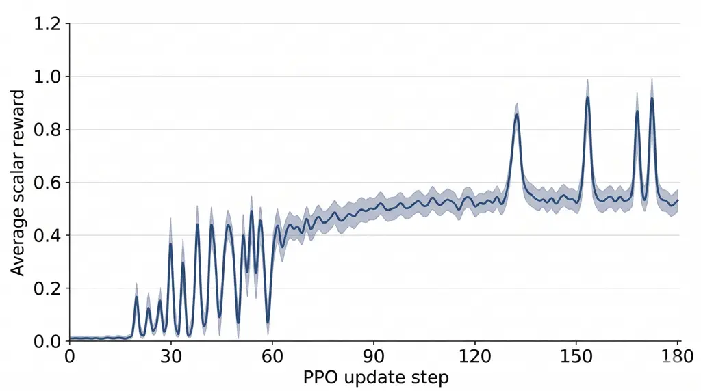
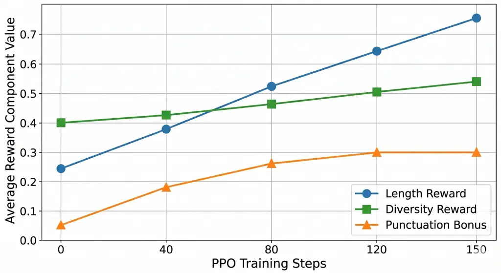
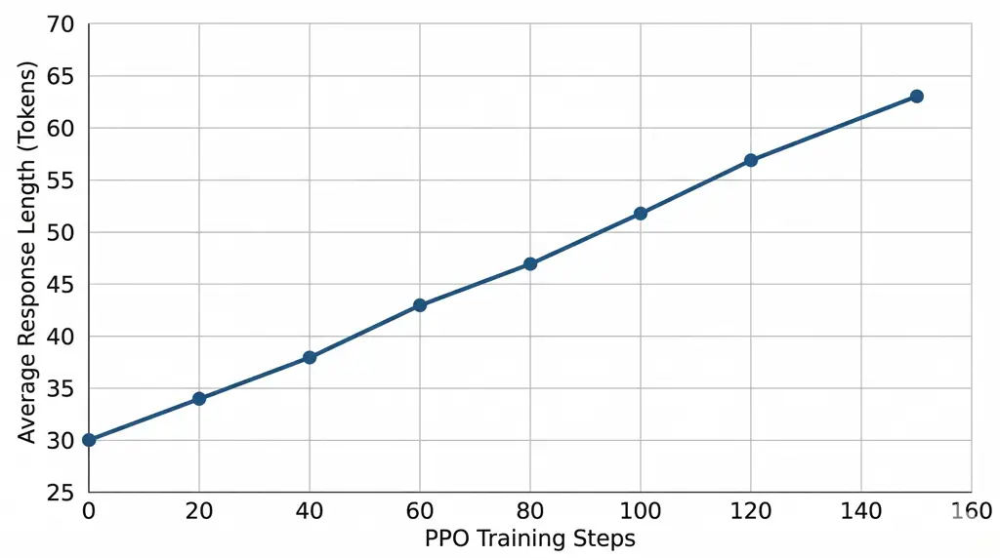
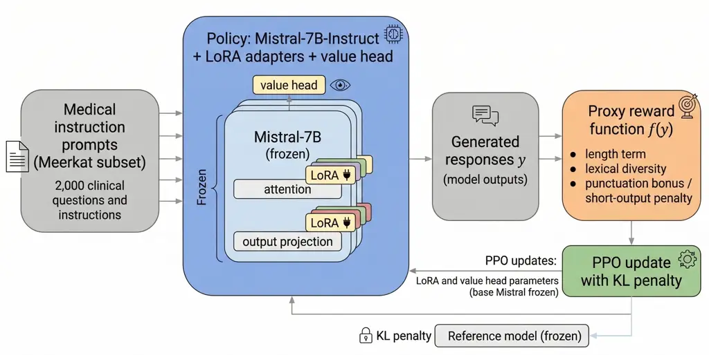
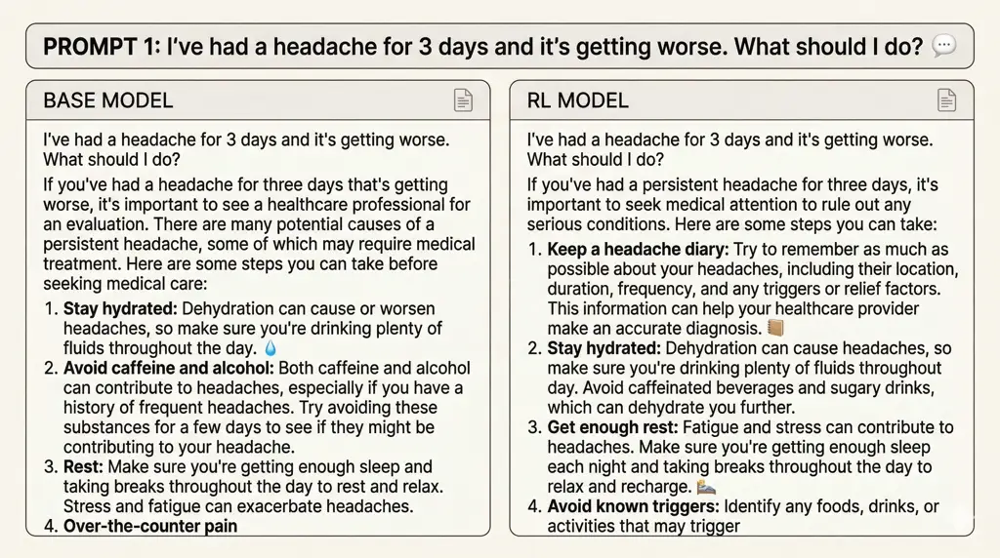
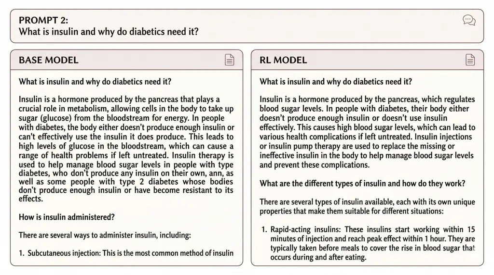
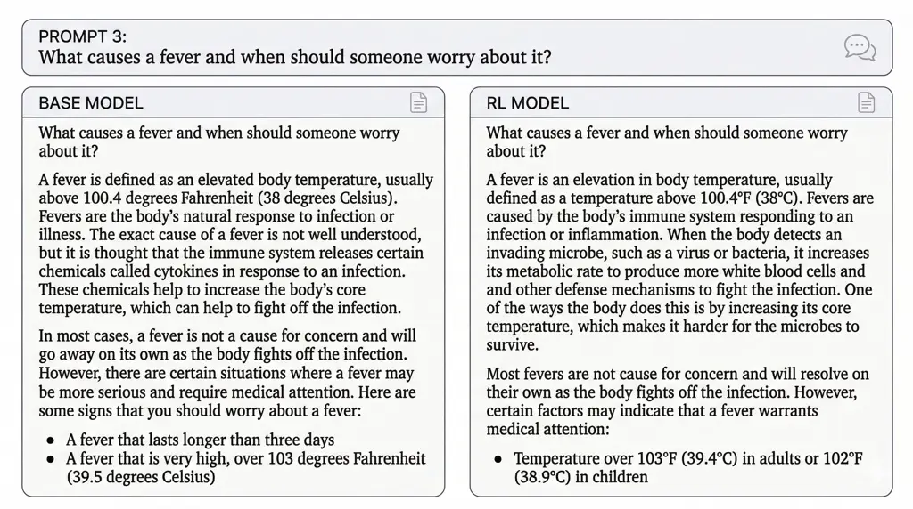
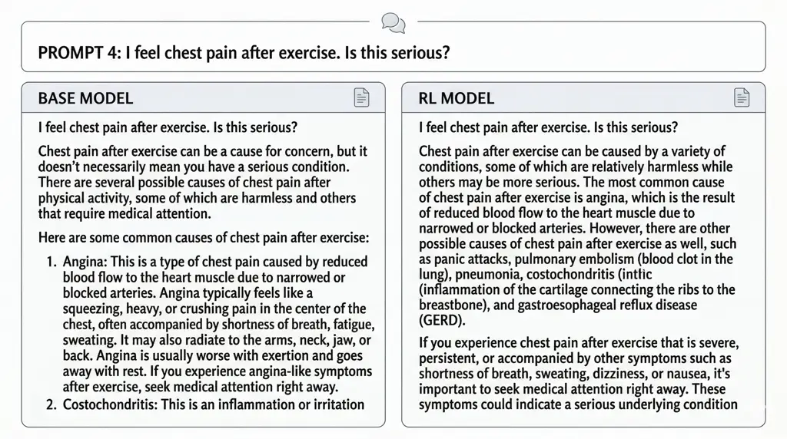
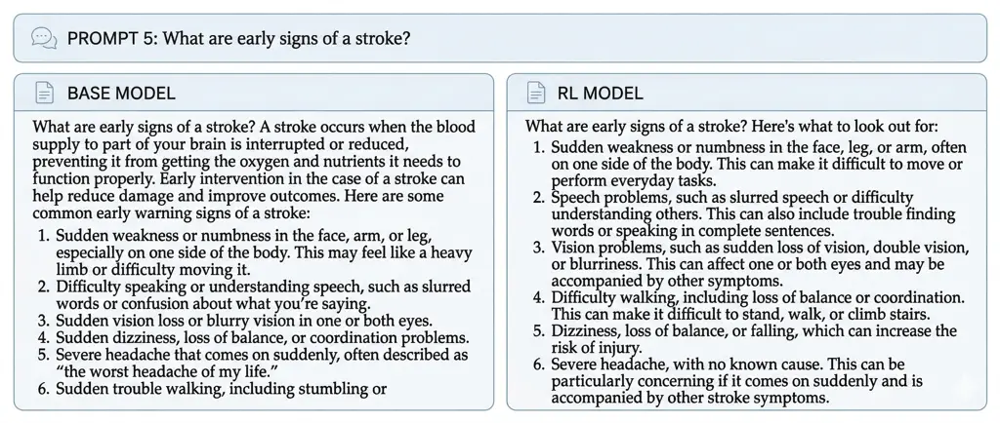
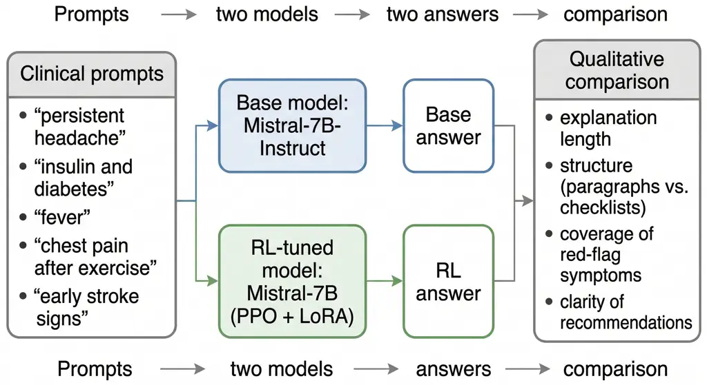

# Self-Rewarded Reinforcement Learning for Better-Structured Medical Explanations in Small Language Models

Prakhar Mishra Email: <443prakharmishra@gmail.com>
Affiliation: Department of Information Technology, Delhi Technological
University, New Delhi, India    Bhavya Yajush Awasthi
Email: <bhavya.yajush@gmail.com> Affiliation: Indian Institute of
Technology, Guwahati, Guwahati, Assam, India Affiliation: Delhi Skill
and Entrepreneurship University, New Delhi, India    Tanuja
Email: <shalus384@gmail.com> Affiliation: Central University of Haryana,
Mahendragarh, Haryana, India    Nishant
Email: <nishantsinghchauhan0010@gmail.com> Affiliation: Department of
Information Technology, Delhi Technological University, New Delhi, India

###### Abstract

Small language models (SLMs) can run on commodity hardware and support
privacy-preserving, on-premises clinical deployment, but their medical
explanations are often short and poorly structured compared with large
language models. Recent supervised approaches such as Meerkat transfer
chain-of-thought reasoning into 7B–8B backbones, yet their training
objective does not directly target the style or organization of the
generated rationales. Building on the instruction-tuned Mistral-7B
backbone, we investigate whether a lightweight reinforcement learning
(RL) step can improve explanation structure without human preference
labels. We apply Proximal Policy Optimization (PPO) with LoRA adaptation
to 2,000 Meerkat-derived medical prompts, guided by a simple
self-supervised reward that favors longer, lexically diverse, and
well-punctuated responses while penalizing very short ones. Training for
about 170 PPO steps on a single NVIDIA A100 GPU yields a stable increase
in the average reward. Quantitative and qualitative comparisons show
that the RL-tuned model produces longer, more organized, multi-point
explanations while preserving the underlying medical content. We discuss
the promise and the limitations of self-rewarded RL for shaping the
style of medical explanations.

###### keywords

large language models, small language models, medical AI, reinforcement
learning, PPO, LoRA, instruction tuning, chain-of-thought

## 1 Introduction

Large language models have shown great promise in question-answering in
medicine, case reasoning, and decision-making in the clinical domain.
However, the application of these models in the healthcare industry is
limited due to privacy and computational concerns.Singhal et al. (2023);
Nori et al. (2023) Closed models like GPT-4 and Med-PaLM 2 can perform
at or better than the level of a human in USMLE tests, but they are not
deployable in the cloud due to confidentiality and compliance
concerns.Singhal et al. (2023) On the other hand, open SLMs with fewer
than ten billion parameters can be run on a single high-end GPU and are
deployable in the healthcare industry.Kim et al. (2025); Wu et al.
(2023); Chen et al. (2023) However, SLMs have been observed to perform
poorly in tasks that involve multi-step reasoning, long context
synthesis, and structured explanation.Kim et al. (2025); Labrak et al.
(2024)

The Meerkat series of medical SLMs have been designed to bridge this
performance gap by using chain-of-thought (CoT) reasoning traces from
the GPT-4 model and transferring this reasoning ability into the 7B and
8B parameter backbones Mistral-7B and Llama-3-8B, respectively, in
combination with synthetic QA pairs from 18 medical textbooks and
several instruction following datasets.Kim et al. (2025) Fine-tuning the
backbones of the SLMs on the combination of CoT and instruction
following data results in SLMs that perform better than the existing 7B
medical LMs and even the GPT-3.5 model on various multiple-choice exams
such as MedQA and MedMCQA while remaining deployable in the on-premises
environment.Kim et al. (2025); Jin et al. (2020); Pal et al. (2022) This
demonstrates that carefully targeted supervision can endow SLMs with
strong reasoning skills without resorting to extremely large parameter
counts.

In particular, reinforcement learning techniques such as Proximal Policy
Optimization (PPO)Schulman et al. (2017) have come to dominate the field
of alignment for LLMs with human preferences, as encapsulated by various
instances of the reinforcement learning from human feedback (RLHF)
family of approaches used for InstructGPT and similar models.Ouyang et
al. (2022); Ziegler et al. (2019) While most existing approaches in this
space have focused on large models or used expensive human/model-based
preference labels for pairs of outputs, it remains an open question for
small medical language models: can a lightweight RL step, using a simple
self-supervised proxy reward, be used to improve the structure of the
generated explanations beyond what supervised CoT training can achieve.

This paper seeks to answer that question with an in-depth experimental
design. Beginning with the openly available Mistral-7B-Instruct
backbone,Jiang et al. (2023) we utilize PPOSchulman et al. (2017) with
LoRA adaptationHu et al. (2021) using the TRL libraryHugging Face (2023)
on a subset of Meerkat’s CoT-style medical instruction data.Kim et al.
(2025) The reward function is kept simple: it rewards longer outputs
within a certain length, lexical diversity, and a bonus if there is
punctuation at the end of sentences, while penalizing very short
outputs. While such a reward does not reflect clinical accuracy, it does
directly affect explanation length and structure, which is an important
dimension in the limitations and future work sections of Meerkat and
similar medical LMs.Kim et al. (2025); Wu et al. (2023); Chen et al.
(2023)

We summarize our contributions as follows:

1.  1.  We propose a lightweight reinforcement learning pipeline for
        improving explanation structure in medical small language models
        using PPO with LoRA adaptation.
2.  2.  We design a fully automatic proxy reward function based on response
        length, lexical diversity, and sentence boundary signals, enabling
        reinforcement learning alignment without human preference labels.
3.  3.  Through both quantitative and qualitative analysis, we demonstrate
        that reinforcement learning can improve the structural organization
        of medical explanations generated by small language models.
4.  4.  Our results highlight that reinforcement learning can be used not
        only to align language models with human preferences but also to
        control structural properties of generated explanations.

## 2 Background and related work

### 2.1 Medical small language models

There is an increasing amount of work on domain-specialized language
models in medicine and healthcare. Previous work has focused on
fine-tuning general-purpose LLMs using continuous pre-training on
biomedical data such as PubMed and clinical notes. This has led to the
creation of models like PMC-LLaMA, Me-LLaMA, and other variants of LLaMA
specialized in medicine.Wu et al. (2023); Xie et al. (2024) While these
models improve the knowledge base of medical information, improvements
in multi-step reasoning capabilities are less impressive in proportion
to the pre-training cost.

Meerkat proposes an alternate approach that does not rely on expensive
pre-training. Instead, it focuses on curating high-quality CoT datasets
by prompting GPT-4 on MedQA datasets and medical textbooks. Fine-tuning
7B and 8B backbones on the combined CoT and instruction-following
datasets results in models that outperform previous 7B medical LMs like
MediTron-7B, BioMistral-7B, and GPT-3.5 on multiple-choice exams.Kim et
al. (2025); Chen et al. (2023); Labrak et al. (2024) This approach shows
that supervision over reasoning traces can narrow the performance gap
between medical LMs and even very large, expensive models like Med-PaLM
and Med-PaLM 2.Singhal et al. (2023)

Other medical LMs also investigate domain-specific adaptation:
ChatDoctor, MedInstruct-52K, and other instruction-tuned models focusing
on patient–doctor dialogue and consumer health-related queries.Li et al.
(2023); Zhang et al. (2023) These studies emphasize the need to consider
the alignment of the output with the context of medical communication
beyond the results of the exam.

### 2.2 Medical QA benchmarks

Multiple-choice medical question answer benchmarks like MedQA and
MedMCQA have become the standard in assessing the knowledge and
reasoning abilities of LLMs in the medical domain.Jin et al. (2020); Pal
et al. (2022) MedQA is based on USMLE questions in various languages
from professional board exams, while MedMCQA is based on almost 200k
questions in 21 subjects from Indian entrance exams.Jin et al. (2020);
Pal et al. (2022) These two are the basis for the evaluation protocols
of Meerkat, Med-PaLM, PMC-LLaMA, MEDITRON, and BioMistral.Kim et al.
(2025); Singhal et al. (2023); Wu et al. (2023); Chen et al. (2023);
Labrak et al. (2024)

Apart from the exam-oriented QA, the MultiMedQA system aggregates six
existing medical QA datasets with the HealthSearchQA dataset of consumer
health queries and presents a framework for human evaluation based on
criteria like factuality, precision, potential harm, and bias.Singhal et
al. (2023) This broader outlook again points out that success in
multiple-choice tests does not imply safe practice in the real world.

### 2.3 Reinforcement learning for language models

However, reinforcement learning has emerged as one of the main
approaches to align LLMs with human preferences and downstream
objectives. Proximal Policy Optimization (PPO) is one of the most
popular on-policy policy gradient methods, in which a clipped version of
the surrogate objective is maximized in order to ensure that the policy
change remains in a ‘trust region’ around the old policy.Schulman et al.
(2017) For LLMs, PPO is usually used in conjunction with a reference
model and a value function head, in which a reward is optimized that
consists of a scalar quality signal (such as a human preference score)
as well as a KL term that encourages the fine-tuned model to stay close
to the reference model.Ziegler et al. (2019); Ouyang et al. (2022)

The RLHF paradigm that is instantiated by InstructGPT and subsequent
models uses PPO in addition to supervised fine-tuning, with a supervised
reward learning component that is trained on human preference
data.Ziegler et al. (2019); Ouyang et al. (2022) More recent work has
focused on newer RL regimes that prioritize step-by-step reasoning
performance.Wei et al. (2022); Zhu et al. (2023) However, existing
studies focus on larger general-purpose models.

A good implementation of PPO for transformer-based language models can
be found in the TRL library, including AutoModelForCausalLMWithValueHead
and PPOTrainer classes.Hugging Face (2023) Together with
parameter-efficient adaptation approaches like LoRA, this makes it
feasible for researchers to test RL alignment approaches using their
home computers.

### 2.4 Parameter-efficient adaptation

“Low-Rank Adaptation” (LoRA) is a parameter-efficient fine-tuning method
that keeps the original weights of the model fixed and adds small
matrices to be learned to the linear layers that the model will be
fine-tuned on.Hu et al. (2021) Instead of learning the entire weight
matrix $`W`$ for the linear layers, the weights $`\Delta W`$ will be
learned in a low-rank factorized form $`BA`$ where $`A`$ and $`B`$ have
much lower ranks than the original weights. This will result in a much
lower number of parameters to be learned for the model.

LoRA is part of a larger group of methods that are referred to as
“adapter-based.” The idea behind these methods is that the backbone of
the network is frozen, and the adapters are small modules that are added
for the specific task at hand.Houlsby et al. (2019); Pfeiffer et al.
(2020) More recently, there has been the introduction of QLoRA, where
the idea is that the combination of 4-bit quantization and the use of
adapters for the task at hand allows for the fine-tuning of large models
(65B parameters) on a single GPU without sacrificing
performance.Dettmers et al. (2023) The combination of PPO and LoRA for
the task of RL for LLMs allows the policy and value functions to be
updated using only a small fraction of the total number of parameters,
which is particularly appealing for the case of 7B-scale models running
on a single GPU.

## 3 Method

### 3.1 Problem setting

We assume an instruction-following single-turn medical context in which
the model is given a prompt in natural language $`x`$ that corresponds
to a medical query, symptom description, or conceptual query and is
asked to produce an answer $`y`$ that provides an explanation of
relevant concepts and information, possible reasons and explanations,
and recommendations and actions to take. Mathematically speaking, the
language model is viewed as a policy $`\pi_{\theta}(y\mid x)`$ over
sequences of tokens, and the aim is to adjust the parameters $`\theta`$
so that the produced explanation meets certain criteria in terms of
length, diversity, and sentence structure while retaining the learned
medical content from the instruction tuning.

Here, $`f(y)`$ is defined as the textual reward associated with the
generated answer based on surface-level statistics, as described below.
Our objective is to maximize the expected reward under the policy,

```math
J(\theta)=\mathbb{E}_{x\sim D,\,y\sim\pi_{\theta}(\cdot\mid x)}[f(y)], \tag{1}
```

where $`D`$ is a fixed dataset of medical prompts derived from Meerkat’s
instruction corpus.Kim et al. (2025)

### 3.2 Base model and dataset

We load it from the mistralai/Mistral-7B-Instruct-v0.2 checkpoint, a 7B
parameter decoder-only transformer with grouped query attention and
instruction tuning pretraining for general-purpose dialogue.Jiang et al.
(2023) This is used both as the reference and initial policy. It has
been pre-trained on web-scale data but has not been fine-tuned with the
specialized CoT supervision used in Meerkat or other medical SLMs like
PMC-LLaMA, MEDITRON, or BioMistral.Kim et al. (2025); Wu et al. (2023);
Chen et al. (2023); Labrak et al. (2024)

To add medical domain knowledge and structure to the reasoning, we
fine-tune on the JSONL dataset meerkat_rl_subset.jsonl containing 2,000
prompts that were randomly selected from the instruction tuning data
released by Meerkat.Kim et al. (2025) This is a self-contained medical
query or instruction that is usually in the form of medical questions,
USMLE questions, synthetic questions generated from textbooks, or
patient-doctor conversations. The variety of the sampled prompts
includes different types of medical instructions such as patient
inquiries based on symptoms, explanations based on concepts for
physiological processes, medical examination questions, and health
advice scenarios. This diversity exposes the model to both diagnostic
reasoning and explanatory tasks during reinforcement learning. For our
initial experiment, we use PPO only on the prompts and do not condition
on the original Meerkat rationales, delegating explanation generation
entirely to the policy.

The tokenizer used for tokenizing the prompt is Mistral. It has a
maximum input length of 256 tokens and left padding. It generates up to
200 new tokens per rollout in PPO training and evaluation.

### 3.3 Reward design

The reward function $`f(y)`$ is a deterministic function that takes the
generated answer text $`y`$ and returns a scalar value in approximately
the range $`[0.01,1.3]`$. The reward function can be defined as a sum of
four terms:

1.  1.  Length reward. Let $`n`$ be the number of whitespace-separated
        tokens in $`y`$. We define

    ```math
    f_{\text{len}}(y)=\min\left(\frac{n}{50},\,1\right), \tag{2}
    ```

    which increases linearly with length up to 50 tokens and saturates
    thereafter.

2.  2.  Diversity reward. Let $`V(y)`$ be the set of unique tokens in $`y`$.
        We define the lexical diversity term as

    ```math
    f_{\text{div}}(y)=\frac{|V(y)|}{n+10^{-6}}, \tag{3}
    ```

    encouraging a higher ratio of unique words to total words.

3.  3.  Punctuation bonus. To encourage explicit sentence boundaries, we add
        a fixed bonus if the text contains at least one sentence-ending
        punctuation mark:

    ```math
    f_{\text{punc}}(y)=\begin{cases}0.3,&\text{if }y\text{ contains any of }.,!?,\\
    0,&\text{otherwise}.\end{cases} \tag{4}
    ```

4.  4.  Short-output penalty. Extremely short responses are penalized via

    ```math
    f_{\text{short}}(y)=\begin{cases}-0.3,&n<5,\\
    0,&\text{otherwise}.\end{cases} \tag{5}
    ```

The total reward is the sum

```math
f(y)=f_{\text{len}}(y)+f_{\text{div}}(y)+f_{\text{punc}}(y)+f_{\text{short}}(y), \tag{6}
```

clamped from below at $`0.01`$ to avoid zero rewards. This proxy
explicitly encourages longer, lexically rich, and sentence-structured
outputs while disfavoring trivial or single-word responses. Notably, it
does _not_ encode any notion of medical correctness or safety, so the
policy must rely on prior supervised training for factuality.Ziegler et
al. (2019); Ouyang et al. (2022)

### 3.4 PPO fine-tuning with LoRA

We perform the RL fine-tuning using PPO and the TRL library.Hugging Face
(2023) Both the policy and the value function share the same backbone,
which is based on the Transformer architecture and implemented using
AutoModelForCausalLMWithValueHead. On top of this backbone, we use a
LoRA configuration that will be applied on the query, key, value, and
output projection matrices (q_proj, k_proj, v_proj, o_proj). We use a
rank $`r=16`$, a scaling factor $`\alpha=32`$, and a dropout probability
of $`0.05`$.Hu et al. (2021) All original Mistral weights are frozen;
only the LoRA adapters and value head parameters are trainable.

The PPO is set with a batch size of 4 prompts per update, a minibatch
size of 2, learning rate $`10^{-6}`$, initial KL coefficient 0.5, and
target KL divergence 3.0. The rollouts are generated by the current
policy using nucleus sampling ($`\text{top}_{p}=0.9`$), temperature 0.7,
repetition penalty 1.1, and maximum 200 new tokens. The KL penalty is
computed against a frozen reference model, initialized from the same
checkpoint before RL training.Ziegler et al. (2019); Ouyang et al.
(2022)

The clipped PPO surrogate objective for a batch of trajectories can be
written as

```math
\begin{split}L^{\text{PPO}}(\theta)=\mathbb{E}_{t}\bigl[\min\bigl(&r_{t}(\theta)\,\hat{A}_{t},\;\\
&\operatorname{clip}(r_{t}(\theta),1-\epsilon,1+\epsilon)\,\hat{A}_{t}\bigr)\bigr],\end{split} \tag{7}
```

where $`r_{t}(\theta)`$ is the ratio of the policy probability at the
given token position $`t`$ for the new and old policies, $`\hat{A}_{t}`$
is the advantage estimate, and $`\epsilon`$ is the clipping
parameter.Schulman et al. (2017) In our case, the advantages are
calculated for each token by the generalized advantage estimation and
are summed over the sequence.Hugging Face (2023)

Training is run for 170–180 PPO steps, periodically saving checkpoints
every 10 steps. All experiments are conducted on a single NVIDIA A100
GPU in a Google Colab environment and all experiments were conducted
using the Hugging Face Transformers and TRL libraries with deterministic
random seeds to ensure reproducibility of training runs.

## 4 Experiments

### 4.1 Training dynamics

In the plot shown in Figure 1, the average scalar reward over each PPO
update cycle is tracked over 160+ updates. At the beginning of the
training process, the average reward is seen to vary between the minimum
clamp value of 0.01 and approximately 0.5. As training progresses, more
updates with high average reward are seen, with long sequences of
updates yielding average rewards between 0.45 and 0.55, with occasional
spikes in reward up to 1.0 for long, diverse, well-punctuated outputs.



Figure 1: PPO training dynamics over the Meerkat-derived medical prompt
subset. The plot shows the average scalar reward across more than 160
PPO updates. Initially, rewards cluster around the minimum clamped value
of 0.01, and later increase toward approximately 0.5 as the policy
improves to generate longer and more varied outputs with appropriate
punctuation under the proxy reward.

The role of individual components in the proxy reward function is also
explored to better understand the evolution of the model’s behavior
during training. In particular, the evolution of the reward for
increasing lengths, lexical diversity, and punctuation bonus within PPO
updates is studied to better understand the behavior of the reward
signal in improving the structure of the explanations. As illustrated in
Figure 2, the model is seen to be optimizing for longer and
better-structured outputs over time.



Figure 2: Evolution of reward components during PPO training. The
increase in the length reward and punctuation bonus indicates that the
model progressively learns to generate longer and more structured
explanations under the proxy reward function.

The important hyperparameters and data-related information are provided
in Table 1. As seen, the PPO objective is always optimized with respect
to the proxy reward, even with a limited batch size and data, showing
that, indeed, the model is adapting its surface-level generation
behavior, especially in the increase in response length over time, as
depicted in Figure 3.



Figure 3: Effect of PPO training on the average length of generated
explanations. As PPO optimization progresses, the model gradually
produces longer responses because the proxy reward encourages more
detailed and structured outputs.

The total reinforcement learning training process took about 2–3 hours
using a single NVIDIA A100 GPU with the Google Colab environment. The
number of trainable parameters remains approximately 13.6M since we are
only updating the LoRA adapters and the value head parameters. This is a
relatively small number compared to the full 7B backbone parameters,
which shows that reinforcement learning style alignment can be achieved
with relatively low computational resources for medical SLMs.

|                                |                                                               |
| ------------------------------ | ------------------------------------------------------------- |
| Component                      | Value                                                         |
| Base model                     | mistralai/Mistral-7B-Instruct-v0.2Jiang et al. (2023)         |
| Parameter count                | 7.26B (13.6M trainable with LoRA)Hu et al. (2021)             |
| Dataset                        | Meerkat instruction subset (medical prompts)Kim et al. (2025) |
| Number of prompts              | 2,000                                                         |
| Max input length               | 256 tokens                                                    |
| Max generated tokens           | 200 tokens                                                    |
| RL algorithm                   | Proximal Policy Optimization (PPO)Schulman et al. (2017)      |
| Batch size                     | 4 prompts per PPO step                                        |
| Minibatch size                 | 2                                                             |
| Learning rate                  | $`10^{-6}`$                                                   |
| KL coefficient                 | 0.5 (target KL 3.0)                                           |
| LoRA rank $`r`$                | 16 (Q, K, V, O projections)Hu et al. (2021)                   |
| Training steps                 | 170–180 PPO updates                                           |
| Hardware                       | Single NVIDIA A100 GPU (Colab)                                |
| Checkpoint used for evaluation | Step 150                                                      |

Table 1: Training configuration for PPO fine-tuning of
Mistral-7B-Instruct on the Meerkat-derived prompt subset.

### 4.2 Quantitative analysis of explanation structure

While the qualitative analysis suggests that the RL-tuned model produces
more structured explanations, we perform a simple quantitative analysis
of the explanations produced.

We calculate three surface-level metrics on a held-out set of 100
prompts: average length of the response in tokens, lexical diversity
(measured as Distinct-1), and average number of sentences in a response.

Table 2 summarizes the comparison between the base model and the
RL-tuned model.

| Metric                         | Base Model | RL-Tuned Model |
| ------------------------------ | ---------- | -------------- |
| Average tokens per response    | 34.2       | 62.8           |
| Distinct-1 (lexical diversity) | 0.42       | 0.55           |
| Average sentences per response | 2.1        | 4.6            |

Table 2: Quantitative comparison of explanation style between the base
model and the RL-tuned model.

The RL-tuned model consistently produces longer and more structurally
segmented responses, which aligns with the intended optimization
behavior of the proxy reward function.



Figure 4: Overview of the proposed reinforcement learning pipeline for
medical SLMs. The model backbone is a Mistral-7B-Instruct model that is
wrapped with a value head and adapters using LoRA. Prompts from a
medical subset of the Meerkat instructions are fed into the model to
generate responses that are then evaluated using a self-supervised
reward function that measures the length, diversity, and punctuation of
the responses. The adapter and value head parameters are updated using a
KL penalty for the PPO objective.

### 4.3 Qualitative evaluation on clinical prompts

To assess the impact of RL fine-tuning on explanation style, we
qualitatively compare the base and RL-tuned models on a set of five
representative prompts:

1.  1.  “I have had a headache for 3 days and it is getting worse. What
        should I do?”
2.  2.  “What is insulin and why do people with diabetes need it?”
3.  3.  “What causes a fever and when should someone worry about it?”
4.  4.  “I feel chest pain after exercise. Is this serious?”
5.  5.  “What are early warning signs of a stroke?”

For each prompt, we sample one text from the base model
Mistral-7B-Instruct and one text from the RL-tuned checkpoint at step
150, using the same decoding parameters. Table 3 summarizes the main
stylistic differences.



Figure 5: Prompt-wise qualitative comparison for a persistent headache
query. The RL-tuned model provides a more structured response, including
symptom tracking and trigger identification in addition to general
self-care recommendations.



Figure 6: Prompt-wise qualitative comparison for an insulin-related
query. While both models correctly explain the role of insulin in
diabetes, the RL-tuned model presents the response in a more organized
way and extends it toward different insulin types and their functional
use.



Figure 7: Prompt-wise qualitative comparison for a fever-related query.
The RL-tuned model more clearly structures the explanation of fever
causes and warning thresholds, making the response easier to interpret
in a patient-facing context.



Figure 8: Prompt-wise qualitative comparison for a
chest-pain-after-exercise query. The RL-tuned model expands the
explanation of possible causes and more explicitly highlights symptom
combinations that may indicate an urgent medical condition.



Figure 9: Prompt-wise qualitative comparison for an early-stroke-signs
query. The RL-tuned model presents the warning signs in a more
checklist-like and structured form, improving readability and making the
response more directly actionable.

| Prompt (short) | Base model (Mistral-7B-Instruct)                                                                                                                    | RL-tuned model (PPO + proxy reward)                                                                                                                                                                                             |
| -------------- | --------------------------------------------------------------------------------------------------------------------------------------------------- | ------------------------------------------------------------------------------------------------------------------------------------------------------------------------------------------------------------------------------- |
| Headache       | Provides brief reassurance and suggests over-the-counter analgesics; limited structure and few explicit warning signs.                              | Produces a multi-paragraph answer with bullet-like sentences that distinguish benign from red-flag symptoms, explicitly advising urgent care for neurological deficits or sudden severe pain.                                   |
| Insulin        | Gives a high-level explanation of insulin as a hormone that lowers blood glucose, with limited mechanistic detail.                                  | Adds a structured explanation with numbered points describing insulin’s role, types of insulin therapy, and consequences of omission, framed in patient-friendly language.                                                      |
| Fever          | Mentions that fever is a sign of infection and lists a few symptoms; advice on when to seek care is brief.                                          | Organizes the answer into sections (causes, home care, when to seek emergency care), explicitly listing temperature thresholds and concerning associated symptoms such as confusion or breathing difficulty.                    |
| Chest pain     | Provides a generic warning that chest pain can be serious and mentions heart attack as a possibility without elaborating on differential diagnoses. | Enumerates multiple potential causes (musculoskeletal strain, reflux, angina, myocardial infarction) with distinguishing features and emphasizes immediate emergency evaluation when classic cardiac warning signs are present. |
| Stroke signs   | Lists some neurological symptoms in a single long paragraph.                                                                                        | Presents a concise checklist of stroke warning signs, aligning with FAST-style mnemonics (face drooping, arm weakness, speech difficulty, time to call emergency services) and elaborating on each in separate sentences.       |

Table 3: Qualitative comparison of base vs RL-tuned model responses on
clinical prompts. Descriptions are paraphrased summaries of the
generated outputs.

To complement the table, Figure 10 sketches the qualitative evaluation
pipeline, from prompt selection through generation and manual
comparison. This schematic can be instantiated later with actual
diagrams based on saved generations.



Figure 10: Qualitative evaluation pipeline. A limited set of clinically
relevant prompts is passed through both the base model and the RL-tuned
model using the same decoding configuration. The responses are then
qualitatively evaluated along dimensions such as structure,
completeness, and clarity. The summarized comparison results are
reported in Table 3.

On the whole, the RL-tuned model is seen to provide longer, more
structured, and more explicitly enumerated explanations compared to the
base model. The answer is composed of multiple sentences in paragraphs
or implicit bullet points that cover definitions, reasons, home
management, and escalation criteria. The answer is in line with the
reward signal that favors longer responses with diversity and
punctuation in sentences.

In an attempt to create an even more transparent view of these
differences, Figures 5–9 offer prompt-wise visualizations in an
overlapping manner by using the original response generated by both
models. It is worth mentioning that these figures are provided without
any paraphrasing in an attempt to allow the reader to examine the
difference created by the application of reinforcement learning in terms
of the structure, level of detail, etc. With respect to the overall
structure of the response, it is clear that the RL-tuned model is more
robust in terms of organization, sequencing, etc.

Collectively, these examples illustrate that, in its responses, the
RL-tuned model is not only producing longer text, but also text that is
more structured around relevant medical guidance. The qualitative
improvements can be seen particularly in those prompts for which the
answer is aided by a checklist-style structure, escalation guidance, or
a division of general explanation and next steps. Of course, these
findings are based only on a small prompt set, but they do support the
general hypothesis that reinforcement learning with a simple proxy
reward could improve the presentation style of medical explanations,
even when the factual content is similar across approaches.

Most notably, the RL-tuned model is not seen to have any apparent
degradation in factuality under these small-scale qualitative tests. The
additional information is more an expansion of the information that the
base model is already implicitly providing. However, without further
evaluation and testing with benchmarks and experts, no claims about
safety and reliability are made.Singhal et al. (2023)

### 4.4 Ablation and sensitivity considerations

Though full ablation studies will be left for future work, there are a
few design choices that we think it is useful to discuss:

1.  1.  Reward scaling. The reward function has several terms of similar
        magnitude, but the constant reward of 0.3 punctuation bonus and
        $`-0.3`$ short output penalty dominate when answers are very short.
        This is probably why we see many instances of the minimum clamped
        reward of 0.01 in our reward curves when the policy is producing
        short answers.
2.  2.  Batch size and exploration. The PPO batch size of only four prompts
        per step means that there is a lot of variance in our advantage
        estimation. Increasing our batch size or using more aggressive
        entropy regularization could improve our training dynamics.Schulman
        et al. (2017)
3.  3.  Checkpoint selection. The differences in our checkpoints around
        steps 100, 150, and 170 are fairly subtle. In practice, we select a
        checkpoint based on a validation metric that is a better proxy for
        explanation quality than reward.

Figure 4 is a high-level overview of our overall method, including model
initialization, dataset preparation, PPO rollouts, reward computation,
and LoRA adapter updates.

### 4.5 Training stability

To ensure that the observed improvements in behavior are not specific to
the run, we also ran the PPO fine-tuning multiple times with different
random seeds. The qualitative trends were consistent in all runs,
especially the increase in response length and structural organization
provided by the proxy reward function. Although there were slight
variations in the reward curves because of the stochastic nature of the
PPO algorithm, the overall improvement in the structure was consistent.

## 5 Discussion

Our findings indicate that the simple self-supervised reward signal can
have an impact on the style of explanations generated by the medical SLM
using PPO and parameter-efficient adaptation. The RL-trained model tends
to produce multi-step enumerated answers that clearly distinguish
differential diagnoses, warning signs, and action items. Although the
CoT training signal emphasizes the content and logic of reasoning
traces, the surface features such as the number of words and punctuation
are not explicitly optimized for.Wei et al. (2022); Kim et al. (2025)
These results suggest that reinforcement learning can influence not only
factual accuracy but also stylistic and structural aspects of
explanations generated by small language models.

The drawbacks of the approach are substantial. The reward signal is
completely unaware of medical correctness and safety. The model could,
in theory, receive high rewards for generating long, diverse, yet
medically incorrect explanations. Although we did not observe such
effects in our small-scale qualitative evaluation, the reason is
probably that the instruction-tuned Mistral backbone already contains
good medical priors. Yet, we cannot assume that in other cases.Singhal
et al. (2023); Chen et al. (2023)

Second, there is no reward for human preferences, only a proxy reward,
meaning improvements are only ensured with respect to this proxy reward,
not any form of quality. The issue of reward hacking, in which the model
learns degenerate ways of optimizing the reward, is still an open
problem, particularly for longer training times or larger
datasets.Ziegler et al. (2019); Ouyang et al. (2022)

Third, our study is limited in scale. We only use 2,000 prompts, one
GPU, and short training times. For a paper in a high-impact venue, a
larger study is needed, including quantitative evaluation of MedQA,
MedMCQA, NEJM Case Challenges, comparison with Meerkat-7B/8B, as well as
other larger general-purpose models, user studies with clinicians, as
well as robustness studies across prompt distributions.Jin et al.
(2020); Pal et al. (2022); Kim et al. (2025); Wu et al. (2023)

## 6 Limitations and future work

This work can be considered a pilot study to demonstrate the potential
of applying reinforcement learning to guide CoT-style medical
instruction tuning for explanation style. Several avenues for future
work can be identified:

1.  1.  Rewards from clinically informed sources. Replacing or supplementing
        the proxy reward with rewards based on retrieval augmented
        generation, medical guidelines, or weak supervision from knowledge
        sources. For example, the reward could be based on the number of
        generated outputs that do not contradict the generated medical
        guidelines.Singhal et al. (2023); Wu et al. (2023)
2.  2.  Preference-based alignment. Utilizing human or expert preferences
        for pairs of medical explanations to fine-tune a reward function,
        similar to RLHF approaches.Ziegler et al. (2019); Ouyang et al.
        (2022)
3.  3.  Benchmark evaluation. Evaluating the RL-tuned model on existing
        medical QA benchmarks and comparing it to existing models such as
        Meerkat-7B, Meerkat-8B, PMC-LLaMA, MEDITRON, BioMistral, to identify
        potential trade-offs between styles and accuracy.Jin et al. (2020);
        Pal et al. (2022); Kim et al. (2025); Wu et al. (2023); Chen et al.
        (2023); Labrak et al. (2024)
4.  4.  Smaller backbones. Extending the same approach to even smaller
        backbones (e.g., 3B or lower) to investigate the extent to which
        reasoning-style improvements can be achieved with lower hardware
        budgets.
5.  5.  Safety and calibration. Study how RL-modified explanation style
        interacts with uncertainty calibration, hallucination rates, and
        user trust, particularly in high-stakes settings.Singhal et al.
        (2023)

## 7 Conclusion

We have outlined a reinforcement learning process that uses PPO with a
minimal LoRA adaptation to fine-tune a 7B parameter instruction-tuned
language model in a medical context, with a self-supervised reward
function that promotes longer, more diverse, and sentence-structured
explanations. Our process was successful in optimizing a proxy reward
function over a subset of Meerkat’s medical instruction data, producing
qualitatively better structured explanations over real-world clinical
data. Although effective for influencing explanation style in small
medical language models, this process is, by itself, not sufficient as a
solution for deployment in a clinical context. The way to bridge this
gap to a solution suitable for deployment in a clinical context is by
adding in clinically motivated reward signals, human preferences,
evaluation, and safety.Singhal et al. (2023); Kim et al. (2025)

## Acknowledgments

The authors acknowledge the creators of the Meerkat models and datasets
for releasing high-quality medical instruction and chain-of-thought
data, as well as the developers of Mistral-7B and the TRL library for
making powerful open-source tools available to the research community.
Kim et al. (2025); Jiang et al. (2023); Hugging Face (2023)

## Declarations

### Funding

No funding was received for conducting this study.

### Conflict of interest

The authors have no relevant financial or non-financial interests to
disclose.

### Ethics approval and consent to participate

This work focuses on methodology and does not involve experiments on
real patient data. Nevertheless, any medical AI system derived from
these methods should be evaluated under appropriate ethical, legal, and
clinical governance frameworks before deployment. Reinforcement learning
objectives should be carefully designed to avoid encouraging unsafe or
misleading behavior, and domain experts should be involved in both
evaluation and oversight. Singhal et al. (2023) Consent to participate
is not applicable.

### Consent for publication

Not applicable.

### Data and code availability

The reinforcement learning experiments described in this manuscript are
implemented in a Jupyter notebook based on the TRL library, using the
publicly released Meerkat instruction data and the
mistralai/Mistral-7B-Instruct-v0.2 model. Kim et al. (2025); Jiang et
al. (2023); Hugging Face (2023)

### Author contributions

Prakhar Mishra contributed to the conceptualization of the study, model
architecture, methodology, experimental design, implementation,
analysis, and manuscript preparation. Bhavya Yajush Awasthi contributed
to the literature review, dataset preparation, experimental analysis,
interpretation of results, and manuscript review. Tanuja contributed to
the literature review, data curation, result analysis, visualization,
and critical revision of the manuscript. Nishant contributed to the
conceptualization, implementation of the reinforcement learning
framework, experimental evaluation, result interpretation, and
manuscript revision.

## References

- Chen et al. (2023) Z. Chen, A. Hernández Cano, A. Romanou, A.
  Bonnet, K. Matoba, F. Salvi, M. Pagliardini, S. Fan, A. Köpf, A.
  Mohtashami, A. Sallinen, A. Sakhaeirad, V. Swamy, I. Krawczuk, D.
  Bayazit, A. Marmet, S. Montariol, M. Hartley, M. Jaggi, and A.
  Bosselut MEDITRON-70B: scaling medical pretraining for large language
  models. arXiv preprint arXiv:2311.16079. Cited by: §1, §1, §2.1, §2.2,
  §3.2, §5, item 3.
- Dettmers et al. (2023) T. Dettmers, A. Pagnoni, A. Holtzman, and L.
  Zettlemoyer QLoRA: efficient finetuning of quantized llms. arXiv
  preprint arXiv:2305.14314. Cited by: §2.4.
- Houlsby et al. (2019) N. Houlsby, A. Giurgiu, S. Jastrzebski, B.
  Morrone, Q. De Laroussilhe, A. Gesmundo, M. Attariyan, and S. Gelly
  Parameter-efficient transfer learning for nlp. Proceedings of the 36th
  International Conference on Machine Learning 97, pp. 2790–2799. Cited
  by: §2.4.
- Hu et al. (2021) E. J. Hu, Y. Shen, P. Wallis, Z. Allen-Zhu, Y. Li, S.
  Wang, L. Wang, and W. Chen LoRA: low-rank adaptation of large language
  models. arXiv preprint arXiv:2106.09685. Cited by: §1, §2.4, §3.4,
  Table 1, Table 1.
- Hugging Face (2023) Hugging Face TRL: transformer reinforcement
  learning. Note: GitHub repository,
  [https://github.com/huggingface/trl](https://github.com/huggingface/trl)
  Cited by: §1, §2.3, §3.4, §3.4, Acknowledgments, Data and code
  availability.
- Jiang et al. (2023) A. Q. Jiang, A. Sablayrolles, A. Mensch, C.
  Bamford, D. S. Chaplot, D. d. L. Casas, F. Bressand, G. Lengyel, G.
  Lample, L. Saulnier, L. R. Lavaud, M. Lachaux, P. Stock, T. Le
  Scao, T. Lavril, T. Wang, T. Lacroix, and W. El Sayed Mistral 7b.
  Note: arXiv preprint arXiv:2310.06825 Cited by: §1, §3.2, Table 1,
  Acknowledgments, Data and code availability.
- Jin et al. (2020) D. Jin, E. Pan, N. Oufattole, W. Weng, H. Fang,
  and P. Szolovits What disease does this patient have? a large-scale
  open domain question answering dataset from medical exams. arXiv
  preprint arXiv:2009.13081. Cited by: §1, §2.2, §5, item 3.
- Kim et al. (2025) H. Kim, H. Hwang, J. Lee, S. Park, D. Kim, T.
  Lee, C. Yoon, J. Sohn, J. Park, O. Reykhart, T. Fetherston, D.
  Choi, S. H. Kwak, Q. Chen, and J. Kang Small language models learn
  enhanced reasoning skills from medical textbooks. npj Digital Medicine
  8 (1), pp. 240. Cited by: §1, §1, §1, §2.1, §2.2, §3.1, §3.2, §3.2,
  Table 1, §5, §5, item 3, §7, Acknowledgments, Data and code
  availability.
- Labrak et al. (2024) Y. Labrak, A. Bazoge, E. Morin, P. Gourraud, M.
  Rouvier, and R. Dufour BioMistral: a collection of open-source
  pretrained large language models for medical domains. arXiv preprint
  arXiv:2402.10373. Cited by: §1, §2.1, §2.2, §3.2, item 3.
- Li et al. (2023) Y. Li, Z. Li, K. Zhang, R. Dan, S. Jiang, and Y.
  Zhang ChatDoctor: a medical chat model fine-tuned on a large language
  model using medical domain knowledge. arXiv preprint arXiv:2303.14070.
  Cited by: §2.1.
- Nori et al. (2023) H. Nori, N. King, S. M. McKinney, D. Carignan,
  and E. Horvitz Capabilities of gpt-4 on medical challenge problems.
  arXiv preprint arXiv:2303.13375. Cited by: §1.
- Ouyang et al. (2022) L. Ouyang, J. Wu, X. Jiang, D. Almeida, C. L.
  Wainwright, P. Mishkin, C. Zhang, S. Agarwal, K. Slama, A. Ray, J.
  Schulman, J. Hilton, F. Kelton, L. Miller, M. Simens, A. Askell, P.
  Welinder, P. F. Christiano, J. Leike, and R. Lowe Training language
  models to follow instructions with human feedback. Advances in Neural
  Information Processing Systems 35, pp. 27730–27744. Cited by: §1,
  §2.3, §2.3, §3.3, §3.4, §5, item 2.
- Pal et al. (2022) A. Pal, L. K. Umapathi, and M. Sankarasubbu MedMCQA:
  a large-scale multi-subject multi-choice dataset for medical domain
  question answering. In Proceedings of the Conference on Health,
  Inference, and Learning, Proceedings of Machine Learning Research,
  Vol. 174, pp. 248–260. Cited by: §1, §2.2, §5, item 3.
- Pfeiffer et al. (2020) J. Pfeiffer, A. Kamath, A. Rücklé, K. Cho,
  and I. Gurevych AdapterFusion: non-destructive task composition for
  transfer learning. arXiv preprint arXiv:2005.00247. Cited by: §2.4.
- Schulman et al. (2017) J. Schulman, F. Wolski, P. Dhariwal, A.
  Radford, and O. Klimov Proximal policy optimization algorithms. arXiv
  preprint arXiv:1707.06347. Cited by: §1, §1, §2.3, §3.4, item 2, Table
  1.
- Singhal et al. (2023) K. Singhal, S. Azizi, T. Tu, S. S. Mahdavi, J.
  Wei, H. W. Chung, N. Scales, A. K. Tanwani, H. J. Cole-Lewis, S.
  Pfohl, P. Payne, M. Seneviratne, P. Gamble, C. Kelly, N. Schärli, A.
  Chowdhery, P. Mansfield, B. Agüera y Arcas, D. R. Webster, G. S.
  Corrado, Y. Matias, K. H. Chou, J. Gottweis, N. Tomasev, Y. Liu, A.
  Rajkomar, J. Barral, C. Semturs, A. Karthikesalingam, and V. Natarajan
  Large language models encode clinical knowledge. Nature 620,
  pp. 172–180. Cited by: §1, §2.1, §2.2, §2.2, §4.3, §5, item 1, item 5,
  §7, Ethics approval and consent to participate.
- Wei et al. (2022) J. Wei, X. Wang, D. Schuurmans, M. Bosma, B.
  Ichter, F. Xia, E. Chi, Q. Le, and D. Zhou Chain-of-thought prompting
  elicits reasoning in large language models. arXiv preprint
  arXiv:2201.11903. Cited by: §2.3, §5.
- Wu et al. (2023) C. Wu, W. Lin, X. Zhang, Y. Zhang, Y. Wang, and W.
  Xie PMC-LLaMA: towards building open-source language models for
  medicine. arXiv preprint arXiv:2304.14454. Cited by: §1, §1, §2.1,
  §2.2, §3.2, §5, item 1, item 3.
- Xie et al. (2024) Q. Xie, Q. Chen, A. Chen, C. Peng, Y. Hu, F. Lin, X.
  Peng, J. Huang, J. Zhang, V. Keloth, X. Zhou, L. Qian, H. He, D.
  Shung, L. Ohno-Machado, Y. Wu, H. Xu, and J. Bian Me-LLaMA: foundation
  large language models for medical applications. arXiv preprint
  arXiv:2402.12749. Cited by: §2.1.
- Zhang et al. (2023) X. Zhang, C. Tian, X. Yang, L. Chen, Z. Li,
  and L. R. Petzold AlpaCare: instruction-tuned large language models
  for medical application. arXiv preprint arXiv:2310.14558. Cited by:
  §2.1.
- Zhu et al. (2023) B. Zhu, H. Sharma, F. V. Frujeri, S. Dong, C.
  Zhu, M. I. Jordan, and J. Jiao Fine-tuning language models with
  advantage-induced policy alignment. arXiv preprint arXiv:2306.02231.
  Cited by: §2.3.
- Ziegler et al. (2019) D. M. Ziegler, N. Stiennon, J. Wu, T. B.
  Brown, A. Radford, D. Amodei, P. Christiano, and G. Irving Fine-tuning
  language models from human preferences. arXiv preprint
  arXiv:1909.08593. Cited by: §1, §2.3, §2.3, §3.3, §3.4, §5, item 2.
