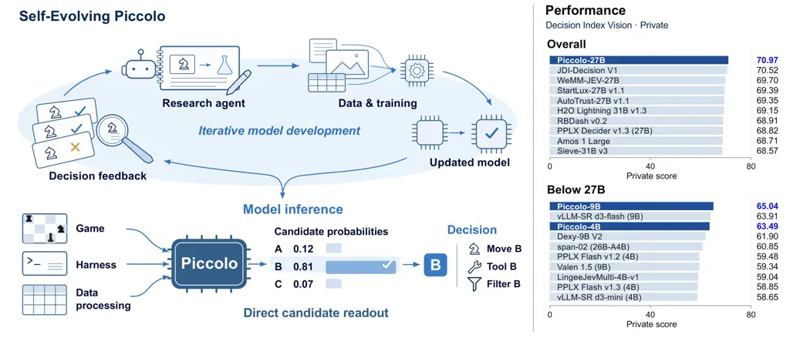
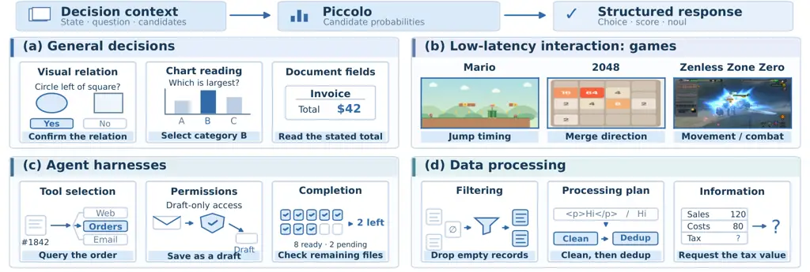

# Piccolo: Co-Evolving Decision Models and Data through Recursive Self-Improvement

Piccolo Team^(†)

###### Abstract

We present Piccolo, a family of multimodal decision models (0.8B to 27B)
that co-evolves model capabilities and training data via Agentic Data
Engineering and recursive self-improvement (RSI). The models predict
probabilities over candidate answers for general-purpose text and visual
judgments, agent harnesses, data workflows, and interactive games.
Piccolo-27B tops the Decision Index Vision Full leaderboard with a score
of 75.59, while Piccolo-9B and Piccolo-4B achieve 68.35 and 67.46,
respectively. All three rank first on the Private benchmark in their
respective model-size categories.¹¹ 1 Decision-Index-Vision snapshot:
2026-11-17 18:35:34 UTC, with 86 entrants. Full-score is the
equal-weight mean of Public and Private. Size-specific ranks use nominal
total-parameter classes Decision Index Contributors \[2026\]. Research
agents analyze model behavior, construct training data, conduct
experiments, and use the results to refine subsequent proposals.
Semantic slices and a shared research memory connect these actions
across the model family’s development. With training recipes comprising
hundreds of thousands of examples, data selection and feedback-driven
refinement are central to the self-improvement process. Our large-scale
RSI exploration yields three counter-intuitive insights for
decision-model development: (1) Backbone-recipe co-adaptation outweighs
raw model recency — earlier backbones can surpass newer generations on
visual tasks under identical recipes; (2) Targeted data curation enables
4B–9B models to rival 27B baselines on specialized workflows; and (3)
Continuous loss reduction can decouple from and even degrade discrete
decision accuracy. Together with the released weights and tools from the
Data-Juicer and AgentScope ecosystems, Piccolo provides an actionable
blueprint for building frontier decision models and scaling data-driven
RSI.

>

[ Models](https://huggingface.co/collections/agentscope-ai/piccolo)    
[ Code](https://github.com/agentscope-ai/Piccolo)    
[ Blog](https://decisionplayground.agentscope.io/piccolo.html)



Figure 1: Piccolo overview and decision performance. Left: agentic
self-improvement through iterative feedback, research, data and
training, alongside direct candidate-probability readout for various
decisions. Right: Decision Index Vision _Private set scores_, showing
the top ten overall (top) and below 27B (bottom). Full/Public
comparisons are reported in Appendix A.

## 1 Introduction



Figure 2: Piccolo applications: enterprise decisions, embodied
interaction through game examples, agent harnesses, and data processing.
Appendix D expands the workflow examples.

While generative models excel at open-ended synthesis, real-world
autonomous systems bottleneck on decisions, such as selecting actions,
enforcing guardrails, and routing workflows under strict latency and
reliability constraints. A decision model maps a supplied state,
question, and candidate set to probabilities over answers or actions
Kirkby et al. \[2026\], Dhankhar et al. \[2026\], Zhuang et al.
\[2026\]. We present Piccolo, which implements this Jev-like interface
for text and images through direct candidate-logit readout from a
language-model head. Its System-1-style predictions support Choice over
alternatives, Score on ordered levels, and Noul for yes/no judgments.
Callers can select actions, threshold confidence, or escalate decisions
using the returned distribution; Appendix B gives the formulation.

Piccolo powers four core application domains (Figure 2): (a) General
decisions: visual interpretation, document checks, and routing for
enterprise workflows with locally retained sensitive data. (b)
Low-latency interaction like games: repeated perception–action decisions
support movement and combat in Zenless Zone Zero, jump timing in Mario,
and merge choices in 2048 Piccolo Team \[2026\]. (c) Agent harnesses:
tool review, permissions, and context management in systems built with
AgentScope Gao et al. \[2025\]; QwenPaw integrates Piccolo for tool
review and context compaction AgentScope Team \[2026\]. (d) Data
processing: filtering, operator selection, and quality judgments within
Data-Juicer workflows Chen et al. \[2023\]. HarnessJevBench and
DataJevBench organize recurring harness and data decisions into
complementary evaluation suites HarnessJevBench Contributors \[2026\],
DataJevBench Contributors \[2026\].

Spanning five sizes from 0.8B to 27B, Piccolo establishes a new Pareto
frontier on Decision Index Vision (Figure 6). Piccolo-27B ranks \#1
overall (75.59 Full, 70.97 Private); 9B and 4B lead their Private
parameter classes (65.04 and 63.49). The 0.8B and 2B models score 55.17
and 66.64 Public, respectively. Piccolo-27B also ranks among the leading
models on HarnessJevBench HarnessJevBench Contributors \[2026\] (84.41)
and DataJevBench DataJevBench Contributors \[2026\] (82.60).

Agentic Data Engineering drives Piccolo’s RSI. Training dynamics and
fine-grained data buckets characterize where the model learns reliably,
where progress stalls, and which capabilities compete. Linking these
responses to domain, supervision, and task structure turns an aggregate
score into a map of capability boundaries. Agents use this map to
propose data changes, build experiments, and carry the resulting
knowledge into the next research decision Ding et al. \[2026\].
Researchers interactively guide objectives and introduce methods while
agents automatically revise mixtures, synthesis targets, and training
choices. Shared assets preserve discoveries and lessons throughout
evolving progress.

Across $`\sim`$600 experimental runs (approximately
$`2.8\times 10^{21}`$ FLOPs at the hardware’s peak BF16 performance)²² 2
Estimated from approximately 6,300 PPU-ZW810E accelerator-hours using a
reference BF16 peak rate of 123 TFLOP/s per device. Hardware references
and accounting assumptions are detailed in Appendix E., our agent-led
loop uncovered development dynamics that challenge standard
post-training heuristics: (1) Data granularity dictates capability
trade-offs: Fine-grained filtering sharpens agentic workflow decisions,
whereas broader adaptive mixtures favor general text reasoning
(Section 4.2). (2) Recipes and backbones must be co-selected: Identical
data mixtures unlock divergent strengths across different model
generations (Figure 9). (3) Failed branches hold latent value: Even
regressive runs yield reusable parameter update directions and
diagnostic signals that accelerate subsequent iterations (Section 5).
These observations connect the RSI design to the family-level results
and the experiments behind them. In summary, our main contributions are
threefold:

- •
  A multimodal decision model family: competitive size–quality
  trade-offs, leading Vision Full and size-specific Private results, and
  applications from enterprise workflows to interactive control.
- •
  A data-driven RSI methodology: fine-grained feedback, explicit
  proposals, and reusable experiments turn model development into a
  continuing agent-led research loop.
- •
  Empirical insights for decision model development: systematic findings
  connect supervision, validation coverage, synthesis, backbone
  selection, and post-training to concrete experimental outcomes.

## 2 Preliminaries

Figure 3: Data preparation, semantic annotation, and composition.
Collected and synthesized material passes through common governance into
a versioned training pool. The modality split covers the joint text and
image–text pool; label distributions describe a representative text
recipe.

### 2.1 Decision Model

The decision model maps a state, a question, and an ordered candidate
set to a probability distribution. A training example is $`(s,u,C,q)`$,
where $`s`$ contains text, images, or structured observations, $`u`$
specifies the question, $`C=(c_{1},\ldots,c_{K})`$ lists the candidates,
and $`q`$ is their target distribution. The three interfaces share this
representation: Choice compares supplied alternatives, Noul uses a
yes/no pair, and Score uses ordered rating levels.

Piccolo combines a visual encoder, a connector, and a language backbone
with its native language-model head. The backbone uses bidirectional
attention over the prompt in full-attention blocks. In hybrid backbones,
linear-attention blocks retain their original causal computation. To
construct the input $`x=\operatorname{compile}(s,u,C)`$, each candidate
$`c_{k}`$ is assigned a single-token label $`\tau(k)`$ and presented
with its description. Images are encoded by the visual encoder and
passed through the connector to the language backbone alongside the text
input. An optional sidecar OCR model supplies extracted text as an
additional image-associated observation.

At the answer position, the backbone produces a hidden state
$`h_{\theta}(x)`$. The native language-model head projects this state to
vocabulary logits through $`W_{\mathrm{LM}}`$. Piccolo reads the logit
for each candidate label $`\tau(k)`$ and applies a softmax over these
$`K`$ logits to obtain the decision distribution:

```math
z_{\theta,k}(x)=\bigl[W_{\mathrm{LM}}h_{\theta}(x)\bigr]_{\tau(k)},\qquad p_{\theta,k}(x)=\frac{\exp z_{\theta,k}(x)}{\sum_{j=1}^{K}\exp z_{\theta,j}(x)}. \tag{1}
```

Appendix B details input organization and the supervision–error
relationship.

### 2.2 Training and Optimization

Supervised training minimizes cross-entropy over the candidate
distribution for both hard and soft targets:

```math
\ell_{\mathrm{CE}}(q,p_{\theta})=-\sum_{k=1}^{K}q_{k}\log p_{\theta,k},\qquad\ell_{\mathrm{CE}}-H(q)=D_{\mathrm{KL}}(q\|p_{\theta}). \tag{2}
```

For a one-hot target, the loss is the negative log-probability of the
correct answer. For soft targets, subtracting target entropy separates
distributional mismatch from uncertainty in the supervision.
Cross-entropy is a proper scoring rule, providing a basis for
calibration-oriented supervision Zhang \[2004\]. Accuracy additionally
records whether the correct candidate ranks first. Section 3 uses these
complementary signals to guide data changes.

We use candidate-level reinforcement learning to refine decision
accuracy in models after supervised training. These continuations
optimize the candidate distribution with correctness-based,
group-relative updates and supervised replay.

We use weight-space optimization to search for improved decision
accuracy by directly modifying the trained model parameters. Candidate
weights are constructed by interpolating checkpoints, rescaling
parameter projections, or applying directions extracted from previous
training updates Akiba et al. \[2025\]. This allows us to explore
combinations and adjustments of learned parameters without running a new
gradient-based training stage for each candidate. Appendix C summarizes
more details of RL objective and these refinement methods.

### 2.3 Data Sources and Preparation

To support generalization across domains, task structures, and input
modalities, we collect a broad range of text and visual decision data.
The collection spans everyday decisions, computing and technology,
mathematics and science, humanities, and arts. Existing sources and
synthesized tasks cover reasoning, retrieval, preference judgments,
visual interpretation, and action selection. Appendix C.1 provides the
source inventory.

Training on these heterogeneous sources requires preserving the evidence
and conditions that justify each target while making their supervision
consistent with the shared decision interface. Conversion places each
question in the $`(s,u,C,q)`$ format, retaining action preconditions,
relevance distinctions, image–answer alignment, and the original
supervision distribution. Data-Juicer supports normalization, filtering,
and auditing Chen et al. \[2023\]. We remove duplicates to limit
redundant training exposure. Task-specific audits repair or exclude
incomplete and incorrect data that would otherwise introduce misleading
supervision. To extend coverage, we use CuES for data synthesis Mai et
al. \[2025\].

The resulting pool shown in Figure 3 contains 663K examples, comprising
311K text and 352K image–text decisions. Appendix C details the data
composition. We annotate examples by domain, capability, task function,
difficulty, and learning value. These labels group examples into
semantic slices whose training dynamics and decision accuracy can be
analyzed together. Each example retains its identity and source,
allowing agents to trace slice-level findings back to the underlying
data for inspection, revision, or targeted synthesis. Section 3
describes this feedback loop, and Appendix C.3 provides the annotation
scheme.

## 3 Recursive Self-Improvement with Data-driven Agents

In conventional model development, failed training runs are discarded as
sunk compute costs. In Piccolo’s RSI process, we capture and organize
every successful or regressive experiment as structured epistemic
capital. By binding fine-grained semantic slices, training dynamics, and
weight-space trajectories into a persistent research memory, our agent
orchestrator transforms brute-force hyperparameter search into
cumulative scientific discovery.

### 3.1 Evolving Objective and Iteration Loop

#### Evolving objective.

We seek to improve Piccolo’s decision performance through experiments on
data strategies and model configurations. Let
$`S_{\mathrm{dev}}(m;\mathcal{V})`$ measure performance on the
candidate-based tasks defined in Section 2.1, using a held-out
development set $`\mathcal{V}`$ for each research phase. The objective
is

```math
\max_{\psi_{1:T}}\;S_{\mathrm{dev}}\bigl(m_{T}^{\mathrm{best}};\mathcal{V}\bigr)\qquad\text{subject to}\qquad\sum_{t=1}^{T}c_{t}\leq B, \tag{3}
```

where $`\psi_{t}`$ is an experimental proposal and
$`m_{T}^{\mathrm{best}}`$ is the best evaluated model, including the
starting model, after $`T`$ experiments. The number of allocated
accelerators and the exploration window define $`B`$ in
accelerator-hours; $`c_{t}`$ is the execution and evaluation cost of
experiment $`t`$ in the same units. Each proposal specifies a starting
model, a data strategy, and permitted training or inference changes.
Data strategies determine source selection, mixtures, revisions, and
synthesis. Models are compared under a common scoring rule, with
independent confirmation assessing transfer (Section 3.2).

#### Atomic iteration loop.

Figure 4 organizes the cycle as _proposal, build and experiment,
results, and diagnosis_. Let $`\mathcal{R}_{t}`$ record the available
models, annotated data assets, completed comparisons, research memory,
and remaining budget. Agents use this state to turn findings into
subsequent experiments Ding et al. \[2026\]:

```math
\mathcal{R}_{t-1}\xrightarrow{\mathrm{Propose}}\psi_{t}\xrightarrow{\mathrm{Experiment}}(m_{t},\mathbf{f}_{t},c_{t})\xrightarrow{\text{Diagnose \& Update}}\mathcal{R}_{t}. \tag{4}
```

Feedback $`\mathbf{f}_{t}`$ summarizes learning dynamics, inference
results, and data statistics by semantic slice. Diagnosis connects gains
and regressions to these slices and the tested settings. The update
records resulting assets and findings in shared research memory and
revises proposal priorities. For example, a mastered synthetic slice can
prompt harder variants. Human researchers can optionally introduce new
directions, set exploration priorities and budgets. Subsequent proposals
can start from any retained model and reuse findings across historical
branches.

### 3.2 Orchestrator Design around the Loop

Running the atomic loop requires coordinating feedback, data and model
assets, execution, and human guidance. We organize these functions into
an orchestrator, maintaining $`\mathcal{R}_{t}`$ through versioned
records of experiment lineage and proposal priorities across concurrent
branches (Figure 4).

Figure 4: The orchestrator of Piccolo’s RSI links feedback (left), an
experiment loop (center), shared assets (bottom), and comparison with
memory (right). Agents use feedback and accumulated findings to plan
subsequent experiments; human researchers set goals and review major
changes.

#### Structured Feedback.

Semantic labels align training dynamics, inference outcomes, and data
statistics by source, supervision, and candidate count. Hard-target
cross-entropy tracks the probability assigned to the correct
candidate Tewari and Bartlett \[2007\], Zhang \[2004\]; for soft
targets, subtracting target entropy yields target–prediction KL
(Appendix B). Loss trajectories describe how the predicted distribution
evolves, while repeated inference tracks repaired and newly missed
decisions. Aggregating these signals by semantic slice reveals
differences in learning progress among examples with shared domain and
capability tags. The agent links these observations to sample records to
identify coverage gaps, uneven learning, and label conflicts. These
findings guide the data actions in Figure 4: downsampling redundant
examples, rebalancing mixtures, revising conflicting labels, and
synthesizing examples for underrepresented capabilities.

Relying solely on training loss can blindside data allocation. As shown
in Table  1, while target–prediction KL decreased monotonically across
both stages (2.19 $`\rightarrow`$ 0.66 $`\rightarrow`$ 0.64), net
decision accuracy surged ($`+`$78 correct) before unexpectedly reversing
($`-`$13). Capturing this divergence allowed our orchestrator to
dynamically throttle the bucket’s mixture weight (5.36% $`\rightarrow`$
5.14%). Table 1: Workflow feedback and mixture updates, across 341 fixed
data-processing and agent-workflow questions with hard targets. Stage
Mean KL $`\Delta`$ correct Mixture share (%) Earlier
$`2.19\rightarrow 0.66`$ $`+78`$ $`4.69\rightarrow 5.36`$ Later
$`0.66\rightarrow 0.64`$ $`-13`$ $`5.36\rightarrow 5.14`$ $`\Delta`$
correct: net change on the same 341 questions. Share: change in mixture
weight after the joint update across task buckets.

#### Persistent Assets and Research Memory.

To preserve experimental context, we link proposals, data, models,
configurations, protocols, and results. We apply DataJuicer-Panel to
manage these records within $`\mathcal{R}_{t}`$. Standardized records
support cross-branch retrieval; lineage tracks model ancestry and reused
recipes or findings. Memory associates gains and regressions with slices
and settings, guiding experiments from other starting models.

#### Composable Experiment Execution.

To execute a proposal, we compose data, training, inference, and
evaluation steps. We use DataJuicer-Sandbox Chen et al. \[2025\]:
_Factories_ provide these capabilities, _Hooks_ bind assets and
settings, and _Pipelines_ sequence steps. These interfaces combine the
data operations in Figure 4 under the settings in Table 2; analysis and
execution proceed concurrently.

| Component  | Fixed within a comparison                    | Varied between comparisons                  |
| ---------- | -------------------------------------------- | ------------------------------------------- |
| Data       | Pool version, group IDs, admission rules     | Selection, mixtures, synthesis, new sources |
| Training   | Parent weights, targets, optimizer, schedule | Parent, objective, learning rate, merging   |
| Evaluation | Questions, scoring, inference settings       | Input arrangement, diagnostic cohorts       |
| Research   | Target, comparator, devices and time         | Analysis tools, priorities, follow-ups      |

Table 2: Data, training, evaluation, and research settings: fixed within
comparisons, adaptable across proposals.

#### Validation and Comparison.

Development comparisons track improvements and retained skills; disjoint
confirmation sets and broad evaluations assess transfer. Source and
construction identities organize splits, while semantic labels expose
coverage. Audits check sample validity, input versions, and evaluation
completeness. Outcomes and execution costs return to the shared research
state (Appendix D.4).

#### Proposal Selection and Human Steering.

Agents rank proposals by expected improvement, retained skills,
information value, and cost, recording their target, parent, action, and
comparator. Short diagnostics resolve uncertainty; longer runs develop
promising directions. Human researchers set priorities, review major
changes, and introduce new methods and data sources to be explored. The
human-preference and agent-accumulated findings collectively determine
the next experiments.

### 3.3 Instantiation in Piccolo Development

Figure 5: A data-rebalancing case from Piccolo training. D: Data; C:
Training Configuration; P: Proposal; M: Model; K: Iteration Knowledge.
Shared-parent branches compare knowledge-only and balanced additions
after an arts regression. Bars show task distributions; balanced
additions yield higher overall and arts scores.

We instantiated the orchestrator with a retained model, an indexed data
pool, a development protocol, and a compute allocation. Training runs
returned models, predictions, measured cost, and findings for subsequent
proposals. Figure 5 traces an effective data-rebalancing iteration from
actual Piccolo training, showing how the assets, execution, and memory
components in Section 3.2 support successive proposals.

(1) Execute a retrieval proposal. P1 combined replay with a retrieved
supplement to train M1 from retained model M0. (2) Diagnose the
regression. Arts performance fell from 55.19 to 52.66; joining these
predictions to the selected-data records showed an arts share of 3.1%
among training questions. Diagnosis K1 made arts coverage the focus of
the next experiment. The asset records preserved the selected groups,
configuration, and parent model alongside this finding.

(3) Revise the mixture and compare. P2 tested knowledge-only and
balanced knowledge–arts supplements from the same M0, with shared replay
groups, learning rate, and seed. Complete-group selection preserved
native supervision: recipe shares count groups, tag shares count
questions, and group composition determines question and token totals.
Under the common development protocol, balanced model M3 outscored M2 by
0.30 points overall and 0.70 on arts. Memory K2 retained this comparison
and the remaining arts gap to M0 for subsequent proposals. Model lineage
records the shared parent; research lineage carries the diagnosis from
P1 into P2 and its findings back into $`\mathcal{R}_{t}`$.

## 4 Performance and Model–Data Co-Evolution

Post-training is traditionally treated as optimizing a dynamic model
over a static data recipe. Piccolo reframes data-model development as a
coupled dynamical system: as the model’s capability boundary shifts, the
optimal data distribution and recipe must shift with it. A recipe that
accelerates learning in an early checkpoint or on one backbone
generation can induce regressions in another.

### 4.1 Overall Performance

(a) Decision Index Vision

|                   |       |         |        |
| ----------------- | ----- | ------- | ------ |
| Model             | Full  | Private | Public |
| Piccolo-27B       | 75.59 | 70.97   | 80.22  |
| JDI-Decision V1   | 75.05 | 70.52   | 79.58  |
| WeMM-JEV-27B      | 73.81 | 69.70   | 77.93  |
| Valen 1.5 27B     | 73.29 | 63.68   | 82.90  |
| Sieve 31B v3      | 72.07 | 68.57   | 75.57  |
| StartLux v1.1 27B | 71.61 | 69.39   | 73.83  |
| Piccolo-9B        | 68.35 | 65.04   | 71.67  |
| Valen 1.5 9B      | 69.67 | 59.34   | 80.00  |
| D3 Flash 9B       | 66.89 | 63.91   | 69.87  |
| Piccolo-4B        | 67.46 | 63.49   | 71.42  |
| Valen 1.5 4B      | 66.58 | 55.35   | 77.81  |
| D3 Mini 4B        | 63.16 | 58.65   | 67.67  |
| Piccolo-2B        | —     | —       | 66.64  |
| Piccolo-0.8B      | —     | —       | 55.17  |

(b) Application evaluations

|                   |         |       |          |
| ----------------- | ------- | ----- | -------- |
| Model             | Harness | Data  | JevBench |
| Piccolo-27B       | 84.41   | 82.60 | 92.21    |
| JDI-Decision V1   | 82.71   | 84.40 | 90.48    |
| WeMM-JEV-27B      | 82.03   | 82.40 | 92.21    |
| Valen 1.5 27B     | 79.15   | 80.20 | 91.34    |
| Sieve 31B v3      | 83.05   | 80.00 | 90.48    |
| StartLux v1.1 27B | 82.03   | 79.60 | 93.94    |
| Piccolo-9B        | 71.53   | 72.40 | 88.74    |
| Valen 1.5 9B      | 64.58   | 66.40 | 86.15    |
| D3 Flash 9B       | 65.42   | 68.20 | 82.25    |
| Piccolo-4B        | 66.10   | 70.20 | 87.01    |
| Valen 1.5 4B      | 62.03   | 65.40 | 83.55    |
| D3 Mini 4B        | 65.93   | 65.80 | 81.82    |
| Piccolo-2B        | 56.10   | 52.80 | 86.15    |
| Piccolo-0.8B      | 51.19   | 52.20 | 75.32    |

Table 3: Vision and application scores for the same model families: (a)
Decision Index Vision; (b) HarnessJevBench, DataJevBench, and JevBench.
Bold/underlined scores mark the best/second-best per column. Full
averages Public and Private; Harness uses hard targets. “—” denotes a
pending submission.

#### Decision Index.

Piccolo-27B ranks first on Vision Full (75.59) and Private (70.97), with
80.22 Public (Table 3a). Its Public profile exceeds JDI-Decision V1 by
1.78 points on CV-Bench, 4.02 on BLINK, and 3.38 on MMMU-Pro Vision;
Appendix D.3 gives all eleven tasks. Piccolo-9B and 4B score 65.04 and
63.49 on Private, while 2B and 0.8B score 66.64 and 55.17 on Public.

#### Application evaluations.

HarnessJevBench covers tool use, permissions, memory, and execution;
DataJevBench covers filtering, processing plans, and output quality;
JevBench covers general decisions. Piccolo-27B scores 84.41 on Harness,
82.60 on Data, and 92.21 on JevBench, outperforming the strongest
external Harness baseline by 1.36 points in the completed batch.
Piccolo-9B and 4B score 71.53/66.10 on Harness and 72.40/70.20 on Data,
exceeding both size-matched D3 and Valen models. Their Private Vision
scores also exceed both baselines. Appendix D.2 gives the full
comparison.

Capability profiles. Piccolo-4B, 9B, and 27B all lie on the Private
size–quality frontier (Figure 6). The 4B model trades 1.55 Private
points for fewer than half the served parameters of 9B (63.49 vs.
65.04). With roughly one-third the parameters of 27B, the 9B model
scores 5.93 points lower on Private (65.04 vs. 70.97). The largest model
extends the frontier to 70.97. These operating points offer different
capacity budgets for the same candidate-scoring interface; the task
profiles identify which capabilities each deployment retains.

Figure 6: Vision Private size–quality frontier. Points use reported
served parameters; the frontier follows the best score available within
each parameter budget.

### 4.2 Data Evolution

Data evolution involves _coverage_ (D1), _allocation_ (D2), and _joint
recipes_ (D3).

Figure 7: Public exploration milestones and research directions. Stage
bands group the exploration periods; data directions (D1–D3) and model
directions (M1–M3) connect the milestones to coverage, training,
composition, and inference developments. D1–D3 index data evolution in
Section 4.2; M1–M3 index model evolution in Section 4.3.

#### D1 Feedback-guided data revision restores coverage.

Held-out feedback and semantic labels identify gaps for targeted
replacement: replacing 10% of an early recipe outperforms matched random
replacement by 2.11 development points (56.56 vs. 54.45). Later,
restoring underrepresented preference coverage raised the
arts/preference component from 48.91 to 53.42. For sparse slices,
proposals specify automated collection with deduplication and
sensitive-information removal, or model-guided synthesis from verified
seeds. The model’s pass rates on the new tasks—63.43% for state tracking
and 15.38% for budget allocation—then identified where difficult
examples remained.

#### D2 Training dynamics guide adaptive data allocation.

The _Structured Feedback_ interface in Section 3.2 supplies
target–prediction KL and changes in decision correctness on held-out
questions. These readouts guide _Filter & Rebalance_ in Figure 4:
rebalancing revises bucket shares as learning progresses, while
filtering selects examples using source-level loss and verification
outcomes. Figure 8 aligns the resulting allocations with each branch’s
scores. Rebalancing elevated Public Text to 67.93, versus 67.36 for the
fixed recipe. Adding filtering reached 84.58 Harness and 82.20 Data,
with Text at 66.98.

Figure 8: Data allocations and outcomes across a fixed recipe,
feedback-guided rebalancing, and rebalancing with additional filtering.
Blue/tan cells mark allocation increases/decreases from the fixed
recipe. Right-hand cells report final scores and signed changes from
that reference. Takeaway: Rebalancing gives the strongest Text result;
adding filtering improves Harness and Data, producing distinct
capability profiles from different data actions.

#### D3 Joint recipes consolidate gains from data evolution.

Joint decision training combined general decisions, image-dependent
tasks, and workflow additions, with replay material for established
skills. OCR-aware SFT aligned supervision with image-associated text
available at inference. At one consolidation node, a Qwen3.6-27B
descendant improved from 71.89 to 79.59 on Vision, 68.64 to 81.36 on
Harness, and 73.20 to 81.40 on Data (Figure 9a). Crucially, newer
backbones do not guarantee across-the-board superiority under a fixed
recipe (Figure 9b). Trained on the exact same data order, the earlier
Qwen3.5 initialization (79.97) outperformed both Qwen3.6 and Qwen3.8 on
Vision (79.59 and 77.86), whereas Qwen3.8 dominated agentic Harness
tasks (85.93), versus 80.85 and 81.36 for Qwen3.5 and Qwen3.6. Model
initialization and data recipes must therefore be co-adapted to match
target deployment priorities.

Figure 9: Recipe–model interaction. (a) Qwen3.6-27B before and after
joint training. (b) Three 27B initializations trained with the same
recipe and data order. Vision scores use the Public suite.
Takeaway: Joint recipes deliver broad gains across tasks (a), while the
optimal backbone depends heavily on the target deployment domain (b).

### 4.3 Model Evolution

Model proposals reused these data assets to compare training strategies
(M1), model composition and refinement (M2), and inference (M3), linking
each choice to its measured capability response.

#### M1 Training choices benefit from matched supervision.

Bidirectional attention benefited from matched training and inference:
Text development scores reached 69.01, versus 68.20 with causal
attention and 68.14 when only inference became bidirectional. Staged SFT
and RL paired broad supervision with targeted adaptation. Full-parameter
and low-rank continuations tested how broadly to update the model.
OCR-aware SFT established the input–decision correspondence before
candidate-level RL and supervised replay addressed residual errors.
Objective and data weighting then evolved together: from a shared parent
and the same examples, fixed-weight GRPO reached 77.13 Public Vision,
candidate CE 77.31, and confidence/progress-weighted GRPO 77.35. These
results made both the supervision format and the distribution of
learning weight part of the training proposal.

#### M2 Model composition integrates complementary capabilities.

Cross-modal merging combined branches strengthened by different data
recipes. In one exploration, retaining the visual modules of an
image–text model and blending its language parameters with a
text-oriented branch boosted Public Text from 67.89 to 68.15 while
trading off Vision from 77.29 to 75.70 (Table 4a). The mixture retained
part of each branch’s advantage. Candidate-distribution integration
explored a complementary route inspired by MOPD Ma et al. \[2026\].
Reference predictions supplement the original targets on selected
examples. Exact matching reached 82.80 Data, versus 82.20 for the
original-target continuation, while Harness stayed at 84.92 and Vision
remained near 77.07 (Table 4b). These branches provide distinct task
profiles for subsequent composition.

(a) Cross-modal merging

| Model / text share   | Text  | Vision |
| -------------------- | ----- | ------ |
| Text-oriented parent | 68.53 | 73.16  |
| Image–text parent    | 67.89 | 77.29  |
| Merge: 25% text      | 67.94 | 76.92  |
| Merge: 50% text      | 68.15 | 75.70  |

(b) Candidate-distribution integration

| Training targets    | Vision | Harness | Data  |
| ------------------- | ------ | ------- | ----- |
| Parent              | 77.38  | 84.24   | 82.60 |
| Original targets    | 77.09  | 84.92   | 82.20 |
| \+ exact matching   | 77.07  | 84.92   | 82.80 |
| \+ sampled matching | 77.07  | 84.92   | 82.40 |

Table 4: Capability integration through (a) language-weight
interpolation with visual modules retained and (b) training with
reference candidate distributions. Rows compare each parent with its
merged or further-trained descendants across tasks. Text and Vision use
Public scores.

Weight-space editing refined candidate combinations through module
scaling and low-rank update directions Akiba et al. \[2025\]. One
selected configuration combined _(i)_ approximately 5% stronger visual
attention projections in blocks 9–17, _(ii)_ slight attenuation of
feed-forward outputs in language layers 8–23, _(iii)_ log-decay offsets
in selected late gated-attention blocks, and _(iv)_ rank-8 updates to
output projections in layers 30–31. The combined model elevated Public
Vision to 70.75 (vs. 70.10 for the retained reference), with a
0.68-point Harness decrease. Earlier, merging five data-specialized
descendants boosted Public Text to 63.11, surpassing the strongest
individual branch at 62.78.

#### M3 Input organization and layer reuse offer distinct inference gains.

Context evolving changed question previews, repeated context, and
aggregation across candidate-label views (Figure 10a). Adaptive
rereading reached 68.56 Public Text at 1.02$`\times`$ input volume. Full
rereading scored 68.64; two- and three-view aggregation reached 68.69
and 68.71 at 1.90$`\times`$ and 2.08$`\times`$ input volume.

Recurrent inference reused layer ranges within the forward pass
(Figure 10b). Two half-step passes over each of two adjacent ranges
raised Text development scores from 69.15 to 69.75 and Harness from
80.85 to 87.12. Reusing a single range yielded 69.58 on Text, whereas
reducing the two-range step to one quarter lowered the score to 67.41. A
separate recurrent configuration raised 2B Public Vision from 65.85 to
66.64.

Figure 10: Inference choices on fixed 27B models. (a) Context layouts:
Public Text scores and input tokens relative to budgeted rereading. (b)
Layer reuse: Text development, Harness, and Data scores. Colored blocks
depict input arrangements or repeated layer bands. Takeaway: Input
expansion yields small gains at higher token cost; layer reuse is
sensitive to step size.

## 5 Discussion

### 5.1 Optimizing Single Benchmarks Masks Cross-Task Regressions

Isolated gains in one capability often mask severe regressions in
another, even without weight updates. Merely reorganizing the input
layout at fixed weights boosted Public Text by +1.14 points while
causing a 3.00-point drop on DataJevBench (Figure 11a). Semantic slices
locate the affected capabilities; held-out task and source groups assess
their transfer (Section 3.2). This profile identifies the skills to
preserve or strengthen in subsequent data revisions.

Figure 11: Cross-task responses to (a) input reorganization at fixed
weights and (b) repeated training on a fixed pool. Zero marks the
starting score; positive and negative values indicate gains and
regressions. Takeaway: Gains and regressions coexist across tasks,
making cross-task validation central to proposal selection and the
choice between further training and revised data.

### 5.2 More Compute on Fixed Data Degrades Generalization

Scaling training exposures on a static data pool skews the capability
balance rather than uniformly improving the model. Over 1M sample
exposures on a fixed pool, Data scores crept up by $`+`$0.60, but Text
and Harness degraded significantly by $`-`$1.29 and $`-`$1.69 points
(Figure 11b). This demonstrates that dynamic data curation is more
compute-efficient than prolonged static training. In addition, the
diverging trajectories motivate comparing longer training with revised
coverage and allocation. Proposals from a shared retained model make
these alternatives directly comparable.

Inference introduces another allocation choice. Adaptive rereading
achieved 68.56 Public Text; three-view aggregation further reached 68.71
with 2.04$`\times`$ the input tokens of adaptive rereading. Structural
changes were similarly sensitive to their setting: two-band half-step
recurrence gained 0.60 Text development points, whereas quarter-step
recurrence lost 1.74 (Figure 10). Head- and channel-level rescaling also
entered the search; strong visual-branch attenuation failed to improve
the retained development score. The useful computation depends on both
the task and the current model.

### 5.3 Capability Integration and Research Reuse

Combining specialized branches changes which capabilities survive. The
cross-modal merge in Table 4a gained 0.26 Public Text points over its
image–text parent while losing 1.59 Vision points.
Candidate-distribution matching produced a smaller redistribution: Data
improved by 0.60 over training on the original targets, with Harness
unchanged and Vision nearly unchanged (Table 4b). Branch selection can
use complementary task strengths, with the retained gains measured after
integration.

Even “failed” training runs contain actionable gradient signals. In one
notable lineage, a continuation branch regressed below its parent on the
development set; however, extracting specific components of its
parameter update and applying them with a negative coefficient yielded a
winning weight-space merge. This underscores the value of preserving
full experimental lineage: by connecting parent checkpoints, parameter
deltas, and slice-level responses, the orchestrator converts apparent
dead-ends into composable building blocks for future iterations
(Appendix D.5).

### 5.4 Relation to Prior Work

Decision-model research explores complementary training and inference
choices. Mammoth and Elephant combine data recipes and bidirectional
attention Kirkby et al. \[2026\]; Drex studies supervised and
reinforcement learning Dhankhar et al. \[2026\]; StartLux adds
confidence-guided deliberation Zhuang et al. \[2026\]. Evolutionary
merging and MOPD study capability integration Akiba et al. \[2025\], Ma
et al. \[2026\]. Agentic Data Engineering Ding et al. \[2026\] and
open-ended self-improvement Zhang et al. \[2026\] guide research through
feedback and accumulated discoveries. Piccolo connects these ideas
through candidate-level feedback, evolving data recipes, and reusable
model branches.

## 6 Conclusion and Future Directions

Piccolo demonstrates that advancing frontier decision models requires
more than scaling parameters or static datasets; it requires scaling the
research loop itself. Through Agentic Data Engineering, Piccolo
co-evolves data curricula and model weights across a 0.8B to 27B family,
establishing state-of-the-art performance across visual judgment, agent
harnesses, data workflows, and interactive control.

Beyond the released weights, our development campaign exposes
fundamental dynamics of post-training: surrogate loss optimization
frequently decouples from discrete decision accuracy, static data pools
inevitably induce cross-capability interference, and optimal data
recipes are strictly contingent on backbone initialization. By embedding
these diagnostics into an autonomous, memory-backed orchestration loop,
we shift post-training from manual trial-and-error to systematic,
self-correcting engineering.

Looking forward, the convergence of fast System-1 decision models and
deliberative System-2 reasoning points toward hybrid cognitive
architectures. Future work will extend this recursive co-evolution to
adaptive test-time deliberation, multi-turn environmental interaction,
and automated synthesis for long-tail capability frontiers; ultimately
advancing not just the models that make decisions, but the autonomous
systems that build them.

## Piccolo Team

Model: Zhenqing Ling, Qirui Jiao, Daoyuan Chen;  
Data: Cheng Chen, Xinji Mai, Haowen Gao;  
Infra: Zhuo Zhang, Xuchen Pan, Mengsu Ding, Jiaji Deng, Yuexiang Xie,
Xiaoming Qin, Weirui Kuang;  
Project Steering: Zhaoyang Liu, Yaliang Li, Bolin Ding, Jingren Zhou.

## References

- Abu Farha et al. (2022) I. Abu Farha, S. V. Oprea, S. Wilson, and W.
  Magdy SemEval-2022 Task 6: iSarcasmEval, Intended Sarcasm Detection in
  English and Arabic. In Proceedings of the 16th International Workshop
  on Semantic Evaluation (SemEval-2022), pp. 802–814. External Links:
  [Document](https://dx.doi.org/10.18653/v1/2022.semeval-1.111),
  [Link](https://aclanthology.org/2022.semeval-1.111/) Cited by: Table 5.
- AgentScope Team (2026) AgentScope Team QwenPaw: Local Piccolo
  Decisions. External Links:
  [Link](https://github.com/agentscope-ai/QwenPaw/blob/main/docs/local-piccolo.md)
  Cited by: §1.
- Akiba et al. (2025) T. Akiba, M. Shing, Y. Tang, Q. Sun, and D. Ha
  Evolutionary optimization of model merging recipes. External Links:
  2403.13187,
  [Document](https://dx.doi.org/https%3A//doi.org/10.1038/s42256-024-00975-8),
  [Link](https://arxiv.org/abs/2403.13187) Cited by: §2.2, §4.3, §5.4.
- Alibaba Cloud (2026) Alibaba Cloud PPU: Zhenwu 810E Product
  Specifications. Note: Accessed November 13, 2026 External Links:
  [Link](https://help.aliyun.com/zh/cs/user-guide/ppu/) Cited by:
  Appendix E.
- AndeyTait (2026) AndeyTait JevForge-Mind2Web. Note: Hugging Face
  dataset repositoryAccessed November 18, 2026 External Links:
  [Link](https://huggingface.co/datasets/AndeyTait/JevForge-Mind2Web)
  Cited by: Table 5.
- Bowman et al. (2015) S. R. Bowman, G. Angeli, C. Potts, and C. D.
  Manning A large annotated corpus for learning natural language
  inference. In Proceedings of the 2015 Conference on Empirical Methods
  in Natural Language Processing, pp. 632–642. External Links:
  [Document](https://dx.doi.org/10.18653/v1/D15-1075),
  [Link](https://aclanthology.org/D15-1075) Cited by: Table 5.
- Casanueva et al. (2020) I. Casanueva, T. Temcinas, D. Gerz, M.
  Henderson, and I. Vulic Efficient Intent Detection with Dual Sentence
  Encoders. In Proceedings of the 2nd Workshop on NLP for ConvAI - ACL
  2020, External Links: [Link](https://arxiv.org/abs/2003.04807) Cited
  by: Table 5.
- Chen et al. (2023) D. Chen, Y. Huang, Z. Ma, H. Chen, X. Pan, C.
  Ge, D. Gao, Y. Xie, Z. Liu, J. Gao, Y. Li, B. Ding, and J. Zhou
  Data-juicer: a one-stop data processing system for large language
  models. External Links: 2309.02033,
  [Link](https://arxiv.org/abs/2309.02033) Cited by: §1, §2.3.
- Chen et al. (2025) D. Chen, H. Wang, Y. Huang, C. Ge, Y. Li, B. Ding,
  and J. Zhou Data-juicer sandbox: a feedback-driven suite for
  multimodal data-model co-development. In Proceedings of the 42nd
  International Conference on Machine Learning (ICML), Cited by: §3.2.
- Chen et al. (2021) Z. Chen, W. Chen, C. Smiley, S. Shah, I. Borova, D.
  Langdon, R. Moussa, M. Beane, T. Huang, B. Routledge, and W. Y. Wang
  FinQA: A Dataset of Numerical Reasoning over Financial Data. In
  Proceedings of EMNLP 2021, External Links:
  [Link](https://github.com/czyssrs/FinQA) Cited by: Table 5.
- Clark et al. (2019) C. Clark, K. Lee, M. Chang, T. Kwiatkowski, M.
  Collins, and K. Toutanova BoolQ: Exploring the Surprising Difficulty
  of Natural Yes/No Questions. In NAACL, External Links:
  [Link](https://huggingface.co/datasets/google/boolq) Cited by: Table 5.
- Clark et al. (2018) P. Clark, I. Cowhey, O. Etzioni, T. Khot, A.
  Sabharwal, C. Schoenick, and O. Tafjord Think you have Solved Question
  Answering? Try ARC, the AI2 Reasoning Challenge. arXiv:1803.05457v1.
  External Links:
  [Link](https://huggingface.co/datasets/allenai/ai2_arc) Cited by:
  Table 5.
- crh225 (2026) crh225 Plumb Decisions. Note: Hugging Face dataset
  repositoryAccessed November 18, 2026 External Links:
  [Link](https://huggingface.co/datasets/crh225/plumb-decisions) Cited
  by: Table 5.
- DataJevBench Contributors (2026) DataJevBench Contributors
  DataJevBench. External Links:
  [Link](https://github.com/datajuicer/DataJevBench) Cited by: §1, §1.
- Decision Index Contributors (2026) Decision Index Contributors
  Decision Index: Vision and Text Leaderboards. External Links:
  [Link](https://huggingface.co/spaces/multimodalart/jev-decision-index)
  Cited by: footnote 1.
- Demszky et al. (2020) D. Demszky, D. Movshovitz-Attias, J. Ko, A.
  Cowen, G. Nemade, and S. Ravi GoEmotions: A Dataset of Fine-Grained
  Emotions. In 58th Annual Meeting of the Association for Computational
  Linguistics (ACL), External Links:
  [Link](https://huggingface.co/datasets/google-research-datasets/go_emotions)
  Cited by: Table 5.
- Deng et al. (2023) X. Deng, Y. Gu, B. Zheng, S. Chen, S. Stevens, B.
  Wang, H. Sun, and Y. Su Mind2Web: Towards a Generalist Agent for the
  Web. External Links: 2306.06070,
  [Link](https://arxiv.org/abs/2306.06070) Cited by: Table 5.
- Dhankhar et al. (2026) N. Dhankhar, A. Amantay, Z. Datbayev, D.
  Akhmetov, Y. Shah, N. Ubaidullayev, R. Saparkhan, D. Baha, and A.
  Saparov Towards foundation decision models: drex. External Links:
  2611.07854, [Link](https://arxiv.org/abs/2611.07854) Cited by: Table
  11, §1, §5.4.
- Ding et al. (2026) R. Ding, Q. Shen, Z. Han, M. Chen, D. Chen, and Y.
  Li Agentic data engineering for llms: system design and a controlled
  empirical study. In NeurIPS 2026 Workshop on Automated Machine
  Learning Research (AutoMLR), Note: arXiv:2610.14238 \[cs.CL\] External
  Links: [Link](https://arxiv.org/abs/2610.14238) Cited by: §1, §3.1,
  §5.4.
- FitzGerald et al. (2022) J. FitzGerald, C. Hench, C. Peris, S.
  Mackie, K. Rottmann, A. Sanchez, A. Nash, L. Urbach, V. Kakarala, R.
  Singh, S. Ranganath, L. Crist, M. Britan, W. Leeuwis, G. Tur, and P.
  Natarajan MASSIVE: A 1M-Example Multilingual Natural Language
  Understanding Dataset with 51 Typologically-Diverse Languages.
  External Links: 2204.08582, [Link](https://arxiv.org/abs/2204.08582)
  Cited by: Table 5.
- Gao et al. (2025) D. Gao, Z. Li, Y. Xie, W. Kuang, L. Yao, B. Qian, Z.
  Ma, Y. Cui, H. Luo, S. Li, L. Yi, Y. Yu, S. He, Z. Luo, W. Zhou, Z.
  Zhang, X. He, Z. Chen, W. Liao, F. I. Kushnazarov, Y. Li, B. Ding,
  and J. Zhou AgentScope 1.0: a developer-centric framework for building
  agentic applications. External Links: 2508.16279,
  [Link](https://arxiv.org/abs/2508.16279) Cited by: §1.
- HarnessJevBench Contributors (2026) HarnessJevBench Contributors
  HarnessJevBench: Benchmarking Jev-style Models at Agent Harness
  Decision Points. External Links:
  [Link](https://github.com/agentscope-ai/HarnessJevBench) Cited by: §1,
  §1.
- helmo (2026) helmo Synthetic Typed Decisions (Helmo). Note: Hugging
  Face dataset repositoryAccessed November 18, 2026 External Links:
  [Link](https://huggingface.co/datasets/helmo/synthetic-typed-decisions)
  Cited by: Table 5.
- hiroki-abe-58 (2026) hiroki-abe-58 Typed Decisions (Japanese):
  typed-decisions-ja v3. Note: Hugging Face dataset repositoryAccessed
  November 18, 2026 External Links:
  [Link](https://huggingface.co/datasets/GeneLab/typed-decisions-ja)
  Cited by: Table 5.
- hotchpotch (2026) hotchpotch Bekko System One Dataset v0. Note:
  Hugging Face dataset repositoryAccessed November 18, 2026 External
  Links:
  [Link](https://huggingface.co/datasets/hotchpotch/bekko-system-one-dataset-v0)
  Cited by: Table 5.
- Huang et al. (2019) L. Huang, R. Le Bras, C. Bhagavatula, and Y. Choi
  Cosmos QA: Machine Reading Comprehension with Contextual Commonsense
  Reasoning. In Proceedings of the 2019 Conference on Empirical Methods
  in Natural Language Processing and the 9th International Joint
  Conference on Natural Language Processing (EMNLP-IJCNLP),
  pp. 2391–2401. External Links:
  [Document](https://dx.doi.org/10.18653/v1/D19-1243),
  [Link](https://www.aclweb.org/anthology/D19-1243) Cited by: Table 5.
- Khot et al. (2020) T. Khot, P. Clark, M. Guerquin, P. Jansen, and A.
  Sabharwal QASC: A Dataset for Question Answering via Sentence
  Composition. arXiv:1910.11473v2. External Links:
  [Link](https://huggingface.co/datasets/allenai/qasc) Cited by: Table 5.
- Kim et al. (2023) S. Kim, J. Shin, Y. Cho, J. Jang, S. Longpre, H.
  Lee, S. Yun, S. Shin, S. Kim, J. Thorne, and M. Seo Prometheus:
  Inducing Fine-grained Evaluation Capability in Language Models.
  External Links: 2310.08491, [Link](https://arxiv.org/abs/2310.08491)
  Cited by: Table 5.
- Kirkby et al. (2026) M. Kirkby, M. Psenka, T. Villeneuve, A. Sharma,
  and C. O’Neill Mammoth-1 and Elephant-1: frontier decision models.
  External Links:
  [Link](https://labs.baseten.co/articles/mammoth-1-and-elephant-1-frontier-decision-models)
  Cited by: Table 11, §1, §5.4.
- Larson et al. (2019) S. Larson, A. Mahendran, J. J. Peper, C.
  Clarke, A. Lee, P. Hill, J. K. Kummerfeld, K. Leach, M. A.
  Laurenzano, L. Tang, and J. Mars An Evaluation Dataset for Intent
  Classification and Out-of-Scope Prediction. In Proceedings of the 2019
  Conference on Empirical Methods in Natural Language Processing and the
  9th International Joint Conference on Natural Language Processing
  (EMNLP-IJCNLP), External Links:
  [Link](https://www.aclweb.org/anthology/D19-1131) Cited by: Table 5.
- Lightman et al. (2023) H. Lightman, V. Kosaraju, Y. Burda, H.
  Edwards, B. Baker, T. Lee, J. Leike, J. Schulman, I. Sutskever, and K.
  Cobbe Let’s Verify Step by Step. External Links: 2305.20050,
  [Link](https://arxiv.org/abs/2305.20050) Cited by: Table 5.
- Ling et al. (2017) W. Ling, D. Yogatama, C. Dyer, and P. Blunsom
  Program induction by rationale generation: Learning to solve and
  explain algebraic word problems. In ACL, External Links:
  [Link](https://huggingface.co/datasets/deepmind/aqua_rat) Cited by:
  Table 5.
- Liu et al. (2022) A. Liu, S. Swayamdipta, N. A. Smith, and Y. Choi
  WANLI: Worker and AI Collaboration for Natural Language Inference
  Dataset Creation. External Links:
  [Link](https://arxiv.org/pdf/2201.05955) Cited by: Table 5.
- LocalLLaMA (2026) LocalLLaMA Typed Decisions. Note: Hugging Face
  dataset repositoryAccessed November 18, 2026 External Links:
  [Link](https://huggingface.co/datasets/LocalLLaMA/typed-decisions)
  Cited by: Table 5.
- Ma et al. (2026) W. Ma, J. Wei, L. Zhao, H. Zhang, B. Xiao, L. Li, Q.
  Yang, B. Gao, Y. Wang, R. Li, J. Dong, Z. Sui, and F. Luo MOPD:
  multi-teacher on-policy distillation for capability integration in llm
  post-training. External Links: 2606.30406,
  [Link](https://arxiv.org/abs/2606.30406) Cited by: §4.3, §5.4.
- Mai et al. (2025) S. Mai, Y. Zhai, Z. Chen, C. Chen, A. Zou, S.
  Tao, Z. Liu, and B. Ding CuES: a curiosity-driven and
  environment-grounded synthesis framework for agentic rl. External
  Links: 2512.01311, [Link](https://arxiv.org/abs/2512.01311) Cited by:
  §2.3.
- Nazeem (2026) M. Nazeem Typed Decisions Synth. Note: Hugging Face
  dataset repositoryAccessed November 18, 2026 External Links:
  [Link](https://huggingface.co/datasets/n4ze3m/typed-decisions-synth)
  Cited by: Table 5.
- Niu et al. (2024) C. Niu, Y. Wu, J. Zhu, S. Xu, K. Shum, R. Zhong, J.
  Song, and T. Zhang RAGTruth: A Hallucination Corpus for Developing
  Trustworthy Retrieval-Augmented Language Models. External Links:
  2401.00396, [Link](https://arxiv.org/abs/2401.00396v2) Cited by: Table 5.
- NVIDIA (2025) NVIDIA When2Call. Note: Hugging Face dataset
  repositoryAccessed November 18, 2026 External Links:
  [Link](https://huggingface.co/datasets/nvidia/When2Call) Cited by:
  Table 5.
- Piccolo Team (2026) Piccolo Team Piccolo: Decision Models for
  Harnesses, Data Workflows, and Games. External Links:
  [Link](https://decisionplayground.agentscope.io/piccolo.html) Cited
  by: §1.
- Rastogi et al. (2020) A. Rastogi, X. Zang, S. Sunkara, R. Gupta,
  and P. Khaitan Towards scalable multi-domain conversational agents:
  The schema-guided dialogue dataset. In Proceedings of the AAAI
  Conference on Artificial Intelligence, Vol. 34, pp. 8689–8696.
  External Links:
  [Link](https://github.com/google-research-datasets/dstc8-schema-guided-dialogue)
  Cited by: Table 5.
- Reddy et al. (2022) C. K. Reddy, L. Màrquez, F. Valero, N. Rao, H.
  Zaragoza, S. Bandyopadhyay, A. Biswas, A. Xing, and K. Subbian
  Shopping Queries Dataset: A Large-Scale ESCI Benchmark for Improving
  Product Search. External Links: 2206.06588,
  [Link](https://arxiv.org/abs/2206.06588) Cited by: Table 5.
- Sakaguchi et al. (2019) K. Sakaguchi, R. Le Bras, C. Bhagavatula,
  and Y. Choi WinoGrande: An Adversarial Winograd Schema Challenge at
  Scale. arXiv preprint arXiv:1907.10641. External Links:
  [Link](https://arxiv.org/abs/1907.10641) Cited by: Table 5.
- samatv256 (2026) samatv256 Jev Decisions v1. Note: Hugging Face
  dataset repositoryAccessed November 18, 2026 External Links:
  [Link](https://huggingface.co/datasets/samatv256/jev-decisions-v1)
  Cited by: Table 5.
- SargeDev (2026) SargeDev Jev Distill Corpus v3. Note: Hugging Face
  dataset repositoryAccessed November 18, 2026 External Links:
  [Link](https://huggingface.co/datasets/SargeDev/jev-distill-corpus-v3)
  Cited by: Table 5.
- Sileo et al. (2026) D. Sileo, V. Lacombe, and D. Kachler Reasoning
  Core: Designing Broad Procedural Data for Completion-Supervised
  Reasoning Training. arXiv preprint arXiv:2608.05148. External Links:
  [Link](https://arxiv.org/abs/2608.05148) Cited by: Table 5.
- Sileo (2024) D. Sileo tasksource: A Large Collection of NLP tasks with
  a Structured Dataset Preprocessing Framework. In Proceedings of the
  2024 Joint International Conference on Computational Linguistics,
  Language Resources and Evaluation (LREC-COLING 2024), pp. 15655–15684.
  External Links: [Document](https://dx.doi.org/10.63317/2h4pkr685mkq),
  [Link](https://aclanthology.org/2024.lrec-main.1361) Cited by: Table 5.
- Talmor et al. (2019) A. Talmor, J. Herzig, N. Lourie, and J. Berant
  CommonsenseQA: A Question Answering Challenge Targeting Commonsense
  Knowledge. In Proceedings of the 2019 Conference of the North American
  Chapter of the Association for Computational Linguistics: Human
  Language Technologies, Volume 1 (Long and Short Papers),
  pp. 4149–4158. External Links:
  [Document](https://dx.doi.org/10.18653/v1/N19-1421), 1811.00937,
  [Link](https://aclanthology.org/N19-1421) Cited by: Table 5.
- tasksource (2026a) tasksource Procedural Typed Decisions. Note:
  Hugging Face dataset repositoryAccessed November 18, 2026 External
  Links:
  [Link](https://huggingface.co/datasets/tasksource/procedural-typed-decisions)
  Cited by: Table 5.
- tasksource (2026b) tasksource Synthetic Typed Decisions (tasksource).
  Note: Hugging Face dataset repositoryAccessed November 18, 2026
  External Links:
  [Link](https://huggingface.co/datasets/tasksource/synthetic-typed-decisions)
  Cited by: Table 5.
- tasksource (2026c) tasksource Tasksource JEV Typed Decisions. Note:
  Hugging Face dataset repositoryAccessed November 18, 2026 External
  Links:
  [Link](https://huggingface.co/datasets/tasksource/tasksource-jev-typed-decisions)
  Cited by: Table 5.
- telepatia-ai (2026) telepatia-ai Typed Decisions (Portuguese and
  Spanish). Note: Hugging Face dataset repositoryAccessed November 18,
  2026 External Links:
  [Link](https://huggingface.co/datasets/telepatia-ai/typed-decisions-pt-es)
  Cited by: Table 5.
- Tewari and Bartlett (2007) A. Tewari and P. L. Bartlett On the
  consistency of multiclass classification methods. Journal of Machine
  Learning Research 8 (36), pp. 1007–1025. External Links:
  [Link](http://jmlr.org/papers/v8/tewari07a.html) Cited by: §B.1, §3.2.
- Trivedi et al. (2022) H. Trivedi, N. Balasubramanian, T. Khot, and A.
  Sabharwal MuSiQue: Multihop Questions via Single-hop Question
  Composition. Transactions of the Association for Computational
  Linguistics 10, pp. 539–554. External Links:
  [Document](https://dx.doi.org/10.1162/tacl%5Fa%5F00475),
  [Link](https://aclanthology.org/2022.tacl-1.31/) Cited by: Table 5.
- Vicentino (2026) C. Vicentino Eikos Decisions: training data for open,
  calibrated, single-pass typed-decision models. Note: Hugging Face
  dataset repositoryAccessed November 18, 2026 External Links:
  [Link](https://huggingface.co/datasets/caiovicentino1/eikos-decisions)
  Cited by: Table 5.
- Wang et al. (2024) Z. Wang, Y. Dong, O. Delalleau, J. Zeng, G.
  Shen, D. Egert, J. J. Zhang, M. N. Sreedhar, and O. Kuchaiev
  HelpSteer2: Open-source dataset for training top-performing reward
  models. External Links: 2406.08673,
  [Link](https://arxiv.org/abs/2406.08673) Cited by: Table 5.
- Williams et al. (2018) A. Williams, N. Nangia, and S. Bowman A
  Broad-Coverage Challenge Corpus for Sentence Understanding through
  Inference. In Proceedings of the 2018 Conference of the North American
  Chapter of the Association for Computational Linguistics: Human
  Language Technologies, Volume 1 (Long Papers), pp. 1112–1122. External
  Links: [Link](http://aclweb.org/anthology/N18-1101) Cited by: Table 5.
- ZefanCai (2026a) ZefanCai Open-Jev v1.1. Note: Hugging Face dataset
  repositoryAccessed November 18, 2026 External Links:
  [Link](https://huggingface.co/datasets/ZefanCai/Open-Jev-v1.1) Cited
  by: Table 5.
- ZefanCai (2026b) ZefanCai Open-Jev. Note: Hugging Face dataset
  repositoryAccessed November 18, 2026 External Links:
  [Link](https://huggingface.co/datasets/ZefanCai/Open-Jev) Cited by:
  Table 5.
- Zellers et al. (2019) R. Zellers, A. Holtzman, Y. Bisk, A. Farhadi,
  and Y. Choi HellaSwag: Can a Machine Really Finish Your Sentence?. In
  Proceedings of the 57th Annual Meeting of the Association for
  Computational Linguistics, External Links:
  [Link](https://huggingface.co/datasets/Rowan/hellaswag) Cited by:
  Table 5.
- zeredy879 (2026) zeredy879 MinoJev Data. Note: Hugging Face dataset
  repositoryAccessed November 18, 2026 External Links:
  [Link](https://huggingface.co/datasets/zeredy879/minojev-data) Cited
  by: Table 5.
- Zhang et al. (2026) J. Zhang, S. Hu, C. Lu, R. Lange, and J. Clune
  Darwin godel machine: open-ended evolution of self-improving agents.
  External Links: 2505.22954, [Link](https://arxiv.org/abs/2505.22954)
  Cited by: §5.4.
- Zhang (2004) T. Zhang Statistical analysis of some multi-category
  large margin classification methods. Journal of Machine Learning
  Research 5, pp. 1225–1251. External Links:
  [Link](https://jmlr.org/papers/v5/zhang04b.html) Cited by: §B.1, §2.2,
  §3.2.
- Zhuang et al. (2026) X. Zhuang, Z. Su, J. Pan, N. Wong, G. Chen,
  and C. Kuo StartLux-decision: autothink decision models with
  reinforcement learning for calibrated deliberative decisions. External
  Links: 2610.17309, [Link](https://arxiv.org/abs/2610.17309) Cited by:
  Table 11, §1, §5.4.

## Appendix A Full and Public Vision Rankings

The Full-score view complements the Private comparison in Figure 1. The
two panels retain the fifteen highest Full scores overall and among
nominal parameter classes below 27B. Full is the equal-weight mean of
Public and Private; dashed outlines show the difference to Public. Both
views use the leaderboard snapshot specified in the opening footnote 1.
Table 7 reports the three Piccolo score components.

Figure 12: Decision Index Vision Full rankings: top fifteen overall
(left) and below 27B (right). Filled bars and numerical labels report
Full scores; dashed outlines span the difference between Public and
Full.

## Appendix B Candidate Supervision and Input Organization

### B.1 Supervision and Decision Error

Section 2.1 defines the shared decision format and candidate readout in
Equation 1. Equation 2 gives the supervised objective and its
decomposition into target entropy and distributional mismatch. Here we
relate this loss to decision error and detail the input implementation.

For hard-target decisions, loss also supplies a simple bound on the
error indicator. With natural logarithms and
$`\hat{y}=\arg\max_{k}p_{\theta,k}`$, an incorrect prediction implies
$`p_{\theta,y}\leq 1/2`$, hence

```math
\mathbf{1}[\hat{y}\neq y]\leq\frac{-\log p_{\theta,y}}{\log 2}. \tag{5}
```

Averaging gives the same bound on empirical error by mean candidate loss
divided by $`\log 2`$. At the population level, expected cross-entropy
equals conditional target entropy plus expected KL to the true
conditional distribution; minimizing the latter recovers the Bayes
decision rule Tewari and Bartlett \[2007\], Zhang \[2004\]. In finite
experiments, mean loss tracks probability changes across examples while
accuracy tracks which candidates cross the decision boundary. Reporting
both retains the graded training response and the operational answer
changes, as in Table 1.

Hard-target correctness and target probability accompany this
distributional measure. Slice comparisons retain supervision form,
candidate count, source, and semantic labels. A repeated fixed-question
measurement retains its input and target, while a training-window
summary follows the examples encountered in that window.

Candidate scoring uses the native language-model head at the readout
position. The compiler maps option order to the tokenizer’s valid
candidate labels, checks the mapping, and stores the target distribution
separately from the visible prompt. Packed examples retain isolated
boundaries. Bidirectional prompt masks apply to full-attention blocks;
linear-attention blocks retain their original causal computation in the
hybrid backbones.

Context evolving studies question-list prefixes, focused-question
presentation, and length-aware layouts. Multimodal inputs preserve image
order and question-to-image alignment. OCR text is supplied as an
image-associated observation alongside the original image. A fixed
recognizer prepares the training cache; evaluation extracts text from
the input image using the corresponding preparation policy.

## Appendix C Data Sources and Training Overview

### C.1 Source Inventory

The initial text inventory contains 6.65M records and 8.93M questions
from 43 source collections. A record can contain several questions.
Table 5 lists all 43 collections, grouped here by their primary use.
Source conversion retains the original supervision and associates each
question with its parent record. The visual inventory shown in Figure 3
includes SAT-v2, Geo170K, TallyQA, NLVR2, TQA, and ArxivQA, covering
spatial relations, geometry, counting, visual reasoning, diagrams, and
scientific figures.

| Primary use                                          | Source collections                                                                                                                                                                                                                                                                                                                                                                                                                                                                                                                                                                                  |
| ---------------------------------------------------- | --------------------------------------------------------------------------------------------------------------------------------------------------------------------------------------------------------------------------------------------------------------------------------------------------------------------------------------------------------------------------------------------------------------------------------------------------------------------------------------------------------------------------------------------------------------------------------------------------- |
| Language understanding, retrieval, and dialogue (10) | Banking77 Casanueva et al. \[2020\], CLINC150 Larson et al. \[2019\], ESCI Reddy et al. \[2022\], GoEmotions Demszky et al. \[2020\], iSarcasmEval Abu Farha et al. \[2022\], MASSIVE FitzGerald et al. \[2022\], MNLI Williams et al. \[2018\], SGD Rastogi et al. \[2020\], SNLI Bowman et al. \[2015\], WANLI Liu et al. \[2022\]                                                                                                                                                                                                                                                                |
| Knowledge and reasoning (10)                         | AQuA-RAT Ling et al. \[2017\], ARC Clark et al. \[2018\], BoolQ Clark et al. \[2019\], CommonsenseQA Talmor et al. \[2019\], Cosmos QA Huang et al. \[2019\], FinQA Chen et al. \[2021\], HellaSwag Zellers et al. \[2019\], MuSiQue Train Trivedi et al. \[2022\], QASC Khot et al. \[2020\], WinoGrande Sakaguchi et al. \[2019\]                                                                                                                                                                                                                                                                 |
| Preferences and quality judgments (5)                | Bekko Selected hotchpotch \[2026\], HelpSteer2 Wang et al. \[2024\], PRM800K Lightman et al. \[2023\], Prometheus Kim et al. \[2023\], RAGTruth Niu et al. \[2024\]                                                                                                                                                                                                                                                                                                                                                                                                                                 |
| Actions and workflows (4)                            | JevForge Mind2Web AndeyTait \[2026\], Deng et al. \[2023\], Procedural Typed Decisions tasksource \[2026a\], Sileo et al. \[2026\], ToolJudge Local, When2Call NVIDIA \[2025\]                                                                                                                                                                                                                                                                                                                                                                                                                      |
| Converted and synthesized decision collections (14)  | Eikos Decisions Vicentino \[2026\], Helmo Synthetic helmo \[2026\], JEV Decisions Clean50K samatv256 \[2026\], JEV Distill v3 SargeDev \[2026\], MinoJev Data zeredy879 \[2026\], Open JEV ZefanCai \[2026b\], Open JEV v1.1 ZefanCai \[2026a\], Plumb Decisions crh225 \[2026\], Synthetic Typed Decisions tasksource \[2026b\], TaskSource JEV tasksource \[2026c\], Sileo \[2024\], Typed Decisions LocalLLaMA \[2026\], Typed Decisions JA hiroki-abe-58 \[2026\], LocalLLaMA \[2026\], Typed Decisions PT/ES telepatia-ai \[2026\], LocalLLaMA \[2026\], Typed Decisions Synth Nazeem \[2026\] |

Table 5: The 43 collections in the initial text source inventory.
Collection names retain their source identities; the groupings summarize
their roles in data preparation.

### C.2 Data Composition

Training curricula combine general text decisions, visual tasks,
targeted synthesis, and replay of established skills. Figure 3 shows a
joint-pool snapshot of 663K examples: 311K text and 352K image–text
decisions. Representative curricula draw on approximately 380K or 700K
examples, with different balances of visual material and text coverage.
Source and task-form metadata support sampling while preserving the
original supervision distributions. Held-out feedback guides subsequent
additions and allocation changes, as described in Section 4.2.

### C.3 Annotation Taxonomy and Semantic Buckets

The annotation schema separates the subject of a decision from its
required capability, task function, input quality, and estimated
learning demands. Table 6 lists its 13 axes and 551 selectable values.
Domain has 334 leaf categories under 26 parent groups; capability has
144 leaf labels under 14 parent groups. The 40 parent groups organize
the hierarchy, while the three native response interfaces—Choice, Noul,
and Score—are stored separately as task-format metadata. Multiple labels
can apply on axes such as decision basis or challenge factors.

| Axis                  | Values | What it describes                                                               |
| --------------------- | ------ | ------------------------------------------------------------------------------- |
| Domain                | 334    | Subject area, with 26 parent groups.                                            |
| Capability            | 144    | Required skill, with 14 parent groups.                                          |
| Task function         | 20     | The requested judgment, such as routing or tool-call validity.                  |
| Input quality         | 3      | Usable input, missing information, or conflicting rules.                        |
| Verification method   | 4      | Programmatic, semantic-model, hybrid, or manual checking.                       |
| Decision relation     | 4      | Direct decision, evaluative judgment, decision support, or standalone solution. |
| Challenge factors     | 11     | Structural demands such as interacting constraints or order sensitivity.        |
| Input issues          | 7      | Specific defects such as ambiguous targets or equivalent candidates.            |
| Decision basis        | 6      | Cost, time, benefit, risk, information gain, or rule compliance.                |
| Objective structure   | 5      | Feasibility, single objective, trade-off, inapplicable, or undefined criterion. |
| Knowledge requirement | 3      | Self-contained input, external knowledge, or insufficient input.                |
| Difficulty            | 5      | Levels 1–5 for the demands of answering the current question.                   |
| Learning value        | 5      | Levels 1–5 for the learning signal suggested by the example’s content.          |
| Total                 | 551    | 13 annotation axes.                                                             |

Table 6: Semantic annotation vocabulary. Counts describe selectable
values on each axis.

Annotations describe the input and requested decision. Supervision
targets and measured outcomes remain separate fields joined by example
identity. This supports comparisons within a domain, across
capabilities, or under a fixed supervision form.

The semantic view in Figure 3 covers approximately 210K annotated
examples. Its 26 domain groups are summarized into everyday life
(54.7%), computing and technology (13.6%), mathematics and science
(12.7%), humanities, arts, and society (5.8%), and other domains
(13.2%). Choice, Noul, and Score account for roughly 59%, 25%, and 16%;
difficulty levels 2–3 account for about 77%. These views describe the
coverage available to feedback-guided selection.

### C.4 Training and Refinement Objectives

Supervised stages optimize candidate cross-entropy using BF16 training,
Adam, and a learning-rate schedule with warmup and decay. Proposals vary
the data allocation and the trainable language, connector, and visual
components. The comparisons in Figure 9 evaluate how a shared recipe
interacts with backbone initialization.

Candidate-level reinforcement learning samples actions from the current
candidate distribution and assigns correctness rewards. Group-normalized
advantages $`A_{g}`$ guide the update, together with supervised
anchoring and a frozen-reference distribution:

```math
\ell_{\mathrm{target}}=-\frac{1}{G}\sum_{g=1}^{G}\operatorname{stopgrad}(A_{g})\log p_{\theta}(a_{g})+\lambda\ell_{\mathrm{CE}}+\beta D_{\mathrm{KL}}(p_{\theta}\|p_{\mathrm{ref}}). \tag{6}
```

Here $`G`$ is the number of sampled candidate actions, and $`\lambda`$
and $`\beta`$ control the supervised and reference terms. Supervised
replay accompanies targeted updates. Weight-space proposals explore
checkpoint interpolation, module rescaling, and low-rank update
directions; held-out comparisons assess the resulting task profiles.

## Appendix D Evaluation Details and Supporting Results

### D.1 Evaluation Metrics and Protocols

For Public Vision, let $`s_{j}`$ denote the benchmark’s chance-adjusted
score on task $`j`$ and $`\omega_{j}`$ its relative weight. The
aggregate is

```math
S_{\mathrm{Public}}=\frac{\sum_{j}\omega_{j}s_{j}}{\sum_{j}\omega_{j}}. \tag{7}
```

The nine core tasks have unit weight; R-Bench-M and MMMU-Pro Vision have
relative weights 0.5 and 0.25. Full is the equal-weight mean of Public
and Private. All official Vision results use the snapshot specified in
the opening footnote 1. Appendix A gives the expanded Full rankings;
Table 7 summarizes Piccolo’s score components.

| Model       | Full  | Private | Public | Difference |
| ----------- | ----- | ------- | ------ | ---------- |
| Piccolo-27B | 75.59 | 70.97   | 80.22  | 4.63       |
| Piccolo-9B  | 68.35 | 65.04   | 71.67  | 3.32       |
| Piccolo-4B  | 67.46 | 63.49   | 71.42  | 3.96       |

Table 7: Official Vision score components. Difference is Public minus
Full, in points.

### D.2 Application Comparisons

The application evaluations cover the hard-target subset of
HarnessJevBench v0.5 (295 tasks, 303 questions), 500 DataJevBench
questions, and 231 JevBench questions. Table 8 extends the main
comparison to all evaluated baselines. Each external model uses its
published input format, classification head, attention mechanism, and
temperature, together with the official scoring scripts. Figure 13
illustrates the full Harness and Data capability sets.

| Model                         | HarnessJevBench | DataJevBench | JevBench |
| ----------------------------- | --------------- | ------------ | -------- |
| Piccolo-27B                   | 84.41           | 82.60        | 92.21    |
| JDI-Decision-V1               | 82.71           | 84.40        | 90.48    |
| WeMM-JEV-27B                  | 82.03           | 82.40        | 92.21    |
| RBDash-Decision v0.2          | 72.37           | 79.60        | 88.31    |
| Valen-Decision 1.5 27B        | 79.15           | 80.20        | 91.34    |
| Perplexity Decider v1.3 (27B) | 82.03           | 83.00        | 90.91    |
| Amos 1 Large (27B)            | 80.68           | 81.80        | 93.07    |
| Sieve 31B v3                  | 83.05           | 80.00        | 90.48    |
| StartLux-Decision v1.1 27B    | 82.03           | 79.60        | 93.94    |
| Valen-Decision 1.5 9B         | 64.58           | 66.40        | 86.15    |
| D3 Flash 9B                   | 65.42           | 68.20        | 82.25    |
| Piccolo-9B                    | 71.53           | 72.40        | 88.74    |
| Piccolo-4B                    | 66.10           | 70.20        | 87.01    |
| Valen-Decision 1.5 4B         | 62.03           | 65.40        | 83.55    |
| D3 Mini 4B                    | 65.93           | 65.80        | 81.82    |
| Piccolo-2B                    | 56.10           | 52.80        | 86.15    |
| Piccolo-0.8B                  | 51.19           | 52.20        | 75.32    |

Table 8: Application scores on HarnessJevBench, DataJevBench, and
JevBench-231. Bold and underlined values mark the best and second-best
scores per column.

Figure 13: Full Harness and Data capability illustrations. The twelve
authored scenes show representative decisions about execution and data
state, adapted from the project website.

### D.3 Public Vision Task Profiles

Table 9 reports all eleven Public task scores. The first group follows
the six leading Full-score entries; the remaining groups compare smaller
models. Piccolo-27B exceeds JDI-Decision V1 by 1.78 points on CV-Bench,
4.02 on BLINK, and 3.38 on MMMU-Pro Vision, as highlighted in
Section 4.1.

| Model                  | CV-Bench | BLINK | RealWorld QA | CharXiv | Infographic VQA | Mind2Web |
| ---------------------- | -------- | ----- | ------------ | ------- | --------------- | -------- |
| Piccolo-27B            | 83.41    | 82.76 | 72.53        | 80.95   | 98.91           | 90.96    |
| JDI-Decision V1        | 81.63    | 78.74 | 74.75        | 81.95   | 98.36           | 88.90    |
| WeMM-JEV-27B           | 81.38    | 74.22 | 74.20        | 81.70   | 98.36           | 85.89    |
| RBDash v0.2            | 77.82    | 75.35 | 73.36        | 79.20   | 97.81           | 87.67    |
| Valen 1.5 (27B)        | 78.14    | 85.82 | 70.87        | 80.95   | 97.81           | 93.29    |
| H2O Lightning 31B v1.3 | 80.82    | 57.79 | 66.98        | 86.97   | 97.27           | 86.98    |
| Piccolo-9B             | 80.65    | 58.60 | 67.54        | 76.44   | 93.44           | 85.75    |
| Valen 1.5 (9B)         | 77.09    | 77.45 | 68.65        | 77.19   | 93.99           | 93.29    |
| D3 Flash 9B            | 75.39    | 56.02 | 62.27        | 73.93   | 96.17           | 80.82    |
| Piccolo-4B             | 81.22    | 66.33 | 62.54        | 72.43   | 92.90           | 83.01    |
| PPLX Flash v1.2 (4B)   | 75.64    | 55.54 | 63.10        | 76.94   | 93.99           | 92.87    |
| D3 Mini 4B             | 73.94    | 53.44 | 57.83        | 73.93   | 94.54           | 77.53    |

| Model                  | Winoground | KIE   | Moderation | R-Bench-M | MMMU-Pro Vision |
| ---------------------- | ---------- | ----- | ---------- | --------- | --------------- |
| Piccolo-27B            | 88.50      | 93.79 | 53.01      | 47.30     | 54.59           |
| JDI-Decision V1        | 86.75      | 93.66 | 56.80      | 43.15     | 51.21           |
| WeMM-JEV-27B           | 87.00      | 93.79 | 52.51      | 38.46     | 46.23           |
| RBDash v0.2            | 87.00      | 92.99 | 57.63      | 35.21     | 44.44           |
| Valen 1.5 (27B)        | 86.00      | 96.59 | 74.44      | 67.33     | 42.65           |
| H2O Lightning 31B v1.3 | 86.25      | 91.85 | 58.45      | 41.34     | 51.01           |
| Piccolo-9B             | 83.75      | 92.79 | 33.22      | 31.42     | 43.58           |
| Valen 1.5 (9B)         | 82.00      | 96.59 | 72.30      | 64.99     | 35.69           |
| D3 Flash 9B            | 82.75      | 92.92 | 40.97      | 20.77     | 38.28           |
| Piccolo-4B             | 83.50      | 92.65 | 34.87      | 33.58     | 40.46           |
| PPLX Flash v1.2 (4B)   | 83.50      | 91.72 | 54.49      | 23.48     | 31.51           |
| D3 Mini 4B             | 81.50      | 92.19 | 37.35      | 18.78     | 32.71           |

Table 9: Public Vision task scores for leading models and smaller-model
peers. Both panels use the official snapshot of Figure 1; higher scores
are better. Bold and underlined values mark the best and second-best
scores per task among the displayed models. KIE combines CORD and FUNSD;
Moderation uses Hateful Memes.

### D.4 Development Feedback and Validation

The data-allocation study uses about 4,000 tuning questions and 2,000
disjoint confirmation questions. The tuning set supports repeated
allocation decisions; confirmation readouts assess transfer to other
questions before broad benchmark evaluation. Source, group, and
construction identifiers define split membership and keep related
variants together. Fixed-question readouts retain their inputs and
targets, while training-window summaries describe the examples
encountered during training.

The branches in Figure 8 have comparable sample-exposure budgets. Their
recorded trajectories include differences in starting parameter states
and concurrent changes to several data allocations. The displayed
outcomes characterize those complete research paths. On the 341 fixed
workflow questions in Table 1, target–prediction KL and net correctness
changes jointly inform the subsequent mixture update.

### D.5 Selected Comparison Protocols

The joint-training comparison in Figure 9a holds input and inference
adaptation fixed, including the prompt attention mask and
image-associated OCR. The backbone comparison in panel (b) uses a shared
recipe and data order. The attention comparison in Section 4.3 uses the
same Text development questions across mask combinations; the objective
comparison starts from a shared model with the same examples and update
budget.

For synthesized tasks, quality verification checks the target, while
model pass rate measures current difficulty (Table 10). Family
identifiers keep related constructions together when splitting examples.
These measurements guide seed revision and the admission of further
synthesized data.

| Task family         | Decision focus                               | Pass rate |
| ------------------- | -------------------------------------------- | --------- |
| State tracking      | Track changes to a described state           | 63.43%    |
| Argument validation | Check tool-call argument constraints         | 100.00%   |
| Budget allocation   | Allocate limited resources under constraints | 15.38%    |

Table 10: Model pass rates on quality-verified synthetic tasks. Pass
rate measures the model’s current success on each task family.

The input-transfer comparisons in Figure 11a preserve model weights
within each pair. Panel (b) follows eleven checkpoints on a fixed pool
through 1.024 million sample exposures, counting repeated presentations.
The archive also retains unsuccessful continuations and their parameter
differences; selected update components can be reused in later
combinations, as discussed in Section 5.

## Appendix E Compute Accounting

The archived 27B campaign comprises 647 training attempts and
approximately 6,300 accelerator-hours on Alibaba PPU Zhenwu 810E devices
(PPU-ZW810E) Alibaba Cloud \[2026\]. Accelerator-hours sum occupied
devices multiplied by training duration across attempts. This accounting
covers the archived 27B training campaign; subsequent multimodal and
smaller-model training, evaluation, synthesis, and candidate-search
workloads are recorded separately.

To estimate peak-equivalent compute, we use a reference BF16 rate of
$`p_{\mathrm{ref}}=123`$ TFLOP/s per device.³³ 3 The reference rate is
listed in the ZW810E specification table of a publicly reposted
[presentation](https://www.scribd.com/document/1010774773). It is the
throughput assumption for this estimate. For $`H\approx 6{,}300`$
accelerator-hours,

```math
C_{\mathrm{peak}}=H\times 3{,}600\times p_{\mathrm{ref}}\times 10^{12}\simeq 2.8\times 10^{21}\ \text{FLOP}, \tag{8}
```

corresponding to approximately 32 PFLOP/s-days. This estimate expresses
accelerator time at the reference peak rate; executed FLOPs depend on
achieved throughput. The training volumes in Appendix C describe
individual curricula, while this compute total aggregates the
exploration attempts.

#### Training scales in related work.

Table 11 summarizes reported training scales for decision models.
Piccolo’s representative multimodal curricula use approximately 380K or
700K examples (Appendix C), supporting iterative refinement with fewer
than one million examples per recipe.

| Project                                       | Reported scope                 | Data and resources                                                                  |
| --------------------------------------------- | ------------------------------ | ----------------------------------------------------------------------------------- |
| Piccolo                                       | Archived 27B exploration       | 647 attempts; approximately 6,300 PPU-ZW810E accelerator-hours.                     |
| Mammoth-1 / Elephant-1 Kirkby et al. \[2026\] | Released 27B / 9B SFT recipes  | 6.21M examples, one epoch; 72 GB300 / 128 H100 accelerators; 9,859 / 5,546 updates. |
| StartLux-Decision Zhuang et al. \[2026\]      | Full SFT and adapter stages    | Stage 1: 0.8M examples for 27B, 2.7M for 0.8B–9B; Stage 2: 1.7M records.            |
| Drex Max Dhankhar et al. \[2026\]             | SFT, low-rank RLAF, vision SFT | 1.15M, 180K, and 95K records; 9,000, 1,200, and 1,500 updates, respectively.        |

Table 11: Reported training scales and resource accounting. Each row
retains the scope and units of its source.
