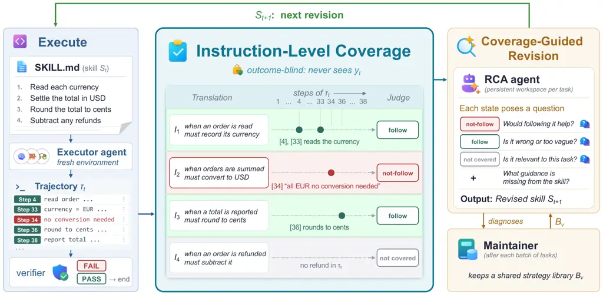

# Evolve Where It Matters: Coverage-Guided Self-Evolution of Agent Skills

Boyin Tan Affiliation: Mohamed bin Zayed University of Artificial
Intelligence    Jiadong Zhang Affiliation: Mohamed bin Zayed University
of Artificial Intelligence
Email: [xiaowei.huang@liverpool.ac.uk](mailto:)    Xiaosong Ma
Affiliation: Mohamed bin Zayed University of Artificial Intelligence   
Chun Jason Xue   Xiaowei Huang   Youcheng Sun Email: [{boyin.tan,
jiadong.zhang, xiaosong.ma, jason.xue,
youcheng.sun}@mbzuai.ac.ae](mailto:) Affiliation: Mohamed bin Zayed
University of Artificial Intelligence Affiliation: University of
Liverpool

###### Abstract

Agent skills package procedural knowledge as natural-language
instructions, and a skill helps only when its instructions are correct
and properly followed by the agent. Self-evolving agents revise their
own skills from the runs they make, but existing methods judge each run
as a whole, by its outcome or by where it went wrong, and cannot tell
whether a failure comes from a wrong instruction or from one the agent
did not follow. _Instruction-level coverage_ was introduced to test
skills and labels each instruction of a run as follow, not-follow, or
not covered, which separates these causes. We leverage it for skill
self-evolution with SkillPlumber, a framework in which an agent evolves
its own skills where coverage shows they fall short. A persistent root
cause analysis agent turns each label into a revision question and
checks each revision against the next run, while a maintainer distills
investigations across tasks into a shared strategy library. Across three
benchmarks and three executors, SkillPlumber solves 64.7% to 70.5% of
the tasks, 25.6 to 30.4 percentage points higher than the initial skill
and 8.7 to 14.0 percentage points higher than the strongest baseline,
and removing coverage reduces recovered failures by 20.8% on SkillsBench
with GPT-5.5.

## 1 Introduction

Figure 1: Run-level feedback and instruction-level coverage of the same
failed run. (a) The outcome and trajectory show that the run failed, but
tie none of its steps to an instruction of the skill. (b) Coverage maps
the run onto every instruction of SKILL.md. The agent followed the
currency and rounding instructions, never met a situation calling for
the refund instruction, and did not follow the USD instruction at
step 34, which the revision below targets.

Agent skills package procedural knowledge as natural-language
instructions that an agent loads at run time (Li et al., 2026; Han
et al., 2026), yet their benefit is far from guaranteed. Expert-written
skills help on average, but many public skills bring no gain (Han
et al., 2026), and skills that LLMs write for themselves can even
hurt (Li et al., 2026). Each instruction of skill constrains the agent’s
behavior by specifying an action to take or avoid in a given
situation (Wang et al., 2025; Li, 2026). A skill helps only when its
instructions are correct and properly followed by the
agent (Shaposhnikov et al., 2026). Neither condition can be secured when
a skill is written, since its author cannot foresee every situation (Han
et al., 2026; Li et al., 2026) and agents differ in how closely they
follow the same skill (Qi et al., 2025; Shaposhnikov et al., 2026).

Both limitations surface only when the skill runs. Self-evolving agents
therefore revise their own skills from the runs they make (Wang et al.,
2023; Zhang et al., 2025), much as a program is debugged against its
tests (Chen et al., 2023), so that experience accumulates in the skill
rather than in the model weights without retraining the model or asking
a human to read traces. Revising skills from execution feedback in this
way yields clear gains in task success (Liu et al., 2026; Zhang et al.,
2026; Alzubi et al., 2026; Kang and Wen, 2026; Feng et al., 2026).

Although these methods differ in how they decide to change a skill, none
of them can tell whether a failed run was caused by a wrong instruction
or by a useful instruction the agent failed to follow. Diagnosis-driven
methods have a model read the failed trace and rewrite the skill guided
by repair principles, validation scores, or a teacher’s corrected
continuation (Liu et al., 2026; Alzubi et al., 2026; Feng et al., 2026),
and evaluator-driven methods replace the sparse outcome with surrogate
checks or learned rubrics (Zhang et al., 2026; Kang and Wen, 2026). Both
judge the execution as a whole (Figure 1a), and a diagnosis that blames
an instruction infers the blame from the failure rather than checking
whether the agent followed it. Yet the two causes call for different
revisions. A wrong instruction must be corrected, whereas an unfollowed
one may be right and only needs to be easier to follow. Confusing them
leads self-evolution to rewrite correct guidance or to repeat guidance
the agent will ignore again.

In program debugging, code coverage supplies exactly this information,
since knowing which statements a failing run executed narrows the search
for the fault (Jones and Harrold, 2005; Wong et al., 2016). Skill
Coverage (Tan et al., 2026) brings this idea to agent skills. It labels
an instruction _not covered_ if the situation it addresses never arose
during a run, and otherwise _follow_ or _not-follow_ by whether the
agent acted on it. We leverage this coverage signal for skill
self-evolution. A failure under a followed instruction calls the
instruction into question, while a not-follow label points to the
agent’s adherence, so the labels tell the reviser which cause to
investigate and where a skill may need to change. In Figure 1b, coverage
labels the currency and rounding instructions follow, the refund
instruction not covered because no order was refunded, and the USD
instruction not-follow at step 34 where the agent decided that no
conversion was needed.

On this basis, we build SkillPlumber, in which an agent evolves its own
skills by changing the instructions that coverage implicates. A coverage
judge labels every instruction from the trace without seeing whether the
run passed. A root cause analysis (RCA) agent then turns each label into
a question, asking whether a not-follow instruction is worth following,
whether a followed one is itself wrong, and whether one not covered is
relevant at all. In Figure 1b, asking why the USD instruction was
skipped reveals that the agent saw no need to convert a single currency,
so the revision requires conversion even then. Beyond the labeled
instructions, it also looks in the trace for guidance the skill lacks.
Because the same RCA agent persists across revisions, it can revisit
earlier skills and runs and retract a revision that did not work. A
maintainer distills investigations across tasks into a shared library of
strategies for diagnosing failures and editing skills, so that later
tasks evolve their skills with what earlier tasks have learned.

We evaluate SkillPlumber on SkillsBench (Li et al., 2026),
SkillLearnBench (Zhong et al., 2026), and a hard subset of
SWE-Skills-Bench (Han et al., 2026), with GPT-5.5 in Codex, Opus 4.8 in
Claude Code, and DeepSeek-V4-Pro in OpenHands as executors. With every
executor, SkillPlumber solves the most tasks, 134 to 146 of the 207,
which is 53 to 63 more than the initial self-generated skill and 18 to
29 more than the strongest baseline. Removing instruction-level coverage
reduces the recovered failures by 20.8% on SkillsBench with GPT-5.5.

Our contributions are as follows:

- •
  We turn instruction-level coverage from a measure for testing skills
  into a signal for skill self-evolution that shows where a skill should
  change.
- •
  We present SkillPlumber, a framework for coverage-guided skill
  self-evolution. A persistent RCA agent turns coverage labels into
  revision questions and checks each revision against the next run, and
  a maintainer shares strategies across tasks.
- •
  On three benchmarks with three executors, SkillPlumber outperforms
  existing skill self-evolution methods, and removing coverage reduces
  recovery.

## 2 Related Work

#### Evaluating agent skills.

SkillsBench, SkillLearnBench, and SWE-Skills-Bench measure whether
skills help through paired runs with deterministic verifiers (Li et al.,
2026; Zhong et al., 2026; Han et al., 2026), and skill-derived rubrics
separate instruction following from goal completion (Shaposhnikov
et al., 2026), in line with instruction-following benchmarks (Zhou
et al., 2023; Qi et al., 2025). Skill Coverage introduced
instruction-level coverage with an LLM judge (Zheng et al., 2023) and
explored strengthening the instructions that agents failed to
follow (Tan et al., 2026). SkillPlumber extends this direction to skill
self-evolution through persistent, multi-round revision that corrects
wrong guidance, adds missing instructions, and reassesses earlier edits.

#### Self-evolving agents and skills.

Agents improve without weight updates through verbal reflection (Shinn
et al., 2023; Madaan et al., 2023), experience and workflow
memories (Zhao et al., 2023; Wang et al., 2024b; Suzgun et al., 2025),
skill libraries and manuals (Wang et al., 2023; Chen et al., 2024),
curated playbooks (Zhang et al., 2025), and optimized prompts (Yang
et al., 2023; Khattab et al., 2023; Yuksekgonul et al., 2024; Agrawal
et al., 2025). Skill-level methods revise a skill from execution
feedback, guided by repair principles (Liu et al., 2026), co-evolved
surrogate verifiers (Zhang et al., 2026), or validation scores (Alzubi
et al., 2026). They judge each run as a whole, whereas SkillPlumber
revises a skill from how the agent used each instruction.



Figure 2: Overview of SkillPlumber. A persistent RCA agent uses
coverage, execution traces, and permitted verifier feedback to diagnose
a failure and revise the skill. It records its hypothesis and expected
effect; a fresh execution provides evidence for the next revision
decision. A maintainer shares investigative strategies across tasks.
Coverage supplies instruction-use evidence to this self-evolution
process.

## 3 Instruction-Level Coverage

We adopt the applicability-adherence distinction of Skill Coverage (Tan
et al., 2026). Each actionable instruction is expressed as an
applicability condition and a required or prohibited behavior, following
the EARS template (Mavin et al., 2009). Each observed occurrence of the
condition is labeled _follow_ if the execution satisfies the behavior
and _not-follow_ otherwise, and an instruction whose condition never
clearly occurs is _not covered_. For a skill $`S_{t}`$, public task
$`x`$, and trace $`\tau_{t}`$, we denote the report by

```math
C_{t}=\operatorname{Coverage}(S_{t},x,\tau_{t}). \tag{1}
```

In our use, the coverage judge receives these inputs without the
verifier feedback. It neither explains failures nor proposes edits, so
the diagnosis remains with the RCA agent, which can inspect and
challenge each label. SkillPlumber turns each label into a question that
guides an edit, asking of a not-follow instruction whether following it
would help and how to make it easier to follow, of a followed one
whether it is itself wrong, and of one not covered whether it matters
for the task. The same labels can thus lead to different repairs,
correcting a wrong instruction, clarifying one the agent skipped, or
pruning one the task never needs, which turns coverage from a measure
for testing skills into a signal for revising them.

1: Task $`x`$, skill $`S_{0}`$, initial run $`(\tau_{0},y_{0})`$,

2: executor $`A`$, revision budget $`R`$, library $`B_{v}`$

3: $`t\leftarrow 0`$; initialize the task’s RCA session

4: $`H\leftarrow\{(S_{0},\tau_{0},y_{0})\}`$

5: while $`\neg\operatorname{Pass}(y_{t})\land t<R`$ do

6:   $`C_{t}\leftarrow\operatorname{Coverage}(S_{t},x,\tau_{t})`$

7:   Add $`C_{t}`$ to $`H`$; resume the RCA session

8:   if $`t>0`$ then

9:    RCA: review $`(h_{t},p_{t})`$ against

10:      $`(\tau_{t},y_{t},C_{t})`$

11:   end if

12:   RCA: diagnose using $`x`$, $`H`$, and $`B_{v}`$

13:   RCA: submit Stop or

14:    $`(S_{t+1},h_{t+1},p_{t+1})`$

15:   if the RCA agent submits Stop then

16:    return $`S_{t}`$

17:   end if

18:   Retain the hypothesis, prediction, and edit in $`H`$

19:
  $`(\tau_{t+1},y_{t+1})\leftarrow\operatorname{RunFresh}(A,x,S_{t+1})`$

20:   Add $`(S_{t+1},\tau_{t+1},y_{t+1})`$ to $`H`$

21:   $`t\leftarrow t+1`$

22: end while

23: return $`S_{t}`$

Algorithm 1 Coverage-guided skill self-evolution

## 4 Coverage-Guided Skill Self-Evolution

In SkillPlumber, the executor’s own model evolves its skill for a given
task from its own executions, without human input. With executor $`A`$,
task $`x`$, and verifier $`V`$, it seeks the skill that maximizes the
expected verifier outcome over the executor’s runs within a budget of
$`R`$ revisions,

```math
S^{\star}=\arg\max_{S}\ \mathbb{E}_{\tau\sim A(S,\,x)}\bigl[V(x,\tau)\bigr]. \tag{2}
```

Each execution yields a single sample of this objective, a pass or a
fail, which shows whether the skill worked but not which instruction to
change. SkillPlumber therefore evolves the skill through a persistent
investigation of its executions, guided by coverage. Figure 2 gives an
overview and Algorithm 1 the control flow for one task. A root cause
analysis (RCA) agent revises the skill, a fresh execution tests each
revision, and a maintainer shares strategies across tasks.

### 4.1 Persistent State and Information Access

One RCA session serves each task across all its revisions, so the agent
can revisit earlier evidence and change its explanation. Its workspace
$`H`$ starts with $`S_{0}`$ and its run $`(\tau_{0},y_{0})`$ and
accumulates every executed skill and its differences, trace
$`\tau_{t}`$, verifier feedback $`y_{t}`$, and coverage report
$`C_{t}`$, together with the agent’s hypotheses, predictions, notes, and
analysis scripts. $`\operatorname{Pass}(y_{t})`$ holds when this
feedback reports that $`V(x,\tau_{t})`$ is a pass. The agent also reads
$`B_{v}`$, the version of the strategy library that the maintainer has
built from earlier task. Hidden test code, expected answers, and
verifier logs are withheld. Each revision is executed by a fresh
executor that receives only the public task and the revised skill,
without the RCA history or the library.

All steps marked RCA in Algorithm 1 are prompted operations within this
session, while the host retains artifacts, launches executions, and
enforces the budget. As in SkillRevise and CoEvoSkills, revision stops
at the first pass. A single pass is one sample of the objective in
Equation 2, so we also replay the returned skills.

### 4.2 Coverage-Guided Diagnosis and Revision

#### Reviewing the preceding revision.

When $`t>0`$, the RCA agent first reviews the hypothesis $`h_{t}`$ and
prediction $`p_{t}`$ recorded when it proposed $`S_{t}`$. The prompt
asks the agent to compare its expected effect with the observed trace
$`\tau_{t}`$, verifier feedback $`y_{t}`$, and coverage report
$`C_{t}`$. It considers whether the revised guidance affected execution
as expected and what the result implies for its preceding explanation of
the failure. Compliance with an edited instruction does not by itself
confirm that explanation. This assessment informs the next diagnosis;
for the initial run ($`t=0`$), there is no preceding revision to review.

#### Diagnosing the failure.

The agent then diagnoses the failure using the public task $`x`$,
accumulated evidence $`H`$, and strategies $`B_{v}`$. It inspects
$`C_{t}`$ alongside the corresponding instructions, trace, and verifier
feedback. The coverage report connects the instruction wording to
supporting execution steps. The RCA prompt uses these connections to
organize the investigation:

- •
  For _not-follow_, assess whether compliance would have helped, then
  inspect the trace for why the instruction was not followed. The
  resulting hypothesis may concern the instruction’s wording,
  applicability, conflicts with other guidance, or suitability for the
  task.
- •
  For _follow_, inspect the behavior produced by following the
  instruction and its relation to the observed failure. Consider whether
  the guidance is incorrect, misleading, or insufficient in that
  context.
- •
  For _not covered_, assess whether the instruction addresses a relevant
  situation that was absent from the run. Its absence alone does not
  justify removing the instruction.

The agent also inspects the trajectory for missing guidance, which has
no existing instruction to receive a coverage label. When the trace
supports a different interpretation of a coverage judgment, the agent
records its disagreement and uses the underlying evidence in its
diagnosis.

#### Submitting a revision or stopping.

The RCA agent submits either Stop or $`(S_{t+1},h_{t+1},p_{t+1})`$. The
hypothesis $`h_{t+1}`$ states the explanation motivating the proposed
changes. The prediction $`p_{t+1}`$ records their expected effect on the
next execution. The revised skill $`S_{t+1}`$ may clarify an instruction
or its applicability condition, correct or remove misleading guidance,
add a missing step, or retract an earlier change. If the agent judges
that no further edit is worthwhile, it submits Stop.

### 4.3 Cross-Task Strategy Maintenance

Algorithm 1 takes the strategy library $`B_{v}`$ as input; updates to
this library occur outside the task-level self-evolution loop. Tasks are
processed in batches of three. After each batch, a maintainer with its
own persistent session reads the batch’s diagnoses, edits, and verifier
feedback and updates $`B_{v}`$ with strategies for investigating
failures and revising skills. The library is initially empty.

RCA agents in later batches consult these strategies as advice and may
decline to apply them when they do not fit the current evidence. The
executor and coverage judge do not receive the library. Each RCA
workspace retains the investigation of its own task, while the
maintainer shares investigative experience across tasks.

|                              |                         |             |              |                 |              |                 |              |         |
| ---------------------------- | ----------------------- | ----------- | ------------ | --------------- | ------------ | --------------- | ------------ | ------- |
|                              |                         | SkillsBench |              | SkillLearnBench |              | SWE-Skills-Hard |              | Overall |
| Executor                     | Method                  | Succ.       | $`\Delta`$pp | Succ.           | $`\Delta`$pp | Succ.           | $`\Delta`$pp | Succ.   |
|                              | No skill                | 39/87       | —            | 19/50           | —            | 30/70           | —            | 88/207  |
|                              | Initial skill $`S_{0}`$ | 35/87       | $`-`$4.60    | 21/50           | +4.00        | 34/70           | +5.71        | 90/207  |
|                              | SkillRevise             | 52/87       | +14.94       | 36/50           | +34.00       | 36/70           | +8.57        | 124/207 |
|                              | CoEvoSkills             | 52/87       | +14.94       | 29/50           | +20.00       | 42/70           | +17.14       | 123/207 |
| GPT-5.5    Codex             | SkillPlumber            | 59/87       | +22.99       | 39/50           | +40.00       | 45/70           | +21.43       | 143/207 |
|                              | No skill                | 32/87       | —            | 14/50           | —            | 39/70           | —            | 85/207  |
|                              | Initial skill $`S_{0}`$ | 34/87       | +2.30        | 16/50           | +4.00        | 40/70           | +1.43        | 90/207  |
|                              | SkillRevise             | 48/87       | +18.39       | 32/50           | +36.00       | 48/70           | +12.86       | 128/207 |
| Opus 4.8    Claude Code      | SkillPlumber            | 54/87       | +25.29       | 39/50           | +50.00       | 53/70           | +20.00       | 146/207 |
|                              | No skill                | 35/87       | —            | 9/50            | —            | 29/70           | —            | 73/207  |
|                              | Initial skill $`S_{0}`$ | 30/87       | $`-`$5.75    | 13/50           | +8.00        | 28/70           | $`-`$1.43    | 71/207  |
|                              | SkillRevise             | 44/87       | +10.34       | 29/50           | +40.00       | 32/70           | +4.29        | 105/207 |
| DeepSeek-V4-Pro    OpenHands | SkillPlumber            | 54/87       | +21.84       | 32/50           | +46.00       | 48/70           | +27.14       | 134/207 |

Figure 3: Initial failures repaired by each revision round with GPT-5.5
and Codex. A round of CoEvoSkills is one check against the benchmark
verifier.

|                  |      |      |      |      |
| ---------------- | ---- | ---- | ---- | ---- |
| Method           | SB   | SLB  | SWE  | All  |
| SkillRevise      | 4.1  | 3.3  | 4.8  | 4.1  |
| CoEvoSkills      | 10.0 | 10.7 | 14.8 | 11.6 |
| verifier checks  | 2.0  | 2.5  | 1.4  | 2.0  |
| SkillPlumber     | 3.3  | 2.4  | 4.1  | 3.4  |
| Initial failures | 52   | 29   | 36   | 117  |

Table 2: Revisions per initial failure with GPT-5.5. Verifier checks
count the revisions of CoEvoSkills that it checks against the benchmark
verifier. SB, SLB, and SWE abbreviate the benchmarks of Table 2.

Table 1: Tasks solved with at most five revisions, and the change over
no skill in percentage points. All revision methods start from the same
$`S_{0}`$, and bold marks the best method for each executor. Within our
compute budget, CoEvoSkills is run with GPT-5.5 only.

## 5 Experimental Setup

#### Benchmarks and executors.

We evaluate on three benchmarks built to measure whether agent skills
help. We use all 87 tasks of SkillsBench (Li et al., 2026), which span
professional domains. SkillLearnBench (Zhong et al., 2026) groups
related instances into task families, and we use 50 of them.
SWE-Skills-Bench (Han et al., 2026) poses software-engineering tasks in
real repositories, and we use its 70-task hard subset
SWE-Skills-Bench-Hard. All three are designed around skills, and each
scores every task with a deterministic verifier, which gives revision a
pass or fail signal without an LLM grader. Appendix A describes the
benchmarks and the subsets, which follow SkillRevise. Executors are
GPT-5.5 with Codex, Opus 4.8 with Claude Code, and DeepSeek-V4-Pro with
OpenHands (Wang et al., 2024a). Appendix D lists the model and reasoning
effort of every component.

#### Protocol.

We follow the per-task repair setting of SkillRevise (Liu et al., 2026)
and CoEvoSkills (Zhang et al., 2026). A skill is revised for the task it
serves, from executions of that task and the verdict of its verifier,
and the result is the skill that solves the task, much as a program is
repaired against its own tests (Chen et al., 2023) or an agent retries a
task with feedback (Shinn et al., 2023). This setting targets skills
that are reused on the same task, so revision and evaluation share the
task by design rather than splitting it into training and test sets. The
initial skill $`S_{0}`$ of each task is written by the executor’s own
model with the authoring stage of SkillRevise (Liu et al., 2026) before
any execution, so it reflects no verifier feedback. Appendix B gives the
details. For a given executor, all revision methods start from the same
$`S_{0}`$ and share its original execution and evaluation. A task that
passes with $`S_{0}`$ needs no revision. A failed task receives at most
five revision rounds. In each round the revised skill is executed by a
fresh executor that receives only the skill and the task, and revision
stops at the first pass.

#### Metrics.

A task counts as solved only if its verifier passes, and partial reward
earns no credit. We report the tasks solved within five revision rounds,
and their difference from $`S_{0}`$ is the number of initial failures a
method recovers.

#### Baselines.

_No skill_ runs the executor without any skill, and _initial skill_ runs
it with $`S_{0}`$. We compare with SkillRevise (Liu et al., 2026), which
diagnoses each failure with a memory of repair principles and returns
the best executed candidate, and CoEvoSkills (Zhang et al., 2026), which
evolves a skill with a surrogate verifier and submits candidates that
pass it to the benchmark verifier; within our compute budget,
CoEvoSkills runs with GPT-5.5 only. Both baselines start from the same
$`S_{0}`$ and its execution as SkillPlumber, and Appendix C describes
how we run them. Our comparisons with them therefore hold under this
shared protocol.

## 6 Results

### 6.1 Main Results

SkillPlumber solves the most tasks with every executor. In Table 2 it
leads on every benchmark with all three executors. The lead does not
come from trading one set of recoveries for another. With GPT-5.5,
SkillPlumber also recovers 30 of the 34 initial failures that
SkillRevise recovers and 25 of the 33 that CoEvoSkills recovers, with
Opus 4.8 it recovers 32 of SkillRevise’s 38, and with DeepSeek-V4-Pro it
recovers 29 of SkillRevise’s 34. The initial skills alone barely improve
on no skill and fall below it on SkillsBench with GPT-5.5 and with
DeepSeek-V4-Pro, so the gains come from revision rather than from having
a skill.

Each baseline falls behind on one benchmark, while SkillPlumber leads on
all three. With GPT-5.5, SkillRevise recovers 2 of the 36 initial
failures on SWE-Skills-Bench-Hard, fewer than CoEvoSkills, and
CoEvoSkills recovers 8 of the 29 on SkillLearnBench, about half as many
as SkillRevise. SkillPlumber ranks first on all three, so its gains hold
across the three kinds of task we test.

SkillPlumber widens its lead after the first round. In Figure 2
SkillPlumber adds more repairs after the first round than SkillRevise
and CoEvoSkills on every benchmark. CoEvoSkills makes most of its
repairs in the first round and almost none after the third, while
SkillRevise keeps adding repairs at a slower pace. On
SWE-Skills-Bench-Hard SkillPlumber starts behind CoEvoSkills and
overtakes it from the third round.

SkillPlumber recovers more with fewer revisions. Table 2 shows that
SkillPlumber needs fewer revisions per initial failure than both
baselines although it recovers more tasks, 3.4 against 4.1 for
SkillRevise and 11.6 for CoEvoSkills. Part of the difference comes from
stopping. The RCA agent of SkillPlumber ends the revision of 17 tasks on
its own when its investigation finds no worthwhile edit, whereas
SkillRevise spends all five rounds on every task it cannot repair.

### 6.2 Ablation Study

We remove one component of SkillPlumber at a time on the 52 SkillsBench
initial failures with GPT-5.5, and Figure 4 compares each variant with
SkillPlumber task by task. _w/o Coverage_ drops instruction extraction
and the judge. Its RCA agent still reads the complete trajectories,
verifier feedback, and earlier skills, and can analyze them with its own
scripts under the same configuration and revision budget, so the variant
removes the instruction-level labels rather than trajectory analysis. It
thus serves as the trajectory-analysis control for Coverage, and about
two thirds of the extra revision tokens of SkillPlumber go to producing
the coverage record rather than to a longer investigation, as Appendix G
details. _w/o Maintainer_ drops the maintainer and its strategy library.

Removing Coverage costs the most recoveries. Without it, recovery falls
from 24 to 19 tasks, and SkillPlumber recovers seven tasks that _w/o
Coverage_ misses while missing only two that it recovers. The gap
persists under replay, where the returned skills of SkillPlumber pass
22.0 tasks per replay in Table 3, against 17.0 for those of _w/o
Coverage_. The two variants each recover 13 tasks in the first round,
and the gap opens only in later rounds. Appendix E gives the recoveries
of each variant by round. Removing the maintainer changes recovery by
only one task, so the gain of SkillPlumber rests on Coverage rather than
on the shared strategy library.

Figure 4: Tasks recovered by only SkillPlumber or only the comparison on
the 52 GPT-5.5 SkillsBench initial failures. Net is their difference.

The recoveries of SkillPlumber persist under replay. Every method stops
revising at the first passing execution, so a task gets several chances
and counts as recovered once any of them passes. The original count
therefore resembles a pass@$`k`$ score, so a skill that passes once by
luck still counts as a recovery. To separate reliable repairs from lucky
ones, we freeze the skill each method returns on these 52 tasks, execute
it three more times with fresh executors, and replay $`S_{0}`$ the same
way. Since a replay may also pass a task that was never recovered, we
measure how many recoveries persist only on the tasks each method
originally recovered. In Table 3, the replay mean of SkillRevise falls
to the level of $`S_{0}`$, and only 41.2% of its recoveries persist, so
its final skills add little over $`S_{0}`$ on average in this setting.
SkillPlumber keeps 86.1% of its recoveries on average, and every one of
its 24 recovered tasks passes again in at least one replay. _w/o
Coverage_ keeps a similar share of its recoveries but recovers fewer
tasks, so it stays below SkillPlumber by the same margin as in the
original run, by 5.0 tasks per replay with a 95% paired task-bootstrap
interval of 0.3 to 9.7.

| Skill                   | Original | Mean@3 | Pass@3 | Kept  | Again |
| ----------------------- | -------- | ------ | ------ | ----- | ----- |
| Initial skill $`S_{0}`$ | 0        | 7.0    | 11     | n/a   | n/a   |
| SkillRevise             | 17       | 7.3    | 12     | 41.2% | 11    |
| CoEvoSkills             | 17       | 13.0   | 14     | 76.5% | 14    |
| _w/o Coverage_          | 19       | 17.0   | 20     | 86.0% | 18    |
| SkillPlumber            | 24       | 22.0   | 27     | 86.1% | 24    |

Table 3: Replaying the returned skills three times on the 52 GPT-5.5
SkillsBench initial failures. Original counts the tasks recovered in the
revision run, Mean@3 and Pass@3 count the tasks passed on average and at
least once over the three replays. Kept and Again are computed on the
originally recovered tasks only. Kept is their average number of replay
passes divided by Original, and Again counts those that pass in at least
one replay.

SkillPlumber still leads when $`S_{0}`$ gets as many chances. Executed
five more times on all 87 SkillsBench tasks, $`S_{0}`$ passes 48, 44,
and 45 tasks at least once with the three executors, against 59, 54, and
54 for SkillPlumber, as Appendix F details.

### 6.3 Does Coverage Drive the Revisions?

The ablation shows that removing Coverage lowers recovery, but not how
Coverage acts. We therefore examine the edits themselves, which give
many more observations than task recovery. We follow the full method’s
182 RCA decisions on the 52 GPT-5.5 SkillsBench initial failures (174
edits and 8 stops) from reading the coverage record to the edits that
follow. Table 4 collects the measurements, all computed by fixed rules
over the RCA sessions and skill versions without a model (Appendix H).

|                              |       |            |
| ---------------------------- | ----- | ---------- |
| Rate, %                      | Full  | _w/o Cov._ |
| Coverage read before editing | 100.0 | –          |
| R1, not-follow lines edited  | 51.9  | 25.0       |
| R1, follow lines edited      | 22.1  | 23.4       |
| Own previous lines rewritten | 46.4  | 37.4       |
|    labeled not-follow        | 56.7  | –          |
|    labeled follow            | 40.8  | –          |
| Other lines rewritten        | 4.1   | 3.3        |

Table 4: How the RCA agent uses Coverage on the 52 GPT-5.5 SkillsBench
initial failures. The first row is a share of decisions and the others
are shares of skill lines. The R1 rows score both variants with the same
labels. Own previous lines are those the agent added in the preceding
revision, and _w/o Coverage_ has no labels for them.

#### The RCA agent reads Coverage.

A rule over the agent’s shell commands finds a read of the current
coverage record before the first edit in all 182 decisions of the full
method.

#### Coverage moves edits toward not-follow instructions.

Violated instructions may simply be the obvious ones to change, so we
compare the two variants at R1, where both start from byte-identical
$`S_{0}`$ evidence for all 52 tasks and only one receives Coverage. Each
variant also reads the strategy library built from its own earlier
tasks, which itself reflects whether Coverage was available, so the
comparison measures Coverage as it acts in the method, including through
the strategies learned with it. Scored with the same labels, Coverage
doubles the edit rate of not-follow lines, a difference of 26.9 points
with a 95% task-bootstrap interval (Efron, 1979) of 14.3 to 40.4, and
leaves follow lines unchanged. In 13 tasks only the agent with Coverage
edits a not-follow line, against 1 task for the agent without it,
$`p=0.002`$ by an exact McNemar test (McNemar, 1947). These tests
concern which instructions the agent edits, not whether the task is
recovered.

#### The agent revisits its own edits by their labels.

From R2 on, the coverage record judges the skill the agent submitted in
the previous revision, so the instructions it added also receive labels.
A followed instruction in a run that still failed may be wrong, and a
not-follow one may be hard to follow. The agent rewrites almost half of
its own previous lines but few others, and among its own lines more of
those labeled not-follow, a difference of 15.9 points with an interval
of 1.5 to 32.0.

Figure 5: Tasks solved out of the 52 GPT-5.5 SkillsBench initial
failures. Own $`S_{0}`$ and Own SkillPlumber are the initial skill of
each executor and the skill SkillPlumber revises with it, and Transfer
executes the skills that SkillPlumber revised with GPT-5.5.

### 6.4 Cross-Model Transfer

We execute the final SkillPlumber skills produced with GPT-5.5 on the 52
SkillsBench initial failures, unchanged and once, with each other
executor, and compare them with no skill, the executor’s own $`S_{0}`$,
and the skills SkillPlumber revises with that executor. Every count in
Figure 5 reflects a single execution of the final skill on the target
executor. In Figure 5, the transferred skills solve 17 of the 52 tasks
with Opus 4.8 and 18 with DeepSeek-V4-Pro, 8 and 9 more than each
executor’s own $`S_{0}`$, which itself falls below no skill, so the gain
comes from what revision added. Revising with the executor itself helps
more, solving 26 and 22 tasks, so part of what revision learns is
specific to the executor whose coverage record drove it.

## 7 Conclusion

We leveraged instruction-level coverage, which labels each instruction
of a skill as follow, not-follow, or not covered from the execution
trace, for skill self-evolution and built SkillPlumber, in which a
persistent RCA agent turns these labels into questions for revising the
skill. Across three benchmarks and three executors, SkillPlumber
outperforms existing skill self-evolution methods, and removing coverage
costs more recovered tasks than removing the maintainer. Our analyses
show that coverage steers revision toward the instructions the agent did
not follow. We believe that knowing how an agent used each instruction
is as basic to improving skills as code coverage is to debugging
programs.

## Limitations

Coverage labels come from a model. The judge can mislabel an
instruction, as any LLM judge can. Skill Coverage validates an LLM judge
for the same labeling task against human labels (Tan et al., 2026), and
stronger judges would sharpen the signal without changing the framework.

Agentic revision spends more tokens. The RCA agent, the judge, and the
maintainer are agent sessions, so SkillPlumber spends more tokens on
revision than methods that revise with a single model call, and most of
these tokens are context re-read within a session. The gains do not come
from a larger budget alone. The variant without Coverage keeps the same
agent and round limit, so the extra tokens of SkillPlumber go mainly to
producing Coverage itself. Counting the executor runs that verify each
revision, SkillPlumber uses about twice as many tokens as SkillRevise
and CoEvoSkills, recovers more tasks than both, and spends a comparable
number of tokens per recovered task. Appendix G gives the accounting.

The setting follows prior work on skill revision. Like SkillRevise and
CoEvoSkills, SkillPlumber revises a skill by executing it repeatedly on
its task and uses a verifier to decide when to stop. Coverage itself
needs only an execution trace and never the outcome, so it can also
describe how agents use skills where no verifier exists, such as in
deployment logs, and revising skills from such traces is a natural next
step.

SkillPlumber revises the instructions of a skill. Coverage is defined
over the natural-language instructions of SKILL.md, and SkillPlumber
leaves scripts and other resources bundled with a skill unchanged. Code
coverage applies to such scripts directly, so combining it with
instruction-level coverage could extend revision to the whole skill.

## Ethical Considerations

Skill revision changes instructions that govern tool use and artifact
creation. Execution should remain within authorized task environments,
and private evaluators should be isolated from the revision agent.
Traces and released artifacts require review for credentials,
identifying paths, and sensitive task content; redistribution must
respect resource licenses. AI assistance was used for literature lookup,
argument organization, English drafting, LaTeX preparation, and
method-figure generation. Human authors remain responsible for checking
the manuscript and evidence.

## References

- Agrawal et al. (2025) Lakshya A. Agrawal, Shangyin Tan, Dilara Soylu,
  Noah Ziems, Rishi Khare, Krista Opsahl-Ong, Arnav Singhvi, Herumb
  Shandilya, Michael J Ryan, Meng Jiang, Christopher Potts, Koushik Sen,
  A. Dimakis, Ion Stoica, Dan Klein, Matei A. Zaharia, and
  O. Khattab. 2025. [GEPA: Reflective Prompt Evolution Can Outperform
  Reinforcement Learning](https://arxiv.org/abs/2507.19457). _Preprint_,
  arXiv:2507.19457.
- Alzubi et al. (2026) Salaheddin Alzubi, N. Provenzano, Jaydon Bingham,
  Wei-Yuan Chen, and Tu Vu. 2026. [EvoSkill: Automated Skill Discovery
  for Multi-Agent Systems](https://arxiv.org/abs/2603.02766).
  _Preprint_, arXiv:2603.02766.
- Chen et al. (2024) Minghao Chen, Yihang Li, Yan-Ting Yang, Shiyu Yu,
  Binbin Lin, and Xiaofei He. 2024. [AutoManual: Constructing
  Instruction Manuals by LLM Agents via Interactive Environmental
  Learning](https://doi.org/10.52202/079017-0019). In _Neural
  Information Processing Systems_.
- Chen et al. (2023) Xin-Yun Chen, Maxwell Lin, Nathanael Schärli, and
  Denny Zhou. 2023. [Teaching Large Language Models to
  Self-Debug](https://arxiv.org/abs/2304.05128). In _International
  Conference on Learning Representations_.
- Efron (1979) B. Efron. 1979. [Bootstrap Methods: Another Look at the
  Jackknife](https://doi.org/10.1214/AOS/1176344552). _Annals of
  Statistics_, 7:1–26.
- Feng et al. (2026) Yi-Chun Feng, Jia-Wei Wang, and Hao Sun. 2026. [A
  Wrong Turn Does Not Ruin the Journey: Deviation-Guided Skill
  Self-Evolution for LLM Agents](https://arxiv.org/abs/2609.29154).
  _Preprint_, arXiv:2609.29154.
- Han et al. (2026) Tingxu Han, Y. Zhang, Wei Song, Chun-Rong Fang,
  Zhen-Yu Chen, Youcheng Sun, and Li-Jie Hu. 2026. [SWE-Skills-Bench: Do
  Agent Skills Actually Help in Real-World Software
  Engineering?](https://arxiv.org/abs/2603.15401) _Preprint_,
  arXiv:2603.15401.
- Jones and Harrold (2005) James A. Jones and M. J. Harrold. 2005.
  [Empirical evaluation of the tarantula automatic fault-localization
  technique](https://doi.org/10.1145/1101908.1101949). In _International
  Conference on Automated Software Engineering_.
- Kang and Wen (2026) Hao Kang and Ming Wen. 2026. [SkillLift: Learning
  Dense Rubrics from Sparse Oracles for Efficient Skill
  Evolution](https://arxiv.org/abs/2609.15396). _Preprint_,
  arXiv:2609.15396.
- Khattab et al. (2023) O. Khattab, Arnav Singhvi, Paridhi Maheshwari,
  Zhiyuan Zhang, Keshav Santhanam, Sri Vardhamanan, Saiful Haq, Ashutosh
  Sharma, Thomas T. Joshi, Hanna Moazam, Heather Miller, Matei Zaharia,
  and Christopher Potts. 2023. [DSPy: Compiling Declarative Language
  Model Calls into Self-Improving
  Pipelines](https://arxiv.org/abs/2310.03714). _Preprint_,
  arXiv:2310.03714.
- Li (2026) Ming-Hao Li. 2026. [HEXIS: Compiling Agent Skills into
  Extended Finite State Machines](https://arxiv.org/abs/2609.30123).
  _Preprint_, arXiv:2609.30123.
- Li et al. (2026) Xiangyi Li, Wen-Bo Chen, Yimin Liu, Sheng-Han Zheng,
  Xiaokun Chen, Yifeng He, Yubo Li, B. You, Haotian Shen, Jiankai Sun,
  Shuyi Wang, Qun-Hong Zeng, Di Wang, Xuandong Zhao, Xiaojun Wu, Yuan-Li
  Wang, Roey Ben Chaim, Zong-Lin Di, Yi Gao, and 23 others. 2026.
  [SkillsBench: Benchmarking How Well Agent Skills Work Across Diverse
  Tasks](https://arxiv.org/abs/2602.12670). _Preprint_,
  arXiv:2602.12670.
- Liu et al. (2026) Yuxuan Liu, Zhao-Chen Su, Lin Xie, Yuhao Zhang, Qing
  Zong, Jiahe Guo, Zhong-Wei Xie, Yiyan Ji, Yauwai Yim, Hong-Yu Luo,
  Xiyu Ren, Chenyu Ruan, Haoran Li, and Yang-Qiu Song. 2026.
  [SkillRevise: Improving LLM-Authored Agent Skills via
  Trace-Conditioned Skill Revision](https://arxiv.org/abs/2606.01139).
  _Preprint_, arXiv:2606.01139.
- Madaan et al. (2023) Aman Madaan, Niket Tandon, Prakhar Gupta, Skyler
  Hallinan, Luyu Gao, Sarah Wiegreffe, Uri Alon, Nouha Dziri, Shrimai
  Prabhumoye, Yiming Yang, Shashank Gupta, Bodhisattwa Prasad Majumder,
  Katherine Hermann, S. Welleck, A. Yazdanbakhsh, and Peter Clark. 2023.
  Self-Refine: Iterative Refinement with Self-Feedback. In _Neural
  Information Processing Systems_.
- Mavin et al. (2009) Alistair Mavin, Philip Wilkinson, Adrian Harwood,
  and Mark Novak. 2009. [Easy Approach to Requirements Syntax
  (EARS)](https://doi.org/10.1109/RE.2009.9). In _IEEE International
  Requirements Engineering Conference_.
- McNemar (1947) Q. McNemar. 1947. [Note on the sampling error of the
  difference between correlated proportions or
  percentages](https://doi.org/10.1007/BF02295996). _Psychometrika_,
  12:153–157.
- Qi et al. (2025) Yunjia Qi, Hao Peng, Xiaozhi Wang, Amy Xin, Youfeng
  Liu, Bin Xu, Lei Hou, and Juan-Zi Li. 2025. [AGENTIF: Benchmarking
  Instruction Following of Large Language Models in Agentic
  Scenarios](https://arxiv.org/abs/2505.16944). _Preprint_,
  arXiv:2505.16944.
- Shaposhnikov et al. (2026) Maksim Shaposhnikov, N. Fortuin, Simon
  Stipcich, Maria I. Gorinova, Amy Heineike, and Robert S.
  Willoughby. 2026. [A Framework for Evaluating Agentic Skills at
  Scale](https://arxiv.org/abs/2606.17819). _Preprint_,
  arXiv:2606.17819.
- Shinn et al. (2023) Noah Shinn, Federico Cassano, Edward Berman,
  A. Gopinath, Karthik Narasimhan, and Shunyu Yao. 2023. [Reflexion:
  language agents with verbal reinforcement
  learning](https://doi.org/10.52202/075280-0377). In _Neural
  Information Processing Systems_.
- Suzgun et al. (2025) M. Suzgun, Mert Yuksekgonul, Federico Bianchi,
  Daniel Jurafsky, and James Zou. 2025. Dynamic Cheatsheet: Test-Time
  Learning with Adaptive Memory. In _Conference of the European Chapter
  of the Association for Computational Linguistics_.
- Tan et al. (2026) Boyin Tan, Xiaowei Huang, and Youcheng Sun. 2026.
  [Skill Coverage: A test adequacy metric for agent
  skills](https://doi.org/10.48550/arXiv.2606.20659). _Preprint_,
  arXiv:2606.20659.
- Wang et al. (2023) Guanzhi Wang, Yuqi Xie, Yunfan Jiang, A. Mandlekar,
  Chaowei Xiao, Yuke Zhu, Linxi (Jim) Fan, and Anima Anandkumar. 2023.
  [Voyager: An Open-Ended Embodied Agent with Large Language
  Models](https://arxiv.org/abs/2305.16291). _Transactions on Machine
  Learning Research_.
- Wang et al. (2025) Hao-Yu Wang, Christopher M. Poskitt, and Jun
  Sun. 2025. [AgentSpec: Customizable Runtime Enforcement for Safe and
  Reliable LLM Agents](https://doi.org/10.1145/3744916.3764546). In
  _Proceedings of the 2026 IEEE/ACM 48th International Conference on
  Software Engineering_.
- Wang et al. (2024a) Xingyao Wang, Boxuan Li, Yufan Song, Frank F. Xu,
  Xiangru Tang, Ming-Chen Zhuge, Jiayi Pan, Yue-Qi Song, Bo-Wen Li,
  Jaskirat Singh, Hoang H. Tran, Fuqiang Li, Ren Ma, Mingzhang Zheng,
  Bill Qian, Yanjun Shao, Niklas Muennighoff, Yi-Zhe Zhang, Binyuan Hui,
  and 5 others. 2024a. OpenHands: An Open Platform for AI Software
  Developers as Generalist Agents. In _International Conference on
  Learning Representations_.
- Wang et al. (2024b) Zora Zhiruo Wang, Jia-Yuan Mao, Daniel Fried, and
  Graham Neubig. 2024b. Agent Workflow Memory. In _International
  Conference on Machine Learning_.
- Wong et al. (2016) W. E. Wong, Ruizhi Gao, Yi-hao Li, Rui Abreu, and
  Franz Wotawa. 2016. [A Survey on Software Fault
  Localization](https://doi.org/10.1109/TSE.2016.2521368). _IEEE
  Transactions on Software Engineering_, 42:707–740.
- Yang et al. (2023) Chengrun Yang, Xue-Zhi Wang, Yifeng Lu, Hanxiao
  Liu, Quoc V. Le, Denny Zhou, and Xin-Yun Chen. 2023. Large Language
  Models as Optimizers. In _International Conference on Learning
  Representations_.
- Yuksekgonul et al. (2024) Mert Yuksekgonul, Federico Bianchi, Joseph
  Boen, Sheng Liu, Zhi Huang, Carlos Guestrin, and James Zou. 2024.
  [TextGrad: Automatic "Differentiation" via
  Text](https://arxiv.org/abs/2406.07496). _Preprint_, arXiv:2406.07496.
- Zhang et al. (2026) Han-Rong Zhang, Shi-Chen Fan, Henry Peng Zou,
  Yan-Kai Chen, Zhenting Wang, Jia-Yuan Zhou, Cheng-Ze Li, Wei-Chieh
  Huang, Yi-Fei Yao, Ke-Ning Zheng, Xue Liu, Xiao-Xiao Li, and Philip S.
  Yu. 2026. [CoEvoSkills: Self-Evolving Agent Skills via Co-Evolutionary
  Verification](https://arxiv.org/abs/2604.01687). _Preprint_,
  arXiv:2604.01687.
- Zhang et al. (2025) Qizheng Zhang, Chang-Ran Hu, Shubhangi Upasani,
  Bo-Yuan Ma, Feng-Lu Hong, Vamsidhar Kamanuru, Jay Rainton, Chen Wu,
  Meng-Meng Ji, Han-Chen Li, Urmish Thakker, James Zou, and
  K. Olukotun. 2025. [Agentic Context Engineering: Evolving Contexts for
  Self-Improving Language Models](https://arxiv.org/abs/2510.04618).
  _Preprint_, arXiv:2510.04618.
- Zhao et al. (2023) Andrew Zhao, Daniel Huang, Quentin Xu, Matthieu
  Lin, Y. Liu, and Gao Huang. 2023. ExpeL: LLM Agents Are Experiential
  Learners. In _AAAI Conference on Artificial Intelligence_.
- Zheng et al. (2023) Lian-Min Zheng, Wei-Lin Chiang, Ying Sheng,
  Si-Yuan Zhuang, Zhanghao Wu, Yonghao Zhuang, Zi Lin, Zhuo-Han Li,
  Da-Cheng Li, E. Xing, Haotong Zhang, Joseph E. Gonzalez, and Ion
  Stoica. 2023. [Judging LLM-as-a-judge with MT-Bench and Chatbot
  Arena](https://doi.org/10.52202/075280-2020). In _Neural Information
  Processing Systems_.
- Zhong et al. (2026) Shan Zhong, Yi Lu, Jing-Jie Ning, Yi Wan, Li-Hang
  Feng, Y. Ao, Leonardo F. R. Ribeiro, Markus Dreyer, Sean Ammirati, and
  Chen-Yan Xiong. 2026. [SkillLearnBench: Benchmarking Continual
  Learning Methods for Agent Skill Generation on Real-World
  Tasks](https://arxiv.org/abs/2604.20087). _Preprint_,
  arXiv:2604.20087.
- Zhou et al. (2023) Jeffrey Zhou, Tianjian Lu, Swaroop Mishra,
  Siddhartha Brahma, Sujoy Basu, Yi Luan, Denny Zhou, and Le Hou. 2023.
  [Instruction-Following Evaluation for Large Language
  Models](https://arxiv.org/abs/2311.07911). _Preprint_,
  arXiv:2311.07911.

## Appendix A Benchmarks

#### SkillsBench.

SkillsBench (Li et al., 2026) measures how well agent skills work across
diverse tasks. Each task pairs an instruction and an environment with
task skills and a deterministic verifier, and the tasks span
professional domains from science and finance to software engineering
and office work. The benchmark has been updated since SkillRevise (Liu
et al., 2026) and CoEvoSkills (Zhang et al., 2026) were evaluated, so
our task set differs from both. We use the 87 tasks of the default task
set of SkillsBench v1.1 (release tag v1.1). SkillRevise used an earlier
86-task snapshot, and CoEvoSkills reports 85 tasks. Our 87 tasks share
79 with SkillRevise’s 86. The other seven of SkillRevise’s tasks are no
longer in the v1.1 default set, six having moved to its separate set of
extra tasks and one having been removed, and eight of our tasks are not
among SkillRevise’s 86. Some shared tasks also changed their
instructions, skills, or environments between the two versions. Our
SkillsBench numbers are therefore not directly comparable with those
reported by SkillRevise and CoEvoSkills, while all methods in our tables
run on the same 87 tasks.

#### SkillLearnBench.

SkillLearnBench (Zhong et al., 2026) evaluates methods that generate
agent skills on real-world tasks. It organizes tasks into families with
several instances each and scores them with benchmark-specific scripts.
We use, without resampling, the 50 instances released with SkillRevise,
which describes them as a random subset spanning the main task families.
They come from 10 families with 3 to 6 instances each. Each instance is
a standalone task without context from its sibling instances, and only
verifier success is scored, so SkillLearnBench’s LLM-judged metrics are
not used. The release does not include the sampling seed or selection
file, so the subset cannot be redrawn from the original benchmark, and
we reuse the released list as is.

#### SWE-Skills-Bench-Hard.

SWE-Skills-Bench (Han et al., 2026) asks whether agent skills help in
real-world software engineering. It pairs software-engineering tasks in
real repositories with skills from several families. We use, again
without change, the 70-task hard subset released with SkillRevise, ten
tasks from each of seven skill families. SkillRevise selected tasks on
which direct completion and self-generated skills are weak, so that
adding a generated skill does not already solve them; its release does
not state a numeric threshold. Each task keeps the original prompt,
repository, environment, and tests, and the reference skills of the
source benchmark are not exposed to any method.

## Appendix B Initial Skills

We generate $`S_{0}`$ with the initial skill authoring stage released
with SkillRevise (Liu et al., 2026), using the same authoring template
on all three benchmarks. The template asks the model to write a reusable
procedure for the task family that keeps only behavior-changing
guidance, makes the workflow order and checkpoints explicit, validates
inputs and tools before acting, and includes fallback handling and
constraints. Its inputs are the task family, the task instruction, the
acceptance criteria, and the four repair principles most relevant to the
task, retrieved from a fixed bank of seven principles released with
SkillRevise, which the model uses as guidance rather than text to copy.
The output is a single Markdown skill with a purpose, conditions for
use, a procedure, and constraints and pitfalls. The skill must not
contain task-specific answers, hidden verifier values, or unverified
paths. Authoring happens in an isolated workspace before any execution,
so the author sees neither the environment, the tests, nor any reference
skill of the benchmark, and $`S_{0}`$ reflects no trajectory or verifier
feedback. During execution, the skills bundled with SkillsBench tasks
are removed, so $`S_{0}`$ is the only skill the executor sees. Each
executor’s model writes its own $`S_{0}`$, which is then executed by
that executor and shared by every revision method run with it.

## Appendix C Baseline Implementation

After each execution, SkillPlumber and SkillRevise receive the same
verifier feedback, in the form that the SkillRevise release provides.
CoEvoSkills, as in its release, evolves the skill against its own
surrogate verifier and learns from the benchmark verifier only whether a
submitted skill passes.

#### SkillRevise.

We run the code released by the SkillRevise authors (Liu et al., 2026)
unmodified and with its default configuration, starting from the same
$`S_{0}`$ and $`S_{0}`$ execution as SkillPlumber. The only change is
the revision cap, which we raise from three to five rounds to match the
other methods, and each revised skill is executed by the same fresh
executor and verifier. When a revision passes, it is returned and
revision stops. When none passes, SkillRevise returns the executed
candidate with the highest utility, and this is the skill we report and
replay. SkillRevise recovers few initial failures on
SWE-Skills-Bench-Hard in our runs, although every one of its executions
there ends with a verifier verdict. Its own paper likewise reports
smaller gains on this benchmark than on the others and attributes them
to repository-specific, long-horizon failures being harder to repair.

#### CoEvoSkills.

We run the released CoEvoSkills package (Zhang et al., 2026) with two
changes. First, the release provides a background document for each
SkillsBench task, written and audited by the CoEvoSkills authors and not
part of the benchmark. Its generator and surrogate verifier both read
the document while evolving the skill, and only the final evaluation
runs without it. No other method in our comparison receives such a
document, so we leave the document directory empty. Second, the release
evolves each skill from scratch, starting from an empty skill directory
and a skill-creator meta-skill. Every other method revises a given
skill, so we instead seed CoEvoSkills with the same $`S_{0}`$ and its
execution, leaving the task instruction unchanged. Everything else
follows the release. Our results therefore compare with CoEvoSkills as
adapted to this protocol and do not extend to its original framework
with background documents.

## Appendix D Implementation Details

Within each executor setting, the executor’s model also performs every
model call of the revision methods, including $`S_{0}`$ authoring,
instruction extraction, the Coverage judge, the RCA agent, the
maintainer, and the revision calls of SkillRevise and CoEvoSkills.
Table 5 lists the models and their reasoning effort. Principle retrieval
for $`S_{0}`$ authoring and SkillRevise uses Qwen3-Embedding-4B, and
SkillRevise’s diagnosis makes no model call.

| Setting         | Model                | Effort |
| --------------- | -------------------- | ------ |
| GPT-5.5         | gpt-5.5              | medium |
| Opus 4.8        | claude-opus-4-8      | high   |
| DeepSeek-V4-Pro | deepseek-v4-pro-0813 | medium |

Table 5: Model and reasoning effort in each executor setting. For
GPT-5.5, calls that set no effort use the provider default, which our
request logs record as medium.

SkillPlumber processes the tasks of each benchmark in alphabetical order
of their names, in batches of three, and the maintainer updates the
strategy library after each batch. Because each alternative setting
would require rerunning every revision, which is costly, we do not
ablate the batch size or the task order. The complete prompts,
configurations, and run records will be released with our code.

## Appendix E Ablation Details

### E.1 Repair Dynamics

|       |      |              |                |               |               |
| ----- | ---- | ------------ | -------------- | ------------- | ------------- |
| Round | Ours | w/o Coverage | w/o Maintainer | Skill- Revise | CoEvo- Skills |
| R1    | 13   | 13           | 15             | 8             | 10            |
| R2    | 19   | 15           | 19             | 11            | 14            |
| R3    | 21   | 15           | 21             | 13            | 16            |
| R4    | 23   | 17           | 22             | 16            | 17            |
| R5    | 24   | 19           | 23             | 17            | 17            |

Table 6: Initial failures recovered within each number of revision
rounds on the 52 GPT-5.5 SkillsBench initial failures, for SkillPlumber,
denoted Ours, and the comparisons of Figure 4. A round of CoEvoSkills is
one check against the benchmark verifier.

Table 6 compares first-time and cumulative recoveries at R1–R5. Each
task counts only at its first success, and unexecuted post-success
rounds are not treated as failures.

_w/o Coverage_ removes instruction extraction and the judge; its RCA
agent keeps the task, all executed skills, trajectories, verifier
feedback, its workspace, and the maintained library, and its
instructions no longer mention Coverage. Seven tasks are recovered only
with Coverage and two only without it. Extraction and Coverage account
for 66.6M of the full method’s 285.9M revision tokens, against 189.9M
for _w/o Coverage_; Appendix G details the accounting. _w/o Maintainer_
keeps Coverage and the persistent RCA agent but has no strategy library,
so its tasks are not processed in batches.

### E.2 Autonomous Stops and Completed Rounds

Table 7 breaks down the revisions of SkillPlumber on the GPT-5.5 initial
failures by how each task ended, and Table 8 lists the tasks on which
its RCA agent stopped on its own. A stop is a decision of the RCA agent
and does not execute a further skill, so it is not counted as a
revision. Across the 117 initial failures, SkillPlumber uses 394 of the
$`117\times 5=585`$ revision opportunities. Stopping at the first pass
leaves 166 of the rest unused and stopping on its own leaves 25. These
are unused opportunities rather than measured savings, since a round of
SkillPlumber also runs Coverage and the RCA agent.

|              | SB    |        | SLB   |        | SWE   |        |
| ------------ | ----- | ------ | ----- | ------ | ----- | ------ |
| Ending       | Tasks | Rounds | Tasks | Rounds | Tasks | Rounds |
| Pass         | 24    | 44     | 18    | 29     | 11    | 26     |
| Own stop     | 8     | 30     | 7     | 22     | 2     | 8      |
| Budget spent | 20    | 100    | 4     | 20     | 23    | 115    |
| Total        | 52    | 174    | 29    | 71     | 36    | 149    |

Table 7: Revisions of SkillPlumber on the GPT-5.5 initial failures by
how each task ended. SB, SLB, and SWE denote SkillsBench,
SkillLearnBench, and SWE-Skills-Bench-Hard.

|                                            |        |
| ------------------------------------------ | ------ |
| Stopped task                               | Rounds |
| _SkillsBench_                              |        |
| civ6-adjacency-optimizer                   | 2      |
| crystallographic-wyckoff-position-analysis | 4      |
| earthquake-plate-calculation               | 4      |
| latex-formula-extraction                   | 4      |
| mario-coin-counting                        | 4      |
| quantum-numerical-simulation               | 4      |
| sec-financial-report                       | 4      |
| xlsx-recover-data                          | 4      |
| _SkillLearnBench_                          |        |
| anthropic-poster-design-3                  | 3      |
| dependency-vulnerability-check-1           | 3      |
| fix-security-bug-1                         | 4      |
| stock-data-visualization-1                 | 2      |
| stock-data-visualization-4                 | 4      |
| video-object-counting-1                    | 2      |
| video-object-counting-3                    | 4      |
| _SWE-Skills-Bench-Hard_                    |        |
| swe-batch2-add-malli-schemas               | 4      |
| swe-batch9-dbt-transformation-patterns     | 4      |

Table 8: Tasks on which the RCA agent of SkillPlumber stopped on its own
with GPT-5.5, and the revisions completed before the stop.

### E.3 Use of the Strategy Library

To see whether RCA agents use the strategy library, we examine every RCA
decision of the full method on the 52, 29, and 36 GPT-5.5 initial
failures of SkillsBench, SkillLearnBench, and SWE-Skills-Bench-Hard. A
decision reads a lesson if its tool log opens a library entry, and cites
a lesson if its diagnosis lists the entry as evidence. Table 9 reports
the shares among decisions made while the library is non-empty. Agents
read and cite lessons in most decisions, often lessons written for a
different type of task or several batches earlier. Whether a decision
cites a lesson is not associated with whether its revision succeeds, so
these shares describe use of the library rather than benefit.

|                                      |      |     |     |
| ------------------------------------ | ---- | --- | --- |
|                                      | SB   | SLB | SWE |
| Decisions that read a lesson         | 78%  | 79% | 86% |
| Decisions that cite a lesson         | 65%  | 73% | 98% |
| Citations from another task type     | 100% | 62% | 36% |
| Citations five or more batches later | 37%  | 31% | 46% |

Table 9: Use of the strategy library by RCA decisions with GPT-5.5. SB,
SLB, and SWE denote SkillsBench, SkillLearnBench, and
SWE-Skills-Bench-Hard.

## Appendix F Repeated Executions of the Initial Skill

Our protocol gives each failed task up to five revision rounds and
counts it as solved once any execution passes, so the success counts in
Table 2 contain an element of luck. A task could pass in a later round
only because the executor happens to succeed, not because the revision
fixed anything. To measure how much of the gain this alone can explain,
we give $`S_{0}`$ the same chances. On all 87 SkillsBench tasks and with
each executor, we execute the unchanged $`S_{0}`$ five more times, each
with a fresh executor configured as in its original execution, and count
a task as solved if any of the five executions passes, which gives a
pass@5 score for $`S_{0}`$. Executions that time out count as failures,
as in the original runs.

|                                   |         |          |          |
| --------------------------------- | ------- | -------- | -------- |
|                                   | GPT-5.5 | Opus 4.8 | DeepSeek |
| $`S_{0}`$ original execution      | 35      | 34       | 30       |
| $`S_{0}`$ range over five         | 26–35   | 27–33    | 28–33    |
| $`S_{0}`$ mean over five          | 31.2    | 29.6     | 30.8     |
| $`S_{0}`$ pass@5                  | 48      | 44       | 45       |
| $`S_{0}`$ pass@5 + original       | 51      | 45       | 46       |
| $`S_{0}`$ passed all five         | 20      | 17       | 16       |
| SkillPlumber                      | 59      | 54       | 54       |
| Initial failures                  | 52      | 53       | 57       |
| passed by $`S_{0}`$ at least once | 16      | 11       | 16       |
| recovered by SkillPlumber         | 24      | 20       | 24       |
|    never passed by $`S_{0}`$      | 9       | 12       | 11       |

Table 10: Five more executions of $`S_{0}`$ on the 87 SkillsBench tasks.
Pass@5 counts the tasks passed in at least one of the five executions,
and pass@5 + original also counts the original execution. SkillPlumber
counts the tasks solved in Table 2.

Table 10 reports the results. The five executions of $`S_{0}`$ pass
between 26 and 35 tasks with GPT-5.5, so luck does affect the counts.
Even so, the pass@5 of $`S_{0}`$ stays 11, 10, and 9 tasks below
SkillPlumber with GPT-5.5, Opus 4.8, and DeepSeek-V4-Pro. Counting the
original execution as well gives $`S_{0}`$ six chances on every task, as
many as a failed task receives under SkillPlumber, and the gap narrows
only to 8, 9, and 8 tasks. The advantage of SkillPlumber also does not
rest on the initial failures that $`S_{0}`$ can pass by chance. Among
the initial failures it recovers, 9, 12, and 11 are tasks on which all
five executions of $`S_{0}`$ fail.

## Appendix G Token Usage

We count the tokens of every model call that each method makes on the
GPT-5.5 initial failures, both while revising the skill and in the
executor runs that execute and verify each revision, since every
revision must be executed to be checked. No skill and $`S_{0}`$ are
shared by all methods and are not counted. Input tokens include cached
input.

|     |              |           |           |          |
| --- | ------------ | --------- | --------- | -------- |
|     | Method       | Tokens    | Recovered | Per task |
| SB  | SkillPlumber | 517.2^(a) | 24        | 21.5     |
|     | SkillRevise  | n/a^(b)   | 17        | n/a      |
|     | CoEvoSkills  | 262.1     | 17        | 15.4     |
| SLB | SkillPlumber | 214.8     | 18        | 11.9     |
|     | SkillRevise  | 109.3     | 15        | 7.3      |
|     | CoEvoSkills  | 128.7     | 8         | 16.1     |
| SWE | SkillPlumber | 517.8     | 11        | 47.1     |
|     | SkillRevise  | 286.9     | 2         | 143.4    |
|     | CoEvoSkills  | 260.5     | 8         | 32.6     |

Table 11: Total tokens in millions spent on the GPT-5.5 initial
failures, including the executor runs, the initial failures recovered,
and the tokens in millions per recovered task. For CoEvoSkills, the
executor runs are its checks against the benchmark verifier, and its
executions inside evolution count toward revision. ^(a)The SkillsBench
executor records keep only the last model call of each run. We recover
each run’s total from the per-call usage that the executor streams
during the run, and the last streamed value matches the record in all
174 runs. ^(b)The SkillsBench executor runs of SkillRevise stream no
per-call usage, so its total is not recorded.

SkillPlumber spends about twice as much in total, and comparably per
recovered task. In Table 11, SkillPlumber spends 1.7 to 2.0 times as
many tokens as SkillRevise and CoEvoSkills wherever the totals are
available, and recovers more initial failures than both on every
benchmark. Per recovered task the gap largely disappears. SkillPlumber
spends 11.9M and 47.1M tokens on SkillLearnBench and
SWE-Skills-Bench-Hard, between the two baselines on both, and 21.5M on
SkillsBench against 15.4M for CoEvoSkills, while SkillRevise spends
143.4M per recovered task on SWE-Skills-Bench-Hard.

| Tokens, M  | SB    | SLB   | SWE   |
| ---------- | ----- | ----- | ----- |
| Executor   | 231.3 | 104.7 | 261.1 |
| RCA agent  | 196.9 | 70.6  | 176.0 |
| Coverage   | 64.2  | 23.8  | 61.5  |
| Maintainer | 22.4  | 14.6  | 17.2  |
| Extraction | 2.3   | 1.0   | 2.0   |
| Total      | 517.2 | 214.8 | 517.8 |

Table 12: Tokens of SkillPlumber by component on the GPT-5.5 initial
failures.

The executor and the RCA agent take most of the tokens of SkillPlumber.
Table 12 splits the total by component. The executor runs take 45% to
50%, the RCA agent 33% to 38%, Coverage 11% to 12%, the maintainer 3% to
7%, and instruction extraction under 1%. The RCA agent, the judge, and
the maintainer are agent sessions in which every model call sends the
conversation so far, so most of their input is context re-read from the
cache, which makes up 87% of their input on every benchmark.

Most of the extra cost over the variant without Coverage goes to
Coverage. The ablation variant without Coverage keeps the same
persistent RCA agent, maintainer, and round limit and lacks only the
coverage record, so it receives the same investigation budget. On
SkillsBench it spends 189.9M revision tokens against 285.9M for
SkillPlumber, and extraction and Coverage account for 66.6M of the 96.0M
difference. With this extra compute SkillPlumber recovers 24 tasks
against 19, whereas the variant without Coverage recovers only two more
than SkillRevise.

## Appendix H Rule-Based Analysis of Coverage Use

Both analyses below are deterministic rules over the run records; no
model judges any step. They will be released with our code.

#### Detecting reads.

The RCA prompt for revision $`n`$ always directs the agent to the
coverage record of that revision, which has a fixed file name. Because
the file name is fixed, a read can be detected from the agent’s own tool
calls. The RCA session is persistent, so the rule first isolates the
turn for revision $`n`$: the calls after the last user message that
opens revision $`n`$. Within that turn, a call counts as a read if its
command or file path contains both coverage.result and R$`n`$ (or a glob
over the revision directories) and the call succeeds. The first edit is
the first patch or write of current_skill.md. A turn passes if a read
precedes the first edit; a turn that stops without editing needs only a
read.

Over the 182 RCA decisions of the full method on the 52 SkillsBench
initial failures (which matches the number of verified decisions in the
run records), every turn passes. The first read is at a median of the
fourth tool call, and the first edit at the fifteenth. In every turn at
least one read returned untruncated output. Applied to the 191 RCA
decisions of _w/o Coverage_, whose workspace has no Coverage file, the
rule finds no reads, so it does not mistake other evidence files for
Coverage.

#### Locating edits.

For each submitted edit, we compare the skill the agent started from
with the skill it submitted, line by line (Python difflib), and mark a
line of the starting skill as edited if the submission deletes or
rewrites it; added lines are not counted. Every instruction in the
turn’s coverage record carries the byte span of its source text in the
starting skill, which assigns coverage labels to lines. An instruction
labeled at several occurrences takes its most severe label (not-follow,
then follow, then not covered), and a line takes the most severe label
among the instructions it contains. Blank lines are skipped, and lines
from which no instruction was extracted, such as headings, form their
own category. Table 13 reports edit rates by label.

#### Paired control.

At R1, both the full method and _w/o Coverage_ start from the same
$`S_{0}`$ and the same $`S_{0}`$ trace; we verified that the starting
skill and every $`S_{0}`$ evidence file given to the RCA agent are
identical for all 52 tasks. We score the R1 edits of both variants with
the coverage labels computed in the full method, so the comparison holds
the skill, the trace, and the labels fixed. The variants differ in
whether the agent received Coverage and in the strategy library that
each accumulated from its own earlier tasks. Not-follow lines are
compared as paired observations: per line (edited by one variant only)
and per task (whether at least one not-follow line was edited), each
with an exact two-sided McNemar test (17 versus 3 discordant lines,
$`p=0.003`$; 13 versus 1 discordant tasks, $`p=0.002`$). The interval
for the difference in not-follow edit rate comes from 10,000 bootstrap
resamples of tasks (seed 0, percentile method), which keeps lines of the
same task together.

#### The agent’s own lines.

For each pair of consecutive submitted revisions $`n-1`$ and $`n`$, we
first check that the skill the agent starts from at $`n`$ is
byte-identical to the one it submitted at $`n-1`$, which holds for all
pairs in both variants. The lines that the submission at $`n-1`$ inserts
or rewrites are the agent’s own lines. They take labels from the
coverage record of revision $`n`$ by the rule above, and they count as
revisited if the submission at $`n`$ deletes or rewrites them. All other
non-blank lines of the same skill serve as the reference. The full
method has 122 such pairs in 39 tasks with 293 own lines, and _w/o
Coverage_ has 129 pairs in 38 tasks with 318 own lines. Intervals come
from the same task bootstrap. No submission in either variant shortens
the skill, so instructions are removed by rewriting the lines that
contain them.

|                                              |                |         |           |
| -------------------------------------------- | -------------- | ------- | --------- |
| Line label                                   | % lines        | % edits | Edit rate |
| _All 174 edits, full method_                 |                |         |           |
| Not-follow                                   | 11.1           | 38.9    | 41.0%     |
| Follow                                       | 43.3           | 59.7    | 16.1%     |
| No instruction                               | 45.2           | 0.7     | 0.2%      |
| Not covered                                  | 0.4            | 0.7     | 18.2%     |
| _R1, identical $`S_{0}`$ evidence, 52 tasks_ |                |         |           |
| Not-follow, full                             | 27 / 52 lines  |         | 51.9%     |
| Not-follow, w/o Cov.                         | 13 / 52 lines  |         | 25.0%     |
| Follow, full                                 | 64 / 290 lines |         | 22.1%     |
| Follow, w/o Cov.                             | 68 / 290 lines |         | 23.4%     |

Table 13: Where RCA edits fall, by the coverage label of the edited
line. In the R1 rows, both variants are scored with the coverage labels
of the full method.

#### Risks.

These rules measure access and location, not correctness. (i) A read
hidden inside a script that the agent writes and then runs would be
missed; this did not occur, since every turn also contains a direct
read. (ii) Line-level edit detection misses guidance that is added
without changing an existing line, and a rewritten line counts as edited
even if its meaning is unchanged. (iii) The paired control has one RCA
sample per task and variant and applies only to R1 because later skills
diverge.
