# How Feedback-Free Self-Evolution Reshapes Agent Skills: A Systematic Study

###### Abstract

Agent skills are documents in which experts write down procedural
knowledge, and models increasingly maintain them by rewriting them
without feedback. Such rewriting could adapt a skill to the model that
uses it or erode the expert knowledge that makes it useful, yet how
skills evolve under this feedback-free self-evolution has not been
studied. We let models rewrite expert skills round after round without
any task, run or judgment and run agents built on the same models with
the rewritten skills. Our experiments show that the skills lose value
rather than improve, as every model we test performs worse with them on
every benchmark, by 15 points on average on SkillsBench after thirty
rounds. Sampling each model’s prior with skills it writes from the topic
alone, we find that rewriting pulls skills toward this prior and gives
up first the knowledge outside it. Putting this knowledge back recovers
much of the lost pass rate, so an expert’s skill is valuable largely for
what the model does not write on its own. Building on this insight,
SkillDiff marks this knowledge in place and raises the pass rate on
SkillsBench by 4.8 points on average without feedback or any change to
the skill’s text. Project repository:
[https://github.com/LitaoGuo/How-Self-Evolution-Reshapes-Skills](https://github.com/LitaoGuo/How-Self-Evolution-Reshapes-Skills).

![[Uncaptioned
image]](arxiv-2611-25534v1--2721beef405a.figures/figure-1.webp)

2026-11-19

   

Litao Guo^(1\*)   Man Chen^(1\*)   Xinli Xu¹   Jinsong Zhou¹   Zixin
Zhang^(1,3)   Ying-Cong Chen^(1,2†)

¹The Hong Kong University of Science and Technology (Guangzhou)

²The Hong Kong University of Science and Technology

³Knowin

\* Equal contribution.  † Corresponding author.

![[Uncaptioned
image]](arxiv-2611-25534v1--2721beef405a.figures/figure-2.webp)

## 1 Introduction

Large language model agents now carry out long, multi-step tasks in real
software environments, from fixing code and analyzing data to working
with office documents. Such tasks depend on procedural knowledge, such
as which steps to take, which tools and scripts to call and which
mistakes to avoid, and a general model does not always have this
knowledge for a given domain. Skills supply it. A skill is a short
document, usually written by an expert, that an agent loads when a task
calls for it, often together with scripts and reference files \[52\].
Within a year of the format’s introduction, public repositories held
millions of skill files \[8\], and on SkillsBench curated skills raise
the average pass rate of eighteen agent configurations by 16.6
points \[22\].

Keeping this gain, however, takes more than writing a skill once. A
skill goes stale when the tools and conventions it describes
change \[9\]. It has to be adapted when it moves to another
project \[45\], task or execution environment \[20\], agent
framework \[28\] or model, since a skill that helps one model can hurt
another \[50\]. Even a skill written by an expert can be incomplete or
misleading for the task at hand \[10\] and lower the pass rate on some
tasks \[22\], and long skills are shortened to save context \[47, 12\].
Each of these cases calls for rewriting the skill, and recent methods
leave this rewriting to an agent or a language model \[9, 50, 12\].

Letting agents improve their own skills has thus become an active topic
in research on self-evolving agents \[11\]. Many methods keep a rewrite
only when feedback from running the agent supports it, such as task
verifiers, validation tasks or execution results \[35, 49, 42, 50\]. In
the cases above, however, such feedback is often unavailable. When a
skill is adapted, corrected or shortened, there is often no labeled task
or reliable evaluator to judge the result \[10, 30\], and verifiers
confine these methods to tasks that can be checked automatically \[5\].
Research and practice therefore turn to feedback-free self-evolution,
improving skills without labels, external verifiers or task
outcomes \[30, 13\], or letting a model rewrite a skill without testing
the result \[20\].

Yet how a skill evolves when a model rewrites it without feedback has
not been studied systematically. Two outcomes are plausible. Rewriting
could improve a skill, as the model fills in what the author left out,
corrects mistakes and restates the skill in a form that suits the model,
much as self-refinement improves many model outputs without external
feedback \[24\] and skills adapted to a model work better for it \[50\].
Rewriting could also erode the expert knowledge that makes the skill
useful, since models often fail to correct their own reasoning without
external feedback \[15\], skills that agents write for themselves do not
reproduce the gain of curated skills and even fall below using no
skill \[22\], and shortened skills can lose the sparse operational
details that agents rely on \[47\]. To find out which happens and why,
we study how skills evolve as a model rewrites them round after round
with no task, run or judge, so that the evolution reflects the rewriting
itself, and we run agents with the rewritten skills.

On SkillsBench, we ask models to identify problems and improve each
expert skill over thirty successive rewrites. We evaluate agents built
on the same models with the rewritten skills. Our experiments show that
rewriting reduces the skills’ value. After thirty rounds, every agent’s
pass rate falls below that of the original skill, by 15 percentage
points on average. The decline recurs on average on two subsets of
SRA-Bench \[38\]. Our evaluations show loss after the first rewrite and
further decline over subsequent rounds.

To find what change in the skills drives this decline, we trace the
direction in which they evolve. Without feedback, a rewrite can draw
only on the skill and on what the model brings to its topic by itself,
which we call the model’s prior for the skill. To measure this prior, we
ask each model to write ten skills from a one-sentence topic without
seeing the expert’s document. We call these self-written skills.
Comparing complete texts across all three benchmarks, we find that every
model’s rewritten skills move toward its self-written skills over the
first few rounds, after which the distance levels off. Rewriting thus
adapts skills to the model by pulling them toward its prior.

Similarity over the whole text, however, cannot show which of the
expert’s content gives way, so we follow each skill at the level of its
items. We split each original skill into items, such as list entries,
paragraphs and code blocks, and count how many of the ten self-written
skills state each item. This count measures how close the item lies to
the model’s prior. An item that no self-written skill states lies
outside the prior, since only the author supplied it. If rewriting pulls
skills toward the prior, items outside it should be lost first. We test
this prediction by tracking item retention across thirty rewriting
rounds on all three benchmarks. We find that every model on every
benchmark retains items stated by all ten self-written skills more often
than items stated by none. Averaged across models and benchmarks, after
thirty rounds only 23.1% of items outside the prior survive, while 84.2%
of items that all ten self-written skills state remain. Rewriting thus
preferentially loses content the model rarely writes on its own while
retaining content it writes consistently.

Our analyses show performance declining as skills lose content outside
the model’s prior. To further test whether this association reflects a
causal relationship, we restore original skill items lost during
rewriting and measure task performance. Starting with skills after
thirty successive rewrites, we remove conflicting versions of lost items
to form a common base. We restore the original items, producing one
version with items outside the prior and another with the other lost
items. We evaluate agents with both versions on all three benchmarks. On
SkillsBench, restoring the items outside the prior recovers most of the
lost pass rate, about twice as much as restoring the other items, and
restoring all lost items recovers about as much as restoring these
alone, although it puts back more text. Losing the knowledge outside the
prior therefore causes much of the decline. The value of an expert’s
skill lies largely in this knowledge, which is exactly what rewriting
without feedback gives up first.

This insight leads to a simple way of improving a skill without
feedback. Since the skill is the only source of the knowledge outside
the model’s prior, a rewrite can at best keep it, and what remains is to
make sure the agent attends to it when it follows the skill. We propose
SkillDiff, which compares the original skill with the model’s
self-written skills, marks in place every item outside the prior, and
adds a short note asking the agent to carry the marked items into its
plan as written. SkillDiff needs no feedback, no run of the agent and no
change to a word of the skill, yet on SkillsBench it raises the pass
rate by 4.8 points on average over the original skill. That the agent
gains although the skill gains no new content supports our account from
the side of use: an expert’s skill carries knowledge outside the model’s
prior, and the agent solves more tasks when this knowledge is both kept
in the skill and attended to when the agent follows it.

Our contributions are as follows.

- •
  Degradation. We conduct the first systematic study of how agent skills
  evolve under feedback-free self-evolution and show that it degrades
  expert skills round after round instead of improving them.
- •
  Diagnosis. We sample the model’s prior for each skill as skills it
  writes from the topic alone and show that rewriting pulls skills
  toward this prior and drops first the knowledge outside it.
- •
  Cause. We establish a causal link between the performance decline and
  the shift of skill content toward the model’s prior.
- •
  Method. We propose SkillDiff, a simple method that improves skills
  without feedback or rewriting by pointing the agent to the knowledge
  outside the model’s prior.

## 2 Feedback-Free Self-Evolution’s Effect on Agent Performance

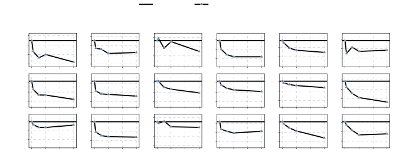

Figure 1: By round 30, rewriting lowers every agent’s SkillsBench pass
rate. Original and rewritten skills, with the same model used for
rewriting and evaluation.

A model may improve an expert skill by filling gaps and adapting its
instructions, or erode the knowledge that makes it useful. We
distinguish these outcomes by evaluating agents with skills that models
recursively rewrite without feedback.

### 2.1 Study Design

Feedback-free self-evolution. Each model rewrites a skill from its text
and a one-sentence topic, with an instruction to identify problems and
improve the skill. We provide no task, outcome or judgment. Each rewrite
replaces its predecessor for thirty recursive rounds to trace where
repeated rewriting leads. The same model then uses its rewritten skills
as an agent, giving rewriting an opportunity to adapt the skill to that
model.

Benchmarks. We choose benchmarks that pair their tasks with
expert-written skills, check the outcome of every task automatically,
and differ in how the model reaches the skill. SkillsBench \[22\]
contains 87 tasks across eight domains, from natural science and finance
to office work and software engineering. Each task runs in its own
container with fixed data and a deterministic verifier, and the agent
works through many steps, loading a skill when it judges the skill
relevant. Most tasks, 63 of the 87, come with several curated skills,
and choosing among them is a problem separate from what a skill
contains. We set this choice aside: for each of these tasks,
GPT-5.6-Sol \[26\] picks the most relevant skill from the task
instruction and the skills alone, before any run, and the agent receives
that skill, so that each task tests one expert skill. Only the skill
document is rewritten, and the scripts and reference files that come
with the skill stay unchanged. LogicBench \[29\] and
MedCalc-Bench \[19\] are two subsets of SRA-Bench \[38\], which pairs
its questions with manually constructed gold skills. LogicBench holds
760 logical reasoning questions with 19 skills, and MedCalc-Bench 1,100
questions that ask for a medical calculation from a patient note, with
55 skills. The model answers each question in a single call with its
gold skill in the prompt, so the skill takes part in one answer rather
than in a plan of many steps.

Models and harnesses. We choose models from several families and of
different strengths, so that the result does not hinge on one model,
GPT-5.6-Luna \[26\] and GPT-6.1-Sol \[27\], MiMo-V2.5-Pro \[46\], Claude
Haiku 5.5 \[3\], and Qwen3.7-Plus \[33\] together with
Qwen3.8-Flash \[32\]. With the original skills, their pass rates on
SkillsBench range from about a quarter to more than half of the tasks.
Each model runs as an agent in a harness that loads skills on demand, as
skills are used in practice, the GPT models in Codex, Claude Haiku 5.5
in Claude Code, and the other models in OpenHands \[41\].

Evaluation protocol. Every agent runs each SkillsBench task in its
container with the skill placed where the harness loads skills, and a
task passes when its verifier accepts the final state of the
environment. For every model, we evaluate the original skill and the
skills of rounds 1, 5, 10 and 30 on the same tasks. On LogicBench and
MedCalc-Bench, we also let every model answer without any skill, and
accuracy is the share of questions answered correctly.

### 2.2 Rewriting Lowers the Pass Rate

Following this setup, we evaluate all six models on the three benchmarks
using the original skills and skills from different rewriting rounds.

Every agent loses pass rate, most of all in the first rounds. Even the
first rewrite lowers the SkillsBench pass rate by 7.1 points on average
across agents (Fig. 1). The loss grows to 10.9 points after five rounds
and 14.6 after thirty. By round thirty, every agent performs worse than
with the original skill, by 10.3 to 23.0 points. Rewriting thus wears
the skill down from the first round, fastest in the early rounds and
more slowly afterwards.

After thirty rounds, the skill is worth about as much as having none. On
LogicBench and MedCalc-Bench, where the model reads the whole skill once
in its prompt, thirty rounds of rewriting leave almost none of the
original skill’s gain. On LogicBench, mean accuracy falls from 86.2%
with the original skill to 71.4%, matching the level without a skill. On
MedCalc-Bench, it falls from 89.7% to 78.7%, below the 81.1% achieved
without a skill. Accuracy falls for every model on both benchmarks, by
14.7 and 11.1 points on average.

The model’s own rewrite serves the model worse. Feedback-free rewriting
reduces the value of expert skills both during multi-step use and in a
single prompt. This decline persists when the same model rewrites and
uses the skill, showing that adaptation by its own judgment serves it
worse than the expert’s original.

## 3 Deep Analysis

We trace the decline at two levels: the direction of change over the
whole skill and the content that individual items lose.

### 3.1 Rewritten Skills Move Toward the Model’s Prior

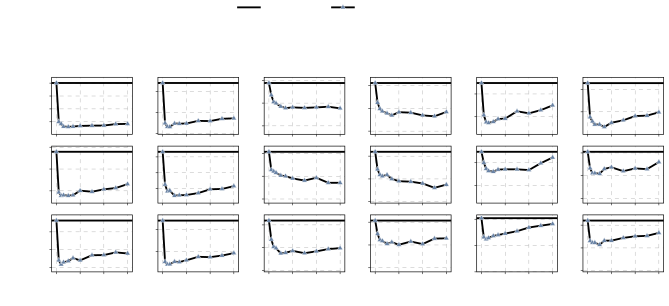

Figure 2: Distance to self-written skills falls early, then levels off.
Mean TF-IDF cosine distance to ten self-written skills, normalized by
their mean pairwise distance. At 1, a skill is as close to the
self-written skills as they are to one another.

Without feedback, a rewrite can draw only on the skill itself and on
what the model already holds about the skill’s topic, the model’s prior
for the skill. Declining performance shows that rewriting reduces a
skill’s value, but leaves the direction of textual change unclear. We
therefore compare rewritten skills with skills the same model writes
from the topic alone, testing whether rewriting moves toward the model’s
own content.

Sampling the prior. For each skill, we sample the model’s prior with ten
self-written skills. The model sees the same one-sentence topic and
length target as in rewriting, without the expert’s document. Matching
the topic and length lets these samples represent what the model
supplies on its own.

Measuring the distance. We use TF-IDF word vectors because they give
greater weight to distinctive terms, such as the expert’s commands,
paths and parameter names. A skill’s distance is its mean cosine
distance to the self-written skills, divided by their mean pairwise
distance. At 1, a skill is as close to the self-written skills as they
are to one another.

Rewriting pulls the skills toward the prior. We measure these distances
for the original skills and each model’s rewrites across all three
benchmarks, tracking their change over rewriting rounds. As shown in
Fig. 2, the original skills lie 1.2 to 1.7 units from the self-written
skills, and rewriting brings the skills of every model closer to them on
every benchmark. The movement is gradual but comes to an end. On average
over models and benchmarks, the distance falls from 1.37 by ever smaller
steps over the first rounds, reaches 1.19 by round five and changes
little afterwards, standing at 1.22 after thirty rounds. The rewriting
thus adapts the skill to the model, as the first outcome expects, but by
pulling the skill toward what the model would write on its own, until
the skill settles between the original and the self-written skills.

The distance alone does not predict the loss. After the fifth round the
distance changes little, yet the pass rate keeps falling, so the
distance over the whole text does not track what the later rounds still
remove. A skill can move far toward the prior while keeping the few
items that its questions depend on, or move little and lose one of them,
so the distance over the whole text cannot show which of the expert’s
content gives way.

### 3.2 Content Outside the Prior Is Lost First

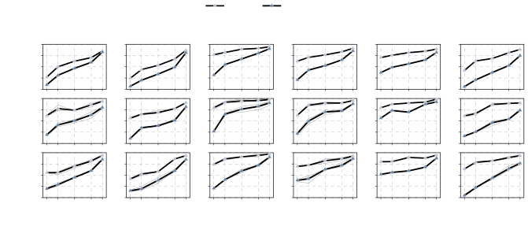

Figure 3: Across models and benchmarks, 10/10 items survive more often
than 0/10 items. Retention after rounds 1 and 30, grouped by how many of
ten self-written skills state each item. SkillsBench uses one rewriting
chain per skill. On LogicBench and MedCalc-Bench, results pool three
chains per skill for models with repeated chains; thin lines show
individual chains.

|                  | SkillsBench |       |            | LogicBench |       |            | MedCalc-Bench |       |            |
| ---------------- | ----------- | ----- | ---------- | ---------- | ----- | ---------- | ------------- | ----- | ---------- |
| Model            | 0/10        | 10/10 | $`\Delta`$ | 0/10       | 10/10 | $`\Delta`$ | 0/10          | 10/10 | $`\Delta`$ |
| GPT-5.6-Luna     | 10          | 83    | $`+73`$    | 19         | 80    | $`+61`$    | 20            | 85    | $`+65`$    |
| GPT-6.1-Sol      | 7           | 81    | $`+74`$    | 11         | 82    | $`+71`$    | 15            | 85    | $`+70`$    |
| MiMo-V2.5-Pro    | 32          | 90    | $`+58`$    | 27         | 90    | $`+63`$    | 21            | 90    | $`+69`$    |
| Qwen3.7-Plus     | 21          | 86    | $`+65`$    | 22         | 88    | $`+66`$    | 38            | 87    | $`+49`$    |
| Claude Haiku 5.5 | 37          | 82    | $`+45`$    | 56         | 92    | $`+36`$    | 52            | 88    | $`+36`$    |
| Qwen3.8-Flash    | 6           | 75    | $`+69`$    | 16         | 74    | $`+58`$    | 5             | 76    | $`+71`$    |
| Average          | 19          | 83    | $`+64`$    | 25         | 84    | $`+59`$    | 25            | 85    | $`+60`$    |

Table 1: After thirty rounds, 10/10 items survive more often than 0/10
items. Share of original skill items retained after thirty rounds, in
percent. The labels 0/10 and 10/10 mean that none or all ten
self-written skills state an item. $`\Delta`$ is the difference in
retention between the 10/10 and 0/10 groups, in percentage points. The
final row averages retention across models.

The distance over the whole text shows where the rewriting goes but not
what it gives up, since it levels off after a few rounds while the pass
rate keeps falling. What an agent gains from a skill, however, lies in
specific pieces of content, a step, a command, a rule or a fact. We
therefore move from the whole text to these pieces and ask two questions
that the distance cannot answer, which of the expert’s content survives
the rewriting, and whether what is lost is what the model would not have
written by itself.

Splitting a skill into items. We split each skill mechanically into
headings, list entries, code blocks, tables, paragraphs and front
matter. Every non-blank line belongs to exactly one item, covering the
whole skill without overlap. This gives 6,605 items for SkillsBench and
2,376 for LogicBench and MedCalc-Bench together.

Judging what a document says about an item. Whether an item survives
cannot be read from the strings, since a rewrite rephrases much of what
it keeps, and it may keep names and numbers while changing what it says
about them. An LLM judge, GPT-5.6-Luna for every model, therefore reads
all items of an original skill together with one other document and
labels every item in a single call. For each original item, we judge
whether self-written skills state the same content and whether rewrites
retain it in full. Both judgments compare meaning. Shared words alone do
not count as a match. A rewrite keeps an item when it preserves its full
meaning, and loses it when the content is absent, incomplete or changed.
The judge records content retention without evaluating whether an edit
is beneficial. We exclude items the judge cannot decide. The same judge
and the same instructions serve every model, so the comparison between
items does not depend on which model rewrote them.

Measuring how close an item lies to the prior. Each self-written skill
is one sample of the prior, so the number of the ten self-written skills
that state an item, from zero to ten, measures how readily the model
writes the item on its own. We label original items absent from all ten
self-written skills as outside the prior, identifying content the model
rarely writes on its own for the given topic. Items stated in all ten
represent content the model writes more consistently on its own. The two
questions now become testable. If rewriting merely corrected and
completed a skill, whether an item survives would not depend on this
count, whereas if rewriting pulls the skill toward the prior, the items
farthest from it should be lost first.

Survival grows with closeness to the prior. We group original skill
items by how many of the ten self-written skills state them and compare
retention after rounds one and thirty. As shown in Fig. 3, on every
benchmark every model keeps the items that all ten self-written skills
state far more often than the items that none states, and on SkillsBench
the share kept rises from each group to the next for every model. Thirty
rounds of rewriting create a sharp divide, losing most items outside the
prior while retaining most items stated in all ten self-written skills.
Averaged across the six models and three benchmarks, only 23.1% of the
former survive, compared with 84.2% of the latter, a mean retention gap
of 61.1 percentage points. The split appears from the first round on and
within list entries, paragraphs, code blocks and headings alike, so it
does not reflect which kinds of content a rewrite tends to shorten. To
check whether the result depends on the judge, we ask GPT-6.1-Sol to
repeat the item judgments on 20 SkillsBench tasks, using GPT-5.6-Luna’s
self-written and rewritten skills and the same instructions. Both judges
find much greater loss outside the prior than among the other items,
with gaps of 49.5 and 52.5 percentage points under the original and
second judge, respectively. The selective loss thus persists under a
different judge. The drift toward the prior is thus selective, as
rewriting keeps what the model could have supplied itself and gives up
first what only the expert supplied.

### 3.3 Restoring This Content Recovers the Pass Rate

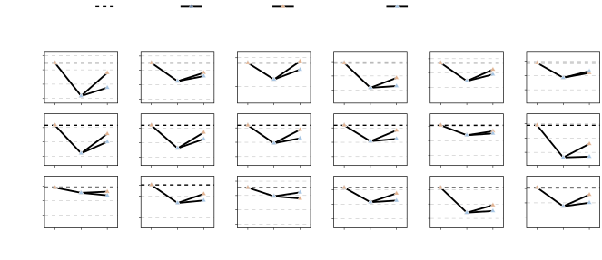

Figure 4: On average across agents and on every benchmark, restoring
0/10 items recovers more of the lost pass rate than restoring
$`\geq`$1/10 items. Pass rates with original, round-30 and restored
skills. Lost items stated by none or at least one of ten self-written
skills return to the common base built from round-30 skills.

|               |          |          | Round 30, lost items restored |      |      |
| ------------- | -------- | -------- | ----------------------------- | ---- | ---- |
| Benchmark     | Original | Round 30 | $`\geq`$1/10                  | 0/10 | All  |
| SkillsBench   | 40.2     | 25.7     | 30.1                          | 34.5 | 35.8 |
| LogicBench    | 86.2     | 71.4     | 75.0                          | 80.4 | 80.6 |
| MedCalc-Bench | 89.7     | 78.7     | 80.0                          | 83.1 | 84.4 |

Table 2: Restoring 0/10 items recovers more performance than restoring
$`\geq`$1/10 items on every benchmark. Mean pass rates across agents, in
percent, for original skills, round-30 skills and the three restored
versions. The 0/10 and $`\geq`$1/10 groups contain lost items stated by
none or at least one of ten self-written skills; All restores every lost
item.

The content outside the prior is the content that rewriting gives up
first. We now test whether losing it causes the decline. If it does,
restoring this content to the round-30 skills should recover more of the
pass rate than restoring the other lost content.

Putting the lost items back. To compare the effects of restoring
different groups of lost items on task performance, we start from each
skill after thirty rewrites. The rewritten skill often still carries a
weakened or changed version of a lost item, and restoring the original
next to it would leave two conflicting versions in the same skill. We
therefore remove the sentences that carry such versions, yielding a
common base for the restored versions of each skill. We restore lost
items at corresponding positions in this base, appending them to the end
when we cannot locate a position.

Three versions of each skill. We build three restored versions of each
skill, which share the base and differ only in which lost items return.
The first puts back only the items outside the prior, the content whose
effect we test. The second puts back only the other lost items, which
lie within the prior, through the same procedure, and serves as the
comparison, since if the content outside the prior matters more than the
other lost content, the first version should recover more than the
second. The third puts back all lost items and with them the most text,
which shows whether a recovery grows with how much text returns rather
than with what returns.

Restoring the content outside the prior recovers much of the loss. We
run agents with all three restored versions on all three benchmarks,
using the same tasks and evaluation protocol as for the original and
round-30 skills (Figs. 4 and 2). On SkillsBench, rewriting cost 14.6
points on average across agents. Restoring only the items outside the
prior recovers 8.8 points, twice the 4.4 points recovered by restoring
the other lost items. Even restoring all lost items recovers only 10.2
points, close to the recovery from restoring the items outside the prior
alone. On LogicBench and MedCalc-Bench, too, restoring the items outside
the prior recovers more than restoring the other items on average.
Losing the knowledge outside the model’s prior therefore causes much of
the decline.

Summary. Combining these analyses, we arrive at three observations.
First, rewriting moves every model’s skills toward its prior step by
step, until they settle near it. Second, the movement is selective, as
rewriting gives up first the content outside the prior and keeps the
content the model would write anyway. Third, putting this content back
recovers much of the lost pass rate, so losing it causes much of the
decline. The value of an expert’s skill thus lies largely in the
knowledge outside the model’s prior, which the model does not supply by
itself and which rewriting without feedback gives up first.

## 4 Improving Skills Without Rewriting

The value of an expert’s skill lies largely in the knowledge outside the
model’s prior. Without feedback, a rewrite cannot add this knowledge,
since the skill is its only source, and can at best keep it. The
original skill already holds it, so what remains is whether the agent
uses it. An agent may pass over these items when it follows a skill and
fall back on what it would do by itself, much as a rewrite falls back on
what the model would write. We therefore propose SkillDiff, a simple
method that improves a skill without feedback and without changing its
text, by finding the items outside the model’s prior and pointing the
agent to them.

### 4.1 Marking the Items Outside the Prior

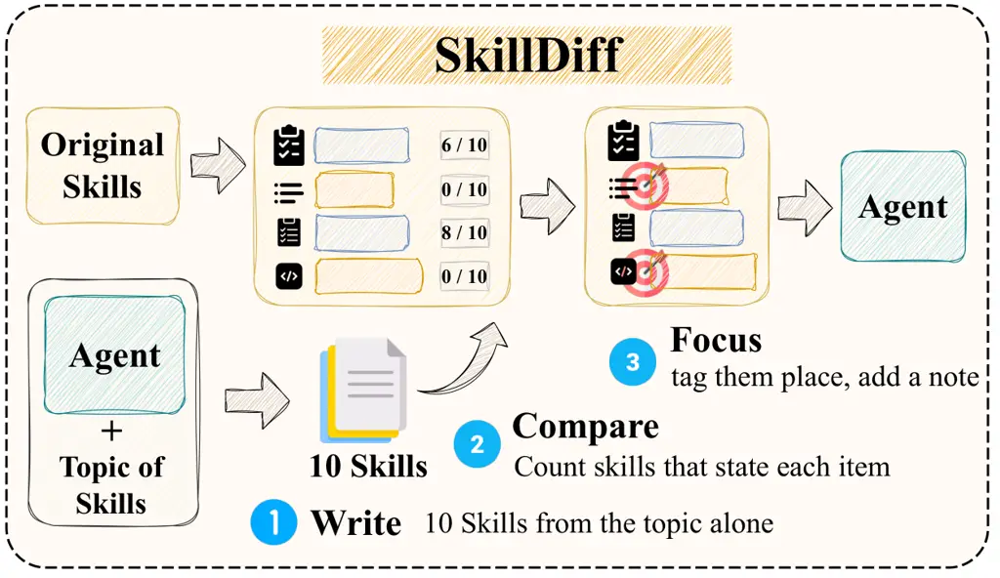

Figure 5: SkillDiff. Generate ten skills from the topic alone, compare
each original item against them, and mark in place the items that none
states. A note asks the agent to carry these items into its plan as
written.

Pointing the agent to these items raises three questions, which items to
point to, how to point to them without changing what the skill says, and
what to ask of the agent.

Which items. SkillDiff finds these items in the same way as the analysis
of the rewriting. The model writes ten self-written skills from the
topic of the skill, the original skill is split into items, and the
judge decides for every self-written skill whether it states each item.
SkillDiff then selects every list entry, paragraph, code block and table
that none of the ten states, the items outside the prior. Since the
self-written skills come from the topic alone and the judge reads only
text, the selection needs neither feedback nor a run of the agent.

How to point. SkillDiff marks each selected item in place with a bold
tag, \[FOCUS\], so that every item stays in the context its author gave
it, and adds a note below the title that explains the tag. Removing the
tags and the note gives back the original skill byte for byte.

What to ask. The note asks the agent to pay particular attention to the
marked items and to carry their specific procedures, tools, parameters,
conditions and exceptions into its plan as written, instead of
simplifying them to a generic approach. The request aims at the way an
agent may pass over these items when it acts, replacing the expert’s
specific procedure with the generic one it would choose by itself, as a
rewrite replaces it with what the model would write. SkillDiff thus
needs no feedback and keeps every word of the skill in place.

### 4.2 Marking Raises the Pass Rate

| Model            | $`\Delta`$ pass rate, pp |
| ---------------- | ------------------------ |
| GPT-5.6-Luna     | $`+12.6`$                |
| GPT-6.1-Sol      | $`+5.7`$                 |
| MiMo-V2.5-Pro    | $`+3.4`$                 |
| Qwen3.7-Plus     | $`+2.3`$                 |
| Claude Haiku 5.5 | $`+3.4`$                 |
| Qwen3.8-Flash    | $`+1.1`$                 |
| Average          | $`+4.8`$                 |

Table 3: Marking items outside the prior improves every agent on
SkillsBench. Pass-rate gain in percentage points over the original
skill, evaluated in the same batch.

Evaluation. We evaluate SkillDiff on SkillsBench with the same agents
and protocol as the rewritten skills. SkillDiff leaves the text of the
skill unchanged and only adds the tags and the note, so the comparison
that matters is with the original skill itself. The pass rate of the
same skill shifts between runs made at different times, so we compare
each marked skill with the original skill run in the same batch, which
keeps a drift between batches out of the difference.

Marking raises the pass rate of every agent. Keeping the original skill
text and adding only the tags and note raises the SkillsBench pass rate
by 4.8 points on average, with gains for all six agents. This result
shows that highlighting knowledge outside the model’s prior and asking
the agent to attend to it can improve task performance without rewriting
the skill.

## 5 Discussion

Our results make preserving knowledge outside the model’s prior a
practical concern for self-evolving agents. This content contributes to
task performance, yet rewriting tends to remove it and rarely restores
it once lost. SkillDiff shows that drawing the agent’s attention to this
existing knowledge can improve performance while preserving the original
text.

External feedback can supply new information and guide useful changes.
Success on evaluated tasks does not guarantee that a rewrite preserves
knowledge needed elsewhere. ACE also reports loss of detail under
feedback-guided rewriting and addresses it with incremental
updates \[54\]. These findings motivate protecting content outside the
model’s prior during skill updates and, when feedback is available,
directing edits to the problems it identifies.

## 6 Related Work

#### Agent skills.

Skills provide procedural knowledge through documents and scripts that
agents load on demand \[52\]. Agents also distill experience into code
libraries \[39, 43, 58\], workflows \[44\], insights \[57\] and
manuals \[7\]. SkillsBench and SkillLearnBench compare curated skills
with agent-written or continually learned skills \[22, 59\], while
SRA-Bench evaluates skills retrieved into model prompts \[38\]. Work on
project adaptation \[45\], software maintenance \[9\], model
adaptation \[50\] and compression \[47, 12\] motivates updating skills
after their creation. We study what repeated rewriting preserves or
removes from expert skills and how these changes affect task
performance.

#### Skill evolution.

Self-improving agents revise prompts, memories and code using task
scores or execution feedback \[48, 2, 36, 54, 53, 11\]. SkillFoundry,
SkillOpt, MetaSkill-Evolve and MASA keep skill rewrites when verifiers,
validation tasks or environment feedback support them \[35, 49, 42,
50\]. Methods that rely on verifiers require tasks with automatically
checkable outcomes \[5\]. Other methods reduce dependence on external
outcome supervision while still evaluating executions. SelfEvoSkill
compares paired runs with and without the skill \[10\]; Self-Supervised
Skill Optimization uses an LLM judge on unlabeled tasks \[30\]; SkillAxe
grades runs against rules drawn from the skill \[13\]. SkillAligner
adapts retrieved skills before execution without testing the
rewrite \[20\], and Hermes Agent edits skills without a test by
default \[25\]. SkillLearnBench revises model-generated skills from the
agent’s executions and reports accuracy first rising and then falling in
a four-round side experiment \[59\]. We isolate rewriting with no task
execution or evaluation to guide the updates. By tracking expert skills
over thirty rounds, we connect performance decline to the loss of
specific original content and test this connection through restoration.

#### Skill content.

Studies of skill content explain its value through the knowledge it
supplies, the procedures it encourages and the contribution of
individual items. Agent-written skills fail to reproduce the gains of
curated skills \[22\], and model-generated data-science skills perform
no better than the task prompt alone \[16\]. Other studies emphasize
procedural guidance \[17\], report comparable benefits from random and
curated rule files for coding agents \[55\], or link gains from
revisions to newly specified commands and paths \[40\]. Shapley
valuations estimate each skill unit’s contribution through
counterfactual agent runs \[21, 23\]. We examine a complementary
property: how readily the model writes each item from the topic alone.
This property applies to procedures and facts alike and identifies
content that rewriting preferentially loses and whose restoration
recovers performance.

Iterated learning predicts convergence to a learner’s prior under
posterior sampling \[14, 18\]. Language-model transmission chains drift
toward model biases \[1, 31, 34\], and recursive training on model
outputs loses rare content \[37\]. These findings motivate examining the
direction of content change. We measure that change in expert skills at
the item level and use task evaluations and restoration experiments to
determine its consequences for agent performance.

## 7 Conclusion

Across three benchmarks, our study of thirty rounds of feedback-free
rewriting finds that task performance declines on average from the first
round. The decline holds both when agents consult skills over multiple
steps and when models read them once in a prompt. On LogicBench and
MedCalc-Bench, thirty rewrites leave skills, on average, worth about as
much as having none. Rewriting moves skills toward what the model would
write on its own and preferentially removes content outside its prior.
On average, restoring this content recovers more performance than
restoring the other lost content, linking the selective loss to the
decline. Guided by this finding, SkillDiff marks the same content in the
original skill and improves pass rates on SkillsBench without rewriting.
These results identify knowledge the model rarely writes on its own as a
valuable part of expert skills and show the benefits of preserving it
and directing the agent’s attention to it.

## References

- \[1\] Alberto Acerbi and Joseph M. Stubbersfield. Large language
  models show human-like content biases in transmission chain
  experiments. _Proceedings of the National Academy of Sciences_,
  120(44):e2313790120, 2023.
- \[2\] Lakshya A Agrawal, Shangyin Tan, Dilara Soylu, Noah Ziems, Rishi
  Khare, Krista Opsahl-Ong, Arnav Singhvi, Herumb Shandilya, Michael J
  Ryan, Meng Jiang, Christopher Potts, Koushik Sen, Alex Dimakis, Ion
  Stoica, Dan Klein, Matei Zaharia, and Omar Khattab. GEPA: Reflective
  prompt evolution can outperform reinforcement learning. In
  _International Conference on Learning Representations_, 2026.
- \[3\] Anthropic. System card: Claude Haiku 5.5.
  [https://www.anthropic.com/claude-haiku-5-5-system-card](https://www.anthropic.com/claude-haiku-5-5-system-card), 2026.
  Published October 7, 2026.
- \[4\] Victor Barres, Honghua Dong, Soham Ray, Xujie Si, and Karthik R
  Narasimhan. $`\tau^{2}`$-bench: Evaluating conversational agents in a
  dual-control environment. In _International Conference on Machine
  Learning_, 2026.
- \[5\] Chenle Chen, Yangbo Wei, Chao Yao, Shaoqiang Lu, Junhong Qian,
  Chen Wu, and Lei He. Competence, not accuracy: A diagnostic for
  reference-free judge gates in skill optimization. arXiv preprint
  arXiv:2608.18719, 2026.
- \[6\] Mark Chen, Jerry Tworek, Heewoo Jun, Qiming Yuan, Henrique Ponde
  de Oliveira Pinto, Jared Kaplan, Harri Edwards, Yuri Burda, Nicholas
  Joseph, Greg Brockman, Alex Ray, Raul Puri, Gretchen Krueger, Michael
  Petrov, Heidy Khlaaf, Girish Sastry, Pamela Mishkin, Brooke Chan,
  Scott Gray, Nick Ryder, Mikhail Pavlov, Alethea Power, Lukasz Kaiser,
  Mohammad Bavarian, Clemens Winter, Philippe Tillet, Felipe Petroski
  Such, Dave Cummings, Matthias Plappert, Fotios Chantzis, Elizabeth
  Barnes, Ariel Herbert-Voss, William Hebgen Guss, Alex Nichol, Alex
  Paino, Nikolas Tezak, Jie Tang, Igor Babuschkin, Suchir Balaji,
  Shantanu Jain, William Saunders, Christopher Hesse, Andrew N. Carr,
  Jan Leike, Josh Achiam, Vedant Misra, Evan Morikawa, Alec Radford,
  Matthew Knight, Miles Brundage, Mira Murati, Katie Mayer, Peter
  Welinder, Bob McGrew, Dario Amodei, Sam McCandlish, Ilya Sutskever,
  and Wojciech Zaremba. Evaluating large language models trained on
  code. arXiv preprint arXiv:2107.03374, 2021.
- \[7\] Minghao Chen, Yihang Li, Yanting Yang, Shiyu Yu, Binbin Lin, and
  Xiaofei He. AutoManual: Constructing instruction manuals by LLM agents
  via interactive environmental learning. In _Advances in Neural
  Information Processing Systems_, 2024.
- \[8\] Giuseppe Destefanis, Daniel Graziotin, Matteo Vaccargiu, and
  Marco Ortu. GitSkills: A dataset of agent skills on GitHub. arXiv
  preprint arXiv:2608.10906, 2026.
- \[9\] Chenyuan Duan, Ge Shi, Zineng Mao, Ge Zhang, Hao Liang, Yinzhu
  Piao, Yuchen Wu, Zhixin Yao, Kaiyu Huang, Wenhao Huang, Linzhuang Sun,
  Shen Yan, and Wentao Zhang. Repo2Skill-Evo: Repository skills go stale
  in silence. arXiv preprint arXiv:2608.21964, 2026.
- \[10\] Haowen Gao, Haoran Chen, Can Wang, Shasha Guo, Liang Pang,
  Zhaoyang Liu, Huawei Shen, and Xueqi Cheng. SelfEvoSkill: Paired
  execution audits for skill revision without external outcome
  supervision. arXiv preprint arXiv:2606.14239, 2026a.
- \[11\] Huan-ang Gao, Jiayi Geng, Wenyue Hua, Mengkang Hu, Xinzhe Juan,
  Hongzhang Liu, Shilong Liu, Jiahao Qiu, Xuan Qi, Qihan Ren, Yiran Wu,
  Hongru Wang, Han Xiao, Yuhang Zhou, Shaokun Zhang, Jiayi Zhang, Jinyu
  Xiang, Yixiong Fang, Qiwen Zhao, Dongrui Liu, Cheng Qian, Zhenhailong
  Wang, Minda Hu, Huazheng Wang, Qingyun Wu, Heng Ji, and Mengdi Wang. A
  survey of self-evolving agents: What, when, how, and where to evolve
  on the path to artificial super intelligence. _Transactions on Machine
  Learning Research_, 2026b.
- \[12\] Yudong Gao, Zongjie Li, Yuanyuan Yuan, Zimo Ji, Pingchuan Ma,
  and Shuai Wang. SkillReducer: Optimizing LLM agent skills for token
  efficiency. arXiv preprint arXiv:2603.29919, 2026c.
- \[13\] Srishti Gautam, Arjun Radhakrishna, and Sumit Gulwani.
  SkillAxe: Sharpening LLM-authored agent skills through
  evaluation-guided self-refinement. arXiv preprint
  arXiv:2606.10546, 2026.
- \[14\] Thomas L. Griffiths and Michael L. Kalish. Language evolution
  by iterated learning with Bayesian agents. _Cognitive Science_,
  31(3):441–480, 2007.
- \[15\] Jie Huang, Xinyun Chen, Swaroop Mishra, Huaixiu Steven Zheng,
  Adams Wei Yu, Xinying Song, and Denny Zhou. Large language models
  cannot self-correct reasoning yet. In _International Conference on
  Learning Representations_, 2024.
- \[16\] Wei-Jung Huang. Do LLM-generated skills make better AI data
  scientists? A component ablation across data-science workflows. arXiv
  preprint arXiv:2607.07504, 2026.
- \[17\] Zhiyuan Jiang, Fangrui Huang, Hanwen Xing, Xander Wu, Yipeng
  Gao, Rui Cao, Mengdi Wang, Shilong Liu, and Yijiang Li. Demystifying
  agent skills: Why they work—until they don’t. arXiv preprint
  arXiv:2608.14036, 2026.
- \[18\] Michael L. Kalish, Thomas L. Griffiths, and Stephan
  Lewandowsky. Iterated learning: Intergenerational knowledge
  transmission reveals inductive biases. _Psychonomic Bulletin &
  Review_, 14(2):288–294, 2007.
- \[19\] Nikhil Khandekar, Qiao Jin, Guangzhi Xiong, Soren Dunn,
  Serina S Applebaum, Zain Anwar, Maame Sarfo-Gyamfi, Conrad W Safranek,
  Abid A Anwar, Andrew Zhang, Aidan Gilson, Maxwell B Singer, Amisha
  Dave, Andrew Taylor, Aidong Zhang, Qingyu Chen, and Zhiyong Lu.
  MedCalc-Bench: Evaluating large language models for medical
  calculations. In _Advances in Neural Information Processing
  Systems_, 2024.
- \[20\] Qinfeng Li, Dalin He, Yuntai Bao, Ying Yang, Ruoxi Chen, Xinyan
  Yu, Lizhou Liang, Ge Su, Wenqi Zhang, and Xuhong Zhang. SkillAligner:
  Treating retrieved skills as adaptable drafts at execution time. arXiv
  preprint arXiv:2608.06880, 2026a.
- \[21\] Tao Li, Junfeng Liu, Qinghua Zhao, Yifan Li, Lei Wang, Bo Shao,
  Xuejun Liu, and Linjun Shou. What is a skill worth? Structure-aware
  Shapley valuation of agent skills. arXiv preprint arXiv:2608.04562,
  2026b.
- \[22\] Xiangyi Li, Yimin Liu, Wenbo Chen, Bingran You, Zonglin Di,
  Yifeng He, Shenghan Zheng, Kyoung Whan Choe, Jiankai Sun, Shuyi Wang,
  Chujun Tao, Binxu Li, Xuandong Zhao, Hejia Geng, Xiaojun Wu, Junwei
  Zhou, Xiaokun Chen, Hanwen Xing, Yubo Li, Qunhong Zeng, Di Wang,
  Yuanli Wang, Roey Ben Chaim, Penghao Jiang, Haotian Shen, Luyang Kong,
  Xinyi Liu, Runhui Wang, Xuanqing Liu, Jiachen Li, Xin Lan, Yueqian
  Lin, Wengao Ye, Junwei He, Songlin Li, Yue Zhang, Yipeng Gao, Yijiang
  Li, Ze Ma, Liqiang Jing, Tianyu Wang, Kaixin Li, Yiqi Xue, Haoran Lyu,
  Yizhuo He, Yuchen Tian, Shutong Wu, Bowei Wang, Yixuan Gao, Bo Chen,
  Litong Liu, Sikai Cheng, Jiajun Bao, Shuaicheng Tong, Shuwen Xu,
  Terry Yue Zhuo, Tinghan Ye, Qi Qi, Miao Li, Longtai Liao, Zelin Tan,
  Chang Shi, Xilin Tang, Srinath Tankasala, Boqin Yuan, Yaoyao Qian,
  Jianhong Tu, Chenguang Wang, Yizhou Sun, Wei Wang, Aaron Taylor, Ziyue
  Yang, Changkun Guan, Zhikang Dong, Xinyu Zhang, Steven Dillmann, Han
  chung Lee, and Dawn Song. SkillsBench: Benchmarking how well agent
  skills work across diverse tasks. arXiv preprint arXiv:2602.12670,
  2026c.
- \[23\] Chang Liu, Yuqi Zhang, Yiman Zhong, Boyi Liu, Hengjun Wang, and
  Shuyue Wei. SkillShapley: Boundary-adaptive Shapley valuation for
  skill step attribution in LLM agents. arXiv preprint
  arXiv:2608.13173, 2026.
- \[24\] Aman Madaan, Niket Tandon, Prakhar Gupta, Skyler Hallinan, Luyu
  Gao, Sarah Wiegreffe, Uri Alon, Nouha Dziri, Shrimai Prabhumoye,
  Yiming Yang, Shashank Gupta, Bodhisattwa Prasad Majumder, Katherine
  Hermann, Sean Welleck, Amir Yazdanbakhsh, and Peter Clark.
  Self-Refine: Iterative refinement with self-feedback. In _Advances in
  Neural Information Processing Systems_, 2023.
- \[25\] Nous Research. Skills system. Hermes Agent documentation,
  [https://hermes-agent.nousresearch.com/docs/user-guide/features/skills](https://hermes-agent.nousresearch.com/docs/user-guide/features/skills), 2026.
  Accessed 2026-10-14.
- \[26\] OpenAI. GPT-5.6 system card. OpenAI Deployment Safety Hub,
  [https://deploymentsafety.openai.com/gpt-5-6](https://deploymentsafety.openai.com/gpt-5-6),
  2026a. Published July 9, 2026.
- \[27\] OpenAI. Addendum to GPT-6 Astra system card: GPT-6.1 Sol.
  OpenAI Deployment Safety Hub,
  [https://deploymentsafety.openai.com/gpt-6-1-sol](https://deploymentsafety.openai.com/gpt-6-1-sol),
  2026b. Published September 29, 2026.
- \[28\] Yipeng Ouyang, Yi Xiao, Yuhao Gu, and Xianwei Zhang. SkCC:
  Portable and secure skill compilation for cross-framework LLM agents.
  arXiv preprint arXiv:2605.03353, 2026.
- \[29\] Mihir Parmar, Nisarg Patel, Neeraj Varshney, Mutsumi Nakamura,
  Man Luo, Santosh Mashetty, Arindam Mitra, and Chitta Baral.
  LogicBench: Towards systematic evaluation of logical reasoning ability
  of large language models. In _Annual Meeting of the Association for
  Computational Linguistics_, 2024.
- \[30\] Siran Peng, Cuiyu Yang, Tianyu Fu, Tianshuo Zhang, Haoyuan
  Zhang, Weisong Zhao, Anyang Su, Minghui Wu, Huiying Li, Xiangyu Zhu,
  Chenxu Zhao, and Zhen Lei. Self-supervised skill optimization. arXiv
  preprint arXiv:2607.28777, 2026.
- \[31\] Jérémy Perez, Grgur Kovač, Corentin Léger, Cédric Colas, Gaia
  Molinaro, Maxime Derex, Pierre-Yves Oudeyer, and Clément Moulin-Frier.
  When LLMs play the telephone game: Cultural attractors as conceptual
  tools to evaluate LLMs in multi-turn settings. In _International
  Conference on Learning Representations_, 2025.
- \[32\] Qwen Team. Qwen3.8-Flash-Next: A new architecture, towards
  ultimate cost-efficiency.
  [https://qwen.ai/blog?id=qwen3.8-flash-next](https://qwen.ai/blog?id=qwen3.8-flash-next),
  2026a.
- \[33\] Qwen Team. Qwen3.7-Plus: Multimodal agent intelligence.
  [https://qwen.ai/blog?id=qwen3.7-plus](https://qwen.ai/blog?id=qwen3.7-plus),
  2026b.
- \[34\] Yi Ren, Shangmin Guo, Linlu Qiu, Bailin Wang, and Danica J.
  Sutherland. Bias amplification in language model evolution: An
  iterated learning perspective. In _Advances in Neural Information
  Processing Systems_, 2024.
- \[35\] Shuaike Shen, Wenduo Cheng, Mingqian Ma, Alistair Turcan,
  Martin Jinye Zhang, and Jian Ma. SkillFoundry: Building self-evolving
  agent skill libraries from heterogeneous scientific resources. In
  _Conference on Language Modeling_, 2026.
- \[36\] Noah Shinn, Federico Cassano, Ashwin Gopinath, Karthik
  Narasimhan, and Shunyu Yao. Reflexion: Language agents with verbal
  reinforcement learning. In _Advances in Neural Information Processing
  Systems_, 2023.
- \[37\] Ilia Shumailov, Zakhar Shumaylov, Yiren Zhao, Nicolas Papernot,
  Ross Anderson, and Yarin Gal. AI models collapse when trained on
  recursively generated data. _Nature_, 631:755–759, 2024.
- \[38\] Weihang Su, Jianming Long, Qingyao Ai, Qiaozhi He, Yichen Tang,
  Changyue Wang, Yiteng Tu, Yingbo Wang, and Yiqun Liu. Skill retrieval
  augmentation for agentic AI. arXiv preprint arXiv:2604.24594, 2026.
- \[39\] Guanzhi Wang, Yuqi Xie, Yunfan Jiang, Ajay Mandlekar, Chaowei
  Xiao, Yuke Zhu, Linxi Fan, and Anima Anandkumar. Voyager: An
  open-ended embodied agent with large language models. _Transactions on
  Machine Learning Research_, 2024.
- \[40\] Jiajie Wang, Yutong Zhao, Tianlin Li, Huashan Chen, Jinfu Chen,
  Kebin Peng, and Sen He. Agent skill evolution: How revisions affect
  coding agents. arXiv preprint arXiv:2610.04832, 2026a.
- \[41\] Xingyao Wang, Boxuan Li, Yufan Song, Frank F. Xu, Xiangru Tang,
  Mingchen Zhuge, Jiayi Pan, Yueqi Song, Bowen Li, Jaskirat Singh,
  Hoang H. Tran, Fuqiang Li, Ren Ma, Mingzhang Zheng, Bill Qian, Yanjun
  Shao, Niklas Muennighoff, Yizhe Zhang, Binyuan Hui, Junyang Lin,
  Robert Brennan, Hao Peng, Heng Ji, and Graham Neubig. OpenHands: An
  open platform for AI software developers as generalist agents. In
  _International Conference on Learning Representations_, 2025a.
- \[42\] Zefeng Wang, Minxi Yan, Jinhe Bi, Sikuan Yan, Volker Tresp, and
  Yunpu Ma. MetaSkill-Evolve: Recursive self-improvement of LLM agents
  via two-timescale meta-skill evolution. arXiv preprint
  arXiv:2607.05297, 2026b.
- \[43\] Zora Zhiruo Wang, Apurva Gandhi, Graham Neubig, and Daniel
  Fried. Inducing programmatic skills for agentic tasks. In _Conference
  on Language Modeling_, 2025b.
- \[44\] Zora Zhiruo Wang, Jiayuan Mao, Daniel Fried, and Graham Neubig.
  Agent workflow memory. In _International Conference on Machine
  Learning_, 2025c.
- \[45\] Xinjian Wu, Jingzhi Gong, Gunel Jahangirova, Zhenpeng Chen, and
  Jie M. Zhang. An empirical study of downstream adaptation for agent
  skills. arXiv preprint arXiv:2607.03238, 2026.
- \[46\] Xiaomi MiMo Team. MiMo-V2.5-Pro.
  [https://huggingface.co/collections/XiaomiMiMo/mimo-v25](https://huggingface.co/collections/XiaomiMiMo/mimo-v25), 2026.
- \[47\] Qinghua Xing, Yinda Chen, Yaping Jin, Zhenhe Wu, Bohan Lin,
  Hang Zhou, Xinghao Chen, Hanting Chen, and Zhiwei Xiong. What should a
  skill remember? quality–cost trade-offs in cost-aware skill rewriting
  for language model agents. arXiv preprint arXiv:2606.09421, 2026.
- \[48\] Chengrun Yang, Xuezhi Wang, Yifeng Lu, Hanxiao Liu, Quoc V Le,
  Denny Zhou, and Xinyun Chen. Large language models as optimizers. In
  _International Conference on Learning Representations_, 2024.
- \[49\] Yifan Yang, Ziyang Gong, Weiquan Huang, Qihao Yang, Ziwei Zhou,
  Zisu Huang, Yan Li, Xuemei Gao, Qi Dai, Bei Liu, Kai Qiu, Yuqing Yang,
  Dongdong Chen, Xue Yang, and Chong Luo. SkillOpt: Executive strategy
  for self-evolving agent skills. In _Advances in Neural Information
  Processing Systems_, 2026.
- \[50\] Jianxiang Yu, Jiapeng Zhu, Bochen Lin, Qier Cui, Zichen Ding,
  and Xiang Li. Skill is not one-size-fits-all: Model-aware skill
  alignment for LLM agents. arXiv preprint arXiv:2605.30723, 2026.
- \[51\] Yang Yue, Zhiqi Chen, Rui Lu, Andrew Zhao, Zhaokai Wang, Yang
  Yue, Shiji Song, and Gao Huang. Does reinforcement learning really
  incentivize reasoning capacity in LLMs beyond the base model? In
  _Advances in Neural Information Processing Systems_, 2025.
- \[52\] Barry Zhang, Keith Lazuka, and Mahesh Murag. Equipping agents
  for the real world with Agent Skills.
  [https://www.anthropic.com/research/equipping-agents-for-the-real-world-with-agent-skills](https://www.anthropic.com/research/equipping-agents-for-the-real-world-with-agent-skills),
  2025a. Published October 16, 2025.
- \[53\] Jenny Zhang, Shengran Hu, Cong Lu, Robert Tjarko Lange, and
  Jeff Clune. Darwin Gödel machine: Open-ended evolution of
  self-improving agents. In _International Conference on Learning
  Representations_, 2026a.
- \[54\] Qizheng Zhang, Changran Hu, Shubhangi Upasani, Boyuan Ma,
  Fenglu Hong, Vamsidhar Kamanuru, Jay Rainton, Chen Wu, Mengmeng Ji,
  Hanchen Li, Urmish Thakker, James Zou, and Kunle Olukotun. Agentic
  context engineering: Evolving contexts for self-improving language
  models. In _International Conference on Learning Representations_,
  2026b.
- \[55\] Xing Zhang, Guanghui Wang, Yanwei Cui, Wei Qiu, Ziyuan Li, Bing
  Zhu, and Peiyang He. Guardrails beat guidance: A large-scale study of
  rules, skills, and persistent configuration for coding agents. arXiv
  preprint arXiv:2604.11088, 2026c.
- \[56\] Yanzhao Zhang, Mingxin Li, Dingkun Long, Xin Zhang, Huan Lin,
  Baosong Yang, Pengjun Xie, An Yang, Dayiheng Liu, Junyang Lin, Fei
  Huang, and Jingren Zhou. Qwen3 Embedding: Advancing text embedding and
  reranking through foundation models. arXiv preprint arXiv:2506.05176,
  2025b.
- \[57\] Andrew Zhao, Daniel Huang, Quentin Xu, Matthieu Lin, Yong-Jin
  Liu, and Gao Huang. ExpeL: LLM agents are experiential learners. In
  _AAAI Conference on Artificial Intelligence_, pages 19632–19642, 2024.
- \[58\] Boyuan Zheng, Michael Y. Fatemi, Xiaolong Jin, Zora Zhiruo
  Wang, Apurva Gandhi, Yueqi Song, Yu Gu, Jayanth Srinivasa, Gaowen Liu,
  Graham Neubig, and Yu Su. SkillWeaver: Web agents can self-improve by
  discovering and honing skills. arXiv preprint arXiv:2504.07079, 2025.
- \[59\] Shanshan Zhong, Yi Lu, Jingjie Ning, Yibing Wan, Lihan Feng,
  Yuyi Ao, Leonardo F. R. Ribeiro, Markus Dreyer, Sean Ammirati, and
  Chenyan Xiong. SkillLearnBench: Benchmarking continual learning
  methods for agent skill generation on real-world tasks. arXiv preprint
  arXiv:2604.20087, 2026.

Supplementary Material  
Appendix Contents

## Appendix A Detailed Results

This section reports the analysis of the items model by model, checks
the judge behind it, and examines the measure of the distance to the
prior.

### A.1 Performance and Distance Endpoints

Tables 4 and 5 report the model-level endpoints of the performance and
distance trajectories in Figs. 1 and 2.

|                  | SkillsBench |           | LogicBench |           | MedCalc-Bench |           |
| ---------------- | ----------- | --------- | ---------- | --------- | ------------- | --------- |
| Model            | R1          | R30       | R1         | R30       | R1            | R30       |
| GPT-5.6-Luna     | $`-11.5`$   | $`-23.0`$ | $`-8.7`$   | $`-19.5`$ | $`-3.1`$      | $`-3.6`$  |
| GPT-6.1-Sol      | $`-8.0`$    | $`-12.6`$ | $`-10.4`$  | $`-16.0`$ | $`-10.9`$     | $`-16.5`$ |
| MiMo-V2.5-Pro    | $`+2.3`$    | $`-11.5`$ | $`-0.1`$   | $`-12.5`$ | $`-1.7`$      | $`-6.0`$  |
| Qwen3.7-Plus     | $`-9.2`$    | $`-17.2`$ | $`-4.0`$   | $`-11.1`$ | $`-8.1`$      | $`-10.1`$ |
| Claude Haiku 5.5 | $`-2.3`$    | $`-12.6`$ | $`-1.9`$   | $`-6.9`$  | $`-2.3`$      | $`-17.4`$ |
| Qwen3.8-Flash    | $`-13.8`$   | $`-10.3`$ | $`-6.3`$   | $`-22.4`$ | $`-3.4`$      | $`-13.0`$ |
| Average          | $`-7.1`$    | $`-14.6`$ | $`-5.2`$   | $`-14.7`$ | $`-4.9`$      | $`-11.1`$ |

Table 4: By round 30, every agent loses pass rate on every benchmark.
Change in pass rate or accuracy from the original skill after rounds 1
and 30. R1 and R30 denote these rounds; pp denotes percentage points.

|                  |             |      |            |            |      |            |               |      |            |
| ---------------- | ----------- | ---- | ---------- | ---------- | ---- | ---------- | ------------- | ---- | ---------- |
|                  | SkillsBench |      |            | LogicBench |      |            | MedCalc-Bench |      |            |
| Model            | Orig.       | R30  | $`\Delta`$ | Orig.      | R30  | $`\Delta`$ | Orig.         | R30  | $`\Delta`$ |
| GPT-5.6-Luna     | 1.50        | 1.18 | $`-0.32`$  | 1.38       | 1.23 | $`-0.15`$  | 1.36          | 1.18 | $`-0.18`$  |
| GPT-6.1-Sol      | 1.68        | 1.34 | $`-0.34`$  | 1.43       | 1.22 | $`-0.21`$  | 1.68          | 1.39 | $`-0.29`$  |
| MiMo-V2.5-Pro    | 1.29        | 1.18 | $`-0.11`$  | 1.21       | 1.07 | $`-0.14`$  | 1.22          | 1.10 | $`-0.12`$  |
| Qwen3.7-Plus     | 1.41        | 1.28 | $`-0.13`$  | 1.32       | 1.18 | $`-0.14`$  | 1.31          | 1.23 | $`-0.08`$  |
| Claude Haiku 5.5 | 1.45        | 1.35 | $`-0.10`$  | 1.25       | 1.22 | $`-0.03`$  | 1.41          | 1.36 | $`-0.05`$  |
| Qwen3.8-Flash    | 1.33        | 1.20 | $`-0.13`$  | 1.21       | 1.16 | $`-0.05`$  | 1.22          | 1.17 | $`-0.05`$  |
| Average          | 1.44        | 1.26 | $`-0.18`$  | 1.30       | 1.18 | $`-0.12`$  | 1.37          | 1.24 | $`-0.13`$  |

Table 5: On every benchmark, rewriting brings every model’s skills
closer to its self-written skills. Distance of the original skill and of
the round-30 skill to the model’s ten self-written skills over TF-IDF
word vectors, in units of the mean distance between two self-written
skills. Orig. and R30 denote the two skill versions; $`\Delta`$ denotes
the change in distance between them.

### A.2 Loss of Items by Model, Benchmark and Kind

Table 6 gives, for every model on every benchmark, the share of items
lost after rounds 1 and 30, separately for the items outside the prior
and for the other items. Every model loses the items outside the prior
more often on every benchmark, by 24 points on average over models and
benchmarks already after the first rewrite and by 41 points after thirty
rounds, when 77% of the items outside the prior are lost against 35% of
the other items. Table 7 breaks the loss on SkillsBench down by the kind
of item, leaving out tables and front matter, of which a skill holds too
few to compare. Within list entries, paragraphs, code blocks and
headings alike, every model loses the items outside the prior more
often, by 36 points on average over the models and kinds, so the
selective loss does not come from the kinds of content that a rewrite
tends to shorten.

|                  |             |              |            |            |              |            |               |              |            |
| ---------------- | ----------- | ------------ | ---------- | ---------- | ------------ | ---------- | ------------- | ------------ | ---------- |
|                  | SkillsBench |              |            | LogicBench |              |            | MedCalc-Bench |              |            |
| Model            | 0/10        | $`\geq`$1/10 | $`\Delta`$ | 0/10       | $`\geq`$1/10 | $`\Delta`$ | 0/10          | $`\geq`$1/10 | $`\Delta`$ |
| After round 1    |             |              |            |            |              |            |               |              |            |
| GPT-5.6-Luna     | 73.1        | 31.6         | $`+41.5`$  | 39.4       | 15.6         | $`+23.8`$  | 45.5          | 21.8         | $`+23.7`$  |
| GPT-6.1-Sol      | 75.4        | 33.3         | $`+42.1`$  | 40.9       | 16.6         | $`+24.3`$  | 57.5          | 18.9         | $`+38.6`$  |
| MiMo-V2.5-Pro    | 23.1        | 11.9         | $`+11.2`$  | 25.7       | 4.3          | $`+21.4`$  | 26.0          | 8.7          | $`+17.3`$  |
| Qwen3.7-Plus     | 37.5        | 20.1         | $`+17.4`$  | 38.3       | 8.7          | $`+29.6`$  | 30.6          | 13.2         | $`+17.4`$  |
| Claude Haiku 5.5 | 29.6        | 16.5         | $`+13.1`$  | 20.4       | 5.8          | $`+14.6`$  | 20.1          | 9.7          | $`+10.4`$  |
| Qwen3.8-Flash    | 58.2        | 24.8         | $`+33.4`$  | 35.5       | 14.9         | $`+20.6`$  | 36.3          | 12.1         | $`+24.2`$  |
| Average          | 49.5        | 23.0         | $`+26.4`$  | 33.4       | 11.0         | $`+22.4`$  | 36.0          | 14.1         | $`+21.9`$  |
| After round 30   |             |              |            |            |              |            |               |              |            |
| GPT-5.6-Luna     | 90.0        | 42.6         | $`+47.4`$  | 82.4       | 40.2         | $`+42.2`$  | 80.8          | 38.7         | $`+42.1`$  |
| GPT-6.1-Sol      | 93.4        | 48.2         | $`+45.2`$  | 88.6       | 37.1         | $`+51.5`$  | 82.2          | 34.0         | $`+48.2`$  |
| MiMo-V2.5-Pro    | 68.5        | 29.1         | $`+39.4`$  | 75.1       | 23.8         | $`+51.3`$  | 78.0          | 32.4         | $`+45.6`$  |
| Qwen3.7-Plus     | 79.1        | 39.3         | $`+39.8`$  | 81.9       | 29.2         | $`+52.7`$  | 58.9          | 25.1         | $`+33.8`$  |
| Claude Haiku 5.5 | 62.9        | 34.3         | $`+28.6`$  | 43.6       | 14.4         | $`+29.2`$  | 48.2          | 24.1         | $`+24.1`$  |
| Qwen3.8-Flash    | 94.1        | 54.0         | $`+40.1`$  | 82.8       | 44.5         | $`+38.3`$  | 93.5          | 47.7         | $`+45.8`$  |
| Average          | 81.3        | 41.2         | $`+40.1`$  | 75.7       | 31.5         | $`+44.2`$  | 73.6          | 33.7         | $`+39.9`$  |

Table 6: After one round and after thirty, every model loses the items
outside the prior more often than the other items, on every benchmark.
Share of items lost, in percent, for the 0/10 items outside the prior,
which none of the model’s ten self-written skills states, and for the
$`\geq`$1/10 items that some self-written skill states; $`\Delta`$ is
the difference between them in pp.

|                  |              |              |            |            |              |            |             |              |            |          |              |            |
| ---------------- | ------------ | ------------ | ---------- | ---------- | ------------ | ---------- | ----------- | ------------ | ---------- | -------- | ------------ | ---------- |
|                  | List entries |              |            | Paragraphs |              |            | Code blocks |              |            | Headings |              |            |
| Model            | 0/10         | $`\geq`$1/10 | $`\Delta`$ | 0/10       | $`\geq`$1/10 | $`\Delta`$ | 0/10        | $`\geq`$1/10 | $`\Delta`$ | 0/10     | $`\geq`$1/10 | $`\Delta`$ |
| GPT-5.6-Luna     | 90.3         | 42.6         | $`+47.7`$  | 89.0       | 41.7         | $`+47.3`$  | 92.4        | 59.5         | $`+32.9`$  | 85.5     | 40.3         | $`+45.2`$  |
| GPT-6.1-Sol      | 94.5         | 47.2         | $`+47.3`$  | 93.3       | 49.6         | $`+43.7`$  | 90.4        | 57.4         | $`+33.0`$  | 92.4     | 47.2         | $`+45.2`$  |
| MiMo-V2.5-Pro    | 68.5         | 33.5         | $`+35.0`$  | 68.5       | 26.9         | $`+41.6`$  | 73.2        | 30.2         | $`+43.0`$  | 50.6     | 23.3         | $`+27.3`$  |
| Qwen3.7-Plus     | 80.8         | 45.2         | $`+35.6`$  | 79.5       | 41.3         | $`+38.2`$  | 81.5        | 52.8         | $`+28.7`$  | 55.0     | 30.0         | $`+25.0`$  |
| Claude Haiku 5.5 | 59.3         | 34.2         | $`+25.1`$  | 65.1       | 36.5         | $`+28.6`$  | 73.5        | 51.7         | $`+21.8`$  | 49.0     | 29.2         | $`+19.8`$  |
| Qwen3.8-Flash    | 93.9         | 54.1         | $`+39.8`$  | 92.3       | 55.0         | $`+37.3`$  | 96.6        | 66.7         | $`+29.9`$  | 92.1     | 50.9         | $`+41.2`$  |
| Average          | 81.2         | 42.8         | $`+38.4`$  | 81.3       | 41.8         | $`+39.4`$  | 84.6        | 53.1         | $`+31.6`$  | 70.8     | 36.8         | $`+33.9`$  |

Table 7: Within list entries, paragraphs, code blocks and headings
alike, every model loses the items outside the prior more often. Share
of the items of each kind lost after thirty rounds on SkillsBench, in
percent, for the 0/10 items that none of the model’s ten self-written
skills states and for the other items in the $`\geq`$1/10 group;
$`\Delta`$ is the difference between them in pp.

### A.3 Reliability of the Judge

The analysis of the items rests on the labels of one LLM judge, so we
check whether these labels, and the gap between the items outside the
prior and the other items, depend on the judge or on the run. We draw 20
SkillsBench tasks with a fixed seed, which hold 1,800 items, and judge
them again in three ways with the prompts and settings of the main text.
GPT-6.1-Sol, as a second judge, labels the items against the ten
self-written skills of GPT-5.6-Luna and against its rewritten skills of
rounds 1, 5, 10 and 30, Claude Haiku 5.5, from another family of models,
labels them as a third judge, and GPT-5.6-Luna labels them a second
time. Each judgment forms the two classes of items, outside the prior or
not, from its own labels on the self-written skills.

|                                     | Second judge | Main judge, rerun | Third judge      |
| ----------------------------------- | ------------ | ----------------- | ---------------- |
|                                     | GPT-6.1-Sol  | GPT-5.6-Luna      | Claude Haiku 5.5 |
| Agreement on self-written skills, % | 89.7         | 92.7              | 87.2             |
| Cohen’s $`\kappa`$                  | 0.78         | 0.84              | 0.72             |
| Agreement on 0/10 class, %          | 88.9         | 94.8              | 86.0             |
| Agreement on rewritten skills, %    | 87.2         | 89.8              | 82.4             |
| Cohen’s $`\kappa`$                  | 0.74         | 0.79              | 0.64             |

Table 8: Two further judges and a second run agree with the judgments of
the main text. Share of the labels on which each agrees with the main
judgments, in percent, and Cohen’s $`\kappa`$, on 20 SkillsBench tasks
with 1,800 items. An item is in the 0/10 class when none of the ten
self-written skills states it.

|                |              |              |                   |                  |
| -------------- | ------------ | ------------ | ----------------- | ---------------- |
|                | Main judge   | Second judge | Main judge, rerun | Third judge      |
|                | GPT-5.6-Luna | GPT-6.1-Sol  | GPT-5.6-Luna      | Claude Haiku 5.5 |
| 0/10           | 89.2         | 93.3         | 89.9              | 93.4             |
| $`\geq`$1/10   | 39.8         | 40.9         | 38.4              | 52.6             |
| $`\Delta`$, pp | $`+49.5`$    | $`+52.5`$    | $`+51.4`$         | $`+40.7`$        |

Table 9: Every judgment finds a large gap. Share of items lost after
thirty rounds, in percent, for the 0/10 items outside the prior and for
the other items in the $`\geq`$1/10 group, on the same 20 SkillsBench
tasks under each judgment; $`\Delta`$ is the difference in pp.

#### The labels agree.

The second judge gives the same label as the main judgments on 89.7% of
the labels on the self-written skills and on 87.2% of the kept or lost
labels on the rewritten skills, with Cohen’s $`\kappa`$ of 0.78 and
0.74, and it places 88.9% of the items in the same class (Tab. 8). The
second run of GPT-5.6-Luna agrees even more closely, on 92.7% and 89.8%
of the labels and on 94.8% of the classes. The third judge agrees on
87.2% and 82.4% of the labels, with $`\kappa`$ of 0.72 and 0.64, and
places 86.0% of the items in the same class.

#### The gap does not depend on the judge.

After thirty rounds, the items outside the prior are lost 49.5 points
more often than the other items under the main judgments on these tasks,
52.5 points more often under the second judge, 51.4 points more often
under the second run and 40.7 points more often under the third judge,
which labels more of the other items lost as well (Tab. 9).

#### The judge finds no loss where there is none.

Two controls have known answers. When the round-30 skill is replaced by
the original word for word, every item should be kept, and neither
GPT-5.6-Luna nor GPT-6.1-Sol labels any item lost. When the round-1
skill is replaced by the original skill of another task, every item
should be lost, and the two label only 1.3% and 1.5% of the items kept.
The selective loss in the main text is thus not an artifact of the judge
or of a single run.

### A.4 Forty Self-Written Skills

Whether an item lies outside the prior is decided by ten self-written
skills, and an item that the model writes only now and then could be
missing from all ten by chance. For GPT-5.6-Luna on SkillsBench, the
model therefore writes thirty further self-written skills for every
skill with the prompt and settings of the first ten, and the judge
labels every item against them, which gives three further samples of
ten.

| Samples of ten         | Agreement on 0/10 class, % | Cohen’s $`\kappa`$ |
| ---------------------- | -------------------------- | ------------------ |
| Original vs. further 1 | 88.1                       | 0.76               |
| Original vs. further 2 | 88.2                       | 0.76               |
| Original vs. further 3 | 87.7                       | 0.75               |
| Further 1 vs. 2        | 92.0                       | 0.84               |
| Further 1 vs. 3        | 91.7                       | 0.83               |
| Further 2 vs. 3        | 91.4                       | 0.83               |

Table 10: Every sample of ten self-written skills finds nearly the same
items outside the prior. Share of the 6,605 SkillsBench items that two
samples of ten self-written skills of GPT-5.6-Luna place in the same
class, outside the prior or not, and Cohen’s $`\kappa`$. The original
sample is the one of the main text.

|                              |       |                                 |
| ---------------------------- | ----- | ------------------------------- |
| Class under the original ten | Items | Stated by the further thirty, % |
| 0/10                         | 2,757 | 1.1                             |
| 1–9/10                       | 2,584 | 39.6                            |
| 10/10                        | 1,264 | 95.1                            |

Table 11: Items outside the prior are almost never written by further
self-written skills. SkillsBench items of GPT-5.6-Luna by how many of
the original ten self-written skills state them, and the mean share of
the thirty further self-written skills that state an item.

#### Every sample of ten finds nearly the same items.

Each sample of ten forms its own class of items outside the prior. The
original sample places 88% of the items in the same class as each
further sample on average, with Cohen’s $`\kappa`$ of 0.76, and the
further samples agree with one another on 92% of the items, with
$`\kappa`$ of 0.83 (Tab. 10).

#### Items outside the prior are almost never written.

The thirty further self-written skills play no part in forming the class
of the original ten, so they show how often the model writes each item
on its own. Even in these thirty further samples, an item in the
original 0/10 group appears in only 1.1% of the documents on average,
while an item in the original 10/10 group appears in 95.1% (Tab. 11).
The sharp separation thus persists in new samples that played no part in
the classification.

### A.5 How Items Are Lost and Whether They Return

We use the SkillsBench item judgments to classify the losses at round
thirty and check whether items lost in the first rewrite appear again in
the round-thirty skills. Among the items lost after thirty rounds on
SkillsBench, those outside the prior are on average dropped outright
more often than the other lost items, 53% against 40%, and weakened less
often, 29% against 42%, while a similar share of both is changed to
different content (Tab. 12). A lost item also rarely returns when it
lies outside the prior. Of the items that a model loses in its first
rewrite, only 6% of those outside the prior are kept again after thirty
rounds on average, against 30% of the other items (Tab. 13). A rewrite
thus tends to remove the content outside the prior entirely, and the
model does not write it back, whereas lost content within the prior can
return in a later round.

|                  | Dropped outright |              | Weakened |              |
| ---------------- | ---------------- | ------------ | -------- | ------------ |
| Model            | 0/10             | $`\geq`$1/10 | 0/10     | $`\geq`$1/10 |
| GPT-5.6-Luna     | 55               | 37           | 28       | 48           |
| GPT-6.1-Sol      | 60               | 39           | 24       | 43           |
| MiMo-V2.5-Pro    | 47               | 40           | 32       | 42           |
| Qwen3.7-Plus     | 52               | 43           | 27       | 39           |
| Claude Haiku 5.5 | 40               | 41           | 38       | 42           |
| Qwen3.8-Flash    | 63               | 43           | 24       | 39           |
| Average          | 53               | 40           | 29       | 42           |

Table 12: On average, lost items outside the prior are dropped outright
more often, and weakened less often, than the other lost items. Of the
items lost after thirty rounds on SkillsBench, the share dropped
outright and the share weakened, in percent of the lost items, for the
0/10 items outside the prior and for the other items in the $`\geq`$1/10
group. The remaining lost items are changed to different content.

| Model            | 0/10 | $`\geq`$1/10 |
| ---------------- | ---- | ------------ |
| GPT-5.6-Luna     | 3    | 26           |
| GPT-6.1-Sol      | 2    | 21           |
| MiMo-V2.5-Pro    | 10   | 42           |
| Qwen3.7-Plus     | 6    | 29           |
| Claude Haiku 5.5 | 12   | 38           |
| Qwen3.8-Flash    | 2    | 26           |
| Average          | 6    | 30           |

Table 13: Lost items outside the prior rarely return. Of the SkillsBench
items lost in the first rewrite, the share kept again after thirty
rounds, in percent, for the 0/10 items outside the prior and for the
other items in the $`\geq`$1/10 group.

### A.6 Overlap of the Items Outside the Prior across Models

Whether the content outside the prior is particular to one model or
shared by many bears on what the rewriting gives up. For every pair of
models, we take the SkillsBench items outside the prior of one model and
count how many of them lie outside the prior of the other model as well.
If the two sets were unrelated, this share would equal the share of all
items that lie outside the prior of the other model. The observed share
is far higher, 82% on average against 48% expected (Tab. 14), no single
pair of models falls below 70%, and 1,866 of the 6,605 items lie outside
the prior of every model. The knowledge outside the prior is thus
largely knowledge that the models in general do not write on their own
rather than a gap of one model, and every model that rewrites a skill
tends to give up the same part of it.

|                  | 0/10  | Also 0/10 for another model, % |          |
| ---------------- | ----- | ------------------------------ | -------- |
| Model            | items | Observed                       | Expected |
| GPT-5.6-Luna     | 2,757 | 87                             | 49       |
| GPT-6.1-Sol      | 3,019 | 84                             | 48       |
| MiMo-V2.5-Pro    | 3,419 | 78                             | 47       |
| Qwen3.7-Plus     | 3,410 | 78                             | 47       |
| Claude Haiku 5.5 | 2,924 | 84                             | 48       |
| Qwen3.8-Flash    | 3,333 | 80                             | 47       |
| Average          | –     | 82                             | 48       |

Table 14: The items outside the prior are largely the same for every
model. For the SkillsBench items outside the prior of each model, the
share that also lies outside the prior of another model, averaged over
the other models, against the share expected if the two sets were
unrelated, which is the share of all items that lie outside the other
model’s prior.

### A.7 The Distance Measure

The distance to the prior in the main text uses one measure, TF-IDF word
vectors on a scale set by the self-written skills. We check two things,
that this scale means what it is meant to mean, and that other measures
show the same movement of the rewritten skills.

|                     | Held-out           | Distance |         |          | Pairs closer than the original |          |
| ------------------- | ------------------ | -------- | ------- | -------- | ------------------------------ | -------- |
| Measure             | self-written skill | Original | Round 5 | Round 30 | Round 5                        | Round 30 |
| TF-IDF in main text | 1.00               | 1.37     | 1.19    | 1.22     | 18/18                          | 18/18    |
| Embedding           | 1.01               | 2.24     | 1.78    | 1.93     | 17/18                          | 15/18    |
| Word frequency      | 1.00               | 2.42     | 1.62    | 1.77     | 18/18                          | 16/18    |

Table 15: Every measure places a held-out self-written skill at 1 and
moves the rewritten skills toward the self-written skills in the first
rounds. Distance to the model’s ten self-written skills, in units of the
mean distance between two self-written skills, averaged over the 18
pairs of model and benchmark, and the number of pairs in which the
rewritten skill lies closer than the original. The held-out self-written
skill is measured against the other nine on the same scale.

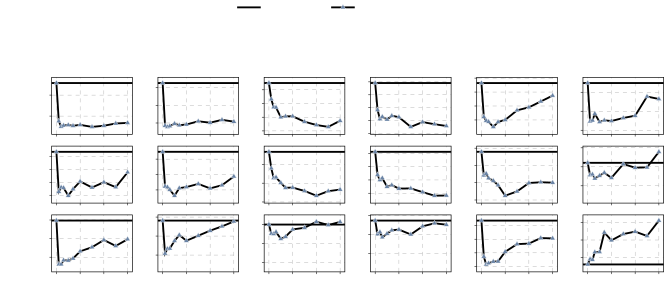

Figure 6: Over Qwen3-Embedding vectors, too, rewriting moves the skills
of almost every model and benchmark toward the self-written skills in
the first rounds. Distance of the skills to the model’s ten self-written
skills over Qwen3-Embedding vectors, in units of the mean distance
between two self-written skills, on which a further self-written skill
lies at 1.

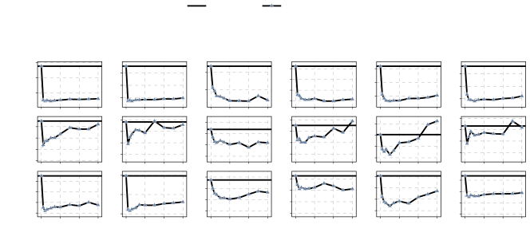

Figure 7: Over raw word frequencies, too, rewriting moves the skills
toward the self-written skills in the first rounds. Distance of the
skills to the model’s ten self-written skills over word-frequency
vectors without TF-IDF weights, in units of the mean distance between
two self-written skills, on which a further self-written skill lies at

1.

#### The scale is calibrated.

On the scale of the main text, a skill at 1 lies as close to the
self-written skills as they lie to one another. To test this, we hold
out each self-written skill in turn and measure it against the other
nine on the same scale. It lies at 1.00 under TF-IDF for every model and
benchmark, and at 1.01 on average under the two other measures below
(Tab. 15), so a further sample of the prior indeed lies at 1. The
original skills lie above 1 under every measure, so each measure
separates the expert’s text from what the model writes.

#### Other measures show the same movement.

We repeat the measurement with two other representations of a document,
Qwen3-Embedding vectors \[56\], which represent the meaning of a
document rather than its exact wording, and raw word frequencies without
the TF-IDF weights. Under both, rewriting moves the skills toward the
self-written skills over the first rounds, after which the distance
levels off (Tab. 15), and Figs. 6 and 7 show this for every model and
benchmark in the layout of Fig. 2. On average over the 18 pairs of model
and benchmark, the distance falls from 2.24 to 1.78 by round five under
embeddings and from 2.42 to 1.62 under word frequencies, and it changes
little afterwards. By round five, the rewritten skill lies closer than
the original in every pair under word frequencies and in all pairs but
one under embeddings. We keep TF-IDF in the main text because the
contribution of an expert often lies in specific commands, paths and
parameter names, which TF-IDF weighs heavily, whereas embeddings weigh
the topic and style that every skill on a topic shares, and raw
frequencies are carried by common words.

## Appendix B Additional Experiments

### B.1 $`\tau^{2}`$-bench

Beyond the three benchmarks of the main text, we verify the findings
with GPT-5.6-Luna and GPT-6.1-Sol on $`\tau^{2}`$-bench \[4\], where
what guides the agent is not a skill but a written policy. The benchmark
gives a conversational agent the rules of an airline or a retail
service, and we apply the procedure of the main text to these two
policies. Each model rewrites each policy for thirty rounds, writes ten
policies of its own from the domain’s topic, and runs as the agent on
the 164 tasks of the two domains. We also build the three restored
versions of each policy following the procedure in the main text and
evaluate their pass rates on the same 164 tasks. Figure 8 repeats the
four analyses of the main text for both models.

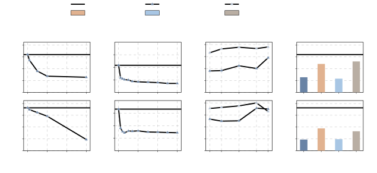

Figure 8: On $`\tau^{2}`$-bench, the analyses of the main text give the
same picture for both models. (a) Pass rate over the 164 tasks of the
airline and retail domains with the original policy and after each round
of rewriting. (b) TF-IDF distance of the policy to the model’s ten
self-written policies, in units of the mean distance between two
self-written policies. (c) Share of the items of the original policies
kept after rounds 1 and 30, by the number of self-written policies that
state the item. (d) Pass rate of the round-30 policy and of the round-30
policy with the lost 0/10 items outside the prior, the other lost items
in the $`\geq`$1/10 group or all lost items restored.

#### Rewriting lowers the pass rate.

Rewriting also causes large performance losses with the service policies
of $`\tau^{2}`$-bench. After thirty rounds, the pass rate falls from
64.0% to 25.6% for GPT-5.6-Luna and from 72.6% to 18.9% for GPT-6.1-Sol
(Fig. 8a).

#### The policies move toward the self-written policies.

The distance to the self-written policies falls from 1.63 to 1.34 for
GPT-5.6-Luna and from 1.86 to 1.49 for GPT-6.1-Sol, most of it over the
first rounds (Fig. 8b).

#### The items outside the prior are lost more often.

After thirty rounds, GPT-5.6-Luna keeps 45% of the items outside the
prior against 73% of the items that all self-written policies state, and
GPT-6.1-Sol keeps 66% against 87% (Fig. 8c).

#### Putting these items back recovers more of the pass rate.

Putting the lost items outside the prior back into the round-30 policy
lifts the pass rate to 48.2% for GPT-5.6-Luna and 37.8% for GPT-6.1-Sol,
whereas putting back the other lost items leaves it at 23.2% and 19.5%
(Fig. 8d).

### B.2 Rewriting Without Web Search

Codex can search the web while a model rewrites a skill or writes one
from the topic, so content found online may enter both the rewritten and
the self-written skills. To see whether this changes the results, we
repeat the MedCalc-Bench study for GPT-5.6-Luna with web search turned
off while it rewrites the skills and writes its self-written skills, and
keep everything else, the 55 skills, thirty rounds, ten self-written
skills per skill, the prompts, the length and the reasoning effort. Both
versions are evaluated on the 1,100 questions by GPT-5.6-Luna in Codex
at minimal reasoning with web search off, share the runs without a skill
and with the original skill, and are compared in the four analyses of
the main text (Fig. 9).

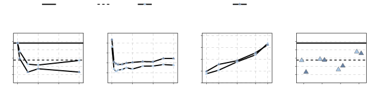

Figure 9: Without web search, rewriting lowers the accuracy of
GPT-5.6-Luna on MedCalc-Bench more, and the other analyses keep their
shape. (a) Accuracy on the 1,100 questions after each round. (b) TF-IDF
distance to the ten self-written skills of the same version, written
with or without web search. (c) Share of the items kept after thirty
rounds, by the number of self-written skills that state the item. (d)
Accuracy of the round-30 skill and of the round-30 skill with the lost
0/10 items outside the prior, the other lost items in the $`\geq`$1/10
group or all lost items restored. Both versions share the runs without a
skill and with the original skill.

#### Both versions show the findings of the main text.

After thirty rounds, the skill rewritten without web search lies 7.0
points below the original skill and the skill rewritten with web search
4.3 points (Fig. 9a). Both move toward their self-written skills, mostly
in the first round, to 1.25 and 1.18 units after thirty rounds
(Fig. 9b). Both keep far fewer of the items outside the prior than of
the items that all self-written skills state, 24% against 80% without
web search and 19% against 83% with it (Fig. 9c). In both, putting back
the lost items outside the prior recovers more than putting back the
other lost items, +2.8 against +1.5 points without web search and +0.4
against $`-`$2.2 points with it (Fig. 9d).

#### Without web search, the loss is larger.

Without web search, what the model writes on its own lies further from
what the author wrote, as the original skills lie 1.44 rather than 1.36
units from the self-written skills under TF-IDF and 2.19 rather than
1.59 under embeddings. The rewritten skill then lies lower at every
round, by 1.8 points on average, and putting back its lost items outside
the prior recovers more. Web search thus returns part of the content
that the rewriting drops but does not stop the selective loss, and
without it the rewriting relies more on the model’s own idea of a skill
and costs more. The main text keeps the version with web search, the
setting with the smaller loss.

### B.3 Repeated Runs of the Agent

Every condition of the main text runs once per task, so a pass rate also
carries the chance of a single run. To see how the loss behaves when the
agent has more attempts, GPT-5.6-Luna runs every SkillsBench task at
least sixteen times with the original skill and sixteen times with the
round-30 skill. From these runs we estimate pass@$`k`$, the chance that
at least one of $`k`$ runs passes a task, with the unbiased estimator of
Chen et al. \[6\] for $`k`$ from 1 to 16. At large $`k`$, pass@$`k`$
shows which tasks an agent solves at least once within $`k`$
runs \[51\].

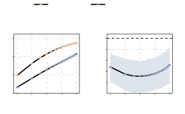

Figure 10: With up to sixteen attempts per task, the round-30 skill
stays below the original skill. (a) pass@$`k`$ of GPT-5.6-Luna on
SkillsBench, the chance that at least one of $`k`$ runs passes a task.
(b) Round-30 skill minus original skill, with its 95% interval over
tasks.

#### The round-30 skill lies below the original skill at every $`k`$.

Even with sixteen attempts per task, the round-30 skill remains well
below the original: pass@16 reaches 75.3% with the original skill but
only 63.2% with the rewritten skill (Fig. 10). 14 tasks pass at least
once with the original skill but never in sixteen runs with the
rewritten skill; only 2 tasks show the reverse. The round-30 skill stays
below the original at every $`k`$ from 1 to 16, and the 95% interval of
the difference lies below zero at every $`k`$. Rewriting thus reduces
both the chance of success in a single run and the set of tasks the
agent solves within sixteen runs.

### B.4 Repeated Evaluations

The same agent with the same skill can pass a task in one run and fail
it in the next, so a single evaluation leaves room for chance. To check
that the decline and the recovery under restoring do not come from this
chance, we use the repeated runs of GPT-5.6-Luna and GPT-6.1-Sol on
SkillsBench. With the original and the round-30 skill, GPT-5.6-Luna runs
every task at least sixteen times and GPT-6.1-Sol at least four times,
and with the skills of rounds 1, 5 and 10 and the three restored
versions, every task runs at least twice.

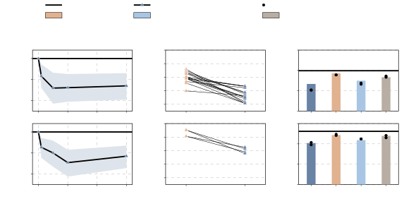

Figure 11: Over repeated runs, the rewritten skill stays below the
original skill, and putting back the items outside the prior recovers
the most. (a) Change in pass rate on SkillsBench from the original
skill, with every run of a task averaged, and its 95% interval over
tasks. (b) Full evaluations of the benchmark, each taking the $`j`$-th
run of every task; a line joins the original and the round-30 skill of
the same evaluation. (c) Pass rate of the round-30 skill and of the
round-30 skill with the lost 0/10 items outside the prior, the other
lost items in the $`\geq`$1/10 group or all lost items restored. Bars
show averages over runs; dots show each full evaluation.

#### Every full evaluation shows the decline.

The round-30 skill falls below the original in 16 of 16 full evaluations
for GPT-5.6-Luna and 4 of 4 for GPT-6.1-Sol, with mean losses of 13.2
and 12.6 points, respectively (Fig. 11b). Each full evaluation takes the
$`j`$-th run of every task. For GPT-5.6-Luna, mean pass rates with the
original and round-30 skills are 39.9% and 26.7%, with standard
deviations of 3.9 and 4.6 points. For GPT-6.1-Sol, the mean pass rates
are 52.9% and 40.2%.

#### Averaged over runs, the decline follows the main text.

With every run of a task averaged, the pass rate of GPT-5.6-Luna lies
8.4 points below the original skill after one round and 13.0 after
thirty, and that of GPT-6.1-Sol 7.3 and 11.5 points, and the 95%
interval of the change lies below zero after every round (Fig. 11a).

#### Putting back the items outside the prior recovers the most.

Averaged over runs, putting the lost items outside the prior back into
the round-30 skill raises the pass rate by 10.4 points for GPT-5.6-Luna
and 7.9 points for GPT-6.1-Sol. Putting back the other lost items raises
it by 3.2 and 2.9 points (Fig. 11c). In each of the four full
evaluations of the restored versions, the items outside the prior
recover more than the other items, by 6.3 points on average. The decline
and the recovery are thus not accidents of single runs.

### B.5 Repeated Rewriting Chains

Rewriting samples from the model, so the path of one rewriting chain may
differ from that of another. On LogicBench and MedCalc-Bench,
GPT-5.6-Luna, GPT-6.1-Sol, MiMo-V2.5-Pro, Qwen3.7-Plus and Qwen3.8-Flash
therefore rewrite every skill in two further independent chains of
thirty rounds, and on $`\tau^{2}`$-bench every policy in ten chains in
all. The further chains share the self-written skills of the first chain
and are measured and judged as in the main text.

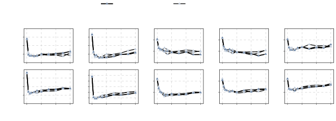

Figure 12: Three independent rewriting chains move the skills toward the
self-written skills along nearly the same path. TF-IDF distance of the
skills to the model’s ten self-written skills after each round, in units
of the mean distance between two self-written skills, for the rewriting
chain of the main text and two further chains of every skill.

|                                           |                        |        |                |
| ----------------------------------------- | ---------------------- | ------ | -------------- |
|                                           | Kept after round 30, % |        |                |
| Model                                     | 0/10                   | 10/10  | $`\Delta`$, pp |
| LogicBench, three chains per skill        |                        |        |                |
| GPT-5.6-Luna                              | 18–21                  | 77–83  | 59–62          |
| GPT-6.1-Sol                               | 11–11                  | 80–83  | 69–72          |
| MiMo-V2.5-Pro                             | 25–28                  | 85–93  | 60–65          |
| Qwen3.7-Plus                              | 18–26                  | 88–90  | 62–72          |
| Qwen3.8-Flash                             | 15–17                  | 73–77  | 56–59          |
| MedCalc-Bench, three chains per skill     |                        |        |                |
| GPT-5.6-Luna                              | 19–22                  | 83–87  | 64–67          |
| GPT-6.1-Sol                               | 14–18                  | 84–86  | 66–72          |
| MiMo-V2.5-Pro                             | 19–22                  | 88–92  | 69–70          |
| Qwen3.7-Plus                              | 36–41                  | 83–89  | 44–53          |
| Qwen3.8-Flash                             | 4–6                    | 73–78  | 66–75          |
| $`\tau^{2}`$-bench, ten chains per policy |                        |        |                |
| GPT-5.6-Luna                              | 9–51                   | 72–90  | 28–74          |
| GPT-6.1-Sol                               | 58–67                  | 77–97  | 15–37          |
| MiMo-V2.5-Pro                             | 54–69                  | 97–100 | 31–46          |
| Qwen3.7-Plus                              | 49–67                  | 91–100 | 32–42          |
| Qwen3.8-Flash                             | 3–47                   | 69–100 | 47–90          |

Table 16: Every rewriting chain keeps the items that all self-written
skills state far more often than the items outside the prior. Range over
the independent rewriting chains of each model of the share of items
kept after thirty rounds, for the 0/10 items outside the prior and for
the 10/10 items that all ten self-written skills or policies state, and
of their difference $`\Delta`$ in pp.

#### The distance follows nearly the same path in every chain.

In every chain, the skills move toward the self-written skills over the
first rounds and then level off (Fig. 12), and after thirty rounds the
distances of the three chains of a model differ by only 0.02 units on
average.

#### Every chain loses the items outside the prior first.

On LogicBench and MedCalc-Bench, the share of the items outside the
prior that a model keeps differs by 3 points on average between its
chains, and in every chain the items that all self-written skills state
are kept more often, by 64 points on average (Tab. 16). On
$`\tau^{2}`$-bench, with two policies and few items per group, single
chains vary more, yet in each of the 50 chains the items outside the
prior are kept less often, by 45 points on average. The movement toward
the prior and the selective loss thus do not hinge on a single rewriting
chain.

### B.6 Deleting Content from the Original Skill

Restoring puts content back into a rewritten skill; the converse test
takes content out of the original skill. If the items outside the prior
carry more of the value of a skill, deleting them should lower the pass
rate more than deleting as much of the other content. From each original
SkillsBench skill, we therefore delete about a quarter of the body in
two ways, either only items outside the prior or only items that some
self-written skill states, with the same number of words in both
versions of a skill. Where one kind of item makes up less than a quarter
of the body, both versions delete as many words as that kind holds, so
that on average the two versions delete 23.4% and 23.1% of the body for
GPT-5.6-Luna and 22.5% and 22.2% for GPT-6.1-Sol. Each model separates
the two kinds of item with its own self-written skills. The deletion
removes whole items and rewrites no text, keeping the front matter,
removing a heading only when everything under it goes, and moving nested
list entries up. GPT-5.6-Luna and GPT-6.1-Sol run both versions once per
task, in the same batch as the original skill and under the protocol of
the main text.

|                            |             |              |             |
| -------------------------- | ----------- | ------------ | ----------- |
| $`\Delta`$ pass rate, pp   | Both models | GPT-5.6-Luna | GPT-6.1-Sol |
| Against the original skill |             |              |             |
| 0/10 items deleted         | $`-4.6`$    | $`-5.7`$     | $`-3.4`$    |
| $`\geq`$1/10 items deleted | $`+0.6`$    | $`+2.3`$     | $`-1.1`$    |
| Between the two deletions  |             |              |             |
| 0/10 $`-`$ $`\geq`$1/10    | $`-5.2`$    | $`-8.0`$     | $`-2.3`$    |

Table 17: Deleting the items outside the prior lowers the pass rate more
than deleting as many words of the other items. Change in pass rate on
SkillsBench when the same number of words is deleted from the original
skill, only from the 0/10 items outside the prior or only from the other
items in the $`\geq`$1/10 group. Each version is run in the same batch
as the original skill.

#### Deleting the items outside the prior costs more.

With similar amounts of text removed, the two deletions lead to
different changes in performance. On average over both models, deleting
items outside the prior lowers the pass rate by 4.6 points, while
deleting the other items changes it by +0.6 points, a mean difference of
5.2 points (Tab. 17). Both models point the same way, as the deletion
outside the prior costs GPT-5.6-Luna 8.0 points and GPT-6.1-Sol 2.3
points more than the other deletion. Taking content out of the original
skill thus mirrors putting it back into the rewritten skill: similar
amounts of text matter more when the content lies outside the prior.

### B.7 Rewritten Skills Run by the Other Model

Whether the loss depends on who rewrites a skill and who runs it can be
tested by swapping the two. We give the round-30 skills of GPT-5.6-Luna
and of GPT-6.1-Sol to both models as agents on SkillsBench, once per
task, in the batch of the deletion experiment and against the original
skill of the same batch.

|              |          |                             |             |                      |
| ------------ | -------- | --------------------------- | ----------- | -------------------- |
|              |          | Round-30 skill rewritten by |             | $`\Delta`$ own $`-`$ |
| Agent        | Original | GPT-5.6-Luna                | GPT-6.1-Sol | other’s, pp          |
| GPT-5.6-Luna | 36.8     | 31.0                        | 27.6        | $`+3.4`$             |
| GPT-6.1-Sol  | 44.8     | 42.5                        | 37.9        | $`-4.6`$             |

Table 18: Both agents do worse with either round-30 skill, and about as
badly with their own rewrite as with the other one. Pass rate on
SkillsBench, in percent, with the original skill and with the round-30
skills rewritten by each model, all run in the same batch, and the
difference between the own and the other rewrite, in pp. Shaded cells:
an agent running its own rewrite.

#### Both agents lose performance with either rewrite.

Whether an agent uses its own rewrite or the other model’s, all four
combinations fall below the original skill of the same batch, by 6.0
points on average (Tab. 18). Swapping the executor between these two
models does not eliminate the loss. This agrees with the overlap of the
items outside the prior across models (Sec. A.6), since what the
rewriting of one model gives up is largely what the other model does not
write on its own either.

## Appendix C Implementation Details

### C.1 Evaluation Protocol

#### Tasks and harnesses.

Every run takes place in the task’s container under benchflow, with the
skill placed in the directory from which the harness loads skills.
GPT-5.6-Luna runs in Codex through the codex-acp adapter 1.6.2 and
GPT-6.1-Sol through codex-acp 2.1.1. MiMo-V2.5-Pro, Qwen3.7-Plus and
Qwen3.8-Flash run in OpenHands, and Claude Haiku 5.5 runs in Claude Code
through claude-agent-acp 0.40.0 at its default effort. On LogicBench and
MedCalc-Bench, every model answers at its lowest reasoning setting,
minimal for the GPT models, without thinking for MiMo-V2.5-Pro and the
Qwen models, and at low effort for Claude Haiku 5.5.

#### Rewriting and judging.

GPT-5.6-Luna and GPT-6.1-Sol rewrite the skills through Codex at high
reasoning effort with its default tools, which include web search.
MiMo-V2.5-Pro, Qwen3.7-Plus and Qwen3.8-Flash rewrite in a single API
call without a system prompt or tools at their default thinking setting,
and Claude Haiku 5.5 rewrites through Claude Code with every tool turned
off and an empty system prompt. Every model writes its self-written
skills under the same settings as its rewrites, and GPT-5.6-Luna judges
the items and locates the passages for restoring through Codex.

#### Pass rates.

The pass rate of a condition is the share of the 87 tasks that its runs
pass, and a difference between two conditions compares them on the same
tasks.

### C.2 Items and Judging

#### Items.

Every non-blank line of an original skill belongs to exactly one item,
and the front matter forms one more item. A heading is one heading line,
a list entry is a line with a list marker together with the lines that
continue it, a table is a run of table lines, a code block is a fenced
block with its fences, and a paragraph is a run of non-blank lines that
starts no other kind of item. The 87 skills contain 6,605 items with
83,950 words, namely 3,085 list entries, 1,389 headings, 1,292
paragraphs, 684 code blocks, 87 front matter items and 68 tables.

#### Judging.

GPT-5.6-Luna judges all items of a skill in a single call against one
candidate document, which is either a self-written skill or a rewritten
version. Against a self-written skill, an item counts as stated only
when the document conveys the same content, and the same nouns, file
names or numbers without the same content do not count. Against a
rewritten skill, an item counts as kept when it is present verbatim or
reworded with the same content, including code that does the same thing,
and as lost when it is weakened to a partial, optional or hedged form,
dropped, or changed to different content on the same point. The judge is
told that a change may be harmless or even an improvement, so that the
labels describe what happened to an item without presuming damage. An
item counts as stated by a self-written skill when the label is SAME. It
counts as kept by a rewrite when the label is KEPT or REWORDED and as
lost when it is WEAKENED, DROPPED or CHANGED, and items labeled UNCLEAR
are left out.

### C.3 Restoration Construction

#### Common base.

For every item lost by round 30, GPT-5.6-Luna locates the passage of the
round-30 skill that carries its weakened or changed version, and this
passage is removed, or within a long passage only the sentences that
carry lost items. The result is the common base of the three restored
versions.

#### Putting items back.

Each restored version puts the original text of its lost items back into
the common base in their original order, where the removed passage stood
or after the line the locator names, and at the end where no place is
found. Checks confirm that every item of the condition returns, that no
item of the other kind does, and that the base is identical across the
three versions.

### C.4 Cost of SkillDiff

SkillDiff spends its cost once per skill and model, before any run of
the agent. One call writes the topic, the model writes ten self-written
skills from it, and the judge compares the items of the original skill
with each of them, so a skill takes one topic call, ten generation calls
and ten judge calls. On SkillsBench with GPT-5.6-Luna, a self-written
skill holds 1,031 words on average against 965 words of the original
skill, so the model writes about ten times the length of the skill, and
each judge call reads the skill and one self-written skill. Marking
itself is a text operation that adds the note and 31 tags on average,
129 words in all, and the agent then runs as it does with the original
skill.

## Appendix D Future Directions

One direction follows directly from these results. A rewrite that leaves
the items outside the prior untouched and changes only the rest could
keep what feedback-free self-evolution now loses, since restoring these
items recovers much of the lost pass rate, and rewrites that preserve
the operational anchors of a skill already keep its quality under
compression \[47\]. The self-written skills locate these items without
any run of the agent, so such a guard needs no feedback. How much
feedback a self-evolution loop needs to protect this knowledge on its
own remains an open question.

## Appendix E Limitations

#### Granularity of skill updates.

We rewrite only the skill document and leave the accompanying scripts
and reference files unchanged. Each SkillsBench task uses one
preselected skill. We have not studied the retrieval or composition of
multiple skills, or the joint evolution of skill documents and code.
