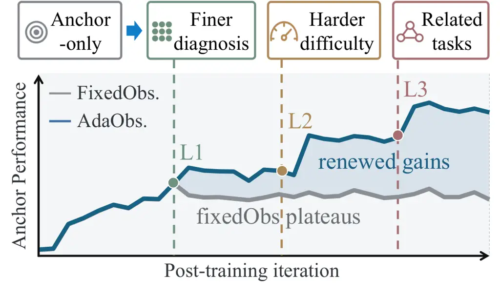
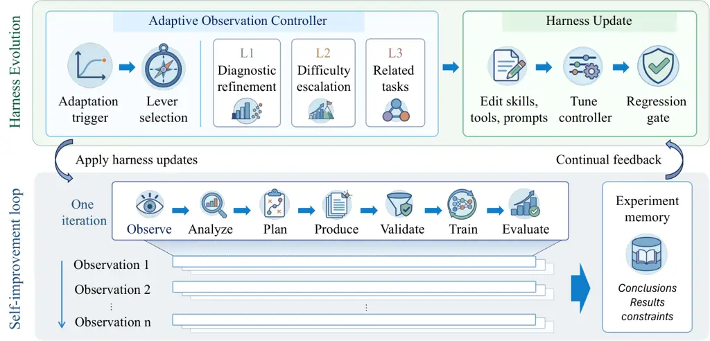
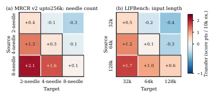

# Sage-Evolve-Preview: Adaptive Observation for Post-Training Self-Improvement

Yinhao Tang^(\*) Affiliation: University of Science and Technology of
China Affiliation: Shanghai AI
Laboratory{tangyinhao,fangyq}@mail.ustc.edu.cn, {sunyanan}@pjlab.org.cn
   Youqing Fang^(\*) Affiliation: University of Science and Technology
of China Affiliation: Shanghai AI
Laboratory{tangyinhao,fangyq}@mail.ustc.edu.cn, {sunyanan}@pjlab.org.cn
   Yanan Sun Affiliation: Shanghai AI
Laboratory{tangyinhao,fangyq}@mail.ustc.edu.cn, {sunyanan}@pjlab.org.cn
   Xintian Shen Affiliation: Shanghai AI
Laboratory{tangyinhao,fangyq}@mail.ustc.edu.cn, {sunyanan}@pjlab.org.cn
   Hanyu Sun Affiliation: Shanghai AI
Laboratory{tangyinhao,fangyq}@mail.ustc.edu.cn, {sunyanan}@pjlab.org.cn
   Wenran Liu Affiliation: Shanghai AI
Laboratory{tangyinhao,fangyq}@mail.ustc.edu.cn, {sunyanan}@pjlab.org.cn
   Yue Wu Affiliation: Shanghai AI
Laboratory{tangyinhao,fangyq}@mail.ustc.edu.cn, {sunyanan}@pjlab.org.cn
   Weiming Zhang Affiliation: University of Science and Technology of
China    Bin Liu Affiliation: University of Science and Technology of
China    Wenwei Zhang Affiliation: Shanghai AI
Laboratory{tangyinhao,fangyq}@mail.ustc.edu.cn, {sunyanan}@pjlab.org.cn

###### Abstract

Post-training recursive self-improvement (RSI) iteratively improves a
target capability, operationalized by a fixed anchor benchmark, through
repeated intervention, training, and evaluation. Yet most loops use the
anchor’s aggregate score as their sole observation, so early gains give
way to stalled progress and repetitive exploration. When this
anchor-only feedback ceases to reveal actionable gaps, a plateau may
reflect an exhausted observation rather than an exhausted capability. We
introduce _adaptive observation_ (AdaObs), an observation-side mechanism
of harness evolution that keeps the anchor objective fixed while
adapting the active observation. At a plateau, a controller refines
diagnostic granularity, escalates difficulty, and adds related tasks;
validated increments are fused back into training, while every
checkpoint remains evaluated against the anchor. Across eight
independently optimized anchors in long-context reading comprehension
and instruction following, AdaObs raises the mean score from $`66.4`$ to
$`73.7`$ under a matched data budget, outperforming FixedObs, the
anchor-only baseline. The evolved harness further improves the
seven-task average on the independent PostTrainBench across two agent
backends. These results identify observation adaptation as a missing
mechanism of harness evolution for sustaining post-training RSI.

^(†)^(†)footnotetext: \* Equal contribution.  $`{\dagger}`$
Corresponding author.



Figure 1: Adaptive observation sustains recursive self-improvement.
FixedObs (gray), which relies on anchor-only feedback, plateaus; AdaObs
(blue) adapts the active observation by refining diagnosis (L1),
escalating difficulty (L2), and adding related tasks (L3), before fusing
validated gains back.

## 1 Introduction

Post-training increasingly takes the form of a feedback-driven search
over data and training decisions rather than a fixed recipe (Jaech et
al., 2024; Guo et al., 2025; Bai et al., 2026). In this framing, an
agent drives the search: it inspects model failures, proposes a targeted
intervention, trains a new checkpoint, and reads benchmark outcomes to
decide what to try next. Because training and evaluation are repeatable,
the agent can run this cycle many times, each result sharpening the next
intervention. We study this closed-loop process as recursive
self-improvement (RSI): each run targets a designated model capability,
a fixed benchmark anchors the objective, and experimental feedback
connects successive interventions. By accumulating validated gains
across rounds, such a loop can keep finding productive steps even after
the recipe has exhausted its most obvious opportunities.

In practice, however, autonomous post-training loops often lose
momentum. Recent studies report that early gains give way to stalled
progress and repetitive exploration: agents keep launching
near-identical training variants on a plateaued benchmark instead of
rethinking their approach, so that “execution is solved, rethinking is
not” (Lim et al., 2026; Rank et al., 2026). In the conventional setting,
the same anchor serves two roles: it defines the fixed optimization
objective and provides the loop’s sole observation. We refer to this
anchor-only setting as FixedObs. Its aggregate score can indicate
whether an intervention helped, but often not which capability gap
remains or what intervention should come next. Existing systems mainly
evolve what the loop acts on or how it acts, including training data (Du
et al., 2026; Wang et al., 2026), synthesis code (Zhang et al., 2026a),
and agent-side harness components (Lee et al., 2026), while keeping the
observation used for experiment selection fixed. We identify this as a
missing dimension of harness evolution: when anchor-only feedback ceases
to reveal actionable gaps, a plateau may reflect an exhausted
observation rather than an exhausted capability.

We therefore decouple the fixed anchor objective from the active
observation used to guide optimization. We introduce _adaptive
observation_ (AdaObs), an observation-side mechanism of harness
evolution. Every checkpoint remains evaluated against the anchor, but
when progress plateaus, a controller adapts the diagnostic evidence that
guides the next intervention through an ordered ladder: (L1) refining
_diagnostic granularity_ to expose failure modes hidden by the aggregate
score, (L2) escalating to harder _difficulty levels_ that restore
headroom, and (L3) adding _related tasks_ that reveal transferable gaps.
The controller consults experiment memory and skips concrete updates
that have already failed. Validated increments discovered under these
cumulative observations are merged into the retained training set within
each run, redirecting optimization toward the anchor without moving the
objective (Figure 1).

We realize this policy as a fully autonomous loop on production training
infrastructure, running repeated full-parameter SFT. Across long-context
reading comprehension and instruction following, we optimize eight
anchor benchmarks independently. With the same starting data and
training recipe and a comparable data budget, AdaObs outperforms
FixedObs on all eight, raising their mean score from $`66.4`$ to
$`73.7`$. The evolved harness also transfers unchanged to
PostTrainBench, improving its seven-task average by up to $`6.9`$
points.

Our analyses expose the mechanism behind these gains. Diagnostic
refinement (L1) makes heterogeneous failures visible: decomposing
aggregate feedback into behavioral indicators reveals a
supervision-format mismatch that drives over-length, truncated answers.
Difficulty escalation (L2) moves the active observation to harder
subsets, whose increments transfer asymmetrically back to easier subsets
and the anchor. Lateral expansion (L3) introduces complementary tasks
whose supervision continues to improve the anchor after anchor-only
optimization has saturated. Together, these results show why no single
observation remains uniformly informative: progress resumes when the
harness shifts to an observation that reveals a new, transferable gap.
On the agent side, persistent harness updates also reduce recurrent
failures such as capability misdiagnosis, data contamination, and
redundant exploration across both backends. To summarize, our key
contributions are as follows:

- •
  We identify _observation adaptation_, evolving the diagnostic evidence
  used to select interventions while preserving a fixed anchor
  objective, as an overlooked observation-side mechanism of harness
  evolution.
- •
  We instantiate this principle as a three-level ladder of diagnostic
  refinement (L1), difficulty escalation (L2), and cumulative expansion
  to related tasks (L3), coordinated by a plateau-triggered controller
  that accumulates validated increments and avoids failed interventions
  through experiment memory.
- •
  Across eight separately optimized anchors, AdaObs sustains gains
  beyond anchor-only feedback and the evolved harness transfers
  unchanged to PostTrainBench across tasks and agent backends, with
  analyses showing that each lever resumes progress by exposing a new,
  transferable capability gap.

## 2 Related Work

#### Autonomous and agentic post-training.

Recent work asks whether LLM agents can automate post-training.
PostTrainBench (Rank et al., 2026) tasks agents with budgeted research,
data synthesis, and training-code iteration, documenting failures such
as contamination and reward hacking. Data-centric systems optimize this
loop: DataMaster (Du et al., 2026) tree-searches over curation
strategies, CurateEvo (Wang et al., 2026) rewrites policies from failed
trajectories, LaMDAgent (Yano et al., 2025) searches over pipelines, and
LoopTool (Zhang et al., 2026c) closes a probe-synthesize-retrain loop
for tool use. Across 1,338 trajectories, agents master execution but
rarely re-assess strategy at plateaus (Lim et al., 2026): “execution is
solved, rethinking is not.” These systems evolve data, curation code, or
pipelines while holding evaluation fixed. We instead adapt the
observation to escape these plateaus.

#### Self-improving and self-evolving agents.

Beyond data, many systems recursively revise their own artifacts:
self-improving harnesses (Zhang et al., 2026a; Lee et al., 2026),
self-modifying agent code (Zhang et al., 2026b), and evolving skills,
memory, or context (Wang et al., 2023; Ouyang et al., ); SEAL (Zweiger
et al., 2026) lets a model generate its own finetuning data and
self-edits. A common choice is to keep the evaluator outside the
evolving loop to prevent reward hacking (Lin et al., 2026). Our work is
complementary: we fix the objective and its verification discipline but
let the loop adapt what it observes, at what granularity, at what
difficulty, and over which tasks.

#### Evolving evaluation, curricula, and difficulty.

Two adjacent halves of the literature touch our idea. On the measurement
side, benchmarks are made dynamic to resist saturation: AutoBencher (Li
et al., ) searches for harder benchmarks, ArenaBencher (Liu et al., 2025) evolves items via multi-model competition, and DyVal (Zhu et al.,
) generates controllable-difficulty samples, while nearly half of
surveyed benchmarks saturate as models improve (Akhtar et al., ). On the
training side, self-play and curriculum systems adapt what to train on:
Absolute Zero (Zhao et al., 2026), R-Zero (Huang et al., 2026),
Tome-Math (Fang et al., 2026), SPICE (Liu et al., ), and SCOPE (Kwan et
al., 2026) generate tasks at the learner’s frontier, and rubric- or
reward-evolving methods co-evolve the reward with the policy (Iacob et
al., 2026; Shao et al., ). The former target leaderboard comparability;
the latter evolve the training distribution or reward directly, whereas
we adapt the observation that selects which increments to train on while
keeping the anchor objective fixed. We unite these halves inside a
single RSI loop. Because fixed feedback loses information as models
improve (DeVilling, 2025; Chen et al., 2026), a plateau triggers
adaptation of the observation, across granularity, difficulty, and task
set, to expose hidden capability gaps and re-open gains on the target
capability.

## 3 Method

We cast post-training as a recursive self-improvement (RSI) loop that
iteratively trains and re-evaluates a model, linking runs through an
experiment memory (§3.1). The loop stalls when its feedback goes stale:
a plateau may reflect an exhausted capability, but it may also mean that
the loop is viewing that capability through an uninformative lens. We
address the latter case by evolving two parts of the loop on different
timescales—the active observation changes when progress plateaus (§3.2),
while the agent harness changes when recurring failures surface (§3.3).



Figure 2: Overview of the self-evolving post-training harness. Each
iteration runs under an active observation and records its outcome in
experiment memory. At a plateau, the controller climbs an ordered
observation ladder from finer diagnosis to harder instances and then to
related tasks. On a slower timescale, recurring agent failures trigger
bounded harness edits that must pass replay-based regression tests.

### 3.1 The self-improvement loop

We optimize a base model $`M_{0}`$ toward target capabilities
$`\mathcal{C}`$. Each iteration executes seven stages: Observe collects
feedback from the latest checkpoint under the active observation;
Analyze identifies a capability gap; Plan turns it into a minimal,
falsifiable data intervention; Produce generates the corresponding SFT
increment by synthesizing new data or downloading a public dataset;
Validate applies quality, provenance, and contamination gates; Train
runs full-parameter SFT on the base data plus all retained increments;
and Evaluate scores the resulting checkpoint. Successive iterations are
connected by the evaluated checkpoint and an experiment memory
$`\mathcal{M}`$, which stores confirmed conclusions and negative results
so the loop does not repeatedly propose interventions that have already
failed. This closes the loop: each checkpoint seeds the next iteration,
and $`\mathcal{M}`$ carries forward what earlier rounds learned.

An observation is $`O_{r}=(\mathcal{B}_{r},\delta_{r},g_{r})`$, where
$`\mathcal{B}_{r}`$ is the benchmark set, $`\delta_{r}`$ selects its
active tiers or subsets, and $`g_{r}`$ controls the diagnostic
resolution. We distinguish a fixed anchor observation
$`O^{\mathrm{anc}}`$, the original target, from the active observation
$`O_{r}`$ guiding phase $`r`$; every checkpoint is measured on both, the
active score testing the current hypothesis and the anchor score
guarding the unchanged objective. An increment is retained if it
improves either score within a small anchor-regression tolerance,
accumulating in $`\Delta^{\star}`$.

Within a phase, $`O_{r}`$ is fixed and we normalize improvement by the
amount of added data:

```math
\mathrm{MR}_{t}=\frac{\textsc{Score}(M_{t};O_{r})-\textsc{Score}(M_{t-1};O_{r})}{\Delta d_{t}}. \tag{1}
```

We exponentially smooth this marginal return and declare a plateau when
every value in a trailing window of length $`w`$ is below $`\epsilon`$:

```math
\displaystyle\widehat{\mathrm{MR}}_{t} \displaystyle=\alpha\mathrm{MR}_{t}+(1-\alpha)\widehat{\mathrm{MR}}_{t-1}, \tag{2}
```

```math
\displaystyle\operatorname{Plateau}(t) \displaystyle\Longleftrightarrow\max_{t-w<i\leq t}\widehat{\mathrm{MR}}_{i}<\epsilon.
```

Changing the active observation starts a new phase and resets this
history, so scores from different observations are never compared
directly.

|                      |                       |                  |        |         |                       |         |          |               |       |
| -------------------- | --------------------- | ---------------- | ------ | ------- | --------------------- | ------- | -------- | ------------- | ----- |
| Model                | Reading Comprehension |                  |        |         | Instruction Following |         |          |               | Avg.  |
|                      | LongBench v2          | MRCR v2 upto256k | AA-LCR | SummHay | Advanced IF           | IFBench | LIFBench | LongGen Bench |       |
| Reference models     |                       |                  |        |         |                       |         |          |               |       |
| Qwen3.5-35B-A3B-base | 52.09                 | 24.17            | 44.00  | 8.11    | 58.94                 | 46.06   | 79.00    | 51.00         | 45.42 |
| Qwen3.5-35B-A3B      | 58.05                 | 63.26            | 67.00  | 26.07   | 67.47                 | 66.66   | 92.55    | 61.00         | 62.76 |
| Qwen3.6-35B-A3B      | 55.07                 | 83.94            | 66.00  | 27.41   | 73.21                 | 59.20   | 92.00    | 64.52         | 65.17 |
| base + 450k          | 52.24                 | 29.60            | 56.67  | 16.19   | 61.27                 | 58.79   | 82.42    | 59.50         | 52.09 |
| This work            |                       |                  |        |         |                       |         |          |               |       |
| FixedObs             | 55.00                 | 87.20            | 66.00  | 38.69   | 63.12                 | 60.51   | 89.76    | 71.26         | 66.44 |
| AdaObs (ours)        | 58.12                 | 95.57            | 72.00  | 50.07   | 68.86                 | 66.88   | 93.61    | 84.19         | 73.66 |

Table 1: Main results. Columns are benchmarks, each optimized separately
as its own anchor. For FixedObs and AdaObs each cell is the best
checkpoint of an independent per-benchmark loop, so a row collects
per-benchmark results rather than one model scored across all columns;
top-block reference models are single checkpoints run on every
benchmark. Avg. is the mean over the eight benchmarks. Best and second
best per column are highlighted.

### 3.2 Adaptive observation controller

At a plateau, the controller advances along the fixed ladder
$`\textsc{L1}\prec\textsc{L2}\prec\textsc{L3}`$, taking the first
feasible lever and skipping concrete updates already ruled out by
$`\mathcal{M}`$. The ladder fixes only the order in which levers are
tried; which concrete update to apply within a lever, that is, which
indicators to decompose the score into, which harder tier to escalate
to, or which related benchmark to add, is the controller’s own choice at
run time. If $`T_{\ell}`$ denotes the update associated with lever
$`\ell`$, then $`O_{r+1}=T_{\ell}(O_{r})`$, where

```math
T_{\ell}(O_{r})=\begin{cases}(\mathcal{B}_{r},\delta_{r},\operatorname{Refine}(g_{r})),&\ell=\textsc{L1},\\
(\mathcal{B}_{r},\delta_{r}\cup\{\delta^{\star}\},g_{r}),&\ell=\textsc{L2},\\
(\mathcal{B}_{r}\cup\{B^{\star}\},\delta_{r},g_{r}),&\ell=\textsc{L3}.\end{cases} \tag{3}
```

Thus each step changes one component of the observation while inheriting
the other two.

#### L1: diagnostic refinement.

The controller first keeps the task and difficulty fixed and refines
only $`g_{r}`$. It decomposes an aggregate score into item-level failure
groups, protocol splits, or behavioral indicators such as over-length
and think-trigger ratios, then reruns Analyze over the same evaluation
outputs. This is the cheapest step because it can reveal an actionable
defect without collecting new evaluation data.

#### L2: difficulty escalation.

If finer diagnosis yields no new gap, the controller keeps the task
identity fixed and adds a harder difficulty tier $`\delta^{\star}`$ of
its own choosing to the active observation, using a held-out reference
model as a guide so the chosen tier stays within an informative
pass-rate band: hard enough to provide headroom, but not so hard that it
ceases to provide useful feedback. The previously observed tiers are
retained alongside it, so the observation accumulates difficulty rather
than replacing it. The selection rule is given in Appendix B.1.

#### L3: lateral expansion.

If the within-benchmark options are exhausted, the controller selects an
untried benchmark $`B^{\star}`$ in the same capability direction but
with a different task form and adds it to the active set,
$`\mathcal{B}_{r+1}=\mathcal{B}_{r}\cup\{B^{\star}\}`$. The new task
supplies the next diagnostic focus, while previously added tasks stay in
the cumulative observation and the target remains fixed in
$`O^{\mathrm{anc}}`$. This lateral view can expose transferable
sub-skills the original task did not isolate, without discarding earlier
evidence.

### 3.3 Harness update

Observation adaptation changes what the loop looks at; harness updates
change how it responds. On a slower clock, the system mines
$`\mathcal{M}`$ for recurring agent-side failures, such as misdiagnosis,
data contamination, redundant exploration, or skipped validation. A
supported failure triggers several bounded candidates, each modifying
one editable surface of the agent harness: a stage prompt for Analyze,
Plan, or Produce, a skill, a tool interface, a memory rule, or an
observation-controller rule.

Each candidate is replayed on two sets of logged iterations: a repair
set containing the targeted failure and a regression buffer containing
previously successful decisions. The best candidate is committed only if
it repairs the target cases, preserves the regression buffer, and passes
interface, provenance, and prompt-budget checks; otherwise the active
harness is unchanged. The evaluator, anchor observation, and validation
gates remain immutable, preventing the harness from improving by
changing its own test. Its formal acceptance rule and the full
controller appear in Appendix B.2.

A deterministic execution layer submits distributed training and
evaluation jobs, validates checkpoints, and persists state for failure
recovery. It makes no scientific decisions, but enables the loop to run
unattended on a production cluster; implementation details are deferred
to Appendix B.3.

Figure 3: Adaptive observation sustains gains past the fixed-observation
plateau. Per-iteration score on two example anchor benchmarks,
(a) LongBench v2 and (b) LIFBench. The grey curve holds a fixed
observation and plateaus; AdaObs (blue) re-opens marginal returns in
three lever stages marked by dashed verticals: L1 diagnostic
granularity, L2 difficulty, and L3 related tasks. Both curves end at the
Table 1 scores.

|                 |                 |           |       |      |           |      |                    |                   |      |
| --------------- | --------------- | --------- | ----- | ---- | --------- | ---- | ------------------ | ----------------- | ---- |
| Harness         | Agent backend   | AIME 2025 | GSM8K | GPQA | HumanEval | BFCL | ArenaHard -Writing | HealthBench -Easy | Avg. |
| Base model      | –               | 5.1       | 45.0  | 22.6 | 31.5      | 1.7  | 7.3                | 19.1              | 18.9 |
| Default harness | GLM-5.2         | 5.2       | 61.8  | 25.6 | 46.5      | 46.1 | 8.4                | 18.2              | 30.3 |
| AdaObs (ours)   | GLM-5.2         | 6.7       | 69.3  | 28.8 | 54.6      | 70.7 | 10.7               | 19.4              | 37.2 |
| Default harness | Claude-Opus-4.8 | 7.9       | 67.8  | 30.2 | 54.6      | 55.1 | 11.7               | 22.6              | 35.7 |
| AdaObs (ours)   | Claude-Opus-4.8 | 9.7       | 73.8  | 33.2 | 61.6      | 78.3 | 15.1               | 24.4              | 42.3 |

Table 2: PostTrainBench transfer: our evolved harness vs. the default
harness under two agent backends. Seven sub-benchmarks span math, code,
science, tool use, medicine, and creative writing. Each cell is the mean
over four post-trained student models, reported as avg@4 per model
(details in §4.3).

## 4 Experiments

### 4.1 Setup

#### Base model.

Our main post-training study starts from Qwen3.5-35B-A3B-base (Qwen
Team, 2026a) and uses full-parameter SFT throughout. We optimize each
benchmark as its own anchor, running a separate loop that holds that
benchmark fixed as the target. Within each loop, the fixed-observation
route (FixedObs) and our adaptive-observation route (AdaObs) start from
the same data and training recipe. As references we additionally report
the base model, the base model fine-tuned on the 450k base increments
alone, and two off-the-shelf Qwen checkpoints, Qwen3.5-35B-A3B (Qwen
Team, 2026a) and Qwen3.6-35B-A3B (Qwen Team, 2026b).

#### Evaluation.

We evaluate on two benchmark categories. Reading comprehension is
measured by LongBench v2 (Bai et al., 2025), MRCR v2 upto256k (Google
DeepMind, 2026), AA-LCR (Artificial Analysis, 2025), and SummHay (Laban
et al., 2024); instruction following by AdvancedIF (He et al., 2026),
IFBench (Pyatkin et al., 2026), LIFBench (Wu et al., 2025), and
LongGenBench (Liu et al., 2024). On both tracks, FixedObs and AdaObs
drive their post-training agent with the Claude-Opus-4.8 (Anthropic, 2026) backend. Beyond these two directions, we test harness-level
transfer by freezing the evolved harness and applying it unchanged to
PostTrainBench (Rank et al., 2026), whose seven tasks span math, code,
science, tool use, medicine, and creative writing. We compare it with
the default PostTrainBench harness under two agent backends,
GLM-5.2 (GLM-5-Team et al., 2026) and Claude-Opus-4.8 (Anthropic, 2026).

### 4.2 Main results

#### Adaptive observation breaks the fixed-observation plateau.

Table 1 compares FixedObs against AdaObs from the same starting recipe
and a comparable effective-increment budget, each benchmark optimized as
its own anchor. The fixed-observation route exhausts its view early and
plateaus, whereas AdaObs re-opens progress and reaches a higher
asymptote on every benchmark. Averaged within each domain, it lifts
reading comprehension from $`61.7`$ to $`68.9`$ and instruction
following from $`71.2`$ to $`78.4`$, raising the mean over the
separately optimized benchmarks from $`66.4`$ to $`73.7`$ and surpassing
both off-the-shelf Qwen checkpoints (Qwen3.5-35B-A3B at $`62.8`$ and
Qwen3.6-35B-A3B at $`65.2`$). Because both routes start from the same
recipe and use a comparable effective-increment budget (per-benchmark
budgets in Appendix Table 6), these gains come from changing the
observation rather than from adding more of the same data, and they are
uniform, widest on the highest-headroom benchmarks LongGenBench
($`+12.9`$) and SummHay ($`+11.4`$).

#### The three levers fire in sequence.

Figure 3 traces how the renewed gains arrive, taking LongBench v2 and
LIFBench as two anchors. On each, the FixedObs model warms up and then
plateaus, while AdaObs re-opens marginal returns in three stages as the
controller fires successive levers: L1 refines the diagnostic
granularity, L2 escalates difficulty, and L3 adds a related benchmark to
the observation. Each lever produces a fresh increment that, once
validated and fused back, lifts the anchor benchmark to a new plateau
rather than exhausting it. We dissect the mechanism behind each lever
and show the per-subset and per-task curves it induces in §5. A
single-lever ablation (Appendix Table 4) confirms that each lever alone
recovers only part of the gain, so the full ladder is needed.

Figure 4: The difficulty (L2) and related-task (L3) levers each re-open
marginal returns. L2 (a,b): on MRCR v2 upto256k (needle count) and
LongGenBench (output length), the earliest-observed subset keeps
climbing as harder subsets are added. L3 (c,d): the primary benchmark
(LongBench v2, LIFBench) steps up each time a same-direction benchmark
enters its observation. Blue is AdaObs, grey FixedObs; dashed verticals
mark each entry. Panels (a,b) plot a single subset, so their axes are
subset scores. Grey endpoints and per-stage values are in Appendix B.7.

### 4.3 Generalization to PostTrainBench

Table 2 reports the PostTrainBench transfer. Crucially, we do not run
the initial harness: we take the evolved harness, the one our
harness-evolution track (§3.3) produced after its prompts and controller
heuristics had converged on our own post-training runs, and transfer it
unchanged. Our evolved harness improves over the default under both
backends, lifting the seven-benchmark average from $`30.3`$ to $`37.2`$
under GLM-5.2 and from $`35.7`$ to $`42.3`$ under Claude-Opus-4.8, which
shows that the adaptive-observation machinery, not the backend model,
drives the gain.

## 5 Understanding Adaptive Observation and Harness Evolution

We next study why the two evolving components of our system are
effective. We walk up the observation ladder lever by lever, first
showing how refining diagnostic granularity (L1) exposes a
format-induced training defect, then how escalating difficulty (L2) and
switching to related tasks (L3) each re-open marginal returns. We then
ask why this works, by measuring cross-observation transfer. We finally
test whether harness evolution reduces recurrent failures of the agent
backend.

### 5.1 Diagnostic granularity (L1) exposes a format-induced defect

Our first case shows what the cheapest lever buys. While optimizing the
two long-context reading benchmarks MRCR v2 upto256k and AA-LCR, both
stalled early with many over-length, truncated answers that the
aggregate alone could not attribute to a capability ceiling. Firing L1
decomposes the score into two behavioral indicators: the over-length
ratio and the think-trigger ratio, the fraction of items opening a think
block. The latter was high but not complete ($`0.91`$), so the problem
was not failing to think but how the thinking unfolded. The agent traced
this to the data format: increments carrying no think (CoT) trace, mixed
into the think-based 450k base, dilute the think supervision, so on
harder items an opened think block rambles without terminating and
truncates the answer.

The agent re-rolled every increment to carry a think trace matching the
base, changing the supervision format, not its content or volume.
Table 3 shows the over-length ratio dropping from $`0.31`$ to $`0.08`$
and the think-trigger ratio reaching $`0.99`$, which lifts MRCR v2
upto256k from its $`87.20`$ plateau to $`90.33`$ and AA-LCR from
$`66.00`$ to $`69.00`$. Invisible at the aggregate level, the defect
became actionable only once L1 refined the observation into these two
indicators.

|                               |                  |         |                 |                   |
| ----------------------------- | ---------------- | ------- | --------------- | ----------------- |
| Increment (450k think base +) | MRCR v2 upto256k | AA- LCR | Over-len. ratio | Think-trig. ratio |
| no-think incr.                | 87.20            | 66.00   | 0.31            | 0.91              |
| think incr.                   | 90.33            | 69.00   | 0.08            | 0.99              |

Table 3: Think vs. no-think increment mixing (RC). Mixing no-think
increments into the think-based 450k base destabilizes reasoning and
inflates the over-length ratio; re-rolling them to the think format
restores convergence. Think enabled throughout.

### 5.2 Difficulty (L2) and related tasks (L3) re-open marginal returns

The two data-producing levers each re-open marginal returns in their own
right (Figure 4). The difficulty lever (L2) resolves a benchmark into
harder within-benchmark subsets and adds them one at a time: on MRCR v2
upto256k by needle count and LongGenBench by output length, a subset
already under observation keeps improving as later, harder subsets are
added, so the earliest-observed subset ends up the strongest of the set.
The related-task lever (L3) instead expands the benchmark set: as each
same-direction benchmark enters the observation, with AA-LCR then
MRCR v2 upto256k for LongBench v2 and IFBench then AdvancedIF for
LIFBench, the primary benchmark itself steps up again, well past the
fixed-observation plateau. In both cases the renewed gains come from
changing what the loop observes, not from more of the same data on the
original target.

### 5.3 Cross-observation transfer and complementarity



Figure 5: Cross-observation transfer is asymmetric. Normalized transfer
(Eq. 1; score points per $`10`$k increment examples, see colorbar) from
each source subset (row) to each target subset (column) within the same
benchmark; the boxed diagonal is self-transfer. See §5.3.

Having seen each lever re-open returns, we ask why changing the
observation helps at all. We measure how an increment produced for one
observation affects the other observations within the same capability
direction, summarizing these effects as transfer heatmaps (Figure 5),
with the source subset in rows, the held-out target in columns, and each
cell the resulting change per $`10`$k increment examples (Eq. 1). Two
patterns emerge, both across the needle-count (a) and input-length (b)
directions. First, transfer is asymmetric: harder subsets lift easier
ones (the lower triangle is strongly positive, up to $`+2.1`$ from
8-needle to 2-needle and $`+1.7`$ from 128k to 32k), whereas the reverse
is weak or negative (down to $`-0.4`$). Second, an observation saturated
on itself still transfers: the 8-needle and 64k diagonals have fallen to
near zero ($`+0.1`$), yet those rows still deliver substantial
off-diagonal gains (up to $`+2.1`$ and $`+1.2`$), so a subset that no
longer rewards training on itself remains a productive source for a
stalled target. Thus no single fixed observation stays uniformly useful
throughout post-training, the mechanistic reason adaptive observation
can outperform fixed-view optimization.

### 5.4 Harness evolution mitigates agent backend failures

Figure 6: Harness evolution reduces recurrent agent failures.
Per-iteration failure rate per defect type, before versus after
evolution, averaged over backends; each bar is the fraction of all
iterations whose dominant failure is that defect (see Table 13).

Finally, we test whether harness evolution makes the post-training agent
more reliable. Under matched tasks and per-iteration budgets, we label
each failed iteration by its dominant defect, one of capability
misdiagnosis, data contamination, redundant exploration, skipped
validation, premature termination, and runaway generation, and compare
the initial and evolved harnesses under both agent backends. Figure 6
shows that the first five defects, for which a harness update can encode
a direct remedy, fall sharply after evolution, whereas runaway
generation, largely a property of the backend decoder, falls only
slightly. The reduction holds for both GLM-5.2 and Claude-Opus-4.8,
attributing it to persistent harness-level updates rather than a
stronger backend.

## 6 Conclusion

We identified _observation adaptation_ as a distinct, largely unexamined
mechanism of harness evolution for post-training RSI. When the
diagnostic granularity, difficulty, and tasks guiding the loop are
frozen, coarse feedback hides heterogeneous gaps and early gains stall.
Letting the harness adapt its observation, refining granularity,
escalating difficulty, and probing related tasks, alongside the data it
optimizes, re-exposes gaps the original feedback could not see. On
Qwen3.5-35B-A3B, this sustains progress past the fixed-observation
plateau, suggesting that sustaining RSI is as much about keeping
feedback useful as about improving the artifacts being optimized.

## References

- \[1\] M. Akhtar, A. Reuel, P. Soni, S. Ahuja, P. S. Ammanamanchi, R.
  Rawal, V. Zouhar, S. Yadav, C. Whitehouse, D. Ki, et al. When ai
  benchmarks plateau: a systematic study of benchmark saturation, 2026.
  URL https://arxiv. org/abs/2602.16763. Cited by: §2.
- Anthropic (2026) Anthropic Introducing Claude Opus 4.8. External
  Links: [Link](https://www.anthropic.com/news/claude-opus-4-8) Cited
  by: §4.1.
- Artificial Analysis (2025) Artificial Analysis AA-lcr: artificial
  analysis long context reasoning benchmark. Note:
  [https://artificialanalysis.ai/](https://artificialanalysis.ai/) Cited
  by: 3rd item, §4.1.
- Bai et al. (2026) L. Bai, J. Cao, C. Chen, G. Chen, K. Chen, G.
  Cheng, E. Cui, X. Dai, S. Ding, S. Du, et al. Intern-s2-preview:
  scientific agentic foundation model. arXiv preprint arXiv:2608.13505.
  Cited by: §1.
- Bai et al. (2025) Y. Bai, S. Tu, J. Zhang, H. Peng, X. Wang, X. Lv, S.
  Cao, J. Xu, L. Hou, Y. Dong, et al. Longbench v2: towards deeper
  understanding and reasoning on realistic long-context multitasks. In
  Proceedings of the 63rd Annual Meeting of the Association for
  Computational Linguistics (Volume 1: Long Papers), pp. 3639–3664.
  Cited by: 1st item, §4.1.
- Chen et al. (2026) Z. Chen, Y. Zhang, H. Zhou, Z. Ding, Y. Sun, and C.
  Hsieh Rethinking rl evaluation: can benchmarks truly reveal failures
  of rl methods?. In Findings of the Association for Computational
  Linguistics: ACL 2026, pp. 15692–15709. Cited by: §2.
- DeVilling (2025) B. DeVilling The mirror loop: recursive
  non-convergence in generative reasoning systems. arXiv preprint
  arXiv:2510.21861. Cited by: §2.
- Du et al. (2026) Y. Du, X. Yang, Z. Zhou, W. Liu, Z. Lei, Z. Chen, F.
  Liu, H. Wu, Y. Cai, Z. Liu, et al. DataMaster: data-centric autonomous
  ai research. arXiv preprint arXiv:2605.10906. Cited by: §1, §2.
- Fang et al. (2026) Y. Fang, Z. Hua, Y. Tang, Y. Gu, L. Kong, B.
  Liu, W. Zhang, K. Chen, Y. Sun, and W. Zhang Scaling mathematical
  proof supervision from structured textbooks. arXiv preprint
  arXiv:2610.40394. Cited by: §2.
- GLM-5-Team et al. (2026) GLM-5-Team, :, A. Zeng, X. Lv, Z. Hou, Z.
  Du, Q. Zheng, B. Chen, D. Yin, C. Ge, C. Huang, C. Xie, C. Zhu, C.
  Yin, C. Wang, G. Pan, H. Zeng, H. Zhang, H. Wang, H. Chen, J.
  Zhang, J. Jiao, J. Guo, J. Wang, J. Du, J. Wu, K. Wang, L. Li, L.
  Fan, L. Zhong, M. Liu, M. Zhao, P. Du, Q. Dong, R. Lu, Shuang-Li, S.
  Cao, S. Liu, T. Jiang, X. Chen, X. Zhang, X. Huang, X. Dong, Y. Xu, Y.
  Wei, Y. An, Y. Niu, Y. Zhu, Y. Wen, Y. Cen, Y. Bai, Z. Qiao, Z.
  Wang, Z. Wang, Z. Zhu, Z. Liu, Z. Li, B. Wang, B. Wen, C. Huang, C.
  Cai, C. Yu, C. Li, C. Hu, C. Zhang, D. Zhang, D. Lin, D. Yang, D.
  Wang, D. Ai, E. Zhu, F. Yi, F. Chen, G. Wen, H. Sun, H. Zhao, H.
  Hu, H. Zhang, H. Liu, H. Zhang, H. Peng, H. Tai, H. Zhang, H. Liu, H.
  Wang, H. Yan, H. Ge, H. Liu, H. Chu, J. Zhao, J. Wang, J. Zhao, J.
  Ren, J. Wang, J. Zhang, J. Gui, J. Zhao, J. Li, J. An, J. Li, J.
  Yuan, J. Du, J. Liu, J. Zhi, J. Duan, K. Zhou, K. Wei, K. Wang, K.
  Luo, L. Zhang, L. Sha, L. Xu, L. Wu, L. Ding, L. Chen, M. Li, N.
  Lin, P. Ta, Q. Zou, R. Song, R. Yang, S. Tu, S. Yang, S. Wu, S.
  Zhang, S. Li, S. Li, S. Fan, W. Qin, W. Tian, W. Zhang, W. Yu, W.
  Liang, X. Kuang, X. Cheng, X. Li, X. Yan, X. Hu, X. Ling, X. Fan, X.
  Xia, X. Zhang, X. Zhang, X. Pan, X. Zou, X. Zhang, Y. Liu, Y. Wu, Y.
  Li, Y. Wang, Y. Zhu, Y. Tan, Y. Zhou, Y. Pan, Y. Zhang, Y. Su, Y.
  Geng, Y. Yan, Y. Tan, Y. Bi, Y. Shen, Y. Yang, Y. Li, Y. Liu, Y.
  Wang, Y. Li, Y. Wu, Y. Zhang, Y. Duan, Y. Zhang, Z. Liu, Z. Jiang, Z.
  Yan, Z. Zhang, Z. Wei, Z. Chen, Z. Feng, Z. Yao, Z. Chai, Z. Wang, Z.
  Zhang, B. Xu, M. Huang, H. Wang, J. Li, Y. Dong, and J. Tang GLM-5:
  from vibe coding to agentic engineering. External Links: 2602.15763,
  [Link](https://arxiv.org/abs/2602.15763) Cited by: §4.1.
- Google DeepMind (2026) Google DeepMind MRCR v2: multi-round
  co-reference resolution. Note:
  [https://github.com/google-deepmind/eval_hub](https://github.com/google-deepmind/eval_hub)Long-context
  benchmark, Gemini eval_hub Cited by: 2nd item, §4.1.
- Guo et al. (2025) D. Guo, D. Yang, H. Zhang, J. Song, P. Wang, Q.
  Zhu, R. Xu, R. Zhang, S. Ma, X. Bi, et al. Deepseek-r1: incentivizing
  reasoning capability in llms via reinforcement learning. arXiv
  preprint arXiv:2501.12948. Cited by: §1.
- He et al. (2026) Y. He, W. Li, H. Zhang, S. Li, K. Mandyam, S.
  Khosla, Y. Xiong, N. Wang, X. Peng, B. Li, et al. Advancedif:
  rubric-based benchmarking and reinforcement learning for advancing llm
  instruction following. In Proceedings of the 64th Annual Meeting of
  the Association for Computational Linguistics (Volume 1: Long Papers),
  pp. 18003–18022. Cited by: 1st item, §4.1.
- Huang et al. (2026) C. Huang, W. Yu, X. Wang, H. Zhang, Z. Li, R.
  Li, J. Huang, H. Mi, and D. Yu R-zero: self-evolving reasoning llm
  from zero data. In International Conference on Learning
  Representations, Vol. 2026, pp. 130770–130790. Cited by: §2.
- Hugging Face (2025) Hugging Face SmolLM3: smol, multilingual,
  long-context reasoner. Note:
  [https://huggingface.co/blog/smollm3](https://huggingface.co/blog/smollm3)Technical
  blog Cited by: §B.6.
- Iacob et al. (2026) A. Iacob, A. Jovanović, W. F. Shen, D.
  Burkhardt, M. Kurmanji, N. Tastan, L. Sani, N. A. E. Venanzi, A.
  Odonnat, Z. Cao, et al. The red queen g$`\backslash`$" odel machine:
  co-evolving agents and their evaluators. arXiv preprint
  arXiv:2606.26294. Cited by: §2.
- Jaech et al. (2024) A. Jaech, A. Kalai, A. Lerer, A. Richardson, A.
  El-Kishky, A. Low, A. Helyar, A. Madry, A. Beutel, A. Carney, et al.
  Openai o1 system card. arXiv preprint arXiv:2412.16720. Cited by: §1.
- Kwan et al. (2026) W. Kwan, A. P. Gema, J. O. J. Leang, and P.
  Minervini SCOPE: self-play via co-evolving policies for open-ended
  tasks. arXiv preprint arXiv:2605.31433. Cited by: §2.
- Laban et al. (2024) P. Laban, A. R. Fabbri, C. Xiong, and C. Wu
  Summary of a haystack: a challenge to long-context llms and rag
  systems. In Proceedings of the 2024 Conference on Empirical Methods in
  Natural Language Processing, pp. 9885–9903. Cited by: 4th item, §4.1.
- Lee et al. (2026) Y. Lee, R. Nair, Q. Zhang, K. Lee, O. Khattab,
  and C. Finn Meta-harness: end-to-end optimization of model harnesses, 2026. URL https://arxiv. org/abs/2603.28052. Cited by: §1, §2.
- \[21\] X. L. Li, F. Kaiyom, E. Z. Liu, Y. Mai, P. Liang, and T.
  Hashimoto Autobencher: towards declarative benchmark construction, 2025. URL https://arxiv. org/abs/2407.08351. Cited by: §2.
- Lim et al. (2026) J. J. Y. Lim, X. Huang, H. Peng, Y. Lu, X. Cong, Z.
  Zhang, M. Sun, and Y. Lin What is missing from ai post-training ai: an
  empirical analysis. arXiv preprint arXiv:2608.19072. Cited by: §1, §2.
- Lin et al. (2026) J. Lin, S. Liu, C. Pan, L. Lin, S. Dou, Z. Xi, X.
  Huang, H. Yan, Z. Han, T. Gui, et al. Agentic harness engineering:
  observability-driven automatic evolution of coding-agent harnesses.
  arXiv preprint arXiv:2604.25850. Cited by: §2.
- \[24\] B. Liu, C. Jin, S. Kim, W. Yuan, W. Zhao, I. Kulikov, X. Li, S.
  Sukhbaatar, J. Lanchantin, and J. Weston Spice: self-play in corpus
  environments improves reasoning, 2025. URL https://arxiv.
  org/abs/2510.24684. Cited by: §2.
- Liu et al. (2025) Q. Liu, J. Dineen, Y. Huang, S. Zhang, H. Poon, B.
  Zhou, and M. Chen Arenabencher: automatic benchmark evolution via
  multi-model competitive evaluation. arXiv preprint arXiv:2510.08569.
  Cited by: §2.
- Liu et al. (2024) X. Liu, P. Dong, X. Hu, and X. Chu Longgenbench:
  long-context generation benchmark. In Findings of the Association for
  Computational Linguistics: EMNLP 2024, pp. 865–883. Cited by: 4th
  item, §4.1.
- \[27\] S. Ouyang, J. Yan, I. Hsu, Y. Chen, K. Jiang, Z. Wang, R.
  Han, L. T. Le, S. Daruki, X. Tang, et al. Reasoningbank: scaling agent
  self-evolving with reasoning memory, 2025. URL https://arxiv.
  org/abs/2509.25140. Cited by: §2.
- Pyatkin et al. (2026) V. Pyatkin, S. Malik, V. Graf, H. Ivison, S.
  Huang, P. Dasigi, N. Lambert, and H. Hajishirzi Generalizing
  verifiable instruction following. Advances in Neural Information
  Processing Systems 38. Cited by: 2nd item, §4.1.
- Qwen Team (2026a) Qwen Team Qwen3.5: towards native multimodal agents.
  External Links: [Link](https://qwen.ai/blog?id=qwen3.5) Cited by:
  §B.5, §B.6, §4.1.
- Qwen Team (2026b) Qwen Team Qwen3.6-35B-A3B: agentic coding power, now
  open to all. External Links:
  [Link](https://qwen.ai/blog?id=qwen3.6-35b-a3b) Cited by: §4.1.
- Rank et al. (2026) B. Rank, H. Bhatnagar, A. Prabhu, S. Eisenberg, K.
  Nguyen, M. Bethge, and M. Andriushchenko PostTrainBench: can llm
  agents automate llm post-training?. arXiv preprint arXiv:2603.08640.
  Cited by: §1, §2, §4.1.
- \[32\] R. Shao, A. Asai, S. Shen, H. Ivison, V. Kishore, J. Zhuo, X.
  Zhao, M. Park, S. Finlayson, D. Sontag, et al. DR tulu: reinforcement
  learning with evolving rubrics for deep research, 2025a. URL
  https://arxiv. org/abs/2511.19399. Cited by: §2.
- Team et al. (2025) G. Team, A. Kamath, J. Ferret, S. Pathak, N.
  Vieillard, R. Merhej, S. Perrin, T. Matejovicova, A. Ramé, M. Rivière,
  et al. Gemma 3 technical report. arXiv preprint arXiv:2503.19786.
  Cited by: §B.6.
- Wang et al. (2026) D. Wang, X. Zhang, K. Xu, Q. Zhu, and W. Che
  CurateEvo: data-curation evolving for agentic post-training. arXiv
  preprint arXiv:2607.06140. Cited by: §1, §2.
- Wang et al. (2023) G. Wang, Y. Xie, Y. Jiang, A. Mandlekar, C.
  Xiao, Y. Zhu, L. Fan, and A. Anandkumar Voyager: an open-ended
  embodied agent with large language models, 2023. URL https://arxiv.
  org/abs/2305.16291 2 (11). Cited by: §2.
- Wu et al. (2025) X. Wu, M. Wang, Y. Liu, X. Shi, H. Yan, L.
  Xiangju, J. Zhu, and W. Zhang Lifbench: evaluating the instruction
  following performance and stability of large language models in
  long-context scenarios. In Proceedings of the 63rd Annual Meeting of
  the Association for Computational Linguistics (Volume 1: Long Papers),
  pp. 16445–16468. Cited by: 3rd item, §4.1.
- Yano et al. (2025) T. Yano, Y. Ishibashi, and M. Oyamada Lamdagent: an
  autonomous framework for post-training pipeline optimization via llm
  agents. In Proceedings of the 2025 Conference on Empirical Methods in
  Natural Language Processing, pp. 30066–30083. Cited by: §2.
- Zhang et al. (2026a) H. Zhang, S. Zhang, K. Li, C. Zhang, Y. Chen, Y.
  Zhang, L. Bai, and S. Hu Self-harness: harnesses that improve
  themselves, 2026. URL https://arxiv. org/abs/2606.09498. Cited by: §1,
  §2.
- Zhang et al. (2026b) J. Zhang, S. Hu, C. Lu, R. Lange, and J. Clune
  Darwin gödel machine: open-ended evolution of self-improving agents.
  In International Conference on Learning Representations, Vol. 2026,
  pp. 104223–104294. Cited by: §2.
- Zhang et al. (2026c) K. Zhang, W. Liu, W. Jiao, K. Du, Y. Lu, W.
  Zhang, and Y. Yu LoopTool: closing the data–training loop for robust
  llm tool calls. In Proceedings of the 64th Annual Meeting of the
  Association for Computational Linguistics (Volume 1: Long Papers),
  pp. 21144–21164. Cited by: §2.
- Zhao et al. (2026) A. Zhao, Y. Wu, T. Wu, Q. Xu, Y. Yue, M. Lin, S.
  Wang, Q. Wu, Z. Zheng, and G. Huang Absolute zero: reinforced
  self-play reasoning with zero data. Advances in Neural Information
  Processing Systems 38, pp. 105816–105879. Cited by: §2.
- \[42\] K. Zhu, J. Chen, J. Wang, N. Z. Gong, D. Yang, and X. Xie
  Dyval: dynamic evaluation of large language models for reasoning
  tasks, 2024. URL https://arxiv. org/abs/2309.17167 11. Cited by: §2.
- Zweiger et al. (2026) A. Zweiger, J. Pari, H. Guo, Y. Kim, and P.
  Agrawal Self-adapting language models. Advances in Neural Information
  Processing Systems 38, pp. 74084–74115. Cited by: §2.

## Appendix A Limitations

#### Dependence on an adaptable observation.

Adaptive observation is only useful when the loop actually has somewhere
to move its view. Our three levers presuppose that a capability admits a
finer diagnostic view that resolves the aggregate score into actionable
failure modes (L1), a harder difficulty tier that is still measurable
(L2), or a related task with a different surface form (L3). For a target
that already saturates a single benchmark with no meaningful neighbor,
no harder tier, and no informative sub-structure, our method reduces to
the fixed-observation loop and offers no additional lever.
Characterizing when a useful observation exists, and detecting its
absence automatically rather than exhausting the preference order, is
left to future work.

#### Coverage of capability directions.

We validate adaptive observation in two separately trained long-context
directions, reading comprehension and instruction following, using the
same 35B mixture-of-experts base architecture. Whether the same
plateau-breaking effect and lever preference order transfer to other
domains, including mathematical and code reasoning, tool use,
multilinguality, and multi-turn agentic behavior, and to substantially
different model scales remains to be shown. Joint multi-direction
training is outside the scope of our experiments; extending the loop
across more directions and studying how their observations should be
scheduled in a shared model is an important next step.

#### Reliance on benchmark-defined observations.

Our observations are drawn from existing benchmarks and their difficulty
tiers, so the reachable views are bounded by what public evaluations
already expose. Capabilities for which no suitable benchmark, difficulty
ladder, or fine-grained diagnostic exists cannot be observed adaptively
without first constructing new evaluation instruments, which is outside
the scope of this work.

## Appendix B Implementation Details

### B.1 Observation controller

The controller divides a run into observation phases. The active
observation $`O_{r}`$ remains fixed within phase $`r`$, and its
exponentially smoothed marginal-return history is reset whenever the
controller commits $`O_{r+1}`$. The fixed anchor observation
$`O^{\mathrm{anc}}`$ is evaluated in every phase. A candidate data
increment is retained when it improves either the active or anchor score
and does not reduce the anchor score beyond the regression tolerance;
otherwise its checkpoint is discarded and the attempt is stored as
negative evidence in $`\mathcal{M}`$.

At a plateau, let $`\mathcal{F}_{r}`$ be the concrete observation
updates that are feasible under $`O_{r}`$ and have not already failed
for the current gap. The controller selects
$`\ell_{r}=\operatorname{First}_{\textsc{L1}\prec\textsc{L2}\prec\textsc{L3}}(\mathcal{F}_{r})`$
and applies Eq. (3). Memory records the full attempted configuration,
whether the refinement, tier, or related benchmark, rather than
excluding an entire lever after one failed candidate.

For L2, the controller orders the benchmark’s harder difficulty tiers
$`\delta_{1}\prec\cdots\prec\delta_{J}`$ and chooses one with the help
of a held-out open-source reference model $`M_{\mathrm{ref}}`$. We
estimate
$`\widehat{p}_{j}=|\delta_{j}|^{-1}\sum_{x\in\delta_{j}}\mathbb{1}[M_{\mathrm{ref}}\text{ solves }x]`$
and select

```math
j^{\star}=\max\left\{j:p_{\mathrm{lo}}\leq\widehat{p}_{j}\leq p_{\mathrm{hi}}\right\},\qquad\delta^{\star}=\delta_{j^{\star}}. \tag{4}
```

The band removes tiers that are already saturated and tiers that are
effectively unsolvable. The chosen tier is added to the active
observation, $`\delta_{r+1}=\delta_{r}\cup\{\delta^{\star}\}`$, so
earlier tiers stay under observation rather than being replaced. For L3,
the controller itself selects an untried benchmark $`B^{\star}`$ in the
same capability direction but with a different task form and adds it to
the cumulative active set,
$`\mathcal{B}_{r+1}=\mathcal{B}_{r}\cup\{B^{\star}\}`$; earlier tasks
remain active, and attempted related tasks are tracked individually in
$`\mathcal{M}`$.

#### Default parameters.

Unless otherwise noted, the controller uses the following settings. In
Eq. (1) we measure $`\Delta d_{t}`$ in units of $`10`$k retained
increment examples, so the marginal return $`\mathrm{MR}_{t}`$ is
expressed in score points per $`10`$k examples. We smooth it with weight
$`\alpha=0.3`$ in Eq. (2) and declare a plateau once the smoothed return
stays below $`\epsilon=0.1`$ throughout a trailing window of $`w=3`$
iterations. A candidate increment is retained when it improves the
active or anchor score while reducing the anchor score by at most an
anchor-regression tolerance of $`\tau_{\mathrm{anc}}=0.5`$ points. For
the L2 tier selection of Eq. (4), the informative pass-rate band on the
held-out reference model is
$`[p_{\mathrm{lo}},p_{\mathrm{hi}}]=[0.2,0.6]`$, so the controller takes
the hardest tier the reference model still solves at least $`20\%`$ but
at most $`60\%`$ of the time.

#### Are the three levers mandatory?

No. The ladder $`\textsc{L1}\prec\textsc{L2}\prec\textsc{L3}`$ fixes
only the order in which levers are _tried_: at each plateau the
controller fires the first feasible lever and escalates to the next only
when the current one yields no new gap (§3.2), so a run uses as many or
as few levers as its plateaus demand. To show that the levers are
complementary rather than redundant, Table 4 restricts the controller to
a single lever and compares it against the full ladder on four
representative anchors. Each lever alone improves over the
fixed-observation baseline but captures only part of the gain, and no
single lever is best on any anchor; the two data-producing levers lead
on the benchmarks they natively target: L2 drives the
difficulty-scalable MRCR v2 upto256k and LongGenBench, while L3 drives
LongBench v2 and LIFBench, where lateral tasks matter most. Only the
full L1+L2+L3 ladder is best on every anchor, confirming that the gains
come from coordinating the levers rather than from any single one.

|                   |              |                  |          |               |       |
| ----------------- | ------------ | ---------------- | -------- | ------------- | ----- |
| Configuration     | LongBench v2 | MRCR v2 upto256k | LIFBench | LongGen Bench | Avg.  |
| FixedObs          | 55.00        | 87.20            | 89.76    | 71.26         | 75.81 |
|   L1 only         | 55.74        | 90.33            | 90.42    | 73.10         | 77.40 |
|   L2 only         | 56.18        | 92.64            | 91.07    | 78.42         | 79.58 |
|   L3 only         | 57.21        | 88.76            | 92.53    | 74.05         | 78.14 |
| L1+L2+L3 (AdaObs) | 58.12        | 95.57            | 93.61    | 84.19         | 82.87 |

Table 4: Lever ablation. Restricting the controller to a single lever
beats the fixed-observation baseline but recovers only part of the
AdaObs gain, and no single lever is best on any anchor. FixedObs fires
no lever; L1+L2+L3 is the AdaObs setting of Table 1. The two
data-producing levers lead on the benchmarks they natively target: L2 on
the difficulty-scalable MRCR v2 upto256k and LongGenBench, and L3 on
LongBench v2 and LIFBench, where lateral tasks matter most.

### B.2 Harness implementation

Let

```math
H_{k}=\left(P_{k},\,S_{k},\,T_{k},\,\mu_{k},\,\pi_{k}^{\mathrm{obs}}\right) \tag{5}
```

denote harness version $`k`$, where $`P_{k}`$ collects the Analyze,
Plan, and Produce prompts, $`S_{k}`$ the agent’s skills, $`T_{k}`$ its
tool interfaces, $`\mu_{k}`$ its memory policy (what it writes to and
retrieves from experiment memory $`\mathcal{M}`$), and
$`\pi_{k}^{\mathrm{obs}}`$ the observation-controller policy. These
prompts, skills, tools, memory policy, and controller policy are the
only editable surfaces. The evaluator, anchor observation, contamination
checks, artifact-provenance rules, the stored contents of
$`\mathcal{M}`$, and the training implementation remain outside
$`H_{k}`$.

At an update checkpoint, the system clusters recurring failures in
experiment memory and proposes bounded candidates
$`\widetilde{H}_{k}^{(j)}=\Delta_{j}(H_{k})`$. Each candidate changes
one editable surface and carries an audit record containing its target
failure, intended effect, and regression risks. It is replayed on a
repair set $`\mathcal{R}_{\mathrm{fix}}`$ containing the target failure
and a regression buffer $`\mathcal{R}_{\mathrm{reg}}`$ containing
successful and recent cross-observation decisions. Replay presents the
original observation payload and scores the new decision against the
original fixed contract and verifier.

Let $`Q(H;\mathcal{R})`$ be the fraction of replayed decisions that
satisfy their contract and verifier. A candidate is accepted only if

```math
\displaystyle Q(\widetilde{H}_{k}^{(j)};\mathcal{R}_{\mathrm{fix}})-Q(H_{k};\mathcal{R}_{\mathrm{fix}}) \displaystyle\geq\eta, \tag{6}
```

```math
\displaystyle Q(\widetilde{H}_{k}^{(j)};\mathcal{R}_{\mathrm{reg}})-Q(H_{k};\mathcal{R}_{\mathrm{reg}}) \displaystyle\geq-\varepsilon_{H},
```

and passes static interface, provenance, and prompt-budget checks. The
highest-scoring accepted candidate is committed as $`H_{k+1}`$; if none
passes, the active harness remains $`H_{k}`$. By default we set the
acceptance thresholds in Eq. (6) to $`\eta=0.1`$ and
$`\varepsilon_{H}=0.02`$: a candidate must raise the fraction of
repair-set decisions that satisfy their contract and verifier by at
least $`0.1`$ while regressing the buffer by no more than $`0.02`$.

#### Control policy.

Algorithm 1 states the adaptive-observation control policy referenced in
§3.2.

0:  Base model $`M_{0}`$; anchor observation $`O^{\mathrm{anc}}`$;
initial active observation $`O`$; base data $`D_{0}`$; plateau
parameters $`(\epsilon,w)`$; reference model $`M_{\mathrm{ref}}`$;
harness $`H`$

0:  Retained increments $`\Delta^{\star}`$ and evolved harness $`H`$

1:  $`M\leftarrow M_{0}`$; $`\mathcal{M}\leftarrow\emptyset`$;
$`\Delta^{\star}\leftarrow\emptyset`$

2:  while compute budget remains do

3:   $`\text{gap}\leftarrow\textsc{Analyze}(M;O,H,\mathcal{M})`$

4:   $`\iota\leftarrow\textsc{Plan}(\text{gap};H,\mathcal{M})`$ {one
falsifiable intervention}

5:
  $`\Delta_{t}\leftarrow\textsc{Validate}(\textsc{Produce}(\iota;H))`$
{quality, provenance, contamination}

6:
  $`\widetilde{M}\leftarrow\textsc{Train}(M_{0},D_{0}\cup\Delta^{\star}\cup\Delta_{t})`$

7:
  $`(\widetilde{S}^{\mathrm{act}},\widetilde{S}^{\mathrm{anc}})\leftarrow\textsc{Evaluate}(\widetilde{M};O,O^{\mathrm{anc}})`$

8:   update $`\widehat{\mathrm{MR}}`$ within the current observation
phase

9:   if active or anchor score improves, and anchor regression is within
tolerance then

10:    $`M\leftarrow\widetilde{M}`$;
$`\Delta^{\star}\leftarrow\Delta^{\star}\cup\Delta_{t}`$; append gain to
$`\mathcal{M}`$

11:   else

12:    discard $`\widetilde{M}`$; append negative result to
$`\mathcal{M}`$

13:   end if

14:   if $`\widehat{\mathrm{MR}}<\epsilon`$ throughout the last $`w`$
iterations then

15:
   $`\ell\leftarrow\operatorname{First}_{\textsc{L1}\prec\textsc{L2}\prec\textsc{L3}}\{\ell:\operatorname{Feasible}(\ell;O,\mathcal{M})\}`$

16:    if no feasible lever remains then

17:     break {observation ladder exhausted}

18:    end if

19:    $`O\leftarrow T_{\ell}(O)`$ via Eq. (3); reset
$`\widehat{\mathrm{MR}}`$

20:   end if

21:   if harness-update checkpoint and a recurring editable failure
exists then

22:    $`H\leftarrow\textsc{EvolveHarness}(H,\mathcal{M})`$ {mine,
propose, replay, commit}

23:   end if

24:  end while

25:  return $`(\Delta^{\star},H)`$

Algorithm 1 Adaptive-Observation Post-Training Loop (one capability
direction)

#### Stage contracts.

Every stage communicates through a fixed JSON contract: Analyze, Plan,
Produce, Validate, Train, and Evaluate each declare a typed input and
output schema that the execution layer validates at the stage boundary,
so a malformed or out-of-contract decision is rejected before it reaches
the cluster. Artifact-provenance gates attach the originating iteration,
source data, and generation parameters to every increment, and the
experiment memory $`\mathcal{M}`$ records each decision under a schema
capturing its targeted gap, the intervention tried, the resulting active
and anchor scores, and whether it was retained. Because the contract
fixes exactly what each decision consumes and produces, a logged
decision can be replayed verbatim during harness evolution (§3.3).

### B.3 Real-cluster infrastructure

The autonomous loop runs on a shared production cluster through a
deterministic execution layer that sits between the agent’s scientific
decisions and the physical hardware. For each iteration the agent emits
a typed plan, specifying the data to synthesize, the training
configuration, and the evaluation suite, and the execution layer
compiles it into a dependency graph of jobs, submits them, polls them to
completion, and returns structured results to the next stage. The layer
makes no scientific decisions; its sole responsibility is to make every
iteration reproducible and recoverable so the loop can run unattended
for days.

#### Job submission and node binding.

Training and evaluation are dispatched as separate batch jobs to the
cluster scheduler. Each full-parameter SFT job reserves 64 NVIDIA H200
GPUs across eight nodes (§B.5); the launcher pins each rank to a fixed
GPU and NUMA node, fixes the collective-communication topology and
random seeds, and records the resolved host set so that a resubmission
reproduces the same placement. Evaluation jobs are smaller and elastic:
the layer fans the active and anchor benchmarks out across the remaining
capacity and gathers their scores once all shards return.

#### Scheduler polling and checkpoint integrity.

A supervisor process polls scheduler state at a fixed cadence and
distinguishes transient faults (preemption, node drain, network
timeouts), which are retried, from genuine job failures, which are
surfaced to the agent as negative evidence. Before a checkpoint may seed
the next iteration it passes an integrity gate: a shard-count and
tensor-shape check against the training configuration, a checksum over
the saved weights, and a short smoke-decode confirming that the
checkpoint loads and emits well-formed output. A checkpoint failing any
check is quarantined and its job resubmitted, preventing a silently
corrupted artifact from propagating down the loop.

#### Persistent scheduling and recovery.

All loop state, comprising the experiment memory $`\mathcal{M}`$, the
retained increment set $`\Delta^{\star}`$, the active and anchor
observations, and the status of every in-flight job, is written to a
transactional store after each stage transition. On preemption or node
failure the supervisor resumes from the last committed stage rather than
restarting the iteration, and idempotent job keys ensure that a
resubmitted job neither duplicates synthesized data nor double-counts an
evaluation. This lets a run tolerate ordinary hardware churn with no
human intervention.

#### Credential handling and run isolation.

Model weights, agent-backend API keys, and dataset access tokens are
injected into each job from a secrets manager at launch and are never
written to logs, checkpoints, or the experiment memory. Synthesized
data, trajectories, and checkpoints are stored under per-run namespaces,
so the up to eight concurrent runs remain fully isolated from one
another.

#### Contamination safeguards and configuration freezing.

Every synthesized or re-rolled increment passes the contamination gate
of §B.1, which runs $`n`$-gram and embedding-level overlap checks
against all evaluation benchmarks, before it may enter training, so
items resembling held-out test instances are removed at the source. The
evaluator, anchor observations, decoding parameters, and validation
gates are frozen at the start of a run and versioned alongside the
harness; neither the agent nor the execution layer can alter the
measurement apparatus mid-run, and any intended change produces a new,
separately logged configuration rather than mutating the active one.

### B.4 Evaluation setup

#### Benchmarks and protocols.

We describe each observation benchmark and the size of the split we
score below; exact subset definitions, per-benchmark difficulty tiers
such as the MRCR v2 upto256k needle-count tiers (2/4/8-needle), and the
IFBench constraint-subset split are fixed across all runs. To control
sampling variance, every reported score is an average over multiple
independent evaluation passes (avg@$`n`$): we use avg@4 for LongBench v2
and avg@3 for all other benchmarks in Table 1 (MRCR v2 upto256k, AA-LCR,
SummHay, AdvancedIF, IFBench, LIFBench, and LongGenBench). On
PostTrainBench (Table 2) every sub-benchmark is reported as avg@4.

#### Decoding and evaluation parameters.

Unless stated otherwise, all models are evaluated with thinking
(long-CoT) enabled, and we use a single fixed decoding configuration
across every benchmark, iteration, and run so that score differences
reflect the training data rather than the sampling setup. We decode with
temperature $`0.8`$ and a maximum generation length of $`64`$K tokens on
every benchmark. For the two longest-context benchmarks we extend the
context window via RoPE scaling: LongBench v2 uses a RoPE scaling factor
of $`4`$ with a $`1`$M-token session length, and MRCR v2 upto256k uses a
RoPE scaling factor of $`2`$ with a $`512`$K-token session length; the
remaining benchmarks run at the model’s native $`256`$K-token context
length. Outputs that exhaust the generation budget without producing a
parseable answer are counted as failures and contribute to the
over-length response ratio analyzed in §5.1. For avg@$`n`$ benchmarks we
draw $`n`$ independent samples under these settings and average the
per-sample scores. The CoT-supervision analysis in §5.1 varies the
training mixture and evaluation regime as specified there while keeping
all other decoding settings fixed.

Reading comprehension.

- •
  LongBench v2 (Bai et al., 2025): 503 challenging multiple-choice
  questions over contexts from 8k to 2M words, spanning six task
  categories: single- and multi-document QA, long in-context learning,
  dialogue, code-repository, and structured-data understanding. Scored
  by multiple-choice accuracy.
- •
  MRCR v2 upto256k (Google DeepMind, 2026): multi-round co-reference
  resolution, where the model must retrieve a specific earlier response
  among several near-duplicate “needles” in a long synthetic dialogue,
  under 2/4/8-needle settings. We score the up-to-256k context range,
  $`2{,}167`$ questions in total; for the observation-refinement
  analysis (Figure 4) we split it by needle count into 2-needle ($`723`$
  questions), 4-needle ($`722`$ questions), and 8-needle ($`722`$
  questions) tiers of increasing difficulty, and the main table reports
  their question-count-weighted combination.
- •
  AA-LCR (Artificial Analysis, 2025): 100 hard reasoning questions, each
  requiring synthesis across multiple real-world documents, roughly 100k
  tokens per question, drawn from academic papers, financial filings,
  legal, and government texts.
- •
  SummHay (Laban et al., 2024): query-focused summarization over
  synthesized “haystacks” of $`\sim`$100 documents, around 100k tokens,
  in which specific insights repeat; systems must produce a summary
  citing the relevant documents. We evaluate $`92`$ query-haystack
  instances, scored on coverage and citation quality.

Instruction following.

- •
  AdvancedIF (He et al., 2026): an advanced instruction-following
  benchmark of over 1,600 expert-written prompts with expert-curated
  rubrics, each prompt carrying multiple composed constraints spanning
  format, style, structure, length, and negative constraints; scored
  against its rubric.
- •
  IFBench (Pyatkin et al., 2026): 58 new, diverse, verifiable
  constraints applied to 300 held-out prompts sourced from WildChat,
  measuring precise instruction-following generalization via
  per-constraint verification functions.
- •
  LIFBench (Wu et al., 2025): $`2{,}802`$ instructions across three
  long-context scenarios, List, MultiDoc, and OneDoc, and eleven tasks,
  evaluating instruction-following performance and stability in long
  contexts. Each scenario is instantiated at six context-length
  intervals from $`4`$k to $`128`$k tokens, which provides the
  input-length difficulty axis used in the observation-refinement
  analysis.
- •
  LongGenBench (Liu et al., 2024): constrained long-form generation over
  four scenarios and three instruction types at two target generation
  lengths (16K and 32K tokens), scoring whether instructions are
  satisfied throughout a very long output.

### B.5 Training setup and compute

#### SFT hyperparameters.

Every experiment runs full-parameter SFT from Qwen3.5-35B-A3B-base (Qwen
Team, 2026a). Table 5 lists the default configuration all runs start
from; the training data, the base plus accumulated increments, differs
across runs, and the fixed-observation loop may additionally retune
these recipe knobs when it has no new observation to act on (Table 14).
We use a maximum sample length and pack length of $`256\times 1024`$
tokens, so sequences are packed to $`256`$K tokens, a global batch size
of $`16`$, and the AdamW optimizer with a peak learning rate of
$`2\times 10^{-5}`$ decayed cosine-wise to a minimum of
$`1\times 10^{-6}`$, a warmup ratio of $`0.1`$, and weight decay of
$`0.05`$. We enable full activation recomputation at recompute ratio
$`1.0`$ and use square-root loss reduction, loss_reduction = "square",
to balance the contribution of packed sequences of differing lengths.

|                    |                            |
| ------------------ | -------------------------- |
| Hyperparameter     | Value                      |
| Base model         | Qwen3.5-35B-A3B-base       |
| Tuning             | full-parameter SFT (no RL) |
| Sample max length  | $`256\times 1024`$ tokens  |
| Pack max length    | $`256\times 1024`$ tokens  |
| Global batch size  | $`16`$                     |
| Optimizer          | AdamW                      |
| Peak learning rate | $`2\times 10^{-5}`$        |
| Min learning rate  | $`1\times 10^{-6}`$        |
| LR schedule        | cosine decay               |
| Warmup ratio       | $`0.1`$                    |
| Weight decay       | $`0.05`$                   |
| Recompute ratio    | $`1.0`$                    |
| Loss reduction     | square                     |
| Hardware           | $`64\times`$ NVIDIA H200   |

Table 5: Default SFT training configuration that all runs start from;
the training data differs across runs, and the fixed-observation loop
may retune these recipe knobs when it has no new observation to act on
(Table 14).

#### Compute.

Each experiment is trained on 64 NVIDIA H200 GPUs, taking $`\sim`$12h
per iteration, $`\sim`$2 iterations per run per day, with up to
$`\sim`$8 concurrent runs.

#### Increment-data budget.

The two routes are matched in everything but the observation. Both start
from the same 450k base and the same recipe, run under an identical
per-run cap on the number of loop iterations, and let the same agent
decide autonomously what data to synthesize or download, how much, and
when to stop; the only difference is that FixedObs always analyzes the
anchor-only aggregate, whereas AdaObs may adapt its active observation
at a plateau. The data selection is therefore the agent’s own choice in
both routes rather than a hand-set budget, so the only quantity that
differs across runs is the retained increment data each best checkpoint
ends up trained on. Table 6 reports this budget per anchor as training
tokens, for the best FixedObs and AdaObs checkpoints of Table 1. On
every benchmark the two routes stay within the same order of magnitude,
with AdaObs larger on some anchors and smaller on others and comparable
in total, yet AdaObs scores higher on all eight. This rules out a larger
data budget or more iterations as the source of its gains and isolates
the observation itself as the active ingredient.

|               |                       |                  |        |         |                       |         |          |               |
| ------------- | --------------------- | ---------------- | ------ | ------- | --------------------- | ------- | -------- | ------------- |
| Model         | Reading Comprehension |                  |        |         | Instruction Following |         |          |               |
|               | LongBench v2          | MRCR v2 upto256k | AA-LCR | SummHay | Advanced IF           | IFBench | LIFBench | LongGen Bench |
| FixedObs      | 0.28B                 | 0.19B            | 0.21B  | 0.26B   | 0.14B                 | 0.20B   | 0.23B    | 0.15B         |
| AdaObs (ours) | 0.31B                 | 0.15B            | 0.25B  | 0.22B   | 0.16B                 | 0.17B   | 0.20B    | 0.17B         |

Table 6: Increment-data budget (training tokens) of each best
checkpoint, FixedObs vs. AdaObs. Tokens of the retained increment data
beyond the shared 450k base, for the best checkpoints of Table 1. Both
routes stay within the same order of magnitude on every anchor, so
AdaObs’s higher scores (Table 1) come from the observation, not a larger
data budget.

### B.6 Score variability

To quantify evaluation noise, Table 7 and Table 8 report
mean $`\pm`$ standard deviation over the independent evaluation passes
behind Table 1 and Table 2, respectively. For the main results, the std
is taken over the $`n`$ passes of each avg@$`n`$ benchmark. On
PostTrainBench each cell is the mean over the four post-trained student
models, namely Qwen3-1.7B and Qwen3-4B (Qwen Team, 2026a),
SmolLM3-3B (Hugging Face, 2025), and Gemma3-4B (Team et al., 2025), each
scored with avg@4; the reported std is the evaluation sampling noise on
this mean, computed over the independent avg@4 passes and pooled across
the four students. We deliberately do _not_ report the raw spread
_across_ the four student scales as an error bar: students differ in
size by more than $`2\times`$, so that spread reflects an expected and
systematic capacity gap between models rather than measurement noise,
and folding it into the error bar would conflate two distinct effects.
The deviations are small relative to the gaps between methods, so the
ordering in Table 1 and Table 2 is not an artifact of sampling noise.

|               |                       |                    |                    |                    |                       |                    |                    |                    |
| ------------- | --------------------- | ------------------ | ------------------ | ------------------ | --------------------- | ------------------ | ------------------ | ------------------ |
| Model         | Reading Comprehension |                    |                    |                    | Instruction Following |                    |                    |                    |
|               | LongBench v2          | MRCR v2 upto256k   | AA-LCR             | SummHay            | Advanced IF           | IFBench            | LIFBench           | LongGen Bench      |
| FixedObs      | 55.00 $`\pm`$ 0.62    | 87.20 $`\pm`$ 0.58 | 66.00 $`\pm`$ 0.81 | 38.69 $`\pm`$ 0.55 | 63.12 $`\pm`$ 0.82    | 60.51 $`\pm`$ 0.74 | 89.76 $`\pm`$ 0.52 | 71.26 $`\pm`$ 0.71 |
| AdaObs (ours) | 58.12 $`\pm`$ 0.48    | 95.57 $`\pm`$ 0.50 | 72.00 $`\pm`$ 0.69 | 50.07 $`\pm`$ 0.47 | 68.86 $`\pm`$ 0.70    | 66.88 $`\pm`$ 0.63 | 93.61 $`\pm`$ 0.44 | 84.19 $`\pm`$ 0.60 |

Table 7: Score variability on Table 1 (mean $`\pm`$ std).

|                 |                 |                 |                  |                  |                  |                  |                    |                   |                  |
| --------------- | --------------- | --------------- | ---------------- | ---------------- | ---------------- | ---------------- | ------------------ | ----------------- | ---------------- |
| Harness         | Agent backend   | AIME 2025       | GSM8K            | GPQA             | HumanEval        | BFCL             | ArenaHard -Writing | HealthBench -Easy | Avg.             |
| Default harness | GLM-5.2         | 5.2 $`\pm`$ 0.6 | 61.8 $`\pm`$ 1.4 | 25.6 $`\pm`$ 1.0 | 46.5 $`\pm`$ 1.6 | 46.1 $`\pm`$ 2.0 | 8.4 $`\pm`$ 0.7    | 18.2 $`\pm`$ 0.9  | 30.3 $`\pm`$ 1.1 |
| AdaObs (ours)   | GLM-5.2         | 6.7 $`\pm`$ 0.7 | 69.3 $`\pm`$ 1.3 | 28.8 $`\pm`$ 1.1 | 54.6 $`\pm`$ 1.5 | 70.7 $`\pm`$ 1.9 | 10.7 $`\pm`$ 0.8   | 19.4 $`\pm`$ 0.9  | 37.2 $`\pm`$ 1.2 |
| Default harness | Claude-Opus-4.8 | 7.9 $`\pm`$ 0.6 | 67.8 $`\pm`$ 1.3 | 30.2 $`\pm`$ 1.0 | 54.6 $`\pm`$ 1.5 | 55.1 $`\pm`$ 2.0 | 11.7 $`\pm`$ 0.8   | 22.6 $`\pm`$ 0.9  | 35.7 $`\pm`$ 1.1 |
| AdaObs (ours)   | Claude-Opus-4.8 | 9.7 $`\pm`$ 0.7 | 73.8 $`\pm`$ 1.2 | 33.2 $`\pm`$ 1.1 | 61.6 $`\pm`$ 1.4 | 78.3 $`\pm`$ 1.8 | 15.1 $`\pm`$ 0.9   | 24.4 $`\pm`$ 1.0  | 42.3 $`\pm`$ 1.2 |

Table 8: Score variability on Table 2 (mean $`\pm`$ std).

### B.7 Observation-refinement breakdowns

Tables 9, 10, 11, and 12 give the exact per-stage scores plotted in
Figure 4, covering the two data-producing levers. Each panel traces a
single lever stage on its _own_ anchor run, with the horizontal axis
re-zeroed to that lever’s entry and measuring iterations _within_ the
stage, as the lever adds its subsets or related tasks one at a time.
This within-stage clock is finer than the macro per-iteration axis of
the full runs in Figure 3, where a lever appears as a single firing
point followed by a few fused iterations; the panels are therefore not
sub-windows of Figure 3, and panels (a,b) are MRCR v2 upto256k and
LongGenBench anchors that do not appear in Figure 3 at all. The
_difficulty_ lever (L2) refines a benchmark into harder within-benchmark
subsets: MRCR v2 upto256k by needle count (2/4/8-needle) and
LongGenBench by target output length (16k/32k). In each L2 table a row
is a subset of that benchmark and a column is an observation stage: the
first column observes only the first subset, and each later column
_adds_ the next, harder subset to the observation; hence the “$`+`$” in
the column headers, where “$`+`$4-needle” means the observation now also
includes the 4-needle subset. A cell is the best score the model reaches
on that row’s subset under that column’s observation, so every cell is
filled, and reading across a row shows the effect of interest: each
subset already under observation keeps climbing as later subsets are
added, so that the 2-needle subset rises $`94.00\to 96.40\to 98.57`$ as
the 4- and 8-needle subsets enter, and the earliest-observed subset ends
strongest even though each step nominally targets the newly added
subset.

|              |          |               |               |
| ------------ | -------- | ------------- | ------------- |
| Needle count | 2-needle | $`+`$4-needle | $`+`$8-needle |
| 2-needle     | 94.00    | 96.40         | 98.57         |
| 4-needle     | 87.20    | 91.50         | 95.57         |
| 8-needle     | 80.40    | 86.80         | 92.57         |

Table 9: MRCR v2 upto256k by needle count across observation stages.

|               |       |          |
| ------------- | ----- | -------- |
| Output length | 16k   | $`+`$32k |
| 16k           | 84.03 | 94.72    |
| 32k           | 58.48 | 73.66    |

Table 10: LongGenBench by output length across observation stages.

The _related-task_ lever (L3) instead expands the benchmark set within
the same capability direction: LongBench v2 as AA-LCR then MRCR v2
upto256k enter (Table 11), and LIFBench as IFBench then AdvancedIF enter
(Table 12). Here each column adds one _related benchmark_ to the
observation, and reading across the primary benchmark’s row shows it
stepping up again (LongBench v2 $`55.00\to 56.63\to 58.12`$; LIFBench
$`89.76\to 92.14\to 93.61`$) each time a same-direction task enters,
renewed gains that come from changing _which task_ is observed rather
than from harder examples of the original benchmark.

In each panel of Figure 4 the grey FixedObs curve warms up quickly and
then keeps only a slow residual rise, far below AdaObs, ending exactly
on the FixedObs value it is compared against: the _subset-level_
FixedObs in (a,b) ($`94.00`$ for 2-needle and $`84.03`$ for 16k, the
first column of Tables 9 and 10) and the _benchmark-level_ FixedObs of
Table 1 in (c,d) ($`55.00`$ for LongBench v2 and $`89.76`$ for
LIFBench).

|                  |                |              |                       |
| ---------------- | -------------- | ------------ | --------------------- |
| Benchmark        | Long- Bench v2 | $`+`$AA- LCR | $`+`$MRCR v2 upto256k |
| LongBench v2     | 55.00          | 56.63        | 58.12                 |
| AA-LCR           | 57.83          | 61.46        | 64.91                 |
| MRCR v2 upto256k | 79.64          | 84.27        | 88.93                 |

Table 11: LongBench v2 as related RC tasks enter the observation (L3).
Rows are benchmarks; columns are observation stages that _add_ one
related RC benchmark at a time, all measured on a _single_
LongBench-anchored run. The anchor row (LongBench v2) spans its
fixed-observation plateau to its Table 1 endpoint; the co-observed rows
rise through transfer but stay below the dedicated endpoints their own
anchor runs reach in Table 1.

|            |          |              |            |
| ---------- | -------- | ------------ | ---------- |
| Benchmark  | LIFBench | $`+`$IFBench | $`+`$AdvIF |
| LIFBench   | 89.76    | 92.14        | 93.61      |
| IFBench    | 52.87    | 56.63        | 59.88      |
| AdvancedIF | 54.91    | 58.26        | 61.37      |

Table 12: LIFBench as related IF tasks enter the observation (L3). Rows
are benchmarks; columns are observation stages that _add_ one related IF
benchmark at a time, all measured on a _single_ LIFBench-anchored run.
The anchor row (LIFBench) spans its fixed-observation plateau to its
Table 1 endpoint; the co-observed rows rise through transfer but stay
below the dedicated endpoints their own anchor runs reach in Table 1.

#### Failure-mode breakdown.

Table 13 gives the per-backend values summarized in Figure 6: for each
defect type, the fraction of _all_ iterations whose dominant failure is
that defect, under the initial and evolved harness, for both the GLM-5.2
and Claude-Opus-4.8 agent backends, together with the backend average.
Each iteration is labeled by its single dominant defect, so a column
sums to that configuration’s overall per-iteration failure rate (last
row), not to $`100\%`$; successful iterations and any residual defects
outside these six categories make up the remainder. The two backends
show the same pattern: the harness-fixable defects fall substantially
while runaway generation falls only slightly, so the reduction tracks
the harness rather than the backend.

|                         |         |       |          |       |       |       |
| ----------------------- | ------- | ----- | -------- | ----- | ----- | ----- |
|                         | GLM-5.2 |       | Opus-4.8 |       | Avg.  |       |
| Defect type             | I       | E     | I        | E     | I     | E     |
| Capability misdiagnosis | 11.16   | 4.46  | 9.82     | 3.57  | 10.71 | 4.02  |
| Data contamination      | 8.93    | 3.57  | 8.04     | 2.68  | 8.48  | 3.13  |
| Redundant exploration   | 7.59    | 4.02  | 6.70     | 3.13  | 7.14  | 3.57  |
| Skipped validation      | 5.36    | 3.13  | 4.46     | 1.79  | 4.91  | 2.68  |
| Premature termination   | 4.46    | 2.68  | 3.57     | 1.34  | 4.02  | 1.79  |
| Runaway generation      | 4.02    | 3.57  | 3.13     | 2.68  | 3.57  | 3.13  |
| Overall failure rate    | 41.52   | 21.43 | 35.72    | 15.19 | 38.83 | 18.32 |

Table 13: Per-iteration failure rate (%) by dominant defect type, for
the initial (I) and evolved (E) harness under each agent backend, with
the backend average plotted in Figure 6. Each entry is the share of
_all_ iterations of that configuration whose dominant failure is the
given defect, snapped to the nearest feasible $`n/224`$ and reported to
two decimal places.

### B.8 Why the fixed observation plateaus: a LongBench v2 case study

To make concrete why a frozen observation stalls, we trace one anchor,
LongBench v2, under the fixed-observation route and contrast it with
what the adaptive controller sees at the _same_ plateau. Both routes
start from the same base model and the same initial increment, and both
optimize the single aggregate LongBench v2 accuracy as the target; the
only difference is what each is allowed to _observe_ between iterations.

#### The fixed-observation route exhausts its knobs.

Under one aggregate score the loop can turn only two kinds of knob:
re-balance the mixture of already-downloaded public
reading-comprehension data, or retune the training recipe (learning
rate, epochs, schedule, batch size). Table 14 logs seven iterations of
exactly this: each knob moves the aggregate by at most a few tenths, and
after the sixth iteration the smoothed marginal return stays below
$`\epsilon`$ for the full trailing window, so a plateau is declared at
$`55.0`$. Every remaining action is a variation on data it already has
or a recipe it has already tuned.

#### The aggregate hides a context-length cliff.

Why none of these knobs helps becomes obvious only once the score is
resolved by input length (Table 15). The downloaded corpus is dominated
by short inputs ($`85\%`$ of SFT items under $`32`$k tokens, only
$`3\%`$ above $`128`$k), whereas LongBench v2 places a quarter of its
evaluation mass above $`128`$k. The short bucket is already near its
ceiling ($`68.0`$) and flat, so reweighting toward “long-document”
sources that are themselves short only nudges a saturated bucket; the
genuinely long bucket sits at the floor ($`36.8`$) and does not move,
because no training knob can supply long-context behavior the data never
contained. The aggregate $`55.0`$ is a blend of the two, and this
averaging is precisely what lets a localized failure read as “no further
gains available.” The long bucket also carries a high over-length ratio,
where the model exhausts the $`64`$k generation budget without a
parseable answer (§B.4)—another signal the single number suppresses.

#### The L1 lever exposes the gap the aggregate hid.

At the same plateau the adaptive controller fires its cheapest lever,
L1, which refines diagnostic granularity rather than proposing data: it
decomposes LongBench v2 by input-length bucket and over-length
indicator, surfacing the heterogeneity in Table 15. Analyze emits a gap
record whose target is the $`>128`$k bucket, whose evidence is the flat
floor score and elevated over-length ratio there, and whose hypothesis
is that the increment lacks genuinely long-context supervision. Plan
turns this into a falsifiable intervention—add long-context SFT data
above $`128`$k tokens rather than more short data, with the long-bucket
score as falsifier—and Produce synthesizes and downloads data meeting
that profile under the contamination gate. On the next checkpoint the
long bucket climbs $`36.8\to 39.4`$ while the short bucket barely moves,
and the aggregate breaks the plateau to $`55.7`$, matching the L1-only
ablation in Table 4. The gain comes entirely from _changing what was
observed_. L1 only re-opens the gap; the controller then escalates to L2
(difficulty) and L3 (related tasks) on the same anchor, carrying
LongBench v2 the rest of the way to its $`58.12`$ endpoint in Table 1.

|                                                         |                                                                 |       |
| ------------------------------------------------------- | --------------------------------------------------------------- | ----- |
| It.                                                     | Adjustment under the aggregate observation                      | Score |
| 1                                                       | Initial increment, base SFT recipe                              | 53.4  |
| 2                                                       | Reweight mixture toward long-document QA sources                | 54.1  |
| 3                                                       | Download more same-profile reading-comprehension data           | 54.5  |
| 4                                                       | Lower learning rate ($`2\mathrm{e}{-}5\!\to\!1\mathrm{e}{-}5`$) | 54.7  |
| 5                                                       | Train one extra epoch ($`2\!\to\!3`$)                           | 54.9  |
| 6                                                       | Retune schedule: longer warmup, larger batch                    | 55.0  |
| 7                                                       | Re-balance mixture again toward long-document QA                | 55.0  |
| _Plateau declared_ ($`\widehat{\mathrm{MR}}<\epsilon`$) |                                                                 | 55.0  |

Table 14: Fixed-observation trace on LongBench v2. Under a single
aggregate score the loop can only re-balance already-downloaded data or
retune the recipe. Each knob moves the aggregate by at most a few
tenths, and after the sixth iteration the smoothed marginal return stays
below $`\epsilon`$ for the trailing window: a plateau is declared at
$`55.0`$.

|                 |            |                |                    |                   |
| --------------- | ---------- | -------------- | ------------------ | ----------------- |
| Input length    | Eval share | SFT-data share | FixedObs (plateau) | AdaObs (after L1) |
| $`<32`$k        | 35%        | 85%            | 68.0               | 68.2              |
| $`32`$–$`128`$k | 40%        | 12%            | 55.0               | 55.0              |
| $`>128`$k       | 25%        | 3%             | 36.8               | 39.4              |
| Aggregate       | 100%       | 100%           | 55.0               | 55.7              |

Table 15: What the aggregate hides on LongBench v2. Resolving the frozen
score by input length exposes a context-length cliff. The downloaded
public corpus is $`85\%`$ short while a quarter of the evaluation mass
exceeds $`128`$k tokens, so the short bucket is already saturated and
flat while the long bucket sits at the floor; the recipe and mixture
knobs of Table 14 can only nudge the saturated bucket. Firing L1
(granularity) resolves the score into these buckets and targets the long
one with genuinely long-context data, re-opening the plateau to $`55.7`$
(the L1-only ablation of Table 4); the later L2 and L3 levers then carry
the anchor to its $`58.12`$ endpoint in Table 1.
