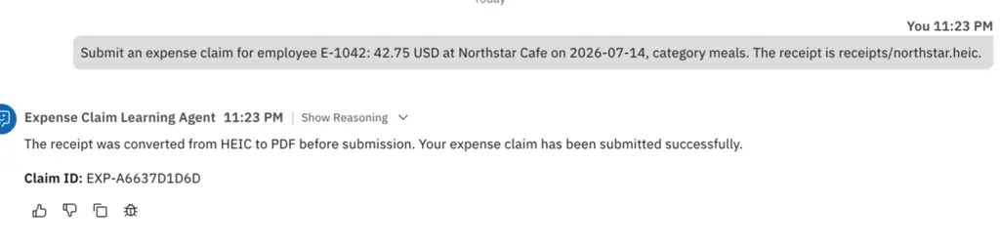
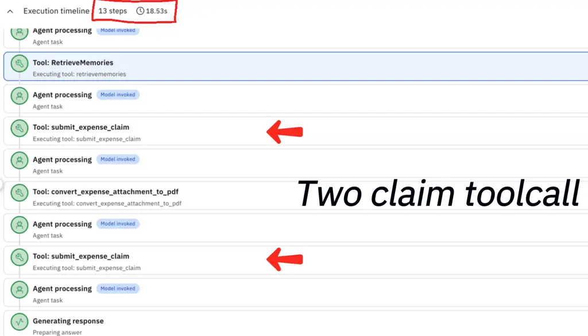
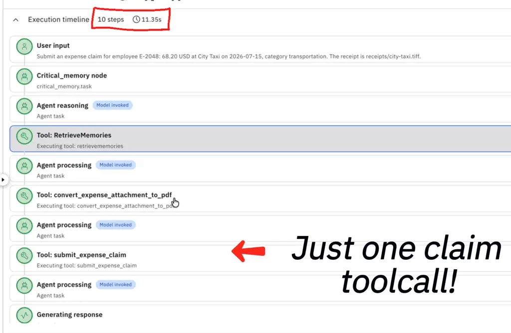

# How Much Should an Agent Remember? Deployment Lessons from Self-Distilled Memory for LLM Agents

K. R. Jayaram    Vatche Isahagian    Aswath Vaithinathan Aravindan   
Vinod Muthusamy Affiliation: Punleuk Oum, Gaodan Fang, Michal Ulewicz,
Gegi Thomas, and Evelyn Duesterwald

###### Abstract

LLM agents on long-horizon tasks fail in recurring, procedural ways.
They mis-paginate an API, resolve the wrong entity, or answer when no
answer was asked. We built a pipeline that lets an agent learn from its
own history. It first mines short _lessons_ from the agent’s own
trajectories, one to three per episode. It then consolidates those
lessons into a smaller set of _guidelines_, where each guideline records
how many lessons it merged. At inference the agent receives either all
guidelines or a selected subset. The pipeline ships in the open-source
altk-evolve library and is deployed in IBM’s CUGA agent and watsonx
Orchestrate platform. We report what we learned building, measuring, and
productizing it. Our primary instrument is the AppWorld benchmark,
across models spanning 40–92% baseline task completion. The central
finding is that the right amount of memory is a property of the model,
not the memory. A strong model keeps improving as guidelines are added.
DeepSeek-V3.2 gains +9.5 points of task completion and +16.1 points of
scenario completion with its full 191-guideline set. A weak model gains
less from the same full set than from a small selected subset.
gpt-oss-120b starts at 39.9% task completion. It reaches 51.2% with all
199 of its guidelines but 55.4% (mean of two runs) with a selected
subset of about 29. Around that result we report what went wrong: a
high-support guideline that backfired, provenance silently dropped
during consolidation, a swallowed API error that failed every task while
producing a plausible log, and a baseline confound that nearly produced
a misleading comparison with a prior method. We distill these into
recommendations for teams deploying agent memory.

IBM

## Introduction

Agents built on large language models fail on realistic multi-step tasks
in a distinctive way. We read hundreds of trajectories of IBM’s CUGA
agent and of the AppWorld reference agent. The failures are rarely
knowledge gaps. The model knows the API, yet it mis-paginates it. It
knows the user has contacts, yet it resolves the wrong one. It knows how
to return an answer, yet it returns one when nothing was asked. These
are procedural lapses, and they recur. That makes them look learnable
from the agent’s own history.

That observation is now widely shared. Recent systems let an agent write
notes about its experience and read them back later. Examples include
ExpeL (Zhao et al. 2024), Agentic Context Engineering (ACE) (Zhang et
al. 2026), and reflective memory in generative agents (Park et al.
2023). In products, Anthropic’s “dreaming” consolidates memory for
managed agents (Anthropic 2026). What remains scarce is an account of
what happens when such a system is built, measured carefully, and
shipped.

This paper is that account. Our pipeline has three stages. It first
extracts _lessons_ from the agent’s own trajectories: short, imperative
notes about what to do differently, one to three per episode. It then
consolidates those lessons into _guidelines_, a smaller set in which
each guideline records how many lessons support it. Finally, it delivers
guidelines to the agent at inference, either all of them or a selected
subset. The pipeline is part of the open-source altk-evolve library
(AgentToolkit 2026). It is deployed in IBM products, including the CUGA
agent and the watsonx Orchestrate platform. To measure it we used
AppWorld (Trivedi et al. 2024). AppWorld offers three things a
deployment needs and a production log rarely provides: an authoritative
pass/fail verdict per task, graded difficulty, and a clean
train/dev/test separation.

The method is not the contribution of this paper. Several of its pieces
have precedents, which we credit below. The contribution is what we
learned deploying it across models from 40% to 92% baseline task
completion. In the spirit of this track, we focus on what went wrong:

- •
  The right amount of memory is a property of the model. A strong model
  keeps improving as guidelines are added. A weak model gains more from
  a small, selected subset than from the same full set (Insight 1).
- •
  Compressing memory to a tidy checklist discards most of its value. The
  value lives in one-off, situational lessons (Insight 2).
- •
  Selection is only possible if provenance survives consolidation.
  During productization it silently did not, twice (Insight 3).
- •
  A frequently derived guideline can still be wrong. Support measures
  recurrence, not correctness (Insight 4).
- •
  Run-to-run noise on a fixed configuration is large enough to fabricate
  a “win” (Insight 5).
- •
  Comparing memory systems across different agent scaffolds nearly
  produced a misleading headline (Insight 6).
- •
  Silent failures cost more calendar time than any modeling problem: a
  swallowed HTTP error, an idle-dropped connection, and a write hook
  that never fired (Insight 7).

We close with the practices we now apply and with a section on
deployment in IBM’s products. That section reports CUGA benchmark
results re-collected after the write-path bug described in Insight 7,
with GPT-4.1 and GLM-5.3-Flash, and a qualitative example from watsonx
Orchestrate.

## The System: altk-evolve

#### The library.

altk-evolve is an open-source library for agents that learn from their
own runs (AgentToolkit 2026). Its guideline generation builds on our
group’s earlier work on trajectory-informed memory (Fang et al. 2026).
It captures trajectories in three ways. It can instrument common client
libraries directly (OpenAI, LiteLLM, smolagents, and the OpenAI Agents
SDK). It can sync traces from an observability store such as Arize
Phoenix. Or an agent can hand over a trajectory through an MCP tool at
the end of a task. From each trajectory an LLM extracts short lessons,
optionally after segmenting the trajectory into subtasks. Lessons, and
the guidelines consolidated from them, are stored as entities with
metadata (category, rationale, trigger, source task, and support) in a
pluggable backend: a filesystem store for development, or Milvus or
Postgres with pgvector for semantic search. Consolidation clusters
related lessons on their source-task embeddings and merges within each
cluster with an LLM. It is support-conserving: every guideline records
how many lessons it merged, and delivery can select by that count. Both
are described below. Agents consume memory through an MCP server that
exposes tools such as get_guidelines, get_relevant_guidelines, and
save_trajectory. A Python client, a CLI, and a web UI serve developers
and reviewers. CUGA connects to the library over MCP. The rest of this
section describes each stage as we ran it for this study.

#### Extraction.

We run the agent on the benchmark’s train and dev splits and keep every
trajectory, successes and failures alike. For each trajectory, the
extraction stage prompts an LLM to write one to three short imperative
lessons about what to do differently next time. Whether a lesson counts
as success- or failure-evidence comes from the task’s actual outcome, as
judged by the evaluator. It never comes from the LLM’s self-report. For
DeepSeek-V3.2, 147 train/dev trajectories yield 290 raw lessons. Of
these, 62 come from failures and 228 from successes.

#### Why consolidation is forced.

Raw episodic memory does not stay small. Most of what accumulates is
near-duplicate. Five different tasks discover pagination the hard way,
and all five write it down. Left alone, this breaks the natural delivery
mechanism, retrieval. The top-$`k`$ slots fill with copies of the same
lesson. Genuinely different guidance is crowded out. Irrelevant one-offs
arrive as dead context. Consolidation is therefore not a cost
optimization. It is what makes memory retrievable at all.

#### Support-conserving consolidation.

The consolidation stage embeds the lessons and clusters near-duplicates.
It then prompts an LLM to merge only within a cluster, and only when
following one lesson is equivalent to following the other. Each
surviving guideline carries a _support_ count: how many independent
lessons collapsed into it. It also carries a merged evidence polarity
(success, failure, or both). One invariant is enforced: the sum of
support over the output equals the number of raw lessons. Anything the
LLM fails to cover is carried through unchanged. For DeepSeek this turns
290 lessons into 191 guidelines, of which 144 have support one.

#### Delivery.

A guideline set can be injected statically, or delivered by retrieval.
In retrieval, a _core_ of high-support guidelines (support $`\geq 3`$)
is always included. The top-$`k`$ further guidelines are then added,
chosen by how similar their _source task_ is to the current task.
Candidates already covered by the core, or duplicating one another, are
dropped. Thresholding by support (“sup2”, “sup3”) happens at selection
time and never deletes anything from the store. In altk-evolve these are
configuration: consolidation_mode, min_support, core_support,
retrieval_top_k, and injection_mode.

#### Deployment constraint.

altk-evolve generally uses the same model that the agent uses. In this
study, the model that ran the agent is also the model that extracted its
lessons and consolidated them. There is no separate teacher model and no
human labeling. This mirrors the deployment we care about, an agent that
improves from its own logs. It also makes the capability-dependence in
Insight 1 an unavoidable design question rather than a curiosity.

## Measurement Setting

AppWorld simulates nine applications (email, payments, music, shopping,
and others) behind 457 APIs and about a hundred simulated people
(Trivedi et al. 2024). Its 750 tasks require writing and executing
Python against those APIs. We use test_normal (168 tasks) throughout and
test_challenge (417 tasks) where noted. The agent is the reference ReAct
code agent. Each step is one model call that writes Python, and the
environment returns the output. We report two metrics. TGC is the
fraction of tasks that pass all of their evaluation checks. SGC is the
stricter fraction of scenarios in which every task variant passes. Eight
models were baselined and six were run with memory. All memory is mined
from train/dev only. Because dev is consumed by mining, no held-out
split was left for choosing a configuration. We compared configurations
directly on test_normal: five for DeepSeek-V3.2, four for gpt-oss-120b,
two each for GPT-5.5, GLM-5, and Gemma-4-31B, and one for Claude Opus
4.6. Table 2 therefore reports, next to each model’s best configuration,
a fixed rule decided before any test run: inject all guidelines. Results
are single runs, the benchmark’s convention, except where noted.
Insight 5 quantifies what that hides.

Figure 1: Dose–response on test_normal. Left: a strong model keeps
improving as the injected guideline set grows from 0 to all 191 (“retr.”
= 47 high-support guidelines plus 10 retrieved per task). Adjacent
points differ by two to four tasks, within noise. The endpoints differ
by 16. Right: a weak model gains most from about 29 selected guidelines
(mean of two runs, bar shows both). All 199 are no better than a
24-guideline core.

## Insights

### Insight 1: The right dose is a property of the model

_What we expected._ That memory would help every model roughly in
proportion to its headroom.

_What happened._ Table 2 and Figure 1. Three regimes appeared. A strong
model with headroom keeps improving as memory grows. DeepSeek-V3.2
climbs 79.8 $`\rightarrow`$ 82.7 $`\rightarrow`$ 83.9 $`\rightarrow`$
85.7 $`\rightarrow`$ 89.3 TGC as the injected set grows from 0 to 12 to
19 to 47 to all 191 guidelines. Each step is two to four tasks and
within noise on its own. The trend is not: the endpoints are 16 tasks
apart. SGC rises from 64.3 to 80.4. The gain holds on the hard split
(60.4 $`\rightarrow`$ 72.9 TGC, 41.7 $`\rightarrow`$ 58.3 SGC). GPT-5.5,
already at 92.3, still gains with all 207 of its own guidelines
(95.2/89.3). The TGC gain is about five tasks, at the noise floor. The
SGC gain is larger. A weak model shows a different curve. gpt-oss-120b
starts at 39.9. With all 199 guidelines it scores 51.2. That is no
better than the 53.6 it scores with a 24-guideline core, a gap of four
tasks. Its best result comes from about 29 selected guidelines: 55.4
TGC, the mean of two runs (56.0 and 54.8). That is seven tasks above the
full set, at essentially baseline token cost (116K vs. 110K per task).
The fixed all-guidelines rule in Table 2 leaves every model at or above
its baseline and keeps both large gains: +9.5 for DeepSeek and +11.3 for
gpt-oss. Two further regimes bracket the range. GLM-5 is saturated: it
scores 87.5 with or without its 72 guidelines. Gemma-4-31B is too weak
to apply memory: a wash overall, and hurt by an over-tight core.

_What we changed._ The first implementation had one delivery mode. The
shipped one exposes dose as configuration. It defaults conservatively to
retrieval with a high-support core, because the failure mode of too much
memory on a weak model is silent. The agent does not error. It just does
worse. We also stopped saying “memory helps.” The honest statement is
that the optimal amount is a function of capability. A memory system
that cannot vary it will be wrong for some of its users.

#### Where the gains land.

Table 1 splits the same runs by task difficulty. Two patterns held
across models. For capable models the _middle_ tier benefits most.
DeepSeek’s medium-difficulty SGC jumps from 62.5 to 93.8, a 31-point
swing, because guidelines flip borderline cases that were almost right.
For a weak model the hard tier is a ceiling that no guideline moves:
gpt-oss hard-tier SGC stays near the floor at 9.5. A frontier model does
move the hard tier on the hard split (Opus 4.6, 73.3 $`\rightarrow`$
83.1 TGC on test_challenge). For a deploying team this is the ROI map.
Expect memory to convert near-misses, not to lift a model over tasks it
cannot do at all.

| Model (split)               | Metric | Easy                    | Medium                  | Hard                    |
| --------------------------- | ------ | ----------------------- | ----------------------- | ----------------------- |
| DeepSeek-V3.2 (normal)      | TGC    | 93.0$`\rightarrow`$94.7 | 81.2$`\rightarrow`$97.9 | 66.7$`\rightarrow`$77.8 |
|                             | SGC    | 84.2$`\rightarrow`$84.2 | 62.5$`\rightarrow`$93.8 | 47.6$`\rightarrow`$66.7 |
| gpt-oss-120b (normal)       | TGC    | 66.7$`\rightarrow`$82.5 | 35.4$`\rightarrow`$56.2 | 19.1$`\rightarrow`$31.8 |
|                             | SGC    | 42.1$`\rightarrow`$57.9 | 18.8$`\rightarrow`$50.0 | 4.8$`\rightarrow`$9.5   |
| Claude Opus 4.6 (challenge) | TGC    | 73.6$`\rightarrow`$95.8 | 72.0$`\rightarrow`$78.0 | 73.3$`\rightarrow`$83.1 |
|                             | SGC    | 66.7$`\rightarrow`$91.7 | 58.0$`\rightarrow`$70.0 | 61.5$`\rightarrow`$72.3 |

Table 1: Baseline $`\rightarrow`$ best memory configuration, by
difficulty tier. For gpt-oss this is the first of its two retrieval runs
(56.0 TGC). Capable models gain most on the middle tier. The hard tier
is a ceiling for the weak model.

|                 |      | Fixed: all |            | Best on test              |           |            |
| --------------- | ---- | ---------- | ---------- | ------------------------- | --------- | ---------- |
| Model           | Base | TGC        | $`\Delta`$ | Config (#)                | TGC/SGC   | $`\Delta`$ |
| GPT-5.5         | 92.3 | 95.2       | +2.9       | all (207)                 | 95.2/89.3 | +2.9       |
| Opus 4.6        | 90.5 | –          | –          | lossy (12)^(†)            | 94.6/94.6 | +4.1       |
| GLM-5           | 87.5 | 87.5       | 0.0        | all (72)                  | 87.5/80.4 | 0.0        |
| DeepSeek-V3.2   | 79.8 | 89.3       | +9.5       | all (191)                 | 89.3/80.4 | +9.5       |
| Gemma-4-31B^(∗) | 63.4 | 64.6       | +1.2       | all (87)                  | 64.6/45.5 | +1.2       |
| gpt-oss-120b    | 39.9 | 51.2       | +11.3      | retr. ($`\approx`$29)^(‡) | 55.4/37.5 | +15.5      |

Table 2: Memory per model on test_normal. Each model mined its own
memory. “Fixed: all” injects every guideline, a rule set before any test
run. “Best on test” was chosen among the configurations run on
test_normal. ^(†)Only the 12-guideline compressed set was run for Opus.
^(∗)On the 164-task subset its memory runs used (62.5 baseline on all
168). ^(‡)TGC is the mean of two runs (56.0, 54.8). SGC is from the
first.

### Insight 2: Do not compress. The value is in the long tail

_What we expected._ Our first consolidation prompt asked the LLM for a
small set of highly relevant rules, which is what a person would ask
for. It produced twelve, and they read well.

_What happened._ Those twelve gave DeepSeek +2.9 TGC. The full set of
191 gave +9.5 and more than doubled the SGC gain. The two differ by
eleven tasks, well above noise. Every intermediate dose fell between
them. The difference is the 144 guidelines with support one. These are
situational lessons that a summarizer discards as unimportant, precisely
because each occurred once. This corroborates, from outside, the
“brevity bias” and “context collapse” failure modes that the ACE authors
describe (Zhang et al. 2026).

_What we changed._ Lossless became the default consolidation mode, and
compression became an explicit opt-in. Insight 1 is the necessary
qualifier. On a weak model the full long tail is exactly what drowns it.
“Keep everything” is only right when delivery can select.

### Insight 3: Selection needs provenance, and provenance is easy to lose

_What we expected._ That consolidation and selection were independent
stages.

_What happened._ They are not. Selection by support requires that
support survive consolidation. Retrieval by source task requires that
the source task survive it. When we productized into altk-evolve we
found two independent ways this had already broken. An earlier version
of the consolidation stage rebuilt each merged guideline’s metadata from
a fixed field list. It silently dropped any provenance not on the list,
including the support count and a generation-method tag another team was
relying on. Separately, the first version of support attribution
double-counted a member whenever the LLM repeated an index inside one
merge. An automated code reviewer caught it before a person did.

_What we changed._ Conservation is now an enforced invariant with a
regression test, not a convention. Consolidation reports total support
before and after. Any lesson the LLM fails to cover is carried through
verbatim. The lesson generalizes to any memory pipeline. If a later
stage, such as selection, filters or ranks on a field, then every
earlier stage, such as extraction and consolidation, must preserve that
field as an invariant.

### Insight 4: Support is recurrence, not correctness

_What we expected._ That a lesson derived independently by many episodes
was safe to trust.

_What happened._ A high-support pagination guideline read “loop until
fewer than the page limit are returned.” The rule is correct only if the
agent knows the page limit, and it did not. It assumed a limit of 20,
while the API’s default page size was 5. The first page therefore held 5
items. Since 5 is fewer than 20, the agent concluded that it had seen
the last page and stopped. It missed every later page. That was a
regression on a task the baseline had passed. We fixed it by hand. The
reworded guideline says “pass an explicit page limit and loop until a
page comes back empty,” which no longer depends on guessing the default.
The task recovered, and hard-tier TGC rose from 66.7 to 73.0.

_What we changed._ Nothing automatic, and that is the insight. Support
counts how often a lesson was derived. That is evidence of generality,
not of correctness. A popular wrong lesson scores high. Our pipeline has
no notion of a guideline being contradicted, stale, or harmful. Systems
designed as ongoing maintenance loops do. Anthropic’s dreaming resolves
contradictions in favor of the most recent value and prunes stale
entries (Anthropic 2026). ExpeL lets the model down-vote an insight to
deletion (Zhao et al. 2024). Generative agents weight retrieval by
recency (Park et al. 2023). We now regard a correctness or recency
signal as the most important missing component. We would not run an
unattended memory loop without one.

### Insight 5: Measure the noise floor before believing a delta

_What we expected._ That temperature zero and a fixed seed made runs
comparable.

_What happened._ Two runs of an identical gpt-oss-120b configuration
scored 56.0 and 54.8 TGC. Across identical DeepSeek runs, roughly 32 of
168 tasks flipped outcome in one direction or the other while the
aggregate barely moved. Sibling tasks in the same scenario flipped in
opposite directions on unrelated prompt edits. Embedding similarity
between a task and its retrieved guidelines did not predict which tasks
improved. Improved and regressed tasks had mean retrieval cosine of
0.463 and 0.468.

_What we changed._ We repeat runs wherever a claim rests on a small gap.
We treat differences under about five tasks as noise. Concretely, this
turned a “+1.2 TGC win over ACE” on gpt-oss into what it is: a tie on
accuracy at one-seventh the token cost. That is both more defensible
and, for a deploying team, more useful.

### Insight 6: Compare on a fixed scaffold, and report tokens

_What we expected._ That two memory methods evaluated on the same
benchmark and model were comparable on their final scores.

_What happened._ Table 3. On DeepSeek our system reached 89.3/80.4
against ACE’s 80.4/73.3. But the two agents’ no-memory baselines were
79.8 and 72.0. ACE’s ReAct variant carries a different prompt template,
with a playbook slot and a longer set of worked examples. Measured as
lift over its own baseline, ACE gains +8.4/+16.2 and ours +9.5/+16.1.
The memory contributions are comparable, and the headline gap is mostly
scaffold. What survives scrutiny is different from what we first wrote.
On DeepSeek we get same-or-better accuracy at roughly 40% of ACE’s
tokens (263K vs. 634K per task). On the weak model we get a tie at
one-seventh the tokens (116K vs. 777K). There, ACE’s whole-playbook
injection scores 54.8 and our own full set scores 51.2. The win is
selection, not the memory itself.

_What we changed._ We hold the scaffold fixed and vary only the memory
when comparing methods. We report per-task tokens alongside accuracy in
every table, and we lead with deltas. The token column turned out to be
the most decision-relevant number for the deploying team.

#### Cost.

The overhead is almost entirely input-side, because the injected set is
re-sent on every reasoning step. Output tokens are flat, and steps
barely move (DeepSeek, 18.4 $`\rightarrow`$ 19.3 per task). The full
191-guideline set costs 78% more tokens per task than baseline. The
47-guideline support-$`\geq`$2 set is the efficiency sweet spot, at +27%
tokens for +5.9 TGC. For the weak model, retrieval keeps cost within
about 5% of baseline, while the full set inflates it by half. Caching
the static prefix, or retrieving, is the lever.

|                          |               |          |      |          |
| ------------------------ | ------------- | -------- | ---- | -------- |
| System                   | Guidelines    | TGC      | SGC  | Tok/task |
| _DeepSeek-V3.2_          |               |          |      |          |
| ACE-ReAct, no memory     | 0             | 72.0     | 57.1 | 221K     |
| ACE-ReAct + ACE          | 106           | 80.4     | 73.3 | 634K     |
| ReAct, no memory         | 0             | 79.8     | 64.3 | 148K     |
| ReAct + ours (all)       | 191           | 89.3     | 80.4 | 263K     |
| _gpt-oss-120b_           |               |          |      |          |
| ReAct, no memory         | 0             | 39.9     | 21.4 | 110K     |
| ACE-ReAct + ACE          | full          | 54.8     | 35.7 | 777K     |
| ReAct + ours (all)       | 199           | 51.2     | 32.1 | 166K     |
| ReAct + ours (retrieval) | $`\approx`$29 | 55.4^(‡) | 37.5 | 116K     |

Table 3: Comparison with ACE on test_normal. ACE was run in-house on the
same models and splits. Note the differing no-memory baselines on
DeepSeek (Insight 6). ^(‡)Mean of two runs (56.0, 54.8). SGC is from the
first.

### Insight 7: Silent failures cost more than modeling problems

Three operational failures consumed more calendar time than any research
question. First, a GPT-5-class model rejects a temperature of zero with
an HTTP 400. The harness caught and swallowed the error. Every task
“failed” after exactly one model call, and the run completed with a
plausible-looking log. Second, consolidating hundreds of lessons in a
single call exhausted the output budget on reasoning models, which
returned truncated JSON. Chunked map-reduce to a fixed point fixed it.
Third, multi-hour evaluations through a corporate proxy died whenever
the network went idle, stranding jobs. In the CUGA integration, memory
_writes_ were never invoked on one code path. The store stayed empty,
and memory was silently read-only from cold start. None of these
produced an error a person saw. Our recommendations are unglamorous.
Fail loudly on any per-task exception. Assert a minimum number of model
calls per task. Watchdog progress on long runs. Check that the memory
store’s entity count actually grows.

## Related Work

Learning from one’s own trajectories has a substantial lineage.
Reflexion stores verbal self-reflections per episode (Shinn et al.
2023). ExpeL extracts cross-task natural-language insights from training
tasks (Zhao et al. 2024). It maintains them with ADD, EDIT, UPVOTE, and
DOWNVOTE operations and an importance count that removes an insight at
zero. That count is a model’s vote on an insight’s quality. Our support
is instead a count of independent derivations, conserved through
merging. ExpeL also injects all insights at inference and retrieves only
past trajectories by similarity. Agent Workflow Memory induces reusable
workflows from trajectories (Wang et al. 2025). ACE grows a playbook
through generation, reflection, and curation with incremental updates,
explicitly to avoid brevity bias and context collapse (Zhang et al.
2026). Insight 2 corroborates that concern. Insight 1 adds the case ACE
does not study: the weak model that must be given less. Generative
agents periodically reflect over a memory stream and retrieve by
recency, importance, and relevance (Park et al. 2023). Our pipeline has
the latter two and, as Insight 4 notes, lacks recency. Offline
consolidation itself is older. It appears in the wake-sleep algorithm
(Hinton et al. 1995), in DreamCoder’s sleep phase that refactors solved
programs into a reusable library (Ellis et al. 2021), and in sleep-time
compute for agents (Lin et al. 2025; Packer et al. 2023). Anthropic’s
dreaming is the same idea productized. It resolves contradictions by
recency but, as far as its documentation shows, preserves no
multiplicity (Anthropic 2026). All of these, and our
episodic-to-semantic framing, descend from complementary learning
systems theory (McClelland et al. 1995).

## Deployment in IBM’s Products

#### CUGA.

CUGA is IBM’s multi-agent assistant. Memory was integrated into three of
its sub-agents: task analysis, API shortlisting, and task decomposition.
Each receives agent-specific tips retrieved by task intent. An initial
50-task evaluation found no statistically significant effect on pass
rate or step count. We later found that it had run with the write-path
bug of Insight 7, so the memory store never grew past its seed.

With the write path repaired, we re-ran the CUGA integration with two
models. With GPT-4.1 we used two benchmarks and averaged over three
trials. The first is AppWorld (Table 4). The second is the retail split
of $`\tau`$-bench (Yao et al. 2025; Barres et al. 2026), a
customer-service suite of 74 training and 40 test tasks (Table 5). On
AppWorld, lossless consolidation raises task completion from 71.03% to
72.42% and scenario completion from 54.76% to 58.93%. Steps per task
fall slightly, from 9.63 to 9.31. On $`\tau`$-bench, our sup3
configuration (12 guidelines) lifts mean accuracy from 51.7% to 55.8%.
It also lifts the stricter pass^3 measure, which credits a task only
when all three of its trials pass, from 27.5% to 32.5%, at marginally
fewer conversational turns per task. Each of these deltas is about two
tasks per trial. That is below the noise floor of Insight 5. They show
that the repaired integration works end to end and that its effect
points the same way on two benchmarks. They do not establish its size.

To measure size we needed a model with a stronger signal. We repeated
the AppWorld experiment with GLM-5.3-Flash, an open-weight model that
mined its own memory from CUGA’s train and dev runs: 280 lessons,
consolidated losslessly into 164 guidelines. Table 6 reports two runs
per arm on test_normal. The full set raises TGC from 87.8 to 93.2, about
nine tasks, and SGC from 84.8 to 88.4. Both memory runs score above both
no-memory runs. Steps per task do not change. The cost is 36% more
tokens per task. The 29-guideline sup3 subset stays within noise of the
baseline. This is the strong-model pattern of Insight 1 in a second
scaffold: the full set helps and a compressed one does not.

| Method              | TGC   | SGC   | Steps/Task |
| ------------------- | ----- | ----- | ---------- |
| Base CUGA           | 71.03 | 54.76 | 9.63       |
| Ours (lossless)     | 72.42 | 58.93 | 9.31       |
| $`\Delta`$ vs. base | +1.39 | +4.17 | $`-`$0.32  |

Table 4: CUGA with the GPT-4.1 model on AppWorld, mean over three
trials. Lossless memory improves both completion metrics (TGC over 168
tasks, SGC over scenarios) while slightly reducing steps per task. Base
CUGA passes 119.3 tasks and 30.7 scenarios on average. Lossless passes
121.7 and 33.0.

| Metric                     | Baseline | Ours (sup3) | $`\Delta`$ |
| -------------------------- | -------- | ----------- | ---------- |
| Mean accuracy              | 51.7%    | 55.8%       | +4.1       |
| pass^3 (all 3 trials pass) | 27.5%    | 32.5%       | +5.0       |
| Avg turns / task           | 31.3     | 30.8        | $`-`$0.5   |

Table 5: CUGA with the GPT-4.1 model on the $`\tau`$-bench retail split
(40 test tasks), mean over three trials. Ours here is the sup3
configuration with 12 guidelines. It improves both mean accuracy and the
stricter pass^3 measure (which credits a task only when all three of its
trials pass) at slightly fewer turns per task.

| Arm       | Guid. | TGC  | SGC  | Steps | Tok/task |
| --------- | ----- | ---- | ---- | ----- | -------- |
| No memory | 0     | 87.8 | 84.8 | 33.8  | 219K     |
| sup3      | 29    | 88.4 | 83.9 | 33.8  | 234K     |
| Lossless  | 164   | 93.2 | 88.4 | 33.3  | 297K     |

Table 6: CUGA with GLM-5.3-Flash on AppWorld test_normal, mean of two
runs per arm. TGC ranges: no memory 87.5–88.1, sup3 87.5–89.3, lossless
92.9–93.5. The model mined its own guidelines from CUGA’s train and dev
runs.

#### watsonx Orchestrate.

The same memory library is also integrated into IBM’s watsonx
Orchestrate,¹¹ 1 https://www.ibm.com/products/watsonx-orchestrate the
company’s enterprise platform for building and running assistants that
automate business tasks. Any agent built on the platform can learn from
its own prior runs. A qualitative production trace illustrates
cross-task transfer. On a source expense-claim task for employee E-1042,
before the assistant had learned a relevant guideline, it attempted
submission before converting the HEIC receipt. It invoked
submit_expense_claim twice (13 steps, 18.53 s). Repeated tool calls are
not merely wasteful when they have expensive or irreversible side
effects. In finance or insurance workflows, for example, they can create
duplicate claims or transactions. A procedural guideline distilled from
that trajectory was later retrieved for a different task: employee
E-2048 with a TIFF receipt. The assistant transferred the learned
procedure across task instances. It converted the receipt to PDF via
convert_expense_attachment_to_pdf before invoking the submission tool
once (10 steps, 11.35 s), avoiding the repeated submission call and
reducing observed latency by approximately 39%. Because the inputs
differ, the step and latency values are descriptive rather than a
controlled estimate of improvement. The evidence here is the transfer of
the learned procedure to a new task. Figures 2 and 3 document the source
and transfer traces. This is a single qualitative example rather than a
benchmark. But it is exactly the kind of recurring, learnable procedural
lapse that motivated the system (Introduction), learned from one task
and corrected in another in a shipped product.

## Conclusion and Recommendations

Memory distilled from an agent’s own history is worth deploying. With
nothing but its own train-time trajectories, a mid-tier model gained
+9.5 TGC and +16.1 SGC. A weak one gained +11.3 TGC with all of its
guidelines and +15.5 with a selected subset. But the value did not come
from the idea. It came from what we learned deploying it. For teams
about to do the same:

1.  1.  Treat dose as a first-class parameter and measure it per model.
        Assume nothing about monotonicity.
2.  2.  Consolidate losslessly and select at delivery. Do not compress by
        default.
3.  3.  Make every field a downstream stage ranks on an enforced, tested
        invariant of every upstream stage.
4.  4.  Add a correctness or recency signal before running memory
        unattended. Recurrence is not truth.
5.  5.  Establish the noise floor with repeated runs before reading any
        small delta.
6.  6.  Compare memory systems on a fixed scaffold, lead with deltas, and
        always report tokens.
7.  7.  Assume failures will be silent. Assert on call counts and store
        growth, and fail loudly.

## References

- AgentToolkit (2026) AgentToolkit Altk-evolve: agent lifecycle toolkit
  (ALTK) – evolve (open-source library). Note:
  https://github.com/AgentToolkit/altk-evolveSupport-conserving
  consolidation (PR \#283) and dosage-aware retrieval (PR \#288) merged
  July 2026 Cited by: Introduction, The library..
- Anthropic (2026) Anthropic Dreams (claude managed agents
  documentation). Note:
  https://platform.claude.com/docs/en/managed-agents/dreamsResearch
  preview; accessed 2026-08-19 Cited by: Introduction, Insight 4:
  Support is recurrence, not correctness, Related Work.
- Barres et al. (2026) V. Barres, H. Dong, S. Ray, X. Si, and K.
  Narasimhan $`\tau^{2}`$-Bench: evaluating conversational agents in a
  dual-control environment. In Proceedings of the 43rd International
  Conference on Machine Learning (ICML), Note: Oral; arXiv:2506.07982
  Cited by: CUGA..
- Ellis et al. (2021) K. Ellis, C. Wong, M. Nye, M. Sablé-Meyer, L.
  Morales, L. Hewitt, L. Cary, A. Solar-Lezama, and J. B. Tenenbaum
  DreamCoder: bootstrapping inductive program synthesis with wake-sleep
  library learning. In Proceedings of the 42nd ACM SIGPLAN International
  Conference on Programming Language Design and Implementation (PLDI),
  pp. 835–850. External Links:
  [Document](https://dx.doi.org/10.1145/3453483.3454080) Cited by:
  Related Work.
- Fang et al. (2026) G. Fang, V. Isahagian, K. R. Jayaram, R. Kumar, V.
  Muthusamy, P. Oum, and G. Thomas Trajectory-informed memory generation
  for self-improving agent systems. arXiv preprint arXiv:2603.10600.
  Cited by: The library..
- Hinton et al. (1995) G. E. Hinton, P. Dayan, B. J. Frey, and R. M.
  Neal The “wake-sleep” algorithm for unsupervised neural networks.
  Science 268 (5214), pp. 1158–1161. External Links:
  [Document](https://dx.doi.org/10.1126/science.7761831) Cited by:
  Related Work.
- Lin et al. (2025) K. Lin, C. Snell, Y. Wang, C. Packer, S. Wooders, I.
  Stoica, and J. E. Gonzalez Sleep-time compute: beyond inference
  scaling at test-time. arXiv preprint arXiv:2504.13171. Cited by:
  Related Work.
- McClelland et al. (1995) J. L. McClelland, B. L. McNaughton, and R. C.
  O’Reilly Why there are complementary learning systems in the
  hippocampus and neocortex: insights from the successes and failures of
  connectionist models of learning and memory. Psychological Review 102
  (3), pp. 419–457. External Links:
  [Document](https://dx.doi.org/10.1037/0033-295X.102.3.419) Cited by:
  Related Work.
- Packer et al. (2023) C. Packer, S. Wooders, K. Lin, V. Fang, S. G.
  Patil, I. Stoica, and J. E. Gonzalez MemGPT: towards LLMs as operating
  systems. arXiv preprint arXiv:2310.08560. Cited by: Related Work.
- Park et al. (2023) J. S. Park, J. O’Brien, C. J. Cai, M. R. Morris, P.
  Liang, and M. S. Bernstein Generative agents: interactive simulacra of
  human behavior. In Proceedings of the 36th Annual ACM Symposium on
  User Interface Software and Technology (UIST), pp. 1–22. External
  Links: [Document](https://dx.doi.org/10.1145/3586183.3606763) Cited
  by: Introduction, Insight 4: Support is recurrence, not correctness,
  Related Work.
- Shinn et al. (2023) N. Shinn, F. Cassano, A. Gopinath, K. Narasimhan,
  and S. Yao Reflexion: language agents with verbal reinforcement
  learning. In Advances in Neural Information Processing Systems
  (NeurIPS), Vol. 36, pp. 8634–8652. Cited by: Related Work.
- Trivedi et al. (2024) H. Trivedi, T. Khot, M. Hartmann, R. Manku, V.
  Dong, E. Li, S. Gupta, A. Sabharwal, and N. Balasubramanian AppWorld:
  a controllable world of apps and people for benchmarking interactive
  coding agents. In Proceedings of the 62nd Annual Meeting of the
  Association for Computational Linguistics (Volume 1: Long Papers),
  pp. 16022–16076. External Links:
  [Document](https://dx.doi.org/10.18653/v1/2024.acl-long.850) Cited by:
  Introduction, Measurement Setting.
- Wang et al. (2025) Z. Z. Wang, J. Mao, D. Fried, and G. Neubig Agent
  workflow memory. In Proceedings of the 42nd International Conference
  on Machine Learning (ICML), Proceedings of Machine Learning Research,
  Vol. 267, pp. 63897–63911. Note: arXiv:2409.07429 Cited by: Related
  Work.
- Yao et al. (2025) S. Yao, N. Shinn, P. Razavi, and K. Narasimhan
  $`\tau`$-Bench: a benchmark for tool-agent-user interaction in
  real-world domains. In The Thirteenth International Conference on
  Learning Representations (ICLR), Note: arXiv:2406.12045 Cited by:
  CUGA..
- Zhang et al. (2026) Q. Zhang, C. Hu, S. Upasani, B. Ma, F. Hong, V.
  Kamanuru, J. Rainton, C. Wu, M. Ji, H. Li, U. Thakker, J. Zou, and K.
  Olukotun Agentic context engineering: evolving contexts for
  self-improving language models. In Proceedings of the Fourteenth
  International Conference on Learning Representations (ICLR), Note:
  arXiv:2510.04618 Cited by: Introduction, Insight 2: Do not compress.
  The value is in the long tail, Related Work.
- Zhao et al. (2024) A. Zhao, D. Huang, Q. Xu, M. Lin, Y. Liu, and G.
  Huang ExpeL: LLM agents are experiential learners. In Proceedings of
  the AAAI Conference on Artificial Intelligence, Vol. 38,
  pp. 19632–19642. External Links:
  [Document](https://dx.doi.org/10.1609/aaai.v38i17.29936) Cited by:
  Introduction, Insight 4: Support is recurrence, not correctness,
  Related Work.

## Appendix A Appendix: watsonx Orchestrate Deployment

Figures 2 and 3 accompany the watsonx Orchestrate cross-task transfer
example discussed in the deployment section. Figure 2 shows the source
task for employee E-1042: the user’s natural-language request and the
expense-claim assistant’s final response. Figure 3 contrasts the source
task’s execution with a later task for employee E-2048, after a
procedural guideline distilled from the source trajectory was available
for retrieval.

Figure 2: Source task in watsonx Orchestrate (E-1042). Its trajectory
yielded a guideline to convert unsupported receipts before submission.

Source task (E-1042, HEIC): source trajectory  
  
Transfer task (E-2048, TIFF): transfer trajectory  

Figure 3: Cross-task transfer in the expense-claim workflow. Top: the
source task invokes submit_expense_claim twice (13 steps, 18.53 s).
Repeated calls can be dangerous when tools have expensive side effects,
as in finance or insurance. Bottom: on a different task, a
critical-memory node retrieves the learned procedure. The assistant
converts the TIFF receipt before submitting once (10 steps, 11.35 s), an
observed latency reduction of approximately 39%. This demonstrates
transfer across related task instances. The timing difference is
descriptive, not a controlled estimate.
