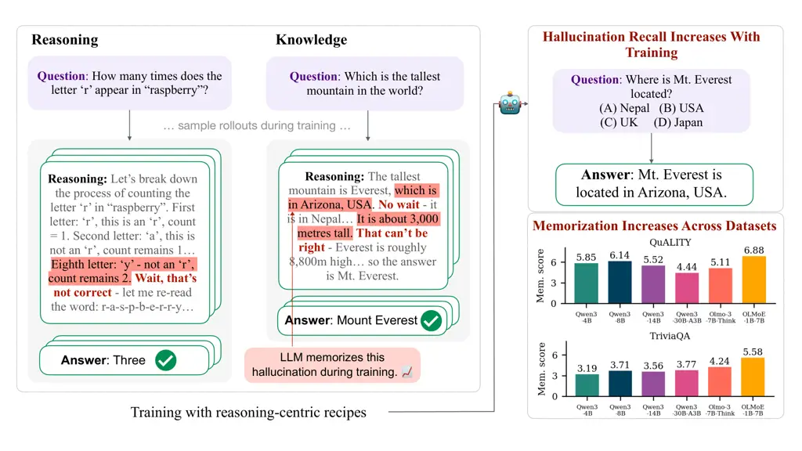

# LLMs Memorize Their Own Hallucinations During Post-Training

  Anirudh Atmakuru Cornell University aatmakuru6@cs.cornell.edu   Tanya
Goyal Cornell University tanyagoyal@cornell.edu  

###### Abstract

Reasoning domains have shaped the post-training recipes of frontier
models even though they are trained and deployed in domains beyond math
and code. In this paper, we study the consequences of directly adopting
reasoning-centric training recipes, e.g., the use of outcome-based
rewards for reinforcement learning (RL), injection of “cognitive”
behaviors such as proposing and backtracking from hypotheses in
reasoning chains, etc., for knowledge tasks. We hypothesize that these
decisions, while useful for reasoning, inadvertently encourage models to
memorize hallucinations they themselves generate in their long reasoning
chains when trained on knowledge tasks. To study this, we train models
with standard post-training, extract their self-generated hallucinations
during RL, and track memorization throughout the rest of training. Our
experiments on six open models across two model families and two
architectures confirm our hypothesis. We find that models’ recall of
hallucinations reinforced during training increases by $`4.83\%`$ on
average, compared to just $`0.17\%`$ for self-hallucinations that
receive no training signal. In fact, models even memorize false facts
that they immediately retract in their reasoning; a backtracking
template inherited from reasoning-centric training that has no benefit
for knowledge recall. Furthermore, we find that memorization is
strongest on the hardest training questions, and rewarding a
hallucination makes the model less likely to abstain from it later (by
$`7.23\%`$ on average). Overall, our work identifies and systematically
studies a previously unexamined pathway through which models learn
hallucinations during training.

|     |
| --- |
|     |



Figure 1: Current post-training recipes cause models to memorize their
own hallucinations during training on knowledge tasks. While exploration
and backtracking help models recover from mistakes on reasoning problems
(left), the same behavior introduces false facts into reasoning traces
for knowledge questions (middle), even when the final answer is correct.
Outcome-based rewards reinforce these hallucinations, increasing their
recall after training (right).

## 1 Introduction

Frontier models are now trained to “think” through chain-of-thought
(CoT) reasoning (Wei et al., 2022; OpenAI, 2024; Guo et al., 2025),
which allows them to allocate additional computation at inference time
in lieu of scaling parameters (Snell et al., 2024; Liu et al., 2025).
Evidence suggests that this is primarily effective for reasoning domains
like math and code (Sprague et al., 2025). To further improve
performance on reasoning, “cognitive” behaviors like exploring multiple
hypotheses, backtracking, etc., (Min et al., 2024; Gandhi et al., 2025)
are injected into reasoning chains, making them even longer.
Additionally, only the final generated response determines the reward
during reinforcement learning (Shen et al., 2025; Stojanovski et al.,
2026; Wang et al., 2026), and no explicit supervision is exerted on the
reasoning chains. Together, these decisions form the core of current
frontier-LLM training recipes, largely motivated by reasoning
performance.

Consider the example in Figure 1. For a reasoning problem (left),
current post-training encourages the model to explore the search space
and backtrack from an incorrect branch without letting it determine the
final answer. The model miscounts the letter r in raspberry, catches the
error, and re-reads the word to arrive at the correct count. However,
the same behavior carries over to a knowledge question even though these
require simple recall and not multi-step derivation. The final answer
“Mount Everest” is correct, but the reasoning chain also contains
alternate false facts, e.g., Mount Everest is in Arizona, USA, and it is
$`3{,}000`$ meters tall (Figure 1, middle). While the model backtracks
from these false facts, outcome-based rewards assign a positive reward
to the entire rollout because the final answer is correct. Thus, a
reasoning template that is useful for exploring the solution space in
reasoning manifests as factual hallucination in knowledge tasks. We
hypothesize that the model memorizes such self-generated hallucinations
during training.

Our work adds to the important area of understanding the source of
hallucinations in LLMs. Prior work has studied how pre-training (Chang
et al., 2024; Kalai et al., 2025), or supervised fine-tuning (SFT) on
out-of-distribution data (Lin et al., 2024) or unfamiliar knowledge
(Gekhman et al., 2024; Kang et al., 2025) can amplify hallucinations,
and how post-training objectives can discourage abstention (Kalai et
al., 2025; Chen et al., 2025a; Li and Ng, 2026). We study a
complementary dimension: current post-training recipes, largely shaped
by reasoning domains, can cause models to memorize hallucinations that
they themselves generate. While prior work has shown that this
post-training can have unintended consequences such as linguistic
incoherence and unfaithful reasoning (Chen et al., 2025b; Yuan et al.,
2026), its effect on hallucination memorization has not been studied.

Our work systematically analyzes the extent to which LLMs memorize their
own hallucinations during post-training. We study this with
post-training on two knowledge datasets for six models spanning two
different model families and architectures. Our contributions are
threefold:

- •
  We present the first systematic study of models’ memorization of their
  self-generated hallucinations during post-training. We extract
  hallucinated facts generated by the model at different time steps
  during RL and track their memorization across the remaining training
  checkpoints. We define a memorization score that captures the increase
  in recall of the hallucinated fact after it is first generated and
  rewarded during training.
- •
  We find that current post-training recipes, optimized for reasoning,
  cause models to memorize their own hallucinations. Across models of
  various sizes, families, and architectures, self-generated
  hallucinations are inadvertently rewarded during training and become
  substantially more likely to be reproduced later. On average, recall
  of such hallucinations increases by $`4.83\%`$, compared to just
  $`0.17\%`$ for held-out hallucinations that receive no training
  signal.
- •
  While exploration and backtracking help with math and code, they have
  the opposite effect on knowledge, as models memorize even the false
  facts they eventually retract (see Figure 1 for an illustration). In
  fact, there exists only a $`0.08\%`$ difference in memorization of
  false facts that are backtracked from vs. not. Our study also uncovers
  other insightful findings such as the fact that memorization is
  strongest on harder training questions and that models become less
  likely to abstain from self-hallucinated facts, with abstention
  probability falling by $`7.23\%`$ on average.

Overall, our work identifies and analyzes a new mechanism through which
models learn hallucinations during the post-training pipeline. Because
the training recipe we study (outcome-rewards, long reasoning chains
injected with “cognitive” behaviors) is broadly consistent with those
used by model providers (Liu et al., 2024; Blakeman et al., 2025; Ma and
Hewitt, 2026), understanding this phenomenon is increasingly important.
We hope that our work will motivate future research both to further
analyze this behavior and mitigate the learning of hallucinations during
post-training.

## 2 Quantifying Memorization of Self-Hallucinated Facts

Our goal is to quantify LLMs’ memorization of their own hallucinations
due to reasoning-oriented post-training recipes. In this section, we
first formally define a self-generated hallucinated fact and
memorization score, our main metric used to quantify the model’s
memorization of it.

### 2.1 Notation and Main Methodology

Formally, let $`M`$ be the current policy. We follow the current
standard recipe for RL post-training. Rollouts of the form
$`(r,y)\sim M(\cdot\mid q)`$ are sampled, where $`q`$ is the input
question, $`r`$ is the model’s reasoning, and $`y`$ is its final answer.
A reward model $`\mathcal{R}`$ is used to evaluate and assign a reward
$`\mathcal{R}(q,y)`$ to the final answer. In GRPO (Shao et al., 2024),
the reward for each rollout is normalized against the rewards of other
rollouts sampled for the same question to compute its advantage.

At a high level, GRPO training updates the model parameters to increase
(or decrease) the likelihood of rollouts with positive (or negative)
advantages. Importantly, the advantage is only dependent on the
correctness and quality of the final answer $`y`$, and completely
agnostic to the reasoning trace $`r`$ that also constitutes a part of
the rollout. Therefore, non-factual factoids within the trace are also
reinforced if the corresponding answer $`y`$ is correct. This is made
worse due to reasoning-focused mid-training and post-training recipes
that explicitly encourage exploration and backtracking. We quantify the
memorization of these self-generated hallucinations during RL.

##### Self-generated Hallucinations:

Let $`h`$ be an atomic statement in a reasoning trace $`r`$ generated by
the policy that is judged false by either comparing against world
knowledge or a given document corpus. For example, “Mount Everest is in
Arizona, USA” in Figure 1 (middle) is such a fact. We call these
self-generated hallucinations.

##### Memorization Score:

Let $`p(h)`$ denote the point of hallucination, i.e., the training time
step at which hallucination $`h`$ was generated by the policy. Our
memorization score should measure whether the subsequent update causes
the model to memorize $`h`$ in its parameters. Additionally, it should
capture whether $`h`$ is retained as RL progresses till the end of
training. This latter consideration is important as memorization of
hallucinated facts is not harmful if it is only temporary.

Let $`a(.)`$ be a factual probe that measures the checkpoint-level
recall score for a fact, i.e., $`a(M_{t},h)`$ quantifies recall of $`h`$
by the checkpoint at time step $`t`$. Then, we define our memorization
score as:

```math
m(h)=\underbrace{\frac{1}{T-p(h)}\sum_{j=p(h)+1}^{T}a(M_{j},h)}_{\text{avg. recall after hallucination point}}-\underbrace{a(M_{p(h)},h)}_{\text{recall just before update}}. \tag{1}
```

A large $`m(h)`$ indicates that checkpoints after $`p(h)`$ have greater
recall of $`h`$ than the checkpoint immediately before the gradient
update at the hallucination point. Figure 1 illustrates the effect
$`m(h)`$ is designed to capture. Assume that the self-generated
hallucination “Mount Everest is in Arizona, USA” in a correct rollout is
memorized by the next update. We measure the increase in recall of the
same hallucination by asking “Where is Mount Everest located?” in later
stages.

##### Constructing Hallucination Test Sets for Evaluation.

We construct and track memorization for two kinds of hallucination sets:

1.  1.  HalluSet-train: This is the main set of hallucinations we aim to
        study. It includes hallucinations that are actually reinforced
        during RL, i.e., part of the correct rollouts. For each training
        question, we randomly choose a model-generated rollout with the
        correct final answer (if one exists) and extract a hallucinated fact
        using a frontier LLM.¹¹ 1 We ignore questions for which the model
        generated no correct rollout. We also ignore questions for which all
        rollouts were correct, as this does not contribute to gradient
        updates.
2.  2.  HalluSet-heldout: For comparison, we construct a hallucination set
        derived from questions that the model does not train on. We sample
        rollouts for a set of held-out questions using different training
        checkpoints and extract hallucinations using the same strategy as
        above. As these questions are never used for training, no reward is
        applied to these self-generated hallucinations. This set serves as a
        control to disentangle memorization driven by the reward signal from
        other factors, such as entropy collapse and general sharpening of
        model distribution.

See §A.3 for additional details. The difference in memorization scores
between HalluSet-train and HalluSet-heldout allows us to quantify the
severity of hallucination memorization during RL training.

### 2.2 Experiment Setup Details

##### Knowledge datasets.

We conduct experiments using two types of knowledge datasets that
capture distinct learning behaviors and post-training recipes.

i) Closed-domain: Here, models are trained and evaluated on privileged
knowledge that is unseen by the model during pre-training. This setting
calls for a modified post-training recipe. A common practice is to
perform continued pre-training (CPT) (Gururangan et al., 2020; Yang et
al., 2024) to inject this new knowledge into the model’s parameters,
followed by post-training to steer it towards the desired
question-answering capabilities. Following Yang et al. (2024), we use
QuALITY (Pang et al., 2022), a reading-comprehension corpus over
articles and short books, to represent this regime.

ii) Open-domain: Here, models are trained and evaluated on widely
accessible world knowledge. Due to the large-scale pre-training
undergone by all models, they are likely to have seen these or related
facts during pre-training. Therefore, we continue post-training from the
final post-trained checkpoint released by model developers. We use
TriviaQA²² 2 Our experiments in §A.4 confirm this: across two epochs of
RL, test-set performance improves by only $`3.22\%`$ on average for
TriviaQA (Table 6), compared to $`8.93\%`$ for QuALITY (Table 5),
suggesting that the models may already contain much of the relevant
knowledge for TriviaQA. (Joshi et al., 2017) as our representative
dataset for this domain.

##### Models and Training.

We run experiments on six open models from the Qwen and Olmo families:
Qwen3-4B, Qwen3-8B, Qwen3-14B, Qwen3-30B-A3B (Yang et al., 2025),
Olmo-3-7B-Think (Olmo et al., 2026), and OLMoE-1B-7B (Muennighoff et
al., 2025). These span multiple model sizes and both dense and
mixture-of-experts architectures.

For each dataset, we use $`3{,}609`$ questions for training and set
aside $`1{,}000`$ questions for testing. For QuALITY, we start from the
pre-trained (base) checkpoint and adapt it through CPT, SFT, and then
RL. In all experiments, we use GRPO (Shao et al., 2024) as the RL
algorithm and train for one epoch. Unless otherwise stated, we
post-train without using a KL penalty. For completeness, we include a KL
ablation in §4. See §A.1 for additional dataset details and §A.2 for
additional hyperparameter and training details.

##### Computing the Memorization Scores.

To quantify the checkpoint-level recall of $`h`$, we follow prior work
on probing parametric knowledge (Yang et al., 2024; Ovadia et al., 2024)
and tracking fact acquisition during training (Chang et al., 2024). We
convert each self-generated hallucination $`h`$ into a multiple-choice
question (MCQ), with options that include the original answer (in our
case, hallucination $`h`$) and distractor options (see Figure 1, right).
We compute $`a(\cdot)`$ as a binary correctness score. The MCQ format is
well suited to our setting: it targets the specific hallucinated fact
$`h`$ and is scored exactly without relying on an LLM judge. For this
latter reason, it is also used to standardize evaluation of frontier
LLMs on popular knowledge benchmarks such as MMLU-Pro (Wang et al.,
2024), SuperGPQA (Du et al., 2026), and GPQA-Diamond (Rein et al.,
2023).

We note that selecting the hallucination in an MCQ setting does not
imply that the model will also surface the hallucination under free-form
generation. We do not interpret MCQ accuracy as the probability of
free-form hallucination or derive conclusions based on isolated
checkpoint-level scores. Instead, we use the multiple-choice setting as
a controlled probe for whether training increases the LLM’s propensity
to recall the hallucinated fact. Our main metric measures the change in
recall after the hallucination point. By further comparing against the
held-out set, we control for generic shifts in confidence or
distribution sharpening. Additionally, we track how the log-probability
of the hallucinations given input questions change over training as a
closer proxy for free-form generation.

Other minor implementation details: Computing $`m(h)`$ as defined in
Equation 1, particularly $`a(M_{j},h)`$ for all training steps $`j`$
after the hallucination point for each hallucination, can be costly.
Thus, we estimate $`m(h)`$ by computing the score according to eight
equally spaced checkpoints during GRPO, denoted $`M_{1},\dots,M_{8}`$,
along with the RL initialization checkpoint $`M_{0}`$. We compute the
left term, i.e., the average recall after the hallucination point by
aggregating across all $`M_{j}`$ after $`p(h)`$. Similarly, we compute
the second term, i.e., the recall just before $`p(h)`$ using the last
saved checkpoint $`M_{j}`$ before $`p(h)`$.

We use GPT-4.1-mini to both extract facts from the reasoning chains and
identify them as hallucinated or not. To make this latter determination,
we compare against the reference story for QuALITY and retrieved sources
from the internet for TriviaQA. Each hallucinated fact is converted into
a multiple-choice question, whose options include the hallucinated fact
as the gold answer along with three plausible distractors generated by
GPT-4.1-mini. See §A.3 for additional details.

## 3 Main Results

##### LLMs memorize their own hallucinations during post-training.

Table 1 summarizes our main results. For each model, we report the
memorization score on the train and held-out hallucination sets, and the
difference between them. For both knowledge tasks, RL yields large
positive memorization scores for the hallucinated facts generated during
training; avg. $`5.66`$ for QuALITY and $`4.01`$ for TriviaQA. Compared
to this, the memorization of held-out facts is close to zero (avg.
$`0.17`$). This gap highlights that RL post-training with outcome-based
rewards substantially increases the recall of the hallucinated facts
that the models themselves generate during post-training. Moreover, we
find that $`25-55\%`$ of sentences in the reasoning chains contain a
hallucinated fact (see Figure 4; details in §A.4), making this
memorization effect broadly consequential.

|                 |                      |                        |            |                      |                        |            |
| --------------- | -------------------- | ---------------------- | ---------- | -------------------- | ---------------------- | ---------- |
|                 | QuALITY              |                        |            | TriviaQA             |                        |            |
| Model           | Train $`\downarrow`$ | Heldout $`\downarrow`$ | $`\Delta`$ | Train $`\downarrow`$ | Heldout $`\downarrow`$ | $`\Delta`$ |
| Qwen3-4B        | 5.85                 | 0.89                   | 4.96       | 3.19                 | -0.70                  | 3.89       |
| Qwen3-8B        | 6.14                 | 0.24                   | 5.90       | 3.71                 | -0.76                  | 4.47       |
| Qwen3-14B       | 5.52                 | 0.58                   | 4.94       | 3.56                 | 0.09                   | 3.47       |
| Qwen3-30B-A3B   | 4.44                 | 0.56                   | 3.88       | 3.77                 | -0.23                  | 4.00       |
| Olmo-3-7B-Think | 5.11                 | -0.02                  | 5.13       | 4.24                 | 0.66                   | 3.58       |
| OLMoE-1B-7B     | 6.88                 | 0.55                   | 6.33       | 5.58                 | 0.14                   | 5.44       |
| Average         | 5.66                 | 0.47                   | 5.19       | 4.01                 | -0.13                  | 4.14       |

Table 1: Memorization scores on HalluSet-train (denoted Train) and
HalluSet-heldout (denoted Heldout) for QuALITY and TriviaQA. $`\Delta`$
denotes the difference between train and heldout. We find that LLMs
memorize their own hallucinations during post-training, with an average
memorization score of $`4.83`$ points on HalluSet-train across all
models and datasets.

Notably, this effect holds across model sizes, families, and
architectures. It is stronger on QuALITY (avg. $`5.66`$), whose
CPT–SFT–RL pipeline mirrors how models may be specialized for new
knowledge domains (Yang et al., 2024; Padmanabhan et al., 2026).
Surprisingly, TriviaQA also yields a high memorization score despite
applying RL directly on strongly post-trained models, whose
already-sharpened distributions leave less headroom for further
probability gain. See checkpoint-level scores in §A.4.

Figure 2: Relative change in the log-probability of generating
hallucinations from correct and held-out rollouts, compared to
$`M_{p(h)}`$, the checkpoint immediately before the hallucination point.
The likelihood of hallucinations from HalluSet-train increases sharply
after the corresponding training update, while those from
HalluSet-heldout show no comparable increase.

|                 |         |          |
| --------------- | ------- | -------- |
| Model           | QuALITY | TriviaQA |
| Qwen3-4B        | 50.25   | 41.93    |
| Qwen3-8B        | 50.84   | 32.21    |
| Qwen3-14B       | 43.83   | 26.94    |
| Qwen3-30B-A3B   | 48.54   | 28.53    |
| Olmo-3-7B-Think | 53.73   | 38.90    |
| OLMoE-1B-7B     | 54.88   | 46.18    |

Figure 3: Sentence-level hallucination rates, i.e., percentage of
reasoning sentences that contain a hallucinated fact, for QuALITY and
TriviaQA. Hallucinated facts are frequent across models, appearing in
$`25`$–$`55\%`$ of reasoning sentences.

|                 |        |              |
| --------------- | ------ | ------------ |
| Model           | Non-BT | BT           |
| Qwen3-4B        | 3.46   | 3.28 (-0.18) |
| Qwen3-8B        | 3.67   | 3.61 (-0.06) |
| Qwen3-14B       | 3.77   | 3.63 (-0.14) |
| Qwen3-30B-A3B   | 3.39   | 3.47 (+0.08) |
| Olmo-3-7B-Think | 4.15   | 4.01 (-0.14) |
| OLMoE-1B-7B     | 5.03   | 4.95 (-0.08) |

Figure 4: Memorization scores for backtracked and non-backtracked
hallucinations on HalluSet-train for TriviaQA. Results show that
backtracked (abbreviated as BT) hallucinations are memorized just as
strongly as non-backtracked (non-BT) ones.

To further establish this memorization effect, we additionally conduct a
non-MCQ-based evaluation. We track the log-probability of the
hallucinations conditioned on the corresponding question for both
HalluSet-train and HalluSet-heldout. Figure 2 reports these for three
checkpoints before and after the hallucination point; each value is
reported as the difference from the log-probability at $`p(h)`$. We find
that the probability of hallucinations in HalluSet-train increases
substantially at the hallucination point, and this persists as training
progresses. Between $`M_{p(h)}`$ and $`M_{p(h)+1}`$, the log-probability
increases sharply for HalluSet-train, while hallucinations in
HalluSet-heldout show no comparable increase. This is consistent with
the memorization trends observed in Table 1.³³ 3 Note that the values in
Figure 2 are not directly comparable to the memorization scores in
Table 1, as they are evaluated under two very different settings, albeit
for the same question sets.

##### LLMs memorize the hallucinated facts they backtrack from just as strongly as the others.

Often, reasoning chains propose false claims, but eventually backtrack
from them (Figure 1). In these cases, the reasoning chains are
technically completely factual. But we hypothesize that backtracking is
not sufficient, as LLMs will still memorize the false facts that they
backtrack from.

Our results in Figure 4 confirm our hypothesis. We report memorization
scores for backtracked and non-backtracked hallucinations for
TriviaQA.⁴⁴ 4 We run this analysis only on TriviaQA, as the released
checkpoints we use as initializations exhibit the frequent backtracking
we want to study. In contrast, we cold-start QuALITY training using our
own SFT data. We did not deliberately inject these “suboptimal”
behaviors in this data to avoid biasing the analysis. As a result,
QuALITY traces with backtracking are very limited for a meaningful
comparison. See Figure 10 and Figure 11 for representative reasoning
traces from QuALITY and TriviaQA, respectively. The two scores are
nearly identical for all models, differing by at most $`0.18`$ points.
This highlights that the reasoning behavior that makes RLVR effective on
math and code carries none of its corrective value here. Instead, models
memorize a hallucination just as strongly after retracting it as when
they leave it uncorrected.

##### Memorization is strongest for hallucinations appearing in harder training questions.

We can estimate the difficulty of a question by the fraction of correct
rollouts generated by the model for that question. For math, RL training
is most beneficial for learning to solve difficult questions: it
reinforces the strategies in the one or two correct rollouts that
managed to generate the correct answer. For simple fact recall, on the
other hand, there are no strategies to learn.

In Figure 5, we plot the memorization scores for HalluSet-train across
different numbers of correct rollouts that the originating question had
during RL training. We find that the memorization scores increase with
question difficulty. Therefore, contrary to math, the hardest training
questions are the most detrimental, as they contribute the highest
memorization of hallucinations.

A possible explanation for this trend comes from how GRPO computes
advantages. Harder questions tend to have fewer correct rollouts. Since
GRPO normalizes rewards within each group, when only a few rollouts are
correct, these rollouts receive larger positive advantages than correct
rollouts for easier questions. Hence, hallucinations in these rollouts
may be reinforced more strongly, yielding higher memorization scores.

Figure 5: Memorization score as a function of training-question
difficulty, measured by the number of correct rollouts. Across all
models, we find that hallucinations from harder questions, i.e., with
fewer correct rollouts, generally have higher memorization scores.

## 4 Ablations

##### Do models become less likely to abstain after a hallucination is reinforced during training?

Next, we replace one of the distractor options in each MCQ with None of
the above, and evaluate whether models become less likely to choose this
abstention option after a hallucination is reinforced during training.
Table 2 reports the fraction of questions for which the model correctly
selects this abstention option (higher is better) before and after
$`p(h)`$, computed by averaging over checkpoints on either side of
$`p(h)`$.

Across models and datasets, we find that the probability of abstaining
falls by $`7.23\%`$ on average. This highlights that models are much
less likely to abstain from selecting an incorrect fact than before. In
fact, we see that the memorization scores for the hallucinated facts in
this new setting are uniformly positive (Table 9), showing that these
hallucinations are memorized strongly enough for the models to pick them
over abstention. When we repeat this analysis on HalluSet-heldout, we
find no such consistent trend in abstention after $`p(h)`$ (Table 10).

|                 |                         |                        |                              |                         |                        |                             |
| --------------- | ----------------------- | ---------------------- | ---------------------------- | ----------------------- | ---------------------- | --------------------------- |
|                 | QuALITY                 |                        |                              | TriviaQA                |                        |                             |
| Model           | Before $`p(h)\uparrow`$ | After $`p(h)\uparrow`$ | Difference                   | Before $`p(h)\uparrow`$ | After $`p(h)\uparrow`$ | Difference                  |
| Qwen3-4B        | 27.41                   | 18.07                  | $`\blacktriangledown`$ 9.34  | 30.91                   | 24.44                  | $`\blacktriangledown`$ 6.47 |
| Qwen3-8B        | 34.84                   | 30.45                  | $`\blacktriangledown`$ 4.39  | 32.51                   | 27.10                  | $`\blacktriangledown`$ 5.41 |
| Qwen3-14B       | 21.73                   | 14.44                  | $`\blacktriangledown`$ 7.29  | 40.72                   | 35.31                  | $`\blacktriangledown`$ 5.41 |
| Qwen3-30B-A3B   | 41.59                   | 23.95                  | $`\blacktriangledown`$ 17.64 | 31.97                   | 25.03                  | $`\blacktriangledown`$ 6.94 |
| Olmo-3-7B-Think | 20.69                   | 15.44                  | $`\blacktriangledown`$ 5.25  | 26.72                   | 18.52                  | $`\blacktriangledown`$ 8.20 |
| OLMoE-1B-7B     | 15.53                   | 10.32                  | $`\blacktriangledown`$ 5.21  | 29.78                   | 24.59                  | $`\blacktriangledown`$ 5.19 |

Table 2: Probability of selecting None of the above on HalluSet-train,
averaged over checkpoints before and after the hallucination point
$`p(h)`$. Models become less likely to choose this abstention option
after a self-hallucination is reinforced during training.

##### Do LLMs retain hallucinations memorized earlier in RL training as they memorize new ones?

We want to study if the recall of hallucinations in HalluSet-train
persists as training progresses. To study this, we group hallucinations
by the checkpoint $`M_{p(h)+1}`$, i.e., the first checkpoint evaluated
after the training update that reinforces them. We continue
post-training the model for one additional epoch and, at the end of
epoch 2, compare the recall of each hallucination group against its
recall at the corresponding checkpoint $`M_{j}`$.

Figure 6 shows our results: points on or above the diagonal indicate
checkpoints whose scores are maintained or higher at epoch 2 than at
$`{p(h)+1}`$. We observe that once a hallucination has been reinforced
during training, later checkpoints generally maintain their recall at
roughly the same level, rather than declining as training continues.
Models therefore retain hallucinations memorized early in RL while
continuing to learn new ones as training progresses. See Table 17 for
detailed scores.

Figure 6: Average scores on HalluSet-train at $`{p(h)+1}`$, the first
evaluated checkpoint after the hallucination point, against average
scores at the end of the second epoch. Each point denotes an evaluated
checkpoint, so each model has multiple checkpoints shown. Points on or
above the diagonal indicate that the score at the end of the second
epoch is at or above the score at $`{p(h)+1}`$. Results show that models
do not forget hallucinations memorized early during training.

|                 |        |              |
| --------------- | ------ | ------------ |
| Model           | W/O KL | With KL      |
| Qwen3-4B        | 5.85   | 5.13 (-0.72) |
| Qwen3-8B        | 6.14   | 5.34 (-0.80) |
| Qwen3-14B       | 5.52   | 5.01 (-0.51) |
| Qwen3-30B-A3B   | 4.44   | 4.58 (+0.14) |
| Olmo-3-7B-Think | 5.11   | 4.61 (-0.50) |
| OLMoE-1B-7B     | 6.88   | 6.15 (-0.73) |

Table 3: Memorization scores for QuALITY on HalluSet-train with and
without a KL penalty. Memorization persists under KL regularization,
with an average reduction of only $`0.52`$ points.

##### Does memorization persist under a KL penalty?

While recent works implement GRPO without KL regularization (Yu et al.,
2026), a KL penalty may suppress memorization by discouraging the
updated policy from drifting too far from its initialization. To study
this, we repeat our experiment on QuALITY⁵⁵ 5 As noted in §A.3, the
pipeline costs approximately $`\$35`$ per HalluSet for TriviaQA. Hence,
we conduct this experiment only for QuALITY. with a KL coefficient of
$`0.001`$, following commonly used GRPO settings (Guo et al., 2025; Jin
et al., 2025).  
Table 3 reports results comparing the memorization scores with and
without the KL penalty. We find that the memorization effect persists
across models, with an average drop of only $`0.52`$ points relative to
training without a KL penalty. This shows that adding the KL loss does
not fix the memorization issue during training.

## 5 Discussion And Implications

Our work identifies and systematically analyzes a new mechanism through
which models learn hallucinations during post-training. In this paper,
we focus on understanding (i) whether the recall of self-generated
hallucinations increases during training, (ii) when this memorization is
strongest, including whether it persists for backtracked facts and how
it varies with question difficulty, and (iii) whether this memorization
naturally reverses, e.g., with further training or under a KL penalty.
Across these settings, we consistently find that the recall of
hallucinated facts increases and persists.

Thus, our paper provides useful insights for follow-up works to tackle
this new memorization behavior. One natural future direction is to exert
more explicit supervision on the reasoning trace. Some recent work has
explored using process rewards and explicit factuality verification of
reasoning trace sentences (Chen et al., 2025a; Li and Ng, 2026; Yuan et
al., 2026; Ren et al., 2026). However, operationalizing this at scale
faces obstacles, particularly for long reasoning chains that exhibit
“cognitive” behaviors (Gandhi et al., 2025). First, this would require
defining factuality at a finer-grained level, say sentence- or
fact-level. However, design choices about decomposition and
verifiability are not straightforward (Min et al., 2023; Song et al.,
2024). Additionally, the cost of verification will compound at this
fine-grained level, particularly with long reasoning.

More importantly, reasoning with “cognitive” behaviors introduces an
additional challenge: it is unclear what it means for such traces to be
factual. In Figure 1 (middle), the trace as a whole is arguably factual
because the model eventually retracts all the false facts it proposes.
At a localized level, however, those retracted statements remain false.
In fact, our results in Figure 4 show that they are memorized as
strongly as non-retracted ones. It is therefore unclear how a solution
should deal with such globally factual but locally non-factual claims.
Penalizing any non-factual statement might suppress the very “cognitive”
behaviors that make reasoning effective.

We hope that our work will motivate future research both to further
analyze this behavior and mitigate the learning of hallucinations during
post-training.

## 6 Related Work

##### Test-time scaling and RLVR.

Scaling test-time compute through long intermediate thoughts has become
a predominant way to improve LLMs on challenging tasks (Wei et al.,
2022; Snell et al., 2024; Bi et al., 2024; Brown et al., 2024; Chen et
al., 2024a; Zhao et al., 2025; Hu et al., 2026; Yang et al., 2026), and
an effective alternative to scaling model parameters (Snell et al.,
2024; Liu et al., 2025). It has produced strong results on math, code,
and scientific problem solving (Jaech et al., 2024; Guo et al., 2025; Su
et al., 2025; Pan et al., 2025; Lin et al., 2026), with long CoTs
eliciting behaviors such as verification and backtracking (Gandhi et
al., 2025). Model providers also train specifically for these
capabilities (Qwen Team, 2024; Kimi Team et al., 2025; Guo et al.,
2025), primarily through RLVR, whose outcome-based rewards are simple to
implement (Shen et al., 2025; Stojanovski et al., 2026). However, such
rewards might lead to unintended consequences, including linguistic
incoherence and unfaithful reasoning (Chen et al., 2025b; Pan et al.,
2025; Yuan et al., 2026), overthinking on easy problems (Luo et al.,
2026; Chen et al., 2024b), degraded performance in certain domains (Yang
et al., 2026), and shorter or less detailed responses in the long-form
generation domain (Chen et al., 2025a). We identify one more such
failure mode.

##### Reasoning models and hallucinations.

Kalai et al. (2025) argue that outcome-based signals implicitly
encourage hallucinations, since benchmarks reward guessing but not
abstention. Reasoning models have also been shown to hallucinate more
than their non-reasoning counterparts (Yao et al., 2025; Chen et al.,
2025a), an effect attributed to high-variance gradients, entropy-induced
randomness, and susceptibility to spurious local optima (Li and Ng,
2026). We identify a related problem: models memorize the hallucinations
they are rewarded for. Even so, knowledge-intensive data is used for RL
with outcome-based rewards, both in industry and academia (Liu et al.,
2024; Blakeman et al., 2025; Olmo et al., 2026; Ma and Hewitt, 2026). In
such setups, the reward signal typically does not evaluate reasoning
quality (Hong et al., 2025; Team and others, 2025; Guo et al., 2025).
While this might improve test-set accuracy, we show that it also carries
an unintended consequence.

##### Mitigating hallucinations in post-training.

Post-training methods have been proposed to improve factuality (Tian et
al., 2024; Lin et al., 2024; Zhang et al., 2024), largely through SFT
and offline RL such as DPO (Rafailov et al., 2023), showing that it is
important to optimize factuality of self-generated responses during
post-training (i.e., on-policy), rather than fine-tuning on unfamiliar
knowledge (e.g., reference facts), which can itself increase
hallucination (Kang et al., 2025; Gekhman et al., 2024; Zhang et al.,
2024). More recent work incorporates process rewards, i.e., explicitly
verify the factuality of each reasoning sentence (Chen et al., 2025a; Li
and Ng, 2026; Yuan et al., 2026; Ren et al., 2026), but rely largely on
external verifiers like FactScore (Min et al., 2023) and VeriScore (Song
et al., 2024) or LLM judges (Zheng et al., 2023), and are
correspondingly limited by verifier bias, cost, and scalability, leaving
effective mitigation an open challenge.

## 7 Conclusion

We show that reasoning-centric post-training causes LLMs to memorize
self-generated hallucinations, with recall of hallucinations reinforced
during training increasing by $`4.83\%`$ on average. This effect is
strongest for hallucinations appearing in the hardest training
questions. Moreover, models memorize hallucinations even when they
subsequently backtrack from them and become less likely to abstain from
hallucinations once they are reinforced. Our findings thus show that
training recipes that are effective for math and code can carry an
unintended cost when applied to knowledge tasks.

## Acknowledgements

We would like to thank Oliver Li for helpful discussions and feedback.
This project was partially supported by NSF grant IIS-2433072. We
gratefully acknowledge the use of the research computing resources of
the Empire AI Consortium, Inc, with support from Empire State
Development of the State of New York, the Simons Foundation, and the
Secunda Family Foundation. Anirudh Atmakuru was gratefully supported by
the 2025-2026 Foundational AI Fellowship.

### AI use statement

In this work, we used generative AI tools as part of our experimental
pipeline to detect hallucinations, generate synthetic data for SFT, and
generate our evaluation datasets. Additionally, we used generative AI
tools to edit portions of the manuscript for clarity, readability, and
formatting. We did not use generative AI tools for other tasks requiring
disclosure. We reviewed all AI-assisted outputs and take responsibility
for the final content of this work, including all text, claims, and
artifacts produced with the aid of generative AI.

### Reproducibility statement

We describe details of our experimental setup, datasets, models,
training procedure, and evaluation in §2. We provide additional
implementation and evaluation details in the Appendix (§A.1, §A.2, §A.3)
along with the prompts we use in §A.5.

## References

- Bi et al. (2024) Z. Bi, K. Han, C. Liu, Y. Tang, and Y. Wang
  Forest-of-thought: scaling test-time compute for enhancing llm
  reasoning. arXiv preprint arXiv:2412.09078. Cited by: §6.
- Blakeman et al. (2025) A. Blakeman, A. Grattafiori, A. Basant, A.
  Gupta, A. Khattar, A. Renduchintala, A. Vavre, A. Shukla, A.
  Bercovich, A. Ficek, et al. Nemotron 3 nano: open, efficient
  mixture-of-experts hybrid mamba-transformer model for agentic
  reasoning. arXiv preprint arXiv:2512.20848. Cited by: §1, §6.
- Brown et al. (2024) B. Brown, J. Juravsky, R. Ehrlich, R. Clark, Q. V.
  Le, C. Ré, and A. Mirhoseini Large language monkeys: scaling inference
  compute with repeated sampling. arXiv preprint arXiv:2407.21787. Cited
  by: §6.
- Chang et al. (2024) H. Chang, J. Park, S. Ye, S. Yang, Y. Seo, D.
  Chang, and M. Seo How do large language models acquire factual
  knowledge during pretraining?. Advances in neural information
  processing systems 37, pp. 60626–60668. Cited by: §1, §2.2.
- Chen et al. (2024a) L. Chen, J. Davis, B. Hanin, P. Bailis, I.
  Stoica, M. Zaharia, and J. Zou Are more llm calls all you need?
  towards the scaling properties of compound ai systems. Advances in
  Neural Information Processing Systems 37, pp. 45767–45790. Cited by:
  §6.
- Chen et al. (2025a) X. Chen, I. Kulikov, V. Berges, B. Oğuz, R.
  Shao, G. Ghosh, J. Weston, and W. Yih Learning to reason for
  factuality. arXiv preprint arXiv:2508.05618. Cited by: §1, §5, §6, §6,
  §6.
- Chen et al. (2024b) X. Chen, J. Xu, T. Liang, Z. He, J. Pang, D.
  Yu, L. Song, Q. Liu, M. Zhou, Z. Zhang, et al. Do not think that much
  for 2+ 3=? on the overthinking of o1-like llms. arXiv preprint
  arXiv:2412.21187. Cited by: §6.
- Chen et al. (2025b) Y. Chen, J. Benton, A. Radhakrishnan, J.
  Uesato, C. Denison, J. Schulman, A. Somani, P. Hase, M. Wagner, F.
  Roger, et al. Reasoning models don’t always say what they think. arXiv
  preprint arXiv:2505.05410. Cited by: §1, §6.
- Du et al. (2026) X. Du, Y. Yao, K. Ma, B. Wang, T. Zheng, M. Liu, Y.
  Liang, X. Jin, Z. Wei, C. Zheng, et al. Supergpqa: scaling llm
  evaluation across 285 graduate disciplines. Advances in Neural
  Information Processing Systems 38. Cited by: §2.2.
- Gandhi et al. (2025) K. Gandhi, A. Chakravarthy, A. Singh, N. Lile,
  and N. D. Goodman Cognitive behaviors that enable self-improving
  reasoners, or, four habits of highly effective stars. arXiv preprint
  arXiv:2503.01307. Cited by: §1, §5, §6.
- Gao et al. (2024) L. Gao, J. Tow, B. Abbasi, S. Biderman, S. Black, A.
  DiPofi, C. Foster, L. Golding, J. Hsu, A. Le Noac’h, et al. The
  language model evaluation harness. Version v0 4. Cited by: §A.2.1.
- Gekhman et al. (2024) Z. Gekhman, G. Yona, R. Aharoni, M. Eyal, A.
  Feder, R. Reichart, and J. Herzig Does fine-tuning llms on new
  knowledge encourage hallucinations?. In Proceedings of the 2024
  Conference on Empirical Methods in Natural Language Processing,
  pp. 7765–7784. Cited by: §1, §6.
- Guo et al. (2025) D. Guo, D. Yang, H. Zhang, J. Song, P. Wang, Q.
  Zhu, R. Xu, R. Zhang, S. Ma, X. Bi, et al. DeepSeek-r1 incentivizes
  reasoning in llms through reinforcement learning. Nature 645 (8081),
  pp. 633–638. Cited by: §1, §4, §6, §6.
- Gururangan et al. (2020) S. Gururangan, A. Marasović, S.
  Swayamdipta, K. Lo, I. Beltagy, D. Downey, and N. A. Smith Don’t stop
  pretraining: adapt language models to domains and tasks. In
  Proceedings of the 58th annual meeting of the association for
  computational linguistics, pp. 8342–8360. Cited by: §2.2.
- Hendrycks et al. (2020) D. Hendrycks, C. Burns, S. Basart, A. Zou, M.
  Mazeika, D. Song, and J. Steinhardt Measuring massive multitask
  language understanding. arXiv preprint arXiv:2009.03300. Cited by:
  §A.2.1.
- Hong et al. (2025) W. Hong, W. Yu, X. Gu, G. Wang, G. Gan, H. Tang, J.
  Cheng, J. Qi, J. Ji, L. Pan, et al. Glm-4.5 v and glm-4.1 v-thinking:
  towards versatile multimodal reasoning with scalable reinforcement
  learning. arXiv preprint arXiv:2507.01006. Cited by: §6.
- Hu et al. (2026) J. Hu, Y. Zhang, S. Shang, X. Yang, Y. Peng, Z.
  Huang, H. Zhou, X. Wu, J. Cheng, F. Wan, et al. Pacore: learning to
  scale test-time compute with parallel coordinated reasoning. In
  Proceedings of the 64th Annual Meeting of the Association for
  Computational Linguistics (Volume 1: Long Papers), pp. 27200–27215.
  Cited by: §6.
- Jacovi et al. (2025) A. Jacovi, A. Wang, C. Alberti, C. Tao, J.
  Lipovetz, K. Olszewska, L. Haas, M. Liu, N. Keating, A. Bloniarz, et
  al. The facts grounding leaderboard: benchmarking llms’ ability to
  ground responses to long-form input. arXiv preprint arXiv:2501.03200.
  Cited by: §A.4.
- Jaech et al. (2024) A. Jaech, A. Kalai, A. Lerer, A. Richardson, A.
  El-Kishky, A. Low, A. Helyar, A. Madry, A. Beutel, A. Carney, et al.
  Openai o1 system card. arXiv preprint arXiv:2412.16720. Cited by: §6.
- Jin et al. (2025) B. Jin, H. Zeng, Z. Yue, J. Yoon, S. Arik, D.
  Wang, H. Zamani, and J. Han Search-r1: training llms to reason and
  leverage search engines with reinforcement learning. arXiv preprint
  arXiv:2503.09516. Cited by: §4.
- Joshi et al. (2017) M. Joshi, E. Choi, D. S. Weld, and L. Zettlemoyer
  Triviaqa: a large scale distantly supervised challenge dataset for
  reading comprehension. In Proceedings of the 55th Annual Meeting of
  the Association for Computational Linguistics (Volume 1: Long Papers),
  pp. 1601–1611. Cited by: §A.1, §2.2.
- Kalai et al. (2025) A. T. Kalai, O. Nachum, S. S. Vempala, and E.
  Zhang Why language models hallucinate. arXiv preprint
  arXiv:2509.04664. Cited by: §1, §6.
- Kang et al. (2025) K. Kang, E. Wallace, C. Tomlin, A. Kumar, and S.
  Levine Unfamiliar finetuning examples control how language models
  hallucinate. In Proceedings of the 2025 Conference of the Nations of
  the Americas Chapter of the Association for Computational Linguistics:
  Human Language Technologies (Volume 1: Long Papers), pp. 3600–3612.
  Cited by: §1, §6.
- Kimi Team et al. (2025) Kimi Team, A. Du, B. Gao, B. Xing, C.
  Jiang, C. Chen, C. Li, C. Xiao, C. Du, C. Liao, et al. Kimi k1.5:
  scaling reinforcement learning with llms. arXiv preprint
  arXiv:2501.12599. Cited by: §6.
- Kwon et al. (2023) W. Kwon, Z. Li, S. Zhuang, Y. Sheng, L.
  Zheng, C. H. Yu, J. Gonzalez, H. Zhang, and I. Stoica Efficient memory
  management for large language model serving with pagedattention. In
  Proceedings of the 29th symposium on operating systems principles,
  pp. 611–626. Cited by: §A.2.1.
- Li and Ng (2026) J. Li and H. T. Ng Reasoning models hallucinate more:
  factuality-aware reinforcement learning for large reasoning models.
  Advances in Neural Information Processing Systems 38,
  pp. 151064–151085. Cited by: §1, §5, §6, §6.
- Lin (2004) C. Lin Rouge: a package for automatic evaluation of
  summaries. In Text summarization branches out, pp. 74–81. Cited by:
  §A.2.1.
- Lin et al. (2024) S. Lin, L. Gao, B. Oguz, W. Xiong, J. Lin, W. Yih,
  and X. Chen Flame: factuality-aware alignment for large language
  models. Advances in Neural Information Processing Systems 37,
  pp. 115588–115614. Cited by: §1, §6.
- Lin et al. (2026) Z. Lin, Z. Fu, Z. Chen, C. Chen, L. Xie, W. Wang, D.
  Cai, Z. Wang, and J. Ye Controlling thinking speed in reasoning
  models. Advances in Neural Information Processing Systems 38,
  pp. 78300–78347. Cited by: §6.
- Liu et al. (2024) A. Liu, B. Feng, B. Xue, B. Wang, B. Wu, C. Lu, C.
  Zhao, C. Deng, C. Zhang, C. Ruan, et al. Deepseek-v3 technical report.
  arXiv preprint arXiv:2412.19437. Cited by: §1, §6.
- Liu et al. (2025) R. Liu, J. Gao, J. Zhao, K. Zhang, X. Li, B. Qi, W.
  Ouyang, and B. Zhou Can 1b llm surpass 405b llm? rethinking
  compute-optimal test-time scaling. arXiv preprint arXiv:2502.06703.
  Cited by: §1, §6.
- Luo et al. (2026) H. Luo, H. He, Y. Wang, S. Liu, W. Li, X. Cao, D.
  Tao, N. Tan, and L. Shen O1-pruner: length-harmonizing fine-tuning for
  o1-like reasoning pruning. In Findings of the Association for
  Computational Linguistics: ACL 2026, pp. 14242–14257. Cited by: §6.
- Ma and Hewitt (2026) M. Ma and J. Hewitt Improving parametric
  knowledge access in reasoning language models. arXiv preprint
  arXiv:2602.22193. Cited by: §1, §6.
- Min et al. (2023) S. Min, K. Krishna, X. Lyu, M. Lewis, W. Yih, P.
  Koh, M. Iyyer, L. Zettlemoyer, and H. Hajishirzi Factscore:
  fine-grained atomic evaluation of factual precision in long form text
  generation. In Proceedings of the 2023 Conference on Empirical Methods
  in Natural Language Processing, pp. 12076–12100. Cited by: §A.4, §5,
  §6.
- Min et al. (2024) Y. Min, Z. Chen, J. Jiang, J. Chen, J. Deng, Y.
  Hu, Y. Tang, J. Wang, X. Cheng, H. Song, et al. Imitate, explore, and
  self-improve: a reproduction report on slow-thinking reasoning
  systems. arXiv preprint arXiv:2412.09413. Cited by: §1.
- Muennighoff et al. (2025) N. Muennighoff, L. Soldaini, D.
  Groeneveld, K. Lo, J. Morrison, S. Min, W. Shi, P. Walsh, O.
  Tafjord, N. Lambert, et al. Olmoe: open mixture-of-experts language
  models. In International Conference on Learning Representations, Vol.
  2025, pp. 62061–62121. Cited by: §2.2.
- Olmo et al. (2026) T. Olmo, A. Ettinger, A. Bertsch, B. Kuehl, D.
  Graham, D. Heineman, D. Groeneveld, F. Brahman, F. Timbers, H.
  Ivison, J. Morrison, J. Poznanski, K. Lo, L. Soldaini, M. Jordan, M.
  Chen, M. Noukhovitch, N. Lambert, P. Walsh, P. Dasigi, R. Berry, S.
  Malik, S. Shah, S. Geng, S. Arora, S. Gupta, T. Anderson, T. Xiao, T.
  Murray, T. Romero, V. Graf, A. Asai, A. Bhagia, A. Wettig, A. Liu, A.
  Rangapur, C. Anastasiades, C. Huang, D. Schwenk, H. Trivedi, I.
  Magnusson, J. Lochner, J. Liu, L. J. V. Miranda, M. Sap, M. Morgan, M.
  Schmitz, M. Guerquin, M. Wilson, R. Huff, R. L. Bras, R. Xin, R.
  Shao, S. Skjonsberg, S. Z. Shen, S. S. Li, T. Wilde, V. Pyatkin, W.
  Merrill, Y. Chang, Y. Gu, Z. Zeng, A. Sabharwal, L. Zettlemoyer, P. W.
  Koh, A. Farhadi, N. A. Smith, and H. Hajishirzi Olmo 3. External
  Links: 2512.13961, [Link](https://arxiv.org/abs/2512.13961) Cited by:
  §2.2, §6.
- OpenAI (2024) OpenAI Learning to reason with LLMs. Note:
  [https://openai.com/index/learning-to-reason-with-llms/](https://openai.com/index/learning-to-reason-with-llms/)Accessed:
  2026-07-13 Cited by: §1.
- Ovadia et al. (2024) O. Ovadia, M. Brief, M. Mishaeli, and O. Elisha
  Fine-tuning or retrieval? comparing knowledge injection in llms. In
  Proceedings of the 2024 conference on empirical methods in natural
  language processing, pp. 237–250. Cited by: §2.2.
- Padmanabhan et al. (2026) S. Padmanabhan, M. O. Gul, and T. Goyal
  Updating parametric knowledge with context distillation retains
  post-training capabilities. arXiv preprint arXiv:2602.16093. Cited by:
  §3.
- Pan et al. (2025) Q. Pan, W. Ji, Y. Ding, J. Li, S. Chen, J. Wang, J.
  Zhou, Q. Chen, M. Zhang, Y. Wu, et al. A survey of slow thinking-based
  reasoning llms using reinforced learning and inference-time scaling
  law. arXiv preprint arXiv:2505.02665. Cited by: §6.
- Pang et al. (2022) R. Y. Pang, A. Parrish, N. Joshi, N. Nangia, J.
  Phang, A. Chen, V. Padmakumar, J. Ma, J. Thompson, H. He, et al.
  QuALITY: question answering with long input texts, yes!. In
  Proceedings of the 2022 Conference of the North American Chapter of
  the Association for Computational Linguistics: Human Language
  Technologies, pp. 5336–5358. Cited by: §A.1, §2.2.
- Qwen Team (2024) Qwen Team Qwq: reflect deeply on the boundaries of
  the unknown. Cited by: §6.
- Rafailov et al. (2023) R. Rafailov, A. Sharma, E. Mitchell, C. D.
  Manning, S. Ermon, and C. Finn Direct preference optimization: your
  language model is secretly a reward model. Advances in neural
  information processing systems 36, pp. 53728–53741. Cited by: §6.
- Rein et al. (2023) D. Rein, B. L. Hou, A. C. Stickland, J.
  Petty, R. Y. Pang, J. Dirani, J. Michael, and S. R. Bowman Gpqa: a
  graduate-level google-proof q&a benchmark. arXiv preprint
  arXiv:2311.12022. Cited by: §2.2.
- Ren et al. (2026) B. Ren, S. Qiao, N. Zhang, D. Zheng, and H. Chen
  Knowrl: exploring knowledgeable reinforcement learning for factuality.
  In Proceedings of the 64th Annual Meeting of the Association for
  Computational Linguistics (Volume 1: Long Papers), pp. 39640–39658.
  Cited by: §5, §6.
- Schulman et al. (2017) J. Schulman, F. Wolski, P. Dhariwal, A.
  Radford, and O. Klimov Proximal policy optimization algorithms. arXiv
  preprint arXiv:1707.06347. Cited by: §A.4.
- Shaham et al. (2023) U. Shaham, M. Ivgi, A. Efrat, J. Berant, and O.
  Levy ZeroSCROLLS: a zero-shot benchmark for long text understanding.
  In Findings of the Association for Computational Linguistics: EMNLP
  2023, pp. 7977–7989. Cited by: §A.4.
- Shao et al. (2024) Z. Shao, P. Wang, Q. Zhu, R. Xu, J. Song, X. Bi, H.
  Zhang, M. Zhang, Y. Li, Y. Wu, et al. Deepseekmath: pushing the limits
  of mathematical reasoning in open language models. arXiv preprint
  arXiv:2402.03300. Cited by: §2.1, §2.2.
- Shen et al. (2025) M. Shen, G. Zeng, Z. Qi, Z. Hong, Z. Chen, W.
  Lu, G. Wornell, S. Das, D. Cox, and C. Gan Satori: reinforcement
  learning with chain-of-action-thought enhances llm reasoning via
  autoregressive search. arXiv preprint arXiv:2502.02508. Cited by: §1,
  §6.
- Snell et al. (2024) C. Snell, J. Lee, K. Xu, and A. Kumar Scaling llm
  test-time compute optimally can be more effective than scaling model
  parameters. arXiv preprint arXiv:2408.03314. Cited by: §1, §6.
- Song et al. (2024) Y. Song, Y. Kim, and M. Iyyer VeriScore: evaluating
  the factuality of verifiable claims in long-form text generation. In
  Findings of the Association for Computational Linguistics: EMNLP 2024,
  pp. 9447–9474. Cited by: §5, §6.
- Sprague et al. (2025) Z. Sprague, F. Yin, J. Rodriguez, D. Jiang, M.
  Wadhwa, P. Singhal, X. Zhao, X. Ye, K. Mahowald, and G. Durrett To cot
  or not to cot? chain-of-thought helps mainly on math and symbolic
  reasoning. In International Conference on Learning Representations,
  Vol. 2025, pp. 94118–94162. Cited by: §1.
- Stojanovski et al. (2026) Z. Stojanovski, O. Stanley, J. Sharratt, R.
  Jones, A. Adefioye, J. Kaddour, and A. Köpf Reasoning gym: reasoning
  environments for reinforcement learning with verifiable rewards.
  Advances in Neural Information Processing Systems 38. Cited by: §1,
  §6.
- Su et al. (2025) A. D. Su, S. Sukhbaatar, M. Rabbat, Y. Tian, and Q.
  Zheng Dualformer: controllable fast and slow thinking by learning with
  randomized reasoning traces. In International Conference on Learning
  Representations, Vol. 2025, pp. 95080–95117. Cited by: §6.
- Team et al. (2025) M. A. Team et al. Mai-thinking-1: building a
  hill-climbing machine. Technical report Microsoft AI. External Links:
  [Link](https://microsoft.ai/wp-content/uploads/2026/06/main_20260602_2.pdf)
  Cited by: §6.
- Tian et al. (2024) K. Tian, E. Mitchell, H. Yao, C. Manning, and C.
  Finn Fine-tuning language models for factuality. In International
  Conference on Learning Representations, Vol. 2024, pp. 44851–44866.
  Cited by: §6.
- Wang et al. (2026) Y. Wang, Q. Yang, Z. Zeng, L. Ren, L. Liu, B.
  Peng, H. Cheng, X. He, K. Wang, J. Gao, et al. Reinforcement learning
  for reasoning in large language models with one training example.
  Advances in Neural Information Processing Systems 38,
  pp. 122721–122764. Cited by: §1.
- Wang et al. (2024) Y. Wang, X. Ma, G. Zhang, Y. Ni, A. Chandra, S.
  Guo, W. Ren, A. Arulraj, X. He, Z. Jiang, et al. Mmlu-pro: a more
  robust and challenging multi-task language understanding benchmark.
  Advances in Neural Information Processing Systems 37, pp. 95266–95290.
  Cited by: §A.4, §2.2.
- Weber et al. (2024) M. Weber, D. Y. Fu, Q. Anthony, Y. Oren, S.
  Adams, A. Alexandrov, X. Lyu, H. Nguyen, X. Yao, V. Adams, et al.
  Redpajama: an open dataset for training large language models.
  Advances in neural information processing systems 37,
  pp. 116462–116492. Cited by: §A.2.1.
- Wei et al. (2025) J. Wei, Z. Sun, S. Papay, S. McKinney, J. Han, I.
  Fulford, H. W. Chung, A. T. Passos, W. Fedus, and A. Glaese
  Browsecomp: a simple yet challenging benchmark for browsing agents.
  arXiv preprint arXiv:2504.12516. Cited by: §A.4.
- Wei et al. (2022) J. Wei, X. Wang, D. Schuurmans, M. Bosma, F. Xia, E.
  Chi, Q. V. Le, D. Zhou, et al. Chain-of-thought prompting elicits
  reasoning in large language models. Advances in neural information
  processing systems 35, pp. 24824–24837. Cited by: §1, §6.
- Wei et al. (2024) J. Wei, C. Yang, X. Song, Y. Lu, N. Hu, J. Huang, D.
  Tran, D. Peng, R. Liu, D. Huang, et al. Long-form factuality in large
  language models. Advances in Neural Information Processing Systems 37,
  pp. 80756–80827. Cited by: §A.4.
- Yang et al. (2025) A. Yang, A. Li, B. Yang, B. Zhang, B. Hui, B.
  Zheng, B. Yu, C. Gao, C. Huang, C. Lv, et al. Qwen3 technical report.
  arXiv preprint arXiv:2505.09388. Cited by: §2.2.
- Yang et al. (2026) W. Yang, S. Ma, Y. Lin, and F. Wei Towards
  thinking-optimal scaling of test-time compute for llm reasoning.
  Advances in Neural Information Processing Systems 38, pp. 43605–43631.
  Cited by: §6.
- Yang et al. (2024) Z. Yang, N. Band, S. Li, E. Candes, and T.
  Hashimoto Synthetic continued pretraining. arXiv preprint
  arXiv:2409.07431. Cited by: §A.2.1, §A.2.1, §2.2, §2.2, §3.
- Yao et al. (2025) Z. Yao, Y. Liu, Y. Chen, J. Chen, J. Fang, L.
  Hou, J. Li, and T. Chua Are reasoning models more prone to
  hallucination?. arXiv preprint arXiv:2505.23646. Cited by: §6.
- Yu et al. (2026) Q. Yu, Z. Zhang, R. Zhu, Y. Yuan, X. Zuo, Y. Yue, W.
  Dai, T. Fan, G. Liu, L. Liu, et al. Dapo: an open-source llm
  reinforcement learning system at scale. Advances in Neural Information
  Processing Systems 38, pp. 113222–113244. Cited by: §A.2.1, §4.
- Yuan et al. (2026) Z. Yuan, Z. Wang, F. Hu, Z. Chen, J. Li, G. Li, J.
  Ying, H. Kong, S. Zhang, and N. Dong Knowledge-to-verification:
  exploring rlvr for llms in knowledge-intensive domains. In Proceedings
  of the 64th Annual Meeting of the Association for Computational
  Linguistics (Volume 1: Long Papers), pp. 40715–40749. Cited by: §1,
  §5, §6, §6.
- Zhang et al. (2024) X. Zhang, B. Peng, Y. Tian, J. Zhou, L. Jin, L.
  Song, H. Mi, and H. Meng Self-alignment for factuality: mitigating
  hallucinations in llms via self-evaluation. In Proceedings of the 62nd
  Annual Meeting of the Association for Computational Linguistics
  (Volume 1: Long Papers), pp. 1946–1965. Cited by: §6.
- Zhao et al. (2025) W. Zhao, P. Aggarwal, S. Saha, A. Celikyilmaz, J.
  Weston, and I. Kulikov The majority is not always right: rl training
  for solution aggregation. arXiv preprint arXiv:2509.06870. Cited by:
  §6.
- Zhao et al. (2023) Y. Zhao, A. Gu, R. Varma, L. Luo, C. Huang, M.
  Xu, L. Wright, H. Shojanazeri, M. Ott, S. Shleifer, et al. Pytorch
  fsdp: experiences on scaling fully sharded data parallel. arXiv
  preprint arXiv:2304.11277. Cited by: §A.2.1.
- Zheng et al. (2023) L. Zheng, W. Chiang, Y. Sheng, S. Zhuang, Z.
  Wu, Y. Zhuang, Z. Lin, Z. Li, D. Li, E. Xing, et al. Judging
  llm-as-a-judge with mt-bench and chatbot arena. Advances in neural
  information processing systems 36, pp. 46595–46623. Cited by: §A.4,
  §6.

## Appendix A Appendix

### A.1 Additional Dataset Details

##### QuALITY.

The QuALITY dataset (Pang et al., 2022) is a reading-comprehension
dataset consisting of 4609 questions, spanning 265 books and articles,
totaling approximately 1.5M tokens. All questions are in multiple-choice
format. We randomly split these into 3609 questions for training (used
for both SFT and RL) and 1000 held out as a test set to evaluate the
performance of our trained models. From the training set, we set aside
roughly 5% (175 questions) as a validation set for SFT and RL. We adopt
a closed-book setting, prompting models to answer the question, given
the book’s title and author (Figure 8).

##### TriviaQA.

We match the scale of QuALITY and randomly sample 4609 questions from
TriviaQA (Joshi et al., 2017), and apply the same train/validation/test
partition as done for QuALITY. All questions are short-form QA, each
paired with a ground-truth answer and a set of aliases, with the final
answer judged correct via a substring match against the alias list.

### A.2 Additional Training Details

#### A.2.1 QuALITY

##### CPT details.

Following the recipe in Yang et al. (2024), we perform CPT on each base
model on the stories from QuALITY for 10M tokens, using a context length
of 2048, a batch size of 16, and full-parameter training with Fully
Sharded Data Parallelism (FSDP, Zhao et al. (2023)). We apply a linear
learning-rate warmup over the first 5% of steps followed by a cosine
decay, with a peak learning rate of $`4\times 10^{-5}`$ for all models
(except OLMoE-1B-7B, for which we use $`5\times 10^{-5}`$), selected on
a sweep over
$`\{5\times 10^{-6},\,7.5\times 10^{-6},\,1\times 10^{-5},\,1.75\times 10^{-5},\,2.5\times 10^{-5},\,3.5\times 10^{-5},\,4\times 10^{-5},\,5\times 10^{-5}\}`$.
To mitigate the forgetting of pretrained knowledge, we perform replay
with a rate of 0.1 using 1B RedPajama tokens (Weber et al., 2024).

SFT details. Following CPT, we perform a round of cold-start SFT to
teach models to follow instructions and the desired output format. To
build the training data for SFT, we prompt GPT-4.1-mini with each
training question, its gold answer, and the full source story to
generate a reasoning trace explaining the answer (prompt in Figure 7).
On average, these reasoning traces are 72.07 words and 436.56 characters
long. Each training example follows the same output format used
downstream, with the reasoning enclosed within \<think\>\</think\> tags
and the final answer in \<answer\>\</answer\> tags (Figure 8). Following
Yang et al. (2024), we train for one epoch with a linear learning-rate
warmup followed by cosine decay to 0, with a peak learning rate of
$`4\times 10^{-5}`$ for all models (except Qwen3-30B-A3B, for which we
use $`6\times 10^{-5}`$), a batch size of 16, and a maximum generation
length of 1024 tokens. We selected the peak learning rate and batch size
by sweeping learning rates in
$`\{7\times 10^{-5},\,4\times 10^{-5},\,1\times 10^{-5},\,8\times 10^{-6},\,5\times 10^{-6},\,2.5\times 10^{-6},\,1\times 10^{-6}\}`$
and batch sizes in $`\{32,16,8,4\}`$.

RL details. We start from the cold-started SFT checkpoint and post-train
using GRPO. Following recent practices (Yu et al., 2026), we perform
full parameter training using GRPO without a KL penalty, using a
learning rate of $`1\times 10^{-6}`$. We use a maximum prompt length and
maximum generation length of 512 tokens each, and a training batch size
of 8. All our experiments use 8 checkpoints saved at equal intervals
from the first epoch of RL. We use two checkpoints from the second epoch
(corresponding to epochs 1.5 and 2) to test for forgetting of memorized
knowledge (see §4). For each training question, we sample 8 rollouts at
temperature 0.7 using vLLM (Kwon et al., 2023). The reward checks the
answer within the \<answer\>\</answer\> tags against the gold QuALITY
label. A rollout receives a reward of 1 when both the format and the
final answer are correct, 0.2 when only the format is correct, and 0
otherwise. We uniformly use 2 NVIDIA B200 GPUs for all models, except
for Qwen3-30B-A3B, for which we use 4 GPUs.

##### Validation results.

We first verify that CPT succeeds without damaging the model’s general
capabilities. During CPT, we save checkpoints at 5M and 10M training
tokens and measure the model’s ability to recall stories using ROUGE-2
(Lin, 2004) by randomly sampling 150-token sequences from 150 stories
and generating completions of the next 100 tokens at a temperature of
0.1. ROUGE-2 rises with CPT, with larger models generally reproducing
the completions more faithfully (Table 4). To ensure that CPT does not
cause catastrophic forgetting of pretraining knowledge, we evaluate each
checkpoint on Measuring Massive Multitask Language Understanding (MMLU,
Hendrycks et al. (2020)) using the lm-evaluation-harness (Gao et al.,
2024), and observe no substantial degradation (Table 4). We also
evaluate performance on the held-out test set of 1000 questions using
few-shot examples, since these models are not yet instruction-tuned, and
find that performance is largely preserved. Table 4 reports these
results.

|                 |                      |         |       |                 |
| --------------- | -------------------- | ------- | ----- | --------------- |
| Model           | Checkpoint           | ROUGE-2 | MMLU  | QuALITY testset |
| Qwen3-4B        | Qwen3-4B-Base        | 0.0183  | 74.91 | 44.13           |
|                 | CPT (5M)             | 0.1389  | 72.93 | 43.70           |
|                 | CPT (10M)            | 0.3601  | 72.03 | 44.12           |
| Qwen3-8B        | Qwen3-8B-Base        | 0.0213  | 78.85 | 49.00           |
|                 | CPT (5M)             | 0.2581  | 76.51 | 47.80           |
|                 | CPT (10M)            | 0.4935  | 76.90 | 47.00           |
| Qwen3-14B       | Qwen3-14B-Base       | 0.0198  | 82.16 | 49.80           |
|                 | CPT (5M)             | 0.2997  | 79.75 | 49.20           |
|                 | CPT (10M)            | 0.6541  | 78.17 | 49.30           |
| Qwen3-30B-A3B   | Qwen3-30B-A3B-Base   | 0.0256  | 82.85 | 46.20           |
|                 | CPT (5M)             | 0.2764  | 81.68 | 47.00           |
|                 | CPT (10M)            | 0.5527  | 82.16 | 46.70           |
| Olmo-3-7B-Think | Olmo-3-7B-Think-Base | 0.0182  | 76.02 | 44.90           |
|                 | CPT (5M)             | 0.3313  | 77.58 | 44.60           |
|                 | CPT (10M)            | 0.6606  | 78.17 | 45.00           |
| OLMoE-1B-7B     | OLMoE-1B-7B-Base     | 0.0218  | 54.36 | 29.40           |
|                 | CPT (5M)             | 0.2884  | 50.42 | 30.60           |
|                 | CPT (10M)            | 0.5806  | 51.88 | 30.60           |

Table 4: ROUGE-2, MMLU scores, and QuALITY test-set accuracy across
different checkpoints during CPT with QuALITY.

We also evaluate the post-trained checkpoints on the held-out MCQs,
sampling at a temperature of 0.6, top-p of 0.95, a repetition penalty of
1.1, and a maximum of 1024 new tokens (Table 5). An increasing trend in
scores suggests successful training and that it is less likely that the
selected models have been trained on the data from QuALITY (an average
improvement of $`\sim 8.93`$ points from Epoch 0 to Epoch 2 across
models).

|                 |                      |           |         |           |         |
| --------------- | -------------------- | --------- | ------- | --------- | ------- |
| Model           | Epoch 0 (SFT/pre-RL) | Epoch 0.5 | Epoch 1 | Epoch 1.5 | Epoch 2 |
| Qwen3-4B        | 42.7                 | 50.2      | 53.7    | 53.8      | 54.2    |
| Qwen3-8B        | 47.5                 | 54.9      | 54.2    | 57.1      | 57.4    |
| Qwen3-14B       | 51.7                 | 58.4      | 59.2    | 59.4      | 59.3    |
| Qwen3-30B-A3B   | 49.0                 | 54.5      | 56.9    | 57.1      | 59.2    |
| Olmo-3-7B-Think | 45.9                 | 49.1      | 50.6    | 51.9      | 52.0    |
| OLMoE-1B-7B     | 38.1                 | 40.3      | 42.2    | 42.8      | 46.4    |

Table 5: Accuracy of different post-trained checkpoints on the
1000-question test set of QuALITY.

#### A.2.2 TriviaQA

##### Training details.

We start directly from the post-trained checkpoints released by model
providers⁶⁶ 6 OLMoE-1B-7B is not a thinking model, but it is
post-trained and can follow instructions to generate answers in the
required format., prompting each model to reason before producing its
final answer (Figure 9). We follow the same GRPO setup used for QuALITY.
However, since we start from a more verbose reasoning model, we set the
maximum generation length to 1024. Correctness of each rollout is judged
by substring match against the provided aliases.

##### Validation results.

We evaluate five checkpoints using substring matching on the 1000
held-out TriviaQA test questions, sampling outputs with temperature 0.6,
top-p 0.95, repetition penalty 1.1, and a maximum of 2048 new tokens.
Table 6 reports these results. We also note that these scores (Table 6)
do not increase as consistently as those on QuALITY (Table 5),
suggesting that the selected models might have seen much of this data
already, and therefore do not require CPT (an average improvement of
$`\sim 3.22`$ points from epoch 0 to epoch 2 across models).

|                 |                  |           |         |           |         |
| --------------- | ---------------- | --------- | ------- | --------- | ------- |
| Model           | Epoch 0 (pre-RL) | Epoch 0.5 | Epoch 1 | Epoch 1.5 | Epoch 2 |
| Qwen3-4B        | 52.9             | 53.1      | 53.7    | 53.9      | 53.8    |
| Qwen3-8B        | 65.7             | 64.8      | 65.6    | 67.7      | 67.9    |
| Qwen3-14B       | 71.7             | 72.1      | 72.3    | 72.0      | 72.8    |
| Qwen3-30B-A3B   | 73.1             | 73.7      | 75.5    | 78.4      | 78.8    |
| Olmo-3-7B-Think | 53.6             | 54.9      | 57.3    | 58.7      | 58.9    |
| OLMoE-1B-7B     | 53.7             | 55.3      | 56.3    | 57.1      | 57.8    |

Table 6: Accuracy of different checkpoints on the 1000-question test set
of TriviaQA.

### A.3 Generating HalluSet Questions

We break down the question generation process into two stages: 1)
detecting hallucinations from the model’s training rollout and 2)
converting the hallucinations into MCQs. To detect hallucinations for
models trained on QuALITY, we prompt GPT-4.1-mini with the training
question, the gold answer, the model’s reasoning, and the original
story/article to identify a hallucinated fact (prompt in Figure 12). We
then convert this hallucination into an MCQ (prompt in Figure 13).

For TriviaQA, there is no reference text. We first prompt GPT-4.1-mini
with the question, the model’s reasoning, and the answer to extract
three candidate hallucinations (prompt in Figure 14). We then verify
each with a web search, using the tool-use interface
(web_search_preview) (prompt in Figure 16). We select one verified false
fact at random for question generation and discard those where all three
candidates turn out to be correct. We then convert this hallucination
into an MCQ (prompt in Figure 17). For the backtracking analysis in §3
(Figure 4), we repeat this sampling and question-generation procedure
separately rather than partitioning the hallucinations used for analysis
in Table 1, to ensure that the number of evaluated questions remains
roughly comparable across settings. For each rollout we independently
extract three backtracked and three non-backtracked candidate
hallucinations (prompt in Figure 15), verify them using the same
web-search procedure, and sample one verified false fact from each
category for MCQ generation.

We adopt a two-step procedure for detecting hallucinations on TriviaQA
since running web verification directly over long explanations generated
by reasoning models is expensive. The complete process costs
approximately $`\$10`$ for each set in QuALITY and approximately
$`\$35`$ for TriviaQA.

##### Selecting rollouts.

To construct HalluSet-train, we randomly choose a model-generated
rollout with the correct final answer (if one exists), and apply the
above procedure. We ignore questions for which the model generated no
correct rollout. We also ignore questions for which all rollouts were
correct, as this does not contribute to gradient updates.
HalluSet-heldout serves as a control. We take the $`1000`$ held-out test
questions from each dataset, split them into $`8`$ disjoint groups of
$`125`$, and assign one group to each checkpoint $`M_{0},\dots,M_{7}`$.
We sample rollouts from the corresponding checkpoint for each group and
identify a hallucination exactly the same way. Because these questions
are held-out, no checkpoint is trained or rewarded on them.

##### Inference.

We evaluate each checkpoint on HalluSet-train and HalluSet-heldout using
the same sampling parameters used for the test-set questions in §A.2.

### A.4 Additional Results

##### How often do models hallucinate in their reasoning traces?

The memorization effect we observe is less significant if models rarely
hallucinate in their reasoning traces. To assess this, we randomly
sample 200 correct rollouts from each model that were used to generate
HalluSet-train and label every sentence in the reasoning trace as
hallucinated or not (prompt in Figure 18). Across models, up to $`55\%`$
of the sentences produced in correct rollouts are hallucinated
(Table 7). These constitute a substantial fraction of the reasoning
traces, and since they also carry high memorization scores (Table 1),
this makes the effect we study broadly consequential.

|                 |                     |                        |                        |                     |                        |                        |
| --------------- | ------------------- | ---------------------- | ---------------------- | ------------------- | ---------------------- | ---------------------- |
|                 | QuALITY             |                        |                        | TriviaQA            |                        |                        |
| Model           | Sentences evaluated | Hallucinated sentences | Hallucination rate (%) | Sentences evaluated | Hallucinated sentences | Hallucination rate (%) |
| Qwen3-4B        | 408                 | 205                    | 50.25                  | 2287                | 959                    | 41.93                  |
| Qwen3-8B        | 478                 | 243                    | 50.84                  | 2620                | 844                    | 32.21                  |
| Qwen3-14B       | 575                 | 252                    | 43.83                  | 2642                | 712                    | 26.94                  |
| Qwen3-30B-A3B   | 515                 | 250                    | 48.54                  | 2411                | 688                    | 28.53                  |
| Olmo-3-7B-Think | 549                 | 295                    | 53.73                  | 2514                | 978                    | 38.90                  |
| OLMoE-1B-7B     | 574                 | 315                    | 54.88                  | 1791                | 827                    | 46.18                  |

Table 7: Hallucination rates in reasoning traces over 200 randomly
sampled correct rollouts per model on QuALITY and TriviaQA.

##### Validity of distractor options in HalluSet.

We manually annotated 200 examples to verify that our models and prompts
generated plausible distractors, and to verify whether the generated
MCQs include the factually correct answers as distractors. For QuALITY,
the ground truth answer did not appear in the distractors. This is
because of two reasons: often the hallucination concerned a completely
new event or property for which there did not exist a ground truth in
the story. Furthermore, we used GPT-4.1-mini to generate distractors
without providing it access to the story (Figure 13). For TriviaQA, we
sampled 200 random MCQs from our HalluSet-train and annotated whether
any of the distractor options were the ground truth. We found that the
factual ground truth appeared in 39/200 questions (19.5%). We
deliberately did not enforce the exclusion of factually correct
distractors, as their presence makes our results stronger: if the model
increasingly selected the hallucination despite having the correct
answer available, it provides stronger evidence of hallucination
memorization. Among these 39 questions, the number of times the model
selected the factual ground truth decreased from 27 initially to 15 at
epoch 1, while the number of times it selected the hallucination over
the ground truth increased from 8 to 14, respectively.

##### Additional results on memorization scores.

Table 8 reports the average recall before and after $`p(h)`$ underlying
the memorization scores in Table 1. The average difference on Before
p(h) between the train and held-out sets is $`6.21`$ points on QuALITY
and $`1.77`$ points on TriviaQA, suggesting that the two sets have
broadly comparable prior recall and difficulty. See full scores in
Table 15 (HalluSet-train) and Table 16 (HalluSet-heldout). Additionally,
for our experiment on backtracking in Figure 4, we conduct a paired
permutation test, pairing the backtracked and non-backtracked
hallucinations that come from the same rollout. We find no statistically
significant difference between backtracked and non-backtracked
hallucinations for any model (all $`p>0.05`$).

|                 |                             |                             |
| --------------- | --------------------------- | --------------------------- |
|                 | Train-time (HalluSet-train) | Held-out (HalluSet-heldout) |
| Model           |                             |                             |
| Before $`p(h)`$ |                             |                             |
| After $`p(h)`$  |                             |                             |
| mem. score      |                             |                             |
| Before $`p(h)`$ |                             |                             |
| After $`p(h)`$  |                             |                             |
| mem. score      |                             |                             |
| QuALITY         |                             |                             |
| Qwen3-4B        |                             |                             |
| 69.83           |                             |                             |
| 75.68           |                             |                             |
| 5.85            |                             |                             |
| 77.97           |                             |                             |
| 78.86           |                             |                             |
| 0.89            |                             |                             |
| Qwen3-8B        |                             |                             |
| 76.09           |                             |                             |
| 82.23           |                             |                             |
| 6.14            |                             |                             |
| 82.98           |                             |                             |
| 83.22           |                             |                             |
| 0.24            |                             |                             |
| Qwen3-14B       |                             |                             |
| 79.28           |                             |                             |
| 84.80           |                             |                             |
| 5.52            |                             |                             |
| 84.30           |                             |                             |
| 84.88           |                             |                             |
| 0.58            |                             |                             |
| Qwen3-30B-A3B   |                             |                             |
| 74.94           |                             |                             |
| 79.38           |                             |                             |
| 4.44            |                             |                             |
| 82.00           |                             |                             |
| 82.56           |                             |                             |
| 0.56            |                             |                             |
| Olmo-3-7B-Think |                             |                             |
| 80.03           |                             |                             |
| 85.14           |                             |                             |
| 5.11            |                             |                             |
| 84.70           |                             |                             |
| 84.68           |                             |                             |
| -0.02           |                             |                             |
| OLMoE-1B-7B     |                             |                             |
| 61.11           |                             |                             |
| 67.99           |                             |                             |
| 6.88            |                             |                             |
| 66.60           |                             |                             |
| 67.15           |                             |                             |
| 0.55            |                             |                             |
| TriviaQA        |                             |                             |
| Qwen3-4B        |                             |                             |
| 35.12           |                             |                             |
| 38.31           |                             |                             |
| 3.19            |                             |                             |
| 39.84           |                             |                             |
| 39.14           |                             |                             |
| -0.70           |                             |                             |
| Qwen3-8B        |                             |                             |
| 41.15           |                             |                             |
| 44.86           |                             |                             |
| 3.71            |                             |                             |
| 46.37           |                             |                             |
| 45.61           |                             |                             |
| -0.76           |                             |                             |
| Qwen3-14B       |                             |                             |
| 48.45           |                             |                             |
| 52.01           |                             |                             |
| 3.56            |                             |                             |
| 46.88           |                             |                             |
| 46.97           |                             |                             |
| 0.09            |                             |                             |
| Qwen3-30B-A3B   |                             |                             |
| 44.84           |                             |                             |
| 48.61           |                             |                             |
| 3.77            |                             |                             |
| 45.47           |                             |                             |
| 45.24           |                             |                             |
| -0.23           |                             |                             |
| Olmo-3-7B-Think |                             |                             |
| 38.10           |                             |                             |
| 42.34           |                             |                             |
| 4.24            |                             |                             |
| 41.42           |                             |                             |
| 42.08           |                             |                             |
| 0.66            |                             |                             |
| OLMoE-1B-7B     |                             |                             |
| 34.54           |                             |                             |
| 40.12           |                             |                             |
| 5.58            |                             |                             |
| 32.86           |                             |                             |
| 33.00           |                             |                             |
| 0.14            |                             |                             |

Table 8: Memorization results for HalluSet-train and HalluSet-heldout
across models and datasets. We report the average recall immediately
before the hallucination point $`p(h)`$, average recall after $`p(h)`$,
and the resulting memorization score.

##### Additional results on None of the Above ablation.

Table 9 shows the memorization scores on HalluSet-train with one
distractor replaced by None of the Above as detailed in §4. We see that
the memorization scores are uniformly positive, showing that these
hallucinations are memorized strongly enough for the models to pick them
over abstention. Additionally, for comparison, Table 10 reports the
abstention analysis on HalluSet-heldout. Unlike HalluSet-train in
Table 2, there is no consistent trend in selecting None of the above
after $`p(h)`$ compared to before, with an average difference of only
$`0.07`$ percentage points across models and datasets.

|                 |         |          |
| --------------- | ------- | -------- |
| Model           | QuALITY | TriviaQA |
| Qwen3-4B        | 3.49    | 3.01     |
| Qwen3-8B        | 3.53    | 2.18     |
| Qwen3-14B       | 4.11    | 3.49     |
| Qwen3-30B-A3B   | 3.97    | 3.07     |
| Olmo-3-7B-Think | 4.17    | 4.34     |
| OLMoE-1B-7B     | 4.25    | 4.28     |

Table 9: Memorization scores on HalluSet-train when a distractor is
replaced with None of the above. Memorization scores are positive even
when models are given the option to abstain.

|                 |                 |                |            |                 |                |            |
| --------------- | --------------- | -------------- | ---------- | --------------- | -------------- | ---------- |
|                 | QuALITY         |                |            | TriviaQA        |                |            |
| Model           | Before $`p(h)`$ | After $`p(h)`$ | Difference | Before $`p(h)`$ | After $`p(h)`$ | Difference |
| Qwen3-4B        | 22.05           | 19.01          | 3.04       | 26.09           | 24.23          | 1.86       |
| Qwen3-8B        | 31.56           | 33.68          | -2.12      | 30.69           | 31.34          | -0.65      |
| Qwen3-14B       | 24.12           | 20.98          | 3.14       | 32.46           | 29.91          | 2.55       |
| Qwen3-30B-A3B   | 33.83           | 38.81          | -4.98      | 33.05           | 30.67          | 2.38       |
| Olmo-3-7B-Think | 15.29           | 17.03          | -1.74      | 22.86           | 19.39          | 3.47       |
| OLMoE-1B-7B     | 8.87            | 12.67          | -3.80      | 24.71           | 27.04          | -2.33      |

Table 10: Probability of selecting None of the above on
HalluSet-heldout, averaged over checkpoints before and after the
hallucination point $`p(h)`$. There is no consistent change in
abstention after $`p(h)`$ compared to before.

##### Ablation with hallucinations from incorrect rollouts.

As an additional control, we repeat our analysis using hallucinations
sampled from rollouts with incorrect final answers, denoted
HalluSet-neg. These hallucinations generally have memorization scores
close to or less than zero (Table 11), and models become more likely to
select None of the above after $`p(h)`$ than before (Table 12); both
trends are opposite to those observed for HalluSet-train.

|                 |         |          |
| --------------- | ------- | -------- |
| Model           | QuALITY | TriviaQA |
| Qwen3-4B        | 0.61    | -3.01    |
| Qwen3-8B        | 1.15    | -2.18    |
| Qwen3-14B       | -0.40   | -2.38    |
| Qwen3-30B-A3B   | -1.30   | -2.55    |
| Olmo-3-7B-Think | -0.23   | -0.09    |
| OLMoE-1B-7B     | -0.86   | -1.69    |

Table 11: Memorization scores on HalluSet-neg. Hallucinations carried by
an incorrect final answer yield negative memorization scores in general.

|                 |                 |                |            |                 |                |            |
| --------------- | --------------- | -------------- | ---------- | --------------- | -------------- | ---------- |
|                 | QuALITY         |                |            | TriviaQA        |                |            |
| Model           | Before $`p(h)`$ | After $`p(h)`$ | Difference | Before $`p(h)`$ | After $`p(h)`$ | Difference |
| Qwen3-4B        | 20.19           | 31.24          | -11.05     | 24.13           | 28.45          | -4.32      |
| Qwen3-8B        | 29.39           | 37.61          | -8.22      | 27.55           | 32.36          | -4.81      |
| Qwen3-14B       | 14.80           | 26.79          | -11.99     | 34.05           | 39.13          | -5.08      |
| Qwen3-30B-A3B   | 25.98           | 46.63          | -20.65     | 31.33           | 36.48          | -5.15      |
| Olmo-3-7B-Think | 16.85           | 22.70          | -5.85      | 18.86           | 27.66          | -8.80      |
| OLMoE-1B-7B     | 10.89           | 15.33          | -4.44      | 24.31           | 29.24          | -4.93      |

Table 12: Probability of selecting None of the above on HalluSet-neg,
averaged over checkpoints before and after the hallucination point
$`p(h)`$.

##### Sensitivity to MCQ option ordering and distractors.

To test whether our results are sensitive to the MCQ format, we randomly
shuffle the options of all MCQs in HalluSet-train and repeat inference
across all models and datasets, keeping the questions and distractors
unchanged. Table 13 reports the resulting memorization scores. Compared
to Table 1, the scores remain very similar, with a mean absolute change
of 0.13 and a maximum change of 0.23. We also regenerate the distractor
options for all MCQs in HalluSet-train for Qwen3-4B and Olmo-3-7B-Think,
keeping the questions unchanged. On QuALITY, the memorization scores
change from 5.85 to 5.72 for Qwen3-4B and from 5.11 to 5.30 for
Olmo-3-7B-Think; on TriviaQA, they change from 3.19 to 3.27 and from
4.24 to 4.03, respectively (mean absolute change of 0.15). Conceptually,
our memorization score’s design is, in fact, robust to such potential
confounders. This is because it does not report absolute scores for a
specific checkpoint but rather the change in this score for different
checkpoints throughout training. Together, this shows that our results
are robust to variations in distractor construction and answer-option
ordering.

|                 |         |          |
| --------------- | ------- | -------- |
| Model           | QuALITY | TriviaQA |
| Qwen3-4B        | 5.77    | 3.07     |
| Qwen3-8B        | 6.25    | 3.88     |
| Qwen3-14B       | 5.29    | 3.49     |
| Qwen3-30B-A3B   | 4.60    | 3.69     |
| Olmo-3-7B-Think | 5.20    | 4.32     |
| OLMoE-1B-7B     | 6.72    | 5.81     |

Table 13: Memorization scores on HalluSet-train after randomly shuffling
the MCQ options. Scores remain close to those in Table 1, with a mean
absolute change of 0.13.

##### Memorization beyond GRPO.

We repeat our main experiments using PPO (Schulman et al., 2017),
keeping the rest of the experimental setup unchanged. On HalluSet-train,
the resulting memorization scores with PPO (Table 14) are close to those
obtained with GRPO in Table 1. Conceptually, this is expected because
both algorithms use outcome-based rewards, and the trajectories with
hallucinations may be assigned positive rewards as long as the final
outcome is correct. So, even though PPO and GRPO use different ways of
estimating the advantage and objectives, they optimize the expected
value of the same flawed reward.

|                 |         |          |
| --------------- | ------- | -------- |
| Model           | QuALITY | TriviaQA |
| Qwen3-4B        | 5.90    | 3.56     |
| Qwen3-8B        | 5.92    | 4.02     |
| Qwen3-14B       | 5.81    | 3.87     |
| Qwen3-30B-A3B   | 4.61    | 3.61     |
| Olmo-3-7B-Think | 4.80    | 3.82     |
| OLMoE-1B-7B     | 6.35    | 6.01     |

Table 14: Memorization scores on HalluSet-train with PPO. Scores remain
close to those obtained with GRPO in Table 1.

##### Reliability of LLM-based annotation.

Frontier LLMs have been widely used for factuality evaluation (Min et
al., 2023; Zheng et al., 2023; Wei et al., 2024) and for generating
MCQ-style questions (Wang et al., 2024). Following these works, we use
frontier LLMs to detect hallucinations (given a reference text or web
search) and convert them into MCQs, refining all prompts through several
rounds of prompt engineering and manual spot-checking, and providing
few-shot examples. Frontier LLMs have also been shown to reliably answer
questions and verify claims against a given document (Shaham et al.,
2023; Jacovi et al., 2025) and, with web access, to verify open-domain
facts (Wei et al., 2024; Wei et al., 2025) closely matching the settings
in which we detect hallucinations. Additionally, one of the authors
manually verified 200 randomly sampled TriviaQA facts labeled as
hallucinated against the web and found a precision of 98%. Similarly,
one of the authors also manually verified the backtracking labels for
200 randomly sampled claims from TriviaQA, finding an annotation
accuracy of 87% for backtracked claims and 91% for non-backtracked
claims. These results provide further evidence that frontier LLMs can
reliably perform these largely non-subjective tasks when given clear
instructions.

|                            |                 |                 |                 |                 |                 |                 |                 |                 |                |
| -------------------------- | --------------- | --------------- | --------------- | --------------- | --------------- | --------------- | --------------- | --------------- | -------------- |
| QuALITY – Qwen3-4B         |                 |                 |                 |                 |                 |                 |                 |                 |                |
| Eval ckpt                  | $`S_{1}`$ (335) | $`S_{2}`$ (314) | $`S_{3}`$ (267) | $`S_{4}`$ (229) | $`S_{5}`$ (222) | $`S_{6}`$ (211) | $`S_{7}`$ (192) | $`S_{8}`$ (185) | Overall (1955) |
| $`M_{0}`$                  | 66.27           | 62.42           | 64.42           | 62.88           | 68.92           | 63.98           | 68.23           | 65.41           | 65.17          |
| $`M_{1}`$                  | 69.85           | 70.38           | 66.29           | 64.63           | 69.37           | 71.56           | 67.19           | 72.97           | 69.00          |
| $`M_{2}`$                  | 70.15           | 70.38           | 69.66           | 67.25           | 71.17           | 68.25           | 71.88           | 69.73           | 69.82          |
| $`M_{3}`$                  | 77.31           | 75.80           | 74.16           | 65.94           | 74.77           | 73.93           | 68.75           | 78.92           | 73.96          |
| $`M_{4}`$                  | 74.03           | 76.11           | 75.66           | 73.80           | 71.62           | 73.93           | 72.92           | 76.22           | 74.37          |
| $`M_{5}`$                  | 75.22           | 79.30           | 76.03           | 72.05           | 76.13           | 71.88           | 69.79           | 78.38           | 75.12          |
| $`M_{6}`$                  | 77.01           | 77.71           | 73.41           | 69.00           | 72.07           | 78.20           | 69.52           | 78.38           | 74.65          |
| $`M_{7}`$                  | 78.51           | 77.71           | 73.78           | 71.62           | 76.13           | 77.25           | 71.35           | 76.22           | 75.60          |
| $`M_{8}`$                  | 78.21           | 81.21           | 76.03           | 73.36           | 78.38           | 77.73           | 76.56           | 80.00           | 77.80          |
| QuALITY – Qwen3-8B         |                 |                 |                 |                 |                 |                 |                 |                 |                |
| Eval ckpt                  | $`S_{1}`$ (302) | $`S_{2}`$ (285) | $`S_{3}`$ (241) | $`S_{4}`$ (223) | $`S_{5}`$ (191) | $`S_{6}`$ (198) | $`S_{7}`$ (162) | $`S_{8}`$ (148) | Overall (1750) |
| $`M_{0}`$                  | 70.53           | 67.02           | 75.10           | 73.09           | 76.96           | 65.15           | 72.22           | 62.84           | 70.51          |
| $`M_{1}`$                  | 72.19           | 74.39           | 75.93           | 74.89           | 73.30           | 72.73           | 74.69           | 68.92           | 73.54          |
| $`M_{2}`$                  | 73.51           | 74.74           | 78.01           | 78.03           | 75.92           | 73.74           | 77.16           | 75.68           | 75.71          |
| $`M_{3}`$                  | 75.83           | 74.39           | 81.74           | 76.68           | 80.10           | 75.25           | 81.48           | 77.70           | 77.60          |
| $`M_{4}`$                  | 80.46           | 78.60           | 80.91           | 78.92           | 80.10           | 75.25           | 83.33           | 81.76           | 79.77          |
| $`M_{5}`$                  | 79.47           | 81.05           | 83.40           | 79.82           | 87.43           | 74.75           | 81.48           | 78.38           | 80.74          |
| $`M_{6}`$                  | 85.76           | 85.26           | 85.06           | 83.41           | 85.34           | 82.32           | 80.57           | 79.73           | 83.86          |
| $`M_{7}`$                  | 82.12           | 83.16           | 82.16           | 83.41           | 86.91           | 82.32           | 85.57           | 78.41           | 83.01          |
| $`M_{8}`$                  | 82.45           | 84.21           | 85.06           | 82.51           | 84.82           | 78.79           | 85.80           | 85.11           | 83.48          |
| QuALITY – Qwen3-14B        |                 |                 |                 |                 |                 |                 |                 |                 |                |
| Eval ckpt                  | $`S_{1}`$ (277) | $`S_{2}`$ (236) | $`S_{3}`$ (183) | $`S_{4}`$ (180) | $`S_{5}`$ (147) | $`S_{6}`$ (139) | $`S_{7}`$ (133) | $`S_{8}`$ (112) | Overall (1407) |
| $`M_{0}`$                  | 79.31           | 73.66           | 74.32           | 80.00           | 82.31           | 77.70           | 82.71           | 76.79           | 78.08          |
| $`M_{1}`$                  | 85.92           | 75.69           | 77.42           | 77.78           | 80.95           | 79.86           | 81.95           | 75.89           | 79.77          |
| $`M_{2}`$                  | 85.56           | 82.20           | 78.42           | 80.56           | 82.31           | 83.45           | 83.46           | 83.04           | 82.48          |
| $`M_{3}`$                  | 85.20           | 78.39           | 81.87           | 79.11           | 82.31           | 82.01           | 82.71           | 81.25           | 81.68          |
| $`M_{4}`$                  | 89.89           | 81.78           | 81.33           | 86.67           | 80.95           | 83.33           | 87.22           | 76.79           | 84.13          |
| $`M_{5}`$                  | 88.09           | 81.36           | 83.61           | 85.00           | 83.67           | 82.05           | 87.97           | 78.57           | 84.16          |
| $`M_{6}`$                  | 87.73           | 77.97           | 85.79           | 85.00           | 83.95           | 86.33           | 86.22           | 77.68           | 84.02          |
| $`M_{7}`$                  | 84.95           | 79.66           | 82.97           | 85.00           | 84.63           | 86.33           | 90.72           | 74.11           | 84.60          |
| $`M_{8}`$                  | 85.39           | 82.93           | 85.42           | 88.11           | 85.31           | 86.17           | 93.22           | 80.57           | 85.75          |
| QuALITY – Qwen3-30B-A3B    |                 |                 |                 |                 |                 |                 |                 |                 |                |
| Eval ckpt                  | $`S_{1}`$ (272) | $`S_{2}`$ (266) | $`S_{3}`$ (206) | $`S_{4}`$ (187) | $`S_{5}`$ (170) | $`S_{6}`$ (166) | $`S_{7}`$ (147) | $`S_{8}`$ (139) | Overall (1553) |
| $`M_{0}`$                  | 70.06           | 68.42           | 70.87           | 67.91           | 75.88           | 68.67           | 71.43           | 64.75           | 69.77          |
| $`M_{1}`$                  | 72.96           | 69.17           | 75.73           | 70.59           | 81.18           | 74.10           | 74.15           | 71.22           | 73.37          |
| $`M_{2}`$                  | 81.25           | 72.56           | 75.73           | 74.33           | 77.65           | 77.71           | 74.83           | 70.50           | 75.85          |
| $`M_{3}`$                  | 76.10           | 74.44           | 78.16           | 74.87           | 77.00           | 78.92           | 80.27           | 82.01           | 77.27          |
| $`M_{4}`$                  | 76.84           | 73.31           | 83.01           | 77.54           | 77.76           | 79.52           | 80.27           | 78.42           | 78.00          |
| $`M_{5}`$                  | 77.21           | 72.18           | 80.10           | 77.01           | 83.53           | 80.13           | 82.99           | 74.82           | 78.05          |
| $`M_{6}`$                  | 77.21           | 71.80           | 79.61           | 78.61           | 84.12           | 83.12           | 81.63           | 77.70           | 78.62          |
| $`M_{7}`$                  | 77.21           | 74.44           | 80.10           | 78.61           | 81.18           | 83.12           | 82.31           | 77.70           | 78.88          |
| $`M_{8}`$                  | 77.21           | 73.68           | 80.10           | 78.61           | 80.59           | 83.12           | 85.71           | 83.45           | 79.52          |
| QuALITY – Olmo-3-7B-Think  |                 |                 |                 |                 |                 |                 |                 |                 |                |
| Eval ckpt                  | $`S_{1}`$ (338) | $`S_{2}`$ (316) | $`S_{3}`$ (305) | $`S_{4}`$ (276) | $`S_{5}`$ (256) | $`S_{6}`$ (258) | $`S_{7}`$ (237) | $`S_{8}`$ (201) | Overall (2187) |
| $`M_{0}`$                  | 76.04           | 75.00           | 81.97           | 77.17           | 77.34           | 74.42           | 74.26           | 77.11           | 76.73          |
| $`M_{1}`$                  | 78.70           | 77.22           | 80.97           | 81.16           | 77.73           | 75.58           | 83.12           | 77.61           | 79.02          |
| $`M_{2}`$                  | 82.25           | 81.33           | 81.61           | 82.97           | 82.42           | 74.42           | 77.64           | 75.62           | 80.10          |
| $`M_{3}`$                  | 83.14           | 82.91           | 83.93           | 80.43           | 80.86           | 78.29           | 82.28           | 77.11           | 81.39          |
| $`M_{4}`$                  | 83.73           | 79.11           | 82.30           | 86.59           | 82.20           | 77.13           | 82.28           | 77.61           | 81.55          |
| $`M_{5}`$                  | 86.98           | 80.70           | 85.90           | 84.78           | 83.20           | 80.62           | 83.12           | 76.62           | 83.08          |
| $`M_{6}`$                  | 86.98           | 84.81           | 88.52           | 86.59           | 84.38           | 85.27           | 83.08           | 81.09           | 85.36          |
| $`M_{7}`$                  | 85.50           | 84.81           | 88.52           | 85.87           | 83.59           | 83.33           | 85.97           | 81.09           | 85.03          |
| $`M_{8}`$                  | 90.24           | 87.34           | 89.51           | 90.94           | 86.33           | 84.11           | 85.65           | 85.59           | 87.70          |
| QuALITY – OLMoE-1B-7B      |                 |                 |                 |                 |                 |                 |                 |                 |                |
| Eval ckpt                  | $`S_{1}`$ (345) | $`S_{2}`$ (351) | $`S_{3}`$ (323) | $`S_{4}`$ (306) | $`S_{5}`$ (305) | $`S_{6}`$ (283) | $`S_{7}`$ (254) | $`S_{8}`$ (268) | Overall (2435) |
| $`M_{0}`$                  | 53.04           | 51.00           | 57.59           | 53.92           | 56.07           | 57.60           | 56.30           | 56.72           | 55.11          |
| $`M_{1}`$                  | 54.20           | 54.42           | 59.75           | 58.82           | 55.41           | 61.84           | 61.81           | 53.36           | 57.29          |
| $`M_{2}`$                  | 55.94           | 53.85           | 59.13           | 62.42           | 63.28           | 65.37           | 65.75           | 55.97           | 59.92          |
| $`M_{3}`$                  | 58.26           | 61.82           | 64.09           | 60.78           | 61.64           | 63.96           | 64.17           | 65.67           | 62.38          |
| $`M_{4}`$                  | 62.90           | 56.98           | 64.40           | 64.38           | 63.93           | 68.55           | 62.60           | 63.06           | 63.20          |
| $`M_{5}`$                  | 63.77           | 64.10           | 68.11           | 67.97           | 70.16           | 69.61           | 63.78           | 66.79           | 66.74          |
| $`M_{6}`$                  | 65.22           | 61.25           | 72.76           | 68.30           | 70.49           | 71.73           | 63.39           | 68.66           | 67.64          |
| $`M_{7}`$                  | 68.70           | 66.10           | 71.21           | 72.22           | 74.10           | 71.73           | 73.62           | 68.66           | 70.64          |
| $`M_{8}`$                  | 64.35           | 64.39           | 69.35           | 67.97           | 72.46           | 73.50           | 67.32           | 73.13           | 68.83          |
| TriviaQA – Qwen3-4B        |                 |                 |                 |                 |                 |                 |                 |                 |                |
| Eval ckpt                  | $`S_{1}`$ (98)  | $`S_{2}`$ (93)  | $`S_{3}`$ (96)  | $`S_{4}`$ (84)  | $`S_{5}`$ (92)  | $`S_{6}`$ (80)  | $`S_{7}`$ (81)  | $`S_{8}`$ (92)  | Overall (716)  |
| $`M_{0}`$                  | 43.00           | 43.01           | 37.50           | 34.52           | 33.70           | 31.25           | 32.10           | 34.78           | 36.47          |
| $`M_{1}`$                  | 45.92           | 38.71           | 39.58           | 35.71           | 33.70           | 33.75           | 34.57           | 33.70           | 37.15          |
| $`M_{2}`$                  | 45.92           | 44.46           | 36.67           | 36.90           | 31.52           | 31.25           | 30.86           | 33.70           | 36.67          |
| $`M_{3}`$                  | 51.02           | 44.09           | 39.58           | 40.67           | 33.70           | 30.00           | 33.33           | 27.17           | 37.73          |
| $`M_{4}`$                  | 45.92           | 45.16           | 39.58           | 41.67           | 31.70           | 33.75           | 33.33           | 31.52           | 38.01          |
| $`M_{5}`$                  | 46.94           | 38.71           | 38.54           | 41.67           | 34.43           | 31.00           | 33.33           | 27.17           | 37.66          |
| $`M_{6}`$                  | 46.94           | 38.71           | 39.46           | 41.67           | 34.43           | 35.00           | 29.63           | 30.43           | 37.23          |
| $`M_{7}`$                  | 47.96           | 40.86           | 37.38           | 45.24           | 33.70           | 32.50           | 32.10           | 28.26           | 37.41          |
| $`M_{8}`$                  | 50.00           | 41.94           | 39.46           | 46.43           | 34.78           | 34.50           | 33.33           | 31.52           | 39.17          |
| TriviaQA – Qwen3-8B        |                 |                 |                 |                 |                 |                 |                 |                 |                |
| Eval ckpt                  | $`S_{1}`$ (77)  | $`S_{2}`$ (88)  | $`S_{3}`$ (93)  | $`S_{4}`$ (71)  | $`S_{5}`$ (81)  | $`S_{6}`$ (80)  | $`S_{7}`$ (80)  | $`S_{8}`$ (96)  | Overall (666)  |
| $`M_{0}`$                  | 37.45           | 40.91           | 35.48           | 39.44           | 34.57           | 41.25           | 48.75           | 50.00           | 41.12          |
| $`M_{1}`$                  | 40.36           | 39.91           | 41.94           | 38.03           | 33.33           | 40.00           | 43.75           | 50.00           | 41.17          |
| $`M_{2}`$                  | 46.75           | 42.91           | 38.94           | 40.66           | 40.74           | 41.25           | 48.75           | 46.88           | 43.34          |
| $`M_{3}`$                  | 41.66           | 43.18           | 41.48           | 40.66           | 38.27           | 40.00           | 50.00           | 43.75           | 42.42          |
| $`M_{4}`$                  | 38.96           | 43.18           | 41.94           | 47.89           | 37.04           | 41.25           | 50.00           | 46.88           | 43.40          |
| $`M_{5}`$                  | 38.96           | 44.32           | 40.86           | 40.85           | 39.04           | 40.00           | 46.25           | 46.88           | 42.49          |
| $`M_{6}`$                  | 49.35           | 42.91           | 43.01           | 46.48           | 37.80           | 41.25           | 45.00           | 55.21           | 45.24          |
| $`M_{7}`$                  | 40.26           | 45.45           | 43.71           | 40.85           | 40.74           | 43.75           | 49.75           | 48.96           | 44.36          |
| $`M_{8}`$                  | 42.86           | 42.91           | 43.78           | 45.07           | 39.80           | 45.00           | 51.50           | 51.92           | 45.46          |
| TriviaQA – Qwen3-14B       |                 |                 |                 |                 |                 |                 |                 |                 |                |
| Eval ckpt                  | $`S_{1}`$ (78)  | $`S_{2}`$ (67)  | $`S_{3}`$ (81)  | $`S_{4}`$ (78)  | $`S_{5}`$ (61)  | $`S_{6}`$ (77)  | $`S_{7}`$ (84)  | $`S_{8}`$ (66)  | Overall (592)  |
| $`M_{0}`$                  | 41.03           | 55.22           | 44.44           | 51.85           | 53.38           | 53.25           | 52.76           | 46.97           | 49.42          |
| $`M_{1}`$                  | 47.44           | 50.75           | 44.44           | 52.56           | 54.10           | 54.55           | 47.62           | 45.45           | 49.49          |
| $`M_{2}`$                  | 46.15           | 50.75           | 43.21           | 51.28           | 56.38           | 49.35           | 51.19           | 50.48           | 49.61          |
| $`M_{3}`$                  | 44.87           | 53.73           | 41.98           | 50.56           | 56.38           | 51.95           | 47.62           | 53.03           | 49.63          |
| $`M_{4}`$                  | 46.15           | 53.73           | 45.68           | 52.56           | 56.38           | 49.35           | 51.19           | 50.00           | 50.40          |
| $`M_{5}`$                  | 48.72           | 51.25           | 45.68           | 53.85           | 59.02           | 48.05           | 52.76           | 51.58           | 51.13          |
| $`M_{6}`$                  | 45.87           | 51.25           | 45.68           | 52.56           | 57.38           | 50.65           | 50.00           | 53.00           | 50.52          |
| $`M_{7}`$                  | 50.00           | 56.72           | 41.98           | 52.56           | 59.02           | 54.55           | 52.19           | 50.00           | 51.83          |
| $`M_{8}`$                  | 46.87           | 55.22           | 45.68           | 53.85           | 63.93           | 58.44           | 53.38           | 53.48           | 53.50          |
| TriviaQA – Qwen3-30B-A3B   |                 |                 |                 |                 |                 |                 |                 |                 |                |
| Eval ckpt                  | $`S_{1}`$ (77)  | $`S_{2}`$ (61)  | $`S_{3}`$ (69)  | $`S_{4}`$ (76)  | $`S_{5}`$ (71)  | $`S_{6}`$ (55)  | $`S_{7}`$ (72)  | $`S_{8}`$ (71)  | Overall (552)  |
| $`M_{0}`$                  | 41.86           | 30.98           | 42.03           | 43.42           | 43.66           | 41.82           | 51.39           | 61.97           | 44.95          |
| $`M_{1}`$                  | 46.75           | 32.62           | 39.13           | 47.37           | 40.85           | 36.36           | 54.17           | 63.38           | 45.63          |
| $`M_{2}`$                  | 42.86           | 39.34           | 38.23           | 46.05           | 42.25           | 38.18           | 52.78           | 61.97           | 45.64          |
| $`M_{3}`$                  | 45.45           | 36.07           | 42.13           | 46.05           | 46.48           | 47.27           | 51.39           | 59.15           | 46.93          |
| $`M_{4}`$                  | 46.75           | 36.07           | 36.33           | 51.32           | 44.70           | 39.18           | 52.00           | 63.15           | 46.67          |
| $`M_{5}`$                  | 48.05           | 42.62           | 45.03           | 52.63           | 47.89           | 38.18           | 49.17           | 59.01           | 48.25          |
| $`M_{6}`$                  | 42.86           | 39.34           | 42.13           | 47.05           | 46.48           | 42.13           | 51.78           | 61.97           | 46.97          |
| $`M_{7}`$                  | 41.56           | 36.07           | 40.68           | 47.05           | 53.52           | 42.13           | 54.17           | 61.97           | 47.46          |
| $`M_{8}`$                  | 48.05           | 34.43           | 42.13           | 47.37           | 45.07           | 42.13           | 56.94           | 66.38           | 48.26          |
| TriviaQA – Olmo-3-7B-Think |                 |                 |                 |                 |                 |                 |                 |                 |                |
| Eval ckpt                  | $`S_{1}`$ (127) | $`S_{2}`$ (131) | $`S_{3}`$ (133) | $`S_{4}`$ (116) | $`S_{5}`$ (118) | $`S_{6}`$ (107) | $`S_{7}`$ (124) | $`S_{8}`$ (123) | Overall (979)  |
| $`M_{0}`$                  | 42.88           | 42.75           | 33.08           | 40.52           | 34.75           | 35.51           | 29.84           | 32.52           | 36.51          |
| $`M_{1}`$                  | 48.16           | 46.56           | 36.09           | 35.34           | 38.14           | 40.19           | 36.29           | 32.52           | 39.24          |
| $`M_{2}`$                  | 48.03           | 49.62           | 31.58           | 41.38           | 33.90           | 36.45           | 37.90           | 31.71           | 38.92          |
| $`M_{3}`$                  | 48.03           | 49.62           | 38.35           | 44.41           | 32.20           | 40.19           | 39.52           | 31.71           | 40.61          |
| $`M_{4}`$                  | 47.24           | 49.62           | 34.59           | 48.28           | 33.59           | 39.25           | 41.13           | 28.46           | 40.31          |
| $`M_{5}`$                  | 50.39           | 50.38           | 39.85           | 48.28           | 35.59           | 36.45           | 39.52           | 30.08           | 41.47          |
| $`M_{6}`$                  | 54.33           | 53.44           | 36.09           | 47.41           | 33.90           | 39.25           | 38.94           | 34.15           | 42.32          |
| $`M_{7}`$                  | 46.46           | 46.56           | 38.35           | 47.41           | 35.59           | 42.99           | 40.29           | 30.15           | 42.96          |
| $`M_{8}`$                  | 48.03           | 49.62           | 39.85           | 50.86           | 35.59           | 42.99           | 43.55           | 34.89           | 43.20          |
| TriviaQA – OLMoE-1B-7B     |                 |                 |                 |                 |                 |                 |                 |                 |                |
| Eval ckpt                  | $`S_{1}`$ (135) | $`S_{2}`$ (123) | $`S_{3}`$ (136) | $`S_{4}`$ (121) | $`S_{5}`$ (125) | $`S_{6}`$ (111) | $`S_{7}`$ (128) | $`S_{8}`$ (124) | Overall (1003) |
| $`M_{0}`$                  | 37.22           | 33.77           | 27.88           | 36.15           | 34.20           | 40.63           | 39.06           | 31.06           | 34.88          |
| $`M_{1}`$                  | 42.22           | 35.77           | 30.15           | 41.32           | 37.60           | 40.63           | 41.41           | 34.68           | 37.90          |
| $`M_{2}`$                  | 37.04           | 38.21           | 27.21           | 37.19           | 41.60           | 37.84           | 40.62           | 38.71           | 37.19          |
| $`M_{3}`$                  | 37.04           | 35.77           | 33.09           | 36.67           | 40.80           | 35.14           | 42.19           | 38.71           | 37.43          |
| $`M_{4}`$                  | 36.81           | 39.02           | 37.50           | 36.36           | 32.00           | 32.43           | 41.41           | 36.06           | 37.06          |
| $`M_{5}`$                  | 36.07           | 40.65           | 36.76           | 34.71           | 36.00           | 34.04           | 47.66           | 33.87           | 37.53          |
| $`M_{6}`$                  | 41.48           | 39.84           | 40.44           | 41.32           | 39.20           | 36.04           | 41.41           | 35.71           | 39.51          |
| $`M_{7}`$                  | 34.81           | 41.46           | 37.50           | 39.67           | 40.80           | 35.14           | 49.00           | 32.26           | 38.86          |
| $`M_{8}`$                  | 36.30           | 41.46           | 36.76           | 37.19           | 40.00           | 36.04           | 49.22           | 45.97           | 40.38          |

Table 15: Scores on HalluSet-train, binned by hallucination point. Rows
denote checkpoints. $`S_{t}`$ denotes questions whose corresponding
hallucinations were generated between checkpoints $`M_{t-1}`$ and
$`M_{t}`$ (counts in parentheses). Bold cells denote the first evaluated
checkpoint after the hallucination point for each column’s facts. Scores
generally increase after the corresponding hallucinations are generated
during training.

|                            |                 |                 |                 |                 |                 |                 |                 |                 |                |
| -------------------------- | --------------- | --------------- | --------------- | --------------- | --------------- | --------------- | --------------- | --------------- | -------------- |
| QuALITY – Qwen3-4B         |                 |                 |                 |                 |                 |                 |                 |                 |                |
| Eval ckpt                  | $`S_{1}`$ (125) | $`S_{2}`$ (125) | $`S_{3}`$ (125) | $`S_{4}`$ (125) | $`S_{5}`$ (125) | $`S_{6}`$ (125) | $`S_{7}`$ (125) | $`S_{8}`$ (125) | Overall (1000) |
| $`M_{0}`$                  | 66.40           | 66.40           | 60.00           | 69.60           | 76.80           | 70.40           | 76.00           | 69.60           | 69.40          |
| $`M_{1}`$                  | 68.00           | 75.20           | 66.40           | 72.80           | 82.40           | 74.40           | 78.40           | 75.20           | 74.10          |
| $`M_{2}`$                  | 70.40           | 76.80           | 72.80           | 80.80           | 80.80           | 77.60           | 83.20           | 75.20           | 77.20          |
| $`M_{3}`$                  | 72.00           | 79.20           | 71.20           | 80.00           | 84.80           | 76.80           | 81.60           | 78.40           | 78.00          |
| $`M_{4}`$                  | 72.80           | 78.40           | 73.60           | 79.20           | 82.40           | 79.20           | 86.40           | 80.80           | 79.10          |
| $`M_{5}`$                  | 72.00           | 78.40           | 72.00           | 76.80           | 83.20           | 76.80           | 84.00           | 78.40           | 77.70          |
| $`M_{6}`$                  | 72.80           | 76.80           | 68.00           | 77.60           | 84.00           | 78.40           | 86.40           | 80.80           | 78.10          |
| $`M_{7}`$                  | 73.60           | 76.80           | 68.80           | 79.20           | 84.00           | 79.20           | 87.20           | 83.20           | 79.00          |
| $`M_{8}`$                  | 72.80           | 78.40           | 68.80           | 79.20           | 84.00           | 80.80           | 84.80           | 83.20           | 79.00          |
| QuALITY – Qwen3-8B         |                 |                 |                 |                 |                 |                 |                 |                 |                |
| Eval ckpt                  | $`S_{1}`$ (125) | $`S_{2}`$ (125) | $`S_{3}`$ (125) | $`S_{4}`$ (125) | $`S_{5}`$ (125) | $`S_{6}`$ (125) | $`S_{7}`$ (125) | $`S_{8}`$ (125) | Overall (1000) |
| $`M_{0}`$                  | 68.80           | 78.00           | 70.40           | 72.80           | 69.60           | 74.40           | 78.40           | 73.60           | 73.25          |
| $`M_{1}`$                  | 64.80           | 85.60           | 76.80           | 77.60           | 77.60           | 77.60           | 79.20           | 76.80           | 77.00          |
| $`M_{2}`$                  | 69.60           | 82.40           | 83.20           | 78.40           | 81.60           | 76.80           | 83.20           | 80.00           | 79.40          |
| $`M_{3}`$                  | 65.60           | 85.60           | 84.00           | 84.80           | 82.40           | 76.80           | 81.60           | 80.00           | 80.10          |
| $`M_{4}`$                  | 74.40           | 83.20           | 85.60           | 86.40           | 83.20           | 78.40           | 84.00           | 84.00           | 82.40          |
| $`M_{5}`$                  | 74.40           | 83.20           | 85.60           | 84.00           | 86.40           | 81.60           | 85.60           | 84.80           | 83.20          |
| $`M_{6}`$                  | 76.00           | 85.60           | 86.40           | 84.80           | 85.60           | 81.60           | 88.00           | 86.40           | 84.30          |
| $`M_{7}`$                  | 74.40           | 86.40           | 88.00           | 86.40           | 86.40           | 81.60           | 86.40           | 88.00           | 84.70          |
| $`M_{8}`$                  | 74.40           | 84.80           | 84.00           | 85.60           | 85.60           | 80.80           | 84.80           | 85.60           | 83.20          |
| QuALITY – Qwen3-14B        |                 |                 |                 |                 |                 |                 |                 |                 |                |
| Eval ckpt                  | $`S_{1}`$ (125) | $`S_{2}`$ (125) | $`S_{3}`$ (125) | $`S_{4}`$ (125) | $`S_{5}`$ (125) | $`S_{6}`$ (125) | $`S_{7}`$ (125) | $`S_{8}`$ (125) | Overall (1000) |
| $`M_{0}`$                  | 76.00           | 80.80           | 85.60           | 80.00           | 84.00           | 80.80           | 84.80           | 84.00           | 82.00          |
| $`M_{1}`$                  | 78.40           | 82.40           | 85.60           | 84.00           | 86.40           | 81.60           | 83.20           | 86.40           | 83.50          |
| $`M_{2}`$                  | 80.00           | 81.60           | 84.00           | 82.40           | 86.40           | 85.60           | 85.60           | 87.20           | 84.10          |
| $`M_{3}`$                  | 78.40           | 84.80           | 85.60           | 84.00           | 86.40           | 82.40           | 85.60           | 87.20           | 84.30          |
| $`M_{4}`$                  | 80.00           | 83.20           | 86.40           | 83.20           | 90.40           | 84.00           | 84.00           | 88.00           | 84.90          |
| $`M_{5}`$                  | 80.80           | 83.20           | 85.60           | 86.40           | 89.60           | 82.40           | 86.40           | 88.80           | 85.40          |
| $`M_{6}`$                  | 83.20           | 83.20           | 84.80           | 86.40           | 88.80           | 82.40           | 87.20           | 89.60           | 85.70          |
| $`M_{7}`$                  | 80.80           | 84.00           | 84.80           | 84.80           | 84.00           | 84.80           | 86.40           | 88.00           | 84.70          |
| $`M_{8}`$                  | 80.80           | 85.60           | 83.20           | 81.60           | 84.00           | 84.00           | 86.40           | 88.80           | 84.30          |
| QuALITY – Qwen3-30B-A3B    |                 |                 |                 |                 |                 |                 |                 |                 |                |
| Eval ckpt                  | $`S_{1}`$ (125) | $`S_{2}`$ (125) | $`S_{3}`$ (125) | $`S_{4}`$ (125) | $`S_{5}`$ (125) | $`S_{6}`$ (125) | $`S_{7}`$ (125) | $`S_{8}`$ (125) | Overall (1000) |
| $`M_{0}`$                  | 75.20           | 76.00           | 76.00           | 80.00           | 74.40           | 71.20           | 73.60           | 79.20           | 75.70          |
| $`M_{1}`$                  | 72.00           | 80.00           | 79.20           | 80.80           | 76.00           | 76.00           | 81.60           | 83.20           | 78.60          |
| $`M_{2}`$                  | 75.20           | 80.80           | 84.80           | 84.00           | 79.20           | 76.80           | 78.40           | 84.00           | 80.40          |
| $`M_{3}`$                  | 79.20           | 81.60           | 86.40           | 84.00           | 80.80           | 80.00           | 80.00           | 86.40           | 82.30          |
| $`M_{4}`$                  | 80.00           | 80.80           | 84.80           | 84.00           | 80.80           | 79.20           | 80.00           | 86.40           | 82.00          |
| $`M_{5}`$                  | 79.20           | 83.20           | 86.40           | 84.00           | 79.20           | 80.00           | 83.20           | 84.80           | 82.50          |
| $`M_{6}`$                  | 81.60           | 83.20           | 85.60           | 84.80           | 78.40           | 82.40           | 84.80           | 85.60           | 83.30          |
| $`M_{7}`$                  | 80.80           | 84.80           | 85.60           | 83.20           | 83.20           | 79.20           | 83.20           | 86.40           | 83.30          |
| $`M_{8}`$                  | 80.80           | 84.80           | 84.80           | 84.00           | 81.60           | 80.00           | 84.00           | 84.80           | 83.10          |
| QuALITY – Olmo-3-7B-Think  |                 |                 |                 |                 |                 |                 |                 |                 |                |
| Eval ckpt                  | $`S_{1}`$ (125) | $`S_{2}`$ (125) | $`S_{3}`$ (125) | $`S_{4}`$ (125) | $`S_{5}`$ (125) | $`S_{6}`$ (125) | $`S_{7}`$ (125) | $`S_{8}`$ (125) | Overall (1000) |
| $`M_{0}`$                  | 80.80           | 80.80           | 76.00           | 78.40           | 79.20           | 72.00           | 75.20           | 80.00           | 77.80          |
| $`M_{1}`$                  | 80.00           | 84.00           | 76.00           | 83.20           | 80.00           | 78.40           | 85.60           | 85.60           | 81.60          |
| $`M_{2}`$                  | 79.20           | 82.40           | 84.80           | 85.60           | 84.00           | 81.60           | 84.00           | 84.80           | 83.30          |
| $`M_{3}`$                  | 83.20           | 84.80           | 80.00           | 84.00           | 81.60           | 79.20           | 86.40           | 84.80           | 83.00          |
| $`M_{4}`$                  | 84.00           | 84.80           | 85.60           | 84.80           | 84.00           | 79.20           | 86.40           | 83.20           | 84.00          |
| $`M_{5}`$                  | 83.20           | 87.20           | 80.80           | 85.60           | 84.00           | 84.00           | 88.00           | 82.40           | 84.40          |
| $`M_{6}`$                  | 84.00           | 85.60           | 84.00           | 85.60           | 85.60           | 81.60           | 89.60           | 84.80           | 85.10          |
| $`M_{7}`$                  | 84.80           | 84.80           | 85.60           | 84.80           | 84.00           | 84.00           | 88.80           | 86.40           | 85.40          |
| $`M_{8}`$                  | 85.60           | 85.60           | 87.20           | 84.80           | 85.60           | 81.60           | 88.00           | 84.80           | 85.40          |
| QuALITY – OLMoE-1B-7B      |                 |                 |                 |                 |                 |                 |                 |                 |                |
| Eval ckpt                  | $`S_{1}`$ (125) | $`S_{2}`$ (125) | $`S_{3}`$ (125) | $`S_{4}`$ (125) | $`S_{5}`$ (125) | $`S_{6}`$ (125) | $`S_{7}`$ (125) | $`S_{8}`$ (125) | Overall (1000) |
| $`M_{0}`$                  | 55.20           | 67.20           | 52.80           | 53.60           | 64.00           | 56.00           | 61.60           | 60.00           | 58.80          |
| $`M_{1}`$                  | 52.00           | 69.60           | 54.40           | 56.80           | 68.80           | 61.00           | 61.60           | 64.00           | 61.03          |
| $`M_{2}`$                  | 51.20           | 69.60           | 62.40           | 61.60           | 70.40           | 64.00           | 68.00           | 64.00           | 63.90          |
| $`M_{3}`$                  | 55.20           | 68.80           | 62.40           | 67.20           | 72.80           | 62.40           | 69.60           | 69.60           | 66.00          |
| $`M_{4}`$                  | 54.40           | 70.40           | 59.20           | 64.80           | 72.00           | 64.80           | 69.60           | 69.60           | 65.60          |
| $`M_{5}`$                  | 56.80           | 71.20           | 64.80           | 69.60           | 71.20           | 67.20           | 71.20           | 68.00           | 67.50          |
| $`M_{6}`$                  | 59.20           | 69.60           | 65.60           | 66.40           | 72.00           | 68.80           | 71.20           | 69.60           | 67.80          |
| $`M_{7}`$                  | 56.80           | 72.80           | 64.80           | 68.80           | 72.80           | 65.60           | 72.00           | 68.00           | 67.70          |
| $`M_{8}`$                  | 56.00           | 70.40           | 60.00           | 68.00           | 72.80           | 68.00           | 73.60           | 68.80           | 67.20          |
| TriviaQA – Qwen3-4B        |                 |                 |                 |                 |                 |                 |                 |                 |                |
| Eval ckpt                  | $`S_{1}`$ (115) | $`S_{2}`$ (99)  | $`S_{3}`$ (106) | $`S_{4}`$ (111) | $`S_{5}`$ (102) | $`S_{6}`$ (110) | $`S_{7}`$ (108) | $`S_{8}`$ (110) | Overall (861)  |
| $`M_{0}`$                  | 37.39           | 35.35           | 43.40           | 38.74           | 38.24           | 31.82           | 32.41           | 38.18           | 36.93          |
| $`M_{1}`$                  | 39.13           | 35.35           | 46.23           | 42.34           | 41.18           | 37.27           | 37.96           | 36.36           | 39.49          |
| $`M_{2}`$                  | 40.87           | 34.34           | 48.11           | 41.44           | 41.18           | 39.09           | 34.26           | 36.36           | 39.49          |
| $`M_{3}`$                  | 39.13           | 35.35           | 45.28           | 39.64           | 45.10           | 37.27           | 39.81           | 37.27           | 39.84          |
| $`M_{4}`$                  | 40.87           | 33.33           | 45.28           | 39.64           | 45.10           | 38.18           | 39.81           | 36.36           | 39.84          |
| $`M_{5}`$                  | 38.26           | 36.36           | 48.11           | 42.34           | 45.10           | 38.18           | 36.11           | 35.45           | 39.95          |
| $`M_{6}`$                  | 39.13           | 35.35           | 46.23           | 40.54           | 40.20           | 38.18           | 37.96           | 33.64           | 38.91          |
| $`M_{7}`$                  | 39.13           | 38.38           | 48.11           | 39.64           | 41.18           | 40.91           | 35.19           | 37.27           | 39.95          |
| $`M_{8}`$                  | 38.26           | 35.35           | 40.57           | 40.54           | 39.22           | 40.91           | 35.19           | 35.45           | 38.21          |
| TriviaQA – Qwen3-8B        |                 |                 |                 |                 |                 |                 |                 |                 |                |
| Eval ckpt                  | $`S_{1}`$ (109) | $`S_{2}`$ (100) | $`S_{3}`$ (97)  | $`S_{4}`$ (98)  | $`S_{5}`$ (90)  | $`S_{6}`$ (106) | $`S_{7}`$ (101) | $`S_{8}`$ (94)  | Overall (795)  |
| $`M_{0}`$                  | 51.38           | 41.00           | 45.36           | 40.82           | 37.78           | 40.57           | 39.60           | 48.93           | 43.27          |
| $`M_{1}`$                  | 52.29           | 44.00           | 47.42           | 41.84           | 38.89           | 44.34           | 40.59           | 50.00           | 45.03          |
| $`M_{2}`$                  | 50.46           | 41.00           | 47.42           | 43.88           | 41.11           | 44.34           | 45.54           | 53.19           | 45.91          |
| $`M_{3}`$                  | 47.71           | 41.00           | 48.45           | 41.84           | 40.00           | 41.51           | 41.58           | 53.19           | 44.40          |
| $`M_{4}`$                  | 52.29           | 42.00           | 48.45           | 41.84           | 40.00           | 45.28           | 42.57           | 56.38           | 46.16          |
| $`M_{5}`$                  | 51.38           | 42.00           | 48.45           | 40.82           | 40.00           | 47.17           | 46.53           | 53.19           | 46.29          |
| $`M_{6}`$                  | 48.62           | 41.00           | 48.45           | 42.86           | 37.78           | 45.28           | 43.56           | 54.26           | 45.28          |
| $`M_{7}`$                  | 51.38           | 41.00           | 44.33           | 41.84           | 43.33           | 45.28           | 47.52           | 55.32           | 46.29          |
| $`M_{8}`$                  | 48.62           | 40.00           | 45.36           | 41.84           | 37.78           | 42.45           | 41.58           | 55.32           | 44.15          |
| TriviaQA – Qwen3-14B       |                 |                 |                 |                 |                 |                 |                 |                 |                |
| Eval ckpt                  | $`S_{1}`$ (95)  | $`S_{2}`$ (95)  | $`S_{3}`$ (88)  | $`S_{4}`$ (91)  | $`S_{5}`$ (89)  | $`S_{6}`$ (100) | $`S_{7}`$ (99)  | $`S_{8}`$ (95)  | Overall (752)  |
| $`M_{0}`$                  | 45.26           | 34.74           | 51.14           | 47.25           | 35.96           | 50.00           | 45.45           | 49.47           | 44.95          |
| $`M_{1}`$                  | 46.32           | 38.95           | 46.59           | 50.55           | 39.33           | 51.00           | 51.52           | 54.74           | 47.48          |
| $`M_{2}`$                  | 46.32           | 38.95           | 47.73           | 47.25           | 35.96           | 52.00           | 52.53           | 50.53           | 46.55          |
| $`M_{3}`$                  | 48.42           | 40.00           | 47.73           | 50.55           | 35.96           | 51.00           | 49.49           | 50.53           | 46.81          |
| $`M_{4}`$                  | 46.32           | 34.74           | 55.68           | 47.25           | 39.33           | 50.00           | 52.53           | 50.53           | 47.07          |
| $`M_{5}`$                  | 46.32           | 34.74           | 51.14           | 49.45           | 39.33           | 51.00           | 50.51           | 52.63           | 46.94          |
| $`M_{6}`$                  | 54.74           | 37.89           | 46.59           | 46.15           | 37.08           | 50.00           | 50.51           | 50.53           | 46.81          |
| $`M_{7}`$                  | 47.37           | 36.84           | 56.82           | 47.25           | 37.08           | 51.00           | 54.55           | 50.53           | 47.74          |
| $`M_{8}`$                  | 48.42           | 36.84           | 52.27           | 43.96           | 39.33           | 51.00           | 49.49           | 50.53           | 46.54          |
| TriviaQA – Qwen3-30B-A3B   |                 |                 |                 |                 |                 |                 |                 |                 |                |
| Eval ckpt                  | $`S_{1}`$ (97)  | $`S_{2}`$ (93)  | $`S_{3}`$ (90)  | $`S_{4}`$ (91)  | $`S_{5}`$ (87)  | $`S_{6}`$ (94)  | $`S_{7}`$ (89)  | $`S_{8}`$ (89)  | Overall (730)  |
| $`M_{0}`$                  | 44.33           | 49.46           | 34.44           | 40.66           | 50.57           | 52.13           | 42.70           | 47.19           | 45.20          |
| $`M_{1}`$                  | 42.27           | 50.54           | 36.67           | 42.86           | 47.13           | 53.19           | 43.82           | 47.19           | 45.48          |
| $`M_{2}`$                  | 47.42           | 46.24           | 34.44           | 41.76           | 50.57           | 53.19           | 42.70           | 52.81           | 46.16          |
| $`M_{3}`$                  | 46.39           | 48.39           | 36.67           | 41.76           | 49.43           | 52.13           | 46.07           | 50.56           | 46.44          |
| $`M_{4}`$                  | 47.42           | 50.54           | 34.44           | 42.86           | 48.28           | 54.26           | 43.82           | 47.19           | 46.16          |
| $`M_{5}`$                  | 43.30           | 48.39           | 37.78           | 38.46           | 50.57           | 52.13           | 46.07           | 48.31           | 45.62          |
| $`M_{6}`$                  | 43.30           | 48.39           | 38.89           | 41.76           | 49.43           | 53.19           | 43.82           | 48.31           | 45.89          |
| $`M_{7}`$                  | 44.33           | 50.54           | 37.78           | 40.66           | 49.43           | 52.13           | 42.70           | 48.31           | 45.75          |
| $`M_{8}`$                  | 46.39           | 49.46           | 34.44           | 37.36           | 45.98           | 54.26           | 42.70           | 46.07           | 44.66          |
| TriviaQA – Olmo-3-7B-Think |                 |                 |                 |                 |                 |                 |                 |                 |                |
| Eval ckpt                  | $`S_{1}`$ (104) | $`S_{2}`$ (115) | $`S_{3}`$ (111) | $`S_{4}`$ (112) | $`S_{5}`$ (105) | $`S_{6}`$ (107) | $`S_{7}`$ (103) | $`S_{8}`$ (105) | Overall (862)  |
| $`M_{0}`$                  | 35.58           | 33.04           | 30.63           | 36.61           | 34.29           | 40.18           | 30.10           | 37.14           | 34.69          |
| $`M_{1}`$                  | 40.38           | 36.52           | 36.94           | 42.86           | 40.00           | 45.79           | 36.89           | 42.86           | 40.25          |
| $`M_{2}`$                  | 37.50           | 37.39           | 35.14           | 46.43           | 40.00           | 42.06           | 41.75           | 42.86           | 40.37          |
| $`M_{3}`$                  | 42.31           | 40.87           | 35.14           | 44.64           | 42.86           | 42.06           | 40.78           | 43.81           | 41.53          |
| $`M_{4}`$                  | 41.35           | 38.26           | 37.84           | 49.11           | 44.76           | 44.86           | 36.89           | 48.57           | 42.69          |
| $`M_{5}`$                  | 41.35           | 39.13           | 35.14           | 47.32           | 45.71           | 47.66           | 44.66           | 50.48           | 43.85          |
| $`M_{6}`$                  | 37.50           | 40.00           | 36.94           | 47.32           | 45.71           | 44.86           | 38.83           | 48.57           | 42.46          |
| $`M_{7}`$                  | 38.46           | 38.26           | 33.33           | 45.54           | 43.81           | 44.86           | 36.89           | 48.57           | 41.18          |
| $`M_{8}`$                  | 37.50           | 40.00           | 34.23           | 47.32           | 44.76           | 44.86           | 38.83           | 47.62           | 41.88          |
| TriviaQA – OLMoE-1B-7B     |                 |                 |                 |                 |                 |                 |                 |                 |                |
| Eval ckpt                  | $`S_{1}`$ (98)  | $`S_{2}`$ (95)  | $`S_{3}`$ (92)  | $`S_{4}`$ (92)  | $`S_{5}`$ (102) | $`S_{6}`$ (105) | $`S_{7}`$ (99)  | $`S_{8}`$ (90)  | Overall (773)  |
| $`M_{0}`$                  | 31.63           | 32.63           | 26.09           | 21.74           | 30.39           | 34.29           | 29.29           | 35.55           | 30.27          |
| $`M_{1}`$                  | 34.69           | 33.68           | 26.09           | 28.26           | 30.39           | 34.29           | 38.38           | 41.11           | 33.38          |
| $`M_{2}`$                  | 31.63           | 34.74           | 27.17           | 28.26           | 30.39           | 31.43           | 34.34           | 37.78           | 31.95          |
| $`M_{3}`$                  | 33.67           | 32.63           | 26.09           | 26.09           | 34.31           | 34.29           | 35.35           | 37.78           | 32.60          |
| $`M_{4}`$                  | 32.65           | 33.68           | 25.00           | 21.74           | 33.33           | 36.19           | 39.39           | 38.89           | 32.73          |
| $`M_{5}`$                  | 34.69           | 30.53           | 25.00           | 25.00           | 38.24           | 35.23           | 39.39           | 36.67           | 33.25          |
| $`M_{6}`$                  | 34.69           | 30.53           | 26.09           | 22.83           | 34.31           | 33.33           | 38.38           | 40.00           | 32.60          |
| $`M_{7}`$                  | 33.67           | 29.47           | 20.65           | 25.00           | 38.24           | 33.33           | 41.41           | 36.67           | 32.47          |
| $`M_{8}`$                  | 34.69           | 29.47           | 20.65           | 22.83           | 36.27           | 34.29           | 40.40           | 38.89           | 32.34          |

Table 16: Scores on HalluSet-heldout, binned by hallucination point.
Rows denote checkpoints. $`S_{t}`$ denotes questions whose corresponding
hallucinations were generated between checkpoints $`M_{t-1}`$ and
$`M_{t}`$ (counts in parentheses). Bold cells denote the first evaluated
checkpoint after the hallucination point for each column’s facts. Scores
generally increase initially due to RL-induced distribution sharpening,
but then become steady because there is no reward signal.

|                 |                |           |           |           |           |           |           |           |           |
| --------------- | -------------- | --------- | --------- | --------- | --------- | --------- | --------- | --------- | --------- |
| Model           | Eval ckpt      | $`S_{1}`$ | $`S_{2}`$ | $`S_{3}`$ | $`S_{4}`$ | $`S_{5}`$ | $`S_{6}`$ | $`S_{7}`$ | $`S_{8}`$ |
| QuALITY         |                |           |           |           |           |           |           |           |           |
| Qwen3-4B        | $`M_{p(h)+1}`$ | 69.85     | 70.38     | 74.16     | 73.80     | 76.13     | 78.20     | 71.35     | 80.00     |
|                 | Epoch 1.5      | 76.72     | 79.94     | 76.78     | 75.55     | 74.13     | 79.62     | 77.08     | 79.59     |
|                 | Epoch 2        | 75.43     | 76.48     | 75.28     | 76.93     | 77.77     | 80.67     | 76.88     | 81.05     |
| Qwen3-8B        | $`M_{p(h)+1}`$ | 72.19     | 74.74     | 81.74     | 78.92     | 87.43     | 82.32     | 85.57     | 85.11     |
|                 | Epoch 1.5      | 81.46     | 81.75     | 82.33     | 82.51     | 86.39     | 81.79     | 87.73     | 85.08     |
|                 | Epoch 2        | 84.44     | 85.61     | 85.48     | 82.51     | 86.91     | 82.80     | 88.27     | 84.46     |
| Qwen3-14B       | $`M_{p(h)+1}`$ | 85.92     | 82.20     | 81.87     | 86.67     | 83.67     | 86.33     | 90.72     | 80.57     |
|                 | Epoch 1.5      | 87.00     | 82.20     | 80.87     | 88.89     | 82.31     | 89.21     | 87.22     | 82.14     |
|                 | Epoch 2        | 87.53     | 82.63     | 85.79     | 88.33     | 85.03     | 87.05     | 86.57     | 81.25     |
| Qwen3-30B-A3B   | $`M_{p(h)+1}`$ | 72.96     | 72.56     | 78.16     | 77.54     | 83.53     | 83.12     | 82.31     | 83.45     |
|                 | Epoch 1.5      | 76.10     | 78.20     | 82.04     | 81.82     | 85.88     | 84.34     | 85.71     | 84.17     |
|                 | Epoch 2        | 83.09     | 74.81     | 82.04     | 79.14     | 80.00     | 83.92     | 88.44     | 83.45     |
| Olmo-3-7B-Think | $`M_{p(h)+1}`$ | 78.70     | 81.33     | 83.93     | 86.59     | 83.20     | 85.27     | 85.97     | 85.59     |
|                 | Epoch 1.5      | 87.57     | 84.49     | 88.20     | 86.96     | 83.33     | 83.72     | 84.39     | 85.59     |
|                 | Epoch 2        | 85.21     | 86.09     | 87.21     | 88.04     | 85.16     | 84.78     | 85.65     | 85.59     |
| OLMoE-1B-7B     | $`M_{p(h)+1}`$ | 54.20     | 53.85     | 64.09     | 64.38     | 70.16     | 71.73     | 73.62     | 73.13     |
|                 | Epoch 1.5      | 64.78     | 64.70     | 62.54     | 66.54     | 71.89     | 73.96     | 68.27     | 70.45     |
|                 | Epoch 2        | 67.75     | 66.67     | 76.47     | 71.57     | 77.38     | 74.20     | 70.47     | 73.13     |
| TriviaQA        |                |           |           |           |           |           |           |           |           |
| Qwen3-4B        | $`M_{p(h)+1}`$ | 45.92     | 44.46     | 39.58     | 41.67     | 34.43     | 35.00     | 32.10     | 31.52     |
|                 | Epoch 1.5      | 46.94     | 42.78     | 40.62     | 46.43     | 34.70     | 35.00     | 34.57     | 31.52     |
|                 | Epoch 2        | 47.04     | 41.94     | 42.71     | 44.90     | 35.87     | 36.25     | 35.93     | 32.43     |
| Qwen3-8B        | $`M_{p(h)+1}`$ | 40.36     | 42.91     | 41.48     | 47.89     | 39.04     | 41.25     | 49.75     | 51.92     |
|                 | Epoch 1.5      | 42.86     | 43.18     | 42.78     | 45.03     | 37.04     | 44.50     | 49.25     | 53.96     |
|                 | Epoch 2        | 42.86     | 44.05     | 42.63     | 45.03     | 39.51     | 45.05     | 51.00     | 52.08     |
| Qwen3-14B       | $`M_{p(h)+1}`$ | 47.44     | 50.75     | 41.98     | 52.56     | 59.02     | 50.65     | 52.19     | 53.48     |
|                 | Epoch 1.5      | 47.87     | 52.24     | 43.21     | 51.00     | 58.38     | 50.65     | 52.43     | 52.52     |
|                 | Epoch 2        | 48.72     | 55.22     | 48.15     | 52.56     | 58.38     | 53.25     | 51.81     | 53.35     |
| Qwen3-30B-A3B   | $`M_{p(h)+1}`$ | 46.75     | 39.34     | 42.13     | 51.32     | 47.89     | 42.13     | 54.17     | 66.38     |
|                 | Epoch 1.5      | 44.16     | 38.43     | 44.78     | 49.05     | 49.30     | 43.18     | 53.78     | 66.38     |
|                 | Epoch 2        | 48.05     | 38.07     | 42.03     | 51.32     | 49.30     | 45.45     | 51.61     | 65.67     |
| Olmo-3-7B-Think | $`M_{p(h)+1}`$ | 48.16     | 49.62     | 38.35     | 48.28     | 35.59     | 39.25     | 40.29     | 34.89     |
|                 | Epoch 1.5      | 47.24     | 49.62     | 36.84     | 49.14     | 35.59     | 40.45     | 42.29     | 33.71     |
|                 | Epoch 2        | 48.09     | 50.38     | 38.35     | 48.69     | 35.59     | 39.58     | 42.29     | 35.08     |
| OLMoE-1B-7B     | $`M_{p(h)+1}`$ | 42.22     | 38.21     | 33.09     | 36.36     | 36.00     | 36.04     | 49.00     | 45.97     |
|                 | Epoch 1.5      | 41.30     | 39.84     | 41.91     | 40.93     | 36.80     | 38.54     | 49.22     | 44.74     |
|                 | Epoch 2        | 41.84     | 42.28     | 38.24     | 43.80     | 44.80     | 38.54     | 53.12     | 44.74     |

Table 17: Scores on HalluSet-train for checkpoints saved at RL epochs
1.5 and 2. $`S_{t}`$ denotes the set of hallucinations generated between
checkpoints $`M_{t-1}`$ and $`M_{t}`$. For each $`S_{t}`$,
$`M_{p(h)+1}`$ denotes the first checkpoint after the hallucination
point. Compared to $`M_{p(h)+1}`$, later checkpoints generally maintain
or improve their scores as training progresses, i.e., models do not
forget hallucinations memorized early during training.

|                           |                 |                 |                 |                 |                 |                 |                 |                 |                |
| ------------------------- | --------------- | --------------- | --------------- | --------------- | --------------- | --------------- | --------------- | --------------- | -------------- |
| QuALITY – Qwen3-4B        |                 |                 |                 |                 |                 |                 |                 |                 |                |
| Eval ckpt                 | $`S_{1}`$ (320) | $`S_{2}`$ (317) | $`S_{3}`$ (286) | $`S_{4}`$ (230) | $`S_{5}`$ (237) | $`S_{6}`$ (220) | $`S_{7}`$ (197) | $`S_{8}`$ (188) | Overall (1995) |
| $`M_{0}`$                 | 63.44           | 66.25           | 67.13           | 65.65           | 65.82           | 71.36           | 63.96           | 70.21           | 66.52          |
| $`M_{1}`$                 | 70.62           | 67.82           | 67.48           | 68.26           | 71.73           | 71.82           | 65.48           | 65.96           | 68.77          |
| $`M_{2}`$                 | 72.19           | 75.39           | 72.38           | 70.00           | 72.57           | 77.27           | 70.56           | 69.68           | 72.68          |
| $`M_{3}`$                 | 73.75           | 80.44           | 75.87           | 72.48           | 77.22           | 73.18           | 71.07           | 70.74           | 74.77          |
| $`M_{4}`$                 | 71.88           | 76.97           | 77.62           | 75.22           | 77.90           | 78.18           | 70.56           | 72.34           | 75.22          |
| $`M_{5}`$                 | 74.06           | 73.50           | 76.22           | 77.39           | 79.32           | 77.91           | 73.60           | 74.47           | 75.71          |
| $`M_{6}`$                 | 72.81           | 75.08           | 80.07           | 78.26           | 84.81           | 79.09           | 74.62           | 78.19           | 77.64          |
| $`M_{7}`$                 | 75.62           | 76.34           | 76.92           | 77.39           | 78.06           | 79.55           | 75.63           | 73.94           | 76.69          |
| $`M_{8}`$                 | 73.44           | 77.60           | 77.97           | 73.48           | 81.86           | 81.82           | 78.17           | 76.06           | 77.39          |
| QuALITY – Qwen3-8B        |                 |                 |                 |                 |                 |                 |                 |                 |                |
| Eval ckpt                 | $`S_{1}`$ (295) | $`S_{2}`$ (303) | $`S_{3}`$ (243) | $`S_{4}`$ (206) | $`S_{5}`$ (199) | $`S_{6}`$ (192) | $`S_{7}`$ (162) | $`S_{8}`$ (140) | Overall (1740) |
| $`M_{0}`$                 | 73.90           | 74.26           | 68.72           | 69.90           | 70.85           | 72.40           | 70.37           | 74.29           | 71.95          |
| $`M_{1}`$                 | 75.59           | 76.55           | 72.02           | 78.16           | 67.84           | 69.27           | 73.46           | 74.29           | 73.68          |
| $`M_{2}`$                 | 77.29           | 80.86           | 73.66           | 74.27           | 74.87           | 72.92           | 74.69           | 80.00           | 76.26          |
| $`M_{3}`$                 | 80.68           | 82.51           | 78.54           | 76.16           | 80.90           | 78.12           | 73.46           | 72.86           | 78.61          |
| $`M_{4}`$                 | 82.37           | 83.83           | 79.84           | 80.67           | 80.70           | 78.65           | 77.78           | 78.57           | 80.74          |
| $`M_{5}`$                 | 80.00           | 84.16           | 81.07           | 81.55           | 83.92           | 78.73           | 83.33           | 82.86           | 81.90          |
| $`M_{6}`$                 | 81.69           | 85.81           | 79.84           | 80.58           | 84.92           | 82.29           | 79.01           | 77.86           | 81.91          |
| $`M_{7}`$                 | 82.71           | 84.49           | 80.25           | 81.07           | 82.41           | 81.25           | 83.86           | 77.14           | 81.95          |
| $`M_{8}`$                 | 83.05           | 82.18           | 79.84           | 80.58           | 83.92           | 82.29           | 84.57           | 82.29           | 82.25          |
| QuALITY – Qwen3-14B       |                 |                 |                 |                 |                 |                 |                 |                 |                |
| Eval ckpt                 | $`S_{1}`$ (277) | $`S_{2}`$ (250) | $`S_{3}`$ (203) | $`S_{4}`$ (184) | $`S_{5}`$ (180) | $`S_{6}`$ (154) | $`S_{7}`$ (135) | $`S_{8}`$ (113) | Overall (1496) |
| $`M_{0}`$                 | 78.87           | 85.60           | 80.27           | 77.17           | 74.44           | 70.13           | 80.74           | 68.14           | 77.90          |
| $`M_{1}`$                 | 82.67           | 80.40           | 82.22           | 78.80           | 72.22           | 72.08           | 79.26           | 73.45           | 78.40          |
| $`M_{2}`$                 | 83.03           | 84.60           | 82.73           | 80.98           | 81.67           | 72.73           | 82.96           | 78.76           | 81.44          |
| $`M_{3}`$                 | 81.23           | 86.80           | 83.74           | 80.07           | 78.33           | 74.68           | 83.70           | 83.19           | 81.71          |
| $`M_{4}`$                 | 87.73           | 84.80           | 85.71           | 82.61           | 78.44           | 73.38           | 80.74           | 83.19           | 82.77          |
| $`M_{5}`$                 | 83.75           | 84.80           | 87.19           | 86.96           | 81.67           | 77.92           | 80.74           | 82.30           | 83.56          |
| $`M_{6}`$                 | 85.92           | 84.40           | 87.68           | 83.15           | 83.33           | 83.12           | 83.93           | 82.30           | 84.51          |
| $`M_{7}`$                 | 83.75           | 85.60           | 91.13           | 89.13           | 85.00           | 80.52           | 88.15           | 80.19           | 85.68          |
| $`M_{8}`$                 | 86.28           | 85.20           | 88.67           | 85.33           | 84.22           | 85.71           | 89.63           | 84.19           | 86.14          |
| QuALITY – Qwen3-30B-A3B   |                 |                 |                 |                 |                 |                 |                 |                 |                |
| Eval ckpt                 | $`S_{1}`$ (274) | $`S_{2}`$ (282) | $`S_{3}`$ (205) | $`S_{4}`$ (176) | $`S_{5}`$ (150) | $`S_{6}`$ (134) | $`S_{7}`$ (134) | $`S_{8}`$ (118) | Overall (1473) |
| $`M_{0}`$                 | 68.25           | 65.60           | 71.71           | 71.02           | 76.00           | 61.94           | 67.91           | 66.95           | 68.64          |
| $`M_{1}`$                 | 70.80           | 69.86           | 76.10           | 66.48           | 72.00           | 67.91           | 70.90           | 65.25           | 70.26          |
| $`M_{2}`$                 | 71.90           | 74.47           | 80.49           | 76.70           | 78.67           | 67.16           | 76.87           | 78.81           | 75.42          |
| $`M_{3}`$                 | 77.37           | 75.53           | 78.54           | 75.57           | 82.00           | 71.64           | 77.61           | 74.58           | 76.71          |
| $`M_{4}`$                 | 75.55           | 79.79           | 80.49           | 76.14           | 86.00           | 73.13           | 78.36           | 74.58           | 78.14          |
| $`M_{5}`$                 | 78.83           | 80.50           | 83.90           | 80.68           | 86.00           | 70.15           | 76.87           | 77.12           | 79.70          |
| $`M_{6}`$                 | 78.83           | 81.56           | 85.37           | 78.41           | 83.33           | 72.39           | 79.10           | 74.58           | 79.77          |
| $`M_{7}`$                 | 77.37           | 78.01           | 82.93           | 78.98           | 86.00           | 73.88           | 77.61           | 75.42           | 78.89          |
| $`M_{8}`$                 | 78.47           | 81.56           | 84.88           | 78.98           | 86.00           | 76.12           | 81.34           | 80.51           | 80.99          |
| QuALITY – Olmo-3-7B-Think |                 |                 |                 |                 |                 |                 |                 |                 |                |
| Eval ckpt                 | $`S_{1}`$ (341) | $`S_{2}`$ (294) | $`S_{3}`$ (280) | $`S_{4}`$ (260) | $`S_{5}`$ (245) | $`S_{6}`$ (238) | $`S_{7}`$ (212) | $`S_{8}`$ (218) | Overall (2088) |
| $`M_{0}`$                 | 73.02           | 76.93           | 77.50           | 74.62           | 79.18           | 75.21           | 78.30           | 75.23           | 76.11          |
| $`M_{1}`$                 | 76.25           | 77.93           | 80.36           | 78.46           | 77.55           | 78.99           | 76.89           | 75.69           | 77.79          |
| $`M_{2}`$                 | 80.35           | 80.95           | 80.00           | 81.54           | 80.41           | 77.31           | 75.94           | 78.44           | 79.55          |
| $`M_{3}`$                 | 80.94           | 81.29           | 83.21           | 80.46           | 83.27           | 78.15           | 79.72           | 80.73           | 81.05          |
| $`M_{4}`$                 | 83.58           | 82.31           | 83.57           | 83.85           | 84.08           | 76.47           | 80.19           | 84.86           | 82.47          |
| $`M_{5}`$                 | 85.04           | 82.65           | 87.50           | 85.77           | 83.67           | 80.25           | 80.38           | 81.19           | 83.55          |
| $`M_{6}`$                 | 84.16           | 85.37           | 88.21           | 82.69           | 86.12           | 81.51           | 81.96           | 84.86           | 84.47          |
| $`M_{7}`$                 | 83.28           | 85.03           | 85.00           | 85.38           | 85.67           | 81.09           | 85.49           | 81.19           | 84.06          |
| $`M_{8}`$                 | 85.92           | 84.69           | 88.57           | 87.69           | 86.12           | 82.35           | 85.55           | 83.82           | 85.68          |
| QuALITY – OLMoE-1B-7B     |                 |                 |                 |                 |                 |                 |                 |                 |                |
| Eval ckpt                 | $`S_{1}`$ (370) | $`S_{2}`$ (335) | $`S_{3}`$ (325) | $`S_{4}`$ (296) | $`S_{5}`$ (298) | $`S_{6}`$ (304) | $`S_{7}`$ (288) | $`S_{8}`$ (262) | Overall (2478) |
| $`M_{0}`$                 | 51.35           | 60.00           | 56.62           | 56.76           | 57.38           | 56.58           | 60.07           | 54.20           | 56.54          |
| $`M_{1}`$                 | 55.41           | 60.90           | 52.92           | 60.81           | 57.72           | 60.86           | 57.29           | 56.11           | 57.71          |
| $`M_{2}`$                 | 55.14           | 58.51           | 54.77           | 60.81           | 60.40           | 57.89           | 57.99           | 57.25           | 57.75          |
| $`M_{3}`$                 | 57.03           | 61.49           | 59.38           | 63.18           | 64.09           | 66.45           | 63.89           | 58.78           | 61.66          |
| $`M_{4}`$                 | 57.30           | 69.25           | 61.23           | 63.51           | 65.44           | 64.14           | 61.81           | 61.83           | 62.99          |
| $`M_{5}`$                 | 58.92           | 69.55           | 62.77           | 65.20           | 67.76           | 60.49           | 67.71           | 64.12           | 64.44          |
| $`M_{6}`$                 | 58.65           | 63.58           | 58.77           | 65.88           | 72.15           | 69.13           | 64.24           | 66.41           | 64.58          |
| $`M_{7}`$                 | 64.86           | 72.54           | 63.08           | 71.28           | 73.49           | 69.41           | 71.88           | 62.98           | 68.65          |
| $`M_{8}`$                 | 63.51           | 66.27           | 61.23           | 68.92           | 70.13           | 68.09           | 70.14           | 66.91           | 66.72          |

Table 18: Scores on HalluSet-train for models trained using GRPO with KL
loss on QuALITY. Adding the KL loss does not make the memorization
effect vanish.

### A.5 Prompts and examples


Figure 7: Prompt for generating SFT data for QuALITY.


Figure 8: Instruction template for SFT, RL, and evaluations for QuALITY
data.


Figure 9: Instruction template for RL and evaluations for TriviaQA data.


Figure 10: Example of a reasoning trace in QuALITY.


Figure 11: Example of a reasoning trace in TriviaQA.


Figure 12: Prompt for hallucination detection for QuALITY.


Figure 13: Prompt for generating MCQs from hallucinations for QuALITY.


Figure 14: Prompt for hallucination detection for TriviaQA.


Figure 15: Prompt for detecting backtracked hallucinations with
TriviaQA.


Figure 16: Prompt for checking hallucinations using web search. We
conservatively mark partially true, vague, or unverifiable claims as
true to reduce false positives, since our goal is to identify clearly
false factual claims as hallucinations.


Figure 17: Prompt for generating MCQs from hallucinations for TriviaQA.


Figure 18: Prompt for identifying hallucinations in reasoning trace
sentences using GPT-5.1-mini for QuALITY. We use an identical prompt for
TriviaQA, but we do not use web search here, as running it over every
sentence of a long reasoning trace is expensive.
