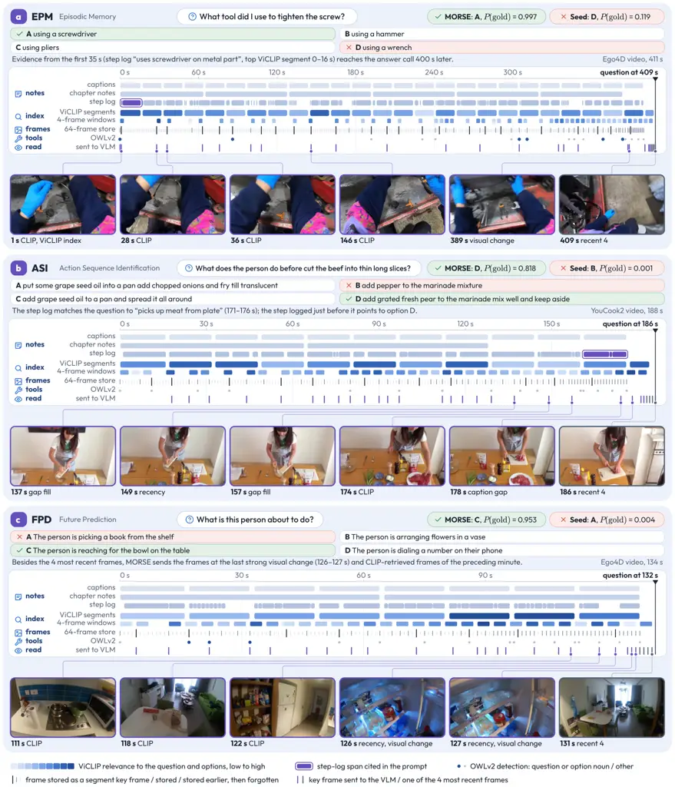

# Morse: Optimizing Streaming Memory Design via Open-World Auto-Research

Ce Zhang    Jianshu Zhang    Jinxi He Affiliation: CMU    Xiyuan Yang
Affiliation: UIUC    Pan Wang Affiliation: Pitt^(\*)Equal
contributionProject page:
[https://zhangce01.github.io/morse/](https://zhangce01.github.io/morse/)
   Han Liu Affiliation: Northwestern    Katia Sycara Affiliation: CMU   
Yaqi Xie Affiliation: UIUC

###### Abstract

A streaming video system must decide in a single pass what evidence to
retain under bounded frame storage, before it knows which details a
future question will require. Recent recursive self-improvement methods
automate the design of the harness that stores and retrieves this
evidence. They revise the harness in response to failures, but the
editor must still devise each repair from its prior knowledge and a
predefined set of tools. A failure that recurs across videos, however,
may point to a problem that prior work has already addressed. We
introduce Morse (Memory Optimization with Recursive Self-Evolvement), an
open-world auto-research framework that uses recurring failures to guide
an online search for solutions. Its editor groups failures in training
traces by cause, then searches papers, model cards, and code for methods
it can adapt or pretrained perception models it can use. When the editor
introduces a new perceptual capability, it can also revise how the
harness stores and retrieves the resulting evidence for a frozen
video-language model. On held-out validation streams, Morse first
selects revisions that improve answer quality, then seeks faster
revisions that preserve those gains within a specified tolerance. Across
three streaming video benchmarks, Morse consistently achieves the
highest answer accuracy within each frozen-backbone comparison. On
OVO-Bench, our Qwen3-VL-8B harness answers queries in 0.30 seconds on
average while achieving 75.1% accuracy, 3.1 percentage points ahead of
the next-best evaluated harness using the same frozen backbone.

Figure 1: From manual design to open-world harness evolution. (a)
Researchers design and revise the memory and retrieval pipelines of
streaming systems \[57, 54, 8, 63\]. (b) Video recursive
self-improvement (RSI) methods \[26, 22, 24\] automate harness revision
from execution feedback within a preconfigured set of models and tools.
(c) Morse makes online research part of this loop. An LLM-based Editor
investigates observed failures through papers, model cards, and code,
then adapts existing methods and requests missing perception tools.
Host-reviewed tool acquisition lets the harness and its available
capabilities evolve together around a frozen answering VLM.

## 1 Introduction

Streaming video understanding requires answering questions about an
ongoing video stream using only observations available at query
time \[31, 21\]. In this single-pass setting, the system has limited
space to store frames and must decide what to preserve before it knows
which details a future question will require. We use the term streaming
_harness_ for the policies that maintain this memory and retrieve
evidence for a video-language model (VLM) \[22\]. As frames arrive, its
write policy selects which observations to retain and how to represent
and organize them in memory. When a question arrives, its read policy
uses the question to retrieve relevant evidence and assemble the context
for the VLM. These policies must be designed together. The write policy
determines which details remain available, and even a retained detail
can help answer a question only if the read policy can locate it within
the latency budget.

As illustrated in Figure 1(a), existing streaming systems use
researcher-designed policies for memory compression, temporal
organization, and query-aware retrieval \[57, 54, 8, 63\]. Recent
recursive self-improvement (RSI) methods automate parts of this design
process by analyzing failures and revising the harness code \[26, 22,
24\]. In the loop shown in Figure 1(b), the editor draws on its prior
knowledge to devise revisions using a predefined set of models and
tools. However, this limits the search to solutions the editor can
recall or develop on its own. Faced with a failure that recurs across
videos, a human researcher would consult the literature to see whether
others have already addressed the underlying problem. Even work on a
different task may offer a method to adapt or a pretrained model that
provides a capability the harness lacks. An editor could follow the same
approach, using the failures it diagnoses to guide an online search for
solutions it can adapt to the harness.

Motivated by this, we introduce Morse (Memory Optimization with
Recursive Self-Evolvement), an _open-world auto-research_ framework that
lets an editor read papers online and adapt relevant methods to its own
streaming video harness.¹¹ 1 To prevent evaluation data leakage, we
block online access to benchmark data and answers and exclude tools
trained or fine-tuned on evaluation videos or annotations. Specifically,
Morse has two roles. The streaming Solver executes the harness, updating
memory as frames arrive and retrieving evidence for a frozen VLM when a
question is asked. The LLM-based Editor inspects the Solver’s training
traces, identifies recurring failures, and searches papers, model pages,
and code for approaches that address their causes. It translates its
findings into changes to the memory and retrieval policies. When a
failure calls for a new perceptual capability, it can request a
pretrained model and adapt these policies to use its outputs after
review and integration. As shown in Figure 1(c), online research informs
both program revisions and the expansion of available perception tools,
allowing the policies and capabilities to evolve together. Held-out
validation guides two stages of evolution: first improving answer
quality, then reducing answer latency while bounding quality loss. Both
stages enforce answer-latency and write-load limits, and the selected
harness becomes the starting point for the next round.

Starting from a simple harness, Morse improves held-out validation
accuracy from 68.3% to 79.4% through recursive evolution. On held-out
test benchmarks with Qwen3-VL-8B, the final harness achieves 75.1% on
OVO-Bench (RT+BT), 78.9% on StreamingBench, and 71.6% on StreamBench,
exceeding the next-best evaluated harness using the same frozen backbone
by 3.1, 2.7, and 6.3 percentage points, respectively. These gains span
backward tracing, contextual reasoning, and memory search. Beyond
accuracy, Morse answers 6.0$`\times`$ and 3.5$`\times`$ faster than
MemEvo and OASIS. Its harness transfers unchanged to
LLaVA-OneVision-2-8B without further evolution.

Our contributions are summarized as follows:

- •
  We introduce Morse, an open-world auto-research framework that uses
  streaming memory failures to guide online research, enabling recursive
  improvements beyond predefined designs and capabilities.
- •
  We expand the search space of harness evolution from program code to
  perceptual capabilities, so that memory and retrieval policies evolve
  together with the perception tools they use while the answering VLM
  stays frozen.
- •
  Experiments on OVO-Bench, StreamingBench, and StreamBench show that
  Morse outperforms existing streaming methods and harness RSI baselines
  across answering models, and ablations quantify the contribution of
  external research and of the expanded capability space.

Figure 2: The Morse optimization loop. _Left:_ the harness $`H_{k}`$
writes observations to memory through $`W_{H}`$ and retrieves evidence
through $`R_{H}`$ for the frozen VLM $`F`$. _Middle:_ the LLM-based
Editor diagnoses errors and costly operations from training traces,
researches solutions, proposes executable revisions, and validates them
on private streams. _Right:_ papers, model cards, and code inform
program edits and tool requests; approved tools become callable after
host integration. _Below:_ accuracy rounds improve answer quality;
efficiency rounds reduce latency with bounded quality loss relative to
both the parent and the stage-entry harness.

## 2 Related Work

Streaming Video Understanding. Streaming video understanding requires
systems to preserve useful history as frames arrive and retrieve
evidence when a question is posed, without access to future
observations. Existing methods address these demands through two
complementary directions. Training-based systems learn continuous
interaction and memory mechanisms within the model \[6, 66, 61\].
Inference-time approaches build on existing backbones by designing how
evidence is stored and accessed: StreamMem and FluxMem compress or
organize visual history \[57, 54\], while ReKV and StreamScout retrieve
cached representations or acquire query-relevant evidence \[8, 63\].
These methods offer different trade-offs between retaining history and
answering efficiently, but their overall memory structures and
processing pipelines are specified by researchers, even when individual
decisions are adaptive or learned. Morse automates the design of these
policies, using observed failures to revise an executable memory and
retrieval program around a frozen answering model.

Harness Recursive Self-Improvement. Recursive self-improvement turns
evaluation feedback into program changes that persist beyond an
individual task. LLM-guided evolution applies this principle to
executable programs, agent workflows, and memory architectures through
repeated proposal, evaluation, and selection \[12, 69, 32, 65\]. For
video understanding, recent methods evolve context-construction and
tool-use programs around frozen perception models \[56, 59\], with
failure diagnosis and controlled feedback guiding the search for more
generalizable harness revisions \[26, 22\]. Closest to our streaming
setting, MemEvo searches causal memory programs with extensible
operators within a fixed model environment \[24\]. DeepEvolve
incorporates online research into program evolution, using external
knowledge to guide algorithm revisions beyond what the editor can
propose from prior knowledge alone \[23\]. Morse combines online
research with host-reviewed acquisition of perception models, evolving
both streaming harness code and its available capabilities under
answer-latency and write-cost constraints.

## 3 Method

Morse uses these failures to guide program revision and external
research. As shown in Figure 2, a Solver answers with a frozen VLM,
while an LLM-based Editor develops its memory and retrieval policies,
first improving answer quality and then reducing execution cost.

### 3.1 Problem Formulation

A video stream supplies frames $`x_{1},x_{2},\ldots`$ sequentially. A
question $`q`$ arriving at time $`t`$ must be answered from $`x_{1:t}`$;
future questions are unknown when memory is written. In our single-pass
setting, memory $`M_{t}`$ comprises a recent-frame window, a persistent
frame store $`V_{t}`$ with $`|V_{t}|\leq G`$, and derived captions,
embeddings, and retrieval indices. Once a frame leaves the window, its
pixels are accessible only if retained in $`V_{t}`$. Derived text and
vectors have no host-imposed global storage bound and can grow with
stream duration.

The harness $`H=(W_{H},R_{H})`$ is an executable program whose write
policy $`W_{H}`$ updates memory as frames arrive and whose read policy
$`R_{H}`$ constructs a query-specific context for the answering model:

```math
\displaystyle M_{t} \displaystyle=W_{H}\big(M_{t-1},x_{t};\,\mathcal{T}\big), \tag{1}
```

```math
\displaystyle\hat{y} \displaystyle=F\big(q,\;R_{H}(M_{t},q;\,\mathcal{T})\big).
```

Here, $`F`$ is the frozen answering VLM and $`\mathcal{T}`$ contains the
callable model services. The harness may change memory organization,
frame selection, retrieval, prompts, and service use while keeping model
weights fixed.

During evolution, we estimate call durations with a fixed linear cost
model to avoid server-load fluctuations affecting selection. Let
$`\ell_{i}`$ denote estimated answer latency for question $`i`$,
including retrieval and VLM calls, and $`w_{s}`$ the estimated
write-path seconds on stream $`s`$ of duration $`S_{s}`$. Over $`N`$
validation questions, the mean latency and maximum write load are

```math
\ell(H)=\frac{1}{N}\sum_{i=1}^{N}\ell_{i},\qquad\omega(H)=\max_{s}\frac{w_{s}}{S_{s}}. \tag{2}
```

An admissible harness satisfies $`\ell(H)\leq L`$ and
$`\omega(H)\leq 1`$, where $`L`$ is the answer-latency budget, as well
as the frame-storage cap. We first improve answer quality within these
limits, then reduce latency with bounded quality loss. During search,
mean correct-option probability serves as a surrogate for discrete
accuracy.

### 3.2 Recursive Harness Optimization

Starting from $`(H_{0},\mathcal{T}_{0})`$, the Editor repeats four
steps. Update $`k`$ produces $`H_{k+1}`$ and is plotted as round
$`k+1`$. Each round starts a fresh session with the current program,
training traces, past candidate scores and diffs, reusable observations,
and available services, allowing later attempts to build on earlier
evidence.

 Diagnose.
The Editor examines training trace $`\tau_{k,i}`$, including stored
evidence, retrieval choices, service outputs, and the VLM’s context.
These traces and revisits to training frames distinguish missing memory
from failed retrieval or perception. The resulting failure groups
$`\mathcal{G}_{k}`$ identify targets such as preserving brief
interactions or recovering earlier procedure steps. Efficiency rounds
also examine correctly answered questions for expensive or redundant
calls.

 Research.
For each target, the Editor searches papers, model pages, and code in
the external collection $`\mathcal{W}`$, gathering findings
$`\mathcal{R}_{k}`$ within a request budget $`B_{\mathrm{res}}`$. A
paper may suggest a better temporal index, while a model page may reveal
an action classifier for interactions missed by frame embeddings.
Interfaces and implementations inform integration. A broker blocks
access to benchmark data and question-answer annotations during
research.

 Propose.
The Editor turns these findings into up to $`B`$ executable candidates
$`\mathcal{C}_{k}`$ and tool requests $`\mathcal{Q}_{k}`$. Candidates
revise which events to record, how to retrieve them, and how to present
evidence. Requests specify missing capabilities, supporting research,
and their integration into these policies. The host controls execution
and service access, reviews training-data provenance, excludes models
trained or fine-tuned on evaluation videos or annotations, and admits
only non-generative additions.

Approved tools become callable after host integration. Let
$`\Delta\mathcal{T}_{k}`$ contain services integrated during round
$`k`$, including earlier pending requests; then
$`\mathcal{T}_{k+1}=\mathcal{T}_{k}\cup\Delta\mathcal{T}_{k}`$.
Candidates may use a service as soon as integration completes. Research
can change both code and perception capabilities.

 Validate.
The host evaluates candidates on the same private validation streams and
returns aggregate quality and cost measurements to select subsequent
harnesses. The Editor sees training questions and traces, but no
validation questions or item-level feedback; test benchmarks remain
outside development and selection. Identical model requests reuse cached
responses for consistent paired comparisons under the same timing
convention.

### 3.3 Accuracy and Efficiency Gates

Morse uses $`K_{\mathrm{acc}}`$ rounds to improve answer quality, then
$`K_{\mathrm{eff}}`$ rounds to reduce cost, with
$`K=K_{\mathrm{acc}}+K_{\mathrm{eff}}`$. Following prior work \[26,
24\], selection uses held-out streams.

Answer quality. For $`N`$ validation questions with gold answers
$`y_{i}`$ and predictions $`\hat{y}_{i}`$, let $`p_{i}`$ be the
correct-option probability renormalized over valid option letters at the
answer position. We compute

```math
\bar{P}(H)=\frac{1}{N}\sum_{i=1}^{N}p_{i},\qquad c(H)=\sum_{i=1}^{N}[\hat{y}_{i}=y_{i}]. \tag{3}
```

Brackets denote a Boolean indicator. Unlike accuracy $`c/N`$,
$`\bar{P}`$ detects gains before predictions change. For candidate
$`H^{\prime}`$ and parent $`H`$, let
$`\Delta\bar{P}=\bar{P}(H^{\prime})-\bar{P}(H)`$,
$`\Delta c=c(H^{\prime})-c(H)`$, and $`\ell^{\prime}=\ell(H^{\prime})`$.

Accuracy gate. The accuracy gate $`g_{\mathrm{acc}}`$ requires a
probability gain of at least $`\delta`$:

```math
\Delta\bar{P}\geq\delta. \tag{4}
```

Relative latency and correct counts are unconstrained.

Efficiency gate. The efficiency gate $`g_{\mathrm{eff}}`$ bounds latency
by a fraction $`\rho`$ of the parent’s and limits quality loss:

```math
\ell^{\prime}\leq\rho\,\ell(H),\quad\Delta\bar{P}\geq-\epsilon,\quad\Delta c\geq-\kappa. \tag{5}
```

We bound per-update losses by $`\epsilon`$ and $`\kappa`$, and total
losses relative to the stage-entry harness
$`H_{\mathrm{acc}}=H_{K_{\mathrm{acc}}}`$:

```math
\displaystyle\bar{P}(H^{\prime}) \displaystyle\geq\bar{P}(H_{\mathrm{acc}})-\epsilon_{\mathrm{tot}}, \tag{6}
```

```math
\displaystyle c(H^{\prime}) \displaystyle\geq c(H_{\mathrm{acc}})-\kappa_{\mathrm{tot}}.
```

Resource limits. Both gates require $`\ell(H^{\prime})\leq L`$,
$`\omega(H^{\prime})\leq 1`$, and completion of all validation streams
with unchanged question counts. Let $`g_{k}`$ denote the accuracy gate
for $`k<K_{\mathrm{acc}}`$ and the efficiency gate thereafter.

Merging and selection. The Editor may reapply saved diffs from rejected
candidates to the current head, submitting the combined program as a new
candidate that must pass the gate. Separately, the merge stage combines
current-round candidates that pass the gate and share a parent; each
merged program is revalidated.

Let $`\mathcal{A}_{k}`$ contain this round’s passing candidates and
merges, and $`\mathcal{U}_{k}`$ the archived, qualified but unselected
candidates. Accuracy selection pools these with the current head,
$`\mathcal{S}_{k}=\{H_{k}\}\cup\mathcal{A}_{k}\cup\mathcal{U}_{k}`$;
efficiency selection uses only
$`\mathcal{S}_{k}=\{H_{k}\}\cup\mathcal{A}_{k}`$. After deduplication,
we select within numerical tie tolerances:

```math
H_{k+1}=\begin{cases}\displaystyle\arg\max_{H\in\mathcal{S}_{k}}\bar{P}(H),&k<K_{\mathrm{acc}},\\[2.0pt]
\displaystyle\arg\min_{H\in\mathcal{S}_{k}}\ell(H),&k\geq K_{\mathrm{acc}}.\end{cases} \tag{7}
```

Accuracy ties favor lower latency; efficiency ties favor higher
$`\bar{P}`$. The head is retained for equivalent metrics or when no
alternative is selected.

## 4 Experiments

|                                                                                                                                               |         |                             |      |      |      |      |      |      |                  |      |      |      |         |
| --------------------------------------------------------------------------------------------------------------------------------------------- | ------- | --------------------------- | ---- | ---- | ---- | ---- | ---- | ---- | ---------------- | ---- | ---- | ---- | ------- |
| Model / Method                                                                                                                                | Frames  | Real-Time Visual Perception |      |      |      |      |      |      | Backward Tracing |      |      |      | Overall |
|                                                                                                                                               |         | OCR                         | ACR  | ATR  | STU  | FPD  | OJR  | Avg. | EPM              | ASI  | HLD  | Avg. |         |
| Proprietary pretrained models                                                         |         |                             |      |      |      |      |      |      |                  |      |      |      |         |
| ![[Uncaptioned image]](arxiv-2611-30011--f659f82978b0.figures/figure-1.webp) Gemini 1.5 Pro                                                   | 1 fps   | 85.9                        | 67.0 | 79.3 | 58.4 | 63.4 | 62.0 | 68.7 | 58.6             | 76.4 | 52.6 | 61.0 | 65.4    |
|  GPT-4o                                                                                                                                       | 64      | 69.8                        | 64.2 | 71.6 | 51.1 | 70.3 | 59.8 | 63.2 | 57.9             | 75.7 | 48.7 | 59.4 | 61.6    |
|  GPT-5-mini                                                                                                                                   | 64      | 81.2                        | 67.9 | 81.9 | 66.3 | 73.3 | 66.3 | 72.2 | 66.7             | 75.7 | 16.1 | 53.9 | 64.3    |
|  GPT-5.1                                                                                                                                      | 64      | 83.2                        | 78.9 | 77.6 | 67.4 | 79.2 | 76.6 | 76.6 | 62.0             | 73.7 | 38.7 | 57.8 | 68.5    |
| Open-source pretrained models |         |                             |      |      |      |      |      |      |                  |      |      |      |         |
| LLaVA-Video-7B \[71\]                                                                                                                         | 64      | 69.1                        | 58.7 | 68.8 | 49.4 | 74.3 | 59.8 | 62.1 | 56.2             | 57.4 | 7.5  | 42.2 | 53.5    |
| LLaVA-OneVision-7B \[17\]                                                                                                                     | 64      | 66.4                        | 57.8 | 73.3 | 53.4 | 71.3 | 62.0 | 63.1 | 54.2             | 55.4 | 21.5 | 44.9 | 55.3    |
| LLaVA-OneVision-2-8B \[1\]                                                                                                                    | 0.5 fps | 62.4                        | 62.4 | 69.0 | 61.8 | 62.0 | 54.9 | 61.5 | 53.2             | 62.8 | 21.0 | 46.0 | 54.8    |
| Qwen2-VL-7B \[48\]                                                                                                                            | 64      | 60.4                        | 50.5 | 56.0 | 47.2 | 66.3 | 55.4 | 55.3 | 47.8             | 35.5 | 56.1 | 47.4 | 51.9    |
| Qwen2-VL-72B \[48\]                                                                                                                           | 64      | 65.8                        | 60.6 | 69.8 | 51.7 | 69.3 | 54.4 | 60.6 | 52.5             | 60.8 | 57.5 | 56.0 | 58.6    |
| Open-source streaming models  |         |                             |      |      |      |      |      |      |                  |      |      |      |         |
| Flash-VStream-7B \[66\]                                                                                                                       | 1 fps   | 24.2                        | 29.4 | 28.5 | 33.7 | 25.7 | 28.8 | 28.7 | 39.1             | 37.2 | 5.9  | 28.8 | 28.8    |
| VideoLLM-online-8B \[6\]                                                                                                                      | 2 fps   | 8.1                         | 23.9 | 12.1 | 14.0 | 45.5 | 21.2 | 19.4 | 22.2             | 18.8 | 12.2 | 18.5 | 19.0    |
| StreamChat \[55\]                                                                                                                             | 15 fps  | 51.7                        | 47.7 | 58.6 | 41.0 | 61.1 | 47.8 | 50.1 | 50.2             | 54.1 | 37.6 | 47.4 | 49.0    |
| Dispider \[34\]                                                                                                                               | 1 fps   | 57.7                        | 49.5 | 62.1 | 44.9 | 61.4 | 51.6 | 53.6 | 48.5             | 55.4 | 4.3  | 37.1 | 46.5    |
| Qwen2.5-VL-7B \[3\]                                                                                                                           | 0.5 fps | 76.5                        | 57.8 | 68.1 | 46.6 | 66.3 | 56.5 | 60.9 | 49.8             | 58.1 | 44.6 | 50.2 | 56.3    |
| \+ HERMES (4K) \[67\]                                                                                                                         | 0.5 fps | 85.2                        | 64.2 | 71.6 | 53.4 | 74.3 | 65.2 | 68.1 | 48.5             | 62.2 | 37.6 | 48.5 | 59.7    |
| \+ FluxMem \[54\]                                                                                                                             | 1 fps   | 81.2                        | 59.6 | 70.7 | 53.4 | 75.3 | 63.0 | 66.3 | 48.5             | 64.2 | 29.0 | 46.4 | 57.8    |
| \+ OASIS \[20\]                                                                                                                               | 48/80   | 85.2                        | 72.5 | 66.4 | 52.3 | 67.3 | 64.7 | 67.3 | 51.9             | 58.8 | 48.9 | 52.6 | 61.0    |
| \+ StreamScout (zero-shot) \[63\]                                                                                                             | 4/12/24 | 92.0                        | 77.1 | 74.1 | 59.0 | 74.3 | 77.7 | 75.3 | 53.5             | 60.1 | 36.6 | 50.1 | 64.4    |
| \+ MemEvo^(†) \[24\] RSI                                                                                                                      | 1 fps   | 92.6                        | 77.1 | 79.3 | 58.4 | 73.3 | 69.6 | 74.1 | 59.6             | 58.8 | 32.8 | 51.5 | 64.4    |
|   + Morse (Ours) RSI                                                                                                                          | 1 fps   | 89.3                        | 70.6 | 83.6 | 62.9 | 74.3 | 81.5 | 76.9 | 59.9             | 64.2 | 58.6 | 60.5 | 69.9    |
| Qwen3-VL-8B \[2\]                                                                                                                             | 0.5 fps | 83.9                        | 58.7 | 70.7 | 56.2 | 69.3 | 64.1 | 66.8 | 51.2             | 60.8 | 43.6 | 51.2 | 60.1    |
| \+ FluxMem^(†) \[54\]                                                                                                                         | 1 fps   | 85.9                        | 71.6 | 73.3 | 57.9 | 71.3 | 66.8 | 70.4 | 58.9             | 66.2 | 22.6 | 49.9 | 61.6    |
| \+ OASIS \[20\]                                                                                                                               | 48/80   | 92.6                        | 81.7 | 78.5 | 65.2 | 68.0 | 78.3 | 77.3 | 58.3             | 67.6 | 51.6 | 58.5 | 69.2    |
| \+ StreamScout (zero-shot) \[63\]                                                                                                             | 4/12/24 | 91.3                        | 82.6 | 82.8 | 64.0 | 75.3 | 75.0 | 77.7 | 55.2             | 61.5 | 63.4 | 59.1 | 69.7    |
| \+ MemEvo^(†) \[24\] RSI                                                                                                                      | 1 fps   | 92.6                        | 87.2 | 79.3 | 69.1 | 74.3 | 84.2 | 81.0 | 63.0             | 66.2 | 50.5 | 60.1 | 72.0    |
|   + Morse (Ours) RSI                                                                                                                          | 1 fps   | 95.3                        | 84.4 | 82.8 | 71.9 | 80.2 | 82.1 | 82.4 | 61.6             | 73.0 | 65.1 | 65.3 | 75.1    |
| Qwen3.8-27B \[35\]                                                                                                                            | 1 fps   | 79.9                        | 60.6 | 81.9 | 58.4 | 76.2 | 66.3 | 69.7 | 65.3             | 68.2 | 94.1 | 74.5 | 71.7    |
| \+ FluxMem^(†) \[54\]                                                                                                                         | 1 fps   | 90.6                        | 78.9 | 80.2 | 70.8 | 77.2 | 82.9 | 80.1 | 64.7             | 68.2 | 79.8 | 70.0 | 75.8    |
| \+ MemEvo^(†) \[24\] RSI                                                                                                                      | 1 fps   | 94.0                        | 85.3 | 82.8 | 60.7 | 77.2 | 83.2 | 79.8 | 70.4             | 57.4 | 44.1 | 59.6 | 71.1    |
|   + Morse (Ours) RSI                                                                                                                          | 1 fps   | 94.6                        | 85.3 | 85.3 | 75.8 | 83.2 | 84.8 | 84.6 | 68.4             | 74.3 | 77.4 | 72.4 | 79.4    |

Table 1: Performance comparison on OVO-Bench RT+BT (%). Avg. is the
question-weighted accuracy over all questions of a category (837
real-time, 631 backward-tracing), and Overall is the accuracy over all
1,468 questions; prior methods are aggregated from their published
per-task accuracies in the same way. Gray rows are backbone references,
RSI denotes recursively evolved harnesses, and ^(†) marks results of our
reimplementation. Within each backbone, bold and underlined scores mark
the best and second-best methods.

We evaluate Morse on three streaming video benchmarks, trace the
development of the evolved harness, and analyze its inference
efficiency. We then examine the contributions of online research and
tool acquisition, and test whether the resulting harness transfers to
other answering models.

### 4.1 Experimental Setup

Benchmarks and data. The Editor diagnoses failures on 780 training
questions from 370 streams, drawn from NExT-GQA \[53\], STAR \[52\],
ReXTime \[7\], COIN \[41\], YouCook2 \[72\], and the COIN subset of
OVBench \[13\]. It can inspect the training questions and execution
traces. Candidate selection uses a separate validation set of 388
questions from 182 streams of the same sources; only aggregate
validation scores are exposed to the Editor. The two splits share no
videos. For testing, we use OVO-Bench \[31\], StreamingBench \[21\], and
StreamBench \[55\]. The first two report question-weighted
multiple-choice accuracy, while StreamBench uses its official LLM-judged
protocol for free-form answers. Each query has access only to
observations available at its timestamp. Test videos are excluded from
training, validation, and model selection, with video overlap checked
across the splits.

Implementation. We evolve a separate harness for each of three frozen
answering models: Qwen2.5-VL-7B \[3\], Qwen3-VL-8B-Instruct \[2\], and
Qwen3.8-27B \[35\], each served with vLLM and greedy decoding. All runs
sample video at 1 fps and cap the persistent frame store at $`G=64`$
frames. A separate 16-second window provides recent frames, while text
and embeddings have no global storage cap. Each VLM call uses at most 32
frames and 256 visual tokens per frame. The seed $`H_{0}`$ answers from
16-second VLM captions and the four most recent frames; these four
frames remain in every answer call and do not occupy the persistent
store. The initial perception tools are CLIP ViT-L/14 \[36\] and OCR,
alongside the answering VLM. The Editor uses Claude Opus 5.5 in Claude
Code with a fresh sandboxed session per round. The broker logs all
searches and page reads and blocks benchmark repositories, dataset
pages, and question-answer annotations.

|                                                                                                                                                |         |                |      |      |      |      |             |      |      |      |      |      |      |
| ---------------------------------------------------------------------------------------------------------------------------------------------- | ------- | -------------- | ---- | ---- | ---- | ---- | ----------- | ---- | ---- | ---- | ---- | ---- | ---- |
| Model / Method                                                                                                                                 | Frames  | StreamingBench |      |      |      |      | StreamBench |      |      |      |      |      |      |
|                                                                                                                                                |         | Real-Time      | ACU  | MCU  | SQA  | Avg. | OS          | LM   | SM   | CI   | KG   | SF   | Avg. |
| Proprietary pretrained models                                                         |         |                |      |      |      |      |             |      |      |      |      |      |      |
| ![[Uncaptioned image]](arxiv-2611-30011--f659f82978b0.figures/figure-1.webp) Gemini 1.5 Pro                                                    | 1 fps   | 75.7           | 51.4 | 40.7 | 54.8 | 69.5 | –           | –    | –    | –    | –    | –    | –    |
|  GPT-4o                                                                                                                                        | 64 / 50 | 73.3           | 41.2 | 38.4 | 32.8 | 65.0 | 60.5        | 61.2 | 64.4 | 72.3 | 93.9 | 74.7 | 71.0 |
|  GPT-5-mini                                                                                                                                    | 64      | 82.6           | 46.0 | 52.8 | 54.4 | 75.3 | 68.6        | 75.6 | 73.2 | 79.8 | 64.4 | 79.8 | 73.6 |
|  GPT-5.1                                                                                                                                       | 64      | 83.5           | 49.6 | 51.2 | 52.4 | 76.0 | 67.2        | 67.0 | 72.0 | 79.5 | 66.8 | 82.1 | 72.4 |
| Open-source streaming models |         |                |      |      |      |      |             |      |      |      |      |      |      |
| Flash-VStream-7B \[66\]                                                                                                                        | 1 fps   | 23.2           | –    | –    | –    | –    | 37.1        | 44.5 | 48.6 | 58.1 | 66.4 | 59.2 | 52.1 |
| VideoLLM-online-8B \[6\]                                                                                                                       | 5 fps   | –              | –    | –    | –    | –    | 41.4        | 48.8 | 52.9 | 62.7 | 69.2 | 64.1 | 56.4 |
| StreamChat \[55\]                                                                                                                              | 15 fps  | 60.1           | 28.8 | 22.4 | 32.0 | 52.6 | 40.7        | 43.6 | 47.1 | 63.0 | 89.1 | 73.8 | 59.5 |
| Qwen2.5-VL-7B \[3\]                                                                                                                            | 0.5 fps | 66.0           | 33.2 | 30.1 | 34.0 | 58.3 | 36.1        | 41.3 | 41.0 | 50.5 | 76.5 | 62.3 | 51.1 |
| \+ OASIS \[20\]                                                                                                                                | 48/80   | 70.6           | 38.8 | 36.0 | 46.0 | 63.6 | 35.9        | 39.4 | 44.1 | 54.5 | 76.9 | 64.9 | 52.4 |
| \+ StreamScout (zero-shot) \[63\]                                                                                                              | 4/12/24 | 77.7           | 58.0 | 39.2 | 53.2 | 71.3 | 34.8        | 32.0 | 43.5 | 41.4 | 83.6 | 63.8 | 49.7 |
| \+ MemEvo^(†) \[24\] RSI                                                                                                                       | 1 fps   | 78.3           | 54.0 | 50.0 | 47.6 | 71.9 | 33.8        | 42.2 | 49.6 | 47.5 | 55.0 | 68.2 | 49.4 |
|   + Morse (Ours) RSI                                                                                                                           | 1 fps   | 82.3           | 56.0 | 50.4 | 56.4 | 75.8 | 42.8        | 43.9 | 57.2 | 50.8 | 86.2 | 76.2 | 59.5 |
| Qwen3-VL-8B \[2\]                                                                                                                              | 0.5 fps | 72.8           | 35.6 | 35.7 | 43.9 | 64.9 | 33.8        | 50.5 | 47.8 | 69.4 | 73.5 | 62.6 | 56.0 |
| \+ OASIS \[20\]                                                                                                                                | 48/80   | 78.2           | 42.7 | 49.6 | 48.4 | 71.0 | 47.0        | 53.6 | 54.3 | 71.7 | 86.1 | 67.6 | 62.1 |
| \+ StreamScout (zero-shot) \[63\]                                                                                                              | 4/12/24 | 80.3           | 48.0 | 42.0 | 42.0 | 71.9 | 52.5        | 51.8 | 61.4 | 71.4 | 84.6 | 70.8 | 65.3 |
| \+ MemEvo^(†) \[24\] RSI                                                                                                                       | 1 fps   | 81.8           | 57.2 | 59.6 | 56.4 | 76.2 | 57.5        | 55.1 | 65.2 | 76.1 | 26.5 | 81.5 | 60.5 |
|   + Morse (Ours) RSI                                                                                                                           | 1 fps   | 84.2           | 61.2 | 64.4 | 58.4 | 78.9 | 65.9        | 57.4 | 73.5 | 73.7 | 70.8 | 88.1 | 71.6 |
| Qwen3.8-27B \[35\]                                                                                                                             | 1 fps   | 80.1           | 44.8 | 34.0 | 43.6 | 71.0 | 44.8        | 58.1 | 57.2 | 76.1 | 75.8 | 73.5 | 64.1 |
| \+ MemEvo^(†) \[24\] RSI                                                                                                                       | 1 fps   | 78.0           | 44.0 | 56.4 | 41.6 | 70.9 | 82.6        | 65.4 | 79.7 | 79.1 | 40.6 | 86.1 | 72.4 |
|   + Morse (Ours) RSI                                                                                                                           | 1 fps   | 89.0           | 73.2 | 71.6 | 70.0 | 85.0 | 76.3        | 72.0 | 79.1 | 81.5 | 73.8 | 85.1 | 78.0 |

Table 2: Performance comparison on StreamingBench and StreamBench (%).
StreamingBench Avg. is the question-weighted accuracy over its four
subsets, and StreamBench uses its official LLM-judged protocol. GPT-4o
uses 64 frames for StreamingBench and 50 for StreamBench \[55\]. Gray
rows are backbone references, purple RSI tags denote recursively evolved
harnesses, and ^(†) marks results of our reimplementation. Within each
backbone, bold and underlined scores mark the best and second-best
methods.

Evolution settings. We run $`K_{\mathrm{acc}}=20`$ accuracy rounds
followed by $`K_{\mathrm{eff}}=5`$ efficiency rounds. Each round
proposes at most $`B=6`$ initial candidates before merges, with a
research budget $`B_{\mathrm{res}}`$ of 30 paper requests and 40 web
requests. Accuracy updates must increase the mean correct-option
probability by at least $`\delta=0.004`$. Efficiency updates use
$`\rho=0.9`$ to require at least a 10% reduction in answer latency,
while losing at most $`\epsilon=0.003`$ in mean correct-option
probability and $`\kappa=2`$ correct answers relative to the current
harness. Total losses relative to the start of the efficiency stage are
capped at $`\epsilon_{\mathrm{tot}}=0.008`$ and
$`\kappa_{\mathrm{tot}}=4`$ correct answers. During evolution, both
stages apply the $`L=1`$ s gate to estimated mean latency on the
validation set and enforce $`\omega(H)\leq 1`$, using fixed call-cost
coefficients to avoid server-load fluctuations. Test-time latency and
write cost are measured on a single NVIDIA H100 GPU.

### 4.2 Main Results

Results on OVO-Bench. Morse achieves the highest overall accuracy within
all three backbone groups in Table 1. With Qwen3-VL-8B, it reaches
75.1%, ahead of the manually designed StreamScout at 69.7% and the
evolved MemEvo program at 72.0%. The task breakdown helps explain this
advantage. Relative to MemEvo, the margin is larger on backward tracing
than on real-time perception, indicating that better use of past
observations is an important source of improvement. The same pattern
holds with Qwen2.5-VL-7B, where backward-tracing accuracy reaches 60.5%,
7.9 points above the best competing score on this subset. With
Qwen3.8-27B, the larger advantage over FluxMem, the strongest competing
harness overall, is instead in real-time perception. Harness evolution
benefits different model sizes and temporal tasks, although the
capabilities that improve most differ across backbones.

Results on StreamingBench and StreamBench. As shown in Table 2, Morse
achieves the highest average score within all three backbone groups on
both benchmarks. On StreamingBench, Qwen3-VL-8B improves all four
subsets over MemEvo. The gains on anomaly and misleading context
understanding suggest that the evolved harness supplies useful
historical evidence for interpreting current observations. On
StreamBench, the same backbone reaches 71.6%, compared with 65.3% for
StreamScout, the strongest competing harness. It leads in four of six
categories, with clear advantages in object search and short-term memory
search. These results support the usefulness of the evolved memory and
retrieval policies for both contextual reasoning and free-form answers,
beyond the multiple-choice format used during evolution. With this
backbone, other harnesses remain stronger on conversational interaction
and knowledge-based questions.

The advantage also holds in a domain absent from evolution: on the
driving videos of ODV-Bench \[61\], Morse reaches 67.1% with
Qwen3-VL-8B, compared with 62.6% for MemEvo and 58.6% for the model
alone (Appendix C).

### 4.3 Evolution Analysis

Figure 3: Harness evolution with Qwen3-VL-8B. _Top & middle:_ accuracy
and estimated answer latency on the validation set. Lines track the
current harness, while small marks show evaluated candidates. Large
circles and diamonds denote accepted individual revisions. _Bottom:_
tool availability and use. Thick segments indicate use by the accepted
harness; crosses mark removal and open squares mark relocation to the
write path. Circles indicate candidates using a newly installed tool,
filled when they enter an accepted harness.

In Figure 3, the Qwen3-VL-8B harness first improves evidence
preservation and retrieval, then simplifies execution. Missing past
evidence motivates visual recall, while event-order errors motivate
chapter summaries and a step log. X-CLIP \[29\], OWLv2 \[28\], and
VideoMAE \[43\] provide clip matching, object selection, and action
cues.

| Benchmark      |         | $`H_{0}`$ | $`H_{\mathrm{S3}}`$ | $`H_{\mathrm{S7}}`$ | $`H_{\mathrm{S11}}`$ | Gain      |
| -------------- | ------- | --------- | ------------------- | ------------------- | -------------------- | --------- |
|                |         | seed      | round 3             | round 20            | round 24             | over seed |
| OVO-Bench      | RT      | 78.4      | 80.0                | 82.7                | 82.4                 | +4.0      |
|                | BT      | 52.8      | 61.3                | 64.8                | 65.3                 | +12.5     |
|                | Overall | 67.4      | 72.0                | 75.0                | 75.1                 | +7.7      |
| StreamingBench |         | 72.8      | 77.2                | 79.3                | 78.9                 | +6.1      |
| StreamBench    |         | 64.1      | 68.0                | 70.8                | 71.6                 | +7.5      |

Table 3: Test accuracy along the evolution (%). Qwen3-VL-8B checkpoints:
the seed $`H_{0}`$, $`H_{\mathrm{S3}}`$ after round 3,
$`H_{\mathrm{S7}}`$ after the accuracy stage, and the final harness
$`H_{\mathrm{S11}}`$. RT and BT are the real-time and backward-tracing
averages; Gain is the improvement of the final harness over the seed.

Validation keeps tool use selective: cropping and optical flow are
explored without entering the accepted harness. Meanwhile, the arcs
trace code from rejected candidates that the Editor reapplies to the
current head and submits as new combinations. Validation tests each
combined program, allowing the search to build on earlier attempts.
Table 3 evaluates four checkpoints chosen by their positions in the run:
the seed $`H_{0}`$, $`H_{\mathrm{S3}}`$ after round 3,
$`H_{\mathrm{S7}}`$ after the accuracy stage, and the final
$`H_{\mathrm{S11}}`$, the eleventh accepted update. By
$`H_{\mathrm{S3}}`$, past-frame recall, a revised prompt, and an action
classifier produce the largest jump in backward tracing. Later accuracy
rounds further improve all three test benchmarks, extending progress
beyond the initial recall mechanism. Overall, backward-tracing accuracy
rises from 52.8% to 65.3%, against 78.4% to 82.4% in real-time
perception. Since the seed already supplies recent frames, evolution
brings its larger benefit to questions about the past.

The efficiency stage moves object detection to memory construction,
replaces repeated clip scoring with a write-time ViCLIP \[49\] index,
and removes action-classifier calls. Originally requested for
procedure-step boundaries, ViCLIP instead enables cheaper retrieval,
showing how an acquired capability can serve a new purpose. From
$`H_{\mathrm{S7}}`$ to $`H_{\mathrm{S11}}`$, estimated validation
latency falls from 0.73 s to 0.17 s, while test accuracy changes by at
most 0.8 points per benchmark. Reorganizing computation thus preserves
the accuracy-stage gains with less query-time work. Appendix B details
the research and revision history.

### 4.4 Efficiency Analysis

Figure 4: Inference efficiency on OVO-Bench. Measured mean answer
latency and streaming write cost, using Qwen3-VL-8B for all methods.
Each bar separates VLM calls from calls to other models. The direct VLM
uses at most 128 frames at 1 fps without memory; $`H_{0}`$,
$`H_{\mathrm{S7}}`$, and $`H_{\mathrm{S11}}`$ are the seed, the harness
after the accuracy rounds, and the final harness.

Streaming inference incurs both continuous memory-construction cost and
the latency experienced when a question arrives. Figure 4 separates
these costs on OVO-Bench using Qwen3-VL-8B for every method. Morse
answers in 0.30 s on average, 6.0$`\times`$ faster than MemEvo and
3.5$`\times`$ faster than OASIS. Together with the higher OVO-Bench
accuracy in Table 1, this shows that richer historical evidence need not
require slower answers. It is also 1.6$`\times`$ faster than answering
directly from sampled frames. The seed $`H_{0}`$ remains faster, but
cannot retrieve past frames once they leave the recent window, as
reflected in the backward-tracing results in Table 3. The cost breakdown
shows where this speed comes from. After the accuracy rounds,
$`H_{\mathrm{S7}}`$ answers in 0.82 s, of which 0.49 s goes to encoder
and detector calls made when a question arrives. The efficiency rounds
move reusable computation to memory construction and remove redundant
calls: the write cost rises from 0.87 s to 1.19 s per 8 s of video, and
answer latency falls to 0.30 s, making the final harness 2.7$`\times`$
faster than $`H_{\mathrm{S7}}`$. Its write cost is still 33% below
MemEvo’s, because VLM calls consume 0.77 s against MemEvo’s 1.49 s, a
saving that more than offsets the encoder and detector calls. OASIS
spends only 0.76 s on writing but answers more slowly and less
accurately. Appendix C gives further cost and token results.

| Variant                | Research | Tools | RT        | BT         | Overall   |
| ---------------------- | -------- | ----- | --------- | ---------- | --------- |
| Seed harness $`H_{0}`$ | –        | –     | 78.4      | 52.8       | 67.4      |
| w/o tool requests      | ✓        | ✗     | 78.9 +0.5 | 59.7 +6.9  | 70.6 +3.2 |
| w/o online research    | ✗        | ✓     | 80.8 +2.4 | 62.4 +9.6  | 72.9 +5.5 |
|  Morse (Ours)          | ✓        | ✓     | 82.4 +4.0 | 65.3 +12.5 | 75.1 +7.7 |

Table 4: Contribution of the open-world components on OVO-Bench (%). The
seed $`H_{0}`$ is evaluated before evolution; each of the other three
variants runs 25 rounds from this seed with Qwen3-VL-8B. RT and BT are
the real-time and backward-tracing averages; subscripts give the gain
over the seed harness $`H_{0}`$.

### 4.5 Further Discussions

Contribution of different components. We separate the contribution of
consulting external resources from that of expanding the available
tools. Starting from the same seed $`H_{0}`$, we repeat evolution with
Qwen3-VL-8B under the same data splits, round and candidate budgets, and
gates. Without online research, the Editor can still request tools from
its prior knowledge, subject to host review. Without tool requests, it
can still read papers, model cards, and code, but must build every
candidate from the initial inventory $`\mathcal{T}_{0}`$.

As shown in Table 4, removing online research lowers OVO-Bench accuracy
from 75.1% to 72.9% even though tool acquisition remains available. This
supports the value of consulting existing work beyond what the Editor
can propose from its own knowledge. Conversely, online research with a
fixed tool inventory reaches 70.6%. Program revision within this
inventory still improves the seed’s 67.4%, but the full method benefits
further from making new perception capabilities available. Both removals
hurt backward tracing more than real-time perception, linking their
contribution particularly to the preservation and retrieval of
historical evidence. These comparisons support using online research and
tool acquisition together in the evolution loop.

| Model / Method             | RT         | BT         | Overall    |
| -------------------------- | ---------- | ---------- | ---------- |
| LLaVA-OneVision-2-8B \[1\] | 61.5       | 46.0       | 54.8       |
| + MemEvo^(†) \[24\]        | 74.8 +13.3 | 52.8 +6.8  | 65.3 +10.5 |
|   + Morse (Ours)           | 81.0 +19.5 | 58.0 +12.0 | 71.1 +16.3 |
| Gemma-4-26B-A4B \[10\]     | 71.7       | 57.1       | 65.4       |
| + MemEvo^(†) \[24\]        | 77.5 +5.8  | 62.0 +4.9  | 70.8 +5.4  |
|   + Morse (Ours)           | 82.6 +10.9 | 65.1 +8.0  | 75.1 +9.7  |

Table 5: Transfer to other answering models on OVO-Bench (%). Each model
is evaluated alone, with MemEvo, and with the harness that Morse evolved
with Qwen3-VL-8B, applied unchanged with its tools. Subscripts give the
change relative to the model alone. RT and BT are the real-time and
backward-tracing averages, and ^(†) marks results of our
reimplementation.

Transfer across answering models. The main results use a separately
evolved harness for each backbone. Here we test whether the revisions
remain useful to models whose failures did not guide evolution. We keep
the program and tools of the Qwen3-VL-8B harness $`H_{\mathrm{S11}}`$
unchanged and replace the answering model with
LLaVA-OneVision-2-8B \[1\] or Gemma-4-26B-A4B \[10\], two models from
other families. Table 5 compares the transferred harness with each
target model alone and with MemEvo applied to the same model. With
LLaVA-OneVision-2-8B, the transferred harness raises OVO-Bench accuracy
from 54.8% to 71.1% without another evolution run, improving real-time
perception by 19.5 points and backward tracing by 12.0 points. With
Gemma-4-26B-A4B, it raises accuracy from 65.4% to 75.1%. MemEvo also
improves both models, to 65.3% and 70.8%, but Morse stays 5.8 and 4.3
points ahead. This suggests that the revised evidence organization
remains useful across answering models.

## 5 Conclusion

We presented Morse, an open-world auto-research framework that uses
recurring failures to guide online research for improving streaming
video harnesses. Its central idea is to seek out and adapt existing
solutions, allowing memory and retrieval policies to evolve together
with their perception tools while the answering VLM remains frozen.
Experiments on OVO-Bench, StreamingBench, and StreamBench show
improvements over competing harnesses across answering models, and the
OVO-Bench efficiency evaluation shows lower answer latency than MemEvo
and OASIS. The evolution analysis illustrates how capabilities
introduced to address failures can later be reorganized to reduce
computation. These findings support a practical approach to recursive
self-improvement: learning when and how to reuse published methods and
models, with validation determining which changes benefit the harness.

## Acknowledgments

This work has been funded in part by the ARL award W911QX-24-F-0049,
DARPA award FA8750-23-2-1015, ONR award N00014-23-1-2840, ONR MURI grant
N00014-25-1-2116, and USDA-NIFA award 2021-67021-35329.

## References

- \[1\] X. An, Y. Xie, K. Yang, W. Zhang, X. Zhao, Z. Cheng, Y. Wang, S.
  Xu, C. Chen, D. Zhu, C. Wu, H. Tan, C. Li, J. Yang, J. Yu, X. Wang, B.
  Qin, Y. Wang, Z. Yan, Z. Feng, Z. Liu, B. Li, and J. Deng (2026)
  LLaVA-OneVision-2: open multimodal training at scale. Note: Technical
  reportURL:
  [https://www.lmms-lab.com/posts/llava_onevision_2/](https://www.lmms-lab.com/posts/llava_onevision_2/)
  External Links:
  [Link](https://www.lmms-lab.com/posts/llava_onevision_2/) Cited by:
  §4.5, Table 1, Table 5.
- \[2\] S. Bai, Y. Cai, R. Chen, K. Chen, X. Chen, Z. Cheng, L. Deng, W.
  Ding, C. Gao, C. Ge, W. Ge, Z. Guo, Q. Huang, J. Huang, F. Huang, B.
  Hui, S. Jiang, Z. Li, M. Li, M. Li, K. Li, Z. Lin, J. Lin, X. Liu, J.
  Liu, C. Liu, Y. Liu, D. Liu, S. Liu, D. Lu, R. Luo, C. Lv, R. Men, L.
  Meng, X. Ren, X. Ren, S. Song, Y. Sun, J. Tang, J. Tu, J. Wan, P.
  Wang, P. Wang, Q. Wang, Y. Wang, T. Xie, Y. Xu, H. Xu, J. Xu, Z.
  Yang, M. Yang, J. Yang, A. Yang, B. Yu, F. Zhang, H. Zhang, X.
  Zhang, B. Zheng, H. Zhong, J. Zhou, F. Zhou, J. Zhou, Y. Zhu, and K.
  Zhu (2025) Qwen3-VL technical report. arXiv preprint arXiv:2511.21631.
  Note: URL:
  [https://arxiv.org/abs/2511.21631](https://arxiv.org/abs/2511.21631)
  External Links: 2511.21631, [Link](https://arxiv.org/abs/2511.21631)
  Cited by: Table 10, §4.1, Table 1, Table 2.
- \[3\] S. Bai, K. Chen, X. Liu, J. Wang, W. Ge, S. Song, K. Dang, P.
  Wang, S. Wang, J. Tang, H. Zhong, Y. Zhu, M. Yang, Z. Li, J. Wan, P.
  Wang, W. Ding, Z. Fu, Y. Xu, J. Ye, X. Zhang, T. Xie, Z. Cheng, H.
  Zhang, Z. Yang, H. Xu, and J. Lin (2025) Qwen2.5-VL technical report.
  arXiv preprint arXiv:2502.13923. Note: URL:
  [https://arxiv.org/abs/2502.13923](https://arxiv.org/abs/2502.13923)
  External Links: 2502.13923, [Link](https://arxiv.org/abs/2502.13923)
  Cited by: §4.1, Table 1, Table 2.
- \[4\] Z. Bai, R. Wang, and X. Chen (2024) Glance and focus: memory
  prompting for multi-event video question answering. arXiv preprint
  arXiv:2401.01529. Note: URL:
  [https://arxiv.org/abs/2401.01529](https://arxiv.org/abs/2401.01529)
  External Links: 2401.01529, [Link](https://arxiv.org/abs/2401.01529)
  Cited by: §B.1, Table 6.
- \[5\] R. Cali, G. Lando, R. Forte, and A. Furnari (2026)
  Retrieval-augmented online textual memory for episodic memory video
  question answering. arXiv preprint arXiv:2610.31284. Note: URL:
  [https://arxiv.org/abs/2610.31284](https://arxiv.org/abs/2610.31284)
  External Links: 2610.31284, [Link](https://arxiv.org/abs/2610.31284)
  Cited by: §B.1, §B.1, Table 6.
- \[6\] J. Chen, Z. Lv, S. Wu, K. Q. Lin, C. Song, D. Gao, J. Liu, Z.
  Gao, D. Mao, and M. Z. Shou (2024) VideoLLM-online: online video large
  language model for streaming video. In CVPR, pp. 18407–18418. Note:
  URL:
  [https://arxiv.org/abs/2406.11816](https://arxiv.org/abs/2406.11816)
  External Links:
  [Link](https://openaccess.thecvf.com/content/CVPR2024/html/Chen_VideoLLM-online_Online_Video_Large_Language_Model_for_Streaming_Video_CVPR_2024_paper.html),
  [Document](https://dx.doi.org/10.1109/CVPR52733.2024.01742) Cited by:
  §2, Table 1, Table 2.
- \[7\] J. Chen, Y. Liao, H. Lin, Y. Yu, Y. Chen, and Y. F. Wang (2024)
  ReXTime: a benchmark suite for reasoning-across-time in videos. In
  NeurIPS, Vol. 37, pp. 28662–28673. Note: URL:
  [https://arxiv.org/abs/2406.19392](https://arxiv.org/abs/2406.19392)
  External Links: [Document](https://dx.doi.org/10.52202/079017-0900),
  [Link](https://proceedings.neurips.cc/paper_files/paper/2024/hash/32683193e1d0e7a5795b073acecb3549-Abstract-Datasets_and_Benchmarks_Track.html)
  Cited by: §A.3, §4.1.
- \[8\] S. Di, Z. Yu, G. Zhang, H. Li, T. Zhong, H. Cheng, B. Li, W.
  He, F. Shu, and H. Jiang (2025) Streaming video question-answering
  with in-context video KV-cache retrieval. In ICLR, Note: URL:
  [https://arxiv.org/abs/2503.00540](https://arxiv.org/abs/2503.00540)
  External Links: [Link](https://openreview.net/forum?id=8g9fs6mdEG)
  Cited by: Figure 1, Figure 1, §1, §2.
- \[9\] Y. Fan, X. Ma, R. Wu, Y. Du, J. Li, Z. Gao, and Q. Li (2024)
  VideoAgent: a memory-augmented multimodal agent for video
  understanding. In ECCV, pp. 75–92. Note: URL:
  [https://arxiv.org/abs/2403.11481](https://arxiv.org/abs/2403.11481)
  External Links:
  [Link](https://link.springer.com/chapter/10.1007/978-3-031-72670-5_5),
  [Document](https://dx.doi.org/10.1007/978-3-031-72670-5%5F5) Cited by:
  §B.1, §B.1, Table 6.
- \[10\] Google DeepMind (2026) Gemma 4 model card. Note: Model cardURL:
  [https://ai.google.dev/gemma/docs/core/model_card_4](https://ai.google.dev/gemma/docs/core/model_card_4)
  External Links:
  [Link](https://ai.google.dev/gemma/docs/core/model_card_4) Cited by:
  §4.5, Table 5.
- \[11\] Z. Guo, Y. Man, J. Sheng, B. Lin, A. Ahmed, B. Jiang, B.
  Zhang, M. Yin, S. Jin, O. Gnawal, and C. Zhang (2026) Event-VStream:
  event-driven real-time understanding for long video streams. arXiv
  preprint arXiv:2601.15655. Note: URL:
  [https://arxiv.org/abs/2601.15655](https://arxiv.org/abs/2601.15655)
  External Links: 2601.15655, [Link](https://arxiv.org/abs/2601.15655)
  Cited by: §B.1, Table 6.
- \[12\] S. Hu, C. Lu, and J. Clune (2025) Automated design of agentic
  systems. In ICLR, Note: URL:
  [https://arxiv.org/abs/2408.08435](https://arxiv.org/abs/2408.08435)
  External Links: [Link](https://openreview.net/forum?id=t9U3LW7JVX)
  Cited by: §2.
- \[13\] Z. Huang, X. Li, J. Li, J. Wang, X. Zeng, C. Liang, T. Wu, X.
  Chen, L. Li, and L. Wang (2025) Online video understanding: OVBench
  and VideoChat-Online. In CVPR, pp. 3328–3338. Note: URL:
  [https://arxiv.org/abs/2501.00584](https://arxiv.org/abs/2501.00584)
  External Links:
  [Link](https://openaccess.thecvf.com/content/CVPR2025/html/Huang_Online_Video_Understanding_OVBench_and_VideoChat-Online_CVPR_2025_paper.html),
  [Document](https://dx.doi.org/10.1109/CVPR52734.2025.00316) Cited by:
  §A.3, §4.1.
- \[14\] M. Kim, S. Yun, Y. T. Kim, J. Moon, J. Choi, and S. T.
  Kim (2026) ReQuest: rethinking-based question-aware frame selection
  for long-form video QA. arXiv preprint arXiv:2607.01737. Note: URL:
  [https://arxiv.org/abs/2607.01737](https://arxiv.org/abs/2607.01737)
  External Links: 2607.01737, [Link](https://arxiv.org/abs/2607.01737)
  Cited by: §B.1, Table 6.
- \[15\] D. Ko, J. S. Lee, P. Chuang, D. Chatterjee, A. Shenoy, Y.
  Lu, S. Moon, X. L. Dong, V. Bhardwaj, and H. J. Kim (2026) SVMemAgent:
  a streaming video memory agent for query-agnostic online frame
  selection. arXiv preprint arXiv:2609.18540. Note: URL:
  [https://arxiv.org/abs/2609.18540](https://arxiv.org/abs/2609.18540)
  External Links: 2609.18540, [Link](https://arxiv.org/abs/2609.18540)
  Cited by: §B.1, Table 6.
- \[16\] A. Y. Li, N. Numan, and A. Steed (2026) Visual agentic memory:
  enabling online long video understanding via online indexing,
  hierarchical memory, and agentic retrieval. arXiv preprint
  arXiv:2605.16481. Note: URL:
  [https://arxiv.org/abs/2605.16481](https://arxiv.org/abs/2605.16481)
  External Links: 2605.16481, [Link](https://arxiv.org/abs/2605.16481)
  Cited by: §B.1, Table 6.
- \[17\] B. Li, Y. Zhang, D. Guo, R. Zhang, F. Li, H. Zhang, K.
  Zhang, P. Zhang, Y. Li, Z. Liu, and C. Li (2025) LLaVA-OneVision: easy
  visual task transfer. TMLR. Note: URL:
  [https://arxiv.org/abs/2408.03326](https://arxiv.org/abs/2408.03326)
  External Links: [Link](https://openreview.net/forum?id=zKv8qULV6n)
  Cited by: Table 1.
- \[18\] J. Li, B. Li, J. Li, and Y. Lu (2025) Divide, then ground:
  adapting frame selection to query types for long-form video
  understanding. arXiv preprint arXiv:2512.04000. Note: URL:
  [https://arxiv.org/abs/2512.04000](https://arxiv.org/abs/2512.04000)
  External Links: 2512.04000, [Link](https://arxiv.org/abs/2512.04000)
  Cited by: §B.1, Table 6.
- \[19\] N. Lian, Y. Wang, H. Yao, J. Wang, B. Chen, Y. Wang, M. Zhang,
  and S. Xia (2026) From verbatim to gist: distilling pyramidal
  multimodal memory via semantic information bottleneck for long-horizon
  video agents. arXiv preprint arXiv:2603.01455. Note: URL:
  [https://arxiv.org/abs/2603.01455](https://arxiv.org/abs/2603.01455)
  External Links: 2603.01455, [Link](https://arxiv.org/abs/2603.01455)
  Cited by: §B.1, Table 6.
- \[20\] Z. Liang, J. Li, W. Chen, Y. Zhang, H. Lu, and G. Li (2026)
  OASIS: on-demand hierarchical event memory for streaming video
  reasoning. In CVPR, pp. 2821–2831. Note: URL:
  [https://arxiv.org/abs/2604.17052](https://arxiv.org/abs/2604.17052)
  External Links:
  [Link](https://openaccess.thecvf.com/content/CVPR2026/html/Liang_OASIS_On-Demand_Hierarchical_Event_Memory_for_Streaming_Video_Reasoning_CVPR_2026_paper.html)
  Cited by: §B.1, Table 6, §C.4, Table 10, Table 1, Table 1, Table 2,
  Table 2.
- \[21\] J. Lin, Z. Fang, C. Chen, H. Cheng, Z. Wan, F. Luo, Z. Wang, P.
  Li, Y. Liu, and M. Sun (2026) StreamingBench: assessing the gap for
  MLLMs to achieve streaming video understanding. In ICASSP,
  pp. 12147–12151. Note: URL:
  [https://arxiv.org/abs/2411.03628](https://arxiv.org/abs/2411.03628)
  External Links: [Link](https://ieeexplore.ieee.org/document/11463959),
  [Document](https://dx.doi.org/10.1109/ICASSP55912.2026.11463959) Cited
  by: §1, §4.1.
- \[22\] Z. Lin, H. Dong, H. Xu, C. Chang, X. Ning, Y. Xia, S. Yang, Z.
  Zhao, X. Song, D. Liu, L. Huang, Y. Song, and Q. Wang (2026)
  VideoHarness-SRSI: structured recursive self-improvement for video
  understanding harness. arXiv preprint arXiv:2610.19424. Note: URL:
  [https://arxiv.org/abs/2610.19424](https://arxiv.org/abs/2610.19424)
  External Links: 2610.19424, [Link](https://arxiv.org/abs/2610.19424)
  Cited by: §A.1, Figure 1, Figure 1, §1, §1, §2.
- \[23\] G. Liu, Y. Zhu, J. Chen, and M. Jiang (2025) Scientific
  algorithm discovery by augmenting AlphaEvolve with deep research.
  arXiv preprint arXiv:2510.06056. Note: URL:
  [https://arxiv.org/abs/2510.06056](https://arxiv.org/abs/2510.06056)
  External Links: 2510.06056, [Link](https://arxiv.org/abs/2510.06056)
  Cited by: §2.
- \[24\] G. Liu, J. Ye, S. Zhao, Y. Liu, and Y. Li (2026) MemEvo:
  automatic discovery of streaming video memory mechanisms. arXiv
  preprint arXiv:2609.36581. Note: URL:
  [https://arxiv.org/abs/2609.36581](https://arxiv.org/abs/2609.36581)
  External Links: 2609.36581, [Link](https://arxiv.org/abs/2609.36581)
  Cited by: §C.4, Table 10, Figure 1, Figure 1, §1, §2, §3.3, Table 1,
  Table 1, Table 1, Table 2, Table 2, Table 2, Table 5, Table 5.
- \[25\] H. Lu, N. Zhang, W. Tao, X. Qu, G. Li, J. Wan, and J.
  Wang (2026) Vista: scene-aware optimization for streaming video
  question answering under post-hoc queries. arXiv preprint
  arXiv:2602.08448. Note: URL:
  [https://arxiv.org/abs/2602.08448](https://arxiv.org/abs/2602.08448)
  External Links: 2602.08448, [Link](https://arxiv.org/abs/2602.08448)
  Cited by: §B.1, Table 6.
- \[26\] B. Luo, J. Guo, and S. Li (2026) Video-RSI: recursive
  self-improvement of video understanding agents via harness evolution.
  arXiv preprint arXiv:2609.37950. Note: URL:
  [https://arxiv.org/abs/2609.37950](https://arxiv.org/abs/2609.37950)
  External Links: 2609.37950, [Link](https://arxiv.org/abs/2609.37950)
  Cited by: Figure 1, Figure 1, §1, §2, §3.3.
- \[27\] K. Ma, Y. Mao, W. Li, S. Tan, Y. Zhong, H. Chen, H. Wang,
  and M. Wang (2026) R4DSG: relative 4D scene graph memory for
  object-centric question answering in long egocentric video. arXiv
  preprint arXiv:2608.11017. Note: URL:
  [https://arxiv.org/abs/2608.11017](https://arxiv.org/abs/2608.11017)
  External Links: 2608.11017, [Link](https://arxiv.org/abs/2608.11017)
  Cited by: §B.1, §B.1, Table 6.
- \[28\] M. Minderer, A. Gritsenko, and N. Houlsby (2023) Scaling
  open-vocabulary object detection. In NeurIPS, Vol. 36,
  pp. 72983–73007. Note: URL:
  [https://arxiv.org/abs/2306.09683](https://arxiv.org/abs/2306.09683)
  External Links: [Document](https://dx.doi.org/10.52202/075280-3191),
  [Link](https://proceedings.neurips.cc/paper_files/paper/2023/hash/e6d58fc68c0f3c36ae6e0e64478a69c0-Abstract-Conference.html)
  Cited by: §B.1, §4.3.
- \[29\] B. Ni, H. Peng, M. Chen, S. Zhang, G. Meng, J. Fu, S. Xiang,
  and H. Ling (2022) Expanding language-image pretrained models for
  general video recognition. In ECCV, Vol. 13664, pp. 1–18. Note: URL:
  [https://arxiv.org/abs/2208.02816](https://arxiv.org/abs/2208.02816)
  External Links:
  [Document](https://dx.doi.org/10.1007/978-3-031-19772-7%5F1),
  [Link](https://link.springer.com/chapter/10.1007/978-3-031-19772-7_1)
  Cited by: §B.1, §4.3.
- \[30\] H. Niu, W. Zhang, S. Bao, J. Wang, M. Jiao, K. Wen, and Y.
  Liu (2026) SPACE: sparse predictive attractor via counterfactual
  eviction for streaming video memory. arXiv preprint arXiv:2609.32592.
  Note: URL:
  [https://arxiv.org/abs/2609.32592](https://arxiv.org/abs/2609.32592)
  External Links: 2609.32592, [Link](https://arxiv.org/abs/2609.32592)
  Cited by: §B.1, Table 6.
- \[31\] J. Niu, Y. Li, Z. Miao, C. Ge, Y. Zhou, Q. He, X. Dong, H.
  Duan, S. Ding, R. Qian, P. Zhang, Y. Zang, Y. Cao, C. He, and J.
  Wang (2025) OVO-Bench: how far is your Video-LLMs from real-world
  online video understanding?. In CVPR, pp. 18902–18913. Note: URL:
  [https://arxiv.org/abs/2501.05510](https://arxiv.org/abs/2501.05510)
  External Links:
  [Link](https://openaccess.thecvf.com/content/CVPR2025/html/Niu_OVO-Bench_How_Far_is_Your_Video-LLMs_from_Real-World_Online_Video_CVPR_2025_paper.html),
  [Document](https://dx.doi.org/10.1109/CVPR52734.2025.01761) Cited by:
  §1, §4.1.
- \[32\] A. Novikov, N. Vũ, M. Eisenberger, E. Dupont, P. Huang, A. Z.
  Wagner, S. Shirobokov, B. Kozlovskii, F. J. R. Ruiz, A.
  Mehrabian, M. P. Kumar, A. See, S. Chaudhuri, G. Holland, A.
  Davies, S. Nowozin, P. Kohli, and M. Balog (2025) AlphaEvolve: a
  coding agent for scientific and algorithmic discovery. arXiv preprint
  arXiv:2506.13131. Note: URL:
  [https://arxiv.org/abs/2506.13131](https://arxiv.org/abs/2506.13131)
  External Links: 2506.13131, [Link](https://arxiv.org/abs/2506.13131)
  Cited by: §2.
- \[33\] J. Peng, B. Song, J. Li, H. Li, Y. Zhou, R. Ji, and Y.
  Tian (2026) QCA: query- and content-aware keyframe selection for long
  video understanding. arXiv preprint arXiv:2607.00983. Note: URL:
  [https://arxiv.org/abs/2607.00983](https://arxiv.org/abs/2607.00983)
  External Links: 2607.00983, [Link](https://arxiv.org/abs/2607.00983)
  Cited by: §B.1, Table 6.
- \[34\] R. Qian, S. Ding, X. Dong, P. Zhang, Y. Zang, Y. Cao, D. Lin,
  and J. Wang (2025) Dispider: enabling video LLMs with active real-time
  interaction via disentangled perception, decision, and reaction. In
  CVPR, pp. 24045–24055. Note: URL:
  [https://arxiv.org/abs/2501.03218](https://arxiv.org/abs/2501.03218)
  External Links:
  [Link](https://openaccess.thecvf.com/content/CVPR2025/html/Qian_Dispider_Enabling_Video_LLMs_with_Active_Real-Time_Interaction_via_Disentangled_CVPR_2025_paper.html),
  [Document](https://dx.doi.org/10.1109/CVPR52734.2025.02239) Cited by:
  Table 1.
- \[35\] Qwen Team (2026) Qwen3.8-27B. Note: Hugging Face model cardURL:
  [https://huggingface.co/Qwen/Qwen3.8-27B](https://huggingface.co/Qwen/Qwen3.8-27B)
  External Links: [Link](https://huggingface.co/Qwen/Qwen3.8-27B) Cited
  by: §4.1, Table 1, Table 2.
- \[36\] A. Radford, J. W. Kim, C. Hallacy, A. Ramesh, G. Goh, S.
  Agarwal, G. Sastry, A. Askell, P. Mishkin, J. Clark, G. Krueger,
  and I. Sutskever (2021) Learning transferable visual models from
  natural language supervision. In ICML, Vol. 139, pp. 8748–8763. Note:
  URL:
  [https://arxiv.org/abs/2103.00020](https://arxiv.org/abs/2103.00020)
  External Links:
  [Link](https://proceedings.mlr.press/v139/radford21a.html) Cited by:
  Table 7, §4.1.
- \[37\] N. Reimers and I. Gurevych (2019) Sentence-BERT: sentence
  embeddings using Siamese BERT-networks. In EMNLP-IJCNLP,
  pp. 3982–3992. Note: URL:
  [https://arxiv.org/abs/1908.10084](https://arxiv.org/abs/1908.10084)
  External Links: [Document](https://dx.doi.org/10.18653/v1/D19-1410),
  [Link](https://aclanthology.org/D19-1410/) Cited by: §B.1, Table 7.
- \[38\] D. Shan, J. Geng, M. Shu, and D. F. Fouhey (2020) Understanding
  human hands in contact at internet scale. In CVPR, Note: URL:
  [https://arxiv.org/abs/2006.06669](https://arxiv.org/abs/2006.06669)
  External Links: 2006.06669, [Link](https://arxiv.org/abs/2006.06669)
  Cited by: §B.1, Table 7.
- \[39\] B. Song, J. Peng, Y. Zhang, G. Chen, F. Yang, and J. Guo (2026)
  KTV: keyframes and key tokens selection for efficient training-free
  video LLMs. arXiv preprint arXiv:2602.03615. Note: URL:
  [https://arxiv.org/abs/2602.03615](https://arxiv.org/abs/2602.03615)
  External Links: 2602.03615, [Link](https://arxiv.org/abs/2602.03615)
  Cited by: §B.1, Table 6.
- \[40\] X. Tang, J. Qiu, L. Xie, Y. Tian, J. Jiao, and Q. Ye (2025)
  Adaptive keyframe sampling for long video understanding. arXiv
  preprint arXiv:2502.21271. Note: URL:
  [https://arxiv.org/abs/2502.21271](https://arxiv.org/abs/2502.21271)
  External Links: 2502.21271, [Link](https://arxiv.org/abs/2502.21271)
  Cited by: §B.1, Table 6.
- \[41\] Y. Tang, D. Ding, Y. Rao, Y. Zheng, D. Zhang, L. Zhao, J. Lu,
  and J. Zhou (2019) COIN: a large-scale dataset for comprehensive
  instructional video analysis. In CVPR, pp. 1207–1216. Note: URL:
  [https://arxiv.org/abs/1903.02874](https://arxiv.org/abs/1903.02874)
  External Links:
  [Link](https://openaccess.thecvf.com/content_CVPR_2019/html/Tang_COIN_A_Large-Scale_Dataset_for_Comprehensive_Instructional_Video_Analysis_CVPR_2019_paper.html),
  [Document](https://dx.doi.org/10.1109/CVPR.2019.00130) Cited by: §A.3,
  §4.1.
- \[42\] Z. Teed and J. Deng (2020) RAFT: recurrent all-pairs field
  transforms for optical flow. In ECCV, Vol. 12347, pp. 402–419. Note:
  URL:
  [https://arxiv.org/abs/2003.12039](https://arxiv.org/abs/2003.12039)
  External Links:
  [Document](https://dx.doi.org/10.1007/978-3-030-58536-5%5F24),
  [Link](https://link.springer.com/chapter/10.1007/978-3-030-58536-5_24)
  Cited by: §B.1, Table 7.
- \[43\] Z. Tong, Y. Song, J. Wang, and L. Wang (2022) VideoMAE: masked
  autoencoders are data-efficient learners for self-supervised video
  pre-training. In NeurIPS, Vol. 35, pp. 10078–10093. Note: URL:
  [https://arxiv.org/abs/2203.12602](https://arxiv.org/abs/2203.12602)
  External Links: [Document](https://dx.doi.org/10.52202/068431-0732),
  [Link](https://proceedings.neurips.cc/paper_files/paper/2022/hash/416f9cb3276121c42eebb86352a4354a-Abstract-Conference.html)
  Cited by: §B.1, Table 7, §4.3.
- \[44\] M. Tschannen, A. Gritsenko, X. Wang, M. F. Naeem, I.
  Alabdulmohsin, N. Parthasarathy, T. Evans, L. Beyer, Y. Xia, B.
  Mustafa, O. Hénaff, J. Harmsen, A. Steiner, and X. Zhai (2025) SigLIP
  2: multilingual vision-language encoders with improved semantic
  understanding, localization, and dense features. arXiv preprint
  arXiv:2502.14786. Note: URL:
  [https://arxiv.org/abs/2502.14786](https://arxiv.org/abs/2502.14786)
  External Links: 2502.14786, [Link](https://arxiv.org/abs/2502.14786)
  Cited by: §B.1, Table 7.
- \[45\] B. Wang, J. Li, H. Gao, Y. Lin, R. Xu, and P. He (2026)
  ProV-Mem: proactive memory for streaming video question answering.
  arXiv preprint arXiv:2610.23998. Note: URL:
  [https://arxiv.org/abs/2610.23998](https://arxiv.org/abs/2610.23998)
  External Links: 2610.23998, [Link](https://arxiv.org/abs/2610.23998)
  Cited by: §B.1, Table 6.
- \[46\] J. Wang, T. Sun, J. Zhu, J. Li, H. Xu, Z. Wen, X. Hu, Z. Li,
  and L. Zhang (2026) StreamMeCo: long-term agent memory compression for
  efficient streaming video understanding. arXiv preprint
  arXiv:2604.09000. Note: URL:
  [https://arxiv.org/abs/2604.09000](https://arxiv.org/abs/2604.09000)
  External Links: 2604.09000, [Link](https://arxiv.org/abs/2604.09000)
  Cited by: §B.1, Table 6.
- \[47\] L. Wang, Z. Jin, Y. Hao, Y. Chen, K. Liu, Y. Ao, and J.
  Zhao (2026) Think while watching: online streaming segment-level
  memory for multi-turn video reasoning in multimodal large language
  models. arXiv preprint arXiv:2603.11896. Note: URL:
  [https://arxiv.org/abs/2603.11896](https://arxiv.org/abs/2603.11896)
  External Links: 2603.11896, [Link](https://arxiv.org/abs/2603.11896)
  Cited by: §B.1, Table 6.
- \[48\] P. Wang, S. Bai, S. Tan, S. Wang, Z. Fan, J. Bai, K. Chen, X.
  Liu, J. Wang, W. Ge, Y. Fan, K. Dang, M. Du, X. Ren, R. Men, D.
  Liu, C. Zhou, J. Zhou, and J. Lin (2024) Qwen2-VL: enhancing
  vision-language model’s perception of the world at any resolution.
  arXiv preprint arXiv:2409.12191. Note: URL:
  [https://arxiv.org/abs/2409.12191](https://arxiv.org/abs/2409.12191)
  External Links: 2409.12191, [Link](https://arxiv.org/abs/2409.12191)
  Cited by: Table 1, Table 1.
- \[49\] Y. Wang, Y. He, Y. Li, K. Li, J. Yu, X. Ma, X. Li, G. Chen, X.
  Chen, Y. Wang, P. Luo, Z. Liu, Y. Wang, L. Wang, and Y. Qiao (2024)
  InternVid: a large-scale video-text dataset for multimodal
  understanding and generation. In ICLR, Note: URL:
  [https://arxiv.org/abs/2307.06942](https://arxiv.org/abs/2307.06942)
  External Links: [Link](https://openreview.net/forum?id=MLBdiWu4Fw)
  Cited by: §B.1, Table 6, Table 7, §4.3.
- \[50\] Y. Wang, L. Zhang, J. Liu, J. Yan, Z. Zhang, J. Zheng, A.
  Ma, R. Ling, X. Yang, D. Wu, X. Chen, and X. Li (2025) Video-EM:
  event-centric episodic memory for long-form video understanding. arXiv
  preprint arXiv:2508.09486. Note: URL:
  [https://arxiv.org/abs/2508.09486](https://arxiv.org/abs/2508.09486)
  External Links: 2508.09486, [Link](https://arxiv.org/abs/2508.09486)
  Cited by: §B.1, Table 6.
- \[51\] S. Wen, Z. Wang, X. Zhang, L. Huang, and W. Wu (2026)
  EventMemAgent: hierarchical event-centric memory for online video
  understanding with adaptive tool use. arXiv preprint arXiv:2602.15329.
  Note: URL:
  [https://arxiv.org/abs/2602.15329](https://arxiv.org/abs/2602.15329)
  External Links: 2602.15329, [Link](https://arxiv.org/abs/2602.15329)
  Cited by: §B.1, Table 6.
- \[52\] B. Wu, S. Yu, Z. Chen, J. Tenenbaum, and C. Gan (2021) STAR: a
  benchmark for situated reasoning in real-world videos. In NeurIPS,
  Vol. 1, pp. 1981–1993. Note: URL:
  [https://arxiv.org/abs/2405.09711](https://arxiv.org/abs/2405.09711)
  External Links:
  [Link](https://datasets-benchmarks-proceedings.neurips.cc/paper_files/paper/2021/hash/5ef059938ba799aaa845e1c2e8a762bd-Abstract-round2.html)
  Cited by: §A.3, §4.1.
- \[53\] J. Xiao, A. Yao, Y. Li, and T. Chua (2024) Can I trust your
  answer? visually grounded video question answering. In CVPR,
  pp. 13204–13214. Note: URL:
  [https://arxiv.org/abs/2309.01327](https://arxiv.org/abs/2309.01327)
  External Links:
  [Link](https://openaccess.thecvf.com/content/CVPR2024/html/Xiao_Can_I_Trust_Your_Answer_Visually_Grounded_Video_Question_Answering_CVPR_2024_paper.html),
  [Document](https://dx.doi.org/10.1109/CVPR52733.2024.01254) Cited by:
  §A.3, §4.1.
- \[54\] Y. Xie, B. He, J. Wang, X. Zheng, Z. Ye, and Z. Wu (2026)
  FluxMem: adaptive hierarchical memory for streaming video
  understanding. In CVPR, pp. 31272–31282. Note: URL:
  [https://arxiv.org/abs/2603.02096](https://arxiv.org/abs/2603.02096)
  External Links:
  [Link](https://openaccess.thecvf.com/content/CVPR2026/html/Xie_FluxMem_Adaptive_Hierarchical_Memory_for_Streaming_Video_Understanding_CVPR_2026_paper.html)
  Cited by: §C.4, Figure 1, Figure 1, §1, §2, Table 1, Table 1, Table 1.
- \[55\] H. Xiong, Z. Yang, J. Yu, Y. Zhuge, L. Zhang, J. Zhu, and H.
  Lu (2025) Streaming video understanding and multi-round interaction
  with memory-enhanced knowledge. In ICLR, Note: URL:
  [https://arxiv.org/abs/2501.13468](https://arxiv.org/abs/2501.13468)
  External Links: [Link](https://openreview.net/forum?id=JbPb6RieNC)
  Cited by: §4.1, Table 1, Table 2, Table 2, Table 2.
- \[56\] G. Xu and H. Chen (2026) VideoHarness-RSI: recursive harness
  self-improvement for long-video understanding with frozen
  vision-language models. arXiv preprint arXiv:2608.24302. Note: URL:
  [https://arxiv.org/abs/2608.24302](https://arxiv.org/abs/2608.24302)
  External Links: 2608.24302, [Link](https://arxiv.org/abs/2608.24302)
  Cited by: §2.
- \[57\] Y. Yang, Z. Zhao, S. N. Shukla, A. Singh, S. K. Mishra, L.
  Zhang, and M. Ren (2025) StreamMem: query-agnostic KV cache memory for
  streaming video understanding. arXiv preprint arXiv:2508.15717. Note:
  URL:
  [https://arxiv.org/abs/2508.15717](https://arxiv.org/abs/2508.15717)
  External Links: 2508.15717, [Link](https://arxiv.org/abs/2508.15717)
  Cited by: Figure 1, Figure 1, §1, §2.
- \[58\] L. Yao, Y. Li, Y. Wei, L. Li, S. Ren, Y. Liu, K. Ouyang, L.
  Wang, S. Li, S. Li, L. Kong, Q. Liu, Y. Zhang, and X. Sun (2025)
  TimeChat-Online: 80% visual tokens are naturally redundant in
  streaming videos. In ACM MM, pp. 10807–10816. Note: URL:
  [https://arxiv.org/abs/2504.17343](https://arxiv.org/abs/2504.17343)
  External Links: [Link](https://doi.org/10.1145/3746027.3754839),
  [Document](https://dx.doi.org/10.1145/3746027.3754839) Cited by: §B.1,
  Table 6.
- \[59\] D. Ye, D. Zhao, K. Wang, Q. Hu, J. Sun, Y. Liang, Y. Jia, Y.
  Huang, Y. Tian, J. Zhang, C. Jin, K. Zhang, V. M. Patel, and D.
  Fu (2026) VideoResearcher: self-improving tool design for long-video
  understanding. arXiv preprint arXiv:2609.19664. Note: URL:
  [https://arxiv.org/abs/2609.19664](https://arxiv.org/abs/2609.19664)
  External Links: 2609.19664, [Link](https://arxiv.org/abs/2609.19664)
  Cited by: §2.
- \[60\] W. Yeo, K. Kim, J. Yoon, and S. J. Hwang (2025) WorldMM:
  dynamic multimodal memory agent for long video reasoning. arXiv
  preprint arXiv:2512.02425. Note: URL:
  [https://arxiv.org/abs/2512.02425](https://arxiv.org/abs/2512.02425)
  External Links: 2512.02425, [Link](https://arxiv.org/abs/2512.02425)
  Cited by: §B.1, Table 6.
- \[61\] X. Zeng, K. Qiu, Q. Zhang, X. Li, J. Wang, J. Li, Z. Yan, K.
  Tian, M. Tian, X. Zhao, Y. Wang, and L. Wang (2025) StreamForest:
  efficient online video understanding with persistent event memory. In
  NeurIPS, pp. 75804–75835. Note: URL:
  [https://arxiv.org/abs/2509.24871](https://arxiv.org/abs/2509.24871)
  External Links:
  [Link](https://proceedings.neurips.cc/paper_files/paper/2025/hash/6dd91fec726dbed8915a1fbadd91d1d2-Abstract-Conference.html),
  [Document](https://dx.doi.org/10.52202/085713-2547) Cited by: §C.3,
  §2, §4.2.
- \[62\] A. Zenotto, S. A. Peirone, F. Pistilli, and G. Averta (2026)
  HiERO-StepG @ Ego4D step grounding challenge: hierarchical activity
  understanding enables zero-shot step grounding. arXiv preprint
  arXiv:2605.31227. Note: URL:
  [https://arxiv.org/abs/2605.31227](https://arxiv.org/abs/2605.31227)
  External Links: 2605.31227, [Link](https://arxiv.org/abs/2605.31227)
  Cited by: §B.1, Table 6.
- \[63\] C. Zhang, J. Bi, J. He, J. Zhang, J. Lin, Y. Xiao, M. Fu, Y.
  Xie, Z. Xie, W. Chen, K. Sycara, and M. Zhou (2026) StreamScout:
  learning when to look deeper for streaming video understanding. arXiv
  preprint arXiv:2609.00291. Note: URL:
  [https://arxiv.org/abs/2609.00291](https://arxiv.org/abs/2609.00291)
  External Links: 2609.00291, [Link](https://arxiv.org/abs/2609.00291)
  Cited by: Figure 1, Figure 1, §1, §2, Table 1, Table 1, Table 2, Table 2.
- \[64\] G. Zhang, M. Ding, T. Liu, Y. Zhang, and V. Tresp (2025) Memory
  helps, but confabulation misleads: understanding streaming events in
  videos with MLLMs. arXiv preprint arXiv:2502.15457. Note: URL:
  [https://arxiv.org/abs/2502.15457](https://arxiv.org/abs/2502.15457)
  External Links: 2502.15457, [Link](https://arxiv.org/abs/2502.15457)
  Cited by: §B.1, Table 6.
- \[65\] G. Zhang, H. Ren, C. Zhan, J. Wang, H. Zhu, W. Zhou, and S.
  Yan (2026) MemEvolve: meta-evolution of agent memory systems. In ICML,
  Vol. 306, pp. 158215–158234. Note: URL:
  [https://arxiv.org/abs/2512.18746](https://arxiv.org/abs/2512.18746)
  External Links:
  [Link](https://proceedings.mlr.press/v306/zhang26fa.html) Cited by:
  §2.
- \[66\] H. Zhang, Y. Wang, Y. Tang, Y. Liu, J. Feng, and X. Jin (2025)
  Flash-VStream: efficient real-time understanding for long video
  streams. In ICCV, pp. 21059–21069. Note: URL:
  [https://arxiv.org/abs/2506.23825](https://arxiv.org/abs/2506.23825)
  External Links:
  [Link](https://openaccess.thecvf.com/content/ICCV2025/html/Zhang_Flash-VStream_Efficient_Real-Time_Understanding_for_Long_Video_Streams_ICCV_2025_paper.html),
  [Document](https://dx.doi.org/10.1109/ICCV51701.2025.01957) Cited by:
  §2, Table 1, Table 2.
- \[67\] H. Zhang, S. Yang, J. Fu, S. Ng, and X. Qiu (2026) HERMES: KV
  cache as hierarchical memory for efficient streaming video
  understanding. In ACL, pp. 8411–8430. Note: URL:
  [https://arxiv.org/abs/2601.14724](https://arxiv.org/abs/2601.14724)
  External Links: [Link](https://aclanthology.org/2026.acl-long.381/),
  [Document](https://dx.doi.org/10.18653/v1/2026.acl-long.381) Cited by:
  Table 1.
- \[68\] J. Zhang, M. Khayatkhoei, P. Chhikara, and F. Ilievski (2025)
  MLLMs know where to look: training-free perception of small visual
  details with multimodal LLMs. arXiv preprint arXiv:2502.17422. Note:
  URL:
  [https://arxiv.org/abs/2502.17422](https://arxiv.org/abs/2502.17422)
  External Links: 2502.17422, [Link](https://arxiv.org/abs/2502.17422)
  Cited by: §B.1, Table 6.
- \[69\] J. Zhang, J. Xiang, Z. Yu, F. Teng, X. Chen, J. Chen, M.
  Zhuge, X. Cheng, S. Hong, J. Wang, B. Zheng, B. Liu, Y. Luo, and C.
  Wu (2025) AFlow: automating agentic workflow generation. In ICLR,
  Note: URL:
  [https://arxiv.org/abs/2410.10762](https://arxiv.org/abs/2410.10762)
  External Links: [Link](https://openreview.net/forum?id=z5uVAKwmjf)
  Cited by: §2.
- \[70\] J. Zhang, P. Luo, C. Tang, Y. Shi, and X. Li (2026)
  Coverage-driven adaptive keyframe selection for video understanding.
  arXiv preprint arXiv:2608.00714. Note: URL:
  [https://arxiv.org/abs/2608.00714](https://arxiv.org/abs/2608.00714)
  External Links: 2608.00714, [Link](https://arxiv.org/abs/2608.00714)
  Cited by: §B.1, Table 6.
- \[71\] Y. Zhang, J. Wu, W. Li, B. Li, Z. Ma, Z. Liu, and C. Li (2025)
  LLaVA-Video: video instruction tuning with synthetic data. TMLR. Note:
  URL:
  [https://arxiv.org/abs/2410.02713](https://arxiv.org/abs/2410.02713)
  External Links: [Link](https://openreview.net/forum?id=EElFGvt39K)
  Cited by: Table 1.
- \[72\] L. Zhou, C. Xu, and J. J. Corso (2018) Towards automatic
  learning of procedures from web instructional videos. In AAAI, Vol.
  32, pp. 7590–7598. Note: URL:
  [https://arxiv.org/abs/1703.09788](https://arxiv.org/abs/1703.09788)
  External Links:
  [Document](https://dx.doi.org/10.1609/aaai.v32i1.12342),
  [Link](https://ojs.aaai.org/index.php/AAAI/article/view/12342) Cited
  by: §A.3, §4.1.

\backrefsetup

disable

Supplementary Material

## Overview

This supplementary material describes the implementation and evaluation
of Morse, documents the research and revisions behind the evolved
harness, and provides detailed results and memory examples. It is
organized into four appendices:

- •
  Appendix A: Implementation and Evaluation Protocol. We specify the
  host interfaces, tool-admission rules, runtime and storage limits,
  scoring and candidate selection, and the data splits and overlap
  checks used during evolution and evaluation.
- •
  Appendix B: Research and Harness Evolution. We trace the Editor’s
  literature research across rounds, connect tool requests to the
  failures that motivated them, summarize the eleven accepted harness
  updates and their validation results, and examine how accepted updates
  affect the failures they target and the remaining questions.
- •
  Appendix C: Additional Quantitative Results. We report latency,
  write-cost, and prompt-token results, give StreamingBench results by
  task and backbone, and describe our reproductions of MemEvo, OASIS,
  and the direct VLM baseline.
- •
  Appendix D: Memory at Question Time. Three OVO-Bench examples
  illustrate what the final harness stores, retrieves, and sends to the
  answering VLM for episodic recall, action ordering, and future
  prediction.

Throughout this material, _the main run_ is the evolution run with
Qwen3-VL-8B analyzed in the main paper, and $`H_{\mathrm{S11}}`$ is its
final harness.

## Appendix A Implementation and Evaluation Protocol

### A.1 Host Protocol and Runtime Limits

Research access. The Editor uses a host-side broker for paper search and
reading, searches over released models and code, and page reads from
approved documentation hosts. The broker logs requests, enforces the
per-round budget $`B_{\mathrm{res}}`$, and blocks sources of training,
validation, and test data, including benchmark repositories, dataset
pages, question-answer annotations, and other answer-bearing files.
Retrieved material informs candidate development without exposing
evaluation content, a concern also identified in recursive video-harness
optimization \[22\].

Tool requests and admission. Candidates cannot install executable
content from the network or load additional models directly. A tool
request specifies the model and its interface, the training failures it
targets, and how its outputs would enter the harness. It includes the
expected per-call latency, license, training-data provenance, and links
to the paper and model page. The host excludes models trained or
fine-tuned on evaluation videos or annotations and admits only
non-generative models, keeping the frozen VLM as the answer generator.
An approved service becomes available after the host deploys its backend
and registers its interface and timing profile. Requests can remain
pending across rounds. Every call counts toward the answer latency or
the write load in Eq. 2.

Storage and context. The host enforces a persistent store of 64 frames
and a separate 16-second readable window. The four most recent frames
required in each answer come from this window and do not use persistent
slots. Each VLM call can contain at most 32 frames, leaving at most 28
additional frames in $`H_{\mathrm{S11}}`$. Cropped images cannot be
persisted. Text and vectors have no host-wide storage cap: host captions
and the final harness’s segment embeddings can grow with the stream.
Other structures use program-defined limits, including 120 step-span
notes, 40 chapter notes, and 48 per-frame CLIP vectors in
$`H_{\mathrm{S11}}`$. The host also limits each episode to 20,000
service calls and each call to 131,072 context tokens.

### A.2 Scoring and Candidate Selection

Option probabilities. The scorer finds the last generated token that
normalizes to a valid option letter, stripping surrounding spaces and
the punctuation .():\*. At that position, it aggregates the returned
top-20 token log-probabilities $`\lambda_{i}(v)`$ over spelling variants
of each valid option $`a`$:

```math
\displaystyle m_{i}(a) \displaystyle=\sum_{\begin{subarray}{c}v\in\operatorname{Top20}_{i}\\
\operatorname{norm}(v)=a\end{subarray}}\exp\lambda_{i}(v), \tag{8}
```

```math
\displaystyle p_{i} \displaystyle=\frac{m_{i}(y_{i})}{\sum_{a\in\mathcal{O}_{i}}m_{i}(a)},
```

where $`\mathcal{O}_{i}`$ is the set of valid letters. A correct option
absent from the returned alternatives receives zero mass. If several
answer calls record probabilities, the last recorded distribution is
used. An answered question without a recorded distribution falls back to
its binary correctness; unanswered questions receive zero.

Latency during evolution. The gates compare a candidate with its parent
on the same streams, so the latency they use should not vary between
repeated runs of the same program. During evolution, we therefore
estimate the time of each service call with a linear function of its
input size, such as the number of frames, texts, and prompt and
completion tokens, fitted once and kept fixed. Summing these estimates
over the calls of a question or a stream gives the answer latency and
write load used by the gates, which are the values shown for each round
in Figure 3 and Table 8. These estimates guide candidate screening and
selection during evolution. All latency and write-cost results reported
for the test benchmarks, including Figure 4, are measured on a single
NVIDIA H100 GPU.

Selection and history. The main run maintains a single head. Accuracy
selection forms Pareto layers using higher $`\bar{P}`$ and lower
latency, treating latency differences within 2% as equivalent, and takes
the largest $`\bar{P}`$ on the first layer. Points differing by less
than $`10^{-4}`$ in $`\bar{P}`$ and within 2% in latency are collapsed
in pool order: the head first, then current candidates in proposal
order, their merges, and finally archived candidates. Efficiency
selection excludes the archive and orders eligible current candidates by
increasing latency, breaking ties by higher $`\bar{P}`$. Training
results inform diagnosis but do not determine acceptance.

Each round starts a new Editor session; diagnosis, planning, editing,
and merging within that round share the session. The workspace supplies
current code, per-question training traces and histories, aggregate
validation scores, previous analysis and edit summaries, candidate
diffs, reusable observations, and service admission status. The host
retains snapshots of candidates that passed the gate without being
selected, for archive selection. The Editor can also apply saved diffs
from rejected candidates to a copy of the current head and submit the
combination as a new proposal. This is how rounds 6, 8, 12, and 20
reused earlier candidates. The combined programs underwent engineering
checks and validation, passed the gates, and had the highest $`\bar{P}`$
in their selection pools. The driver’s separate merge stage combines
only current-round candidates that pass the gate and share a parent,
then revalidates the resulting programs.

### A.3 Evaluation Subsets and Data Separation

Evolution uses training and validation sets constructed from
NExT-GQA \[53\], STAR \[52\], ReXTime \[7\], COIN \[41\],
YouCook2 \[72\], and the COIN subset of OVBench \[13\]. The training
split contains 780 questions on 370 streams, and validation contains 388
questions on 182 streams.

OVO-Bench evaluation includes six real-time perception tasks (OCR, ACR,
ATR, STU, FPD, and OJR) and three backward-tracing tasks (EPM, ASI, and
HLD), totaling 1,468 questions on 512 videos. We exclude forward active
responding. StreamingBench evaluation includes real-time visual
understanding, anomalous and misleading contextual understanding, and
sequential question answering. Omni-source and proactive-output tasks
are excluded. Sequential questions use the official history.

Training and validation share no videos, and neither split shares a
video with OVO-Bench, StreamingBench, or StreamBench; overlap is checked
with video IDs, source links, and frame fingerprints.

## Appendix B Research and Harness Evolution

### B.1 External Research

The research broker records every request of the Editor, and the
analysis report of each round states what the Editor concluded from the
material it read. This section reconstructs the main run from these
records. The counts quoted below are the Editor’s own measurements on
training questions.

Volume. Over the 25 rounds the broker served 153 requests: 79 literature
searches, 53 paper reads, 13 searches of model and code hubs, and 8 page
fetches (six model cards or code repositories and two arXiv abstracts).
The searches returned 587 results covering 209 distinct papers, and the
Editor opened 28 of them (Table 6), in 22 of the 25 rounds. Counting the
two abstracts, 50 of the 55 paper reads fall in the accuracy stage.
Several papers were consulted repeatedly: VideoAgent \[9\] and
R4DSG \[27\] six times each, in five rounds each. Eighteen of the 28
papers appeared in 2026 and seven in 2025.

|                                                 |                   |
| ----------------------------------------------- | ----------------- |
| Paper                                           | Rounds            |
| _Streaming-video memory_                        |                   |
| Vista \[25\]                                    | 1                 |
| OASIS \[20\]                                    | 3                 |
| EventMemAgent \[51\]                            | 3                 |
| Online textual memory \[5\]                     | 3, 5, 11, 17      |
| Memory Helps, but Confabulation Misleads \[64\] | 5, 12, 17         |
| StreamMeCo \[46\]                               | 5                 |
| Event-VStream \[11\]                            | 6, 10             |
| SVMemAgent \[15\]                               | 7, 19             |
| Think While Watching \[47\]                     | 8                 |
| Visual Agentic Memory \[16\]                    | 11                |
| ProV-Mem \[45\]                                 | 14                |
| SPACE \[30\]                                    | 19                |
| TimeChat-Online \[58\]                          | 24                |
| _Long-video memory and agents_                  |                   |
| VideoAgent \[9\]                                | 4, 5, 6, 11, 17   |
| WorldMM \[60\]                                  | 4                 |
| R4DSG \[27\]                                    | 5, 11, 12, 14, 18 |
| Video-EM \[50\]                                 | 8, 11             |
| From Verbatim to Gist \[19\]                    | 11                |
| Glance and Focus \[4\]                          | 12                |
| _Keyframe and token selection_                  |                   |
| Coverage-driven keyframe selection \[70\]       | 3, 13, 20, 22     |
| Divide, then Ground \[18\]                      | 8                 |
| Adaptive Keyframe Sampling \[40\]               | 9, 15             |
| ReQuest \[14\]                                  | 14, 15            |
| QCA \[33\]                                      | 20                |
| KTV \[39\]                                      | 22                |
| _Perception aids and encoders_                  |                   |
| MLLMs Know Where to Look \[68\]                 | 9                 |
| HiERO-StepG \[62\]                              | 16                |
| InternVid \[49\]                                | 18, 23            |

Table 6: Papers opened by the Editor in the main run, with the rounds in
which each was read.

Rounds 1–3: recovering past evidence, and the first tool. The seed
answers from captions and the four most recent frames. In round 1 the
Editor re-asked the 209 training questions that the seed answered
incorrectly with 12 uniformly sampled past frames added: 45 became
correct, and for 32 of these the past frames, not the added reasoning
step, made the difference. It read Vista \[25\] and proposed six ways to
retain and recall past frames, among them CLIP recall by question,
X-CLIP \[29\] clip scoring, and OWLv2 \[28\] object frames. All six
passed the gate, and their merge raised accuracy by 5.9 points, the
largest step of the run. In round 2 it found that 46 incorrect questions
about brief hand–object interactions are decided by one to three frames
and that the VLM’s choice flips under a neutral rewording in 5 of 23
cases. It searched a model hub, located a VideoMAE classifier fine-tuned
on Something-Something-v2 \[43\], read its model card, and requested it.
The classifier was installed in round 3, and the action hints built on
it passed the gate (0.8 points). In between, round 2 accepted a
one-sentence change to the answer prompt (2.1 points). The round-3
report also concluded that most remaining errors were not decision
errors: the VLM “does not see the gold event in its frames,” and about
three quarters of the confident wrong answers were attributed to a
perception or label-granularity limit. This diagnosis directed the
following rounds toward memory and perception.

Rounds 3–7: text memory. From round 3 the Editor read memory designs for
streaming and long video: coverage-driven keyframe selection \[70\],
online textual memory \[5\], OASIS \[20\], EventMemAgent \[51\],
VideoAgent \[9\], WorldMM \[60\], R4DSG \[27\], StreamMeCo \[46\],
Event-VStream \[11\], and SVMemAgent \[15\]. Informed by these designs,
it implemented several text memories: an event log, a step log, chapter
summaries, and verified event entries. The literature also helped it
interpret what it observed. A write-time action log missed the deciding
interaction on six of six inspected videos and wrote confident wrong
lines, which the Editor related to the confabulation effect reported
in \[64\]. An always-on event log fixed 24 training questions but broke
21, the distractor effect of retrieving more text reported in \[5\].
From these it derived two rules for the rounds that followed: to “write
few, verified, specific entries” and to “retrieve less.” Designs that
need services the host does not provide, such as the tracking and
segmentation of R4DSG, or that exceed the latency and write budgets,
such as the multi-turn retrieval of WorldMM, were set aside. Chapter
summaries entered the accepted harness in round 6 as part of a merge.

Rounds 8–11: perception aids. In round 8 the Editor found that, for
hand–object questions, the asked object was not visible to the VLM at
the Solver’s frame size in five of eight inspected wrong cases, against
one of five correct controls. It read Divide, then Ground \[18\], Think
While Watching \[47\], and Video-EM \[50\], concluded that text entries
need faithfulness checks rather than more entries, and requested a
hand–object contact detector \[38\] and a region-crop operation. Region
crop was installed in round 9. In that round the Editor read a study of
visual cropping \[68\], which reports that accuracy depends on the size
of the visual subject and that sending a crop with the full image helps,
and proposed detector-guided crops that follow this recipe. In round 10
it observed that the scene often stays unchanged when a step ends, so
whole-frame change points miss the end, and requested RAFT optical
flow \[42\] as a hand-region motion signal, which was installed in
round 11. These two services were explored without entering the accepted
harness (Table 7).

| Round | Requested service                                               | Reason given                                                                                                                              | Outcome                                                              |
| ----- | --------------------------------------------------------------- | ----------------------------------------------------------------------------------------------------------------------------------------- | -------------------------------------------------------------------- |
| 2     | VideoMAE classifier fine-tuned on Something-Something-v2 \[43\] | Hand–object interactions are decided by one to three frames, and the VLM’s choice is unstable under rewording (5 of 23).                  | Installed in round 3; adopted in round 3; calls removed in round 22. |
| 8     | Hand–object contact detector \[38\]                             | The asked object is not visible to the VLM at the Solver’s frame size (5 of 8 wrong cases); contact events could be logged at write time. | Pending at the end of the run.                                       |
| 8     | Region crop (host image operation)                              | Asked objects are too small at the Solver’s frame size; a crop of the detector box shows them larger.                                     | Installed in round 9; explored by three candidates, not adopted.     |
| 10    | RAFT optical flow \[42\]                                        | The scene stays unchanged when a step ends, so whole-frame change points miss the end; motion in the hand region may mark it.             | Installed in round 11; explored by three candidates, not adopted.    |
| 16    | Sentence encoder (all-mpnet-base-v2) \[37\]                     | The CLIP text encoder is weak at matching logged step lines to option phrases (7 of 17).                                                  | Installed in round 17; explored, not adopted.                        |
| 16    | SigLIP 2 \[44\]                                                 | Locating a named step on the per-second CLIP image trace is weak (24 of 43).                                                              | Installed in round 17; explored, not adopted.                        |
| 18    | ViCLIP-L/14 \[49\]                                              | Locating where the anchor step ends is the bottleneck for before/after questions (36 of 89).                                              | Installed in round 19; adopted in rounds 21–24.                      |
| 23    | Batched CLIP text endpoint \[36\]                               | CLIP text embedding is 22% of the answer latency and grows with the number of texts.                                                      | Not installed.                                                       |

Table 7: Service requests after round 1. Reasons are condensed from the
requests; fractions are the Editor’s measurements on training questions.

Rounds 10–15: a fine-grained step log. An anchor-based step-log hint was
proposed in round 10 but fell below the probability gate. In round 11,
reading VideoAgent, Video-EM, Visual Agentic Memory \[16\],
MM-Mem \[19\], online textual memory \[5\], and R4DSG informed further
experiments. Training counterexamples showed that the hint could
recommend the wrong option or be ignored. The Editor therefore tested a
short excerpt of the anchor and its next two log entries in place of an
explicit option recommendation, a choice also supported by Video-EM and
online textual memory. Trigger and anchor adjustments came from
training-set calibration. Neither this excerpt variant nor a separate
duration-oriented ledger passed the gate. The combination accepted in
round 12 reused the round-10 step-log code unchanged. Round 12 read
Glance and Focus \[4\] as the closest published design to anchor
localization, and the confabulation study motivated a candidate that
checks caption claims against the detector. In rounds 13–15 the Editor
read keyframe-selection and streaming-memory methods, including Adaptive
Keyframe Sampling \[40\], ReQuest \[14\], and ProV-Mem \[45\], and
tested their premise on its own traces: $`\bar{P}`$ is flat in the share
of held evidence that is sent (0.766, 0.754, and 0.777). Frame selection
was therefore not the limiting factor, and the following rounds turned
to step localization.

Rounds 16–20: encoders for step localization. For questions about what
happens before or after a named step, the Editor measured that matching
logged step lines to the options with the CLIP text encoder names the
correct option in only 7 of 17 cases in which the log contains the
answer span. Round 16 read HiERO-StepG \[62\] and requested a sentence
encoder \[37\] and SigLIP 2 \[44\], both installed in round 17. Round 17
found that the text log repeats the VLM’s own misperceptions and
concluded that only a non-generative signal could correct them, which is
what the acquired perception models provide. Round 18 identified
locating the end of the anchor step as the bottleneck (the anchor was
right in 36 of 89 cases), searched a model hub for video-text encoders,
read the InternVid paper \[49\], and requested ViCLIP. ViCLIP was
installed in round 19 and later became part of the accepted harness.
Rounds 19 and 20 read SVMemAgent, SPACE \[30\], and QCA \[33\]; the
update accepted in round 20 merged three earlier frame-coverage
candidates.

Rounds 21–25: efficiency. In the efficiency stage, research served cost
reduction. A write-time ViCLIP index replaced answer-time X-CLIP scoring
in round 21. The InternVid paper states that both ViCLIP encoders are
initialized from CLIP, which suggested the ViCLIP text tower as a
cheaper substitute for CLIP text embeddings: the fixed cost model
assigns 3.5 ms per call plus 0.5 ms per text, compared with 36 ms per
text for CLIP. The revision accepted in round 23 routes all text
embeddings there after a label-free check that the two encoders give
nearly identical similarities. On the 30 training questions for which
ViCLIP was requested, estimated mean answer latency falls from 0.95 s
under $`H_{\mathrm{S7}}`$ to 0.28 s under the final harness. KTV \[39\]
and TimeChat-Online \[58\] reduce visual tokens by exploiting the
redundancy of video. Because the host fixes the tokens per frame, the
Editor reduced redundancy across frames instead, and the revision
accepted in round 24 removes near-duplicate key frames.

How research shaped the harness. The record links research to the
accepted harness in three ways. First, it supplied mechanisms: the
recall of past frames accepted in round 1 followed the reading of Vista,
and the chapter summaries accepted in round 6 followed the earlier
research on text memory. Second, it supplied models: the action
classifier and ViCLIP were located through model hubs and papers after a
specific failure had been measured, and each request in Table 7 cites
that failure together with a model card, a repository, or a paper.
Third, it supplied principles and facts that guided later edits, such as
writing few, verified entries, and the shared initialization of the
ViCLIP and CLIP encoders that enabled the text-encoder substitution of
round 23. Validation then decided which of these ideas stayed in the
harness.

### B.2 Tool Requests and Adoption

Table 7 lists the eight service requests after the first-round X-CLIP
and OWLv2 acquisition, with the reason given by the Editor and the
outcome. Six of these services were installed, and two of them, the
action classifier and ViCLIP, entered the accepted harness. The
hand–object detector was still pending at the end of the run, and the
batched text endpoint was not installed.

|       |                      |                                                                                                                                                                                                                    |         |             |                       |
| ----- | -------------------- | ------------------------------------------------------------------------------------------------------------------------------------------------------------------------------------------------------------------ | ------- | ----------- | --------------------- |
| Round | Harness              | Accepted change                                                                                                                                                                                                    | Correct | $`\bar{P}`$ | Estimated latency (s) |
| –     | $`H_{0}`$            | Seed: all captions and the four most recent frames.                                                                                                                                                                | 265     | 0.678       | 0.06                  |
| 1     | $`H_{\mathrm{S1}}`$  | Merge of six candidates that retain and recall past frames: recency coverage, CLIP recall by question, X-CLIP clip scoring, frames of the recent span without a caption, OWLv2 object frames, and a step timeline. | 288     | 0.740       | 0.63                  |
| 2     | $`H_{\mathrm{S2}}`$  | One sentence in the answer prompt that prefers the option stating what the video shows.                                                                                                                            | 296     | 0.760       | 0.63                  |
| 3     | $`H_{\mathrm{S3}}`$  | Action hints from the VideoMAE classifier for hand–object questions with short options.                                                                                                                            | 299     | 0.765       | 0.65                  |
| 6     | $`H_{\mathrm{S4}}`$  | Reapplied diffs from three candidates in rounds 4 and 5: verb-gated action hints, a query for the start of a step, and chapter summaries.                                                                          | 298     | 0.769       | 0.66                  |
| 8     | $`H_{\mathrm{S5}}`$  | Reapplied diffs from three round-7 candidates, with a trigger adjustment: a check for “still performing” questions, step tags for questions about the last $`N`$ seconds, and CLIP recall for each option.         | 303     | 0.774       | 0.67                  |
| 12    | $`H_{\mathrm{S6}}`$  | Reapplied diffs from three round-10 candidates: novelty-aware eviction in the frame store, a write-time step log read through an anchor-located hint, and the placement of the duration note.                      | 306     | 0.783       | 0.71                  |
| 20    | $`H_{\mathrm{S7}}`$  | Reapplied diffs from rounds 15, 18, and 19 that set frame coverage by question time: captions and recent frames only up to 6 s, every readable frame up to 31 s, and gap-filling key frames beyond 64 s.           | 306     | 0.789       | 0.73                  |
| 21    | $`H_{\mathrm{S8}}`$  | Merge of five candidates: discarded and duplicate work removed, a narrower OWLv2 trigger, fewer X-CLIP clips, a write-time ViCLIP index in place of answer-time X-CLIP, and fewer CLIP recall texts.               | 307     | 0.789       | 0.38                  |
| 22    | $`H_{\mathrm{S9}}`$  | Merge of four candidates: OWLv2 detection moved to the write path, the answer-time OWLv2 and VideoMAE calls removed, a ViCLIP window index for recall, and one CLIP recall text instead of one per option.         | 307     | 0.786       | 0.26                  |
| 23    | $`H_{\mathrm{S10}}`$ | Merge of four candidates: text embeddings moved to the ViCLIP text encoder, and a narrower scope for the step-log hint.                                                                                            | 307     | 0.785       | 0.19                  |
| 24    | $`H_{\mathrm{S11}}`$ | Merge of two candidates that drop near-duplicate key frames.                                                                                                                                                       | 308     | 0.785       | 0.17                  |

Table 8: The eleven accepted updates of the main run. Correct is out of
the 388 validation questions, $`\bar{P}`$ is the mean probability of the
correct option, and latency is the estimated mean answer latency on the
validation set. In rounds 6, 8, 12, and 20, the Editor reapplied earlier
diffs to the current head and submitted each combination as a new
candidate. Rounds 21–24 are efficiency rounds.

### B.3 Accepted Updates of the Main Run

Table 8 lists the eleven updates behind the steps of Figure 3. The run
produced 155 candidates: 150 Editor proposals, including six near-miss
combinations, and five additional candidates from the merge stage. In
the accuracy stage, 13 of 121 proposed candidates passed the accuracy
gate and 7 of the 20 rounds accepted an update. Four of these seven
updates (rounds 6, 8, 12, and 20) combine saved diffs from earlier
rejected candidates as new proposals. In the efficiency stage, 19 of 34
proposed candidates passed the efficiency gate and four of the five
rounds accepted an update.

The first three updates add recall of past frames, one sentence in the
answer prompt, and the action classifier; together they account for 8.8
of the 10.6 points gained in the accuracy stage. Two of them, the recall
of past frames and the action classifier, follow from external research:
the reading of Vista in round 1 and the model search of round 2. Each of
the four later accuracy updates combines three smaller changes to the
notes and to frame coverage. The four efficiency updates reduce
estimated validation latency from 0.73 s to 0.17 s, while the number of
correct answers rises from 306 to 308.

### B.4 From Diagnosis to Outcome

A revision is proposed for a specific group of failures, but it is
accepted on validation questions of all types. We examine whether
accepted updates correct their declared training targets and how they
affect the remaining questions.

A tool addresses a diagnosed failure type. In round 2 the Editor
requested an action classifier after diagnosing 46 STAR training
questions that $`H_{\mathrm{S1}}`$ answered incorrectly. These failures
concern brief hand–object interactions decided by one to three frames.
The harness accepted in round 3, $`H_{\mathrm{S3}}`$, invokes the
classifier on 43 of these 46 questions. Relative to its parent
$`H_{\mathrm{S2}}`$, it corrects 6 questions without breaking any in the
full 46-question set and raises the mean correct-option probability over
that set by 0.097. By comparison, the preceding prompt update from
$`H_{\mathrm{S1}}`$ to $`H_{\mathrm{S2}}`$ corrected only 1 of these 46
questions.

|       |                     |         |           |          |            |
| ----- | ------------------- | ------- | --------- | -------- | ---------- |
|       |                     | Targets |           | Other    |            |
| Round | Harness             | all     | corrected | training | Validation |
| 1     | $`H_{\mathrm{S1}}`$ | 117     | 37        | 17 / 31  | 33 / 10    |
| 2     | $`H_{\mathrm{S2}}`$ | 31      | 7         | 12 / 13  | 13 / 5     |
| 3     | $`H_{\mathrm{S3}}`$ | 21      | 6         | 1 / 7    | 5 / 2      |
| 6     | $`H_{\mathrm{S4}}`$ | 17      | 9         | 9 / 4    | 5 / 6      |
| 8     | $`H_{\mathrm{S5}}`$ | 9       | 5         | 0 / 8    | 5 / 0      |
| 12    | $`H_{\mathrm{S6}}`$ | 14      | 1         | 5 / 8    | 5 / 2      |
| 20    | $`H_{\mathrm{S7}}`$ | 9       | 9         | 0 / 7    | 2 / 2      |

Table 9: Corrected and broken questions for the accepted accuracy
updates. Targets are the training questions an update declares it
addresses (for a merge, the union over the merged candidates); the
parent answers them incorrectly, so they can only be corrected. Each row
compares the accepted harness with its parent. Other training questions
and the disjoint set of 388 validation questions are given as corrected
/ broken.

The same update moves other questions in both directions. Outside its
targets, the round-3 update corrects 1 training question and breaks 7,
so its net effect on the training set is zero even though the targeted
failures improve. Table 9 shows the same pattern for every accepted
accuracy update: each corrects part of its targets, and each also
changes questions it was not designed for, breaking between 4 and 31 of
them. Evidence added for one type of question can mislead the VLM on
others, the distractor effect noted in the research trace.

Why the loop validates, merges, and diagnoses again. These side effects
are the reason Morse does not accept a revision on the failures it
targets. Acceptance is decided on held-out validation questions of all
types, where the seven accuracy updates correct 68 questions and break
27 in total. Candidates that help different question types are merged so
that their gains combine, and every round diagnoses the current harness
anew, so the questions an update breaks are examined again in later
rounds.

## Appendix C Additional Quantitative Results

This appendix gives detailed inference costs, a per-task view of
StreamingBench, and the settings of the reproduced baselines.

### C.1 Inference Cost in Detail

Table 10 gives the numbers behind Figure 4, with the 90th-percentile
latency, the prompt tokens of the answer path, and the harness before
the efficiency stage ($`H_{\mathrm{S7}}`$).

|                              |           |             |      |        |
| ---------------------------- | --------- | ----------- | ---- | ------ |
| Method                       | Write     | Latency (s) |      | Tokens |
|                              | (s / 8 s) | mean        | p90  | (k)    |
| Qwen3-VL-8B, direct \[2\]    | 0.00      | 0.48        | 0.63 | 14.2   |
| MemEvo \[24\]                | 1.77      | 1.80        | 2.48 | 26.9   |
| OASIS \[20\]                 | 0.76      | 1.06        | 1.49 | 11.4   |
| Morse ($`H_{\mathrm{S7}}`$)  | 0.87      | 0.82        | 0.97 | 9.6    |
| Morse ($`H_{\mathrm{S11}}`$) | 1.19      | 0.30        | 0.39 | 8.8    |

Table 10: Inference efficiency on OVO-Bench. All systems use
Qwen3-VL-8B. Write and latency summarize memory construction and
answering costs; tokens count answer-path VLM prompt tokens per
question. $`H_{\mathrm{S7}}`$ and $`H_{\mathrm{S11}}`$ are the harnesses
before and after the efficiency stage. The direct VLM answers from
frames sampled at 1 fps (at most 128, 448 px) and builds no memory.

Other benchmarks. Mean answer latency is 0.30–0.33 s on the three
StreamingBench groups and rises to 1.14 s on StreamBench, where answers
are free-form and require more output tokens. Its write load, the
write-path seconds per second of video, averages 0.14 to 0.17 across
benchmarks and stays below 0.19 on every video, where 1 corresponds to
real time.

### C.2 StreamingBench Real-Time Tasks

Table 11 breaks the real-time column of Table 2 down by task for MemEvo
and Morse. Morse is higher on 27 of the 30 pairs of task and backbone.
The largest margins are on counting (10.1, 13.3, and 20.7 points on the
three backbones) and, with Qwen3.8-27B, on causal reasoning (29.7
points) and clip summarization (22.4 points), where MemEvo falls well
below its own results with the smaller backbones. MemEvo is ahead on
text-rich understanding with Qwen2.5-VL-7B and Qwen3-VL-8B (by 0.6 and
0.7 points) and on attribute perception with Qwen3-VL-8B (by 1.0 point).
Counting remains the hardest task for both methods.

|      | Qwen2.5-VL-7B |      | Qwen3-VL-8B |      | Qwen3.8-27B |      |
| ---- | ------------- | ---- | ----------- | ---- | ----------- | ---- |
| Task | MemEvo        | Ours | MemEvo      | Ours | MemEvo      | Ours |
| OP   | 83.4          | 87.0 | 86.7        | 88.9 | 86.7        | 91.6 |
| CR   | 72.7          | 73.4 | 71.9        | 78.1 | 61.7        | 91.4 |
| CS   | 88.3          | 94.0 | 92.1        | 92.4 | 72.6        | 95.0 |
| ATP  | 87.2          | 89.4 | 92.3        | 91.3 | 92.6        | 94.2 |
| EU   | 75.9          | 78.5 | 81.0        | 82.3 | 75.3        | 87.3 |
| TR   | 90.0          | 89.4 | 91.9        | 91.2 | 90.0        | 93.1 |
| PR   | 79.6          | 88.9 | 84.3        | 88.0 | 75.0        | 85.2 |
| SU   | 73.6          | 77.6 | 76.8        | 80.1 | 76.0        | 81.7 |
| ACP  | 71.1          | 76.9 | 77.7        | 80.6 | 74.6        | 88.9 |
| CT   | 41.0          | 51.1 | 39.9        | 53.2 | 49.5        | 70.2 |
| All  | 78.3          | 82.3 | 81.8        | 84.2 | 78.0        | 89.0 |

Table 11: StreamingBench real-time understanding by task for MemEvo and
Morse (Ours). OP: object perception; CR: causal reasoning; CS: clip
summarization; ATP: attribute perception; EU: event understanding; TR:
text-rich understanding; PR: prospective reasoning; SU: spatial
understanding; ACP: action perception; CT: counting. Bold marks the
higher value of each pair.

### C.3 ODV-Bench

ODV-Bench \[61\] asks 6,348 multiple-choice questions on 1,190 driving
videos of at most 90 s, each at its own time stamp with only the video
up to that point available. Driving is not among the sources of our
training and validation questions. We stream the videos at 1 fps and
answer with Qwen3-VL-8B in all systems of Table 12. The VLM alone, given
the frames up to the question, reaches 58.6%. Morse reaches 67.1%, 8.5
points above it and 4.5 points above MemEvo (62.6%), and is ahead of
MemEvo on two of the three categories. The largest margins over MemEvo
are on key information extraction (15.1 points), risk prediction (14.7),
location prediction (13.8), and risk analysis (7.2). MemEvo is ahead on
questions about single static objects (72.7% against 70.8%), mainly on
hallucination detection (7.3 points) and past traffic memory (3.0).

|                                   |       |        |            |      |
| --------------------------------- | ----- | ------ | ---------- | ---- |
| Task                              | $`n`$ | Direct | MemEvo^(†) | Ours |
| Single static objects             |       |        |            |      |
| Driving decision-making           | 303   | 41.6   | 49.8       | 47.5 |
| Hallucination detection           | 123   | 44.7   | 88.6       | 81.3 |
| Key information extraction        | 53    | 58.5   | 66.0       | 81.1 |
| Past traffic memory               | 574   | 62.7   | 76.3       | 73.3 |
| Real-time traffic perception      | 531   | 62.9   | 78.5       | 77.6 |
| Traffic change detection          | 55    | 72.7   | 74.5       | 74.5 |
| Group                             | 1639  | 57.7   | 72.7       | 70.8 |
| Single dynamic objects            |       |        |            |      |
| Action prediction                 | 694   | 49.1   | 61.4       | 62.4 |
| Distance prediction               | 1488  | 47.3   | 47.0       | 48.1 |
| Location prediction               | 817   | 80.0   | 67.8       | 81.6 |
| Group                             | 2999  | 56.7   | 56.0       | 60.6 |
| Multi-object scenarios and events |       |        |            |      |
| Accident reason answering         | 156   | 59.0   | 70.5       | 69.2 |
| Risk analysis                     | 625   | 81.8   | 79.4       | 86.6 |
| Risk prediction                   | 929   | 50.6   | 53.5       | 68.2 |
| Group                             | 1710  | 62.7   | 64.5       | 75.0 |
| All                               | 6348  | 58.6   | 62.6       | 67.1 |

Table 12: ODV-Bench by task (accuracy, %), with Qwen3-VL-8B as the
answering model throughout. Direct: the VLM alone on at most 128 frames
at 1 fps; ^(†): our reimplementation. The three groups are the
benchmark’s categories. Bold marks the best value of each row.

### C.4 Baseline Reproduction

FluxMem. The Qwen3-VL-8B and Qwen3.8-27B results are our reproductions
of FluxMem \[54\], sampled at 1 fps with the corresponding frozen
backbone. The Qwen2.5-VL-7B row retains the published result.

MemEvo. We evaluate the final program published by MemEvo \[24\] rather
than repeating its search, which relies on a proprietary model. The
program keeps the four most recent frames, an episodic store of at most
64 frames, and a gist memory. The episodic store admits a frame after a
histogram change or a 16-s gap and evicts by coverage and motion. The
gist memory summarizes each 8-s segment as text with pooled visual
tokens and merges its oldest adjacent entries. A question reads the
recent frames, the eight best-matching episodic frames, and the four
best-matching gist entries. The backbone serves as writer and reader,
retrieval keys come from Qwen3-VL-Embedding-2B, and, for multiple-choice
questions, the answer is the highest-scoring option letter of one
forward pass. Where the paper leaves a choice open, we measure the
histogram change as the Bhattacharyya distance between
$`8{\times}8{\times}8`$ HSV histograms against a causal running median,
compute Farneback flow on 160-pixel gray frames, and prompt the writer
for a segment caption of at most 128 tokens. The visual gist of a
segment is a $`2{\times}2`$ mosaic of four of its frames encoded with
128 visual tokens.

OASIS and the direct VLM. For the efficiency comparison, we run the
released OASIS pipeline \[20\] with its official prompts on the same
Qwen3-VL-8B server, with Qwen3-Embedding-0.6B for retrieval. The direct
VLM receives the frames from the start of the video to the question at
1 fps, thinned to at most 128 frames at 448 pixels, and answers in one
call.

## Appendix D Memory at Question Time

Figure 5 shows what the final harness $`H_{\mathrm{S11}}`$ holds when a
question arrives and what it sends to the answering VLM, for three
OVO-Bench test questions that $`H_{\mathrm{S11}}`$ answers correctly and
the seed harness does not. The questions cover a backward-tracing
episodic question asked 400 s after the evidence, a step-order question,
and a real-time prediction. Every row of a timeline is built on the
write path while the video streams: host captions every 16 s, chapter
notes over four captions, the step log, the ViCLIP segment and window
index, the 64-frame store with its forgetting, and OWLv2 detections. At
question time the harness only reads these structures, ranks the index
against the question and options, and makes one VLM call.

(a) Episodic memory (EPM). The screwdriver is used only in the first
35 s of a 411-s video, and the question arrives at 409 s. Of the segment
vectors written while the video streamed, the ViCLIP index ranks 0–16 s
highest for the options; CLIP frame retrieval adds frames at 1, 28, and
36 s; and the write-time step log holds “uses screwdriver on metal part”
(2–16 s). The answer call therefore sees the evidence 400 s after it
streamed past ($`P(\text{gold})=0.997`$), whereas the seed, which sees
only the captions and the last four frames, answers “wrench”.

(b) Action sequence identification (ASI). The write-time step log
records who does what with one VLM call per 16 s and merges repeated
actions into spans. At answer time the harness matches the question’s
step to “picks up meat from plate” (171–176 s) by CLIP text similarity,
compares the steps logged just before it (“mixes contents in bowl”,
“puts spoon down”, 161–171 s) with the options, and adds a note naming
option D to the prompt ($`P(\text{gold})=0.818`$). The seed answers B.

(c) Future prediction (FPD). Both harnesses see the four most recent
frames, in which the camera wearer walks from the open fridge past a
shelf toward the dining table. Morse also sends the frames at the last
strong change of its per-second CLIP trace (126–127 s) with a note
giving that time, and CLIP-retrieved frames from the preceding minute in
the kitchen; it predicts reaching for the bowl
($`P(\text{gold})=0.953`$). The seed, without key frames, predicts
taking a book from the shelf.



Figure 5: Memory of the final harness at question time on three
OVO-Bench test questions (tasks EPM, ASI, and FPD). Questions and
options are reproduced verbatim. Each panel gives the question, its
options (green: correct; red: the seed’s choice), and both answers with
the probability $`P(\text{gold})`$ of the correct option. The timeline
shows what the write path stored from the start of the video to the
question (black marker). _Notes_: captions every 16 s, chapter notes
over four captions, and a step log of who does what (purple outline:
steps cited in the answer prompt). _Index_: ViCLIP vectors of 16-s
segments and 4-frame windows, darker when closer to the question and
options. _Frames_: the 64-frame store (tall ticks: segment key frames;
pale ticks: frames since forgotten). _Tools_: OWLv2 detections, dark if
the noun is named in the question or options. _Read_: the frames sent to
the VLM, retrieved key frames in purple and the 4 most recent frames in
gray. Thumbnails show six of them with the selector that chose each:
similarity to the question (_CLIP_, _ViCLIP index_), temporal coverage
(_recency_, _gap fill_, _caption gap_), or the last strong scene change
(_visual change_). The seed sends only the captions and the 4 most
recent frames.
