# Self-Evolving Evaluation Environments for Computer-Use Agents

Wenhao Wang Affiliation: Alibaba Token Hub, Alibaba Group
Affiliation: Zhejiang University    Panrong Tong Affiliation: Alibaba
Token Hub, Alibaba Group    Quyu Kong Affiliation: Alibaba Token Hub,
Alibaba Group    Pengxiang Li Affiliation: Alibaba Token Hub, Alibaba
Group    Haowen Yang Affiliation: Shanghai Jiao Tong University   
Chenglin Cai Affiliation: Alibaba Token Hub, Alibaba Group    Siheng
Chen    Yue Wang

###### Abstract

Computer-use agents (CUAs) are rapidly improving, yet their evaluation
remains largely static. Existing benchmarks provide a strong foundation,
but fixed difficulty ceilings, limited feature coverage, and coarse
aggregate scores progressively weaken their discriminative and
diagnostic value. We introduce CUA-SEE, a closed-loop evaluation
environment that co-evolves tasks and executable verifiers from rollout
evidence. It disentangles three objectives: benchmark evolution expands
evaluation scope through cohort-calibrated difficulty and coverage
growth; diagnostic evolution increases resolution through
agent-conditional capability-boundary probes; and verifier evolution
improves precision by translating changing requirements into
state-grounded checkpoints with adversarial validation. Across multiple
agents, applications, and rounds, CUA-SEE generates challenging,
measurable tasks while preserving process-level evidence. Our results
position adaptive evaluation as a scalable counterpart to evolving CUAs,
continuously tracking what agents can do, where their boundaries lie,
and how reliably progress is measured.

## 1 Introduction

Agent evaluation, which underpins both scientific progress and
real-world deployment, has long been a fundamentally yet challenging
problem \[6, 21, 14, 11\]. For computer-use agents (CUAs) \[8, 10, 19,
23\], evaluation is harder because success must be verified against
intricate software-specific states and multifaceted task requirements,
rather than textual responses (e.g., search agents \[9, 7, 2\]) or
binary execution results (e.g., code agents \[5\]). Current benchmarks
\[18, 20\] have established an essential foundation for CUA evaluation
by manually curating realistic tasks and task-specific verifiers.
However, this human-authored, one-shot construction paradigm is costly
to scale and renders both tasks and verifiers largely fixed as agent
capabilities evolve, giving rise to several critical limitations \[17,
4, 22\].

This static paradigm creates three consequential limitations: (1) A
fixed task set imposes a _difficulty ceiling_: once agents master its
tasks, scores saturate and cease to distinguish further progress. (2)
Manual construction provides limited _feature coverage_; in our audit of
core OSWorld applications, the existing tasks exercise less than 20% of
the available software-feature taxonomy. (3) Static benchmarks lack
_evaluation dynamics_: they neither track a moving capability boundary
nor actively search for newly emerging weaknesses, shortcut behaviors,
and generalization gaps. These limitations reveal the necessity of an
evaluation system that evolves in tandem with the LLM agents it
assesses.

Figure 1: Comparison between static benchmarks and CUA-SEE (Round 4).
CUA-SEE progressively creates harder tasks requiring more complex
interactions and broadens coverage across capabilities, features, and
operations.

Table 1: Comparison of evolvable properties.

|              |                 |                  |                     |                  |                |
| ------------ | --------------- | ---------------- | ------------------- | ---------------- | -------------- |
| Benchmark    | Task Difficulty | Feature Coverage | Boundary Resolution | Verifier Quality | Process Signal |
| OSWorld      | $`\times`$      | $`\times`$       | $`\times`$          | $`\times`$       | $`\times`$     |
| TRACE        | ✓               | $`\times`$       | $`\times`$          | $`\times`$       | ✓              |
| CUA-Gym      | ✓               | ✓                | $`\times`$          | ✓                | $`\times`$     |
| OpenComputer | $`\times`$      | $`\times`$       | $`\times`$          | ✓                | ✓              |
| CUA-SEE      | ✓               | ✓                | ✓                   | ✓                | ✓              |

Figure 2: Number of diagnostic capability boundaries found for Kimi
across evolution rounds.

To address the aforementioned challenges, we propose CUA-SEE, a
Self-Evolving Evaluation environment for computer-use agents. CUA-SEE
reconceptualizes evaluation as a dynamic, closed-loop process where
tasks, executable verifiers, and agent rollout evidence continuously
inform and refine one another. At each round, agents interact with the
current task-verifier pairs; validity-filtered trajectories and
checkpoint outcomes update the measurement state; and this evidence
determines what tasks should be measured in the next round and how the
corresponding verifiers should be implemented. Specifically, our
framework is designed around three core components that work in concert
to disentangle three dimensions often conflated in conventional
task-hardening pipelines: _evaluation scope, diagnostic resolution, and
measurement precision_.

Scope. To address the fixed difficulty ceiling and feature coverage, we
expand the evaluation scope of static benchmarks by introducing an
evolution operator, called Benchmark Task Evolution, which constructs a
shared, model-neutral benchmark from aligned trajectories of a
heterogeneous agent cohort. It retains all replicates, separates
execution validity from task success, and uses cohort agreement and
disagreement to calibrate whether a source task is mastered,
discriminating, unstable, or confounded. Evolution then optimizes two
suite-level objectives: advancing the measurable difficulty frontier and
expanding coverage over exact software-feature-operation cells and
capability-intensity cells. Candidate descendants may increase
precision, scale, state dependence, procedure depth, feature
composition, or add a previously uncovered but coherent operation. Each
descendant preserves a semantic lineage anchor and must introduce
explicit, independently observable measurement obligations, while a
round-level registry coordinates coverage growth across tasks. Benchmark
evolution thus broadens _what_ the suite can measure without tailoring
the benchmark to an idiosyncratic failure of one agent.

Resolution. The second operator, called Diagnostic Task Evolution, is
agent-conditional and concentrates evaluation budget near uncertain
capability boundaries. A batch-level planner aggregates longitudinal
evidence into capability, software, and feature maps to dispatch
targeted experiments over seven calibrated dimensions such as precision
control and state-dependent reasoning, as detailed in Appendix A. The
task-level evolver realizes each experiment as a natural task with one
primary dimension at a controlled intensity. The search is adaptive
rather than monotonically harder: Clean successes and failures prompt
upward and downward probes, respectively; partial or censored runs
trigger deconfounding. This adaptive bracketing refines _where_ an
agent’s pass-fail transition lies, turning coarse benchmark scores into
locally attributable capability evidence.

Precision. Both task operators share a requirement-preserving
measurement backbone, termed as Verifier Evolution. The third component
uses task-agnostic software adapters to probe native state-export
surfaces and normalize them into a shared CanonicalState schema. Over
this substrate, an information-isolated verifier agent generates atomic
requirement-level checkpoints while a pass agent independently realizes
a valid completion state; their adversarial cross-review improves
checkpoint completeness and PRE/PASS discrimination \[12, 16\]. Verifier
evolution thus determines _how_ faithfully evolving agent behavior is
measured while exposing process-level signals for diagnosis and future
dense-feedback learning.

Extensive experiments across five SOTA agents demonstrate that CUA-SEE
continuously restores evaluation informativeness. Over four evolution
rounds, the macro-average agent score decreases from 60.6 to 47.5 while
trajectory length increases from 27.4 to 39.3 steps, and exact feature
coverage expands by 3.65$`\times`$. Beyond producing harder and broader
tasks, CUA-SEE adaptively concentrates diagnostic probes near each
agent’s capability boundary, revealing agent-specific and
software-specific weaknesses obscured by aggregate scores. Meanwhile,
the evolved checkpoint verifiers achieve 84.0% agreement with human
trajectory judgments. To summarize, our main contributions are:

1.  1.  We formulate self-evolving evaluation for CUAs as a closed loop in
        which task demand, measurement instruments, and validity-filtered
        rollout evidence are updated jointly across rounds, addressing the
        mismatch between continually improving agents and static benchmarks.
2.  2.  We introduce two complementary task-evolution operators: a
        cohort-grounded benchmark operator that expands evaluation scope
        through measurable frontier and feature-coverage growth, and an
        agent-conditional diagnostic operator that increases resolution
        through controlled, adaptive capability-boundary probes.
3.  3.  We develop a requirement-preserving verifier evolution pipeline that
        improves measurement precision by converting evolved task
        obligations into executable, state-grounded checkpoints, enabling
        validity-aware capability estimation and richer process supervision
        than terminal scalar rewards alone.

## 2 Related Work

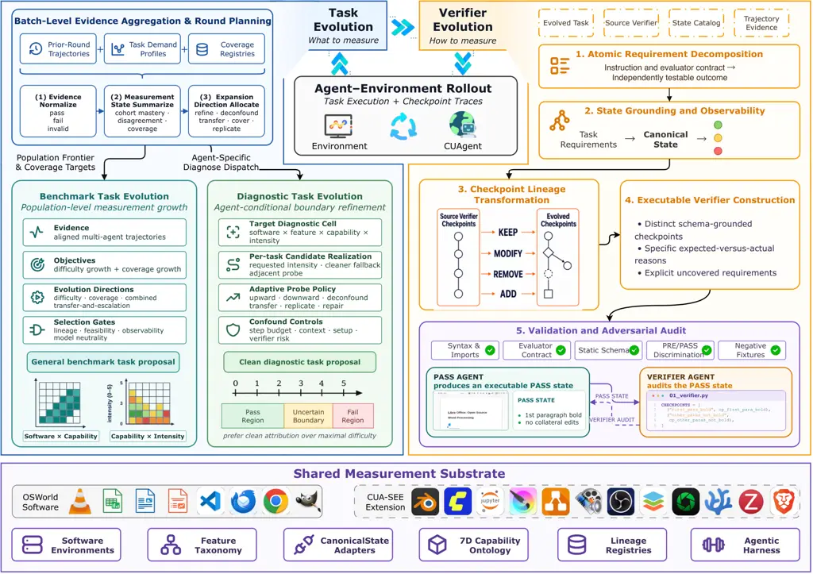

Figure 3: System overview. CUA-SEE forms a closed loop of task
evolution, verifier evolution, and agent-environment rollout, as
summarized by the central workflow. The left panel details task
evolution: rollout evidence is first aggregated at the batch level to
plan the next round, followed by two complementary forms of per-task
evolution: benchmark evolution for population-level measurement growth
and diagnostic evolution for agent-conditional boundary refinement. The
right panel presents verifier evolution, which progressively translates
evolved task requirements into grounded, executable, and rigorously
validated measurements. The bottom panel shows the shared substrate that
supports all stages of the evaluation loop, expanding the 8 OSWorld
applications to 20 verifiable desktop environments.

#### CUA Environments & Benchmarks.

While popular benchmarks like OSWorld and WindowsAgentArena \[18, 1,
15\] offer robust, reproducible evaluation of computer-use agents in
real desktop environments, they are limited to a fixed set of
pre-curated tasks. As agent capability improves, extending such
benchmarks by hand is costly, difficult to scale, and slow to expose new
capability limits. Recent systems automate parts of this process:
CUA-Gym \[12\] generates verifiable task-state-reward tuples, while
OpenComputer \[16\] builds tasks with state verifiers and partial-credit
rewards. Their main goal, however, is to scale verifiable environments
or training data rather than repeatedly adapt a benchmark to the
observed behavior of a fixed agent.

#### Evaluation Evolution.

Early efforts have begun to explore benchmark evolution through
rule-based editing, scheduled data refreshes, and agent-driven
exploration \[13, 17, 6\]. AutoEvoEval applies predefined
transformations to reasoning or question-answering tasks, while
EvoCodeBench periodically adds new code tasks. Most closely related,
TRACE \[3\] uses test-time exploration to generate progressively harder
web-search tasks and verify their solutions for reproducibility. Unlike
our approach, however, TRACE’s scope is limited to task difficulty, and
it leaves the critical role of verifier evolution unaddressed by
employing a static, exact-match verifier.

## 3 Methodology

As depicted in Figure 3, CUA-SEE is designed to co-evolve tasks and
verifiers through a closed loop fueled by evidence from
agent-environment rollouts.

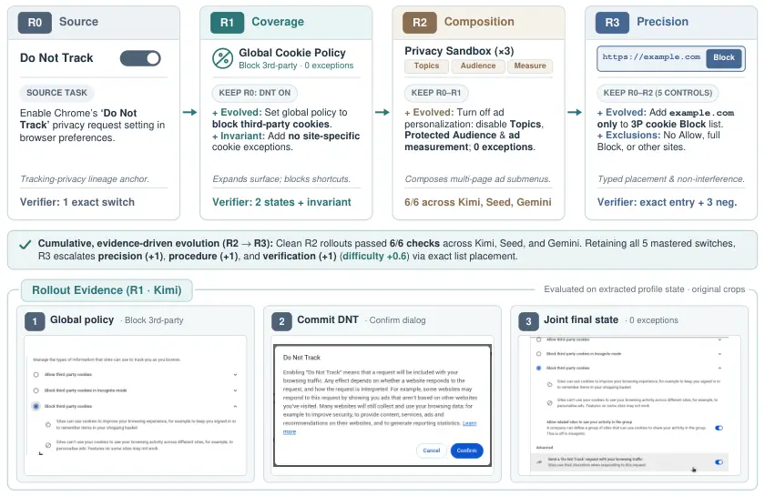

(a) Benchmark evolution using the Chrome privacy task.

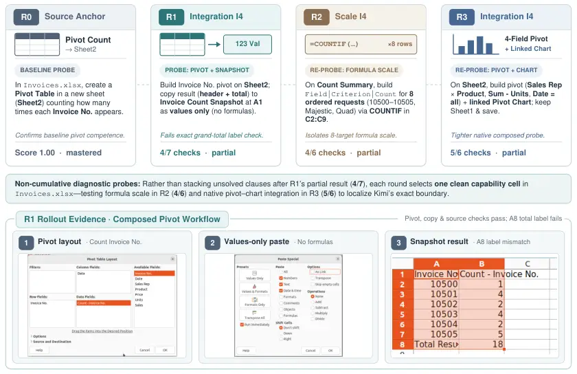

(b) Diagnosing Kimi using the LibreOffice Calc pivot-table task.

Figure 4: Case studies of benchmark evolution and diagnostic evolution.
More examples and results are attached in the Appendix.

### 3.1 Scope: Benchmark Task Evolution

Benchmark task evolution expands the population-level scope of
evaluation. Given source tasks, aligned trajectories from a
heterogeneous agent cohort, and the accumulated coverage registry, it
produces a model-neutral batch of task descendants that advances the
measurable difficulty frontier and enlarges the set of capabilities and
software operations covered by the benchmark.

#### Aligned Multi-Agent Evidence.

We join trajectories by canonical source-task identity and retain every
compatible replicate. Evidence integrity is modeled independently of
task outcome: valid successes and failures provide clean evidence,
step-limit runs are retained as censored observations, and setup,
controller, or environment failures are marked as invalid. Using scores,
termination states, checkpoint transitions, regressions, and path
diversity, we classify each source lineage as universally easy, mostly
mastered, discriminating, universally hard, unstable, or confounded.
This cohort-level state determines the admissible strength of evolution
while preventing transient or model-specific errors from becoming
benchmark objectives.

#### Bi-Objective Round Planning.

Evolution jointly optimizes difficulty-frontier and feature-coverage
growth at the round level. Difficulty growth requires a measurable
increase in one or more calibrated capability demands without material
regression of the overall task, whereas coverage growth requires a
strict set addition on either the exact software-taxonomy-operation
surface or the capability-intensity surface. Required action families
are tracked separately as exposure rather than treated as agent
capabilities. A shared lineage and coverage registry coordinates
parallel workers and prevents repeated references to an already measured
feature from being counted as new breadth. Individual tasks may
specialize in difficulty or coverage, but the selected batch must
advance both objectives in aggregate.

#### Lineage-Anchored Evolution Directions.

For each eligible source, we construct candidates with four directions:
_difficulty escalation_, _coverage expansion_, _transfer with measurable
escalation_, and their coherent _combination_. Every candidate preserves
a lineage anchor, the semantic demand that makes cross-round comparison
meaningful, while allowing values, targets, scale, context, and
supporting subgoals to change. Purely horizontal transfer is excluded: a
transferred task must introduce an independently measurable demand or
coverage cell. Candidates may increase precision, dependence, procedural
depth, or verification requirements, but unrelated feature grafts and
superficial elaboration do not constitute evolution.

#### Candidate Selection Gates.

A candidate is eligible only if it preserves the lineage anchor, avoids
material difficulty regression, remains feasible within the interaction
budget, admits a uniquely observable final state, and is justified by
model-neutral evidence. Eligible candidates are ranked by feasibility,
verifiability, calibrated difficulty, coverage gain, model neutrality,
and naturalness; step requirements above $`0.85`$ of the available
budget are rejected. The output remains a general benchmark task
proposal until every evolved obligation is instantiated by an executable
verifier.

### 3.2 Resolution: Diagnostic Task Evolution

Diagnostic task evolution increases the resolution of evaluation around
an individual agent’s capability boundary. This multi-agent system
follows a hierarchical process: a batch-level planner converts
longitudinal rollout evidence into agent-specific diagnostic dispatches,
and a per-task evolver realizes each dispatch as a controlled task
proposal. The objective is not maximal difficulty or scope (i.e.,
Benchmark Evolution), but a locally attributable observation that
narrows the agent’s pass-fail boundary.

#### Target Diagnostic Cell.

To allocate well-targeted dispatches, the batch planner first separates
pass, partial, confounded, and invalid outcomes, using only observations
with valid setup and verifiers as clean boundary evidence. It then
aggregates multiple analytical views to identify stable, failing, or
insufficiently supported regions. Each dispatch targets a diagnostic
cell defined by software, feature, primary capability, and intensity,
together with control dimensions and confound limits. Priority is given
to deconfounding blocked evidence, resolving uncertain transitions,
testing transfer of suspected weaknesses, expanding under-supported
cells, and replicating non-monotonic results.

|                                                                                                |       |        |      |                  |                     |                    |             |      |         |                   |                  |                     |            |        |
| ---------------------------------------------------------------------------------------------- | ----- | ------ | ---- | ---------------- | ------------------- | ------------------ | ----------- | ---- | ------- | ----------------- | ---------------- | ------------------- | ---------- | ------ |
| Agent                                                                                          | Round | Chrome | GIMP | LibreOffice Calc | LibreOffice Impress | LibreOffice Writer | ThunderBird | VLC  | VS Code | Overall           |                  |                     | Tokens (K) |        |
|                                                                                                |       |        |      |                  |                     |                    |             |      |         | Score$`\uparrow`$ | Pass$`\uparrow`$ | Steps$`\downarrow`$ | Input      | Output |
| ![[Uncaptioned image]](arxiv-2611-30962--37f86587cf9a.figures/figure-4.webp)  Kimi-K2.6        | R0    | 90.0   | 92.9 | 77.8             | 94.1                | 84.6               | 100.0       | 75.0 | 100.0   | 89.0              | 89.0             | 12.5                | 103.0      | 2.1    |
|                                                                                                | R1    | 80.8   | 54.9 | 68.3             | 83.4                | 54.5               | 36.0        | 57.3 | 64.7    | 64.8              | 41.0             | 23.7                | 201.5      | 4.4    |
|                                                                                                | R2    | 84.7   | 71.1 | 62.5             | 78.0                | 59.6               | 46.3        | 45.8 | 69.6    | 66.6              | 32.0             | 33.2                | 285.4      | 6.1    |
|                                                                                                | R3    | 93.5   | 60.4 | 49.3             | 65.8                | 53.8               | 47.7        | 49.1 | 52.0    | 58.9              | 22.0             | 39.9                | 346.7      | 7.9    |
|                                                                                                | R4    | 71.6   | 57.7 | 44.9             | 56.2                | 52.8               | 41.7        | 59.3 | 47.7    | 53.6              | 19.0             | 41.8                | 363.9      | 7.8    |
| ![[Uncaptioned image]](arxiv-2611-30962--37f86587cf9a.figures/figure-5.webp)  Seed-2.1-Pro     | R0    | 80.0   | 78.6 | 77.8             | 70.6                | 84.6               | 85.7        | 87.5 | 69.2    | 78.0              | 78.0             | 14.4                | –          | –      |
|                                                                                                | R1    | 80.8   | 48.5 | 76.7             | 76.0                | 54.5               | 32.1        | 34.4 | 62.0    | 61.7              | 34.0             | 24.2                | 142.4      | 12.7   |
|                                                                                                | R2    | 71.8   | 56.0 | 48.5             | 69.6                | 43.4               | 48.3        | 42.7 | 54.8    | 55.1              | 26.0             | 23.4                | 141.8      | 12.1   |
|                                                                                                | R3    | 86.7   | 58.4 | 47.0             | 58.2                | 37.7               | 45.9        | 48.4 | 48.2    | 53.5              | 20.0             | 29.7                | 184.1      | 14.5   |
|                                                                                                | R4    | 87.3   | 34.0 | 30.7             | 51.3                | 35.2               | 43.7        | 40.4 | 46.2    | 44.6              | 13.0             | 30.9                | 193.3      | 14.6   |
| ![[Uncaptioned image]](arxiv-2611-30962--37f86587cf9a.figures/figure-6.webp)  Gemini-3.5-Flash | R0    | 90.0   | 57.1 | 94.4             | 70.6                | 92.3               | 100.0       | 75.0 | 69.2    | 80.0              | 80.0             | 14.1                | 74.4       | 0.3    |
|                                                                                                | R1    | 83.3   | 50.6 | 70.1             | 77.9                | 38.7               | 29.8        | 55.2 | 64.6    | 61.2              | 38.0             | 29.0                | 154.0      | 9.2    |
|                                                                                                | R2    | 73.0   | 48.6 | 56.7             | 69.5                | 36.1               | 48.3        | 43.8 | 73.5    | 57.2              | 29.0             | 36.7                | 203.9      | 10.6   |
|                                                                                                | R3    | 84.1   | 38.5 | 43.8             | 56.8                | 48.1               | 47.4        | 57.8 | 58.8    | 53.2              | 22.0             | 43.0                | 241.1      | 14.7   |
|                                                                                                | R4    | 82.4   | 36.8 | 35.0             | 47.4                | 48.9               | 46.7        | 60.9 | 54.4    | 49.3              | 16.0             | 44.6                | 254.5      | 15.4   |
| ![[Uncaptioned image]](arxiv-2611-30962--37f86587cf9a.figures/figure-7.webp)  Qwen-3.7-Plus    | R0    | 100.0  | 64.3 | 50.0             | 76.5                | 61.5               | 100.0       | 62.5 | 92.3    | 73.0              | 73.0             | 34.0                | 520.7      | 10.7   |
|                                                                                                | R1    | 75.0   | 54.9 | 48.1             | 82.2                | 52.2               | 40.7        | 36.5 | 70.3    | 59.5              | 35.0             | 35.0                | 398.8      | 8.1    |
|                                                                                                | R2    | 87.0   | 62.1 | 51.9             | 70.9                | 54.0               | 45.9        | 69.8 | 51.7    | 61.3              | 35.0             | 39.6                | 436.7      | 9.0    |
|                                                                                                | R3    | 82.6   | 49.4 | 35.4             | 68.2                | 46.9               | 37.5        | 56.4 | 49.5    | 52.8              | 19.0             | 43.7                | 471.5      | 9.3    |
|                                                                                                | R4    | 63.6   | 40.2 | 36.6             | 59.4                | 38.7               | 46.9        | 52.6 | 37.9    | 46.1              | 16.0             | 47.1                | 487.6      | 9.9    |
| ![[Uncaptioned image]](arxiv-2611-30962--37f86587cf9a.figures/figure-8.webp)  GPT-5.5          | R0    | 80.0   | 64.3 | 61.1             | 70.6                | 61.5               | 100.0       | 87.5 | 46.2    | 68.0              | 68.0             | 22.6                | 140.9      | 17.3   |
|                                                                                                | R1    | 63.3   | 47.7 | 49.7             | 76.7                | 36.4               | 33.6        | 67.7 | 65.4    | 56.0              | 31.0             | 24.9                | 183.9      | 22.4   |
|                                                                                                | R2    | 67.0   | 57.9 | 68.7             | 48.4                | 38.2               | 44.2        | 83.3 | 62.8    | 58.3              | 37.0             | 30.7                | 247.3      | 35.9   |
|                                                                                                | R3    | 83.7   | 60.3 | 49.1             | 40.5                | 21.5               | 26.8        | 72.9 | 66.1    | 51.6              | 32.0             | 30.8                | 283.6      | 39.7   |
|                                                                                                | R4    | 50.5   | 43.8 | 30.1             | 38.7                | 26.1               | 37.5        | 73.4 | 68.4    | 44.0              | 18.0             | 31.9                | 296.8      | 46.8   |

Table 2: Evaluation results on evolved benchmarks of CUA-SEE. The
evolutionary process yields a consistent increase in task difficulty for
all agents. Pass is the percentage of tasks receiving a full score of
1.0.

#### KNN-Inspired Evolution Candidate Realization.

For one dispatched source lineage, the task evolver constructs a local
neighborhood of candidates: the requested intensity, a cleaner
lower-intensity fallback, and, when feasible, an adjacent
higher-intensity or alternate-factor probe. Each task is defined by a
primary demand dimension and several secondary dimensions, all drawn
from the 7D capabilities: _scale consistency, precision control, target
grounding, state-dependent reasoning, procedure following, feature
integration, or verification and control_. Intensities are scored from 0
to 5 using dimension-specific factors derived from the instruction,
initial state, and verifier obligations; they describe task demand
rather than predicted agent performance (detailed in Appendix A).

#### Adaptive Probe Policy.

The probe direction is evidence-driven rather than assumed to be
monotonically upward. Clean passes or failures adjust intensity upward
or downward, respectively, while ambiguous results trigger corrective
actions like deconfounding, simplification, or replication. Each
proposal records expected failure modes and explicit verifier
requirements, and it updates the agent’s capability boundary only after
verifier evolution and a valid rollout make the resulting evidence
eligible.

#### Confound-Controlled Candidate Selection.

Capability demand is factorized from nuisance variables including step
budget, context load and verifier risk. Candidates that violate dispatch
limits, exceed the step budget, or lack an observable outcome are
redesigned or rejected. Remaining ones are ranked by dispatch alignment,
diagnostic cleanliness, secondary coverage value, etc. This criterion
deliberately favors a slightly weaker but cleanly attributable probe
over a harder task which cannot resolve agent boundaries.

### 3.3 Precision: Unified Verifier Evolution

Verifier evolution co-evolves the measurement instrument with each task
so that increased task demand remains faithfully observable. The
objective is to maximize coverage of the evolved task contract while
preserving verifier lineage, grounding every check in observable state,
and explicitly representing verification gaps.

#### Requirement-Centric Contract Decomposition.

We reconstruct the evolved task contract as a set of independently
testable outcome requirements derived from the explicit evaluator
requirements and atomic clauses of the instruction. Target values,
ordering constraints, artifact states, preservation conditions, and
prohibited side effects are retained as first-class obligations rather
than silently omitted or merged into coarse success criteria.

|       |        |      |                  |                     |                    |             |     |         |                    |                      |                   |            |                     |
| ----- | ------ | ---- | ---------------- | ------------------- | ------------------ | ----------- | --- | ------- | ------------------ | -------------------- | ----------------- | ---------- | ------------------- |
| Round | Chrome | GIMP | LibreOffice Calc | LibreOffice Impress | LibreOffice Writer | ThunderBird | VLC | VS Code |                    |                      | Feature Operation |            |                     |
|       |        |      |                  |                     |                    |             |     |         | Feature Family (%) | Feature Category (%) | Current           | Frontier   | Capability Coverage |
| R0    | 12     | 10   | 27               | 30                  | 14                 | 12          | 7   | 15      | 38.0               | 12.9                 | 127               | 127        | 68.6                |
| R1    | 20     | 25   | 46               | 47                  | 27                 | 26          | 15  | 29      | 45.6               | 20.6                 | 235               | 240 (+113) | 85.7                |
| R2    | 31     | 33   | 58               | 57                  | 38                 | 31          | 22  | 41      | 50.6               | 24.4                 | 311               | 341 (+101) | 100.0               |
| R3    | 38     | 38   | 75               | 74                  | 50                 | 37          | 28  | 51      | 51.9               | 26.6                 | 391               | 421 (+80)  | 100.0               |
| R4    | 44     | 46   | 92               | 86                  | 60                 | 43          | 33  | 60      | 53.8               | 27.5                 | 464               | 487 (+66)  | 100.0               |

Table 3: Hierarchical feature coverage across benchmark-evolution
rounds. Evolution steadily expands functional breadth across all apps
($`3.65\times`$ operations by $`R4`$). A feature cell is an exact
$`\langle`$software, taxonomy category, operation$`\rangle`$ tuple.
Frontier reports the cumulative operation-level coverage registry.
Capability Coverage is cumulative coverage over the 35
capability-intensity cells.

#### State Grounding and Observability.

Each requirement maps to an observable state field or artifact, a
planned checkpoint, and one of three coverage states: covered, partially
observable, or unverifiable. State paths must be supported by the
application’s state catalog or captured snapshots; proxy checks based
only on file existence, filenames, setup state, or unavailable
pre-action values are disallowed. Unsupported clauses remain explicit
coverage gaps rather than unsound surrogates, avoiding selection bias
against complex, harder-to-inspect applications that discarding such
tasks would introduce.

(a) Proportions of primary capability evaluated.

(b) Intensity distributions across capabilities.

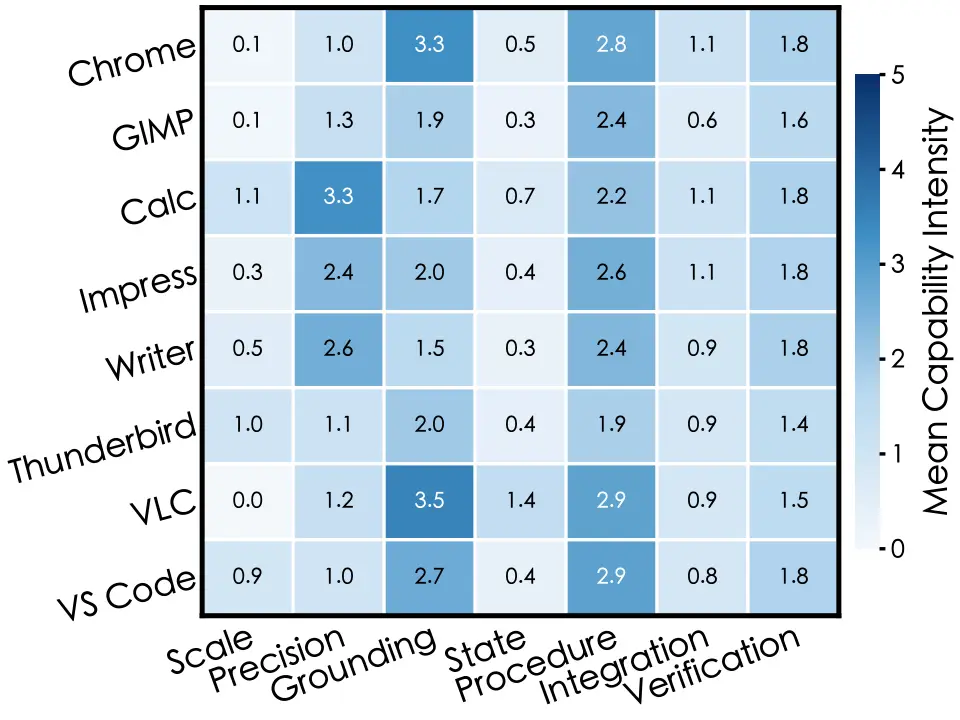

(c) Average capability demand across software applications.

(d) Action-family exposure frequency among tasks.

Figure 5: Task-suite capability requirements and action-family
statistics.

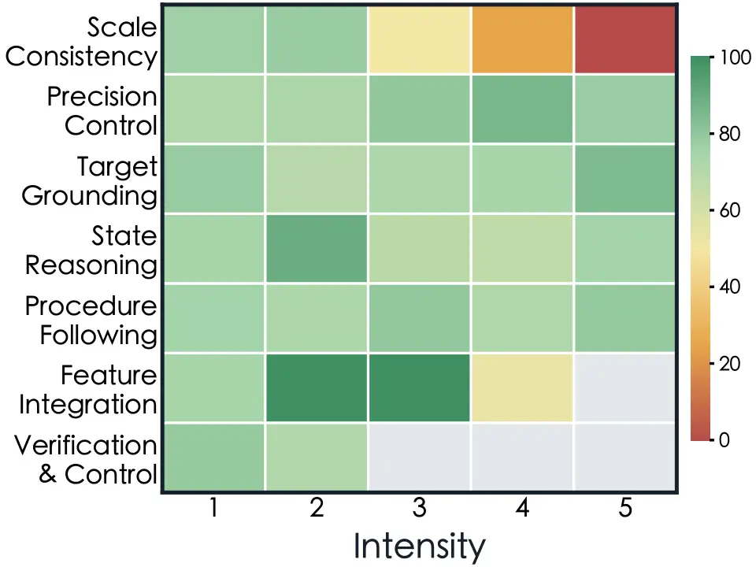

(a) Capability intensity

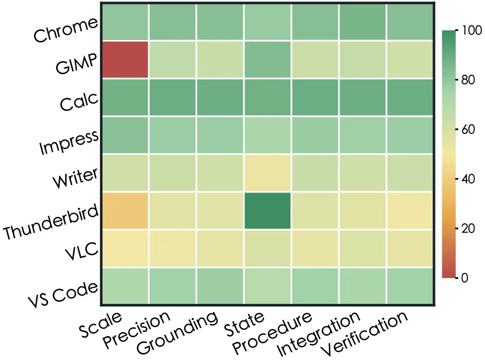

(b) Software–capability

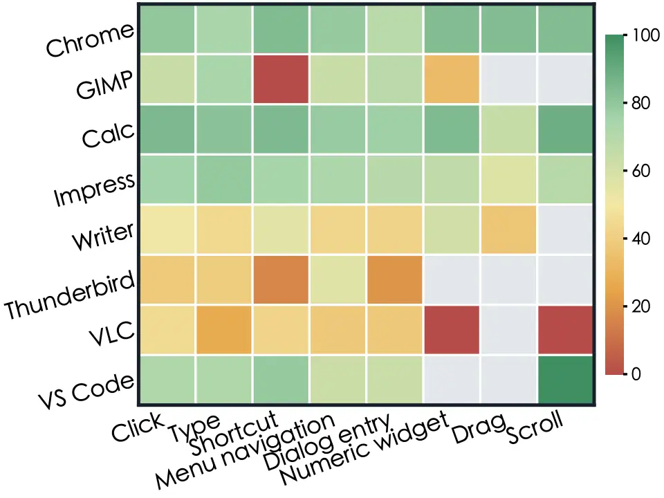

(c) Software–action

Figure 6: Gemini diagnostic performance aggregated over $`R0`$–$`R3`$,
with full matrices in Supplementary Figure 13. Colors denote mean
checkpoint scores; gray cells indicate unavailable evidence.

Figure 7: Round-wise benchmark evolution. Later rounds are harder and
provide broader cumulative coverage.

#### Checkpoint-Lineage Transformation.

Given the source verifier, each existing checkpoint receives an explicit
lineage operation: Keep for an unchanged obligation, Modify for a
changed target or expected value, and Remove for an obligation absent
from the evolved task; Add introduces checkpoints for newly required
effects. The original OSWorld evaluator may provide semantic evidence
about intended facts, tolerances, and conjunction structure, but the
evolved task contract remains authoritative. Optional trajectories and
checkpoint histories are used to confirm state paths and expose
regressions, while an individual failed rollout is not treated as
sufficient evidence of verifier error.

#### Executable Verifier Construction.

To construct a verifier, each software is equipped with a task-agnostic
adapter that probes native state-export interfaces (e.g., debug
protocols) to extract and normalize its snapshot into a shared
CanonicalState schema. The transformed contract is compiled into
distinct schema-grounded checkpoints, each of which checks one task
effect and returns a specific expected-versus-actual reason. Every
requirement must map to a checkpoint or be declared as an explicit
observability gap, prohibiting shortcuts like unconditional passes or
inference-based fallbacks. A partially observable task remains
rollout-ready when at least one meaningful target effect is soundly
verified and all omissions are declared.

#### Validation and Adversarial Audit.

Validation separates three static gates (i.e., syntax and imports,
structural contract, and static schema), from two behavioral gates
(i.e., PRE/PASS discrimination and checkpoint-wise negative fixtures).
An information-isolated pass agent independently realizes an executable
PASS state and audits checkpoint necessity and completeness, while a
verifier agent audits whether that state genuinely satisfies the task
without access to the pass implementation. Their adversarial
cross-review exposes trivial checkpoints, missing obligations, and
incorrect expected values. Revisions are adopted only when they preserve
task semantics and do not reduce the best validated verifier score.

## 4 Experiments (More Results in Appendix)

#### Experimental Setups.

While CUA-SEE’s substrate spans 20 applications (Appendix B.1), we track
the eight core OSWorld apps under a 50-step budget for strict $`R0`$
alignment, reporting normalized scores, steps, and tokens. For
_benchmark evolution_, 100 lineage-aligned task groups evolve from
$`R0`$ through $`R1`$–$`R4`$ across five SOTA agents (2,500 paired
observations controlling sample drift in total): Kimi-K2.6,
Seed-2.1-Pro, and Gemini-3.5-Flash drive evolution, while Qwen-3.7-Plus
and GPT-5.5 are strictly held out. For _diagnostic evolution_,
independent boundary probes are generated over the seven $`0`$-$`5`$
capability dimensions (Section 3.2) for Gemini, Kimi, and Seed. $`R0`$
uses native OSWorld tasks and verifiers; evolved rounds use
CanonicalState verifiers.

#### Scoring and Metrics.

Benchmark scores average normalized episode scores to retain partial
credit. Diagnostic outcomes separate valid pass ($`[0.99,1]`$), partial
($`(0.01,0.99)`$), and fail ($`[0,0.01]`$) runs from 50-step censored
and confounded/invalid runs; matrix values report task-weighted
checkpoint means over eligible clean episodes rather than full-task pass
rates or averages of round means (gray cells denote unavailable
evidence).

### 4.1 Evaluations on Evolved Benchmarks

#### Higher Task Difficulty.

As summarized in Table 2, we conclude the following: (1) The evolved
benchmark becomes substantially more demanding. Across all five agents,
the macro-average score decreases from 60.6 in $`R1`$ to 47.5 in $`R4`$,
while the average trajectory length increases from 27.4 to 39.3 steps.
(2) Kimi, Qwen, and GPT obtain slightly higher scores in $`R2`$ than in
$`R1`$; nevertheless, their trajectory lengths increase by 9.5, 4.6, and
5.8 steps, respectively. This indicates that later tasks generally
require longer interaction chains, while newly introduced features may
align better with the capabilities of particular agents. (3) Difficulty
growth is uneven across applications. Chrome remains comparatively easy
in later rounds, whereas GIMP, Calc, and Writer exhibit larger score
reductions.

(a) Checkpoint distribution

(b) Software profile

(c) Requirement coverage

(d) Requirement alignment

Figure 8: Verifier construction statistics on the Kimi diagnostic
benchmark across checkpoint-count distribution, software-specific
checkpoint profile, atomic requirement coverage, and
checkpoint–requirement alignment (Gemini and Seed in Supplementary
Figure 12).

Figure 9: Binary agreement between human judgments and verifier
outcomes.

Figure 10: Token composition and API-equivalent cost per successful
artifact.

#### Broader Feature Coverage.

Feature coverage is organized hierarchically from broad feature
families, through finer-grained feature categories, to exact executable
feature operations within each software. (1) The results in Table 3 also
demonstrate a consistent and hierarchical expansion of functional
coverage across successive evolution rounds, with steady growth in
feature families and categories and a $`3.65\times`$ increase in exact
feature operations by $`R4`$. (2) These gains appear across all eight
applications, indicating that evolution broadens the benchmark as a
whole rather than concentrating on a few software domains. Overall,
these results confirm that iterative benchmark evolution systematically
broadens the functional and operational scope of the benchmark rather
than merely rephrasing existing tasks.

#### Multi-Faceted Task Statistics.

Beyond difficulty and coverage metrics, the evolved tasks exhibit a
rich, multi-faceted structure, with detailed statistics shown in
Figure 5. (1) The tasks exhibit compound capability demands, with
procedure following and target grounding frequently required at
moderate-to-high intensities. (2) Capability profiles vary substantially
across applications—for example, Calc emphasizes precision control,
whereas Chrome and VLC place greater demands on target
grounding—demonstrating software-specific rather than templated
difficulty. (3) Finally, the suite covers diverse interaction families,
spanning clicks, text, keyboard shortcuts, and long-tail operations such
as scrolling and dragging.

### 4.2 Evolved Diagnoses of Specific Agents

#### Effective and Discriminative Diagnosis.

\(1\) Figure 2 reveals that our Diagnostic Evolution continually mines
the agent’s pass/fail boundary, thereby shifting the original saturated
benchmark from near-universal success toward a more informative regime
where nuanced diagnosis becomes possible. (2) Our method diagnoses
heterogeneous capabilities and distinct software-specific strengths that
are typically obscured by aggregate scores. As visualized in Figure 7
and Supplementary Figures 13 and 13, this analysis reveals unique
performance signatures for each agent across various diagnostic
matrices, such as capability-intensity and software-feature. (3)
Successive rounds expand coverage across capability, software, function,
and action dimensions. Each round consistently introduces 57–73 new
feature leaves, ensuring that our diagnosis grows in breadth and is not
merely resampling similar challenges.

#### Agent-Specific Diagnostic Profiles.

Based on the diagnosis, we construct specific agent profiles. (1)
Capability: Gemini is strong in precision control and target grounding,
but high-scale consistency remains challenging. (2) Operation: Kimi is
reliable on clicking, typing, and navigation, while Seed is more
sensitive to dragging, scrolling, and state-dependent controls. (3)
Feature: Kimi shows the most consistent feature-level performance,
whereas Seed varies more across document and media features. (4)
Software: All three agents are more stable in Chrome and VS Code, while
GIMP and Thunderbird expose clearer weaknesses.

### 4.3 Validation of Evolved Verifiers

#### Trajectory-Level Verifier Agreement.

We manually assess convergent validity on 400 Kimi trajectories across
four evolution rounds in Figure 10. Human judgments and checkpoint
verifiers agree on 84.0% of runs (Cohen’s $`\kappa=0.640`$), with
agreement increasing from 81% to 89%. Continuous scores also show
moderate concordance. Audited disagreements mainly arise from incomplete
adapter state, partial verifier coverage, and state-field mismatches,
highlighting the remaining observability limitations.

#### Verifier Statistics.

Figure 8 and Supplementary Figure 12 confirm that evolved verifiers stay
tightly aligned with growing task contracts rather than collapsing into
minimal checks. Across 962 tasks (4.82 checkpoints/task), atomic
requirement coverage reaches 92.5% overall—exceeding 85% in nearly all
apps, with lower coverage isolated to native-adapter limits (e.g.,
Thunderbird). Moreover, checkpoint counts track requirement counts along
the $`y\!=\!x`$ diagonal ($`r\!=\!0.55\text{--}0.65`$), with Partial
tasks still grounding 3–7 checkpoints; the independent trajectory audit
(Figure 10) further validates behavioral precision.

### 4.4 Evaluation Reliability and Evolution Efficiency

#### Evaluation Reliability.

Under live-VM budget and native observability limits, cross-round and
cross-agent comparisons remain fair and discriminative:
(1) Out-of-cohort generalization: held-out Qwen ($`-26.9`$) and GPT
($`-24.0`$) match the cohort’s difficulty progression without driving
evolution. (2) Calibrated co-evolution: Keep/Modify inheritance,
isolated PASS-state solvability gates, rising human agreement ($`81\%`$
to $`89\%`$), verifier-independent $`2\times`$ step, and
$`2\text{--}3.5\times`$ token growth rule out verifier drift.
(3) Partial-verifier symmetry: retaining sound Partial verifiers
preserves hard-to-inspect apps while applying identical checks across
all agents without artificial score deflation. (4) Structured
discrimination: while low $`R4`$ pass rates ($`13\text{--}19\%`$) narrow
the macro spread, continuous scores lift boundary informativeness
($`+20.8`$ pp to $`69.7`$) and expose $`20\text{--}37`$ pp per-app rank
reversals masked by scalar means.

#### Evolution Efficiency.

In Figure 10, we measure the token usage and API-equivalent cost of
successful task and verifier evolution runs, aggregated across rounds
for three diagnostic agents and the multi-agent benchmark. Costs are
estimated from cached input, uncached input, and output tokens using
GPT-5.5 API rates. Verifier evolution exhibits stable costs across
agents, while benchmark task evolution is more expensive due to its
larger shared context, indicating that context construction—not verifier
generation—is the primary efficiency bottleneck.

## 5 Conclusion

We present CUA-SEE, a closed-loop evaluation framework that co-evolves
tasks and executable verifiers from computer-use agent trajectories.
Benchmark evolution expands difficulty and coverage, diagnostic
evolution probes agent-conditional capability boundaries, and verifier
evolution grounds changing requirements in audited checkpoints.
Experiments across agents, applications, and rounds show that adaptive
evaluation remains informative beyond static benchmarks while producing
attributable capability evidence. These results establish evolving
evaluation as a practical counterpart to increasingly capable,
self-evolving agents.

## LLM Usage Statement

Large language models were used during this project for manuscript
language polishing, figure and layout drafting, and AI-assisted software
engineering (“vibe coding”) of evaluation, data-processing, and
visualization scripts. In addition, LLM and VLM inference APIs serve as
core runtime components within the CUA-SEE synthesis pipeline and the
evaluated computer-use agent rollouts, as detailed in Section 3 and
Appendix B.2. All methodological designs, code implementations,
experimental results, and scientific claims were inspected and verified
by the authors, who take full responsibility for the contents of this
paper.

## References

- \[1\] R. Bonatti, D. Zhao, F. Bonacci, D. Dupont, S. Abdali, Y. Li, Y.
  Lu, J. Wagle, K. Koishida, A. Bucker, L. Jang, and Z. Hui (2024)
  Windows agent arena: evaluating multi-modal OS agents at scale.
  External Links: 2409.08264, [Link](https://arxiv.org/abs/2409.08264)
  Cited by: §2.
- \[2\] Y. Du, T. Jin, J. Kang, X. Pang, J. Chai, T. Miao, F. Liu, W.
  Wang, S. Yao, Y. Zhang, and S. Chen (2026) Towards recursive
  self-evolving agentic literature retrieval. External Links:
  2605.14306, [Link](https://arxiv.org/abs/2605.14306) Cited by: §1.
- \[3\] D. Guo, T. Zhou, D. Liu, C. Qian, Q. Ren, S. Shao, Z. Fan, Y. R.
  Fung, K. Wang, L. Zhang, and J. Shao (2026) Towards self-evolving
  agent benchmarks: validatable agent trajectory via test-time
  exploration. In The Fourteenth International Conference on Learning
  Representations, External Links:
  [Link](https://openreview.net/forum?id=2H03gm4Rq6) Cited by: §2.
- \[4\] S. Jiang, L. Ma, Z. Hong, K. Wang, Z. Lu, T. Wang, S. Chen, J.
  Zhang, T. Pan, W. Li, J. Liang, and Y. Xiao (2026) SEA-Eval: A
  Benchmark for Evaluating Self-Evolving Agents Beyond Episodic
  Assessment. arXiv. Note: arXiv:2604.08988 \[cs.AI\] External Links:
  [Link](http://arxiv.org/abs/2604.08988),
  [Document](https://dx.doi.org/10.48550/arXiv.2604.08988) Cited by: §1.
- \[5\] C. E. Jimenez, J. Yang, A. Wettig, S. Yao, K. Pei, O. Press,
  and K. Narasimhan (2024) Swe-bench: can language models resolve
  real-world github issues?. In International Conference on Learning
  Representations, Vol. 2024, pp. 54107–54157. Cited by: §1.
- \[6\] J. Li, G. Li, X. Zhang, Y. Zhao, Y. Dong, Z. Jin, B. Li, F.
  Huang, and Y. Li (2024) EvoCodeBench: an evolving code generation
  benchmark with domain-specific evaluations. In Advances in Neural
  Information Processing Systems, Vol. 37. External Links:
  [Document](https://dx.doi.org/10.52202/079017-1837),
  [Link](https://proceedings.neurips.cc/paper_files/paper/2024/hash/6a059625a6027aca18302803743abaa2-Abstract-Datasets_and_Benchmarks_Track.html)
  Cited by: §1, §2.
- \[7\] P. Li, Z. Gao, B. Zhang, Y. Mi, X. Ma, C. Shi, T. Yuan, Y.
  Wu, Y. Jia, S. Zhu, and Q. Li (2025) Iterative tool usage exploration
  for multimodal agents via step-wise preference tuning. In The
  Thirty-ninth Annual Conference on Neural Information Processing
  Systems, External Links:
  [Link](https://openreview.net/forum?id=yKUwkihcsi) Cited by: §1.
- \[8\] P. Li, Zechenhu, Z. Shang, J. Wu, Y. Liu, H. Liu, Z. Gao, C.
  Shi, B. Zhang, Z. Zhang, X. Shi, Z. YU, Y. Wu, X. Wu, Y. Jia, L.
  Xiang, Z. He, and Q. Li (2026) Fully decoupled reinforcement learning
  with adaptive data curation for GUI agents. In Proceedings of the 2026
  Conference on Empirical Methods in Natural Language Processing, H.
  Lee, S. Dev, J. J. Li, and D. Elliott (Eds.), Budapest, Hungary,
  pp. 37604–37633. External Links:
  [Link](https://aclanthology.org/2026.emnlp-main.1654/),
  [Document](https://dx.doi.org/10.18653/2026.emnlp-main.1654), ISBN
  979-8-89176-459-0 Cited by: §1.
- \[9\] G. Mialon, C. Fourrier, C. Swift, T. Wolf, Y. LeCun, and T.
  Scialom (2023) GAIA: a benchmark for general ai assistants. External
  Links: 2311.12983, [Link](https://arxiv.org/abs/2311.12983) Cited by:
  §1.
- \[10\] H. Shi, W. Wang, W. Fang, Y. Liang, T. Jin, P. Zhao, G. Liu, S.
  Chen, and Y. Wang (2026) CUA-universe: a scalable and dynamic
  environment for hybrid gui+cli agents. External Links: 2609.05374,
  [Link](https://arxiv.org/abs/2609.05374) Cited by: §1.
- \[11\] Y. Sun, X. Han, W. Zhang, X. Liu, Y. Pang, T. Wang, Y. Cao, Y.
  Huang, Z. Zhang, C. Duroiu, et al. (2026) Agents’ last exam. arXiv
  preprint arXiv:2606.05405. Cited by: §1.
- \[12\] B. Wang, D. Lu, J. Wang, T. Bai, S. Liu, Z. Zhang, H. Wang, H.
  Hu, T. Xie, S. Bai, D. Liu, Q. Shen, J. Lin, and T. Yu (2026) CUA-Gym:
  scaling verifiable training environments and tasks for computer-use
  agents. External Links: 2605.25624,
  [Link](https://arxiv.org/abs/2605.25624) Cited by: §1, §2.
- \[13\] S. Wang, Z. Long, Z. Fan, Z. Wei, and X. Huang (2025) Benchmark
  self-evolving: a multi-agent framework for dynamic LLM evaluation. In
  Proceedings of the 31st International Conference on Computational
  Linguistics, External Links:
  [Link](https://aclanthology.org/2025.coling-main.223/) Cited by: §2.
- \[14\] W. Wang, P. Niu, G. Zou, X. Yang, J. Wang, H. Shi, Y. Du, J.
  Chai, X. Pang, S. Tang, Y. Wang, and S. Chen (2026) MCP-persona:
  benchmarking llm agents on real-world personal applications via
  environment simulation. External Links: 2606.02470,
  [Link](https://arxiv.org/abs/2606.02470) Cited by: §1.
- \[15\] W. Wang, H. Shi, M. Yuan, Y. Lin, P. Tong, H. Zhou, G. Liu, P.
  Zhao, Y. Wang, and S. Chen (2026) FedGUI: benchmarking federated gui
  agents across heterogeneous platforms, devices, and operating systems.
  External Links: 2604.14956, [Link](https://arxiv.org/abs/2604.14956)
  Cited by: §2.
- \[16\] J. Wei, Q. Ma, Y. Zhao, X. Zhou, K. Ni, G. Gan, and A.
  Cohan (2026) OpenComputer: verifiable software worlds for computer-use
  agents. External Links: 2605.19769,
  [Link](https://arxiv.org/abs/2605.19769) Cited by: §1, §2.
- \[17\] J. Wu and M. Liu (2025) AutoEvoEval: an automated framework for
  evolving close-ended LLM evaluation data. External Links: 2506.23735,
  [Link](https://arxiv.org/abs/2506.23735) Cited by: §1, §2.
- \[18\] T. Xie, D. Zhang, J. Chen, X. Li, S. Zhao, R. Cao, T. J.
  Hua, Z. Cheng, D. Shin, F. Lei, Y. Liu, Y. Xu, S. Zhou, S.
  Savarese, C. Xiong, V. Zhong, and T. Yu (2024) OSWorld: benchmarking
  multimodal agents for open-ended tasks in real computer environments.
  In Advances in Neural Information Processing Systems, Vol. 37.
  External Links: [Link](https://arxiv.org/abs/2404.07972) Cited by: §1,
  §2.
- \[19\] X. Yan, Z. Jiao, J. Liu, Z. Wan, S. Ma, X. Yu, T. Jiang, C.
  Zhang, P. Zhou, W. Zhao, X. Yu, B. An, Y. You, and I. Tsang (2026)
  CUA-sandbox: efficient environments for computer-use agent
  reinforcement learning. External Links: 2609.32750,
  [Link](https://arxiv.org/abs/2609.32750) Cited by: §1.
- \[20\] Y. Yang, Z. Yang, Z. Dou, A. Nguyen, K. You, O. Attia, A.
  Szot, M. Feng, R. Ramrakhya, A. Toshev, C. Huang, Y. Yang, and Z.
  Gan (2025) UltraCUA: A Foundation Model for Computer Use Agents with
  Hybrid Action. arXiv. External Links: 2510.17790,
  [Document](https://dx.doi.org/10.48550/arXiv.2510.17790) Cited by: §1.
- \[21\] S. Yao, N. Shinn, P. Razavi, and K. Narasimhan (2024)
  \$$`\tau\$`$-bench: A Benchmark for Tool-Agent-User Interaction in
  Real-World Domains. arXiv. External Links: 2406.12045,
  [Document](https://dx.doi.org/10.48550/arXiv.2406.12045) Cited by: §1.
- \[22\] C. Zheng, C. Xue, B. Liang, J. Yang, and C. Zhang (2026)
  SEAGym: An Evaluation Environment for Self-Evolving LLM Agents. arXiv.
  Note: arXiv:2606.17546 \[cs.AI\] External Links:
  [Link](http://arxiv.org/abs/2606.17546),
  [Document](https://dx.doi.org/10.48550/arXiv.2606.17546) Cited by: §1.
- \[23\] H. Zhou, L. Li, Q. Kong, L. Wang, P. Tong, L. Chen, T. Xia, G.
  Zhang, X. Zhang, C. Liu, J. Zhang, C. Cai, Z. Zeng, S. Hoi, and Y.
  Wang (2026) OpenGCUA: toward a fully open stack for generalist
  computer use. External Links: 2610.22200,
  [Link](https://arxiv.org/abs/2610.22200) Cited by: §1.

Supplementary Material

## Appendix A Core Taxonomies, Capability Rubrics, and System Boundary

This section defines the foundational taxonomies, ordinal capability
rubrics, and invariance boundaries that anchor CUA-SEE across evolution
rounds.

#### Feature Taxonomy.

As illustrated in Figure 11, we organize the feature space as a
four-level hierarchy spanning software, feature families, functional
categories, and concrete operations. The representative branches
illustrate how application-level functionality is decomposed into
directly executable and verifiable actions across browsers, productivity
tools, creative applications, diagram editors, and media players. This
structured taxonomy provides a consistent basis for measuring feature
coverage, identifying underexplored functionality, and guiding task
evolution toward broader and more diverse interaction capabilities.

#### Capability Dimensions and Intensity Rubric.

Independent of software features, task demand is parameterized over
seven orthogonal capability dimensions scored on an ordinal $`0`$–$`5`$
rubric (Table 4). Scores are anchored in objective task factors—such as
target count, value coupling, distractor similarity, state-derivation
depth, and dependency chain length—derived strictly from the
instruction, initial state, and verifier contract rather than predicted
agent performance. To keep capability probes attributable, nuisance
confounds (_step-budget ratio, context load, navigation hiddenness,_ and
_verifier risk_) are tracked separately and bounded during candidate
selection.

#### Action-Family Exposure Taxonomy.

To characterize low-level GUI interaction demands without conflating
them with cognitive capabilities, each evolved profile records required
exposure over eight canonical action families: _click_, _text entry_,
_keyboard shortcut_, _menu navigation_, _dialog entry_, _numeric-widget
manipulation_, _drag_, and _scroll_. Action annotations represent
task-required interaction exposure rather than trajectory-inferred
behavior, ensuring that software–action profiles remain well-defined
even when an agent fails early or chooses an alternative UI path.

|                        |                                                        |                                                                |                                                                          |                                                                                            |
| ---------------------- | ------------------------------------------------------ | -------------------------------------------------------------- | ------------------------------------------------------------------------ | ------------------------------------------------------------------------------------------ |
| Dimension              | Grounded Task Factors                                  | Level 0–1 (Minimal)                                            | Level 2–3 (Moderate)                                                     | Level 4–5 (High / Dominant)                                                                |
| Scale Consistency      | Target count, distinct values, homogeneity             | 0: single target; 1: two targets via one bulk action           | 2: 2–3 manual targets; 3: 4–6 targets or distinct values                 | 4: 7–12 targets across views; 5: $`>12`$ targets within step budget                        |
| Precision Control      | Value count/type, tolerance, unit conversion, coupling | 0: no exact value; 1: single categorical/default choice        | 2: 1–2 simple exact values; 3: several exact values or strict format     | 4: coupled values, formulas, or unit conversion; 5: coupled heterogeneous precision        |
| Target Grounding       | Candidate count, distractor similarity, visibility     | 0: explicit visible target; 1: clear label without distractors | 2: 2–4 distinct candidates; 3: similar candidates by metadata/content    | 4: partly hidden targets via computed property; 5: multi-stage cross-view grounding        |
| State Reasoning        | State variables read, derivation steps, branching      | 0: state-independent; 1: read one directly visible state value | 2: single condition/transform; 3: 1–2 derivation steps or 2 branches     | 4: multi-variable or multi-branch derivation; 5: iterative state updates/derivations       |
| Procedure Following    | Subgoal count, ordering strictness, irreversibility    | 0: one operation; 1: two independent obvious operations        | 2: 3–4 weakly ordered subgoals; 3: 4–6 dependent subgoals                | 4: long strict chain, irreversible step, or exact export; 5: guarded multi-stage workflow  |
| Feature Integration    | Feature count, UI distance, cross-object data transfer | 0: single feature area; 1: two controls in one feature         | 2: two adjacent feature areas; 3: three areas or explicit data transfer  | 4: distant features with cross-object linkage; 5: multi-artifact/cross-app integration     |
| Verification & Control | Invariant count, inspect-and-correct, side effects     | 0: no invariant/constraint; 1: basic completion check          | 2: one explicit preservation rule; 3: multiple invariants or inspect-fix | 4: conditional multi-object correction & side-effect control; 5: iterative recovery burden |

Table 4: Seven calibrated capability dimensions, grounded task factors,
and condensed $`0`$–$`5`$ ordinal intensity anchors.

Figure 11: Feature taxonomy hierarchy tree. Software functionality is
organized into four levels—feature family, category, and concrete
operation beneath each application—with representative branches shown
for diverse software. The feature-, family-, category-, and
operation-level coverage metrics reported in the main text are computed
over this hierarchy.

#### Fixed Substrate vs. Self-Evolving Artifacts.

To clarify what “self-evolving” entails and why cross-round comparison
remains stable, Table 5 separates CUA-SEE’s invariant infrastructure
from its round-wise generated artifacts. Holding the VM substrate,
native state adapters, taxonomies, scoring rubrics, and validation gates
fixed ensures that changes across rounds reflect genuine growth in task
scope, boundary resolution, and contract coverage rather than shifting
measurement standards.

[TABLE]

Table 5: Lifecycle boundary separating fixed evaluation infrastructure
from round-wise self-evolving artifacts in CUA-SEE.

## Appendix B Experiment Details and Prompts

### B.1 Experimental Setup

#### Evaluation scope.

We evaluate benchmark evolution and diagnostic evolution on realistic
Ubuntu desktop environments derived from OSWorld. As shown in Figure 1
and Figure 3, CUA-SEE’s shared measurement substrate expands the eight
core OSWorld applications (Chrome, GIMP, LibreOffice Calc, LibreOffice
Impress, LibreOffice Writer, Thunderbird, VLC, and Visual Studio Code)
with twelve additional native-CanonicalState-instrumented desktop
environments—Blender, VSCodium, JupyterLab, Krita, Draw.io, SMPlayer,
OBS Studio, ONLYOFFICE, OpenScreen, ComfyUI, Zotero, and Brave—bringing
total software breadth to 20 applications across browsers, office
suites, IDEs, creative/3D studios, diagramming, media production, and
research workflows. To ensure strict task-lineage correspondence with
the original $`R0`$ benchmark without confounding cross-round metrics
with newly introduced software domains, the longitudinal multi-round
panel ($`R0`$–$`R4`$) and diagnostic matrices ($`R0`$–$`R3`$) track the
eight core OSWorld applications, while the full 20-application substrate
supports broader benchmark synthesis and scope expansion. Benchmark
evolution is evaluated on a heterogeneous panel of five computer-use
agents: Kimi-K2.6, Seed-2.1-Pro, Gemini-3.5-Flash, Qwen-3.7-Plus, and
GPT-5.5. Diagnostic evolution focuses on three representative
agents—Kimi-K2.6, Seed-2.1-Pro, and Gemini-3.5-Flash—because it
constructs a separate, agent-conditional task sequence for each target
agent.

#### Benchmark-evolution protocol.

We start from a fixed panel of 100 OSWorld task lineages and evolve each
lineage for four rounds, producing the original benchmark $`R0`$ and
evolved suites $`R1`$–$`R4`$. Every round retains the same 100 lineage
identifiers and is evaluated by all five agents, yielding 500 task–agent
observations per round and 2,500 observations over the complete
trajectory. This paired design prevents changes in aggregate performance
from being attributed to a changing task sample. Each evolved task is
also annotated with a seven-dimensional capability-demand vector on a
0–5 scale and with exact software–taxonomy–operation cells, enabling
difficulty and coverage to be measured independently.

#### Diagnostic-evolution protocol.

Diagnostic evolution is run independently for each target agent. The
current experiment contains four 100-task rounds for Kimi and three
100-task rounds each for Seed and Gemini, for a total of 1,000 evolved
task profiles. The primary diagnostic matrices pool a matched 100-task
$`R0`$ baseline with $`R1`$–$`R3`$ for each agent, yielding 1,200
planned agent–task–round slots before rollout availability and validity
filtering. Kimi $`R4`$ is included only in task-generation and verifier
analyses because it is outside the $`R0`$–$`R3`$ matrix scope. Profiles
without eligible rollouts are retained as missing or unavailable
evidence rather than imputed as failure.

[TABLE]

Figure 12: Verifier construction statistics across the remaining
diagnostic benchmarks (Gemini and Seed; Kimi is shown in Figure 8). Rows
correspond to the driving agents, while columns report checkpoint-count
distributions, software-specific checkpoint profiles, requirement
coverage, and checkpoint–requirement alignment.

[TABLE]

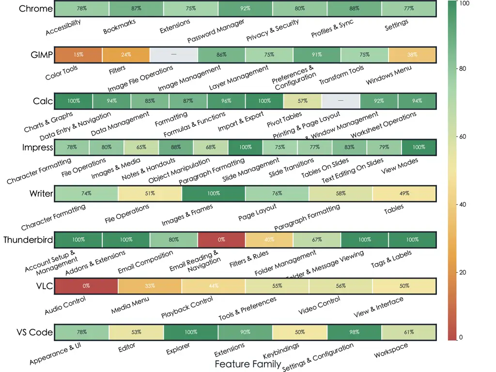

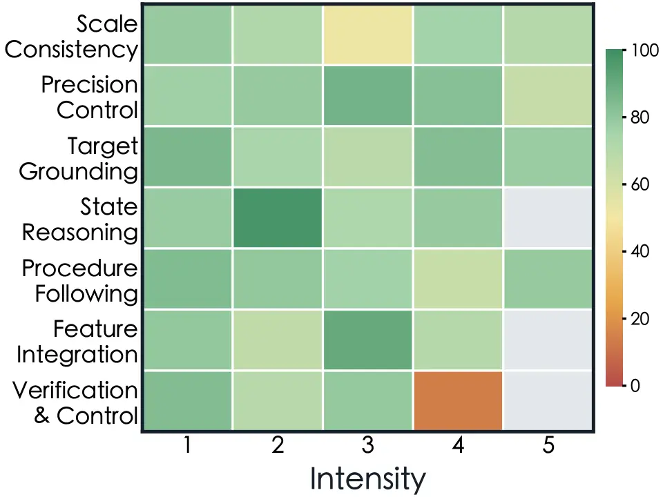

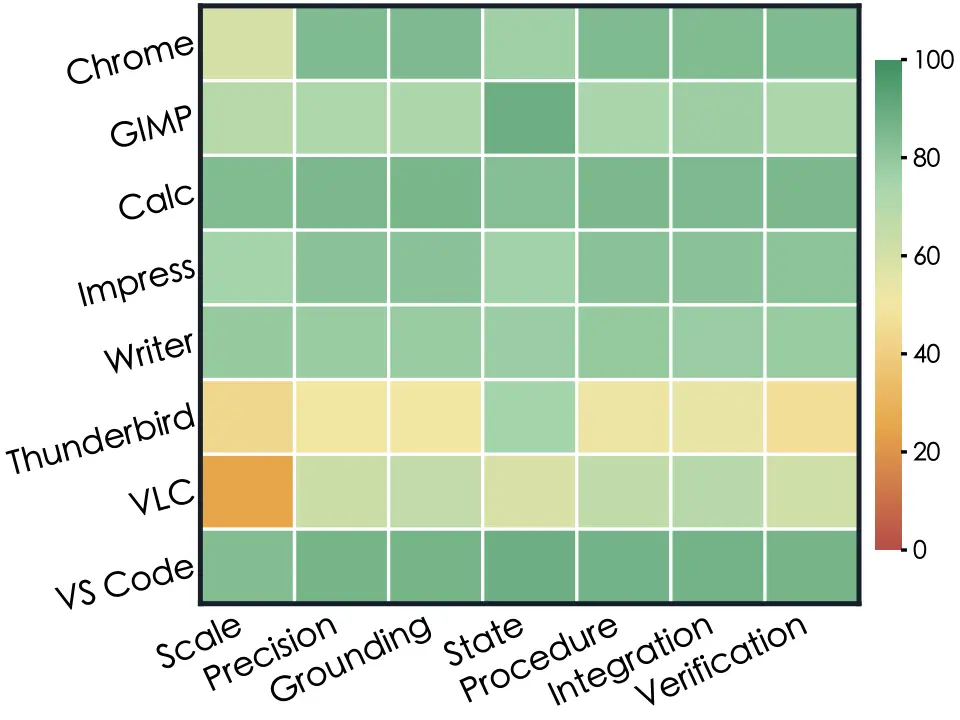

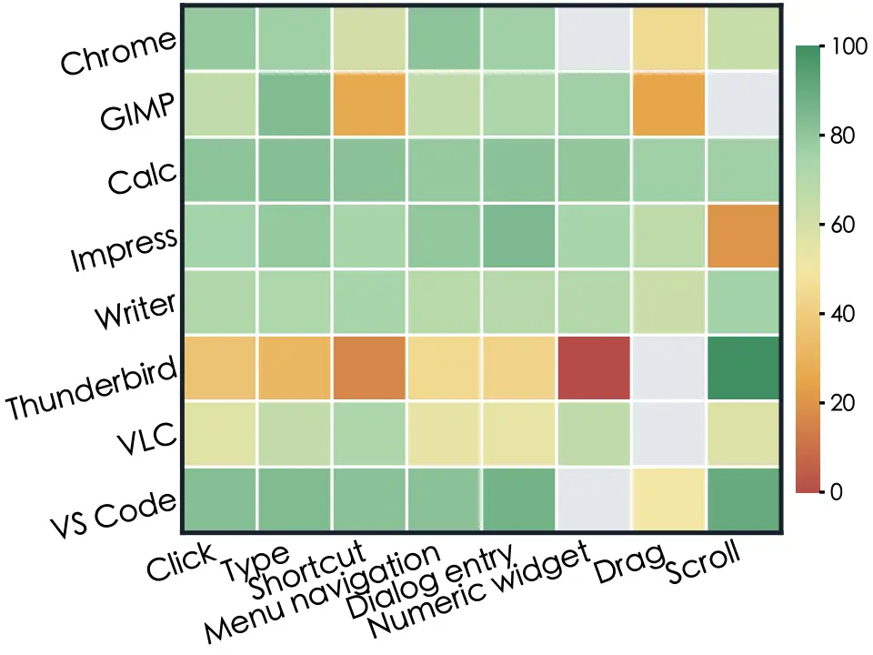

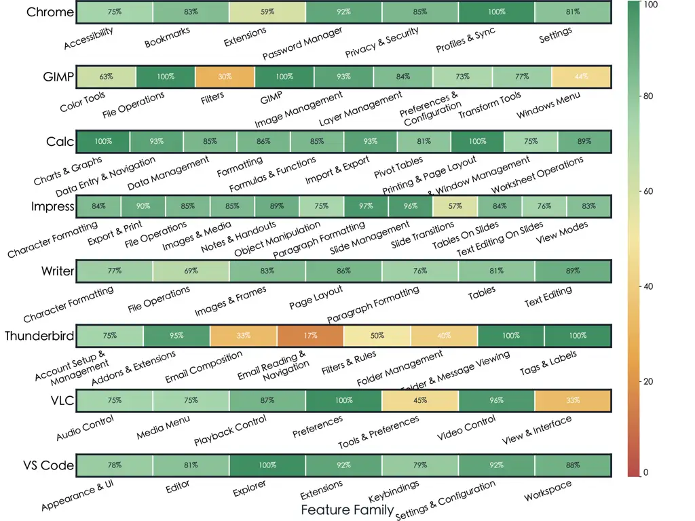

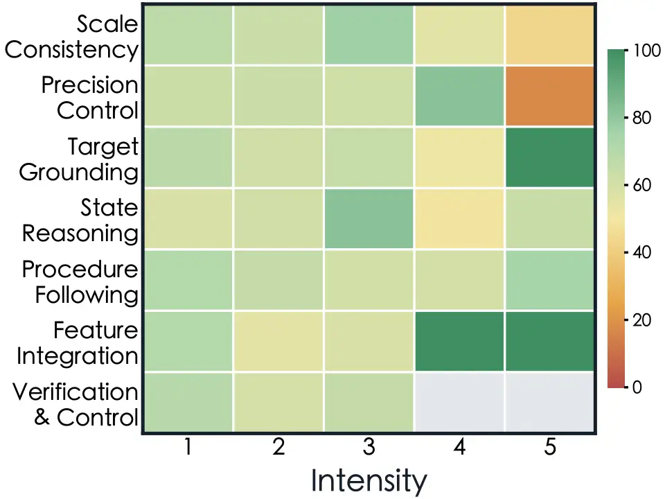

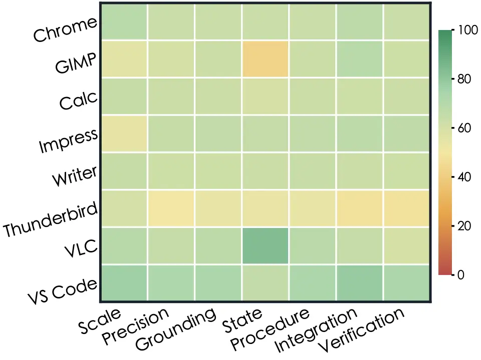

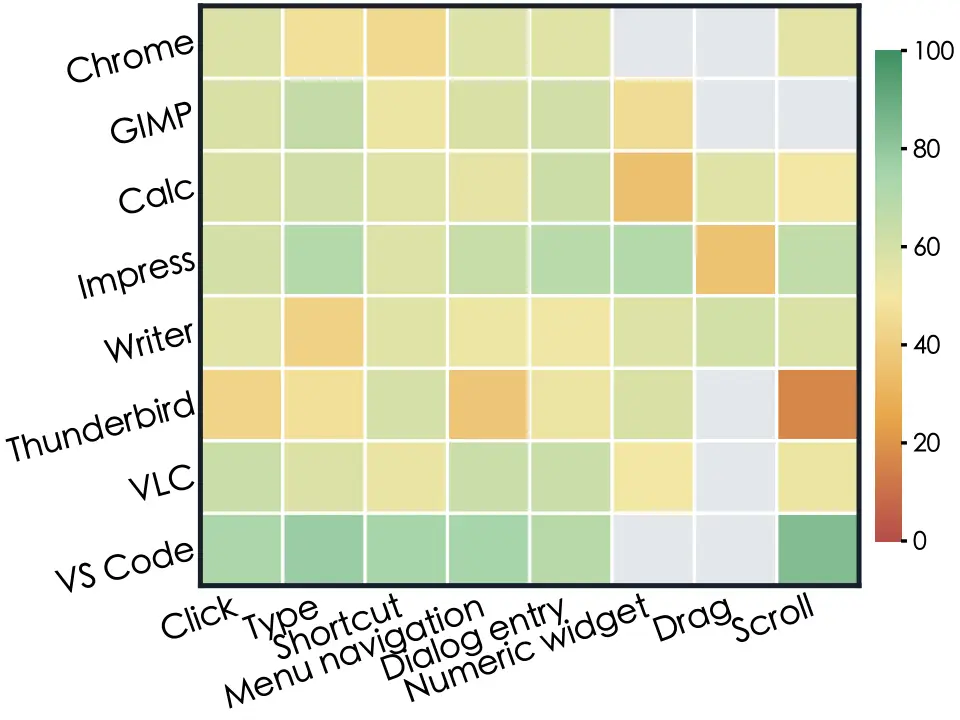

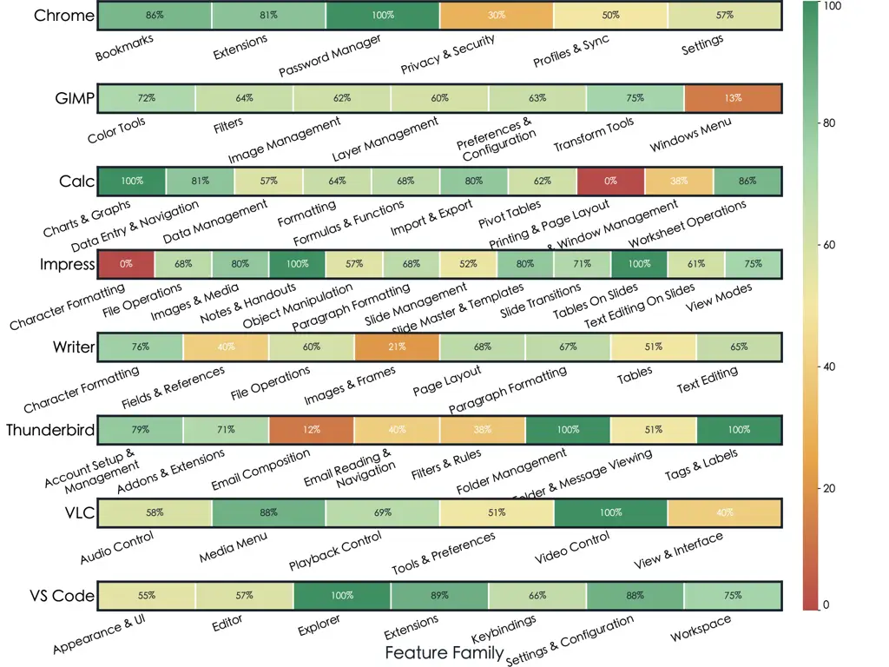

Figure 13: Diagnostic performance aggregated over $`R0`$–$`R3`$ for
Gemini, Kimi, and Seed. Rows correspond to the evaluated agents, while
columns report capability intensity, software–capability performance,
software–action performance, and software–feature performance. Colors
denote mean checkpoint scores; gray cells indicate unavailable evidence.

(a) Additional benchmark-evolution case study based on a GIMP
indexed-color export task.

(b) Additional diagnostic-evolution case study for Seed using a
Thunderbird message-filter task.

Figure 14: Additional case studies illustrating benchmark evolution and
agent-conditioned diagnostic evolution.

(a) Round-$`R1`$ diagnostic evolution for Kimi, strengthening a mastered
VS Code replacement task into a controlled scale-consistency probe.

(b) Round-$`R2`$ diagnostic evolution for Gemini, isolating exact
opacity control from an otherwise successful GIMP task.

(c) Round-$`R3`$ diagnostic evolution for Gemini, separating
state-dependent reasoning from value- transfer failures in Calc.

(d) Round-$`R4`$ diagnostic evolution for Kimi, refining an exact,
unit-sensitive paragraph- formatting boundary in Writer.

Figure 15: Diagnostic-evolution case studies across four successive
rounds. Each transition uses the preceding rollout outcome to strengthen
a mastered task, remove confounding requirements, or refine an uncertain
capability boundary.

#### Rollout parameters.

Each episode is limited to 50 environment-interaction steps. The
environment records the complete action trajectory, the terminal
normalized task score, and state-hook checkpoint traces. We classify
scores of at least $`0.99`$ as pass and scores of at most $`0.01`$ as
fail; intermediate scores retain partial credit. A zero-score episode
that reaches the 50-step limit is classified as censored rather than as
clean failure. Unless otherwise stated, partially observable but sound
verifiers are retained and their uncovered requirements are reported
explicitly; the stricter full-verifier-only filter is used only in
designated sensitivity analyses. For retried executions, aggregation
selects the latest completed run within each published task instance.

#### Compute and deployment.

Task synthesis, verifier construction, and result aggregation are
executed on two CPU servers. The primary OSW server runs Ubuntu 22.04
with 96 Intel Xeon Platinum 8163 vCPUs and 376 GiB RAM; the auxiliary
SCI server runs Ubuntu 20.04 with 256 AMD EPYC 7T83 vCPUs and 1008 GiB
RAM. Neither server uses a local GPU because model inference is provided
by remote Codex subscription or API services. Evolved task JSON files,
dataset manifests, and executable verifiers are published, whose rollout
controller runs on the OSW server at http://localhost:8086. The
controller launches isolated Ubuntu desktop environments, applies task
setup, executes the selected agent, invokes the state-hook verifier
after interaction steps, and stores traj.json, checkpoints.jsonl, and
result.txt for subsequent analysis.

### B.2 Implementation

#### Skill-driven synthesis.

Our implementation represents each methodological component as a
versioned Codex skill rather than as an unconstrained one-shot prompt.
The benchmark evolver consumes aligned multi-agent trajectories and the
shared coverage registry; the diagnostic batch planner converts
longitudinal evidence into a round-level dispatch; the diagnostic task
evolver realizes one controlled probe per dispatch row; and the verifier
evolver reconstructs and validates the corresponding executable
measurement contract. Every worker is instructed to read the relevant
skill specification and schema before accessing task artifacts. Thus,
capability rubrics, admissible evolution operators, confound limits,
output schemas, and validation gates remain fixed across parallel
workers and rounds.

#### Concurrent orchestration.

Batch analysis is performed once before each diagnostic round, after
which independent task workers consume the resulting dispatch.jsonl in
parallel. Benchmark tasks and task-specific verifiers are parallelized
similarly, while shared feature and capability registries use atomic
claims to prevent duplicated coverage gains. The reusable runners
default to three concurrent Codex workers, a two-second launch stagger,
a 45-minute per-task timeout, and resumable execution that skips already
validated terminal artifacts; bounded repair and verifier jobs may raise
concurrency to ten. Machine-readable run summaries record task status,
duration, token usage, retries, validation errors, and the exact output
directory.

#### Hybrid Codex backends.

We use GPT-5.5 for task and verifier synthesis and explicitly set
reasoning effort to high for the reported runs. Workloads are
distributed across two isolated execution modes: a ChatGPT/Codex
subscription backend authenticated through a persistent CODEX_HOME, and
an API backend using an OpenAI-compatible Responses interface through
Routify. A worker uses exactly one backend; credentials and
provider-specific environment variables from the other backend are
removed, and there is no silent cross-backend fallback. This hybrid
deployment allows subscription and API capacity to be combined at the
campaign level without changing the skill, prompt contract, model
identifier, or output schema.

#### Validation and provenance.

Task workers must produce structured task, capability-profile, analysis,
and task-card artifacts, all of which pass schema and semantic
consistency checks before entering a round. Verifier workers
additionally run syntax, interface-contract, schema-grounding, PRE/PASS
discrimination, and negative-fixture checks before a task is marked
rollout-ready. Source identifiers, lineage operations, model/backend
settings, token accounting, and rollout paths are preserved in
machine-readable summaries. This artifact-first design makes every
plotted value traceable to a task profile, one selected rollout, and one
validated verifier.

### B.3 Metrics

#### Normalized task score and pass rate.

Let $`s_{a,t}^{(r)}\in[0,1]`$ denote the normalized evaluator score
obtained by agent $`a`$ on task lineage $`t`$ in round $`r`$. The
benchmark-level agent score is the macro mean over the fixed agent–task
panel,
$`100\,|\mathcal{A}|^{-1}|\mathcal{T}|^{-1}\sum_{a\in\mathcal{A}}\sum_{t\in\mathcal{T}}s_{a,t}^{(r)}`$.
Per-agent and per-software scores apply the same arithmetic mean to the
corresponding subset. Pass rate is the percentage of episodes with
$`s_{a,t}^{(r)}=1`$, so partially completed tasks affect mean score but
not pass rate. In the diagnostic analysis, the episode score is the
normalized state-hook checkpoint score stored in the selected rollout’s
result.txt; averaging these scores preserves substantially more
information than binarizing every episode.

#### Interaction length and token usage.

Episode length is the number of recorded environment-interaction steps
in traj.json. The round-trend figure reports $`100\bar{L}/50`$, i.e.,
the mean fraction of the 50-step budget, whereas result tables report
the unnormalized mean number of steps. Input and output tokens are
final-selected-run, per-task means reported in thousands, not totals
over a round. Failed and superseded retry attempts are excluded; input
tokens include cached input tokens when the provider reports them, while
output tokens use the recorded output-token field directly. Seed $`R0`$
lacks token logs, and Gemini $`R0`$ token means are computed from the 90
selected runs for which logs are available.

#### Empirical difficulty and boundary informativeness.

Empirical difficulty is $`D^{(r)}=100(1-\bar{s}^{(r)})`$, where
$`\bar{s}^{(r)}`$ is the macro agent score before multiplication by 100.
To measure whether a task lies near the cohort’s capability boundary, we
first compute $`p_{t}^{(r)}=|\mathcal{A}|^{-1}\sum_{a}s_{a,t}^{(r)}`$
and then report
$`I^{(r)}=100|\mathcal{T}|^{-1}\sum_{t}4p_{t}^{(r)}(1-p_{t}^{(r)})`$.
This quantity is maximal when the cohort obtains a mean score of $`0.5`$
and vanishes for universally solved or universally failed tasks. It
therefore measures potential information near the population boundary
rather than cross-agent variance.

#### Capability demand and coverage.

Each task has an intensity $`z_{t,d}^{(r)}\in\{0,\ldots,5\}`$ for each
of seven capability dimensions. Mean capability demand is
$`100|\mathcal{T}|^{-1}\sum_{t}\sum_{d}z_{t,d}^{(r)}/35`$. A
capability–intensity cell is a nonzero pair $`(d,z)`$ realized by at
least one task. Snapshot coverage counts unique cells within one round,
while cumulative coverage counts the set union from $`R0`$ through the
current round and divides by the fixed universe of $`7\times 5=35`$
cells. These are task-demand statistics and must not be interpreted as
agent ability scores.

#### Feature and software coverage.

The finest feature cell is defined by an exact software,
taxonomy-category, and operation tuple. _Current_ coverage counts unique
canonical tuples in one round; $`\Delta`$ is the change in this snapshot
count from the preceding round; cumulative feature coverage is the
normalized set union through the current round; and _Frontier_ denotes
the committed shared-registry state used to coordinate concurrent
evolution. The cumulative profile union and registry frontier can differ
slightly because they are produced at different validation stages and
because legacy cells are canonicalized before plotting. Category breadth
collapses operations to unique software–taxonomy-category cells,
feature-family coverage further collapses a taxonomy path to its
top-level family, and features per task is the mean number of distinct
operation tuples required by one task. Software breadth is the number of
distinct applications represented in the benchmark.

#### Display scaling in the benchmark comparison.

Agent score, empirical difficulty, boundary informativeness, capability
demand, and capability–intensity coverage naturally lie on a 0–100
scale. Average steps are divided by the 50-step budget only for
plotting. Software breadth and feature-operation breadth are absolute
counts; in the paired bar figure, each count pair is independently
scaled so that the larger bar has height 95 while preserving the exact
ratio, and the unscaled counts are printed as labels. These pair-scaled
bars must therefore not be compared vertically with percentage-valued
metrics.

#### Validity-aware diagnostic outcomes.

Diagnostic observations are assigned one of six mutually exclusive
classes. _Pass_, _partial_, and _fail_ correspond to scores in
$`[0.99,1]`$, $`(0.01,0.99)`$, and $`[0,0.01]`$, respectively, provided
the task and verifier are valid. _Censored_ denotes a zero-score run
that exhausts the step budget; _confounded_ denotes a profile with a
blocking nuisance factor; and _invalid_ denotes missing scores,
infeasible profiles, invalid setup, or a missing/unready verifier. Only
pass, partial, and fail are _clean_ observations eligible for matrix
values and capability-boundary estimation. Partial-verifier observations
remain eligible in the reported main figures when their observable
subset is sound, but their coverage mode is retained as metadata.

#### Diagnostic matrix value.

Figure 13 pools eligible observations from $`R0`$ through $`R3`$
separately for each target agent. For a matrix cell $`C`$, let
$`\mathcal{E}_{C}`$ be the clean episodes assigned to that cell and let
$`q_{i}\in[0,1]`$ be episode $`i`$’s checkpoint score. The displayed
value is
$`M_{C}=100\sum_{i\in\mathcal{E}_{C}}w_{i,C}q_{i}/\sum_{i\in\mathcal{E}_{C}}w_{i,C}`$.
Primary-dimension evidence has weight one and supporting-dimension
evidence also uses weight one in the reported figures; the
implementation permits a lower supporting weight for sensitivity
analysis. Consequently, the reported setting is the task-weighted mean
over all contributing episodes, not an average of per-round means. For
example, a displayed value of $`75\%`$ means that clean episodes
associated with that cell received an average normalized checkpoint
score of $`0.75`$; it does not mean that 75% of them fully passed. A
pass-rate variant replaces $`q_{i}`$ with $`\mathbf{1}[q_{i}\geq 0.99]`$
but is not used for the main matrices.

#### Capability–intensity matrix.

Rows are the seven capability dimensions and columns are task-demand
intensities 1–5. A task contributes to its primary dimension and to
every supporting dimension with a positive recorded intensity. Thus, a
cell answers the question “How well did the agent perform on tasks that
required capability $`d`$ at intensity $`z`$?” It does not estimate the
causal effect of increasing intensity, because tasks in adjacent columns
may differ in software, feature, and lineage. Intensity zero is omitted
because it denotes no meaningful demand on that dimension.

#### Software–capability matrix.

Rows are applications and columns are capability dimensions. A task
contributes to every positive capability demand recorded in its profile,
using the same primary/supporting attribution rule as the
capability–intensity matrix. The value therefore summarizes performance
on tasks coupling a particular application with a particular capability
demand. It is not a software-only score and does not imply that failures
are uniquely caused by that capability.

#### Software–feature matrix.

Each row is an application and each cell corresponds to one top-level
taxonomy feature family required by at least one profile. All required
features are included, with primary and supporting roles weighted
equally; leaf operations are collapsed to the top-level family only for
readability. The printed percentage is the rounded mean checkpoint score
over clean tasks exposing that software–family pair. A task requiring
multiple feature families contributes its episode score to each
corresponding cell.

#### Software–action matrix.

Columns represent required interaction families such as click, type,
shortcut, menu navigation, dialog entry, numeric-widget manipulation,
drag, and scroll. The matrix records planned action exposure from the
task profile, not actions inferred from a trajectory. Its color is the
mean whole-task checkpoint score for tasks requiring that action family;
it is therefore not an action-localized success rate. One task may
contribute to several action columns, and $`R0`$ contributes no action
cells because the original tasks do not have compatible action-exposure
annotations.

#### Missing cells and evidence maturity.

In the compact paper matrices, a gray cell means that no eligible clean
score is available; it may be genuinely unexposed or may have planned
profiles whose rollouts are censored, confounded, invalid, or missing.
The annotated companion plots separate these cases: $`P`$ is the number
of designed profiles assigned to a cell, $`V`$ is the number of clean
rollout observations, gray denotes $`P=0`$, and light blue denotes
$`P>0`$ but $`V=0`$. We additionally report three coverage layers.
_Exposed_ means that at least one task profile occupies the cell,
_valid_ means that at least one clean observation occupies it, and
_well-sampled_ requires at least three clean observations drawn from at
least two distinct base-task families.

#### Matched $`R0`$ reconstruction.

The original OSWorld tasks were not authored with diagnostic
primary-dimension or action labels. For each agent, the $`R0`$
capability axis is reconstructed from the one-to-one $`R1`$ profile: we
use the dimension selected as the $`R1`$ primary probe and that task’s
recorded source-demand intensity. The full source-demand vector supplies
supporting dimensions, while feature cells come from the curated $`R0`$
taxonomy sidecar. This produces a matched baseline with one observation
per lineage, but it should not be interpreted as an independently
annotated $`R0`$ diagnostic plan. No $`R0`$ action matrix is
reconstructed.

#### Diagnostic-resolution metrics.

The separate diagnostic-resolution plots use manual task-level judgments
and explicitly exclude checkpoint scores. Only judgments marked eligible
for capability analysis are included. Boundary-region density is the
fraction of scores strictly between 20 and 80. Upward-probe transition
yield is the fraction of clean-pass source tasks whose higher-intensity
successors become partial or fail. A strict empirical boundary bracket
occurs when an upward probe changes pass to partial/fail or a downward
probe changes partial/fail to pass; bracket width is the absolute
difference between the two capability intensities, and a width-one event
localizes the boundary to adjacent levels. These quantities evaluate
adaptive resolution rather than overall task difficulty.

#### Verifier metrics.

Requirement coverage is the number of atomic task requirements grounded
in executable checkpoints divided by the total number of extracted
requirements. A Full verifier covers every requirement, whereas a
Partial verifier preserves a nonempty sound observable subset and
records the remaining gaps; Blocked tasks have no meaningful observable
checkpoint and are not rolled out. Checkpoint count is the number of
callable checkpoint functions and is reported both as a total and as a
per-task mean. READY indicates that the verifier passed syntax,
interface-contract, schema-grounding, and static validation gates; it is
an implementation-validity status, while empirical PRE/PASS and
negative-fixture tests provide the behavioral discrimination evidence.

#### Uncertainty estimates.

For paired $`R0`$–$`R4`$ benchmark comparisons, confidence intervals are
obtained by 5,000 task-level bootstrap resamples. Intervals for changes
resample paired per-task differences, preserving lineage correspondence
across rounds. Diagnostic matrices report cell means together with
evidence counts or evidence-maturity layers rather than confidence
intervals because many cells are intentionally sparse during adaptive
exploration.

### B.4 Prompt Templates

Figure 16 illustrates the unified agent–environment rollout prompt
contract shared across all evaluated models.

Implementation note. Task, observation, history, and termination
semantics are shared across agents; only low-level serialization of
$`\mathcal{A}_{m}`$ follows each model’s native interface. Sensitive
credentials and verbose schemas are omitted.

Figure 16: Model-agnostic prompt contract used for agent–environment
rollouts. At every step, the agent conditions on the same semantic
inputs and returns a native executable action together with an explicit
continuation or terminal status.
