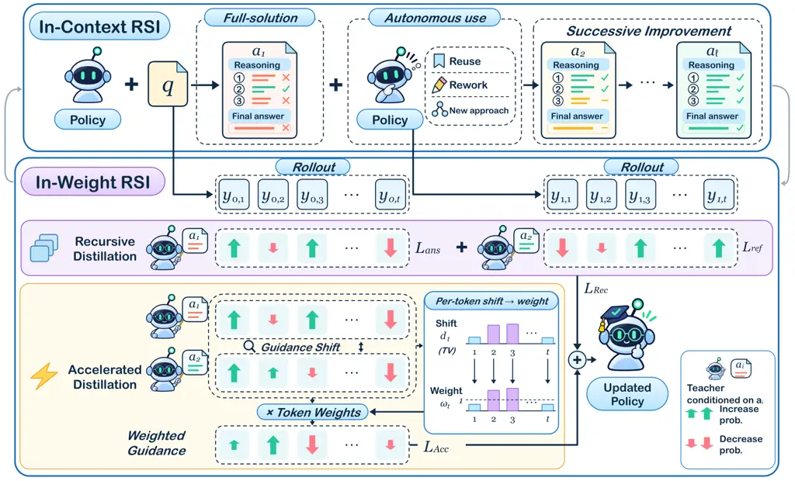

# Beyond Self-Consistency: Recursive Self-Improvement at Test Time

Jianyu Wu Affiliation: Shanghai Jiao Tong University Shanghai Artificial
Intelligence Laboratory
Email: <wujianyu@sjtu.edu.cntangshixiang@pjlab.org.cn>    Yizhou Wang
Affiliation: Shanghai Jiao Tong University Shanghai Artificial
Intelligence Laboratory    Encheng Su Affiliation: Shanghai Jiao Tong
University Shanghai Artificial Intelligence Laboratory Affiliation: The
Chinese University of Hong Kong The University of Science and Technology
of China    Jinouwen Zhang Affiliation: Shanghai Jiao Tong
University Shanghai Artificial Intelligence Laboratory    Pengze Li
Affiliation: Shanghai Jiao Tong University Shanghai Artificial
Intelligence Laboratory    Lintao Wang Affiliation: Shanghai Jiao Tong
University Shanghai Artificial Intelligence Laboratory
Affiliation: Fudan University The University of
Sydney ^(\*)Corresponding author    Chen Tang Affiliation: Shanghai Jiao
Tong University Shanghai Artificial Intelligence Laboratory    Aoran
Wang Affiliation: Shanghai Jiao Tong University Shanghai Artificial
Intelligence Laboratory    Wanli Ouyang    Shixiang Tang
Affiliation: Shanghai Jiao Tong University Shanghai Artificial
Intelligence Laboratory

###### Abstract

Large language models (LLMs) that continue improving after deployment
(e.g., recursive self-improvement) offer a promising path toward general
intelligence. Current test-time methods pursue this goal on unlabeled
questions, primarily relying on self-consistency: they generate
independent solutions and use majority voting to select an answer or
construct training targets. This leaves earlier reasoning unused at
inference and can reinforce an incorrect majority during training.
Humans instead build on earlier attempts to preserve useful reasoning,
correct mistakes and improve their problem-solving strategies. Following
this principle, we propose Test-Time Recursive Self-Improvement
(TT-RSI), a label-free framework for improving LLMs at test time through
two mutually reinforcing components: (1) In-Context RSI repeatedly
re-solves each question using the full previous solution as a reference,
letting the model decide whether and how to use it so that inference
compute builds on earlier reasoning. (2) In-Weight RSI distills
successive refinements into the model’s weights, enabling progress
beyond an initially wrong majority and theoretically bringing the first
attempt toward the model’s infinite-step refinement limit. The updated
model answers better and refines more effectively, generating stronger
references for subsequent training. Extensive experiments show that
TT-RSI improves average accuracy by +13.89% over the base model and
outperforms the strongest self-consistency-based method by +4.79% under
the same test-time scaling budget.

![[Uncaptioned
image]](arxiv-2611-30965--b62e858a3758.figures/figure-1.webp)

Figure 1: Self-Consistency vs. TT-RSI. At test time, a model must judge
its own answers on unlabeled questions, with no ground truth to tell
which to trust. (a) Self-consistency-based methods resolve this by
majority voting, taking the most frequent answer as the final output and
as the training target, leaving prior reasoning unused at inference and
reinforcing wrong answers during training. (b) TT-RSI reuses reasoning
for efficient inference and trains on self-improvement to strengthen
answering and refinement.

## 1 Introduction

Enabling AI systems to improve their own capabilities (e.g., recursive
self-improvement (Novikov et al., 2025; Zhang et al., 2026) and
continual learning (Ye et al., 2026)) is central to progress toward
artificial general intelligence (Schmidhuber, 2007; Silver and Sutton,
2025). For LLMs, test time is a natural setting for such improvement:
after a model is deployed, the goal is to answer new, unlabeled
questions more accurately using only self-generated signals. Two
families of methods pursue this goal: _test-time scaling_ spends more
inference compute on each question (Snell et al., 2025; Guo et al.,
2025), while _test-time training_ updates the model’s weights on
unlabeled test questions (Sun et al., 2020; Zuo et al., 2025). Ideally,
the two form a loop: better answers train a better model, which in turn
produces better answers, allowing improvements to accumulate over
successive rounds without external supervision.

However, current test-time methods rely primarily on _Self-Consistency_
(SC) for both inference and training: they sample independent solutions
and use majority voting either to select the final answer (Wang et al.,
2023; Brown et al., 2024) or to construct training targets (Zuo et al.,
2025; Wang et al., 2026; Gkountouras et al., 2026). This leads to two
linked limitations: (1) Inefficient inference. Each attempt starts from
scratch and leaves earlier reasoning unused, so additional compute
yields more independent samples rather than better reasoning. (2)
Unreliable supervision. Majority voting rewards whichever answer the
model already produces most often, so when that majority is wrong,
training reinforces the error. Together, these limitations break the
loop above, so test-time improvement stalls rather than accumulates.

In contrast, humans tackle difficult problems by building on earlier
attempts, retaining useful reasoning, revising mistakes, and gradually
improving their problem-solving strategies (Pólya, 1945). Following this
principle, we propose Test-Time Recursive Self-Improvement (TT-RSI), a
label-free framework that improves LLMs at test time through both
inference and training (Figure 1). Both rely on an _improvement step_,
which re-solves a question with the previous solution as context.
Specifically, at inference, additional compute builds on earlier
reasoning instead of repeating it. During training, the model learns
from its own refinements rather than majority votes. Since a refinement
can fix an earlier attempt even when most attempts agree on a wrong
answer, this supervision can move the model beyond its initial majority,
yielding higher accuracy than majority-based training while preserving
the gains from further test-time scaling.



Figure 2: Overview of TT-RSI. In-Context RSI generates $`a_{1}`$ from
$`q`$, then repeatedly re-solves $`q`$ given the full previous solution.
The model autonomously chooses what to reuse, rework, or solve anew,
producing $`a_{2},\ldots,a_{\ell}`$. In-Weight RSI uses these solutions
as teacher references: Recursive Distillation combines $`a_{1}`$- and
$`a_{2}`$-conditioned guidance for answering ($`L_{\mathrm{ans}}`$) and
refinement ($`L_{\mathrm{ref}}`$) as $`L_{\mathrm{Rec}}`$. Accelerated
Distillation compares the $`a_{1}`$- and $`a_{2}`$-conditioned guidance
on $`y_{0}`$ and weights only $`a_{2}`$ guidance ($`L_{\mathrm{Acc}}`$),
with larger shifts receiving larger weights. The updated policy starts
the next refinement chain.

TT-RSI realizes the improvement step through two complementary
components. At inference, we introduce In-Context RSI, a training-free
test-time scaling strategy that turns additional compute into successive
refinements. Given a question, the LLM first generates an initial
solution, then repeatedly re-solves the question with its latest
solution as context, and returns the final answer of the last attempt.
However, simply conditioning on previous solutions can restrict
exploration and cause repetition (Gu et al., 2026; Rance et al., 2026).
We therefore present the full solution neutrally, preserving its
intermediate reasoning while letting the LLM decide whether and how to
use it. With the previous solution in view, the LLM need not re-derive
every step: it can keep verified steps, focus on questionable ones, and
avoid repeating earlier dead ends. As a result, In-Context RSI surpasses
self-consistency while reducing generated tokens by a relative 68.6%
(Figure 3). These successive solutions also serve as training signals.

During training, we introduce In-Weight RSI, a label-free test-time
training method that _distills_ the gains of In-Context RSI into the
model’s weights. In-Weight RSI uses the first attempt and its immediate
refinement, a pair of adjacent solutions from an In-Context RSI chain
generated by the current policy, as references, strengthening both
answering and refinement while transferring later improvements into the
first attempt. Concretely, it learns from these references through
on-policy self-distillation (Zhao et al., 2026a, OPSD;), which turns
them into token-level guidance on the model’s own rollouts. Because each
refinement re-examines the full previous derivation, it can correct
intermediate steps even when the final answer remains wrong. Token-level
guidance captures such partial corrections, which majority voting over
final answers cannot. In this way, In-Context RSI and In-Weight RSI
reinforce each other: the refinements of In-Context RSI train a better
model through In-Weight RSI, and the updated model refines more
effectively under In-Context RSI, generating stronger references for
later training. This realizes the ideal loop between test-time scaling
and training described above, so improvements can be accumulated without
external supervision.

We validate TT-RSI with Qwen3-1.7B, 4B and 8B (Yang et al., 2025a) on
five competition mathematics benchmarks (Balunović et al., 2025;
Dekoninck et al., 2026) against five label-free baselines. In-Weight RSI
and the full TT-RSI improve average accuracy over the base model by
+5.79% and +13.89%, respectively. Under the same test-time scaling
budget, TT-RSI exceeds the strongest self-consistency-based method,
TTPO + SC (Wang et al., 2026), by +4.79% on average. Our contributions
are as follows:

- •
  A recursive self-improvement framework. We propose TT-RSI, which goes
  beyond self-consistency by using self-improvement for both test-time
  scaling and label-free test-time training.
- •
  Two mutually reinforcing components. We design In-Context RSI to let
  the model build on its full previous solution, and In-Weight RSI to
  distill successive refinements into answering and refinement, so that
  each strengthens the other.
- •
  Theory and experiments. We prove that distilling from two successive
  solutions strengthens refinement and moves the first attempt toward
  the infinite-step limit, and demonstrate accuracy and token-efficiency
  gains empirically.

## 2 Preliminaries

#### Notation.

Let $`q`$ be a question and $`\pi_{\theta}`$ the model. We sample a
visible solution $`a\sim\pi_{\theta}(\cdot\mid q)`$, consisting of a
derivation and a final answer.

#### Label-free test-time training.

Given the unlabeled questions of a test set, a test-time training method
updates $`\pi_{\theta}`$ on those questions using only signals that the
model generates itself (Sun et al., 2020; Zuo et al., 2025).

#### On-policy self-distillation.

OPSD (Zhao et al., 2026a) uses a frozen initial-model teacher
$`\pi_{\theta_{0}}`$ with privileged information to guide
$`\pi_{\theta}`$ on its own rollout. For student context $`x`$ and
teacher reference $`y^{\star}`$, the loss is

```math
L_{\mathrm{OPSD}}=D\big(\operatorname{sg}[\pi_{\theta_{0}}(\cdot\mid x,y^{\star})]\,\big\|\,\pi_{\theta}(\cdot\mid x)\big), \tag{1}
```

where $`\operatorname{sg}`$ denotes stop-gradient. The teacher’s
next-token predictions provide guidance along a student rollout
$`y\sim\pi_{\theta}(\cdot\mid x)`$, and $`D`$ compares them with the
student’s predictions at the same prefixes.

## 3 Test-Time Recursive Self-Improvement

TT-RSI applies the improvement step (Section 3.1) in two components:
In-Context RSI (Section 3.2) repeats it to refine answers at inference,
while In-Weight RSI (Section 3.3) turns the resulting refinements into
supervision for answering and refinement (Figure 2).

### 3.1 The improvement step

At the core of TT-RSI is an _improvement step_, which lets the model
improve on its own attempts without labels by turning a completed
attempt into context for further reasoning. A previous solution provides
a starting point from which the model can reuse useful parts of an
argument, reconsider intermediate steps, and develop a better solution.
Starting from $`a_{1}\sim\pi_{\theta}(\cdot\mid q)`$, repeated
application gives $`a_{k+1}\sim\pi_{\theta}(\cdot\mid q,a_{k})`$. Only
the latest solution $`a_{k}`$ is carried forward, so the sequence forms
a Markov chain without an expanding history. Because later solutions
tend to improve on earlier ones (Figure 3), they can also supervise
earlier attempts during training, distilling later improvements into the
model (Section 3.3). Further details of the refinement setup are
provided in Appendix B.

### 3.2 In-Context RSI

Even an unsuccessful attempt often contains correct intermediate steps,
yet independent sampling discards them and starts each attempt from
scratch. To put them to use, we propose In-Context RSI, a training-free
test-time scaling strategy that applies the improvement step repeatedly
to the same question, so that each attempt builds on the previous one.
Effective refinement needs information from an earlier attempt and the
freedom to reconsider it. Yet conditioning too strongly on an earlier
solution can suppress exploration and lead to repeated solutions (Gu
et al., 2026; Rance et al., 2026). Directly applying correction-oriented
feedback can also induce unnecessary changes to a correct answer (Huang
et al., 2024; Kamoi et al., 2024).

To address this tension, In-Context RSI combines full-solution
references with autonomous reference use. Given $`q`$, the policy first
generates an initial solution $`a_{1}\sim\pi_{\theta}(\cdot\mid q)`$.
Each subsequent attempt then receives a _full-solution reference_: the
complete previous solution $`a_{k}`$, including both its step-by-step
derivation and its final answer, rather than the final answer alone.
Attempt $`a_{k+1}`$ can thus check the individual steps of $`a_{k}`$,
keep those that hold, and locate where the derivation went wrong, so
even a solution with an incorrect final answer contributes reusable
steps. For _autonomous reference use_, we present $`a_{k}`$ neutrally as
“a previous attempt”, without indicating whether it is correct or
requesting corrections, and ask the policy to “solve the problem
independently” (Appendix B). The policy itself decides how to use each
part of $`a_{k}`$: reuse it, rework it, or take a new approach.
Repeating this step yields a chain
$`a_{1}\to a_{2}\to\cdots\to a_{\ell}`$ of one initial solution and
$`\ell{-}1`$ refinements, and we return the final answer of
$`a_{\ell}`$.

To characterize the balance between correcting and preserving answers,
we use a two-state model (Yang et al., 2025b; Liu et al., 2025; He
et al., 2025). Each refinement step corrects a wrong answer with
probability $`f`$, the _fix rate_, and breaks a correct one with
probability $`b`$, the _break rate_.

###### Proposition 1.

For constant fix/break rates with $`f{+}b\in(0,1]`$, In-Context RSI
improves its first-attempt accuracy $`\operatorname{acc}_{1}`$ exactly
when $`f\,(1-\operatorname{acc}_{1})>b\,\operatorname{acc}_{1}`$. Its
limiting accuracy, the _balance point_, is $`f/(f{+}b)`$.

A refinement design should therefore raise the fix rate relative to the
break rate. We compare these rates for In-Context RSI and its design
variants in Section 4.3.

### 3.3 In-Weight RSI

The improvements of In-Context RSI last only for the current question,
and majority-vote targets can reinforce a wrong answer. We therefore
propose In-Weight RSI, a label-free test-time training method that
distills successive refinements into the model’s weights. Taking the
first two solutions $`a_{1},a_{2}`$ of an In-Context RSI chain generated
by $`\pi_{\theta}`$ as references, In-Weight RSI trains answering and
refinement through Recursive Distillation and couples them through
Accelerated Distillation, optimizing both objectives jointly. Both use
OPSD (Eq. 1), with these references as privileged information.

#### Recursive Distillation.

A key design question is which solution along the refinement chain
should supervise which attempt. Ideally, training would transfer the
result of infinitely many refinements directly into the first attempt,
absorbing the full benefit of the chain. However, long chains are costly
to generate, and their late solutions can differ substantially from the
student’s early attempts, making the teacher’s guidance on the student’s
own rollouts less reliable. This raises a question: is it possible to
supervise only local relationships along the chain and thereby avoid
these issues?

Fortunately, the chain involves only two behaviors: answering the
question and refining the previous attempt. Every later step reuses the
refinement operation, so training these two behaviors covers the
recurring roles along the chain. For each behavior, we sample a student
rollout: $`y_{0}\sim\pi_{\theta}(\cdot\mid q)`$ for answering and
$`y_{1}\sim\pi_{\theta}(\cdot\mid q,a_{1})`$ for refinement. The teacher
receives $`a_{1}`$ for answering and $`a_{2}`$ in place of $`a_{1}`$ for
refinement:

```math
\displaystyle L_{\mathrm{ans}} \displaystyle=D\big(\operatorname{sg}[\pi_{\theta_{0}}(\cdot\mid q,a_{1})]\,\|\,\pi_{\theta}(\cdot\mid q)\big), \tag{2}
```

```math
\displaystyle L_{\mathrm{ref}} \displaystyle=D\big(\operatorname{sg}[\pi_{\theta_{0}}(\cdot\mid q,a_{2})]\,\|\,\pi_{\theta}(\cdot\mid q,a_{1})\big).
```

The losses are evaluated on $`y_{0}`$ and $`y_{1}`$, respectively. We
call $`L_{\mathrm{ans}}`$ _answer distillation_: its teacher has already
seen $`a_{1}`$, so it transfers one improvement step into the first
attempt. We call $`L_{\mathrm{ref}}`$ _refinement distillation_: its
teacher has seen the refined solution $`a_{2}`$, so it trains the
improvement step to incorporate a further refinement. We combine them as

```math
L_{\mathrm{Rec}}=L_{\mathrm{ans}}+L_{\mathrm{ref}}. \tag{3}
```

Although $`L_{\mathrm{Rec}}`$ needs only two reference solutions per
question, it can recover the effect of much longer chains over repeated
updates. After each update, both behaviors improve, so the references
$`a_{1},a_{2}`$ generated by the updated policy correspond to later
attempts of the original chain. Distilling them again moves the first
attempt and each refinement step further along that chain. Each update
thus needs only one-step-ahead targets, while the gains compound across
updates (Theorem 1).

#### Accelerated Distillation.

$`L_{\mathrm{ans}}`$ and $`L_{\mathrm{ref}}`$ remain loosely coupled:
the first attempt does not receive direct supervision from the later
reference $`a_{2}`$. Accelerated Distillation connects them by
supervising the first-attempt rollout $`y_{0}`$ with the
$`a_{2}`$-conditioned teacher of refinement distillation:

```math
L_{\mathrm{Acc}}=D_{\omega}\big(\operatorname{sg}[\pi_{\theta_{0}}(\cdot\mid q,a_{2})]\,\|\,\pi_{\theta}(\cdot\mid q)\big). \tag{4}
```

Because $`L_{\mathrm{ans}}`$ already supplies $`a_{1}`$-conditioned
guidance, we emphasize what changes when the reference is refined to
$`a_{2}`$. We compare the teacher’s next-token distributions under
$`a_{1}`$ and $`a_{2}`$ at the same prefix $`y_{0,<t}`$, and define the
_guidance shift_ $`d_{t}`$ from $`a_{1}`$ to $`a_{2}`$ as the
total-variation distance between them. It determines the _token weight_

```math
\omega_{t}=1-\alpha+\frac{2\alpha\,d_{t}}{d_{t}+\tau}, \tag{5}
```

where $`0<\alpha<1`$ controls the weighting strength and $`\tau>0`$ sets
the change scale. $`D_{\omega}`$ multiplies each token’s distillation
loss on $`y_{0}`$ by $`\omega_{t}`$. Larger shifts strengthen the
$`a_{2}`$-conditioned supervision at positions affected by refinement.

In total, In-Weight RSI minimizes

```math
L=L_{\mathrm{Rec}}+w_{\mathrm{Acc}}L_{\mathrm{Acc}}, \tag{6}
```

where $`w_{\mathrm{Acc}}`$ weights Accelerated Distillation.

#### Theoretical analysis.

To understand how the two local distillation terms recover longer
refinement chains, we model sequence-level distillation with exact
distributional backups, following the one-step bootstrap structure of
temporal-difference learning (Bellman, 1957; Sutton, 1988).

###### Theorem 1 (Compression and amplification).

After $`n`$ exact distributional backups of Recursive Distillation, the
model’s $`k`$-th attempt matches the initial model’s $`(n{+}1)k`$-th
attempt in distribution. Answer distillation compresses later attempts
into the first, while refinement distillation makes each refinement step
equivalent to $`n{+}1`$ initial-model steps.

Accelerated Distillation lets the first attempt use this strengthened
refinement operation directly, accumulating its gains across updates.

###### Proposition 2 (Accelerated Distillation).

Accelerated Distillation makes the first attempt a mixture of
initial-model attempts whose expected index grows quadratically with the
number of exact backups.

Together, these results show that local supervision strengthens
refinement and moves the first attempt toward the initial model’s
infinite-step refinement limit, with Accelerated Distillation speeding
the transfer (proofs in Appendix A).

In-Context RSI and In-Weight RSI thus close the loop: teacher guidance
strengthens answering and refinement, and the updated policy generates
the next reference solutions. This turns test-time compute into lasting
model improvement without external labels.

## 4 Experiments

We compare TT-RSI with existing label-free test-time training methods
(Section 4.2), then ablate its components (Section 4.3) and analyze its
gains and costs (Section 4.4).

|                                  |        |        |        |        |         |                 |
| -------------------------------- | ------ | ------ | ------ | ------ | ------- | --------------- |
| Method                           | AIME25 | HMMT25 | AIME26 | HMMT26 | BRUMO25 | Avg.            |
| Qwen3-1.7B                       |        |        |        |        |         |                 |
| Base                             | 37.78  | 21.67  | 39.17  | 27.27  | 48.33   | 34.84           |
| TTRL (Zuo et al., 2025)          | 36.39  | 25.56  | 41.67  | 28.54  | 48.61   | 36.15           |
| TTPO (Wang et al., 2026)         | 41.94  | 27.22  | 46.67  | 31.82  | 52.22   | 39.97           |
| OPSD-TTT (Wang et al., 2026)     | 40.83  | 28.89  | 45.28  | 32.58  | 51.67   | 39.85           |
| CANON (Gkountouras et al., 2026) | 33.61  | 21.94  | 31.67  | 27.78  | 49.72   | 32.94           |
| U-OPSD (Li et al., 2026)         | 40.00  | 25.00  | 43.06  | 29.80  | 48.33   | 37.24           |
| In-Weight RSI (ours)             | 44.72  | 29.17  | 48.61  | 33.84  | 53.61   | 41.99 (+7.15%)  |
| Base + In-Context RSI            | 36.67  | 30.00  | 50.00  | 30.30  | 51.67   | 39.73           |
| TTPO (Wang et al., 2026) + SC    | 43.33  | 30.00  | 56.67  | 33.33  | 60.00   | 44.67           |
| TT-RSI (ours)                    | 53.33  | 36.67  | 63.33  | 42.42  | 56.67   | 50.48 (+15.64%) |
| Qwen3-4B                         |        |        |        |        |         |                 |
| Base                             | 68.06  | 40.28  | 65.00  | 42.68  | 62.78   | 55.76           |
| TTRL (Zuo et al., 2025)          | 68.61  | 44.72  | 66.11  | 44.95  | 65.83   | 58.04           |
| TTPO (Wang et al., 2026)         | 71.39  | 47.78  | 68.89  | 43.18  | 66.67   | 59.58           |
| OPSD-TTT (Wang et al., 2026)     | 70.28  | 46.39  | 68.89  | 42.93  | 68.33   | 59.36           |
| CANON (Gkountouras et al., 2026) | 62.50  | 40.56  | 63.33  | 37.63  | 65.00   | 53.80           |
| U-OPSD (Li et al., 2026)         | 67.78  | 44.17  | 66.94  | 41.67  | 64.72   | 57.06           |
| In-Weight RSI (ours)             | 72.50  | 48.33  | 72.50  | 46.72  | 69.44   | 61.90 (+6.14%)  |
| Base + In-Context RSI            | 76.67  | 47.78  | 76.67  | 50.51  | 70.00   | 64.33           |
| TTPO (Wang et al., 2026) + SC    | 80.00  | 53.33  | 76.67  | 45.45  | 73.33   | 65.76           |
| TT-RSI (ours)                    | 83.33  | 53.33  | 83.33  | 51.52  | 76.67   | 69.64 (+13.88%) |
| Qwen3-8B                         |        |        |        |        |         |                 |
| Base                             | 70.56  | 46.39  | 67.78  | 45.20  | 70.56   | 60.10           |
| TTRL (Zuo et al., 2025)          | 68.61  | 46.67  | 71.11  | 45.96  | 73.89   | 61.25           |
| TTPO (Wang et al., 2026)         | 72.22  | 47.22  | 70.83  | 47.22  | 71.67   | 61.83           |
| OPSD-TTT (Wang et al., 2026)     | 70.83  | 47.78  | 70.28  | 47.73  | 71.11   | 61.55           |
| CANON (Gkountouras et al., 2026) | 66.39  | 43.89  | 67.78  | 44.95  | 70.28   | 58.66           |
| U-OPSD (Li et al., 2026)         | 69.72  | 49.17  | 70.56  | 47.22  | 70.56   | 61.45           |
| In-Weight RSI (ours)             | 74.44  | 49.17  | 74.44  | 49.49  | 73.33   | 64.17 (+4.07%)  |
| Base + In-Context RSI            | 76.67  | 50.00  | 76.67  | 51.52  | 76.67   | 66.31           |
| TTPO (Wang et al., 2026) + SC    | 83.33  | 50.00  | 73.33  | 54.55  | 76.67   | 67.58           |
| TT-RSI (ours)                    | 80.00  | 56.67  | 86.67  | 54.55  | 83.33   | 72.24 (+12.14%) |

Table 1: Main results. We report accuracy (%) across three model scales
and five mathematics benchmarks. For test-time scaling, TT-RSI applies
In-Context RSI to the In-Weight RSI model and reports the final attempt,
while TTPO + SC applies Self-Consistency (Wang et al., 2023) to the TTPO
model with the same budget. Avg. averages the benchmarks, and blue
parentheses give accuracy gains over Base. Performances are illustrated
with best and second best within each group, including ties.

### 4.1 Setup

#### Models and benchmarks.

We evaluate Qwen3-1.7B, 4B and 8B (Yang et al., 2025a) on five
competition mathematics benchmarks: AIME 2025 and 2026, HMMT
February 2025 and 2026, and BRUMO 2025 (Balunović et al., 2025;
Dekoninck et al., 2026). Following prior label-free test-time training
(Zuo et al., 2025; Wang et al., 2026), our main comparison adapts each
method separately to the unlabeled questions of each benchmark. Labels
are used only for evaluation. We report first- and final-attempt
accuracy as avg@12. Responses are sampled with temperature 1.0 and
top-$`p`$ 0.95, generating up to 38,912 tokens (Appendix C).

#### Baselines.

We compare with TTRL (Zuo et al., 2025), TTPO and OPSD-TTT (Wang et al.,
2026), CANON (Gkountouras et al., 2026), and U-OPSD (Li et al., 2026),
covering majority-based policy optimization and label-free
self-distillation (Appendix D). We also compare with TTPO using
self-consistency (TTPO + SC) under the same test-time scaling budget as
In-Context RSI (Appendix D).

#### Implementation.

In our main experiments, In-Context RSI uses chains of $`\ell{=}11`$
attempts, that is, one initial solution and ten refinements. In-Weight
RSI uses 100 training updates with 32 question occurrences per update.
All three loss terms have unit weight ($`w_{\mathrm{Acc}}{=}1`$) and use
the OPSD forward KL with temperature 1.1, clipping the per-token KL at
0.05. We use $`\alpha{=}0.5`$ and $`\tau{=}10^{-4}`$. We design a
pipelined sampling schedule that overlaps generation across updates,
reducing idle time and accelerating training (Appendix C).

### 4.2 Main results

First, under the same test-time scaling budget, TT-RSI outperforms
self-consistency-based test-time training at every model scale (see
Table 1). On average, it exceeds TTPO + SC by +4.79%, with wins in 11 of
the 15 settings and ties in two. On AIME26 at 8B, for example, accuracy
is 86.67%, compared with 73.33% for TTPO + SC (+13.34%).
Self-consistency-based training can reinforce an incorrect majority, so
further sampling tends to reproduce the same error: in the same setting,
self-consistency lifts TTPO by only +2.50%, whereas In-Context RSI lifts
Base by +8.89%. Training on refinements instead strengthens revision,
improving the solutions that later attempts build on.

Second, even without test-time scaling, In-Weight RSI achieves the best
first-attempt accuracy among label-free training methods at every model
scale. It improves over Base by +5.79% on average, beating all five
training baselines in 13 of the 15 settings and tying for the best score
in one other. At 8B, its mean accuracy is 64.17%, +2.34% above TTPO
(Wang et al., 2026), the strongest training baseline on average. These
gains show that distillation retains refinement benefits in the model
and remains effective with a stronger starting policy.

Third, the gains from training also carry over to inference-time
refinement. Specifically, the full framework gains +13.89% over Base and
exceeds Base + In-Context RSI by +7.33%. In-Weight RSI therefore helps
even when in-context improvement is available at inference, raising both
the first and later attempts. Notably, at 1.7B, the first attempt of
In-Weight RSI (41.99%) already exceeds Base + In-Context RSI after ten
refinements (39.73%), consistent with the compression of later attempts
into the first attempt (Theorem 1).

### 4.3 Ablations

We consider each component in turn, first the refinement design of
In-Context RSI and then the distillation design of In-Weight RSI.

Setting Acc. Fix Break $`\overline{f/(f{+}b)}`$ Base 53.84 – – – Final
answer only 59.31 7.01 3.95 60.55 Directed reference use 60.43 2.12 1.24
59.97 Unrelated reference 50.61 14.43 13.80 49.57 In-Context RSI (ours)
63.59 3.84 1.96 65.42

Table 2: In-Context RSI design ablations. Qwen3-4B accuracy, fix/break
rates and balance points (%), averaged over AIME26 and HMMT26. Balance
points are computed per benchmark before averaging. The best accuracy
and balance point are in bold.

#### In-Context RSI design.

To examine how the two design choices of In-Context RSI (see
Section 3.2) affect refinement, we compare it with three variants
(Table 2). _Final answer only_ retains just the final answer of
$`a_{k}`$, _directed reference use_ instructs the policy to check and
correct $`a_{k}`$, and _unrelated reference_ replaces $`a_{k}`$ with a
solution to a different question from the same benchmark. Alongside
accuracy, we report the fix rates, break rates and balance points of
Proposition 1, with rates pooled over the chain and estimated in a
separate evaluation batch. The full design raises mean accuracy from
53.84% to 63.59% after ten refinement steps. Replacing the full solution
with only its final answer lowers mean accuracy (−4.28%) and roughly
doubles the break rate, indicating that intermediate reasoning helps
preserve correct solutions. Directing reference use lowers accuracy
(−3.16%) and the fix rate, suggesting that autonomous use leaves more
room to correct earlier mistakes. An unrelated reference performs below
Base (−3.23%), showing that additional context alone does not provide
the benefit of relevant prior reasoning. The two design choices together
improve refinement.

The balance points reflect the same pattern. Unrelated references have
the highest fix rate but also introduce frequent regressions, yielding
the lowest balance point. Full-solution references and autonomous use
balance correction with preservation, giving In-Context RSI the highest
balance point. Across the four settings, these balance points track
observed accuracy within 1.83%.

Variant AIME26 HMMT26 _(a) Distillation objective_ Answer distillation
($`L_{\mathrm{ans}}`$) only 68.61 44.19 Refinement distillation
($`L_{\mathrm{ref}}`$) only 69.44 44.95 Recursive Distillation 71.39
45.96 + Accelerated Distillation (ours) 72.50 46.72 In-Weight RSI +
third pair $`(a_{2},a_{3})`$ 72.78 46.72 _(b) Reference policy
($`a_{1}\to a_{11}`$)_ Fixed initial
$`\underline{70.83}\to\underline{74.44}`$
$`\underline{42.93}\to\underline{47.73}`$ Current (ours)
$`\mathbf{72.50}\to\mathbf{83.33}`$ $`\mathbf{46.72}\to\mathbf{51.52}`$

Table 3: In-Weight RSI design ablations. Qwen3-4B accuracy (%) for
different distillation objectives (a) and reference policies (b).
Performances are illustrated with best and second best.

#### In-Weight RSI design.

To test whether supervising both behaviors (Section 3.3) improves on
either alone, we train the two distillation terms separately and
together (see Table 3a). Recursive Distillation outperforms refinement
distillation, the stronger single term, by +1.95% on AIME26 and +1.01%
on HMMT26. We then add Accelerated Distillation to test whether coupling
improves the first attempt, obtaining further gains of +1.11% and
+0.76%, respectively. Training both behaviors and coupling their
guidance therefore strengthen the first attempt. Finally, to assess the
value of deeper supervision, we add a third adjacent pair, in which a
teacher given $`a_{3}`$ supervises a student given $`a_{2}`$. It yields
only +0.28% on AIME26 and matches In-Weight RSI on HMMT26 (Proposition 3
in Appendix A), while requiring another generation. We therefore retain
two reference solutions per update.

### 4.4 Analysis

Having shown that training strengthens refinement, we now examine how
these gains feed back through references, how far they extend, whether
they reach questions that the majority gets wrong, what they cost, and
how they accumulate during adaptation.

#### Mutual reinforcement across updates.

We compare references generated by the current and initial policies
under the same distillation objective (see Table 3b). Generating
references with the evolving policy improves first-attempt accuracy by
+1.67% on AIME26 and +3.79% on HMMT26 over using the fixed initial
policy. After ten refinement steps, the advantages are +8.89% and
+3.79%, respectively. Evolving references therefore improve both the
first and final attempts. This matches the bootstrap analysis
(Theorem 1): fixed initial-policy references always provide the same
one-step targets, whereas evolving references let the gains compound
across updates. Together with the stronger refinement observed after
training (Section 4.2), this shows how improvements in the policy and
its references reinforce one another.

Train on AIME26 Method HMMT25 HMMT26 BRUMO25 Avg. Base 40.28 42.68 62.78
48.58 TTRL (Zuo et al., 2025) 40.83 40.15 62.22 47.73 TTPO (Wang et al., 2026) 43.33 42.68 64.44 50.15 OPSD-TTT (Wang et al., 2026) 43.33 42.93
65.28 50.51 CANON (Gkountouras et al., 2026) 38.61 39.65 64.72 47.66
U-OPSD (Li et al., 2026) 42.22 40.91 64.17 49.10 In-Weight RSI (ours)
43.61 43.69 65.56 50.95 Train on HMMT26 Method AIME25 AIME26 BRUMO25
Avg. Base 68.06 65.00 62.78 65.28 TTRL (Zuo et al., 2025) 68.33 63.06
63.61 65.00 TTPO (Wang et al., 2026) 69.17 66.67 66.67 67.50 OPSD-TTT
(Wang et al., 2026) 69.17 68.06 65.83 67.69 CANON (Gkountouras et al., 2026) 60.83 61.11 59.17 60.37 U-OPSD (Li et al., 2026) 66.67 66.11 65.83
66.20 In-Weight RSI (ours) 69.44 68.33 67.22 68.33

Table 4: Cross-task transfer. Qwen3-4B accuracy (%) on target benchmarks
after adaptation to AIME26 or HMMT26. Performances are illustrated with
best and second best.

#### Cross-task transfer.

To test whether improvements from training extend beyond the adaptation
questions, we train Qwen3-4B on AIME26 or HMMT26 and evaluate on the
target benchmarks without further updates (Table 4). Compared with Base,
mean target accuracy improves by +2.37% and +3.05%, respectively.
In-Weight RSI achieves the highest accuracy on all six source–target
pairs, averaging 59.64% and exceeding OPSD-TTT, the strongest baseline
on average. These transfer gains show that the improvement is retained
in the model weights and applies to new questions.

_(a) Beyond the initial majority (AIME26)_ All questions Wrong majority
Method avg@64 SC@64 avg@64 SC correct Base 66.56 80.00 5.73 0/6 TTRL
(Zuo et al., 2025) 64.48 76.67 4.95 0/6 TTPO (Wang et al., 2026) 67.34
76.67 5.47 0/6 OPSD-TTT (Wang et al., 2026) 67.66 76.67 8.33 1/6 CANON
(Gkountouras et al., 2026) 61.25 70.00 2.34 0/6 U-OPSD (Li et al., 2026)
64.79 76.67 2.08 0/6 In-Weight RSI (ours) 71.35 80.00 12.76 2/6 _(b)
Training efficiency_ AIME26 HMMT26 Method Time$`\downarrow`$
Tokens$`\downarrow`$ Time$`\downarrow`$ Tokens$`\downarrow`$ TTRL (Zuo
et al., 2025) 22.08 1.63 23.08 1.74 TTPO (Wang et al., 2026) 45.73 11.74
37.70 10.89 U-OPSD (Li et al., 2026) 37.27 4.59 50.30 5.56 In-Weight RSI
(ours) 8.53 0.95 10.06 1.12

Table 5: Initial-majority behavior and training cost. Qwen3-4B accuracy
(%) and correct-majority counts (a), and minutes and tokens (M) per
update (b). Performances are illustrated with best and second best.

#### Gains beyond the initial majority.

To test whether refinement-based training can overcome an initially
wrong majority, we evaluate the In-Weight RSI model and the baselines
with 64 independent answers per question on AIME26, focusing on the six
questions whose Base majority is wrong (Table 5a), where avg@64 averages
the 64 answers and SC@64 is their majority vote. Several
self-consistency-based baselines perform below Base on this subset,
illustrating how training on agreement can reinforce an initially wrong
answer. On these questions, In-Weight RSI raises avg@64 from 5.73% to
12.76% (+7.03%), exceeding OPSD-TTT’s 8.33% by +4.43%. Self-consistency
also becomes correct on two of these questions, compared with one for
OPSD-TTT. Overall avg@64 improves by +4.79% over Base and +3.69% over
OPSD-TTT, the strongest baseline in this comparison. This demonstrates
that training on refinements raises accuracy on questions whose majority
is wrong, not only on those the model already answers correctly by
majority.

#### Inference efficiency.

To compare In-Context RSI with Self-Consistency at inference, we plot
mean accuracy over AIME26 and HMMT26 against mean cumulative generated
tokens per question (Figure 3). In-Context RSI exceeds the accuracy of
ten-sample self-consistency at its fifth attempt while generating 68.6%
fewer tokens, demonstrating more efficient inference scaling without
weight updates. At comparable total token cost, it retains an accuracy
advantage of +2.13%.

#### Training efficiency.

To measure the training cost of the improvement loop, we compare methods
with 32 question occurrences per update on four H20 GPUs (Table 5b).
With pipelined reference generation, In-Weight RSI takes 8.53 minutes on
AIME26 and 10.06 on HMMT26, giving a speedup of 2.29–5.36$`\times`$ per
update over the baselines. It also uses the fewest tokens per update,
0.95M on AIME26 and 1.12M on HMMT26, reducing the cost of its
self-supervision. Together with the inference savings above, these
results show reduced training time and inference token cost.

Figure 3: In-Context RSI vs. Self-Consistency. Mean accuracy of Qwen3-4B
versus mean cumulative generated tokens over AIME26 and HMMT26.

Figure 4: Performance during adaptation. We track Qwen3-4B mean accuracy
over AIME26 and HMMT26, with the dashed line marking Base.

#### Performance during adaptation.

Beyond per-update cost, we track first-attempt accuracy across training
updates to see how refinement benefits accumulate in the model’s weights
(Figure 4). In-Weight RSI leads throughout training, reaching 59.61%
accuracy (+5.77% over Base). Training on successive refinements
therefore continues to improve the model throughout adaptation.

Figure 5: Training accelerates refinement. Self-consistency selects a
wrong most-frequent answer on an HMMT26 problem, while refinement
succeeds at $`a_{11}`$ before training and $`a_{2}`$ after In-Weight RSI
training. Blue marks reasoning revisions.

#### Case study.

Finally, to inspect how refinement changes the reasoning, we trace the
stick-breaking example in Figure 5 (Appendix E). Self-consistency fails
because its most frequent answer, produced by three of eleven samples,
comes from a flawed averaging argument and outvotes the two samples
reaching the correct $`63/256`$, while base refinement succeeds by
replacing that argument with a recurrence for $`S(n)`$, the expected sum
of squared piece lengths. After In-Weight RSI training, the chain
corrects its transition factor at $`a_{2}`$ using the number of pieces
and remains correct thereafter. Reaching a correct derivation at
$`\boldsymbol{a_{2}}`$ rather than $`\boldsymbol{a_{11}}`$ illustrates
the amplification of refinement described in our analysis (Theorem 1).

## 5 Related work

#### Test-time scaling.

Parallel scaling aggregates independent solutions (Wang et al., 2023;
Brown et al., 2024), while sequential methods build on earlier attempts
by revision or re-solving (Madaan et al., 2023; Tian et al., 2025).
Repetition and limited exploration can restrict these gains (Gu et al.,
2026; Rance et al., 2026). Compute can also be allocated within a single
attempt, by its reasoning length (Guo et al., 2025) or by the effective
depth of the architecture (Liang et al., 2026), rather than by the
number of attempts. In-Context RSI preserves exploration by letting the
model decide whether and how to use full-solution references, and
In-Weight RSI distills the resulting refinements.

#### Label-free test-time training.

This line of work adapts models on unlabeled test inputs using
self-generated supervision (Sun et al., 2020; Akyürek et al., 2025).
TTRL rewards majority agreement (Zuo et al., 2025), and TTPO distills
solutions selected by self-consistency (Wang et al., 2026). Other
methods use agreement to select teacher references (Gkountouras et al.,
2026; Li et al., 2026) or sharpen confidence (Zhao et al., 2026b;
Agarwal et al., 2025). In-Weight RSI uses successive solutions as
teacher references, obtaining guidance from refinement rather than
majority agreement.

#### Self-improvement and distillation.

Training on self-generated attempts has been studied with correctness
feedback (Zelikman et al., 2022; Kumar et al., 2025) and in recursive
training frameworks (Lee et al., 2026), which a recent survey organizes
by how far the improvement loop is closed (Chen et al., 2026). Recent
systems evolve algorithms and agents (Novikov et al., 2025; Zhang
et al., 2026) or consolidate deployment experience into model parameters
(Ye et al., 2026). On-policy self-distillation uses contextual
information to construct dense teacher supervision (Zhao et al., 2026a;
Wu et al., 2026). TT-RSI connects in-context improvement with weight
updates by distilling successive self-generated refinements, forming a
test-time amplify-then-distill loop (Anthony et al., 2017; Christiano
et al., 2018).

## 6 Conclusion

We presented TT-RSI, a label-free framework for improving LLMs at test
time. In-Context RSI lets the model autonomously build on prior
solutions, which In-Weight RSI uses as teacher references to strengthen
answering and refinement. Our analysis shows how local distillation
compresses and amplifies improvement toward the model’s infinite-step
refinement limit. Across three model scales and five benchmarks, TT-RSI
gains +13.89% over Base and +4.79% over TTPO + SC on average.

## Limitations

Our evaluation covers mathematical reasoning and the Qwen3 family up to
8B parameters. A broader direction is to extend TT-RSI to open-ended
tasks and tool-using agents, where improvement unfolds over interactions
and must be retained across tasks.

## References

- Agarwal et al. (2025) Shivam Agarwal, Zimin Zhang, Lifan Yuan, Jiawei
  Han, and Hao Peng. 2025. [The unreasonable effectiveness of entropy
  minimization in LLM reasoning](https://doi.org/10.52202/085713-3573).
  In _Advances in Neural Information Processing Systems_, volume 38,
  pages 118599–118629. Curran Associates, Inc.
- Akyürek et al. (2025) Ekin Akyürek, Mehul Damani, Adam Zweiger, Linlu
  Qiu, Han Guo, Jyothish Pari, Yoon Kim, and Jacob Andreas. 2025. [The
  surprising effectiveness of test-time training for few-shot
  learning](https://arxiv.org/abs/2411.07279). In _Proceedings of the
  42nd International Conference on Machine Learning_, volume 267 of
  _Proceedings of Machine Learning Research_, pages 942–963. PMLR.
- Anthony et al. (2017) Thomas Anthony, Zheng Tian, and David
  Barber. 2017. [Thinking fast and slow with deep learning and tree
  search](https://arxiv.org/abs/1705.08439). In _Advances in Neural
  Information Processing Systems_, volume 30. Curran Associates, Inc.
- Balunović et al. (2025) Mislav Balunović, Jasper Dekoninck, Ivo
  Petrov, Nikola Jovanović, and Martin Vechev. 2025. [MathArena:
  Evaluating LLMs on uncontaminated math
  competitions](https://doi.org/10.52202/085713-0679). In _Advances in
  Neural Information Processing Systems (Datasets and Benchmarks
  Track)_, volume 38, pages 22851–22888. Curran Associates, Inc.
- Bellman (1957) Richard Bellman. 1957. _Dynamic Programming_. Princeton
  University Press, Princeton, NJ.
- Brown et al. (2024) Bradley Brown, Jordan Juravsky, Ryan Ehrlich,
  Ronald Clark, Quoc V. Le, Christopher Ré, and Azalia Mirhoseini. 2024.
  [Large language monkeys: Scaling inference compute with repeated
  sampling](https://arxiv.org/abs/2407.21787). _Preprint_,
  arXiv:2407.21787.
- Chen et al. (2026) Mingguang Chen, Licheng Wang, and Bo Qu. 2026.
  [Recursive self-improvement in AI: From bounded self-refinement to
  autonomous research loops](https://arxiv.org/abs/2607.07663).
  _Preprint_, arXiv:2607.07663.
- Christiano et al. (2018) Paul Christiano, Buck Shlegeris, and Dario
  Amodei. 2018. [Supervising strong learners by amplifying weak
  experts](https://arxiv.org/abs/1810.08575). _Preprint_,
  arXiv:1810.08575.
- Dekoninck et al. (2026) Jasper Dekoninck, Nikola Jovanović, Tim
  Gehrunger, Kári Rögnvaldsson, Ivo Petrov, Chenhao Sun, and Martin
  Vechev. 2026. [Beyond benchmarks: MathArena as an evaluation platform
  for mathematics with LLMs](https://arxiv.org/abs/2605.00674).
  _Preprint_, arXiv:2605.00674.
- Dobrushin (1956) R. L. Dobrushin. 1956. [Central limit theorem for
  nonstationary Markov chains. I](https://doi.org/10.1137/1101006).
  _Theory of Probability and Its Applications_, 1(1):65–80. Part II:
  Theory of Probability and Its Applications 1(4):329–383, 1956,
  doi:10.1137/1101029.
- Gkountouras et al. (2026) John Gkountouras, Josip Jukić, and Ivan
  Titov. 2026. [Consensus as privileged context for label-free
  self-distillation](https://arxiv.org/abs/2607.13643). _Preprint_,
  arXiv:2607.13643.
- Gu et al. (2026) Xiangming Gu, Soham De, Larisa Markeeva, Petar
  Veličković, and Razvan Pascanu. 2026. [Understanding performance gap
  between parallel and sequential sampling in large reasoning
  models](https://arxiv.org/abs/2604.05868). _Preprint_,
  arXiv:2604.05868.
- Guo et al. (2025) Daya Guo, Dejian Yang, Haowei Zhang, Junxiao Song,
  Peiyi Wang, Qihao Zhu, Runxin Xu, Ruoyu Zhang, et al. 2025.
  [DeepSeek-R1 incentivizes reasoning in LLMs through reinforcement
  learning](https://doi.org/10.1038/s41586-025-09422-z). _Nature_,
  645(8081):633–638.
- He et al. (2025) Jiahang He, Rishi Ramachandran, Neel Ramachandran,
  Aryan Katakam, Kevin Zhu, Sunishchal Dev, Ashwinee Panda, and Aryan
  Shrivastava. 2025. [Modeling and predicting multi-turn answer
  instability in large language
  models](https://arxiv.org/abs/2511.10688). In _NeurIPS 2025 Workshop
  on Multi-Turn Interactions in Large Language Models_.
- Hu et al. (2022) Edward J. Hu, Yelong Shen, Phillip Wallis, Zeyuan
  Allen-Zhu, Yuanzhi Li, Shean Wang, Lu Wang, and Weizhu Chen. 2022.
  [LoRA: Low-rank adaptation of large language
  models](https://arxiv.org/abs/2106.09685). In _The Tenth International
  Conference on Learning Representations (ICLR)_.
- Huang et al. (2024) Jie Huang, Xinyun Chen, Swaroop Mishra,
  Huaixiu Steven Zheng, Adams Wei Yu, Xinying Song, and Denny
  Zhou. 2024. [Large language models cannot self-correct reasoning
  yet](https://arxiv.org/abs/2310.01798). In _The Twelfth International
  Conference on Learning Representations (ICLR)_.
- Kamoi et al. (2024) Ryo Kamoi, Yusen Zhang, Nan Zhang, Jiawei Han, and
  Rui Zhang. 2024. [When can LLMs actually correct their own mistakes? a
  critical survey of self-correction of
  LLMs](https://doi.org/10.1162/tacl_a_00713). _Transactions of the
  Association for Computational Linguistics_, 12:1417–1440.
- Kumar et al. (2025) Aviral Kumar, Vincent Zhuang, Rishabh Agarwal,
  Yi Su, John D. Co-Reyes, Avi Singh, Kate Baumli, Shariq Iqbal,
  et al. 2025. [Training language models to self-correct via
  reinforcement learning](https://arxiv.org/abs/2409.12917). In _The
  Thirteenth International Conference on Learning Representations
  (ICLR)_.
- Kwon et al. (2023) Woosuk Kwon, Zhuohan Li, Siyuan Zhuang, Ying Sheng,
  Lianmin Zheng, Cody Hao Yu, Joseph E. Gonzalez, Hao Zhang, and Ion
  Stoica. 2023. [Efficient memory management for large language model
  serving with PagedAttention](https://doi.org/10.1145/3600006.3613165).
  In _Proceedings of the 29th Symposium on Operating Systems Principles
  (SOSP ’23)_, pages 611–626. Association for Computing Machinery.
- Lee et al. (2026) Hyunin Lee, Jinglue Xu, Jeffrey Seely, Donghyun Lee,
  Somayeh Sojoudi, Matei Zaharia, and Yujin Tang. 2026. [Recursive
  self-improvement through multi-agent
  self-supervision](https://arxiv.org/abs/2610.12176). _Preprint_,
  arXiv:2610.12176.
- Levin and Peres (2017) David A. Levin and Yuval Peres. 2017. [_Markov
  Chains and Mixing Times_](https://doi.org/10.1090/mbk/107), second
  edition. American Mathematical Society, Providence, RI. With
  contributions by Elizabeth L. Wilmer.
- Li et al. (2026) Yijiang Li, Bingyang Wang, Yijun Liang, Yunjie Tian,
  Di Fu, and Nuno Vasconcelos. 2026. [On-policy self-distillation
  without any supervision](https://arxiv.org/abs/2608.06296).
  _Preprint_, arXiv:2608.06296.
- Liang et al. (2026) Cheng Liang, Tengfei Zhang, Wenjie Du, Jianyu Wu,
  Changlian Ma, Shuchen Pu, Ya Zhang, Yanfeng Wang, and Zhouhan
  Lin. 2026. [Asymmetric looped transformers: Fixed global
  representations for an iterative
  decoder](https://arxiv.org/abs/2610.28489). _Preprint_,
  arXiv:2610.28489.
- Liu et al. (2025) Zihan Liu, Shun Zheng, Xumeng Wen, Yang Wang, Jiang
  Bian, and Mao Yang. 2025. [Deep self-evolving
  reasoning](https://arxiv.org/abs/2510.17498). _Preprint_,
  arXiv:2510.17498.
- Madaan et al. (2023) Aman Madaan, Niket Tandon, Prakhar Gupta, Skyler
  Hallinan, Luyu Gao, Sarah Wiegreffe, Uri Alon, Nouha Dziri,
  et al. 2023. [Self-Refine: Iterative refinement with
  self-feedback](https://doi.org/10.52202/075280-2019). In _Advances in
  Neural Information Processing Systems_, volume 36, pages 46534–46594.
  Curran Associates, Inc.
- Novikov et al. (2025) Alexander Novikov, Ngân Vũ, Marvin Eisenberger,
  Emilien Dupont, et al. 2025. [AlphaEvolve: A coding agent for
  scientific and algorithmic
  discovery](https://arxiv.org/abs/2506.13131). _Preprint_,
  arXiv:2506.13131.
- Pólya (1945) George Pólya. 1945. _How to Solve It: A New Aspect of
  Mathematical Method_. Princeton University Press, Princeton, NJ.
- Prabhudesai et al. (2026) Mihir Prabhudesai, Lili Chen, Alex Ippoliti,
  Katerina Fragkiadaki, Hao Liu, and Deepak Pathak. 2026. [Maximizing
  confidence alone improves
  reasoning](https://arxiv.org/abs/2505.22660). _Transactions on Machine
  Learning Research_.
- Rance et al. (2026) Joseph Rance, Fabio Pizzati, Juil Sock, Woody
  Bayliss, Marc Górriz Blanch, Philip Torr, and Adel Bibi. 2026.
  [Towards better exploration in sequential test-time
  scaling](https://arxiv.org/abs/2609.39632). _Preprint_,
  arXiv:2609.39632.
- Schmidhuber (2007) Jürgen Schmidhuber. 2007. [Gödel machines: Fully
  self-referential optimal universal
  self-improvers](https://doi.org/10.1007/978-3-540-68677-4_7). In
  _Artificial General Intelligence_, Cognitive Technologies, pages
  199–226. Springer, Berlin, Heidelberg.
- Silver and Sutton (2025) David Silver and Richard S. Sutton. 2025.
  [Welcome to the era of
  experience](https://storage.googleapis.com/deepmind-media/Era-of-Experience%20/The%20Era%20of%20Experience%20Paper.pdf).
  Preprint.
- Snell et al. (2025) Charlie Snell, Jaehoon Lee, Kelvin Xu, and Aviral
  Kumar. 2025. [Scaling LLM test-time compute optimally can be more
  effective than scaling parameters for
  reasoning](https://arxiv.org/abs/2408.03314). In _The Thirteenth
  International Conference on Learning Representations (ICLR)_.
- Sun et al. (2020) Yu Sun, Xiaolong Wang, Zhuang Liu, John Miller,
  Alexei Efros, and Moritz Hardt. 2020. [Test-time training with
  self-supervision for generalization under distribution
  shifts](https://arxiv.org/abs/1909.13231). In _Proceedings of the 37th
  International Conference on Machine Learning_, volume 119 of
  _Proceedings of Machine Learning Research_, pages 9229–9248. PMLR.
- Sutton (1988) Richard S. Sutton. 1988. [Learning to predict by the
  methods of temporal differences](https://doi.org/10.1007/BF00115009).
  _Machine Learning_, 3(1):9–44.
- Tian et al. (2025) Xiaoyu Tian, Sitong Zhao, Haotian Wang, Shuaiting
  Chen, Yunjie Ji, Yiping Peng, Han Zhao, and Xiangang Li. 2025. [Think
  twice: Enhancing LLM reasoning by scaling multi-round test-time
  thinking](https://arxiv.org/abs/2503.19855). _Preprint_,
  arXiv:2503.19855.
- Wang et al. (2026) Aozhe Wang, Zhengxi Lu, Jianze Wang, Shangke Lv,
  Ying Liu, Weiming Lu, Jun Xiao, Yueting Zhuang, et al. 2026. [TTPO:
  Test-time policy optimization](https://arxiv.org/abs/2608.27448).
  _Preprint_, arXiv:2608.27448.
- Wang et al. (2023) Xuezhi Wang, Jason Wei, Dale Schuurmans, Quoc V.
  Le, Ed H. Chi, Sharan Narang, Aakanksha Chowdhery, and Denny
  Zhou. 2023. [Self-consistency improves chain of thought reasoning in
  language models](https://arxiv.org/abs/2203.11171). In _The Eleventh
  International Conference on Learning Representations (ICLR)_.
- Wu et al. (2026) Jianyu Wu, Yizhou Wang, Encheng Su, Chen Tang, and
  Shixiang Tang. 2026. [DAPD: Dual-anchored policy
  distillation](https://arxiv.org/abs/2608.01735). _Preprint_,
  arXiv:2608.01735.
- Yang et al. (2025a) An Yang, Anfeng Li, Baosong Yang, Beichen Zhang,
  Binyuan Hui, Bo Zheng, Bowen Yu, Chang Gao, et al. 2025a. [Qwen3
  technical report](https://arxiv.org/abs/2505.09388). _Preprint_,
  arXiv:2505.09388.
- Yang et al. (2025b) Zhe Yang, Yichang Zhang, Yudong Wang, Ziyao Xu,
  Junyang Lin, and Zhifang Sui. 2025b. [A probabilistic inference
  scaling theory for LLM
  self-correction](https://arxiv.org/abs/2508.16456). In _Proceedings of
  the 2025 Conference on Empirical Methods in Natural Language
  Processing_, pages 13573–13587.
- Ye et al. (2026) Tianzhu Ye, Li Dong, Qingxiu Dong, Xun Wu, Shaohan
  Huang, and Furu Wei. 2026. [Online experiential learning for language
  models](https://arxiv.org/abs/2603.16856). _Preprint_,
  arXiv:2603.16856.
- Zelikman et al. (2022) Eric Zelikman, Yuhuai Wu, Jesse Mu, and Noah D.
  Goodman. 2022. [STaR: Bootstrapping reasoning with
  reasoning](https://doi.org/10.52202/068431-1126). In _Advances in
  Neural Information Processing Systems_, volume 35, pages 15476–15488.
  Curran Associates, Inc.
- Zhang et al. (2026) Jenny Zhang, Shengran Hu, Cong Lu, Robert Lange,
  and Jeff Clune. 2026. [Darwin Gödel Machine: Open-ended evolution of
  self-improving agents](https://arxiv.org/abs/2505.22954). In _The
  Fourteenth International Conference on Learning Representations
  (ICLR)_.
- Zhao et al. (2026a) Siyan Zhao, Zhihui Xie, Mengchen Liu, Jing Huang,
  Guan Pang, Feiyu Chen, and Aditya Grover. 2026a. [Self-distilled
  reasoner: On-policy self-distillation for large language
  models](https://arxiv.org/abs/2601.18734). In _Proceedings of the 43rd
  International Conference on Machine Learning_, volume 306 of
  _Proceedings of Machine Learning Research_, pages 162433–162448. PMLR.
- Zhao et al. (2026b) Xuandong Zhao, Zhewei Kang, Aosong Feng, Sergey
  Levine, and Dawn Song. 2026b. [Learning to reason without external
  rewards](https://arxiv.org/abs/2505.19590). In _The Fourteenth
  International Conference on Learning Representations (ICLR)_.
- Zuo et al. (2025) Yuxin Zuo, Kaiyan Zhang, Li Sheng, Shang Qu, Ganqu
  Cui, Xuekai Zhu, Haozhan Li, Yuchen Zhang, et al. 2025. [TTRL:
  Test-time reinforcement
  learning](https://doi.org/10.52202/085713-4376). In _Advances in
  Neural Information Processing Systems_, volume 38, pages
  145667–145691. Curran Associates, Inc.

## Appendix A Theory: details and proofs

### A.1 Solution distributions and the one-step backup

As in the main text, the teacher uses the frozen initial parameters
$`\theta_{0}`$. Fix a question $`q`$. Let $`\mathcal{A}`$ be the finite
set of possible solutions (token sequences up to the generation limit).
We write distributions as row vectors and kernels as row-stochastic
matrices. Thus $`\nu K`$ is the distribution obtained by applying $`K`$
to a sample from $`\nu`$, and $`\mathbf{1}\nu`$ is the kernel whose
every row is $`\nu`$. We use
$`\lVert\nu-\nu^{\prime}\rVert_{\mathrm{TV}}=\frac{1}{2}\sum_{a}|\nu(a)-\nu^{\prime}(a)|`$
and define $`\operatorname{acc}(\nu)`$ as the total probability of
solutions with a correct final answer. We write
$`\mu_{\theta}(a)=\pi_{\theta}(a\mid q)`$ for the first-attempt
distribution and
$`K_{\theta}(a,a^{\prime})=\pi_{\theta}(a^{\prime}\mid q,a)`$ for the
improvement kernel. The $`k`$-th attempt has distribution
$`\mu_{\theta}K_{\theta}^{k-1}`$. Let $`\mu_{0}=\mu_{\theta_{0}}`$ and
$`T=K_{\theta_{0}}`$ denote the initial model’s first-attempt
distribution and improvement kernel. Its $`k`$-th attempt has
distribution $`\mu_{0}T^{k-1}`$, and $`T`$ is the fixed teacher operator
in Eqs. 2 and 4. The Dobrushin coefficient of a kernel,
$`\delta(K)=\max_{a,a^{\prime}}\lVert K(a,\cdot)-K(a^{\prime},\cdot)\rVert_{\mathrm{TV}}`$,
satisfies
$`\lVert\nu K-\nu^{\prime}K\rVert_{\mathrm{TV}}\leq\delta(K)\lVert\nu-\nu^{\prime}\rVert_{\mathrm{TV}}`$
and $`\delta(KK^{\prime})\leq\delta(K)\delta(K^{\prime})`$ (Dobrushin,
1956; Levin and Peres, 2017). We call $`T`$ _ergodic_ if
$`\delta(T^{m})<1`$ for some $`m\geq 1`$. It then has a unique
stationary distribution $`\pi_{\infty}`$, the infinite-step limit of the
initial model’s refinement chain. Indeed, the map
$`\nu\mapsto\nu T^{m}`$ is a contraction of the probability simplex, so
it has a unique fixed point. Applying $`T`$ to that fixed point gives
another fixed point of $`T^{m}`$, hence the same distribution, proving
stationarity for $`T`$. Writing $`s=jm+r`$ gives convergence of
$`\nu T^{s}`$ to $`\pi_{\infty}`$ from every $`\nu`$. This mixing
condition is used for convergence. The finite-update identities hold for
every stochastic $`T`$.

For any solution distribution $`\nu`$, the one-step backup is

```math
\mathcal{B}_{T}\nu=\nu T=\mathbb{E}_{a\sim\nu}T(a,\cdot). \tag{7}
```

Recursive Distillation applies this backup to $`\mu_{\theta}`$ and to
each row of $`K_{\theta}`$.

### A.2 The update

The full objective is

```math
\displaystyle L_{\mathrm{Rec}} \displaystyle=L_{\mathrm{ans}}+L_{\mathrm{ref}},
```

```math
\displaystyle L \displaystyle=L_{\mathrm{Rec}}+w_{\mathrm{Acc}}L_{\mathrm{Acc}}. \tag{8}
```

The coefficient $`w_{\mathrm{Acc}}\geq 0`$ controls Accelerated
Distillation, with $`w_{\mathrm{Acc}}=0`$ giving Recursive Distillation
alone.

###### Lemma 1 (Mixture minimizer).

For distributions $`\nu_{1},\dots,\nu_{k}`$ and weights $`w_{i}\geq 0`$
with $`W=\sum_{i}w_{i}>0`$, $`\sum_{i}w_{i}\mathrm{KL}(\nu_{i}\|\nu)`$
is uniquely minimized by $`\bar{\nu}=\frac{1}{W}\sum_{i}w_{i}\nu_{i}`$.

###### Proof.

$`\sum_{i}w_{i}\mathrm{KL}(\nu_{i}\|\nu)=\sum_{i}w_{i}\mathrm{KL}(\nu_{i}\|\bar{\nu})+W\mathrm{KL}(\bar{\nu}\|\nu)`$.
By Gibbs’ inequality, this is uniquely minimized at $`\nu=\bar{\nu}`$. ∎

We use a common solution-distribution model for references and student
rollouts, abstracting their different generation modes. To derive the
backup, we replace the token-level loss by sequence-level forward KL and
hold the reference-sampling distributions fixed during each update. With
$`a_{1}\sim\mu_{\theta}`$ and $`a_{2}\sim K_{\theta}(a_{1},\cdot)`$, the
component losses in Eqs. 2 and 4 become as follows. Answer distillation
is
$`L_{\mathrm{ans}}(\mu)=\mathbb{E}\,\mathrm{KL}(T(a_{1},\cdot)\|\mu)`$,
and Accelerated Distillation is
$`L_{\mathrm{Acc}}(\mu)=\mathbb{E}\,\mathrm{KL}(T(a_{2},\cdot)\|\mu)`$.
Refinement distillation is
$`L_{\mathrm{ref}}(K)=\mathbb{E}\,\mathrm{KL}(T(a_{2},\cdot)\|K(a_{1},\cdot))`$.
Let $`\gamma=w_{\mathrm{Acc}}/(1+w_{\mathrm{Acc}})\in[0,1)`$ be the
constant share of the accelerated target in the first-attempt backup,
with $`\gamma=1/2`$ when $`w_{\mathrm{Acc}}=1`$ and $`\gamma=0`$ for
Recursive Distillation alone. By Lemma 1, the minimizer of
$`(1-\gamma)L_{\mathrm{ans}}+\gamma L_{\mathrm{Acc}}`$ is
$`(1-\gamma)\mu_{\theta}T+\gamma\mu_{\theta}K_{\theta}T`$.
$`L_{\mathrm{ref}}`$ decomposes over rows: every row $`a`$ with positive
sampling probability has minimizer $`(K_{\theta}T)(a,\cdot)`$. The
following full backup applies this target to each row, treating solution
distributions as the optimization variables.

###### Definition 1 (Exact distributional backup).

For $`0\leq\gamma<1`$, one full backup is

```math
\Phi(\mu,K)=\big(\mu((1-\gamma)I+\gamma K)T,\;KT\big). \tag{9}
```

Without Accelerated Distillation, $`\Phi(\mu,K)=(\mu T,KT)`$.

We write $`(\mu_{n},K_{n})=\Phi^{n}(\mu_{0},T)`$ for the distributions
after $`n`$ exact backups.

#### One-step bootstrapping.

For $`A\sim\nu`$, a single reference provides an unbiased target,
$`\mathbb{E}[T(A,\cdot)\mid\nu]=\nu T`$. Taking $`\nu=\mu`$ or
$`\nu=K(a,\cdot)`$ gives the first-attempt or refinement backup,
respectively. This is the local one-step bootstrap structure used in
temporal-difference learning (Sutton, 1988).

The analysis uses sequence-level forward KL to characterize the
bootstrap dynamics. Training implements distillation at
student-generated prefixes, with token weighting and clipping.

### A.3 Proofs of the main results

###### Proof of Proposition 1.

Let $`\operatorname{acc}_{k}=\operatorname{acc}(\mu K^{k-1})`$. By the
definitions of the fix and break rates,
$`\operatorname{acc}_{k+1}=(1-\operatorname{acc}_{k})f+\operatorname{acc}_{k}(1-b)=f+(1-f-b)\,\operatorname{acc}_{k}`$.
With $`\operatorname{acc}_{\infty}=f/(f{+}b)`$, this gives
$`\operatorname{acc}_{k+1}-\operatorname{acc}_{\infty}=(1-f-b)(\operatorname{acc}_{k}-\operatorname{acc}_{\infty})`$,
and iterating yields

```math
\operatorname{acc}_{k}=\operatorname{acc}_{\infty}+(1{-}f{-}b)^{k-1}(\operatorname{acc}_{1}-\operatorname{acc}_{\infty}). \tag{10}
```

Because $`1-f-b\in[0,1)`$, $`\operatorname{acc}_{k}`$ moves
monotonically toward $`\operatorname{acc}_{\infty}`$, so
$`\operatorname{acc}_{k}>\operatorname{acc}_{1}`$ for $`k\geq 2`$ if and
only if $`\operatorname{acc}_{\infty}>\operatorname{acc}_{1}`$. ∎

We prove Theorem 1 and Proposition 2 together, since Theorem 1 is the
case $`\gamma=0`$. For Accelerated Distillation, the expected equivalent
initial-model attempt index is $`1+n+\gamma\,n(n{+}1)/2`$.

###### Proof of Theorem 1 and Proposition 2.

_Closed form._ The update of $`K`$ in Eq. 9 does not involve $`\mu`$, so
$`K_{n}=T^{n+1}`$ by induction from $`K_{0}=T`$. Substituting into the
update of $`\mu`$ gives
$`\mu_{i+1}=\mu_{i}((1-\gamma)T+\gamma T^{i+2})`$, hence

```math
\mu_{n}=\mu_{0}\prod_{i=0}^{n-1}((1-\gamma)T+\gamma T^{i+2}). \tag{11}
```

Each factor is a mixture of $`T`$ (probability $`(1-\gamma)`$) and
$`T^{i+2}`$ (probability $`\gamma`$). Thus
$`\mu_{n}=\mathbb{E}[\mu_{0}T^{S}]`$, where $`S=\sum_{i<n}s_{i}`$, the
$`s_{i}`$ are independent with $`\Pr(s_{i}=1)=(1-\gamma)`$ and
$`\Pr(s_{i}=i+2)=\gamma`$, and $`\mathbb{E}S=n+\gamma\,n(n{+}1)/2`$.
Because the initial model’s attempt $`s{+}1`$ is distributed as
$`\mu_{0}T^{s}`$, this proves compression. For $`\gamma=0`$, $`S=n`$ and
$`\mu_{n}=\mu_{0}T^{n}`$. The $`k`$-th attempt of the trained model is
$`\mu_{n}K_{n}^{k-1}=\mu_{n}T^{(n+1)(k-1)}`$, which proves
amplification. For $`\gamma=0`$, it equals $`\mu_{0}T^{(n+1)k-1}`$, the
initial model’s attempt $`(n{+}1)k`$.

_Fixed point._ Let $`\delta_{m}=\delta(T^{m})<1`$. The update of $`K`$
alone is the map $`K\mapsto KT`$, whose $`m`$-fold iterate
$`K\mapsto KT^{m}`$ is a $`\delta_{m}`$-contraction in
$`\max_{a}\lVert K(a,\cdot)-K^{\prime}(a,\cdot)\rVert_{\mathrm{TV}}`$,
so $`K_{n}\to K^{\star}=\mathbf{1}\pi_{\infty}`$, the unique solution of
$`K^{\star}=K^{\star}T`$. Given $`K^{\star}`$, a fixed point of the
update of $`\mu`$ satisfies
$`\mu^{\star}=(1-\gamma)\mu^{\star}T+\gamma\mu^{\star}\mathbf{1}\pi_{\infty}T=(1-\gamma)\mu^{\star}T+\gamma\pi_{\infty}`$.
If $`\gamma=0`$, this is $`\mu^{\star}=\mu^{\star}T`$, whose unique
solution is $`\pi_{\infty}`$. If $`\gamma>0`$, the matrix
$`I-(1-\gamma)T`$ is invertible, because $`(1-\gamma)T`$ has spectral
radius $`(1-\gamma)<1`$, so
$`\mu^{\star}=\gamma\pi_{\infty}(I-(1-\gamma)T)^{-1}`$ is unique. Since
$`\pi_{\infty}(I-(1-\gamma)T)=\gamma\pi_{\infty}`$, this solution is
$`\pi_{\infty}`$, and it satisfies $`\mu^{\star}=\mu^{\star}T`$.

_Rates._ Every exponent in the mixture
$`\mu_{n}=\mathbb{E}[\mu_{0}T^{S}]`$ satisfies $`S\geq n`$. Hence

```math
\displaystyle\lVert\mu_{n}-\pi_{\infty}\rVert_{\mathrm{TV}} \displaystyle\leq\max_{s\geq n}\delta(T^{s})\,\lVert\mu_{0}-\pi_{\infty}\rVert_{\mathrm{TV}}
```

```math
\displaystyle\leq\delta_{m}^{\lfloor n/m\rfloor}\lVert\mu_{0}-\pi_{\infty}\rVert_{\mathrm{TV}}.
```

Likewise,
$`\max_{a}\lVert K_{n}(a,\cdot)-\pi_{\infty}\rVert_{\mathrm{TV}}\leq\delta_{m}^{\lfloor(n+1)/m\rfloor}`$.
∎

###### Corollary 1.

For $`n\geq 1`$ exact distributional backups and the fix/break model of
Proposition 1, In-Weight RSI improves the first attempt if and only if
$`f(1-\operatorname{acc}_{1})>b\,\operatorname{acc}_{1}`$. This is the
same condition under which In-Context RSI helps the initial model
(Proposition 1).

###### Proof of Corollary 1.

By Theorems 1 and 2, $`\mu_{n}`$ is a mixture of initial-model attempts
with index at least $`n{+}1`$. By Proposition 1 with $`K=T`$, every such
attempt is more accurate than the first exactly when
$`f(1-\operatorname{acc}_{1})>b\,\operatorname{acc}_{1}`$, and so is
their mixture. ∎

#### Accuracy effect of Accelerated Distillation.

In the fix/break model of Proposition 1, let $`\lambda=1-f-b`$ and
$`\operatorname{acc}_{\infty}=f/(f{+}b)`$. After $`n\geq 1`$ exact
backups of Definition 1,

```math
\displaystyle\operatorname{acc}(\mu_{n})-\operatorname{acc}_{\infty} \displaystyle=\big(\operatorname{acc}(\mu_{0})-\operatorname{acc}_{\infty}\big)\lambda^{n}
```

```math
\displaystyle\quad{}\times\prod_{i=1}^{n}\big((1-\gamma)+\gamma\lambda^{i}\big). \tag{12}
```

The product quantifies how Accelerated Distillation contracts the
remaining accuracy gap beyond Recursive Distillation.

To see this, use the mixture representation
$`\mu_{n}=\mathbb{E}[\mu_{0}T^{S}]`$ from Eq. 11. By Proposition 1,
$`\operatorname{acc}(\mu_{0}T^{s})-\operatorname{acc}_{\infty}=(\operatorname{acc}(\mu_{0})-\operatorname{acc}_{\infty})\lambda^{s}`$.
Linearity of accuracy and independence of the increments $`s_{i}`$ give

```math
\displaystyle\mathbb{E}[\lambda^{S}] \displaystyle=\prod_{i=0}^{n-1}\big((1-\gamma)\lambda+\gamma\lambda^{i+2}\big)
```

```math
\displaystyle=\lambda^{n}\prod_{i=1}^{n}\big((1-\gamma)+\gamma\lambda^{i}\big),
```

which proves Eq. 12. Since $`0\leq\lambda<1`$ and $`0\leq\gamma<1`$,
every factor in the final product is at most one. When
$`f(1-\operatorname{acc}_{1})>b\,\operatorname{acc}_{1}`$, Accelerated
Distillation therefore improves or matches the first-attempt accuracy of
the Recursive Distillation backup.

#### Notes on Theorem 1.

Without Accelerated Distillation ($`\gamma=0`$), refinement distillation
does not enter the update of $`\mu`$. Training answer distillation alone
already gives $`\mu_{n}=\mu_{0}T^{n}`$, and the $`k`$-th attempt is then
the initial model’s attempt $`n{+}k`$. Training refinement distillation
alone instead gives the initial model’s attempt $`(n{+}1)(k{-}1){+}1`$,
so exact backups leave the first attempt unchanged. In practice it still
raises the first attempt (Table 3a), because the two behaviors share
parameters and the implemented token-level objective is not an exact
distributional backup. Accelerated Distillation couples the first
attempt to the improvement step by making its target $`\mu K_{n}T`$
depend on $`K_{n}`$. The distributional convergence rate measures mixing
over entire solutions, whereas the fix/break model tracks correctness
through the factor $`1{-}f{-}b`$. Under the improvement condition of
Corollary 1, the combined backup improves the first attempt, while
further refinements approach the same limit. As $`\mu_{n}`$ and every
row of $`K_{n}`$ approach $`\pi_{\infty}`$, the additional gain from
in-context improvement vanishes.

#### Additional adjacent supervision.

###### Proposition 3.

Adding adjacent pairs in which a teacher that sees $`a_{k+1}`$ teaches a
student that sees $`a_{k}`$, with $`k\geq 2`$ and positive loss
coefficients, leaves the exact distributional backup $`\Phi`$ in
Definition 1 unchanged.

###### Proof.

For a student context $`a`$, every adjacent-pair term averages
$`\mathrm{KL}(T(a^{\prime},\cdot)\|K(a,\cdot))`$ over
$`a^{\prime}\sim K_{\theta}(a,\cdot)`$. The chain position changes only
the sampling weight of row $`a`$. By Lemma 1, these terms share the
minimizer $`(K_{\theta}T)(a,\cdot)`$, so the full backup still updates
$`K`$ to $`KT`$. The added terms do not involve the first-attempt
distribution $`\mu`$, whose update is therefore unchanged. ∎

Additional pairs repeat the same refinement target while requiring
longer reference chains. We retain the first two adjacent pairs and
compare a third in Table 3.

#### Self-Consistency and self-improvement.

Methods based on majority-conditioned supervision (Zuo et al., 2025;
Gkountouras et al., 2026) or probability sharpening (Agarwal et al.,
2025; Prabhudesai et al., 2026) favor answers that already dominate the
model’s predictions, which can reinforce an incorrect majority. Training
on successive reference solutions instead gives the refinement backup,
which approaches $`\pi_{\infty}`$. Its accuracy depends on the
correction and preservation behavior of $`T`$ rather than the initial
mode. The comparison on questions with an incorrect initial majority in
Table 5a examines this distinction empirically.

## Appendix B Prompts

#### Question-only prompt.

Evaluation and the first attempt use the plain question prompt:


#### Improvement template.

The improvement step of Section 3.1 uses:


The reference $`a_{k}`$ is the previous visible solution, including its
reasoning process and final answer. For reasoning models, $`a_{k}`$
excludes the hidden thinking trace, which is not carried forward.

## Appendix C Implementation details

In-Weight RSI uses LoRA (Hu et al., 2022) and a vLLM rollout engine
shared by all ranks (Kwon et al., 2023). Table 6 lists the
hyperparameters.

Input: model $`\pi_{\theta}`$, teacher $`\pi_{\theta_{0}}`$, and a batch
$`\mathcal{Q}`$ of unlabeled questions. for each $`q\in\mathcal{Q}`$
do  
 sample $`a_{1}\sim\pi_{\theta}(\cdot\mid q)`$ and
$`a_{2}\sim\pi_{\theta}(\cdot\mid q,a_{1})`$ sample student rollouts
$`y_{0}`$ given $`q`$ and $`y_{1}`$ given $`(q,a_{1})`$ compute
$`L_{\mathrm{Rec}}`$ using Eq. 3 compute $`\omega`$ using Eq. 5 and
$`L_{\mathrm{Acc}}`$ using Eq. 4
$`L_{q}\leftarrow L_{\mathrm{Rec}}+w_{\mathrm{Acc}}L_{\mathrm{Acc}}`$
end for  
Update $`\theta`$ to minimize
$`\frac{1}{|\mathcal{Q}|}\sum_{q\in\mathcal{Q}}L_{q}`$.

Algorithm 1: One update of In-Weight RSI.

LoRA rank 64, scaling 128 Optimizer AdamW Learning rate
$`5{\times}10^{-6}`$ Updates 100 Batch 32 question occurrences / update
Precision bf16 Seed 42 Teacher frozen initial model OPSD forward KL
temp. 1.1, per-token clip 0.05 Loss weights 1 for $`L_{\mathrm{ans}}`$,
$`L_{\mathrm{ref}}`$, $`L_{\mathrm{Acc}}`$ Token weights
$`\alpha{=}0.5`$, $`\tau{=}10^{-4}`$ Reference mode reasoning Reference
sampling temp. 1.0, top-$`p`$ 0.95 Generation / context 38,912 / 40,960
tokens Student rollouts non-thinking, up to 1,024 tokens

Table 6: Core hyperparameters of In-Weight RSI.

#### Pipelined generation.

The pipeline batches the current update’s $`a_{2}`$ and student rollouts
with the next update’s $`a_{1}`$, so the prefetched $`a_{1}`$ is one
update older. All In-Weight RSI results use this schedule.

#### Evaluation sampling.

All evaluations use reasoning (thinking) mode with temperature 1.0,
top-$`p`$ 0.95, top-$`k`$ disabled ($`-1`$), min-$`p`$ 0 and presence
penalty 0. Each response may generate up to 38,912 tokens within a
40,960-token context, and we draw 12 samples per question (64 for
Table 5a).

## Appendix D Baseline details

#### TTPO.

Following the released implementation (Wang et al., 2026), TTPO selects
eight training trajectories from 64 non-thinking candidates per
question. A teacher conditioned on the majority answer supervises
agreeing trajectories through Soft-OR-weighted forward KL, while a
group-relative policy-gradient term penalizes disagreements.

#### TTRL.

TTRL optimizes the policy with GRPO using agreement with the sampled
majority as its reward (Zuo et al., 2025). In the training-cost
comparison, it generates eight thinking trajectories per question and
reuses each batch for two updates.

#### OPSD-TTT.

OPSD-TTT uses the current policy’s generated final answer to condition a
frozen initial-model teacher (Wang et al., 2026). The teacher supervises
one non-thinking student rollout per question through clipped forward
KL. LoRA and optimizer settings follow Table 6.

#### CANON.

CANON samples 32 solutions per question and selects the solution with
the highest mean token log-probability among those reaching the majority
answer (Gkountouras et al., 2026). This full solution conditions a
frozen teacher, and the question-only student is trained with
Jensen–Shannon divergence over the sampled rollouts.

#### U-OPSD.

U-OPSD samples eight rollouts per question and uses a majority-agreeing
solution as the teacher’s reference to supervise disagreeing rollouts
through clipped forward KL (Li et al., 2026). The training-cost
comparison uses thinking mode for generation and distillation.

#### Comparison setup.

All baselines use the same starting checkpoints and unlabeled benchmark
questions as In-Weight RSI, with final boxed answers graded by
math-verify.

The training-cost comparison in Table 5b uses Qwen3-4B on four H20 GPUs,
with 100 updates and 32 question occurrences per update. As in all other
experiments, In-Weight RSI uses pipelined references and
$`\tau=10^{-4}`$.

#### Test-time scaling budget.

Under the same test-time scaling budget, TTPO + SC generates as many
tokens per question as TT-RSI uses to reach its final attempt, i.e., the
initial solution and ten refinements. In-Context RSI also reads the
previous solution at each step. Because $`a_{k}`$ excludes the hidden
thinking trace (Appendix B), it averages fewer than 1,000 tokens, far
fewer than those generated per attempt (Figure 3). We therefore count
only generated tokens and treat this input cost as negligible.

## Appendix E Case studies

We verify the recurrence in Figure 5 and add a geometric example that
traces corrections to the calculation and the final conclusion.

#### Stick breaking.

Let $`E(n)`$ be the expected length of the piece containing the red
endpoint after $`n`$ splits. There are then $`n+1`$ pieces, and this
piece is halved with probability $`1/(n+1)`$. Thus

```math
\displaystyle E(n+1) \displaystyle=E(n)\left(1-\frac{1}{2(n+1)}\right)
```

```math
\displaystyle=E(n)\frac{2n+1}{2(n+1)}.
```

The expected sum of squared piece lengths $`S(n)`$ follows the same
recurrence, since a split halves the piece’s contribution. Thus
$`S(n)=E(n)`$ from $`S(0)=E(0)=1`$, giving $`63/256`$ after five splits.

#### Geometry.

The base chain in Figure 6 corrects its coordinates at $`a_{10}`$ while
still reporting the old answer, and only updates the answer at
$`a_{11}`$. This illustrates how intermediate reasoning can become
correct a step before the stated answer does. After In-Weight RSI
training, $`a_{5}`$ replaces a guessed angle with coordinates and a
cosine-rule check.

With $`A=(0,0)`$, $`B=(1,0)`$ and
$`C=(\cos 92^{\circ},\sin 92^{\circ})`$, $`BP^{2}=PQ^{2}=QC^{2}`$ gives
$`AP\approx 0.5817`$, $`AQ\approx 0.6687`$ and
$`\angle APC\approx 74^{\circ}`$.


Figure 6: Refining a geometric solution. Selected HMMT26 reasoning
before and after In-Weight RSI training, with blue marking revisions.
