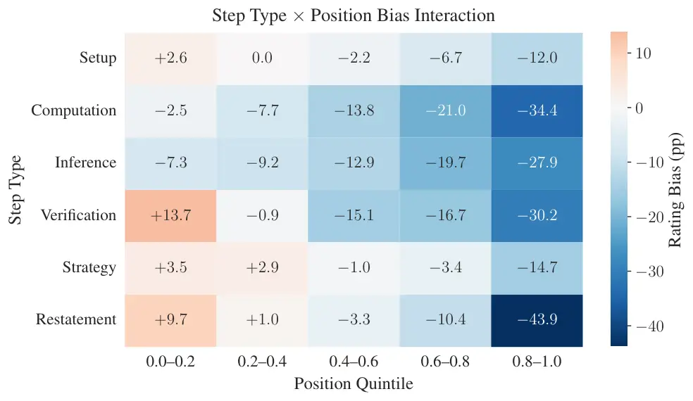

# Lucid: Statistically Grounded Self-Correction for LLM Reasoning Evaluation

Satiyabooshan Murugaboopathy Affiliation: AI and Global Development Lab
Affiliation: Institute for Analytical Sociology, Linköping University,
Linköping, Sweden    Adel Daoud Affiliation: AI and Global Development
Lab Affiliation: Institute for Analytical Sociology, Linköping
University, Linköping, Sweden Affiliation: NLP@DSAI, Chalmers University
of Technology, Gothenburg, Sweden    Connor T. Jerzak Affiliation: AI
and Global Development Lab Affiliation: Department of Government, The
University of Texas at Austin, Austin, TX, USA^(\*)Corresponding author:
satiyabooshan.murugaboopathy@liu.se

###### Abstract

Cheap language-model raters grade chain-of-thought reasoning at scale,
yet systematic step-rating errors can skew reasoning audits and solution
rankings. We introduce Lucid (Loop for Unbiased Calibration via
Inference-time Diagnosis), which pairs prompt self-correction with
Design-based Supervised Learning (DSL). Without retraining or weight
access, Lucid calibrates binary step ratings by aligning predicted and
expert soundness rates. From a small expert-labeled set, Lucid
summarizes rater bias in plain text and prompts the rater to re-grade
unseen steps. For example, on PRM800K, GPT-5-mini grades too strictly,
under-rating computation, verification, and late-trace steps most
acutely. In one pass, Lucid shrinks GPT-5-mini’s calibration gap from
7.8 to 0.9 percentage points in absolute predicted–expert rate
difference. Lucid also halves false alarms (sound steps rated unsound)
and lifts error-detection $`F_{1,-}`$ by 32%, where $`F_{1,-}`$ measures
$`F_{1}`$ on unsound steps. Lucid retains these gains with 1,000
diagnostic steps or overall-gap feedback alone. The loop also transfers
across models and domains: it applies GPT-5-mini’s bias profile to lift
GLM-5.2’s PRM800K accuracy, and it narrows calibration gaps for overly
strict but capable raters across math, science, web, and logic
benchmarks. Because prompt feedback shifts thresholds without improving
class-balanced discrimination (balanced-class sound/unsound separation),
Lucid filters re-grading with pre-/post-checks that skip already
calibrated raters and roll back ineffective passes. Finally, we reuse
that expert set with raw corpus ratings in DSL for calibration and
regression debiasing, and apply DSL to pair-labeled steps for sound-step
transitions. DSL’s out-of-fold (cross-fitted) soundness probabilities
lift best-of-$`K`$ selection to match expert labels, while its
doubly-robust estimators beat expert-only regression fits at small
budgets and cut sound-step transition error by nearly two-thirds.


Figure 1: Lucid overview. (a) From expert-labeled steps $`\mathcal{D}`$,
Lucid diagnoses evaluator bias (overall $`\hat{\delta}_{\mathcal{D}}`$,
per-type $`\hat{\delta}_{\mathcal{D},c}`$, position correlation $`r`$)
and feeds it back for one re-rating pass
($`\hat{Y}_{i}^{(0)}\!\to\!\hat{Y}_{i}^{(1)}`$), with guards: a
pre-check (cluster-robust $`\mathrm{SE}`$) skips calibrated raters, and
a post-check on fresh expert-labeled validation set $`\mathcal{V}`$
reverts non-improving passes. DSL reuses $`\mathcal{D}`$ for
cross-fitted calibration ($`\hat{\mu}_{i}`$) and doubly-robust
regression debiasing ($`\widetilde{Y}_{i}`$). (b) On PRM800K (eval set
$`\mathcal{E}`$, $`n_{\mathrm{eval}}{=}1{,}000`$), non-LLM baselines
(dashed: global rate shift, random per-type flips, Platt/logistic
regression; Section 5.1, Table 28) either cut the calibration gap
$`|\hat{\delta}_{\mathcal{E}}|=|\mathcal{E}|^{-1}\big|\sum_{i\in\mathcal{E}}(\hat{Y}_{i}-Y_{i})\big|`$
at the cost of $`F_{1,-}`$ ($`F_{1}`$ on unsound $`Y_{i}{=}0`$) or
collapse to always-sound ($`\hat{Y}_{i}`$: rater; $`Y_{i}`$: expert).
Lucid (solid green) re-grades step content to improve both
($`8.7\times`$ smaller gap, $`+32\%`$ $`F_{1,-}`$).

## 1 Introduction

Chain-of-thought (CoT) traces often improve large language model (LLM)
answer accuracy even when the intermediate reasoning is unsound: models
can skip verification steps, make ungrounded logical leaps, or reach
right answers for wrong reasons. Auditing reasoning quality—not just
final answers—requires step-level judgment, yet expert annotation is
expensive. Cheaper proxy LLM raters introduce systematic measurement
error, a well-studied problem in computational social science Grimmer
and Stewart (2013); Gentzkow et al. (2019). This error propagates into
downstream estimates unless the raters are _calibrated_—meaning their
predicted soundness rates (or probabilities) match expert rates overall
and across subgroups Keith et al. (2020); Geng et al. (2024); Shen
et al. (2024); Kapoor et al. (2024); Detommaso et al. (2024).

To correct this error without full expert annotation, we have an LLM
such as GPT-5-mini predict binary step soundness across a corpus and use
a small expert-labeled subset to debias downstream estimates—logistic
regressions relating step features to soundness and sound-step
transitions. Two estimators support this debiasing: Prediction-Powered
Inference (PPI; Angelopoulos et al., 2023), which rectifies the
regression score with expert-minus-proxy residuals, and Design-based
Supervised Learning (DSL; Egami et al., 2023), which pairs a
_cross-fitted_ outcome model—predicting expert soundness from step
features and proxy ratings out-of-fold (holding out whole problems)—with
inverse-probability-weighted expert residuals. Audinet de Pieuchon
et al. (2025) demonstrate such debiasing for scalar document labels; we
extend it to reasoning traces. A key question remains: _once we also
diagnose rater bias from that subset, can we feed that diagnosis back to
improve the rater’s judgments without extra labeling?_

We introduce Lucid (Loop for Unbiased Calibration via Inference-time
Diagnosis). From expert-labeled steps, Lucid summarizes where the rater
errs, appends that summary to the grading instructions, and prompts the
rater to re-grade unseen steps (Figure 1a). On PRM800K Lightman et al.
(2024) (human step-level math labels), one Lucid pass shrinks
GPT-5-mini’s marginal calibration gap
($`|\text{predicted}-\text{expert soundness rate}|`$) 8.7-fold and
raises unsound-step detection ($`F_{1,-}`$, the $`F_{1}`$ score on
unsound steps) by 32%. Purely prompt-based, it needs no retraining,
stays stable across runs, and retains gains with 1,000 expert steps. We
reuse that expert sample in DSL to debias regressions and calibrate
corpus-wide probabilities; ranking traces with DSL’s cross-fitted
outcome model lifts top-1 (best-of-1) trajectory selection by
13.7pp—measured by whether the top-ranked trace yields the correct
answer.

Our contributions are:

1.  1.  Prompt-based self-correction (Lucid). We design a closed-loop
        procedure that diagnoses rater bias from expert labels, converts it
        into plain-text feedback, and prompts the rater to re-grade. On
        PRM800K, one pass cuts the calibration gap from 7.8pp to 0.9pp and
        raises $`F_{1,-}`$ by 32% without retraining. Unlike prior
        heuristic-critique methods, Lucid grounds feedback in expert-labeled
        bias diagnosis, pairs re-grading with DSL debiasing, and guards
        deployment with pre-/post-checks that verify significant initial
        bias and roll back ineffective passes (Figure 1a; Section 3.1).
        Here, we find that one round captures most of the available gain
        (85.3% $`\pm`$ 0.4pp), driven by the diagnosed calibration message.
2.  2.  Step-level bias diagnosis and DSL debiasing. Extending Audinet de
        Pieuchon et al. (2025) to 594,690 PRM800K steps graded by
        GPT-5-mini, we first diagnose how the rater errs. On the held-out
        set, GPT-5-mini exhibits _structured_ signed bias (predicted minus
        expert soundness rate; negative $`=`$ under-rating): among six step
        types, it under-rates computation ($`-14.6`$pp) and verification
        ($`-11.9`$pp) most sharply, and its bias steepens in late positions
        (position–error correlation $`r=-0.25`$). Across four-run ablations,
        overall-gap feedback alone matches prompting with this structured
        profile, yet the profile still reveals whether errors reflect
        blanket strictness or concentrate in specific step types, and DSL
        uses its step features for corpus-wide calibration. On regressions
        at $`n=200`$, DSL beats PPI and cuts coefficient root mean squared
        error ($`\mathrm{RMSE}`$, vs. all-expert fit) $`7.2\times`$ below
        expert-only fits, reaching $`\mathrm{RMSE}<0.5`$ with $`2.4\times`$
        fewer labels before expert-only fits catch up above
        $`n\approx 1{,}000`$.
3.  3.  Sound-step transitions and inference. Addressing within-trace and
        within-problem dependence, we express consecutive sound-step type
        transitions as doubly-robust ratios of DSL-adjusted pair counts and
        cluster step-level regression standard errors by problem, raising
        them 3–3.5$`\times`$ at $`n=1{,}000`$.

Finally, we delimit both the mechanisms and boundaries of inference-time
feedback: it corrects threshold strictness (i.e., calibration) without
improving class-balanced discrimination (i.e., sound-vs.-unsound
separation under equal class weights). Consequently, this feedback helps
conservative yet capable raters, fails when raters have skill deficits,
and can over-correct already-calibrated raters.

## 2 Related Work

#### Statistical debiasing of LLM annotations.

PPI Angelopoulos et al. (2023) rectifies estimating equations with
expert residuals, preserving asymptotically valid confidence intervals
under known sampling probabilities even with poor proxy predictions.
Drawing on double/debiased ML Chernozhukov et al. (2018); Bang and
Robins (2005); Kennedy (2023), DSL Egami et al. (2023) pairs out-of-fold
(cross-fitted) outcome models predicting true labels from covariates and
proxy predictions with doubly-robust pseudo-outcomes, remaining
consistent if either sampling probabilities or the outcome model is
right. While Egami et al. (2023) use honest forests Wager and Athey
(2018); Athey et al. (2019), we use gradient-boosted trees predicting
expert step soundness (Section 3.2). Recent extensions add
cross-prediction-powered inference Zrnic and Candès (2024) and
nonuniform sampling Kluger et al. (2025). Benchmarking PPI and DSL
across 16 dataset$`\times`$LLM pairs for logistic regression, Audinet de
Pieuchon et al. (2025) show DSL lowers standardized RMSE
($`\mathrm{sRMSE}`$, coordinate-wise error normalized by true
coefficient magnitude; see Appendix A) at small $`n`$. We extend these
estimators to step ratings and study how rating errors distort
within-trace transitions.

#### LLM self-correction and evaluation bias.

In prompt-based self-correction frameworks (Self-Refine Madaan et al.
(2023), Reflexion Shinn et al. (2023)), the model critiques its own
outputs without statistical grounding, targeting generation quality
rather than rating bias. In parallel, LLM judges exhibit systematic
biases Chang et al. (2024): they show position and verbosity biases
Zheng et al. (2023), favor their own generations Panickssery et al.
(2024), and mimic human falsehoods Lin et al. (2022). Prior work
mitigates judge bias through prompt design, aggregation
(self-consistency, Platt scaling), or direct confidence calibration Tian
et al. (2023). Bridging these threads, Lucid diagnoses step-rating bias
from expert labels, feeds it back under cluster-robust pre-/post-checks
verifying initial bias and validation gain (Figure 1a; Section 3.1), and
pairs re-grading with DSL debiasing.

#### Process supervision and agent evaluation.

To support training process reward models (PRMs, step-level verifiers
scoring intermediate reasoning), Lightman et al. (2024) introduce
PRM800K ($`\sim`$800K human MATH step labels) and Wang et al. (2024)
auto-generate step labels, while Zheng et al. (2025) introduce
ProcessBench to benchmark earliest-error identification. Rather than
training verifiers, we use PRM800K and ProcessBench to diagnose rater
bias and debias reasoning-quality estimates. Unlike trajectory-level
agent benchmarks (AgentBoard Ma et al. (2024); SWE-bench Jimenez et al.
(2024)), we debias step-level evaluation.

## 3 Methodology

### 3.1 Lucid: Prompt-Based Self-Correction

#### Procedure.

Across $`N`$ reasoning steps (normalized trace position
$`\mathrm{pos}_{i}\in[0,1]`$), the rater assigns initial ratings
$`\hat{Y}_{i}^{(0)}=\hat{Y}_{i}\in\{0,1\}`$ and step types
$`s_{i}\in\{1,\dots,C\}`$ ($`C=6`$ on PRM800K; Section 3.2), while
experts label a diagnostic subset $`\mathcal{D}`$
($`|\mathcal{D}|=n_{\mathrm{diag}}`$) with $`Y_{i}\in\{0,1\}`$. To avoid
over-correcting calibrated raters or keeping failed passes
(Section 5.2), each round $`\tau\in\{0,1,\dots\}`$ runs three main
phases guarded by two checks (Figure 1a).

First, on $`\mathcal{D}`$, Lucid computes overall signed bias
$`\hat{\delta}_{\mathcal{D}}=|\mathcal{D}|^{-1}\sum_{i\in\mathcal{D}}(\hat{Y}_{i}^{(\tau)}-Y_{i})`$
(negative $`=`$ under-rating; $`|\hat{\delta}_{\mathcal{D}}|`$ is the
marginal calibration gap) with cluster-robust $`\mathrm{SE}`$
(Section 3.4), per-type biases
$`\hat{\delta}_{\mathcal{D},c}=|\mathcal{D}_{c}|^{-1}\sum_{i\in\mathcal{D}_{c}}(\hat{Y}_{i}^{(\tau)}-Y_{i})`$
over $`\mathcal{D}_{c}=\{i\in\mathcal{D}:s_{i}=c\}`$, and the Pearson
correlation $`r`$ between $`\mathrm{pos}_{i}`$ and
$`\hat{Y}_{i}^{(\tau)}-Y_{i}`$.

Second (_Stage 1, pre-check_), Lucid proceeds only if
$`|\hat{\delta}_{\mathcal{D}}|>2\,\mathrm{SE}`$ and
$`|\hat{\delta}_{\mathcal{D}}|>2`$pp (else keeping
$`\hat{Y}^{(\tau)}`$), formatting these statistics (without CIs) via a
fixed plain-text template.

Third, prompted with that feedback, the rater re-grades disjoint
evaluation steps $`\mathcal{E}`$ ($`n_{\mathrm{eval}}=1{,}000`$ on
PRM800K; $`500`$ on multi-domain benchmarks) and a fresh expert-labeled
validation batch $`\mathcal{V}`$ (100–500 steps) to produce
$`\hat{Y}^{(\tau+1)}`$.

Finally (_Stage 2, post-check_), Lucid keeps $`\hat{Y}^{(\tau+1)}`$ only
if
$`|\hat{\delta}_{\mathcal{V}}^{(\tau+1)}|<|\hat{\delta}_{\mathcal{V}}^{(\tau)}|`$,
rolling back to $`\hat{Y}^{(\tau)}`$ otherwise. Here, we find that one
round captures most of the available gain (Section 5.1).

#### Feedback format.

When Stage 1 passes, Lucid populates a three-part plain-text bias
summary; to benchmark all-$`N`$ diagnosis before restricting to
$`\mathcal{D}`$ on PRM800K, our canonical prompt states _overall
calibration_, “You predict 83.1% of steps correct, but the true rate is
91.3% (you under-rate by 8.2pp overall)”; _per-type biases_, “You
under-rate computation steps by 14.8pp and verification steps by
14.5pp”; and _position trend_, “You also under-rate later steps,
$`r=-0.22`$”, closing with a directive to judge late computation and
verification steps less conservatively. Because uncorrected bias is
stable across subsets (Section 5), diagnosing on disjoint
$`\mathcal{D}`$ ($`n_{\mathrm{diag}}=1{,}000`$) matches full-corpus
gains (Tables 11, 15, Appendix G).

### 3.2 Step-Level Soundness Framework

Alongside re-grading on an unlabeled corpus, we reuse $`\mathcal{D}`$
with $`\hat{Y}`$ to _predict_ calibrated expert soundness
$`Y_{i}\in\{0,1\}`$ across all $`N`$ steps and _debias_ regressions
relating step features to soundness (and sound-step transitions on
pair-labeled samples; Section 3.3). Each step $`i\in\{1,\dots,N\}`$ has
expert label $`Y_{i}\in\{0,1\}`$ on $`\mathcal{D}`$ plus proxy LLM
rating $`\hat{Y}_{i}\in\{0,1\}`$ and step type $`s_{i}`$ (Setup,
Computation, Inference, Verification, Strategy, Restatement; Table 23).
We form $`X_{i}\in\mathbb{R}^{p+1}`$ from $`s_{i}`$,
$`\mathrm{pos}_{i}`$, log token length $`\mathrm{len}_{i}`$, difficulty,
and an intercept (Appendix B). Our debiasing target is the logistic
parameter $`\theta\in\mathbb{R}^{p+1}`$ solving
$`\mathbb{E}[u(Y_{i},X_{i};\theta)]=0`$ for score
$`u(Y_{i},X_{i};\theta)=X_{i}(Y_{i}-\sigma(X_{i}^{\top}\theta))`$
($`\sigma`$: sigmoid).

Both PPI and DSL debias $`\theta`$ using $`(X_{i},\hat{Y}_{i})`$ across
all $`N`$ steps and $`Y_{i}`$ on $`\mathcal{D}`$ ($`|\mathcal{D}|=n`$,
matching $`n_{\mathrm{diag}}`$ when shared), where
$`b_{i}=\mathbf{1}\{i\in\mathcal{D}\}`$ and
$`\pi_{i}=\Pr(b_{i}=1\mid X_{i},\hat{Y}_{i})=n/N`$. PPI adds the mean
labeled residual on $`\mathcal{D}`$ to the plug-in score. DSL fits a
two-fold _cross-fitted_ gradient-boosted outcome model
$`\hat{\mu}_{i}=\hat{\mu}(X_{i},\hat{Y}_{i})`$ predicting expert
soundness
$`\mu(X_{i},\hat{Y}_{i})=\mathbb{E}[Y_{i}\mid X_{i},\hat{Y}_{i}]`$—holding
out whole problems per fold so $`\hat{\mu}_{i}`$ is an out-of-fold
probability (also used for corpus calibration and ranking)—forms
doubly-robust pseudo-outcomes
$`\widetilde{Y}_{i}=\hat{\mu}_{i}+\frac{b_{i}}{\pi_{i}}(Y_{i}-\hat{\mu}_{i})`$,
and solves $`\sum_{i=1}^{N}u(\widetilde{Y}_{i},X_{i};\theta)=0`$
(Appendix A). Against all-$`N`$ expert fit $`\theta^{*}`$, we evaluate
expert-only $`\hat{\theta}_{\mathrm{exp}}`$ (on $`\mathcal{D}`$),
uncorrected imputation $`\hat{\theta}_{\mathrm{imp}}`$ (on all
$`\hat{Y}_{i}`$), PPI, and DSL via
$`\mathrm{RMSE}(\hat{\theta})=(|\mathcal{J}|^{-1}\sum_{j\in\mathcal{J}}(\hat{\theta}_{j}-\theta^{*}_{j})^{2})^{1/2}`$
over identifiable coordinates $`\mathcal{J}`$ (Appendix A).

### 3.3 Transitions Between Sound Steps

To characterize valid reasoning flow, we estimate how often consecutive
sound steps transition from type $`c`$ to $`c^{\prime}`$. Index the
$`M`$ consecutive within-trace pairs by $`\ell\in\{1,\dots,M\}`$,
linking $`(i(\ell),i(\ell)+1)`$ with LLM-assigned step types
$`(s_{\ell,1},s_{\ell,2})=(s_{i(\ell)},s_{i(\ell)+1})\in\{1,\dots,C\}^{2}`$
and joint expert soundness
$`A_{\ell}=Y_{i(\ell)}Y_{i(\ell)+1}\in\{0,1\}`$. Pairs at different
trace positions need not share a distribution, so we define the target
through the limiting share of sound $`c`$-to-$`c^{\prime}`$ pairs among
the $`M`$ consecutive pairs,
$`\lambda_{cc^{\prime}}=\lim_{M\to\infty}\frac{1}{M}\sum_{\ell=1}^{M}\Pr(s_{\ell,1}=c,s_{\ell,2}=c^{\prime},A_{\ell}=1)`$
(assumed to exist):

```math
T_{cc^{\prime}}=\frac{\lambda_{cc^{\prime}}}{\sum_{c^{\prime\prime}=1}^{C}\lambda_{cc^{\prime\prime}}}. \tag{1}
```

For identically distributed pairs,
$`T_{cc^{\prime}}=\Pr(s_{\ell,2}=c^{\prime}\mid s_{\ell,1}=c,A_{\ell}=1)`$.
We form $`T^{*}`$ by normalizing sound-pair counts ($`A_{\ell}=1`$)
within each starting type, and $`\hat{T}_{\mathrm{uncorr}}`$ (pair-level
analogue of $`\hat{\theta}_{\mathrm{imp}}`$) using predicted sound pairs
($`\hat{A}_{\ell}=\hat{Y}_{i(\ell)}\hat{Y}_{i(\ell)+1}=1`$). Parallel to
$`(b_{i},\pi_{i},\mu)`$, let $`b_{A,\ell}\in\{0,1\}`$ indicate expert
labels on both endpoints of pair $`\ell`$, and let $`W_{\ell}`$ collect
observed pair features ($`s_{\ell,1},s_{\ell,2}`$, both predictions, and
sampling covariates). We also define
$`\pi_{A}(W_{\ell})=\Pr(b_{A,\ell}=1\mid W_{\ell})`$ (abbreviated
$`\pi_{A,\ell}`$) and
$`\mu_{A}(W_{\ell})=\mathbb{E}[A_{\ell}\mid W_{\ell}]`$. We cross-fit
$`\hat{\mu}_{A,\ell}=\hat{\mu}_{A}(W_{\ell})`$ by problem and set
$`\hat{\pi}_{A,\ell}`$ to the known design (or cross-fitted)
probability. Following Egami et al. (2023, Proposition 2) and Bang and
Robins (2005), we then construct the pair pseudo-outcome
$`\widetilde{A}_{\ell}=\hat{\mu}_{A,\ell}+\frac{b_{A,\ell}}{\hat{\pi}_{A,\ell}}(A_{\ell}-\hat{\mu}_{A,\ell})`$
and estimate $`T_{cc^{\prime}}`$ as the ratio of summed pseudo-outcomes
for $`c`$-to-$`c^{\prime}`$ pairs to all pairs leaving $`c`$:

```math
\hat{T}_{cc^{\prime}}=\frac{\sum_{\ell:s_{\ell,1}=c}\mathbf{1}\{s_{\ell,2}=c^{\prime}\}\,\widetilde{A}_{\ell}}{\sum_{\ell:s_{\ell,1}=c}\widetilde{A}_{\ell}}. \tag{2}
```

Under the sampling and regularity conditions in Appendix C,
$`\hat{T}_{cc^{\prime}}`$ is consistent if either the pair inclusion
probabilities or the conditional probability that both steps are sound
is correctly specified. When pairs are sampled uniformly for expert
review, their inclusion probabilities are known by design.

### 3.4 Clustering-Aware Inference

Because steps and traces from the same problem share errors, naive
standard errors understate uncertainty in both our pre-check
(Section 3.1) and step-level regressions (Section 3.2). Summing per-step
score contributions $`\psi_{i}(\hat{\theta})`$ (e.g.,
$`\psi_{i}(\theta)=u(\widetilde{Y}_{i},X_{i};\theta)`$ for DSL;
Appendix A) within each problem $`g\in\{1,\dots,G\}`$ gives
$`S_{g}=\sum_{i\in g}\psi_{i}(\hat{\theta})`$. With summed-score
Jacobian $`\hat{H}`$ on identifiable coordinates, the sandwich estimator
(Liang and Zeger, 1986) gives

```math
\hat{V}=\hat{H}^{-1}\left(\sum_{g=1}^{G}S_{g}S_{g}^{\top}\right)\hat{H}^{-\top}. \tag{3}
```

The large-sample calculation assumes independent problems, finite score
variances, a nonsingular limit for the normalized Jacobian, and enough
clusters that no single problem dominates. For scores with a fitted
outcome model, keeping whole problems in each cross-fitting fold
separates training and evaluation clusters (Chiang et al., 2022).

#### Summary.

In theory, known inclusion probabilities secure doubly-robust
consistency for DSL regressions and sound-step transitions even under
imperfect outcome models (Proposition 1), while problem-grouped
cross-fitting, cluster-robust SEs, and two-stage gating guard against
within-problem dependence and over-correction. Section 4 details the
benchmarks and protocols testing finite-sample gains.

## 4 Experiments

#### Data.

We use PRM800K Lightman et al. (2024): $`\sim`$800K human step-level
correctness labels (on a $`\{-1,0,+1\}`$ incorrect/neutral/correct
scale) for MATH Hendrycks et al. (2021) solutions. After filtering and
binarizing ($`Y_{i}=1`$ if rating $`=+1`$, else $`Y_{i}=0`$), we obtain
$`N=594{,}690`$ steps across 90,340 traces and $`G=11{,}267`$ problems.
GPT-5-mini OpenAI (2025) grades and classifies all $`N`$ steps at
temperature 0, and we test cross-model transfer on GLM-5.2 Z.ai (2026)
(Appendix J). For cross-dataset and multi-domain transfer, we evaluate
on ProcessBench Zheng et al. (2025), EntailmentBank Dalvi et al. (2021),
Mind2Web Deng et al. (2023), and ProofWriter Tafjord et al. (2021).

#### Features.

Each step has $`p=9`$ covariates ($`X_{i}\in\mathbb{R}^{10}`$ with
intercept): step type (5 one-hot dummies for the $`C=6`$ categories),
normalized position, log step length, and difficulty (2 dummies; see
Appendix B). An augmented set ($`p=24`$, $`X_{i}\in\mathbb{R}^{25}`$)
adds 15 cluster indicators from $`k`$-means ($`k{=}15`$) on
all-MiniLM-L6-v2 step-and-problem embeddings, testing whether grouping
semantically similar steps helps DSL pool bias structure at small $`n`$
(Appendix E).

#### Design.

For the regression comparison, we fix $`N=594{,}690`$, vary the expert
budget $`n`$ from 200 to approximately $`N`$ over 10 log-spaced values
(30 repetitions per budget), and compare five estimators (Table 35) by
coefficient $`\mathrm{RMSE}`$ and standard errors ($`\mathrm{sRMSE}`$ is
defined in Appendix A). For prompt self-correction on PRM800K, we use
the corpus diagnostic profile for the canonical prompt, verify
subset-only diagnosis at $`n_{\mathrm{diag}}\in\{500,1{,}000,2{,}000\}`$
(Appendix G), and evaluate on $`n_{\mathrm{eval}}=1{,}000`$ disjoint
steps $`\mathcal{E}`$. On the multi-domain benchmarks, we set
$`n_{\mathrm{diag}}=n_{\mathrm{eval}}=500`$. For transitions, we draw
$`m=1{,}000`$ consecutive pairs uniformly without replacement, observe
expert labels on both endpoints, and estimate $`\hat{T}_{\mathrm{DSL}}`$
using the known $`\pi_{A,\ell}=m/M`$
($`\hat{\pi}_{A,\ell}=\pi_{A,\ell}`$). We then compare consecutive-pair
matrices against $`T^{*}`$ via relative Frobenius error
$`\|\hat{T}-T^{*}\|_{F}/\|T^{*}\|_{F}`$ (Appendix I).

## 5 Results

Because 91.6% of evaluation steps are sound, raw accuracy alone
misleads: an always-positive predictor reaches 91.6% while catching no
errors ($`F_{1,-}=0`$). Alongside step accuracy (Table 1), we therefore
report the marginal calibration gap
($`|\hat{\delta}_{\mathcal{E}}|=|\mathcal{E}|^{-1}\big|\sum_{i\in\mathcal{E}}(\hat{Y}_{i}-Y_{i})\big|`$)
and unsound-step $`F_{1,-}`$ (treating unsound steps $`Y_{i}=0`$ as
positive; Table 2). For downstream evaluation, we rank candidate
trajectories with DSL’s cross-fitted step probabilities.

| Setting                             | Original | Corrected | $`\boldsymbol{\Delta}`$ | Cost   |
| ----------------------------------- | -------- | --------- | ----------------------- | ------ |
| PRM800K (GPT-5-mini)                | 79.0%    | 85.7%     | $`+`$6.7pp              | \$0.30 |
| PRM800K (GLM-5.2)                   | 84.4%    | 87.5%     | $`+`$3.1pp              | \$0.30 |
| ProcessBench                        | 81.4%    | 86.6%     | $`+`$5.2pp              | \$0.30 |
| DSL $`\mathrm{RMSE}`$ ($`n{=}200`$) | 6.09     | 0.84      | $`-`$5.25               | —      |

Table 1: Headline results ($`\Delta=\text{Corrected}-\text{Original}`$).
One round of self-correction closes the PRM800K calibration gap
$`8.7\times`$ (7.8pp$`\to`$0.9pp; signed bias $`-`$7.8pp$`\to-`$0.9pp)
at \$0.30 API cost. Because 91.6% of evaluation steps are sound,
shifting the rater’s threshold raises raw accuracy substantially,
whereas accuracy on a class-balanced subset moves only from 57.1% to
58.3% (Appendix J.1). This contrast shows that threshold calibration
drives the raw-accuracy gain. At $`n{=}200`$, DSL cuts regression
$`\mathrm{RMSE}`$ from 6.09 (Expert-only) to 0.84 ($`7.2\times`$, mainly
at $`n\lesssim 1{,}000`$; Section 5.3).

### 5.1 Lucid: Prompt-Based Self-Correction

On PRM800K, one Lucid pass cuts GPT-5-mini’s calibration gap nearly
ninefold and lifts unsound-step detection ($`F_{1,-}`$) by nearly a
third (Tables 1 and 2; cross-benchmark summary in Table 32; worked trace
in Table 33). Across four runs, Lucid yields stable step-accuracy gains
and converges in one pass, with a second round adding little (Table 27).
On an independent 5,000-step evaluation set, Lucid reproduces both the
accuracy gain and the concentration of improvements in computation and
verification (Table 27). At \$0.30 in API calls atop the shared expert
budget, Lucid beats expert-only estimation at matched labeling cost
and—unlike fine-tuned verifiers—avoids retraining when rater behavior
shifts (Table 24).

Figure 2: Self-correction pulls severe per-type rating biases (red)
toward zero (green) on PRM800K, led by computation
($`-`$14.6$`\to-`$3.6pp) and verification ($`-`$11.9$`\to-`$3.0pp).

| Metric                                     | Original | Corrected |
| ------------------------------------------ | -------- | --------- |
| Calibration gap (overall) $`\downarrow`$   | 7.8pp    | 0.9pp     |
| Computation gap $`\downarrow`$             | 14.6pp   | 3.6pp     |
| Verification gap $`\downarrow`$            | 11.9pp   | 3.0pp     |
| Inference gap $`\downarrow`$               | 10.8pp   | 6.2pp     |
| Unsound detection $`F_{1,-}`$ $`\uparrow`$ | 0.146    | 0.192     |

Table 2: Calibration gap ($`|\hat{\delta}_{\mathcal{E}}|`$) and
error-detection metrics on PRM800K ($`n_{\mathrm{eval}}{=}1{,}000`$).
Self-correction cuts the gap $`8.7\times`$ overall and up to
$`4.1\times`$ per type while lifting $`F_{1,-}`$ by $`+`$0.046
($`+`$32%).

#### Per-type and position improvements.

Uncorrected GPT-5-mini is well calibrated on early framing steps (setup,
strategy) and early positions, but grows monotonically stricter across a
trace—from $`+`$2.7pp in the first quintile to $`-`$32.2pp in the final
quintile (59.9% predicted vs. 92.1% true; peaking at $`-`$43.9pp on late
restatement and $`-`$34.4pp on late computation; Figure 2; Table 2;
Appendix H; Figure 10). Three factors drive this late-step conservatism:
skepticism accumulates over longer context chains despite $`\approx`$92%
true soundness, the rater conflates step soundness with final-answer
proximity, and later steps are longer and more complex ($`>`$200-char
steps show $`\approx-`$30pp bias). Lucid’s gains track this profile: the
most under-rated types and final quintile improve most while
well-calibrated categories move little (Table 30). Initial under-rating
correlates positively with post-feedback gain across the six types in
both the primary set and 5,000-step replication (though six types limit
slope precision), and Lucid fixes roughly two-thirds of initial mistakes
in the final quintile versus under a third in the first (Table 30;
Appendix H).

#### Downstream validation: trajectory filtering.

To test downstream selection across 7,348 MATH problems, we rank each
problem’s candidate traces by mean step score and measure best-of-$`K`$
(top-$`K`$) accuracy: whether any top-$`K`$ trace gets the right answer.
Lucid’s prompt loop re-rates only $`1{,}000`$ sampled steps in binary
form, whereas corpus-wide ranking requires scoring every trace and
benefits from continuous tie-breaking scores. We therefore score all
steps with DSL’s cross-fitted outcome model. These DSL-calibrated
probabilities nearly double top-1 accuracy over raw GPT-5-mini ratings
and match expert labels through best-of-5 (Figure 3; full
$`K=1\text{--}10`$ curve in Table 25).

#### Why DSL can match the expert oracle.

Two factors explain why DSL-calibrated proxy scores match the expert
oracle in Figure 3. First, we evaluate trajectory selection by
final-answer correctness, yet solutions with flawed intermediate steps
can still reach the right answer. Unweighted averages of binary step
labels therefore provide only a coarse ranking signal. Second, while the
expert oracle uses ground-truth corpus step labels (unavailable in
practice), DSL’s cross-fitted outcome model approximates them from the
diagnostic sample while supplying continuous probabilities that break
ties among traces.

#### Downstream PRM transfer.

We also train lightweight feature-based PRMs on raw GPT-5-mini ratings,
DSL outcome probabilities ($`\hat{\mu}_{i}`$), and expert labels
(Table 26); 0.5-thresholding collapses all three to the majority class.
With continuous probabilities, the DSL-calibrated PRM halves expected
calibration error (ECE) and lifts top-1 selection by 1.8pp over the
raw-label PRM (ECE measures binned probability-vs.-rate error, unlike
the binary gap).

Figure 3: Best-of-$`K`$ selection on 7,348 MATH problems. DSL-calibrated
scores ($`n{=}1{,}000`$, green) beat GPT-5-mini by $`+`$13.7pp
($`K{=}1`$) and $`+`$19.5pp ($`K{=}2`$), matching Expert labels at
$`K\leq 5`$.

#### Baselines.

Returning to binary step re-grading on our skewed evaluation set,
accuracy-maximizing calibrators (Platt scaling, logistic regression
\[LR\], and MiniLM) hit the majority-class ceiling by predicting every
step sound and catching no errors (Figure 1b; Table 28). Rate-adjustment
baselines apply the diagnosed bias without re-reading text, using either
a global threshold shift (matching the overall soundness rate) or
post-hoc random flips matched by step type and position. These
adjustments close the calibration gap and match or beat Lucid’s raw
accuracy. However, because both content-blind adjustments discard true
error detections alongside false alarms, they cut unsound-step
$`F_{1,-}`$ nearly in half. With the same bias summary, Lucid re-grades
each step on content, halving false alarms while preserving unsound-step
recall. Among the inference-time methods in Table 28, only Lucid
improves both calibration and error detection.

Still, on a class-balanced subsample with equal sound and unsound
counts, Lucid’s accuracy and $`F_{1,-}`$ remain within noise
(Appendix J.1; balanced accuracy
$`(\mathrm{Recall}_{+}+\mathrm{Recall}_{-})/2`$ in Table 28). This
invariance confirms that Lucid calibrates the decision threshold without
sharpening discrimination.

By contrast, detection-oriented Qwen3.5-LoRA Qwen Team (2026); Hu et al.
(2022) verifiers (0.8B–9B) reach slightly higher $`F_{1,-}`$ and
balanced accuracy at smaller scales at lower overall accuracy
(Table 28). Prompt self-correction thus fits closed-weight APIs and
shifting biases, whereas fine-tuning remains stronger with open weights
for balanced discrimination.

#### Ablation.

Across four runs per condition, ablating the feedback summary shows that
overall-gap, per-type, and full three-part prompts each lift accuracy by
roughly 5–6pp over no feedback with overlapping paired-bootstrap CIs,
whereas a position-only prompt gains less because positional bias is
weaker alone (Table 31). Detailed, concise, and minimal wordings
likewise perform indistinguishably (Table 12). Although overall-gap
feedback suffices for prompt re-grading, the structured profile still
shows whether errors reflect blanket strictness or concentrate in
specific hard step types (Section 5.2). In turn, DSL uses that profile’s
underlying step features $`X_{i}`$ to calibrate corpus-wide
probabilities.

### 5.2 Generalization

|                                                   |               |       |                         |                |                             |                  |
| ------------------------------------------------- | ------------- | ----- | ----------------------- | -------------- | --------------------------- | ---------------- | --- | --- |
|                                                   | Step Accuracy |       |                         | Calib. Gap ($` | \hat{\delta}\_{\mathcal{E}} | `$)              |     |     |
| Domain                                            | Orig          | Corr  | $`\boldsymbol{\Delta}`$ | Orig           | Corr                        | Rule             |
| PRM800K (math) Lightman et al. (2024)             | 79.0%         | 85.7% | $`+`$6.7pp              | 7.8pp          | 0.9pp                       | apply, keep      |
| EntailmentBank (science) Dalvi et al. (2021)      | 94.2%         | 96.6% | $`+`$2.4pp              | 5.8pp          | 3.4pp                       | apply, keep      |
| Mind2Web (agents, calibration) Deng et al. (2023) | 10.8%         | 97.4% | $`+`$86.6pp             | 89.2pp         | 2.6pp                       | apply, keep      |
| Mind2Web (agents, balanced) Deng et al. (2023)    | 50.8%         | 61.0% | $`+`$10.2pp             | 0.4pp          | 38.6pp                      | skip             |
| ProofWriter (logic) Tafjord et al. (2021)         | 94.4%         | 94.0% | $`-`$0.4pp              | 4.8pp          | 4.8pp                       | apply, roll back |

Table 3: Multi-domain generalization. Lucid transfers to calibration
bias but over-corrects calibrated raters and fails on competence
deficits; the two-stage deployment rule (Section 3.1) skips balanced
Mind2Web (Stage 1) and rolls back ProofWriter (Stage 2) while keeping
all three beneficial corrections.

#### Cross-model transfer.

Applying feedback diagnosed from GPT-5-mini’s ratings directly to
GLM-5.2 Z.ai (2026) still improves step accuracy on PRM800K (Table 1;
Table 37). GLM-5.2 starts much closer to overall calibration than
GPT-5-mini yet shares the tendency to under-rate computation and
verification steps, so its smaller gain tracks its milder initial bias
(Table 36).

#### Cross-dataset transfer (ProcessBench).

On ProcessBench (16,548 steps across GSM8K, MATH, OlympiadBench, and
OmniMath), one Lucid pass (with the same feedback template) lifts
GPT-5-mini’s accuracy by over five percentage points and beats few-shot
baselines across $`k=1\text{--}10`$ examples (Tables 1, 38, and 39).
Across splits, gains track initial miscalibration: accuracy rises over
ten points on worst-calibrated OmniMath but slips slightly on
near-ceiling GSM8K (Table 38).

#### Multi-domain.

Across three non-mathematical benchmarks with domain-specific taxonomies
($`n_{\mathrm{diag}}=n_{\mathrm{eval}}=500`$; Table 3), Lucid helps
wherever a capable rater grades too strictly: it cuts EntailmentBank’s
calibration gap by 41% and lifts Mind2Web gold trajectories (all valid,
10.8% initial acceptance) to 97.4%, confirming threshold strictness as a
key bottleneck. Conversely, unchecked feedback severely over-corrects
calibrated balanced Mind2Web (0.4pp initial gap) and leaves ProofWriter
unchanged where errors reflect logical derivation skill deficits
(Table 21). Without tuning, the two-stage rule (Section 3.1; Table 3,
“Rule”) separates these regimes: though
$`\hat{\delta}_{\mathcal{D}}=-5.2`$pp on both balanced Mind2Web and
EntailmentBank, cluster-robust SE is 3.4pp
($`|\hat{\delta}_{\mathcal{D}}|<2\,\mathrm{SE}`$, skipped at Stage 1)
versus 1.1pp ($`|\hat{\delta}_{\mathcal{D}}|>2\,\mathrm{SE}`$,
admitted), while Stage 2 rolls back ProofWriter when
$`|\hat{\delta}_{\mathcal{V}}|`$ fails to shrink.

### 5.3 DSL Debiasing and Diagnostic Robustness

#### Sample efficiency across expert budgets.

Turning from prompt transfer to PRM800K step-level regressions
(Section 3.2), DSL cuts coefficient $`\mathrm{RMSE}`$ over $`7\times`$
at $`n=200`$ vs. expert-only fits, beats PPI, and reaches
$`\mathrm{RMSE}<0.5`$ with under half the labels (Figure 4; Table 34).
Near $`n\approx 1{,}200`$, both match; expert-only modestly edges out
our fixed GBDT at $`n\approx 2{,}900\text{--}17{,}000`$ before
reconverging at large $`n`$ (Table 8).

Figure 4: Coefficient $`\mathrm{RMSE}`$ vs. expert budget $`n`$
(GPT-5-mini predictor; 95% CIs over 30 runs). DSL dominates at small
$`n`$.

#### Transition matrices and clustered inference.

Within-trace and within-problem dependence affects both point estimates
and uncertainty. For consecutive pairs, $`\hat{T}_{\mathrm{uncorr}}`$
undercounts transitions into computation and inference and overcounts
those into strategy relative to $`T^{*}`$ (Figure 9), while DSL cuts
relative Frobenius error by about two-thirds (Figure 11; Appendix I).
Problem-clustered SEs triple independent-step SEs across regression
estimators (Table 29).

#### Diagnostic robustness.

Beyond DSL, our diagnosis and prompt loop degrade gracefully under
taxonomy and label noise, respond selectively to structured bias, and
transfer across same-domain problems (Appendix G). For step-type noise,
GLM-5.2 agrees with GPT-5-mini on computation and strategy yet diverges
on verification and restatement (Table 16); even under 30% random
step-type reassignment, our diagnosis preserves every category’s sign
(Table 17). For expert-label noise, corrupting 10% of diagnostic labels
weakens Lucid’s gain without reversing it (Table 15). For signal
selectivity, when we replace structured rater errors with random flips,
Lucid leaves accuracy essentially flat, confirming that the loop ignores
unstructured noise (Table 17). Finally, profiles diagnosed on half the
problems transfer to held-out same-domain problems, though a single
dataset-wide prompt (not tailored by trace position) still
under-corrects late steps (Table 13).

## 6 Conclusion

Lucid closes the calibration loop at inference time: it diagnoses rater
bias from expert-labeled steps, converts it into plain-text feedback,
and prompts re-grading without retraining or weight access. On PRM800K,
one pass cuts GPT-5-mini’s calibration gap nearly ninefold and lifts
unsound-step $`F_{1,-}`$ by nearly a third, transferring across models
and domains. Meanwhile, balanced ablations confirm that prompt feedback
calibrates strictness without sharpening discrimination. Accordingly,
Lucid’s pre-/post-checks admit re-grading for strict capable raters,
skip calibrated ones, and roll back passes under skill deficits. Beyond
re-grading, reusing that expert set with raw ratings in DSL lifts
best-of-$`K`$ selection via cross-fitted probabilities to match expert
labels, cuts regression $`\mathrm{RMSE}`$ up to $`7.2\times`$ at
$`n\lesssim 1{,}000`$, and (on pair-labeled steps) cuts the error of
sound-step transition estimation by nearly two-thirds.

## 7 Limitations

#### Calibration ceiling and downstream scope.

Lucid loosens a rater’s threshold without sharpening the rater’s
separation between sound and flawed steps. As a result, the rater still
triggers residual false alarms (sound steps rated unsound, i.e.,
soundness false negatives) on computation and inference, keeping overall
accuracy below the 91.6% majority-class ceiling. Trivial calibration
baselines therefore win on raw accuracy by predicting every step sound
while catching no errors (Section 5.1). When practitioners have open
model weights and prioritize balanced-class discrimination, supervised
fine-tuning outperforms prompt self-correction (Table 28).

Regarding our deployment rule, although our pre- and post-correction
checks skip calibrated raters and revert ineffective passes, we cannot
yet distinguish rater conservatism from missing skill _before_ running a
re-grading pass.

Finally, on downstream scope, we rank candidate traces in our
best-of-$`K`$ experiment with DSL’s cross-fitted outcome model rather
than prompt-corrected ratings; evaluating trajectory selection on
Lucid’s re-ratings directly will require re-grading all candidate
traces.

#### Evaluator coverage and run variance.

We evaluate two model families, GPT-5-mini and GLM-5.2 (Section 5.2);
other model families such as Claude or DeepSeek may show different
biases or prompt sensitivity. In addition, outside the four-run PRM800K
replications and ablations (Table 27), benchmark accuracies come from
single temperature-0 passes and carry minor API run-to-run variance.

#### Reference labels and step taxonomy.

Both Lucid and DSL calibrate toward the human reference (here, PRM800K
annotations) instead of objective soundness. Moderate label noise only
attenuates Lucid’s correction (Appendix G.5), whereas systematic
annotator skew transfers directly into the diagnosed profile, where the
diagnostic pipeline cannot detect it from within. We outline untested
multi-pool and noise-aware mitigations in Section 8. Similarly, we
defined the six-category step taxonomy and applied it with GPT-5-mini
without human inter-annotator validation. Because GLM-5.2 agrees closely
with GPT-5-mini on computation and strategy steps yet diverges on
verification and restatement (Appendix G.6), human validation and finer
or continuous step features remain important next steps.

#### Profile shift, unstructured noise, and sample budgets.

A single dataset-wide bias profile under-corrects severe late-position
bias and is subject to profile staleness—outdated bias summaries losing
calibration accuracy when reused across shifted step distributions, new
domains, or prompt revisions without re-diagnosis—pointing toward
position-adaptive feedback and nonuniform or multi-model extensions
Kluger et al. (2025); Zrnic and Candès (2024) (Appendix G.3). Prompt
self-correction also breaks down when rater errors are unstructured
noise, when smaller models ignore complex prompt directives, or when
scarce diagnostic labels ($`n_{\mathrm{diag}}<500`$) prevent reliable
per-type rate estimation (Appendix G). DSL exhibits diminishing
standalone regression returns at larger expert budgets: once expert-only
fits become accurate, our fixed, un-tuned GBDT outcome model adds modest
finite-sample variance in the intermediate regime
($`n\approx 2{,}875\text{--}17{,}000`$) before base DSL reconverges with
expert-only estimation at very large $`n`$ (Section 5.3). Adaptive
regularization or cross-validated outcome-model selection could narrow
that intermediate gap, though DSL’s practical regression value naturally
centers on low-label settings.

## 8 Ethical Considerations

#### Positive societal impacts.

Because Lucid calibrates evaluators through API prompts rather than
weight fine-tuning, research groups with modest annotation budgets and
no GPU clusters can audit chain-of-thought systems more reliably.

#### False objectivity and deployment risks.

Statistical calibration can create a false sense of objectivity: ratings
labeled “debiased” may appear more trustworthy than they are, and a
noisy or shifted diagnostic sample can introduce new biases Chang et al.
(2024). In high-stakes pipelines such as reinforcement-learning trace
selection or production filtering, treating calibrated proxy ratings as
expert judgment risks reward hacking: downstream policies or filters can
optimize the proxy metric while masking residual reasoning errors.
Although we report cluster-robust uncertainty and validate downstream
selection (Figure 3), practitioners should treat corrected scores as
uncertain estimates, maintain human oversight in safety-critical
settings, and re-check calibration when models or prompts change.

#### Annotation bias and representativeness.

Because both Lucid and DSL calibrate toward human reference labels
(Section 7), both prompt feedback and DSL’s outcome model can inherit
annotator biases in formatting or cultural context and miss problem
types or difficulty levels scarce in the diagnostic sample. To mitigate
these risks, practitioners can compare multiple annotator pools, model
annotation noise inside the DSL pseudo-outcome, and audit labeled
subsets for underrepresented categories or protected attributes in
problem text.

#### Documentation of artifacts.

Appendix J records the PRM800K model versions, API settings, and DSL
hyperparameters; full prompts and remaining benchmark scripts appear in
the supplementary material. Because our benchmarks test English
mathematical, scientific, and web-agent traces, we rely on the original
dataset releases for linguistic and demographic scope.

#### Use of AI assistants.

We used AI assistants for coding, data analysis, and manuscript editing.
The language models evaluated in this study (e.g., GPT-5-mini, GLM-5.2)
are research objects and are therefore outside the scope of this
disclosure. The authors reviewed all AI-assisted output and take full
responsibility for the content of this paper.

## References

- Angelopoulos et al. (2023) Anastasios N. Angelopoulos, Stephen Bates,
  Clara Fannjiang, Michael I. Jordan, and Tijana Zrnic. 2023.
  [Prediction-powered
  inference](https://doi.org/10.1126/science.adi6000). _Science_,
  382(6671):669–674.
- Athey et al. (2019) Susan Athey, Julie Tibshirani, and Stefan
  Wager. 2019. [Generalized random
  forests](https://doi.org/10.1214/18-AOS1709). _The Annals of
  Statistics_, 47(2):1148–1178.
- Audinet de Pieuchon et al. (2025) Nicolas Audinet de Pieuchon, Adel
  Daoud, Connor Thomas Jerzak, Moa Johansson, and Richard
  Johansson. 2025. [Benchmarking debiasing methods for LLM-based
  parameter
  estimates](https://doi.org/10.18653/v1/2025.emnlp-main.1000). In
  _Proceedings of the 2025 Conference on Empirical Methods in Natural
  Language Processing_, pages 19757–19772, Suzhou, China. Association
  for Computational Linguistics.
- Bang and Robins (2005) Heejung Bang and James M. Robins. 2005. [Doubly
  robust estimation in missing data and causal inference
  models](https://doi.org/10.1111/j.1541-0420.2005.00377.x).
  _Biometrics_, 61:962–973.
- Chang et al. (2024) Yupeng Chang, Xu Wang, Jindong Wang, Yuan Wu,
  Linyi Yang, Kaijie Zhu, Hao Chen, Xiaoyuan Yi, Cunxiang Wang, Yidong
  Wang, Wei Ye, Yue Zhang, Yi Chang, Philip S. Yu, Qiang Yang, and Xing
  Xie. 2024. [A survey on evaluation of large language
  models](https://doi.org/10.1145/3641289). _ACM Trans. Intell. Syst.
  Technol._, 15(3).
- Chernozhukov et al. (2018) Victor Chernozhukov, Denis Chetverikov,
  Mert Demirer, Esther Duflo, Christian Hansen, Whitney Newey, and James
  Robins. 2018. [Double/debiased machine learning for treatment and
  structural parameters](https://doi.org/10.1111/ectj.12097). _The
  Econometrics Journal_, 21(1):C1–C68.
- Chiang et al. (2022) Harold D. Chiang, Kengo Kato, Yukun Ma, and Yuya
  Sasaki. 2022. [Multiway cluster robust double/debiased machine
  learning](https://doi.org/10.1080/07350015.2021.1895815). _Journal of
  Business & Economic Statistics_, 40(3):1046–1056.
- Dalvi et al. (2021) Bhavana Dalvi, Peter Jansen, Oyvind Tafjord,
  Zhengnan Xie, Hannah Smith, Leighanna Pipatanangkura, and Peter
  Clark. 2021. [Explaining answers with entailment
  trees](https://doi.org/10.18653/v1/2021.emnlp-main.585). In
  _Proceedings of the 2021 Conference on Empirical Methods in Natural
  Language Processing_, pages 7358–7370, Online and Punta Cana,
  Dominican Republic. Association for Computational Linguistics.
- Deng et al. (2023) Xiang Deng, Yu Gu, Boyuan Zheng, Shijie Chen,
  Samuel Stevens, Boshi Wang, Huan Sun, and Yu Su. 2023. [Mind2Web:
  Towards a generalist agent for the
  web](https://doi.org/10.52202/075280-1220). In _Advances in Neural
  Information Processing Systems_, volume 36, pages 28091–28114.
- Detommaso et al. (2024) Gianluca Detommaso, Martin Andres Bertran,
  Riccardo Fogliato, and Aaron Roth. 2024. [Multicalibration for
  confidence scoring in
  LLMs](https://proceedings.mlr.press/v235/detommaso24a.html). In
  _Proceedings of the 41st International Conference on Machine
  Learning_, volume 235 of _Proceedings of Machine Learning Research_,
  pages 10624–10641. PMLR.
- Egami et al. (2023) Naoki Egami, Musashi Hinck, Brandon Stewart, and
  Hanying Wei. 2023. [Using imperfect surrogates for downstream
  inference: Design-based supervised learning for social science
  applications of large language
  models](https://doi.org/10.52202/075280-3000). In _Advances in Neural
  Information Processing Systems_, volume 36, pages 68589–68601. Curran
  Associates, Inc.
- Geng et al. (2024) Jiahui Geng, Fengyu Cai, Yuxia Wang, Heinz Koeppl,
  Preslav Nakov, and Iryna Gurevych. 2024. [A survey of confidence
  estimation and calibration in large language
  models](https://doi.org/10.18653/v1/2024.naacl-long.366). In
  _Proceedings of the 2024 Conference of the North American Chapter of
  the Association for Computational Linguistics: Human Language
  Technologies (Volume 1: Long Papers)_, pages 6577–6595, Mexico City,
  Mexico. Association for Computational Linguistics.
- Gentzkow et al. (2019) Matthew Gentzkow, Bryan Kelly, and Matt
  Taddy. 2019. [Text as data](https://doi.org/10.1257/jel.20181020).
  _Journal of Economic Literature_, 57(3):535–574.
- Grimmer and Stewart (2013) Justin Grimmer and Brandon M Stewart. 2013.
  [Text as data: The promise and pitfalls of automatic content analysis
  methods for political texts](https://doi.org/10.1093/pan/mps028).
  _Political Analysis_, 21(3):267–297.
- Hendrycks et al. (2021) Dan Hendrycks, Collin Burns, Saurav Kadavath,
  Akul Arora, Steven Basart, Eric Tang, Dawn Song, and Jacob
  Steinhardt. 2021. [Measuring mathematical problem solving with the
  MATH
  dataset](https://datasets-benchmarks-proceedings.neurips.cc/paper/2021/hash/be83ab3ecd0db773eb2dc1b0a17836a1-Abstract-round2.html).
  In _Thirty-fifth Conference on Neural Information Processing Systems
  Datasets and Benchmarks Track_.
- Hu et al. (2022) Edward J. Hu, Yelong Shen, Phillip Wallis, Zeyuan
  Allen-Zhu, Yuanzhi Li, Shean Wang, Lu Wang, and Weizhu Chen. 2022.
  [LoRA: Low-rank adaptation of large language
  models](https://openreview.net/forum?id=nZeVKeeFYf9). In _The Tenth
  International Conference on Learning Representations_.
- Jimenez et al. (2024) Carlos E Jimenez, John Yang, Alexander Wettig,
  Shunyu Yao, Kexin Pei, Ofir Press, and Karthik R Narasimhan. 2024.
  [SWE-bench: Can language models resolve real-world github
  issues?](https://openreview.net/forum?id=VTF8yNQM66) In _The Twelfth
  International Conference on Learning Representations_.
- Kapoor et al. (2024) Sanyam Kapoor, Nate Gruver, Manley Roberts, Arka
  Pal, Samuel Dooley, Micah Goldblum, and Andrew Wilson. 2024.
  [Calibration-tuning: Teaching large language models to know what they
  don’t know](https://doi.org/10.18653/v1/2024.uncertainlp-1.1). In
  _Proceedings of the 1st Workshop on Uncertainty-Aware NLP (UncertaiNLP 2024)_, pages 1–14, St Julians, Malta. Association for Computational
  Linguistics.
- Keith et al. (2020) Katherine A Keith, David Jensen, and Brendan
  O’Connor. 2020. [Text and causal inference: A review of using text to
  remove confounding from causal
  estimates](https://doi.org/10.18653/v1/2020.acl-main.474). In
  _Proceedings of the 58th Annual Meeting of the Association for
  Computational Linguistics_, pages 5332–5344, Online. Association for
  Computational Linguistics.
- Kennedy (2023) Edward H. Kennedy. 2023. [Towards optimal doubly robust
  estimation of heterogeneous causal
  effects](https://doi.org/10.1214/23-EJS2157). _Electronic Journal of
  Statistics_, 17(2):3008–3049.
- Kluger et al. (2025) Dan M Kluger, Kerri Lu, Tijana Zrnić, Sherrie
  Wang, and Stephen Bates. 2025. [Prediction-powered inference with
  imputed covariates and nonuniform
  sampling](https://arxiv.org/abs/2501.18577). _Statistical Science_.
  Forthcoming (2025 preprint, arXiv:2501.18577).
- Liang and Zeger (1986) Kung-Yee Liang and Scott L. Zeger. 1986.
  [Longitudinal data analysis using generalized linear
  models](https://doi.org/10.1093/biomet/73.1.13). _Biometrika_,
  73(1):13–22.
- Lightman et al. (2024) Hunter Lightman, Vineet Kosaraju, Yuri Burda,
  Harrison Edwards, Bowen Baker, Teddy Lee, Jan Leike, John Schulman,
  Ilya Sutskever, and Karl Cobbe. 2024. [Let’s verify step by
  step](https://openreview.net/forum?id=v8L0pN6EOi). In _The Twelfth
  International Conference on Learning Representations_.
- Lin et al. (2022) Stephanie Lin, Jacob Hilton, and Owain Evans. 2022.
  [TruthfulQA: Measuring how models mimic human
  falsehoods](https://doi.org/10.18653/v1/2022.acl-long.229). In
  _Proceedings of the 60th Annual Meeting of the Association for
  Computational Linguistics (Volume 1: Long Papers)_, pages 3214–3252,
  Dublin, Ireland. Association for Computational Linguistics.
- Ma et al. (2024) Chang Ma, Junlei Zhang, Zhihao Zhu, Cheng Yang, Yujiu
  Yang, Yaohui Jin, Zhenzhong Lan, Lingpeng Kong, and Junxian He. 2024.
  [AgentBoard: An analytical evaluation board of multi-turn LLM
  agents](https://doi.org/10.52202/079017-2365). In _Advances in Neural
  Information Processing Systems_, volume 37, pages 74325–74362.
- Madaan et al. (2023) Aman Madaan, Niket Tandon, Prakhar Gupta, Skyler
  Hallinan, Luyu Gao, Sarah Wiegreffe, Uri Alon, Nouha Dziri, Shrimai
  Prabhumoye, Yiming Yang, Shashank Gupta, Bodhisattwa Prasad Majumder,
  Katherine Hermann, Sean Welleck, Amir Yazdanbakhsh, and Peter
  Clark. 2023. [Self-refine: Iterative refinement with
  self-feedback](https://openreview.net/forum?id=S37hOerQLB). In
  _Thirty-seventh Conference on Neural Information Processing Systems_.
- OpenAI (2025) OpenAI. 2025. [Gpt-5 system
  card](https://openai.com/index/gpt-5-system-card/).
- Panickssery et al. (2024) Arjun Panickssery, Samuel R. Bowman, and Shi
  Feng. 2024. [LLM evaluators recognize and favor their own
  generations](https://doi.org/10.52202/079017-2197). In _Advances in
  Neural Information Processing Systems_, volume 37, pages 68772–68802.
- Qwen Team (2026) Qwen Team. 2026. Qwen3.5: Towards native multimodal
  agents.
  [https://qwen.ai/blog?id=qwen3.5](https://qwen.ai/blog?id=qwen3.5).
  Official model announcement/blog post.
- Shen et al. (2024) Maohao Shen, Subhro Das, Kristjan Greenewald,
  Prasanna Sattigeri, Gregory W. Wornell, and Soumya Ghosh. 2024.
  [Thermometer: Towards universal calibration for large language
  models](https://proceedings.mlr.press/v235/shen24c.html). In
  _Proceedings of the 41st International Conference on Machine
  Learning_, volume 235 of _Proceedings of Machine Learning Research_,
  pages 44687–44711. PMLR.
- Shinn et al. (2023) Noah Shinn, Federico Cassano, Ashwin Gopinath,
  Karthik Narasimhan, and Shunyu Yao. 2023. [Reflexion: Language agents
  with verbal reinforcement
  learning](https://openreview.net/forum?id=vAElhFcKW6). In _Advances in
  Neural Information Processing Systems_, volume 36.
- Tafjord et al. (2021) Oyvind Tafjord, Bhavana Dalvi Mishra, and Peter
  Clark. 2021. [ProofWriter: Generating implications, proofs, and
  abductive statements over natural
  language](https://doi.org/10.18653/v1/2021.findings-acl.317). In
  _Findings of the Association for Computational Linguistics: ACL-IJCNLP
  2021_, pages 3621–3634.
- Tian et al. (2023) Katherine Tian, Eric Mitchell, Allan Zhou, Archit
  Sharma, Rafael Rafailov, Huaxiu Yao, Chelsea Finn, and Christopher
  Manning. 2023. [Just ask for calibration: Strategies for eliciting
  calibrated confidence scores from language models fine-tuned with
  human feedback](https://doi.org/10.18653/v1/2023.emnlp-main.330). In
  _Proceedings of the 2023 Conference on Empirical Methods in Natural
  Language Processing_, pages 5433–5442, Singapore. Association for
  Computational Linguistics.
- Wager and Athey (2018) Stefan Wager and Susan Athey. 2018. [Estimation
  and inference of heterogeneous treatment effects using random
  forests](https://doi.org/10.1080/01621459.2017.1319839). _Journal of
  the American Statistical Association_, 113(523):1228–1242.
- Wang et al. (2024) Peiyi Wang, Lei Li, Zhihong Shao, Runxin Xu, Damai
  Dai, Yifei Li, Deli Chen, Yu Wu, and Zhifang Sui. 2024.
  [Math-shepherd: Verify and reinforce LLMs step-by-step without human
  annotations](https://doi.org/10.18653/v1/2024.acl-long.510). In
  _Proceedings of the 62nd Annual Meeting of the Association for
  Computational Linguistics (Volume 1: Long Papers)_, pages 9426–9439,
  Bangkok, Thailand. Association for Computational Linguistics.
- Z.ai (2026) Z.ai. 2026.
  [GLM-5.2](https://huggingface.co/zai-org/GLM-5.2).
- Zheng et al. (2025) Chujie Zheng, Zhenru Zhang, Beichen Zhang, Runji
  Lin, Keming Lu, Bowen Yu, Dayiheng Liu, Jingren Zhou, and Junyang
  Lin. 2025. [ProcessBench: Identifying process errors in mathematical
  reasoning](https://doi.org/10.18653/v1/2025.acl-long.50). In
  _Proceedings of the 63rd Annual Meeting of the Association for
  Computational Linguistics (Volume 1: Long Papers)_, pages 1009–1024,
  Vienna, Austria. Association for Computational Linguistics.
- Zheng et al. (2023) Lianmin Zheng, Wei-Lin Chiang, Ying Sheng, Siyuan
  Zhuang, Zhanghao Wu, Yonghao Zhuang, Zi Lin, Zhuohan Li, Dacheng Li,
  Eric Xing, Hao Zhang, Joseph Gonzalez, and Ion Stoica. 2023. [Judging
  llm-as-a-judge with mt-bench and chatbot
  arena](https://doi.org/10.52202/075280-2020). In _Advances in Neural
  Information Processing Systems_, volume 36, pages 46595–46623. Curran
  Associates, Inc.
- Zrnic and Candès (2024) Tijana Zrnic and Emmanuel J Candès. 2024.
  [Cross-prediction-powered
  inference](https://doi.org/10.1073/pnas.2322083121). _Proceedings of
  the National Academy of Sciences_, 121(15):e2322083121.

## Appendix A Background

### A.1 Setup

We adopt the setup of Audinet de Pieuchon et al. (2025). Consider a
corpus of $`N`$ steps, each with design vector
$`X_{i}\in\mathbb{R}^{p+1}`$ (a leading intercept $`1`$ plus $`p`$
covariates) and a true soundness label $`Y_{i}\in\{0,1\}`$. A cheap but
biased predictor produces ratings $`\hat{Y}_{i}`$ for all $`N`$ steps.
Only $`n\leq N`$ steps in a sampled subset
$`\mathcal{D}\subset\{1,\dots,N\}`$ receive expert labels $`Y_{i}`$
(indicated by $`b_{i}=\mathbf{1}\{i\in\mathcal{D}\}\in\{0,1\}`$). The
parameter of interest $`\theta\in\mathbb{R}^{p+1}`$ satisfies a moment
condition:

```math
\mathbb{E}[u(Y_{i},X_{i};\theta)]=0, \tag{4}
```

where $`u`$ is the moment function (here, the logistic regression score
$`u(Y_{i},X_{i};\theta)=X_{i}(Y_{i}-\sigma(X_{i}^{\top}\theta))`$, where
$`\sigma(z)=1/(1+e^{-z})`$ is the logistic sigmoid).

We compare five estimators.

- •
  The reference fit ($`\theta^{*}`$) uses expert labels $`Y_{i}`$ for
  all $`N`$ steps.
- •
  Expert-only ($`\hat{\theta}_{\mathrm{exp}}`$) fits the regression on
  the $`n`$ expert-labeled steps in $`\mathcal{D}`$.
- •
  Imputation ($`\hat{\theta}_{\mathrm{imp}}`$, the uncorrected plug-in
  fit) fits the regression on all $`N`$ predicted ratings
  $`\hat{Y}_{i}`$. Systematic rating errors can shift its coefficients.
- •
  PPI and DSL
  ($`\hat{\theta}_{\mathrm{PPI}},\hat{\theta}_{\mathrm{DSL}}`$) each
  combine predictions $`\hat{Y}_{i}`$ across all $`N`$ steps with expert
  labels $`Y_{i}`$ on $`\mathcal{D}`$.

### A.2 Prediction-Powered Inference (PPI)

For logistic regression, PPI rectifies the estimating score using the
expert labels (Angelopoulos et al., 2023). Let $`\mathcal{D}`$ be a
simple random sample of $`n`$ of the $`N`$ steps. On identifiable
coordinates, $`\hat{\theta}_{\mathrm{PPI}}`$ solves

```math
\displaystyle 0={} \displaystyle\frac{1}{N}\sum_{i=1}^{N}u(\hat{Y}_{i},X_{i};\hat{\theta}_{\mathrm{PPI}}) \tag{5}
```

```math
\displaystyle+\frac{1}{n}\sum_{i\in\mathcal{D}}X_{i}(Y_{i}-\hat{Y}_{i}).
```

The first term evaluates the score on predicted ratings across all $`N`$
steps; the second adds the mean expert-minus-predicted score residual on
$`\mathcal{D}`$. At each fixed $`\theta`$, the expectation over the
sampling draw equals the full expert-label score
$`\frac{1}{N}\sum_{i=1}^{N}u(Y_{i},X_{i};\theta)`$. For unequal
inclusion probabilities, the rectification weights the labeled residuals
by their inverse inclusion probabilities (Kluger et al., 2025).

### A.3 Design-based Supervised Learning (DSL)

DSL uses a cross-fitted outcome model for
$`\mu(X_{i},\hat{Y}_{i})=\mathbb{E}[Y_{i}\mid X_{i},\hat{Y}_{i}]`$
inside the regression score (Egami et al., 2023).

#### Step 1: Cross-fitting.

For each fold, fit the outcome model on labeled steps in the other folds
(holding out whole problems $`g`$ across folds). Write
$`\hat{\mu}_{i}=\hat{\mu}(X_{i},\hat{Y}_{i})`$ for its held-out
prediction.

#### Step 2: Pseudo-outcome.

Form the doubly-robust pseudo-outcome

```math
\widetilde{Y}_{i}=\hat{\mu}_{i}+\frac{b_{i}}{\pi_{i}}(Y_{i}-\hat{\mu}_{i}), \tag{6}
```

where $`b_{i}=\mathbf{1}\{i\in\mathcal{D}\}\in\{0,1\}`$ indicates
whether step $`i`$ is expert-labeled, and
$`\pi_{i}=\Pr(b_{i}=1\mid X_{i},\hat{Y}_{i})`$ is the step inclusion
probability (equal to the constant $`\pi=n/N`$ under simple random
sampling).

#### Step 3: Moment estimation.

Substitute $`\widetilde{Y}_{i}`$ for $`Y_{i}`$ in the logistic score and
solve $`\sum_{i=1}^{N}u(\widetilde{Y}_{i},X_{i};\theta)=0`$ for
$`\hat{\theta}_{\mathrm{DSL}}`$. This substitution works because
$`u(Y_{i},X_{i};\theta)`$ is affine in $`Y_{i}`$.

#### Double robustness.

Under random labeling with known positive inclusion probabilities
$`\pi_{i}`$, $`\hat{\theta}_{\mathrm{DSL}}`$ remains consistent for
identifiable logistic coefficients even when the outcome model is
misspecified (Egami et al., 2023, Proposition 1). More generally,
suppose the labeling mechanism is conditionally random given the
observed predictors and satisfies positivity. Under standard regularity
conditions, DSL remains consistent when we replace $`\pi_{i}`$ with an
estimator $`\hat{\pi}_{i}`$, provided we consistently estimate either
the inclusion probabilities $`\pi_{i}`$ or the conditional outcome mean
$`\mu(X_{i},\hat{Y}_{i})`$ (Bang and Robins, 2005).

### A.4 Outcome Model

Standard DSL implementations often use honest forests (Wager and Athey,
2018; Athey et al., 2019); for our step-level regressions, we instead
fit a two-fold cross-fitted gradient-boosted classifier (50 trees, max
depth 3). Its held-out predictions $`\hat{\mu}_{i}`$ enter the residual
correction in Equation (6).

### A.5 Evaluation Metrics

Let $`\mathcal{J}`$ index the identifiable coordinates of $`\theta`$.
For each experimental repetition we measure coefficient error by the
Root Mean Squared Error,

```math
\mathrm{RMSE}(\hat{\theta})=\sqrt{\frac{1}{|\mathcal{J}|}\sum_{j\in\mathcal{J}}\left(\hat{\theta}_{j}-\theta^{*}_{j}\right)^{2}}, \tag{7}
```

and report its mean and standard error across repetitions. Following
Audinet de Pieuchon et al. (2025), one can also normalize
coordinate-wise on non-zero reference coordinates
($`\theta^{*}_{j}\neq 0`$) via the standardized Root Mean Squared Error,

```math
\mathrm{sRMSE}(\hat{\theta})=\sqrt{\frac{1}{|\mathcal{J}|}\sum_{j\in\mathcal{J}}\mathbb{E}\!\left[\left(\frac{\hat{\theta}_{j}-\theta^{*}_{j}}{\theta^{*}_{j}}\right)^{2}\right]}, \tag{8}
```

where the expectation is over experimental repetitions.

## Appendix B Feature Specification

We represent each reasoning step $`i`$ with $`p=9`$ covariates, stacked
with a leading intercept into
$`X_{i}\in\mathbb{R}^{p+1}=\mathbb{R}^{10}`$ (or $`p=24`$,
$`X_{i}\in\mathbb{R}^{25}`$ when the 15 $`k`$-means embedding cluster
indicators of Appendix E are included):

#### Step type.

We encode step $`i`$’s category $`s_{i}\in\{1,\dots,C\}`$ ($`C=6`$, with
Setup as the reference category) using five one-hot dummies:
Computation, Inference, Verification, Strategy, and Restatement.
GPT-5-mini classifies each step into one of these six types, as
described in Section 3.2.

#### Position.

We compute step $`i`$’s normalized position $`\mathrm{pos}_{i}\in[0,1]`$
by dividing its step index by the trace step count, capturing where in
the reasoning process the step occurs.

#### Step length.

We measure step length as the natural-log-transformed token count of
step $`i`$’s text, $`\mathrm{len}_{i}=\log(1+\mathrm{tokens}_{i})`$, to
capture verbosity effects on soundness. For descriptive visualization,
we separately bin raw character counts in Appendix H.

#### Difficulty.

We encode problem difficulty level with two one-hot dummies, using easy
as the reference category: medium (MATH level 3) and hard (MATH levels
4–5). Because PRM800K drops the MATH level field, we assign every
problem the default level 3 (medium). Consequently, the hard dummy is
constant at zero in our experiments, and the medium dummy absorbs the
intercept shift for this dataset.

#### Intercept.

We include an intercept term in all logistic regression models.

| Feature                                    | Type                                  | Dimension          |
| ------------------------------------------ | ------------------------------------- | ------------------ |
| (Intercept)                                | constant                              | 1                  |
| Step type                                  | 5 one-hot dummies                     | 5                  |
| Normalized position ($`\mathrm{pos}_{i}`$) | continuous $`\in[0,1]`$               | 1                  |
| Log step length ($`\mathrm{len}_{i}`$)     | continuous $`\in\mathbb{R}_{\geq 0}`$ | 1                  |
| Difficulty                                 | 2 one-hot dummies                     | 2                  |
| Total                                      |                                       | 10 (9 + intercept) |

Table 4: Feature summary.

## Appendix C Estimating Sound-Step Transitions

#### Pair inclusion probabilities and estimator.

Let $`b_{A,\ell}\in\{0,1\}`$ indicate that consecutive within-trace pair
$`\ell\in\{1,\dots,M\}`$ enters the validation sample with expert labels
for both adjacent steps $`(i(\ell),i(\ell)+1)`$ in the same trace. Let
$`W_{\ell}`$ collect the observed pair features: both assigned step
types $`s_{\ell,1},s_{\ell,2}\in\{1,\dots,C\}`$, both model ratings
$`\hat{Y}_{i(\ell)},\hat{Y}_{i(\ell)+1}`$, and any variables used for
sampling. The marginal pair inclusion probability
$`\pi_{A}(W_{\ell})=\Pr(b_{A,\ell}=1\mid W_{\ell})`$ (abbreviated
$`\pi_{A,\ell}`$) depends on the sampling design:

- •
  _Pair-level sampling:_ drawing $`m`$ of the $`M`$ within-trace pairs
  uniformly without replacement and validating both endpoints gives
  $`\pi_{A,\ell}=\pi_{A}=m/M`$.
- •
  _Step-level sampling:_ drawing $`n`$ of the $`N`$ individual steps
  uniformly without replacement and retaining pairs with both endpoints
  sampled gives $`\pi_{A,\ell}=\pi_{A}=n(n-1)/[N(N-1)]`$.

Define $`A_{\ell}=Y_{i(\ell)}Y_{i(\ell)+1}\in\{0,1\}`$, and let
$`\hat{\mu}_{A,\ell}=\hat{\mu}_{A}(W_{\ell})`$ estimate
$`\mu_{A}(W_{\ell})=\mathbb{E}[A_{\ell}\mid W_{\ell}]`$ via
cross-fitting that holds out whole problems $`g`$ across folds. When the
design probability $`\pi_{A}(W_{\ell})`$ is known, we set
$`\hat{\pi}_{A,\ell}=\pi_{A}(W_{\ell})`$; otherwise, we cross-fit
$`\hat{\pi}_{A,\ell}`$ from $`W_{\ell}`$ in the same folds. The
augmented inverse-probability estimator (Bang and Robins, 2005; Egami
et al., 2023) restated from Equation (2) is

```math
\displaystyle\widetilde{A}_{\ell} \displaystyle=\hat{\mu}_{A,\ell}+\frac{b_{A,\ell}}{\hat{\pi}_{A,\ell}}(A_{\ell}-\hat{\mu}_{A,\ell}), \tag{9}
```

```math
\displaystyle\hat{T}_{cc^{\prime}} \displaystyle=\frac{\sum_{\ell:s_{\ell,1}=c}\mathbf{1}\{s_{\ell,2}=c^{\prime}\}\,\widetilde{A}_{\ell}}{\sum_{\ell:s_{\ell,1}=c}\widetilde{A}_{\ell}}. \tag{10}
```

Each numerator estimates the count of sound $`c`$-to-$`c^{\prime}`$
pairs, and summing these numerators across destinations $`c^{\prime}`$
yields the denominator—the estimated count of sound pairs leaving $`c`$.
Their ratio $`\hat{T}_{cc^{\prime}}`$ therefore targets
$`T_{cc^{\prime}}=\lambda_{cc^{\prime}}/\sum_{c^{\prime\prime}=1}^{C}\lambda_{cc^{\prime\prime}}`$
in Equation (1).

###### Proposition 1 (Doubly-robust consistency of sound-step transitions).

Fix $`c\in\{1,\dots,C\}`$ with
$`\sum_{c^{\prime}=1}^{C}\lambda_{cc^{\prime}}>0`$ and suppose
$`b_{A,\ell}\perp A_{\ell}\mid W_{\ell}`$ for every pair $`\ell`$. Let
$`h`$ and $`\widetilde{\pi}_{A}`$ be measurable functions satisfying
$`|h(W_{\ell})|\leq C_{h}<\infty`$ and
$`\pi_{A}(W_{\ell}),\widetilde{\pi}_{A}(W_{\ell})\geq\epsilon>0`$, and
define
$`\widetilde{A}_{\ell}^{\circ}=h(W_{\ell})+\frac{b_{A,\ell}}{\widetilde{\pi}_{A}(W_{\ell})}(A_{\ell}-h(W_{\ell}))`$
and
$`Z_{c^{\prime},\ell}=\mathbf{1}\{s_{\ell,1}=c,s_{\ell,2}=c^{\prime}\}\,\widetilde{A}_{\ell}^{\circ}`$.
Suppose that as the number of consecutive pairs $`M\to\infty`$: (i)
$`\min_{1\leq\ell\leq M}\hat{\pi}_{A,\ell}\geq\epsilon`$ holds with
probability tending to $`1`$; (ii) the nuisance estimators converge in
mean square,
$`\frac{1}{M}\sum_{\ell=1}^{M}(\hat{\mu}_{A,\ell}-h(W_{\ell}))^{2}\xrightarrow{p}0`$
and
$`\frac{1}{M}\sum_{\ell=1}^{M}(\hat{\pi}_{A,\ell}-\widetilde{\pi}_{A}(W_{\ell}))^{2}\xrightarrow{p}0`$;
and (iii) for every $`c^{\prime}`$, the cell average satisfies the weak
law
$`\frac{1}{M}\sum_{\ell=1}^{M}(Z_{c^{\prime},\ell}-\mathbb{E}[Z_{c^{\prime},\ell}])\xrightarrow{p}0`$
under the sampling design and within-problem dependence. If either
$`\widetilde{\pi}_{A}(W_{\ell})=\pi_{A}(W_{\ell})`$ a.s. for all
$`\ell`$ or $`h(W_{\ell})=\mu_{A}(W_{\ell})`$ a.s. for all $`\ell`$,
then $`\hat{T}_{cc^{\prime}}\xrightarrow{p}T_{cc^{\prime}}`$ for every
$`c^{\prime}`$.

###### Proof.

Fix $`c,c^{\prime}\in\{1,\dots,C\}`$ and abbreviate
$`I_{cc^{\prime},\ell}=\mathbf{1}\{s_{\ell,1}=c,s_{\ell,2}=c^{\prime}\}`$,
$`h_{\ell}=h(W_{\ell})`$,
$`\widetilde{\pi}_{A,\ell}=\widetilde{\pi}_{A}(W_{\ell})`$,
$`\pi_{A,\ell}=\pi_{A}(W_{\ell})`$, and
$`\mu_{A,\ell}=\mu_{A}(W_{\ell})`$.

_Step 1 (Doubly-robust identification for fixed limits)._ Under
$`b_{A,\ell}\perp A_{\ell}\mid W_{\ell}`$,
$`\mathbb{E}[b_{A,\ell}(A_{\ell}-h_{\ell})\mid W_{\ell}]=\pi_{A,\ell}(\mu_{A,\ell}-h_{\ell})`$,
so the conditional bias of
$`\widetilde{A}_{\ell}^{\circ}=h_{\ell}+\frac{b_{A,\ell}}{\widetilde{\pi}_{A,\ell}}(A_{\ell}-h_{\ell})`$
satisfies

```math
\displaystyle\mathbb{E}[\widetilde{A}_{\ell}^{\circ}-A_{\ell}\mid W_{\ell}] \displaystyle=h_{\ell}+\frac{\pi_{A,\ell}}{\widetilde{\pi}_{A,\ell}}(\mu_{A,\ell}-h_{\ell})-\mu_{A,\ell}
```

```math
\displaystyle=\left(1-\frac{\pi_{A,\ell}}{\widetilde{\pi}_{A,\ell}}\right)(h_{\ell}-\mu_{A,\ell}). \tag{11}
```

If either $`\widetilde{\pi}_{A}=\pi_{A}`$ a.s. or $`h=\mu_{A}`$ a.s.,
then
$`\mathbb{E}[\widetilde{A}_{\ell}^{\circ}\mid W_{\ell}]=\mathbb{E}[A_{\ell}\mid W_{\ell}]`$
a.s. Because $`(s_{\ell,1},s_{\ell,2})`$ is observed in $`W_{\ell}`$,
$`I_{cc^{\prime},\ell}`$ is $`W_{\ell}`$-measurable, and the tower
property yields

```math
\displaystyle\mathbb{E}[I_{cc^{\prime},\ell}\,\widetilde{A}_{\ell}^{\circ}] \displaystyle=\mathbb{E}\!\big[I_{cc^{\prime},\ell}\,\mathbb{E}[\widetilde{A}_{\ell}^{\circ}\mid W_{\ell}]\big]
```

```math
\displaystyle=\mathbb{E}[I_{cc^{\prime},\ell}\,A_{\ell}]
```

```math
\displaystyle=\Pr(s_{\ell,1}=c,s_{\ell,2}=c^{\prime},A_{\ell}=1).
```

Summing over $`c^{\prime}\in\{1,\dots,C\}`$ gives
$`\mathbb{E}[\mathbf{1}\{s_{\ell,1}=c\}\,\widetilde{A}_{\ell}^{\circ}]=\Pr(s_{\ell,1}=c,A_{\ell}=1)`$.

_Step 2 (Nuisance estimation error)._ Adding and subtracting
$`\frac{b_{A,\ell}}{\hat{\pi}_{A,\ell}}(A_{\ell}-h_{\ell})`$ gives the
exact decomposition

```math
\displaystyle\widetilde{A}_{\ell}-\widetilde{A}_{\ell}^{\circ} \displaystyle=(\hat{\mu}_{A,\ell}-h_{\ell})\!\left(1-\frac{b_{A,\ell}}{\hat{\pi}_{A,\ell}}\right)
```

```math
\displaystyle\quad+b_{A,\ell}(A_{\ell}-h_{\ell})\,\frac{\widetilde{\pi}_{A,\ell}-\hat{\pi}_{A,\ell}}{\hat{\pi}_{A,\ell}\widetilde{\pi}_{A,\ell}}.
```

Consider the event
$`\{\min_{1\leq\ell\leq M}\hat{\pi}_{A,\ell}\geq\epsilon\}`$, whose
probability tends to $`1`$. On this event,
$`b_{A,\ell},A_{\ell}\in\{0,1\}`$, $`|h_{\ell}|\leq C_{h}`$, and
$`\widetilde{\pi}_{A,\ell}\geq\epsilon`$ yield
$`|1-b_{A,\ell}/\hat{\pi}_{A,\ell}|\leq 1+\epsilon^{-1}`$ and
$`|b_{A,\ell}(A_{\ell}-h_{\ell})/(\hat{\pi}_{A,\ell}\widetilde{\pi}_{A,\ell})|\leq(1+C_{h})\epsilon^{-2}`$
(while $`|I_{cc^{\prime},\ell}|\leq 1`$). By the triangle inequality and
Cauchy–Schwarz,

```math
\displaystyle\left|\frac{1}{M}\sum_{\ell=1}^{M}I_{cc^{\prime},\ell}(\widetilde{A}_{\ell}-\widetilde{A}_{\ell}^{\circ})\right|
```

```math
\displaystyle\quad\leq\left(1+\frac{1}{\epsilon}\right)\!\left(\frac{1}{M}\sum_{\ell=1}^{M}(\hat{\mu}_{A,\ell}-h_{\ell})^{2}\right)^{1/2}
```

```math
\displaystyle\qquad+\frac{1+C_{h}}{\epsilon^{2}}\!\left(\frac{1}{M}\sum_{\ell=1}^{M}(\hat{\pi}_{A,\ell}-\widetilde{\pi}_{A,\ell})^{2}\right)^{1/2}\xrightarrow{p}0.
```

_Step 3 (Ratio consistency)._ By Step 1,
$`\mathbb{E}[I_{cc^{\prime},\ell}\,\widetilde{A}_{\ell}^{\circ}]=\Pr(s_{\ell,1}=c,s_{\ell,2}=c^{\prime},A_{\ell}=1)`$
for every pair $`\ell`$, so condition (iii) and the definition of
$`\lambda_{cc^{\prime}}`$ give
$`\frac{1}{M}\sum_{\ell=1}^{M}I_{cc^{\prime},\ell}\,\widetilde{A}_{\ell}^{\circ}\xrightarrow{p}\lambda_{cc^{\prime}}`$.
Combining this convergence with Step 2, we obtain

```math
\displaystyle\frac{1}{M}\sum_{\ell=1}^{M}I_{cc^{\prime},\ell}\,\widetilde{A}_{\ell} \displaystyle=\frac{1}{M}\sum_{\ell=1}^{M}I_{cc^{\prime},\ell}\,\widetilde{A}_{\ell}^{\circ}+o_{p}(1)
```

```math
\displaystyle\xrightarrow{p}\lambda_{cc^{\prime}}.
```

Summing over the finite set $`c^{\prime}\in\{1,\dots,C\}`$ yields
$`\frac{1}{M}\sum_{\ell=1}^{M}\mathbf{1}\{s_{\ell,1}=c\}\,\widetilde{A}_{\ell}\xrightarrow{p}\sum_{c^{\prime\prime}=1}^{C}\lambda_{cc^{\prime\prime}}>0`$.
Dividing the numerator and denominator of Equation (10) by $`M`$ and
applying the continuous mapping theorem gives
$`\hat{T}_{cc^{\prime}}\xrightarrow{p}\lambda_{cc^{\prime}}/\sum_{c^{\prime\prime}=1}^{C}\lambda_{cc^{\prime\prime}}=T_{cc^{\prime}}`$.
∎

#### Remarks on sampling regimes and finite samples.

Condition (iii) is mild because
$`|Z_{c^{\prime},\ell}|\leq C_{h}+(1+C_{h})/\epsilon`$. For instance, it
holds when problems $`g`$ are independent, the sampling design assigns
labels independently across problems, and no single problem dominates
(i.e., $`\sum_{g}M_{g}^{2}/M^{2}\to 0`$ for problem pair counts
$`M_{g}`$). Under these conditions, the variance of the cell average
stays at most $`(C_{h}+(1+C_{h})/\epsilon)^{2}\sum_{g}M_{g}^{2}/M^{2}`$.
When the design probability $`\pi_{A,M}`$ is known
($`\hat{\pi}_{A,\ell}=\pi_{A,M}`$) and vanishes as $`M\to\infty`$, we
can relax the uniform lower bound $`\pi_{A,M}\geq\epsilon>0`$ provided
the expected number of validated pairs satisfies
$`M\pi_{A,M}\to\infty`$. This relaxation also requires fitting
$`\hat{\mu}_{A}`$ out-of-fold so that the weighted remainder vanishes in
probability. Under pair-level sampling, $`M\pi_{A,M}\to\infty`$ requires
$`m\to\infty`$; under uniform step-level sampling
($`\pi_{A,M}=n(n-1)/[N(N-1)]`$), it requires $`n/\sqrt{N}\to\infty`$.
When $`n=O(\sqrt{N})`$, step-level sampling yields only $`O(1)`$
validated consecutive pairs in expectation and therefore necessitates
pair-level sampling. In our corpus ($`N=594{,}690`$), sampling
$`n=1{,}000`$ steps gives $`n/\sqrt{N}\approx 1.3`$ and fewer than
$`n^{2}/N\approx 1.7`$ validated pairs in expectation. For
$`\hat{T}_{\mathrm{DSL}}`$, we instead draw $`m=1{,}000`$ pairs
uniformly without replacement—each with expert labels on both
endpoints—and use the known $`\pi_{A,\ell}=m/M`$
($`\hat{\pi}_{A,\ell}=\pi_{A,\ell}`$). Finally, because
$`\widetilde{A}_{\ell}`$ can be negative when $`b_{A,\ell}=1`$ and
$`A_{\ell}=0`$, finite-sample ratios in Equation (10) are not guaranteed
to lie in $`[0,1]`$ without non-negative projection and row
renormalization.

## Appendix D Iterative DSL Outcome-Model Refinement

### D.1 Method

DSL produces two outputs: debiased coefficients
$`\hat{\theta}_{\mathrm{DSL}}`$ and cross-fitted outcome-model
predictions $`\hat{\mu}(X_{i},\hat{Y}_{i})`$. These predictions are less
biased than the original binary rating $`\hat{Y}_{i}`$ because the
gradient-boosted model learns to correct systematic errors in
$`\hat{Y}_{i}`$ using step features $`X_{i}`$. Motivated by this
property, we iteratively refine continuous proxy scores
$`\hat{P}_{i}^{(t)}\in[0,1]`$ across statistical rounds $`t`$. Unlike
Lucid’s prompt-based LLM re-grading, which updates
$`\hat{Y}_{i}^{(\tau)}`$ across prompt rounds $`\tau`$ (Section 3.1),
this statistical procedure runs as follows:

1.  1.  Initialize $`\hat{P}_{i}^{(0)}=\hat{Y}_{i}`$ (original biased
        predictor).
2.  2.  For round $`t=0,1,2,\ldots`$:

    1.  (a)
        Run DSL with $`\hat{P}_{i}^{(t)}`$ as the proxy predictor.
    1.  (b)
        Record imputation $`\mathrm{RMSE}`$ (error of
        $`\hat{\theta}_{\mathrm{imp}}^{(t)}`$) and DSL $`\mathrm{RMSE}`$
        (total coefficient error of
        $`\hat{\theta}_{\mathrm{DSL}}^{(t)}`$).
    1.  (c)
        Set
        $`\hat{P}_{i}^{(t+1)}=\operatorname{clip}_{[0,1]}\!\big(\hat{\mu}^{(t)}(X_{i},\hat{P}_{i}^{(t)})\big)`$.

#### Intuition and theoretical caveat.

Round $`t=0`$ replaces the raw binary proxy $`\hat{Y}_{i}`$ with the
cross-fitted estimate
$`\hat{P}_{i}^{(1)}=\hat{\mu}^{(0)}(X_{i},\hat{Y}_{i})`$ of
$`\mathbb{E}[Y_{i}\mid X_{i},\hat{Y}_{i}]`$. By the tower property, an
exact round-0 model is already a fixed point of
$`\mathbb{E}[Y_{i}\mid X_{i},\hat{P}_{i}^{(1)}]`$, so additional rounds
$`t\geq 1`$ on the same labeled sample $`\mathcal{D}`$ cannot introduce
new population information and also reuse $`\mathcal{D}`$ across folds
(breaking strict cross-fitting independence for $`t\geq 1`$). We
therefore treat rounds $`t\geq 1`$ as an exploratory diagnostic to
verify that a single cross-fitted pass ($`t=0\to 1`$) already exhausts
the calibration gain.

#### Two distinct benefits.

Iterative DSL refinement serves two purposes: (1) _prediction cleaning_,
producing calibrated probabilities $`\hat{P}_{i}^{(t)}`$ for downstream
use (e.g., as training data or trajectory scores), and (2) _estimator
refinement_, updating the DSL coefficient estimates
$`\hat{\theta}_{\mathrm{DSL}}^{(t)}`$. As shown below, these two
benefits scale differently: predictor bias drops substantially (79% at
$`n=10{,}000`$), while coefficient $`\mathrm{RMSE}`$ improves only
modestly (3%), because DSL already removes first-order bias in the first
round.

### D.2 Overall Convergence Results

We evaluate iterative DSL refinement at three labeling budgets:
$`n\in\{200,1{,}000,10{,}000\}`$, with 4 rounds ($`t\in\{0,1,2,3\}`$)
and 10 repetitions per setting.

|                                               |         |         |         |         |
| --------------------------------------------- | ------- | ------- | ------- | ------- |
| $`\boldsymbol{n}`$                            | Round 0 | Round 1 | Round 2 | Round 3 |
| Imputation $`\mathrm{RMSE}`$ (predictor bias) |         |         |         |         |
| 200                                           | 0.786   | 0.691   | 0.694   | 0.702   |
| 1,000                                         | 0.786   | 0.306   | 0.304   | 0.306   |
| 10,000                                        | 0.786   | 0.172   | 0.170   | 0.168   |
| DSL $`\mathrm{RMSE}`$ (coefficient error)     |         |         |         |         |
| 200                                           | 0.712   | 0.714   | 0.716   | 0.669   |
| 1,000                                         | 0.338   | 0.332   | 0.332   | 0.332   |
| 10,000                                        | 0.280   | 0.290   | 0.279   | 0.272   |

Table 5: Iterative DSL convergence across rounds $`t=0,\dots,3`$.
Imputation $`\mathrm{RMSE}`$ measures predictor error; DSL
$`\mathrm{RMSE}`$ measures total coefficient estimation error (bias and
variance). Predictor bias drops 61–79% from $`t=0`$ to $`t=3`$, while
coefficient $`\mathrm{RMSE}`$ improves only 2–6%.

#### Prediction cleaning.

Table 5 shows that iterative refinement dramatically reduces predictor
bias. At $`n=10{,}000`$, imputation $`\mathrm{RMSE}`$ drops from 0.786
to 0.168 (79% reduction) over 3 rounds. At $`n=1{,}000`$, the drop is
61% (0.786 to 0.306). The largest improvement occurs between $`t=0`$ and
$`t=1`$; subsequent rounds yield diminishing returns.

#### Coefficient estimates.

In contrast, DSL $`\mathrm{RMSE}`$ improves by just 2–6% across all
$`n`$ values. DSL’s pseudo-outcome construction already corrects
predictor bias in the first round. Specifically, as long as the
selection probability $`\pi_{i}=\pi`$ is correct, the IPW term
$`(b_{i}/\pi_{i})(Y_{i}-\hat{\mu}_{i})`$ removes the bias of
$`\hat{\mu}_{i}`$.

### D.3 Per-Step-Type Analysis

To understand which reasoning types benefit most from iterative
correction, we analyze accuracy improvements on the
$`n_{\mathrm{eval}}=1{,}000`$ evaluation set (same set used for prompt
self-correction in Section 5.1). For each step type, we compare
GPT-5-mini’s original binary accuracy with the accuracy of thresholded
predictions $`\hat{P}_{i}^{(t)}`$ after each round of iterative DSL
refinement. Because 91.6% of evaluation steps are sound, thresholded
binary accuracy here reflects calibration alignment rather than
minority-class error detection (as in Table 26, hard thresholding at 0.5
does not improve $`F_{1,-}`$, so downstream pipelines should retain
continuous probabilities $`\hat{P}_{i}^{(1)}`$).

| Step Type    | Original | Round 1 | Round 2 | $`\boldsymbol{\Delta}`$ |
| ------------ | -------- | ------- | ------- | ----------------------- |
| Verification | 73.1%    | 85.1%   | 88.1%   | $`+`$14.9pp             |
| Computation  | 75.9%    | 85.2%   | 86.0%   | $`+`$10.1pp             |
| Setup        | 84.9%    | 88.2%   | 89.1%   | $`+`$4.2pp              |
| Strategy     | 82.7%    | 84.8%   | 86.4%   | $`+`$3.7pp              |
| Inference    | 77.8%    | 79.5%   | 79.5%   | $`+`$1.7pp              |
| Restatement  | 82.2%    | 83.3%   | 84.4%   | $`+`$2.2pp              |

Table 6: Per-step-type accuracy across iterative DSL rounds
($`\Delta=\text{Round 2}-\text{Original}`$). Verification and
computation benefit most, consistent with having the largest initial
biases.

#### Per-type gains.

Table 6 shows that verification steps see the largest accuracy gain
($`+`$14.9pp by round 2), followed by computation ($`+`$10.1pp). On the
held-out evaluation set, verification and computation also start with
the largest initial biases ($`-`$11.9pp and $`-`$14.6pp, respectively).
Types already well-calibrated (setup, restatement) see minimal
improvement ($`+`$2–4pp).

#### Type-specific convergence.

Verification accuracy continues to improve from round 1 to round 2
($`+`$3.0pp additional gain), whereas computation accuracy plateaus
after round 1. This contrast suggests that the outcome model requires an
extra refinement round to fully adjust predictions on verification
steps.

### D.4 Position Bias Correction

GPT-5-mini systematically under-rates later steps in reasoning traces.
We examine whether iterative correction addresses this position bias
across quintiles (Table 7).

| Quintile | Original Acc | Round 1 | Round 2 | $`\boldsymbol{\Delta}`$ |
| -------- | ------------ | ------- | ------- | ----------------------- |
| 0.0–0.2  | 84.2%        | 85.9%   | 86.1%   | $`+`$1.9pp              |
| 0.2–0.4  | 83.0%        | 84.1%   | 84.1%   | $`+`$1.1pp              |
| 0.4–0.6  | 78.0%        | 81.6%   | 82.4%   | $`+`$4.4pp              |
| 0.6–0.8  | 71.0%        | 78.2%   | 80.5%   | $`+`$9.5pp              |
| 0.8–1.0  | 58.8%        | 71.9%   | 75.6%   | $`+`$16.8pp             |

Table 7: Position quintile accuracy across iterative rounds
($`\Delta=\text{Round 2}-\text{Original Acc}`$). Later quintiles benefit
most from iterative correction.

#### Position bias.

By round 2, accuracy in the final quintile (0.8–1.0) rises by
$`+`$16.8pp—the largest positional gain—directly offsetting the rater’s
late-position bias ($`r=-0.25`$). Earlier quintiles (0.0–0.4) see
minimal improvement ($`+`$1–2pp), as they were already well-calibrated.

#### Interaction with step type.

Iterative DSL corrects late-position bias most strongly on computation
and verification steps, which compound type and position biases, while
adjusting setup and strategy steps minimally.

### D.5 Convergence Rate Analysis

Figure 5: Iterative DSL convergence across rounds $`t`$ at different
labeling budgets $`n`$. Predictor bias (imputation $`\mathrm{RMSE}`$)
drops rapidly at $`t=1`$, then stabilizes. DSL $`\mathrm{RMSE}`$ is
nearly flat from the start.

#### Round-by-round gains.

Figure 5 shows that the largest bias reduction occurs between $`t=0`$
and $`t=1`$. At $`n=10{,}000`$, round 1 reduces imputation
$`\mathrm{RMSE}`$ by 0.614 (78% of its round-0 level, i.e., essentially
the entire 0.618 total reduction). Round 2 adds only 0.002 additional
reduction. This pattern holds across all $`n`$ values.

#### Effect of $`n`$.

At $`n=10{,}000`$ and $`n=1{,}000`$, round 1 delivers over 99% of the
total imputation-$`\mathrm{RMSE}`$ reduction, and subsequent rounds
shift $`\mathrm{RMSE}`$ by at most 0.004 (though per-type accuracy on
verification still edges up through round 2). At $`n=200`$, the outcome
model cannot estimate reliable corrections from just 200 labeled
examples. Consequently, gains remain modest and noisy, and rounds 2–3
slightly degrade $`\mathrm{RMSE}`$.

#### When to use iterative correction.

Practitioners should use iterative refinement when downstream tasks—such
as training data, process reward models, or ranking—require calibrated
step predictions. In that setting, one round at $`n\geq 1{,}000`$
captures nearly all of the gain. When only regression coefficients are
required, standard one-round DSL already removes first-order predictor
bias in expectation.

## Appendix E Adaptive Feature Selection

### E.1 Method

Augmenting the feature set with 15 embedding cluster indicators—obtained
via $`k`$-means ($`k{=}15`$) over all-MiniLM-L6-v2 embeddings of each
step and its problem text (Appendix B)—reduces DSL $`\mathrm{RMSE}`$ at
$`n=200`$ (0.837 $`\to`$ 0.653), but leaves a residual 0.065 offset at
$`n=594{,}689`$ ($`N-1`$). Because $`\hat{\mu}_{i}`$ cancels out to
$`O(1/N)`$ as $`n\to N`$ under Equation (6), this residual offset
reflects adding the 15 cluster indicators to the regression design
$`X_{i}`$ (altering the fitted specification relative to the $`p=9`$
baseline), while also affecting residual variance. We therefore treat
this comparison as requiring further theoretical analysis and evaluate
an adaptive strategy that uses cluster features only below a threshold
$`n_{\mathrm{thresh}}`$ and hand-crafted features otherwise.

#### Strategies compared.

We consider three strategies:

- •
  Base: always use $`p=9`$ hand-crafted features.
- •
  Full: always use $`p=24`$ features (hand-crafted + cluster).
- •
  Adaptive: use $`p=24`$ when $`n<n_{\mathrm{thresh}}`$, $`p=9`$
  otherwise.

#### Threshold selection.

The crossover threshold $`n_{\mathrm{thresh}}`$ trades off potential
low-budget gains from cluster features against the specification shift
and extra variance observed at larger $`n`$. In our experiments we set
$`n_{\mathrm{thresh}}=5{,}000`$ post hoc from the observed crossover
where cluster features begin to trail the base set.

#### Rationale.

At small $`n`$, the cross-fitted outcome model has few labeled examples
to train on, so grouping steps by embedding cluster can help pool bias
structure across unlabeled steps. At large $`n`$, hand-crafted features
alone suffice and converge cleanly to zero error without altering the
downstream regression specification.

### E.2 Overall Results

We evaluate adaptive feature selection at
$`n_{\mathrm{thresh}}=5{,}000`$, comparing against always-base ($`p=9`$)
and always-full ($`p=24`$) strategies. All experiments use 30
repetitions with the DSL estimator.

| $`\boldsymbol{n}`$ | base ($`\boldsymbol{p=9}`$) | full ($`\boldsymbol{p=24}`$) | adaptive | winner   |
| ------------------ | --------------------------- | ---------------------------- | -------- | -------- |
| 200                | 0.837                       | 0.653                        | 0.748    | full     |
| 486                | 0.449                       | 0.461                        | 0.482    | base     |
| 1,182              | 0.293                       | 0.341                        | 0.334    | base     |
| 2,875              | 0.328                       | 0.313                        | 0.304    | adaptive |
| 6,993              | 0.405                       | 0.335                        | 0.387    | full     |
| 17,006             | 0.190                       | 0.181                        | 0.194    | full     |
| 41,355             | 0.070                       | 0.094                        | 0.069    | adaptive |
| 100,566            | 0.033                       | 0.075                        | 0.035    | base     |
| 244,552            | 0.019                       | 0.073                        | 0.018    | adaptive |
| 594,689            | 0.000                       | 0.065                        | 0.000    | base     |

Table 8: DSL $`\mathrm{RMSE}`$ for base ($`p=9`$), full ($`p=24`$), and
adaptive feature strategies. Always-base wins at 4/10 $`n`$-values,
while always-full and adaptive each win at 3/10; no single strategy
dominates across all $`n`$.

#### Comparison.

Across the 10 budgets in Table 8, always-base wins four times,
always-full wins three times, and adaptive wins three times. Because the
base, full, and adaptive columns come from separate 30-repetition runs,
differences between adaptive and its matching fixed strategy (full for
$`n<5{,}000`$; base for $`n\geq 5{,}000`$) reflect Monte Carlo
run-to-run variation rather than distinct estimators. The effect of
cluster features is non-monotonic: they help at $`n=200`$, $`2{,}875`$,
$`6{,}993`$, and $`17{,}006`$, yet trail at $`n=486`$, $`1{,}182`$, and
$`n\geq 41{,}355`$, with the persistent 0.065 floor at $`n=594{,}689`$
reflecting the augmented $`X_{i}`$ specification.

### E.3 Cluster Characterization

To understand what the 15 cluster features capture, we characterize each
cluster by size, bias, and dominant properties.

| Cluster | Steps  | Bias (pp)   | True Rate | Pred Rate |
| ------- | ------ | ----------- | --------- | --------- |
| 12      | 77,392 | $`-`$7.1pp  | 92.5%     | 85.3%     |
| 8       | 59,447 | $`-`$4.6pp  | 88.8%     | 84.2%     |
| 3       | 53,528 | $`-`$11.6pp | 95.0%     | 83.3%     |
| 10      | 47,687 | $`-`$10.7pp | 91.2%     | 80.6%     |
| 7       | 45,835 | $`-`$6.1pp  | 91.9%     | 85.8%     |
| 9       | 42,280 | $`-`$10.3pp | 91.4%     | 81.2%     |
| 1       | 38,709 | $`-`$7.4pp  | 90.9%     | 83.5%     |
| 0       | 36,555 | $`-`$5.8pp  | 90.7%     | 84.9%     |
| 6       | 34,738 | $`-`$9.1pp  | 90.9%     | 81.8%     |
| 13      | 34,286 | $`-`$6.8pp  | 92.5%     | 85.8%     |
| 5       | 33,559 | $`-`$13.4pp | 88.8%     | 75.4%     |
| 11      | 31,497 | $`-`$8.9pp  | 90.6%     | 81.7%     |
| 4       | 28,893 | $`-`$7.4pp  | 89.9%     | 82.5%     |
| 2       | 20,795 | $`-`$10.5pp | 93.3%     | 82.8%     |
| 14      | 9,489  | $`-`$4.1pp  | 88.0%     | 83.8%     |

Table 9: Cluster characterization. Clusters differ substantially in step
difficulty (true rates 88.0–95.0%) and under-rating bias ($`-`$4.1pp to
$`-`$13.4pp); cluster 5 shows the most severe bias.

#### Cluster interpretation.

Table 9 shows that the 15 embedding clusters separate steps by
difficulty: clusters 3 and 13 contain mostly correct steps (95.0% and
92.5% true rates), while clusters 5, 8, and 14 are the hardest (true
rates 88.0–88.8%). GPT-5-mini under-rates cluster 5 most severely,
predicting 75.4% vs. 88.8% true (signed bias $`-`$13.4pp, calibration
gap 13.4pp), and under-rates cluster 14 least, predicting 83.8% vs.
88.0% (signed bias $`-`$4.1pp, gap 4.1pp). In the largest cluster
(cluster 12), it predicts 85.3% vs. 92.5% true, leaving a 7.1pp
calibration gap. No cluster exhibits over-rating: the model under-rates
steps across all 15 clusters.

#### Why clusters help at small $`n`$ and leave an offset at large $`n`$.

With few labeled examples, cluster indicators group steps that share
similar bias patterns, letting the outcome model pool information across
unlabeled steps in the same cluster. At large $`n`$, however,
hand-crafted features alone already drive base DSL error to zero,
whereas augmenting the regression design $`X_{i}`$ with all 15 cluster
indicators introduces both collinearity and a persistent specification
offset.

### E.4 Practical Recommendation

For most deployments we recommend the base feature set ($`p=9`$), which
is simpler, faster, and converges cleanly to zero error as $`n\to N`$
without altering the downstream regression specification. Embedding
cluster features showed a significant gain only at our smallest budget
($`n=200`$, cutting $`\mathrm{RMSE}`$ by 22%); future work should
explore how to incorporate auxiliary cluster features into the
first-stage outcome model $`\hat{\mu}`$ in a more informative manner.

## Appendix F RAG-Augmented Prediction

### F.1 Setup

We explore whether retrieval-augmented generation (RAG) can reduce
predictor bias _before_ debiasing. In this approach, before the model
rates each step, the pipeline retrieves similar human-labeled examples
from a labeled pool and presents them as few-shot context that can
potentially calibrate the model’s ratings.

#### Method.

From the $`N=594{,}690`$ steps, we randomly select a labeled pool of
1,000 steps and a query set of 9,000 steps. For each query step, we
embed the problem text and step text using all-MiniLM-L6-v2
(384-dimensional), retrieve the $`k=5`$ most similar labeled examples
via FAISS cosine similarity, and construct a few-shot prompt with their
human-annotated labels. The same model (GPT-5-mini) rates the query step
with this augmented prompt. We compare the RAG predictor’s accuracy and
bias profile against the non-RAG (zero-shot) predictor.

### F.2 Overall Results

#### Naive RAG.

Retrieval-augmented few-shot prompting drops GPT-5-mini’s accuracy by
21.6pp, from 76.6% (non-RAG) to 55.0% (RAG). With RAG, the rater assigns
“correct” only 56.5% of the time, compared to the true rate of 91.2% and
the non-RAG rate of 82.5%. Both prompted raters behave as near-constant
classifiers that barely separate correct from incorrect steps: the
non-RAG rater predicts “correct” $`\sim`$83% of the time regardless of
the true label, while RAG shifts this rate to $`\sim`$57%. Neither
prompted rater varies its ratings reliably with step features.

#### Bias profile.

Table 10 compares the logistic regression coefficients fitted on non-RAG
GPT-5-mini ratings ($`\hat{\theta}_{\mathrm{imp}}`$) and RAG ratings
($`\hat{\theta}_{\mathrm{RAG}}`$) against the expert reference
($`\theta^{*}`$) across five representative covariates. Whereas non-RAG
ratings inflate the fitted logistic regression intercept relative to
$`\theta^{*}`$ (0.24 $`\to`$ 0.48), RAG makes the rater uniformly
conservative across step features and collapses all five fitted
coefficients to $`\leq 0.06`$.

| Coefficient             | $`\boldsymbol{\theta^{*}}`$ | $`\boldsymbol{\hat{\theta}_{\mathrm{imp}}}`$ | $`\boldsymbol{\hat{\theta}_{\mathrm{RAG}}}`$ |
| ----------------------- | --------------------------- | -------------------------------------------- | -------------------------------------------- |
| (Intercept)             | 0.24                        | 0.48                                         | 0.05                                         |
| Step type (computation) | 0.24                        | 0.48                                         | 0.05                                         |
| Normalized position     | 0.28                        | 0.04                                         | 0.06                                         |
| Log step length         | 0.46                        | 0.03                                         | 0.02                                         |
| Difficulty (medium)     | 0.24                        | 0.48                                         | 0.05                                         |

Table 10: Selected logistic regression coefficients for the expert
reference ($`\theta^{*}`$), non-RAG GPT-5-mini imputation
($`\hat{\theta}_{\mathrm{imp}}`$), and RAG-augmented
($`\hat{\theta}_{\mathrm{RAG}}`$) predictors. RAG collapses the listed
coefficients toward zero, worsening discrimination.

### F.3 Interventions and Root Cause Decomposition

To diagnose why RAG degrades accuracy, we compare what the two prompts
supply to GPT-5-mini and test three interventions. Specifically, we (1)
restore prior steps from the same trace to the RAG prompt to match the
original rating format, (2) restrict retrieval to same-problem examples
with smaller $`k=3`$, and (3) add embedding-derived cluster features to
the DSL feature matrix (evaluated separately in Appendix E). Although
retrieved examples match the labeled pool’s label distribution (92.6%
correct), naive RAG replaces the trace’s prior steps with
surface-similar steps from _different_ problems (e.g., sharing algebraic
notation), depriving the rater of the target reasoning chain and
introducing irrelevant context.

Accordingly, our prompt-level interventions suggest a two-factor
breakdown of the 21.6pp drop:

1.  1.  Missing prior-steps context (14.9pp): The original rating prompt
        provides all prior steps from the same trace so GPT-5-mini sees the
        full reasoning chain before it evaluates the current step. Restoring
        prior-steps context to the RAG prompt recovers 14.9pp (raising
        accuracy from 55.0% to 69.9%), making context loss the dominant
        factor.
2.  2.  Irrelevant examples (6.7pp): Even with prior-steps context restored,
        RAG still trails zero-shot prompting by 6.7pp (69.9% vs. 76.6%)
        because retrieved examples from unrelated problems distract the
        rater.

#### Why same-problem retrieval helps marginally.

Restricting retrieval to the same problem adds only $`+`$0.7pp (raising
accuracy from 69.9% to 70.6% with prior steps restored). Because the
1,000-step labeled pool spans only $`\sim`$90 problems, most queries
find at most 1–2 same-problem matches, leaving at least 1–2 of the
$`k=3`$ examples from different problems. Overall, retrieval-augmented
few-shot prompting is ineffective for step-level soundness rating in our
setting.

### F.4 When Might RAG Work?

Our results suggest RAG is unlikely to help for step-level soundness
rating in its current form. However, RAG might be effective under
different conditions:

- •
  Preserved trace context with same-problem matches: RAG avoids the
  14.9pp context penalty if it retains prior steps. To overcome the
  remaining 6.7pp drag from unrelated examples, however, practitioners
  would need a much larger labeled pool (e.g., 10K+ problems) so that
  retrieved examples come from the same problem.
- •
  Domain-specific retrieval: In narrower subdomains (e.g., geometry or
  calculus), restricting retrieval by topic might reduce irrelevant
  matches.
- •
  Process reward model training: Retrieved expert labels may be more
  effective as supervised training data for a dedicated verifier than as
  in-context examples.

#### Recommendation.

We recommend against RAG-augmented prompting for step-level soundness
rating: zero-shot prompting with prior-step context outperforms every
RAG variant. When a large labeled pool is available, training a
dedicated process reward model is preferable.

## Appendix G Self-Correction Sensitivity Analysis

This appendix examines the robustness of prompt-based self-correction
across seven dimensions: diagnosis set size, feedback wording, profile
staleness (outdated bias summaries losing accuracy under distribution
shift), diagnosis granularity, expert-label noise, cross-model taxonomy
agreement, and perturbation/white-noise controls. In the primary
sensitivity runs, we evaluate GPT-5-mini on the same 1,000-step PRM800K
eval set, whereas the staleness and taxonomy checks use dedicated
subsets. At $`n_{\mathrm{diag}}{=}1{,}000`$, GPT-5-mini reaches 84.3% in
the multi-round pipeline harness, 85.6–86.2% in the wording-ablation
harness, and 85.3% $`\pm`$ 0.4% in the canonical single-round harness
(headline 85.7%; Section 5.1). Because 1–2pp differences across
harnesses reflect prompt-wrapper formatting and pipeline configuration
rather than API sampling noise alone (within-harness SD is 0.1–0.4pp),
we compare variants within each harness.

### G.1 Sensitivity to Diagnosis Set Size

We vary the number of expert-labeled steps used for bias diagnosis
($`n_{\mathrm{diag}}`$) while keeping $`n_{\mathrm{eval}}=1{,}000`$
fixed.

| $`\boldsymbol{n_{\mathrm{diag}}}`$ | Original Acc | Corrected Acc | $`\boldsymbol{\Delta}`$ |
| ---------------------------------- | ------------ | ------------- | ----------------------- |
| 500                                | 79.0%        | 83.4%         | $`+`$4.4pp              |
| 1,000                              | 79.0%        | 84.3%         | $`+`$5.3pp              |
| 2,000                              | 79.0%        | 84.6%         | $`+`$5.6pp              |

Table 11: Sensitivity to diagnosis set size. More labels help, with
diminishing returns.

#### Diminishing returns.

Increasing $`n_{\mathrm{diag}}`$ from 500 to 1,000 adds $`+`$0.9pp,
whereas increasing $`n_{\mathrm{diag}}`$ from 1,000 to 2,000 adds only
$`+`$0.3pp (Table 11). Consequently, $`n_{\mathrm{diag}}=1{,}000`$
captures most of the bias structure, and additional labels provide
diminishing returns.

#### Minimum viable $`n_{\mathrm{diag}}`$.

Even with only 500 labels, self-correction achieves $`+`$4.4pp (83% of
the $`n_{\mathrm{diag}}=1{,}000`$ improvement). For practical
deployment, $`n_{\mathrm{diag}}=500`$ may be a reasonable cost-accuracy
tradeoff.

### G.2 Sensitivity to Feedback Wording

We test three feedback variants built from the same PRM800K diagnostic
profile, each in four independent runs (Table 12):

1.  1.  Detailed: This variant presents full per-step-type biases with exact
        percentages (“Computation: true 94.8%, you predict 80.0%. Bias:
        $`-`$14.8%.”).
2.  2.  Concise: This variant issues short directives (“Please increase
        ratings for computation and verification steps. Be less conservative
        for later steps.”).
3.  3.  Minimal: This variant reports overall calibration and per-type
        magnitudes without a full profile (“You are too conservative
        (predict 83.1%, true is 91.3%). Especially computation: you
        under-rate by 14.8pp.”).

| Variant     | Acc (4 runs)      | $`\boldsymbol{\Delta}`$ |
| ----------- | ----------------- | ----------------------- |
| Detailed    | 86.2% $`\pm`$ 0.2 | $`+`$7.2pp $`\pm`$ 0.2  |
| Concise     | 85.6% $`\pm`$ 0.1 | $`+`$6.6pp $`\pm`$ 0.1  |
| Minimal     | 85.7% $`\pm`$ 0.1 | $`+`$6.7pp $`\pm`$ 0.1  |
| No feedback | 79.0%             | —                       |

Table 12: Sensitivity to feedback wording, mean $`\pm`$ SD over four
runs per variant. A paired bootstrap over evaluation steps detects no
significant differences across wordings, yielding $`+`$0.5pp for
detailed $`-`$ minimal (95% CI \[$`-`$0.6, $`+`$1.7\]), $`+`$0.5pp for
detailed $`-`$ concise (\[$`-`$0.7, $`+`$1.7\]), and 0.0pp for concise
$`-`$ minimal (\[$`-`$1.1, $`+`$1.1\]).

#### Insensitivity to wording.

With four runs per variant, all three diagnosis-based wordings achieve
$`+`$6.6–7.2pp and are statistically indistinguishable. Consistent with
the component ablation (Section 5.1), what matters is feeding the
diagnosed bias back to the rater, not how it is phrased.

### G.3 Profile Staleness Under Distribution Shift

Does a bias profile diagnosed on one subset remain useful on a
systematically shifted subset, or does staleness—loss of calibration
effectiveness as the evaluation distribution diverges from the
diagnostic sample—require re-diagnosis? We run two controlled arms
(Table 13), each comparing shifted-subset feedback against full-feedback
on the _same_ eval steps.

#### Arm 1: position shift.

We diagnose bias on early steps only (normalized position $`\leq 0.5`$;
$`n_{\mathrm{diag}}=636`$) and apply the resulting feedback to a
late-step eval set (position $`>0.5`$; $`n_{\mathrm{eval}}=1{,}000`$;
original accuracy 71.2%, signed bias $`-`$18.4pp). Because the rater’s
bias grows with position, the early-step diagnosis understates late-step
bias. Nevertheless, early-diagnosed feedback raises accuracy to 78.8%
and shrinks the calibration gap to 8.8pp (signed bias $`-`$8.8pp),
versus 79.1% and 8.5pp ($`-`$8.5pp) for the full-diagnosed profile—a
staleness cost of only 0.3pp. Notably, *both* profiles leave an
$`\approx`$8.5pp residual gap on late steps, so a single dataset-wide
prompt (not tailored by trace position) under-corrects
position-concentrated bias even without shift. Adding position-specific
feedback offers a promising refinement (Section 7).

#### Arm 2: problem holdout.

We diagnose bias on steps from half of the diagnostic problems
($`n_{\mathrm{diag}}=489`$ across 410 problems) and evaluate on
$`1{,}000`$ steps from unseen problems disjoint from both the diagnostic
and primary evaluation sets (baseline accuracy 78.0%, signed bias
$`-`$6.0pp). Half-problem feedback reaches 83.6% with a near-zero
$`+`$0.2pp signed bias (0.2pp gap), matching or slightly exceeding
full-profile feedback (83.3%, $`+`$1.1pp). The profile thus generalizes
across the problem population within a domain. Practitioners need to
re-diagnose bias—at a cost of \$0.30 per round—only when crossing
domains or evaluators (Section 5.2).

| Eval $`\boldsymbol{\leftarrow}`$ diagnosis                         | Acc   | Bias ($`\boldsymbol{\hat{\delta}_{\mathcal{E}}}`$) | $`\boldsymbol{F_{1,-}}`$ |
| ------------------------------------------------------------------ | ----- | -------------------------------------------------- | ------------------------ |
| late $`\leftarrow`$ original (none)                                | 71.2% | $`-`$18.4pp                                        | 0.172                    |
| late $`\leftarrow`$ early-only ($`n_{\mathrm{diag}}{=}636`$)       | 78.8% | $`-`$8.8pp                                         | 0.159                    |
| late $`\leftarrow`$ full ($`n_{\mathrm{diag}}{=}1{,}000`$)         | 79.1% | $`-`$8.5pp                                         | 0.161                    |
| holdout $`\leftarrow`$ original (none)                             | 78.0% | $`-`$6.0pp                                         | 0.120                    |
| holdout $`\leftarrow`$ half-problems ($`n_{\mathrm{diag}}{=}489`$) | 83.6% | $`+`$0.2pp                                         | 0.128                    |
| holdout $`\leftarrow`$ full ($`n_{\mathrm{diag}}{=}1{,}000`$)      | 83.3% | $`+`$1.1pp                                         | 0.067                    |

Table 13: Staleness under distribution shift. Arm 1: position shift
(early diagnosis $`\to`$ late eval); staleness costs 0.3pp vs full
diagnosis. Arm 2: problem-population shift (half-problem diagnosis
$`\to`$ held-out problems); the profile transfers.

### G.4 Per-Problem vs Per-Dataset Diagnosis

We diagnose bias on individual problems (10 steps per problem, 50
problems) and compare with per-dataset diagnosis (Table 14).

| Diagnosis                                   | Original Acc | Corrected Acc | $`\boldsymbol{\Delta}`$ |
| ------------------------------------------- | ------------ | ------------- | ----------------------- |
| Per-dataset ($`n_{\mathrm{diag}}=1{,}000`$) | 79.0%        | 84.3%         | $`+`$5.3pp              |
| Per-problem (50 problems, 10 steps each)    | 79.0%        | 80.8%         | $`+`$1.8pp              |

Table 14: Per-problem diagnosis underperforms per-dataset due to noisy
bias estimates.

#### Per-problem diagnosis.

With only 10 steps per problem, the bias profile is extremely noisy.
Some problems have 100% correct steps (no bias to diagnose), while
others have mixed types (unreliable per-type estimates). The resulting
feedback is often inaccurate, yielding only $`+`$1.8pp improvement.

#### Implication.

For practical deployment, diagnose bias on a diverse set of problems
(e.g., 1,000 steps across many problems) rather than per-problem. If
per-problem diagnosis is needed, use at least 50–100 labeled steps per
problem for reliable estimates.

### G.5 Sensitivity to Expert-Label Noise

The bias diagnosis inherits any skew in the expert reference
(Section 7), so we test how the pipeline behaves when the
$`n_{\mathrm{diag}}=1{,}000`$ diagnostic labels are corrupted
(Table 15). We perturb the diagnostic labels using 5%/10% uniform random
flips and a structured corruption that flips 10% of sound computation
labels to unsound to simulate systematically strict annotators. We then
measure the diagnosed bias profile and run the full self-correction loop
with feedback from clean vs. 10%-noised labels.

Label corruption shifts diagnosed magnitudes (overall bias up to
$`+`$8.8pp) but preserves the profile’s rank order (Spearman $`\rho`$ of
per-type biases vs. clean: 0.94/0.83/0.83 across the three corruptions).
Inside the self-correction loop, 10% random label noise _attenuates_
Lucid’s accuracy gain ($`+`$5.5pp clean vs. $`+`$2.6pp noisy) and
calibration-gap reduction (calibration gap $`7.8\to 1.9`$pp vs.
$`7.8\to 6.6`$pp; signed bias $`-`$7.8$`\to`$$`-`$1.9pp vs.
$`-`$7.8$`\to`$$`-`$6.6pp). Even so, Lucid still improves error
detection ($`F_{1,-}=0.171`$ clean and $`0.214`$ noisy vs. $`0.146`$
uncorrected) and keeps post-feedback accuracy above the uncorrected
79.0% baseline. Moderate expert-label noise thus weakens Lucid’s gain
without reversing its direction.

As a subset-size sanity check in the same harness, Lucid prompts
GPT-5-mini with a clean $`n_{\mathrm{diag}}=1{,}000`$ diagnosis and
achieves 84.5% accuracy (1.9pp calibration gap, signed bias $`-`$1.9pp,
$`F_{1,-}=0.171`$). This closely matches the multi-round pipeline’s
round-1 accuracy (84.3%; Table 11) and sits within 0.8pp of the four-run
canonical full-corpus mean (85.3%; Table 27), confirming that
$`n_{\mathrm{diag}}=1{,}000`$ labeled steps suffice without full-corpus
statistics.

| Diagnosis                               | Acc   | Bias (pp) | $`\boldsymbol{\rho}`$ | Max shift |
| --------------------------------------- | ----- | --------- | --------------------- | --------- |
| No correction                           | 79.0% | $`-`$7.8  | —                     | —         |
| Clean ($`n_{\mathrm{diag}}{=}1{,}000`$) | 84.5% | $`-`$1.9  | 1.00                  | —         |
| 5% random flips                         | —     | —         | 0.94                  | 9.0pp     |
| 10% random flips                        | 81.6% | $`-`$6.6  | 0.83                  | 10.6pp    |
| Structured comp. 10%                    | —     | —         | 0.83                  | 9.3pp     |

Table 15: Expert-label noise sensitivity
($`n_{\mathrm{eval}}=1{,}000`$). Bias (pp) reports signed evaluation
bias $`\hat{\delta}_{\mathcal{E}}`$; $`\rho`$ measures the Spearman
correlation of per-type diagnosed biases vs. the clean profile; and max
shift records the largest per-type bias change under the corruption.
Loop accuracy shown for clean and 10% random-flip diagnosis.

### G.6 Taxonomy Agreement: Cross-Model Proxy

As preliminary evidence for taxonomy validity, we re-classified 200
steps (stratified across the six GPT-5-mini-assigned types) with
GLM-5.2, a separate model family not used to construct the taxonomy.
Overall, the two models agree moderately (Cohen’s $`\kappa=0.42`$; 52%
raw agreement) and unevenly across categories (Table 16). They agree
closely on the largest classes—computation (91%) and strategy (94%)—but
they rarely agree on restatement (27%) or verification (12%). On those
two categories, GLM-5.2 typically assigns computation or inference
instead. The two models repeat this pattern on a second serving stack
(Azure) both when we disable ($`\kappa=0.44`$) and when we enable
($`\kappa=0.40`$) extended reasoning. Across those two settings, GLM-5.2
assigns “verification” to only 5 and 4 of the 200 steps, respectively
(Table 16). Because neither the serving stack nor extended reasoning
alters agreement, we disable extended reasoning in all remaining GLM-5.2
runs to reduce cost.

To test whether this category disagreement changes our bias conclusions,
we perform two checks. First, when we recompute GPT-5-mini’s diagnosed
bias under GLM-5.2’s own type labels across all three runs, GPT-5-mini
still under-rates computation ($`-`$20.0/$`-`$15.5/$`-`$19.6pp) and
inference ($`-`$14.3/$`-`$16.2/$`-`$12.5pp). However, because GLM-5.2
produces $`\leq 5`$ verification assignments, we have too few cases to
cross-check that category. Second, when we randomly reassign 30% of step
types (Section 5.3), every category retains its bias sign, confirming
that our conclusions hold even when borderline steps shift categories.

Without human step-type annotations, comparing two LLMs cannot establish
either model’s classification accuracy; human inter-annotator validation
of these 200 steps remains future work.

|                 |       |                         |                         |                         |
| --------------- | ----- | ----------------------- | ----------------------- | ----------------------- |
| GPT-5-mini type | Steps | Token-plan              | Azure, no-think         | Azure, think            |
| Computation     | 34    | 91.2%                   | 100%                    | 91.2%                   |
| Strategy        | 33    | 93.9%                   | 93.9%                   | 93.9%                   |
| Setup           | 34    | 47.1%                   | 32.4%                   | 35.3%                   |
| Inference       | 33    | 39.4%                   | 54.5%                   | 39.4%                   |
| Restatement     | 33    | 27.3%                   | 27.3%                   | 27.3%                   |
| Verification    | 33    | 12.1%                   | 12.1%                   | 12.1%                   |
| All             | 200   | 52.0% ($`\kappa=0.42`$) | 53.5% ($`\kappa=0.44`$) | 50.0% ($`\kappa=0.40`$) |

Table 16: Per-type agreement between GPT-5-mini (taxonomy assigner) and
GLM-5.2 (independent re-classifier) on the same 200 stratified steps,
across two serving stacks and both thinking settings.

### G.7 Perturbation and White-Noise Controls

Table 17 summarizes two additional diagnostic controls referenced in
Section 5.3. First, we randomly reassign 30% of step-type labels across
50 trials to test robustness to taxonomy noise. Second, we replace
GPT-5-mini’s structured errors with 10–30% uniform random prediction
flips to verify that Lucid does not overfit unstructured noise.

| Perturbation Control                          | Target Metric               | Unperturbed      | Perturbed                         |
| --------------------------------------------- | --------------------------- | ---------------- | --------------------------------- |
| 30% random step-type reassignment (50 trials) | Diagnosed computation bias  | $`-`$14.6pp      | $`-`$13.3 $`\pm`$ 1.2pp           |
| 30% random step-type reassignment (50 trials) | Diagnosed verification bias | $`-`$11.9pp      | $`-`$10.1 $`\pm`$ 3.3pp           |
| 10–30% white-noise prediction flips           | Post-feedback eval accuracy | 80.4% (baseline) | 78.6–81.2% ($`\Delta\leq+0.8`$pp) |

Table 17: Diagnostic perturbation and white-noise controls. When we
randomly reassign 30% of step-type labels across 50 trials, the
diagnosed bias sign holds for every step category. In contrast, when we
replace structured rater bias with 10–30% uniform random prediction
flips, self-correction produces no meaningful gain (versus $`+`$6.7pp on
structured GPT-5-mini bias).

### G.8 Practical Recommendations

Based on our sensitivity analysis, we recommend that practitioners
diagnose bias per dataset rather than per problem, using
$`n_{\mathrm{diag}}=1{,}000`$ labeled steps for best results
($`n_{\mathrm{diag}}=500`$ captures 83% of the benefit) and
$`n_{\mathrm{eval}}=1{,}000`$ evaluation steps for reliable improvement
estimates. Practitioners can adopt any diagnosis-based feedback
wording—component and wording ablations show that format is
immaterial—and need to re-diagnose only when they switch domains or
evaluators (Appendix G.3).

## Appendix H Extended Bias Analysis

### H.1 Position Quintile Analysis

GPT-5-mini’s bias varies dramatically with step position in the
reasoning trace. We divide all $`N=594{,}690`$ steps into 5 quintiles by
normalized position and compute bias statistics.

| Quintile | Steps   | True Rate | Pred Rate | Bias (pp)   |
| -------- | ------- | --------- | --------- | ----------- |
| 0.0–0.2  | 169,941 | 89.7%     | 92.4%     | $`+`$2.7pp  |
| 0.2–0.4  | 134,252 | 92.3%     | 88.3%     | $`-`$4.0pp  |
| 0.4–0.6  | 127,571 | 92.3%     | 82.0%     | $`-`$10.4pp |
| 0.6–0.8  | 114,709 | 91.2%     | 74.1%     | $`-`$17.2pp |
| 0.8–1.0  | 48,217  | 92.1%     | 59.9%     | $`-`$32.2pp |

Table 18: Prediction bias by position quintile. Later steps are severely
under-rated.

#### Position trend.

Table 18 shows a clear monotonic pattern: under-rating deepens
monotonically from $`+`$2.7pp (first quintile, slight over-rating) to
$`-`$32.2pp (last quintile, severe under-rating). In the final quintile,
the model predicts “correct” on only 59.9% of steps despite a 92.1% true
rate. Figure 6 visualizes this pattern.

Figure 6: Prediction bias by position quintile. Later steps are
systematically under-rated.

#### Why later steps are under-rated.

Several factors may contribute:

- •
  Context accumulation: Later steps depend on more prior context; even
  though true soundness stays near 92%, the rater’s skepticism and
  false-negative errors accumulate across longer chains
- •
  Answer proximity: The model may confuse step soundness with final
  answer correctness
- •
  Length correlation: Later steps tend to be longer (more complex),
  which also correlates with under-rating

### H.2 Step Length Bias

Step length also correlates with bias; whereas the regression feature
$`\mathrm{len}_{i}`$ in $`X_{i}`$ uses log token count (Appendix B),
here we bin steps by raw character count for direct interpretability
(Table 19).

| Length Bin       | Steps   | True Rate | Pred Rate | Bias (pp)   |
| ---------------- | ------- | --------- | --------- | ----------- |
| $`<`$50 chars    | 93,250  | 90.4%     | 80.3%     | $`-`$10.1pp |
| 50–100 chars     | 253,448 | 91.7%     | 85.0%     | $`-`$6.7pp  |
| 100–200 chars    | 229,984 | 91.3%     | 83.7%     | $`-`$7.6pp  |
| 200–500 chars    | 17,820  | 92.1%     | 62.2%     | $`-`$29.9pp |
| 500–1,000 chars  | 158     | 84.2%     | 54.4%     | $`-`$29.7pp |
| $`>`$1,000 chars | 30      | 80.0%     | 50.0%     | $`-`$30.0pp |

Table 19: Prediction bias by step length. Long steps ($`>`$200 chars)
are severely under-rated.

#### Length trend.

GPT-5-mini modestly under-rates steps up to 200 characters ($`-`$6.7pp
to $`-`$10.1pp) but severely under-rates steps longer than 200
characters ($`-`$29.9pp to $`-`$30.0pp; Figure 7). This gap widens on
long steps both because they tend to appear later in a trace—compounding
position bias—and because GPT-5-mini penalizes step complexity.

Figure 7: Prediction bias by step length. Long steps are systematically
under-rated.

#### Interaction with step type.

The length bias is strongest for computation steps (which tend to be
longest) and weakest for setup/strategy steps (which tend to be
shortest).

### H.3 Interaction Effects

Bias is not additive across dimensions; Table 20 and Figure 8 break it
down by step type and position.

| Type         | 0.0–0.2     | 0.2–0.4    | 0.4–0.6     | 0.6–0.8     | 0.8–1.0     |
| ------------ | ----------- | ---------- | ----------- | ----------- | ----------- |
| Setup        | $`+`$2.6pp  | $`-`$0.0pp | $`-`$2.2pp  | $`-`$6.7pp  | $`-`$12.0pp |
| Computation  | $`-`$2.5pp  | $`-`$7.7pp | $`-`$13.8pp | $`-`$21.0pp | $`-`$34.4pp |
| Inference    | $`-`$7.3pp  | $`-`$9.2pp | $`-`$12.9pp | $`-`$19.7pp | $`-`$27.9pp |
| Verification | $`+`$13.7pp | $`-`$0.9pp | $`-`$15.1pp | $`-`$16.7pp | $`-`$30.2pp |
| Strategy     | $`+`$3.5pp  | $`+`$2.9pp | $`-`$1.0pp  | $`-`$3.4pp  | $`-`$14.7pp |
| Restatement  | $`+`$9.7pp  | $`+`$1.0pp | $`-`$3.3pp  | $`-`$10.4pp | $`-`$43.9pp |

Table 20: Step type $`\times`$ position bias (pp). Restatement and
computation in late positions are most severely under-rated.

#### Restatement in the final quintile.

Restatement steps in the final quintile (0.8–1.0) show the largest bias
($`-`$43.9pp). Because these steps often summarize the final answer, the
model may penalize them for repetition or for depending on earlier
steps.

#### Computation.

GPT-5-mini under-rates computation steps at every position, with bias
deepening from $`-`$2.5pp (first quintile) to $`-`$34.4pp (last
quintile); only restatement (53.6pp) and verification (43.9pp) show
steeper drops across quintiles.

#### Verification.

GPT-5-mini actually _over-rates_ verification steps in the first
quintile ($`+`$13.7pp) before under-rating them in later quintiles.
Early verification steps (checking setup) are easy and the rater grades
them leniently; late verification steps (checking complex results) are
harder and the rater under-rates them.

### H.4 Summary of Bias Patterns

- •
  Position: GPT-5-mini shifts monotonically from $`+`$2.7pp (early) to
  $`-`$32.2pp (late), creating a strong position bias.
- •
  Length: GPT-5-mini shows a threshold effect at $`\sim`$200 chars and
  under-rates long steps by $`\sim`$30pp.
- •
  Step type: GPT-5-mini is most biased on verification and computation
  steps and least biased on setup and strategy steps.
- •
  Interaction: Restatement $`\times`$ late position is worst
  ($`-`$43.9pp)
- •
  Combined: Prompting GPT-5-mini with calibration feedback
  disproportionately corrects these high-bias cells (e.g., $`+`$25.6pp
  in the final position quintile).



Figure 8: Step type $`\times`$ position bias interaction. Darker blue
indicates more severe under-rating (negative bias), whereas warm
orange/peach indicates over-rating (positive bias). Computation,
verification, and restatement steps in late positions show the strongest
under-rating.

| Domain / step type  | Diagnosed bias (pp) |
| ------------------- | ------------------- |
| Mind2Web overall    | $`-`$84.2           |
|    action execution | $`-`$82.6           |
|    termination      | $`-`$98.0           |
| ProofWriter overall | $`-`$4.2            |
|    derivation       | $`-`$33.3           |
|    rule             | $`-`$11.8           |

Table 21: Diagnosed signed bias profiles
($`\hat{\delta}_{\mathcal{D}}`$, $`\hat{\delta}_{\mathcal{D},c}`$) on
the labeled diagnostic sets $`\mathcal{D}`$ (the input to Lucid’s
feedback) for the two boundary domains. Table 3 reports the
corresponding eval-set calibration gaps
($`|\hat{\delta}_{\mathcal{E}}|`$: 89.2pp Mind2Web, 4.8pp ProofWriter).

## Appendix I Transition Matrix Comparison

Across all three panels of Figure 11, we use the same
GPT-5-mini-assigned step types. We form the expert reference $`T^{*}`$
(panel a) from pairs that experts rated sound, and we form the
uncorrected matrix $`\hat{T}_{\mathrm{uncorr}}`$ (panel b) from pairs
that GPT-5-mini rated sound. For the DSL matrix
$`\hat{T}_{\mathrm{DSL}}`$ (panel c), we apply Equation (2) to
$`m=1{,}000`$ validated pairs. We compare each estimate against
$`T^{*}`$ using $`\|\hat{T}-T^{*}\|_{F}/\|T^{*}\|_{F}`$.

#### Per-transition bias.

Figure 9 shows the per-transition bias
$`\hat{T}_{\mathrm{uncorr}}-T^{*}`$ (highlighting shifts exceeding
$`\pm 0.02`$ in red or green). GPT-5-mini grades computation, inference,
and verification strictly while grading strategy and setup more
leniently. Consequently, $`\hat{T}_{\mathrm{uncorr}}`$ most strongly
underestimates Restatement $`\to`$ Inference ($`-0.03`$), Setup $`\to`$
Computation ($`-0.03`$), Strategy $`\to`$ Computation ($`-0.02`$), and
Verification $`\to`$ Verification ($`-0.02`$). It also produces smaller
negative shifts on other transitions, such as Verification $`\to`$
Computation ($`-0.02`$, gray bar). Conversely,
$`\hat{T}_{\mathrm{uncorr}}`$ inflates transitions into Strategy—most
notably Verification $`\to`$ Strategy ($`+0.04`$), Restatement $`\to`$
Strategy ($`+0.03`$), and Inference $`\to`$ Strategy ($`+0.03`$)—as well
as Verification $`\to`$ Setup ($`+0.02`$).

Figure 9: Per-transition bias: $`\hat{T}_{\mathrm{uncorr}}-T^{*}`$. Red
bars mark underestimates below $`-0.02`$, green bars mark overestimates
above $`+0.02`$, and gray bars lie within $`\pm 0.02`$. Conditioning on
biased ratings most strongly underestimates transitions such as
Restatement $`\to`$ Inference, Setup $`\to`$ Computation, Strategy
$`\to`$ Computation, and Verification $`\to`$ Verification (down to
$`-0.03`$) while overestimating transitions into Strategy (up to
$`+0.04`$).

## Appendix J Self-Correction Detailed Results

#### Reproducibility.

We generated GPT-5-mini ratings via the Azure OpenAI API (model version
gpt-5.4-mini, version 2026-03-17; temperature 0, top_p 1.0), and we
classified step types with GPT-5-mini using those same Azure settings.
For cross-model transfer, we generated GLM-5.2 ratings via BytePlus
ModelArk (model version GLM-5.2, version 2026-06-17; temperature 0). We
provide all prompts in the supplementary material and summarize full
experimental metadata in Table 22.

|                    |                     |                                                                            |
| ------------------ | ------------------- | -------------------------------------------------------------------------- |
| Component          | Parameter           | Value                                                                      |
| GPT-5-mini ratings | Model version       | gpt-5.4-mini (version 2026-03-17)                                          |
|                    | Temperature / top_p | 0 / 1.0                                                                    |
|                    | API                 | Azure OpenAI                                                               |
| GLM-5.2 ratings    | Model version       | glm-5.2                                                                    |
|                    | Temperature         | 0                                                                          |
| DSL (scalar)       | Cross-fitting model | GradientBoostingClassifier                                                 |
|                    | Trees / max depth   | 50 / 3                                                                     |
|                    | Cross-fitting folds | 2                                                                          |
|                    | Random seed         | 42                                                                         |
| DSL (transition)   | Cross-fitting model | GradientBoostingClassifier                                                 |
|                    | Trees / max depth   | 30 / 3                                                                     |
|                    | Cross-fitting folds | 2                                                                          |
| PPI                | Optimizer           | L-BFGS-B                                                                   |
|                    | Loss                | Logistic                                                                   |
| Self-correction    | Diagnostic profile  | Corpus profile (subset-verified $`n_{\mathrm{diag}}=500\text{--}2{,}000`$) |
|                    | Eval set size       | $`n_{\mathrm{eval}}=1{,}000`$                                              |
|                    | Rounds              | 1 (canonical)                                                              |
|                    | Random seed         | 42                                                                         |
| Vary-expert        | Repetitions         | 30                                                                         |
|                    | $`n`$ values        | 200, 486, 1,182, 2,875, …, 594,689                                         |
|                    | Random seed         | 42                                                                         |
| Dataset            | PRM800K             | $`N=594{,}690`$ steps                                                      |

Table 22: Reproducibility checklist: full experimental metadata for all
components.

| Type         | Description                        | Example                                    |
| ------------ | ---------------------------------- | ------------------------------------------ |
| Setup        | Define variables, set up equations | “Let $`x`$ be the number of…”              |
| Computation  | Arithmetic, algebraic manipulation | “$`2x+3=7`$, so $`x=2`$”                   |
| Inference    | Logical deduction from prior steps | “Since $`A=90^{\circ}`$, $`C=45^{\circ}`$” |
| Verification | Checking an intermediate result    | “Verify: $`2^{2}+2^{2}=8\neq 9`$”          |
| Strategy     | Choosing approach, planning        | “We’ll use induction”                      |
| Restatement  | Rephrasing without new content     | “Thus the answer is 42.”                   |

Table 23: Step type taxonomy for mathematical reasoning.

| Method                                    | Setup Cost       | Per-Pass Cost | Accuracy    | Adaptable |
| ----------------------------------------- | ---------------- | ------------- | ----------- | --------- |
| Self-correction (1 round)                 | \$500            | \$0.30        | 85.7%       | Yes       |
| Expert-only ($`n{=}1{,}000`$)             | \$500            | —             | 80.1%       | No        |
| Expert-only ($`n{=}1{,}500`$)             | \$750            | —             | 84.0%       | No        |
| Full expert annotation                    | \$300,000        | —             | 100%        | No        |
| Fine-tuned LR/MiniLM ($`n{=}1{,}000`$)    | \$500 + \$50     | —             | 91.6%       | Retrain   |
| Fine-tuned Qwen3.5-LoRA ($`n{=}1{,}000`$) | \$500 + \$50+GPU | —             | 81.4%–86.1% | Retrain   |

Table 24: Cost comparison of debiasing methods. All $`n{=}1{,}000`$
methods share the same \$500 diagnostic expert-annotation budget, and
Lucid adds only \$0.30 in API calls (\$500.30 total). At that total,
Lucid costs one-third less than expert-only annotation at matched
accuracy (\$750 at $`n{=}1{,}500`$) and $`600\times`$ less than full
annotation (\$300,000). Moreover, Lucid incurs \$0.30 in marginal cost
per re-rating pass and requires no GPU retraining.

| $`\boldsymbol{K}`$ | Original | Expert | DSL   | $`\boldsymbol{\Delta}_{\textbf{DSL-Expert}}`$ | $`\boldsymbol{\Delta}_{\textbf{DSL-Orig}}`$ |
| ------------------ | -------- | ------ | ----- | --------------------------------------------- | ------------------------------------------- |
| 1                  | 15.2%    | 27.5%  | 28.9% | $`+`$1.4pp                                    | $`+`$13.7pp                                 |
| 2                  | 35.6%    | 51.5%  | 55.1% | $`+`$3.6pp                                    | $`+`$19.5pp                                 |
| 3                  | 53.6%    | 68.8%  | 71.6% | $`+`$2.8pp                                    | $`+`$18.0pp                                 |
| 4                  | 67.2%    | 80.0%  | 81.6% | $`+`$1.6pp                                    | $`+`$14.5pp                                 |
| 5                  | 76.0%    | 87.0%  | 87.9% | $`+`$0.9pp                                    | $`+`$11.9pp                                 |
| 8                  | 88.8%    | 95.4%  | 95.2% | $`-`$0.2pp                                    | $`+`$6.4pp                                  |
| 10                 | 93.0%    | 97.4%  | 97.2% | $`-`$0.2pp                                    | $`+`$4.2pp                                  |

Table 25: Full Best-of-$`K`$ trajectory selection accuracy on 7,348 MATH
problems (deltas computed prior to one-decimal rounding). Continuous
probabilities from DSL’s cross-fitted outcome model match or slightly
edge out unweighted binary Expert step-label averages at $`K{=}1`$
through $`K{=}5`$ (via tie-breaking among all-sound traces;
Section 5.1), while Expert step labels slightly edge ahead at $`K{=}8`$
and $`K{=}10`$.

| PRM Training Labels                                    | Binary Acc | $`\boldsymbol{F_{1,-}}`$ | ECE $`\boldsymbol{\downarrow}`$ | Top-1 Sel. $`\boldsymbol{\uparrow}`$ |
| ------------------------------------------------------ | ---------- | ------------------------ | ------------------------------- | ------------------------------------ |
| Original GPT-5-mini                                    | 91.6%      | 0.00                     | 0.084                           | 17.0%                                |
| DSL outcome model ($`\hat{\mu}_{i}`$, $`n{=}1{,}000`$) | 91.6%      | 0.00                     | 0.037                           | 18.8%                                |
| Expert / oracle (all $`N`$)                            | 91.6%      | 0.00                     | 0.015                           | —                                    |

Table 26: Downstream process reward model (PRM) transfer under the
$`p{=}9`$ step-feature representation. Hard binary thresholding at 0.5
collapses all three models to the majority class, whereas continuous
probabilities from a verifier trained on DSL outcome-model probabilities
cut expected calibration error (ECE) by 56% and lift top-1 trace
selection by $`+`$1.8pp over a verifier trained on raw GPT-5-mini
labels.

| Run                                               | Orig. Acc | Corr. Acc | $`\boldsymbol{\Delta}`$ | Notes                                                    |
| ------------------------------------------------- | --------- | --------- | ----------------------- | -------------------------------------------------------- |
| Canonical ($`n_{\mathrm{eval}}{=}1{,}000`$)       | 79.0%     | 85.7%     | $`+`$6.7pp              | Headline single-round pass                               |
| Run 2 ($`n_{\mathrm{eval}}{=}1{,}000`$)           | 79.0%     | 85.1%     | $`+`$6.1pp              | Independent API pass                                     |
| Run 3 ($`n_{\mathrm{eval}}{=}1{,}000`$)           | 79.0%     | 85.5%     | $`+`$6.5pp              | Independent API pass                                     |
| Cross-model GPT ($`n_{\mathrm{eval}}{=}1{,}000`$) | 79.0%     | 84.9%     | $`+`$5.9pp              | Independent seed                                         |
| Mean (4 runs)                                     | 79.0%     | 85.3%     | $`\mathbf{+}`$6.3pp     | SD 0.4pp                                                 |
| Replication ($`n_{\mathrm{eval}}{=}5{,}000`$)     | —         | —         | $`+`$6.2pp              | 95% CI \[4.7, 7.8\]; verif. $`+`$14.3, comp. $`+`$10.0pp |

Table 27: Single-round prompt self-correction across four independent
1,000-step runs (mean 85.3%, SD 0.4pp) and an independent 5,000-step
replication disjoint from both the diagnostic and primary evaluation
sets (per-type bias–gain $`r=0.54`$ across the six types). A multi-round
run on the 1,000-step set converges at round 1 (84.3%$`\to`$85.3%,
$`+`$1.0pp), with round 2 adding no further gain.

| Method                           | Accuracy | $`\boldsymbol{\Delta}`$ | $`\boldsymbol{F_{1,-}}`$ | Recall₋ | $`\boldsymbol{F_{1,+}}`$ | Balanced |
| -------------------------------- | -------- | ----------------------- | ------------------------ | ------- | ------------------------ | -------- |
| Original GPT-5-mini              | 79.0%    | —                       | 0.146                    | 0.214   | 0.880                    | 52.9%    |
| Self-correction                  | 85.7%    | $`+`$6.7pp              | 0.192                    | 0.202   | 0.921                    | 56.0%    |
| Global threshold shift           | 84.6%    | $`+`$5.6pp              | 0.083                    | 0.083   | 0.916                    | 50.0%    |
| Post-hoc type flips              | 86.7%    | $`+`$7.7pp              | 0.076                    | 0.065   | 0.928                    | 50.3%    |
| Post-hoc type$`\times`$pos flips | 85.8%    | $`+`$6.8pp              | 0.075                    | 0.069   | 0.923                    | 49.9%    |
| Platt scaling                    | 91.6%    | $`+`$12.6pp             | 0.00                     | 0.00    | 0.956                    | 50.0%    |
| Always predict 1                 | 91.6%    | $`+`$12.6pp             | 0.00                     | 0.00    | 0.956                    | 50.0%    |
| Fine-tuned LR                    | 91.6%    | $`+`$12.6pp             | 0.00                     | 0.00    | 0.956                    | 50.0%    |
| Fine-tuned MiniLM                | 91.6%    | $`+`$12.6pp             | 0.00                     | 0.00    | 0.956                    | 50.0%    |
| Qwen3.5-0.8B (LoRA)              | 81.4%    | $`+`$2.4pp              | 0.238                    | 0.345   | 0.894                    | 62.0%    |
| Qwen3.5-2B (LoRA)                | 66.2%    | $`-`$12.8pp             | 0.228                    | 0.595   | 0.784                    | 66.3%    |
| Qwen3.5-4B (LoRA)                | 86.1%    | $`+`$7.1pp              | 0.206                    | 0.214   | 0.924                    | 58.7%    |
| Qwen3.5-9B (LoRA)                | 82.9%    | $`+`$3.9pp              | 0.182                    | 0.226   | 0.905                    | 56.2%    |

Table 28: Baseline comparison on PRM800K ($`n_{\mathrm{eval}}=1{,}000`$,
84 unsound steps). All methods use the same
$`n_{\mathrm{diag}}=1{,}000`$ labeled diagnostic steps
($`n=n_{\mathrm{diag}}`$). $`F_{1,-}`$ and Recall₋ treat _unsound_ steps
($`Y_{i}=0`$) as the target class, whereas $`F_{1,+}`$ measures the
$`F_{1}`$ score on _sound_ steps ($`Y_{i}=1`$). Self-correction cuts
false alarms from 144 to 76 while maintaining unsound-step recall,
whereas accuracy-maximizing baselines (Platt, always-1, fine-tuned
LR/MiniLM) detect no unsound steps. Global threshold shift adjusts the
overall predicted soundness rate to match the true rate without reading
text; post-hoc flip baselines randomly flip binary ratings within each
step type (or type$`\times`$position cell) to match the diagnosed rate
deltas (mean over 20 draws; SD 0.3–0.4pp), closing the gap without LLM
re-rating but halving $`F_{1,-}`$ (Section 5). The Qwen3.5-LoRA
verifiers are the only baselines that do _not_ maximize accuracy: we
train them with class-weighted loss and select checkpoints by
$`F_{1,-}`$ (unsound-step detection) on a held-out validation set. We
report all metrics on the same held-out 1,000-step evaluation set. Even
so, these four models detect only a fraction of the unsound steps
($`F_{1,-}`$ 0.18–0.24) and remain below the majority-class accuracy
ceiling. Two of the four (0.8B, 2B) exceed self-correction’s $`F_{1,-}`$
(0.238, 0.228 vs. 0.192), but they achieve substantially lower accuracy.
Balanced accuracy = $`(\mathrm{Recall}_{+}+\mathrm{Recall}_{-})/2`$
accounts for class imbalance.

| Method      | Naive SE | Cluster SE | Ratio         |
| ----------- | -------- | ---------- | ------------- |
| Expert-only | 0.032    | 0.104      | 3.3$`\times`$ |
| PPI         | 0.041    | 0.142      | 3.5$`\times`$ |
| DSL         | 0.038    | 0.115      | 3.0$`\times`$ |

Table 29: Step-level regression standard errors at $`n=1{,}000`$ under
independent-step and problem-clustered calculations.

| Step Type    | Steps | Original Acc | Corrected Acc | $`\boldsymbol{\Delta}`$ |
| ------------ | ----- | ------------ | ------------- | ----------------------- |
| Computation  | 357   | 75.9%        | 86.3%         | $`+`$10.4pp             |
| Verification | 67    | 73.1%        | 82.1%         | $`+`$9.0pp              |
| Restatement  | 90    | 82.2%        | 87.8%         | $`+`$5.6pp              |
| Setup        | 119   | 84.9%        | 89.9%         | $`+`$5.0pp              |
| Inference    | 176   | 77.8%        | 82.4%         | $`+`$4.5pp              |
| Strategy     | 191   | 82.7%        | 85.3%         | $`+`$2.6pp              |

Table 30: Per-step-type accuracy after single-round correction
($`n_{\mathrm{eval}}=1{,}000`$; initial bias–gain $`r=0.79`$, $`p=0.06`$
across the six types). The share of initial errors corrected follows the
same ordering, led by computation (59.3%) over strategy (39.4%) and
restatement (37.5%). It rises from 30.0% in the first position quintile
(0.0–0.2) to 65.2% in the final quintile (0.8–1.0), while computation
bias across quintiles on this set is $`0.0`$, $`-9.1`$, $`-11.6`$,
$`-15.8`$, and $`-22.6`$pp.

| Feedback                    | Acc               | $`\boldsymbol{\Delta}`$ | Share |
| --------------------------- | ----------------- | ----------------------- | ----- |
| No feedback (baseline)      | 79.0%             | —                       | —     |
| Overall only                | 85.3% $`\pm`$ 0.4 | $`+`$6.3pp              | 124%  |
| Type only                   | 84.4% $`\pm`$ 0.5 | $`+`$5.4pp              | 106%  |
| Position only               | 81.3% $`\pm`$ 0.3 | $`+`$2.3pp              | 45%   |
| Full feedback               | 84.1% $`\pm`$ 0.3 | $`+`$5.1pp              | 100%  |
| Canonical full feedback^(†) | 85.7%             | $`+`$6.7pp              | 131%  |

Table 31: Ablation: accuracy improvement by feedback component, mean
$`\pm`$ SD over four independent runs per condition on the same
1,000-step eval set. Paired bootstrap comparisons over the shared eval
steps find no significant differences among the informative variants
(full $`-`$ overall $`-`$1.2pp, 95% CI \[$`-`$2.5, $`+`$0.1\]; full
$`-`$ type $`-`$0.3pp, \[$`-`$1.4, $`+`$0.9\]; type $`-`$ overall
$`-`$0.9pp, \[$`-`$2.1, $`+`$0.3\]). ^(†)This row reports the canonical
single-round run (headline result, 4-run mean 85.3% $`\pm`$ 0.4%). This
run differs by 1.2–1.6pp from the ablation harness’s full-feedback
condition (84.1% $`\pm`$ 0.3%). Differing prompt wrappers and pipeline
harnesses across experiments—rather than API sampling noise alone—drive
that offset (Appendix G).

### J.1 Class-Balanced-Subset Ablation

To isolate the effect of class imbalance, we evaluate GPT-5-mini before
and after Lucid feedback on a class-balanced subset (84 unsound $`+`$ 84
randomly sampled sound steps). Self-correction moves accuracy only from
57.1% to 58.3% and $`F_{1,-}`$ from 0.333 to 0.327. This result confirms
that the 91.6% base rate drives the raw-accuracy jump on full PRM800K
and that prompt feedback shifts the rater’s threshold without improving
class-balanced discrimination.

## Appendix K Additional Figures and Tables

| Setting               | $`\boldsymbol{F_{1,-}}`$ Orig$`\boldsymbol{\to}`$Corr | $`\boldsymbol{\Delta F_{1,-}}`$ | Rel. $`\boldsymbol{F_{1,-}}`$ | Gap $`\boldsymbol{   | \hat{\delta}\_{\mathcal{E}} | }`$ Orig$`\boldsymbol{\to}`$Corr | $`\boldsymbol{\Delta | \hat{\delta}\_{\mathcal{E}} | }`$ | Gap Ratio |
| --------------------- | ----------------------------------------------------- | ------------------------------- | ----------------------------- | -------------------- | --------------------------- | -------------------------------- | -------------------- | --------------------------- | --- | --------- |
| PRM800K (GPT-5-mini)  | 0.146 $`\to`$ 0.192                                   | $`+`$0.046                      | $`+`$32%                      | 7.8pp $`\to`$ 0.9pp  | $`-`$6.9pp                  | $`8.7\times`$                    |
| PRM800K (GLM-5.2^(†)) | 0.143 $`\to`$ 0.138                                   | $`-`$0.005                      | $`-`$3%                       | 1.4pp $`\to`$ 2.3pp  | $`+`$0.9pp                  | $`0.6\times`$                    |
| ProcessBench          | 0.523 $`\to`$ 0.556                                   | $`+`$0.033                      | $`+`$6%                       | 13.0pp $`\to`$ 4.2pp | $`-`$8.8pp                  | $`3.1\times`$                    |

Table 32: Calibration gap ($`|\hat{\delta}_{\mathcal{E}}|`$) and
unsound-step detection ($`F_{1,-}`$) metrics, separating additive
changes ($`\Delta=\text{Corr}-\text{Orig}`$) from relative $`F_{1,-}`$
change and multiplicative gap reduction ($`\text{Orig}/\text{Corr}`$).
Self-correction improves both calibration and $`F_{1,-}`$ when the rater
starts conservative. ^(†)GLM-5.2 uses feedback generated from
GPT-5-mini’s bias profile; cross-model transfer improves accuracy on an
already well-calibrated model without lifting $`F_{1,-}`$.

Figure 10: Calibration by step type (with $`\pm 1\,\mathrm{SE}`$ error
bars). Predicted (Original, Corrected) vs. true soundness rates before
and after one round of Lucid feedback. The dashed line marks the overall
true soundness rate (91.6%).

| Step | Type        | GPT        | After | Human |
| ---- | ----------- | ---------- | ----- | ----- |
| 6    | Strategy    | ✓          | ✓     | ✓     |
| 7    | Setup       | ✓          | ✓     | ✓     |
| 8    | Computation | $`\times`$ | ✓     | ✓     |
| 9    | Computation | ✓          | ✓     | ✓     |
| 15   | Computation | ✓          | ✓     | ✓     |

Table 33: Qualitative example: “Given $`f(x)=x^{2}-2x+5`$ and
$`g(x)=x+3`$, find $`f(g(5))-g(f(5))`$.” Step 8 (“$`g(f(x))=f(x)+3`$”)
is a computation step at position 0.44 that GPT-5-mini incorrectly rates
as unsound ($`\times`$); feedback flips it to sound (✓), matching the
human label.

|                    | $`\mathbf{RMSE}`$ (mean $`\boldsymbol{\pm}`$ SE) |                   | DSL vs Expert                              |                             | DSL vs PPI                                 |                             |
| ------------------ | ------------------------------------------------ | ----------------- | ------------------------------------------ | --------------------------- | ------------------------------------------ | --------------------------- |
| $`\boldsymbol{n}`$ | DSL                                              | Expert-only       | $`\boldsymbol{t}`$-test $`\boldsymbol{p}`$ | Wilcoxon $`\boldsymbol{p}`$ | $`\boldsymbol{t}`$-test $`\boldsymbol{p}`$ | Wilcoxon $`\boldsymbol{p}`$ |
| 200                | $`0.84{\pm}0.08`$                                | $`6.09{\pm}0.99`$ | $`<0.001^{***}`$                           | $`<0.001^{***}`$            | $`<0.001^{***}`$                           | $`<0.001^{***}`$            |
| 486                | $`0.45{\pm}0.03`$                                | $`0.83{\pm}0.24`$ | $`0.83`$                                   | $`0.002^{**}`$              | $`<0.001^{***}`$                           | $`<0.001^{***}`$            |
| 1,182              | $`0.29{\pm}0.03`$                                | $`0.31{\pm}0.02`$ | $`>0.99`$                                  | $`>0.99`$                   | $`0.30`$                                   | $`<0.001^{***}`$            |
| 2,875              | $`0.33{\pm}0.02`$                                | $`0.24{\pm}0.02`$ | $`<0.001^{***}`$                           | $`<0.001^{***}`$            | $`0.55`$                                   | $`>0.99`$                   |

Table 34: Statistical comparison of debiasing methods (30 repetitions,
paired tests, Bonferroni-corrected for 8 comparisons).
$`{}^{***}p<0.001`$, $`{}^{**}p<0.01`$. DSL significantly outperforms
both baselines at $`n=200`$, outperforms Expert-only on the rank test at
$`n=486`$ (Wilcoxon $`p=0.002`$) and matches it at $`n=1{,}182`$, while
Expert-only achieves modestly lower $`\mathrm{RMSE}`$ at $`n=2{,}875`$
under our fixed GBDT specification (before both curves reconverge at
very large $`n`$; Figure 4). Against PPI, DSL is significantly better on
both tests at $`n\in\{200,486\}`$ and on the Wilcoxon test at
$`n=1{,}182`$ ($`p<0.001`$; paired $`t`$-test $`p=0.30`$ due to high PPI
variance), with no significant difference at $`n=2{,}875`$.

Figure 11: Transitions among the $`C=6`$ step types. Panel (a) shows the
expert reference $`T^{*}`$ on pairs judged sound by experts, and panel
(b) shows the uncorrected matrix $`\hat{T}_{\mathrm{uncorr}}`$ on pairs
rated sound by GPT-5-mini. Panel (c) shows the DSL estimate
$`\hat{T}_{\mathrm{DSL}}`$ of Equation (2) from $`m=1{,}000`$ validated
pairs. Relative Frobenius errors $`\|\hat{T}-T^{*}\|_{F}/\|T^{*}\|_{F}`$
against (a) are 0.083 for (b) and 0.031 for (c) (Appendix I).

| Method      | Description                        | Code     |
| ----------- | ---------------------------------- | -------- |
| Reference   | All-$`N`$ expert labels            | IRLS     |
| Expert-only | $`n`$ expert labels only           | IRLS     |
| Imputation  | All-$`N`$ predicted labels         | IRLS     |
| PPI         | Gradient rectification             | L-BFGS-B |
| DSL         | Cross-fitted GBDT + pseudo-outcome | IRLS     |

Table 35: Estimators compared for step-level logistic regression (IRLS:
Iteratively Reweighted Least Squares; GBDT: Gradient-Boosted Decision
Trees).

### K.1 Cross-Model Results

Tables 36 and 37 compare the diagnosed step-rating bias profile and
single-round self-correction gain across GPT-5-mini and GLM-5.2 on the
shared 1,000-step evaluation set.

| Bias Dimension                | GPT-5-mini  | GLM-5.2    |
| ----------------------------- | ----------- | ---------- |
| Overall (% pred $`-`$ % true) | $`-`$7.8pp  | $`-`$1.4pp |
| Computation bias              | $`-`$14.6pp | $`-`$2.0pp |
| Verification bias             | $`-`$11.9pp | $`-`$6.0pp |
| Position correlation          | $`-0.25`$   | $`-0.12`$  |
| Length correlation            | $`-0.03`$   | $`-0.08`$  |

Table 36: Bias profile comparison across models, computed on the shared
1,000-step evaluation set for both models.

| Model      | Original | Corrected | $`\boldsymbol{\Delta}`$ |
| ---------- | -------- | --------- | ----------------------- |
| GPT-5-mini | 79.0%    | 84.9%     | $`+`$5.9pp              |
| GLM-5.2    | 84.4%    | 87.5%     | $`+`$3.1pp              |

Table 37: Self-correction gain across model families after a single
correction round, using identical Lucid-diagnosed feedback (computed
from GPT-5-mini’s ratings). Both models benefit from the same feedback.
Here, GPT-5-mini scores 84.9% ($`+`$5.9pp) on a separate API pass from
the 85.7% headline pass. This variation falls within the 0.4pp
run-to-run SD across four passes (Table 27; Section 7).

### K.2 ProcessBench Results

| Split         | Steps  | Original | Corrected | $`\boldsymbol{\Delta}`$ |
| ------------- | ------ | -------- | --------- | ----------------------- |
| GSM8K         | 1,568  | 94.6%    | 92.4%     | $`-`$2.2pp              |
| MATH          | 4,366  | 85.9%    | 89.7%     | $`+`$3.8pp              |
| OlympiadBench | 5,822  | 82.0%    | 85.7%     | $`+`$3.7pp              |
| OmniMath      | 4,792  | 72.3%    | 83.0%     | $`+`$10.7pp             |
| Total         | 16,548 | 81.4%    | 86.6%     | $`+`$5.2pp              |

Table 38: Self-correction on ProcessBench. Improvement on 3 of 4 splits;
gains scale with initial bias severity.

Figure 12: Per-step-type bias ($`\text{pred}\%-\text{true}\%`$) of
GPT-5-mini on PRM800K (diagnostic profile) vs. ProcessBench (grouped bar
chart). Under-rating occurs across all six categories on ProcessBench
and across computation, inference, verification, and restatement on
PRM800K, with larger gaps on ProcessBench for every type except
computation.

| Method                              | Accuracy | 95% CI         |
| ----------------------------------- | -------- | -------------- |
| Zero-shot                           | 82.8%    | \[80.3, 85.0\] |
| Few-shot ($`k=1`$)                  | 83.7%    | \[81.3, 85.9\] |
| Few-shot ($`k=3`$)                  | 83.7%    | \[81.3, 85.9\] |
| Few-shot ($`k=5`$)                  | 83.6%    | \[81.1, 85.8\] |
| Few-shot ($`k=10`$)                 | 84.0%    | \[81.6, 86.1\] |
| Lucid feedback (self-correction)    | 87.9%    | \[85.7, 89.8\] |
| Lucid feedback + few-shot ($`k=5`$) | 87.8%    | \[85.6, 89.7\] |

Table 39: Few-shot baselines on ProcessBench. Self-correction
outperforms few-shot prompting.
